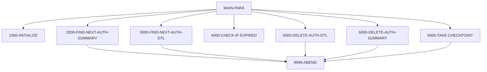

# Program CBPAUP0C

| Item | Value |
|---|---|
| Source | `app/app-authorization-ims-db2-mq/cbl/CBPAUP0C.cbl` |
| Lines | 386 total, 266 code, 90 comment, 30 blank |
| PROGRAM-ID | CBPAUP0C |
| Author | AWS |
| Runtime | ims-bmp |
| Module | auth |
| CICS transactions | None in CSD |
| JCL steps | [CBPAUP0J](../06-batch/jobs/CBPAUP0J.md).STEP01 (`app/app-authorization-ims-db2-mq/jcl/CBPAUP0J.jcl:24-25`) |
| Paragraphs | 17 |
| Semantic analysis | validated (batch B01) |
| Version banner |  |

## Summary

CBPAUP0C is a batch IMS DL/I program (PSB name PSBPAUTB in working storage, PCB number 2) that purges expired pending authorizations from the pending-authorization IMS database. It reads a SYSIN parameter card (expiry days, checkpoint frequency, checkpoint display frequency, debug flag) and applies defaults when values are missing. It walks every PAUTSUM0 summary root segment with GN and, for each, every PAUTDTL1 child detail with GNP; a detail whose age in days (current YYDDD minus the un-complemented authorization date) reaches the expiry threshold is deleted with DLET and its amount/count is backed out of the in-memory summary counters. After the children are processed, the summary is deleted when its approved count is zero or less. IMS checkpoints (CHKP with id 'RMAD'+counter) are taken every P-CHKP-FREQ summaries and at end of run; read/delete totals are displayed and any unexpected DL/I status ends the run with RETURN-CODE 16. (Confirmed)

Evidence: `app/app-authorization-ims-db2-mq/cbl/CBPAUP0C.cbl:1-5`, `app/app-authorization-ims-db2-mq/cbl/CBPAUP0C.cbl:79-108`, `app/app-authorization-ims-db2-mq/cbl/CBPAUP0C.cbl:136-180`, `app/app-authorization-ims-db2-mq/cbl/CBPAUP0C.cbl:183-210`, `app/app-authorization-ims-db2-mq/cbl/CBPAUP0C.cbl:277-298`, `app/app-authorization-ims-db2-mq/cbl/CBPAUP0C.cbl:352-383`

Header comment (Unverified, `app/app-authorization-ims-db2-mq/cbl/CBPAUP0C.cbl:1`): See the comment block at the top of the source. Unverified until matched to code.

## Divisions and sections

| Division / section | Lines | Notes |
|---|---|---|
| IDENTIFICATION DIVISION | `app/app-authorization-ims-db2-mq/cbl/CBPAUP0C.cbl:22-25` |  |
| ENVIRONMENT DIVISION | `app/app-authorization-ims-db2-mq/cbl/CBPAUP0C.cbl:26-32` |  |
| DATA DIVISION | `app/app-authorization-ims-db2-mq/cbl/CBPAUP0C.cbl:33-131` |  |
| PROCEDURE DIVISION | `app/app-authorization-ims-db2-mq/cbl/CBPAUP0C.cbl:132-386` | USING IO-PCB-MASK PGM-PCB-MASK |
| ENVIRONMENT / CONFIGURATION SECTION | `app/app-authorization-ims-db2-mq/cbl/CBPAUP0C.cbl:27-28` |  |
| ENVIRONMENT / INPUT-OUTPUT SECTION | `app/app-authorization-ims-db2-mq/cbl/CBPAUP0C.cbl:29-32` |  |
| DATA / FILE SECTION | `app/app-authorization-ims-db2-mq/cbl/CBPAUP0C.cbl:36-38` |  |
| DATA / WORKING-STORAGE SECTION | `app/app-authorization-ims-db2-mq/cbl/CBPAUP0C.cbl:39-124` |  |
| DATA / LINKAGE SECTION | `app/app-authorization-ims-db2-mq/cbl/CBPAUP0C.cbl:125-131` |  |

## Files and data stores

No SELECT entries (no COBOL file I/O).

CRUD summary from the program facts:

| Store | Kind | Ops | Evidence |
|---|---|---|---|
| DLI-DLET | logical | D | `app/app-authorization-ims-db2-mq/cbl/CBPAUP0C.cbl:310` |
| DLI-GNP | logical | R | `app/app-authorization-ims-db2-mq/cbl/CBPAUP0C.cbl:255` |
| DLI-GN | logical | R | `app/app-authorization-ims-db2-mq/cbl/CBPAUP0C.cbl:223` |

## Embedded CICS, SQL and DL/I commands

| Paragraph | Kind | Verb | Resources | Response | Lines |
|---|---|---|---|---|---|
| 2000-FIND-NEXT-AUTH-SUMMARY | DLI | GN | PAUTSUM0 PCB PAUT-PCB-NUM |  | `app/app-authorization-ims-db2-mq/cbl/CBPAUP0C.cbl:223-226` |
| 3000-FIND-NEXT-AUTH-DTL | DLI | GNP | PAUTDTL1 PCB PAUT-PCB-NUM |  | `app/app-authorization-ims-db2-mq/cbl/CBPAUP0C.cbl:255-258` |
| 5000-DELETE-AUTH-DTL | DLI | DLET | PAUTDTL1 PCB PAUT-PCB-NUM |  | `app/app-authorization-ims-db2-mq/cbl/CBPAUP0C.cbl:310-313` |
| 6000-DELETE-AUTH-SUMMARY | DLI | DLET | PAUTSUM0 PCB PAUT-PCB-NUM |  | `app/app-authorization-ims-db2-mq/cbl/CBPAUP0C.cbl:335-338` |
| 9000-TAKE-CHECKPOINT | DLI | CHKP |  |  | `app/app-authorization-ims-db2-mq/cbl/CBPAUP0C.cbl:355-356` |

## Calls, transfers and callers

No CALL, XCTL, LINK or START.

## Copybooks

| Copybook | Statement | Resolution | Resolved path | REPLACING | Line |
|---|---|---|---|---|---|
| [CIPAUSMY](../08-data/layouts/CIPAUSMY.md) | COPY | inventory | app/app-authorization-ims-db2-mq/cpy/CIPAUSMY.cpy |  | `app/app-authorization-ims-db2-mq/cbl/CBPAUP0C.cbl:117` |
| [CIPAUDTY](../08-data/layouts/CIPAUDTY.md) | COPY | inventory | app/app-authorization-ims-db2-mq/cpy/CIPAUDTY.cpy |  | `app/app-authorization-ims-db2-mq/cbl/CBPAUP0C.cbl:121` |

## Data division items

Every data entry coded in this source (copybook contents are on the copybook pages). Lengths are computed from PIC and USAGE.

| Section | Lvl | Name | PIC | Usage | Len | OCCURS | REDEFINES | VALUE | 88-levels | Line |
|---|---|---|---|---|---|---|---|---|---|---|
| WORKING-STORAGE | 01 | WS-VARIABLES |  |  |  |  |  |  |  | 41 |
| WORKING-STORAGE | 05 | WS-PGMNAME | X(08) |  | 8 |  |  | 'CBPAUP0C' |  | 42 |
| WORKING-STORAGE | 05 | CURRENT-DATE | 9(06) |  | 6 |  |  |  |  | 43 |
| WORKING-STORAGE | 05 | CURRENT-YYDDD | 9(05) |  | 5 |  |  |  |  | 44 |
| WORKING-STORAGE | 05 | WS-AUTH-DATE | 9(05) |  | 5 |  |  |  |  | 45 |
| WORKING-STORAGE | 05 | WS-EXPIRY-DAYS | S9(4) | COMP | 2 |  |  |  |  | 46 |
| WORKING-STORAGE | 05 | WS-DAY-DIFF | S9(4) | COMP | 2 |  |  |  |  | 47 |
| WORKING-STORAGE | 05 | IDX | S9(4) | COMP | 2 |  |  |  |  | 48 |
| WORKING-STORAGE | 05 | WS-CURR-APP-ID | 9(11) |  | 11 |  |  |  |  | 49 |
| WORKING-STORAGE | 05 | WS-NO-CHKP | 9(8) |  | 8 |  |  | 0 |  | 51 |
| WORKING-STORAGE | 05 | WS-AUTH-SMRY-PROC-CNT | 9(8) |  | 8 |  |  | 0 |  | 52 |
| WORKING-STORAGE | 05 | WS-TOT-REC-WRITTEN | S9(8) | COMP | 4 |  |  | 0 |  | 53 |
| WORKING-STORAGE | 05 | WS-NO-SUMRY-READ | S9(8) | COMP | 4 |  |  | 0 |  | 54 |
| WORKING-STORAGE | 05 | WS-NO-SUMRY-DELETED | S9(8) | COMP | 4 |  |  | 0 |  | 55 |
| WORKING-STORAGE | 05 | WS-NO-DTL-READ | S9(8) | COMP | 4 |  |  | 0 |  | 56 |
| WORKING-STORAGE | 05 | WS-NO-DTL-DELETED | S9(8) | COMP | 4 |  |  | 0 |  | 57 |
| WORKING-STORAGE | 05 | WS-ERR-FLG | X(01) |  | 1 |  |  | 'N' | ERR-FLG-ON = 'Y'; ERR-FLG-OFF = 'N' | 59 |
| WORKING-STORAGE | 05 | WS-END-OF-AUTHDB-FLAG | X(01) |  | 1 |  |  | 'N' | END-OF-AUTHDB = 'Y'; NOT-END-OF-AUTHDB = 'N' | 62 |
| WORKING-STORAGE | 05 | WS-MORE-AUTHS-FLAG | X(01) |  | 1 |  |  | 'N' | MORE-AUTHS = 'Y'; NO-MORE-AUTHS = 'N' | 65 |
| WORKING-STORAGE | 05 | WS-QUALIFY-DELETE-FLAG | X(01) |  | 1 |  |  | 'N' | QUALIFIED-FOR-DELETE = 'Y'; NOT-QUALIFIED-FOR-DELETE = 'N' | 68 |
| WORKING-STORAGE | 05 | WS-INFILE-STATUS | X(02) |  | 2 |  |  | SPACES |  | 71 |
| WORKING-STORAGE | 05 | WS-CUSTID-STATUS | X(02) |  | 2 |  |  | SPACES | END-OF-FILE = '10' | 72 |
| WORKING-STORAGE | 05 | WK-CHKPT-ID |  |  |  |  |  |  |  | 75 |
| WORKING-STORAGE | 10 | FILLER | X(04) |  | 4 |  |  | 'RMAD' |  | 76 |
| WORKING-STORAGE | 10 | WK-CHKPT-ID-CTR | 9(04) |  | 4 |  |  | ZEROES |  | 77 |
| WORKING-STORAGE | 01 | WS-IMS-VARIABLES |  |  |  |  |  |  |  | 79 |
| WORKING-STORAGE | 05 | PSB-NAME | X(8) |  | 8 |  |  | 'PSBPAUTB' |  | 80 |
| WORKING-STORAGE | 05 | PCB-OFFSET |  |  |  |  |  |  |  | 81 |
| WORKING-STORAGE | 10 | PAUT-PCB-NUM | S9(4) | COMP | 2 |  |  | +2 |  | 82 |
| WORKING-STORAGE | 05 | IMS-RETURN-CODE | X(02) |  | 2 |  |  |  | STATUS-OK = ' ', 'FW'; SEGMENT-NOT-FOUND = 'GE'; DUPLICATE-SEGMENT-FOUND = 'II'; WRONG-PARENTAGE = 'GP'; END-OF-DB = 'GB'; DATABASE-UNAVAILABLE = 'BA'; PSB-SCHEDULED-MORE-THAN-ONCE = 'TC'; COULD-NOT-S | 83 |
| WORKING-STORAGE | 05 | WS-IMS-PSB-SCHD-FLG | X(1) |  | 1 |  |  |  | IMS-PSB-SCHD = 'Y'; IMS-PSB-NOT-SCHD = 'N' | 93 |
| WORKING-STORAGE | 01 | PRM-INFO |  |  |  |  |  |  |  | 98 |
| WORKING-STORAGE | 05 | P-EXPIRY-DAYS | 9(02) |  | 2 |  |  |  |  | 99 |
| WORKING-STORAGE | 05 | FILLER | X(01) |  | 1 |  |  |  |  | 100 |
| WORKING-STORAGE | 05 | P-CHKP-FREQ | X(05) |  | 5 |  |  |  |  | 101 |
| WORKING-STORAGE | 05 | FILLER | X(01) |  | 1 |  |  |  |  | 102 |
| WORKING-STORAGE | 05 | P-CHKP-DIS-FREQ | X(05) |  | 5 |  |  |  |  | 103 |
| WORKING-STORAGE | 05 | FILLER | X(01) |  | 1 |  |  |  |  | 104 |
| WORKING-STORAGE | 05 | P-DEBUG-FLAG | X(01) |  | 1 |  |  |  | DEBUG-ON = 'Y'; DEBUG-OFF = 'N' | 105 |
| WORKING-STORAGE | 05 | FILLER | X(01) |  | 1 |  |  |  |  | 108 |
| WORKING-STORAGE | 01 | PENDING-AUTH-SUMMARY |  |  |  |  |  |  |  | 116 |
| WORKING-STORAGE | 01 | PENDING-AUTH-DETAILS |  |  |  |  |  |  |  | 120 |
| LINKAGE | 01 | IO-PCB-MASK | X |  | 1 |  |  |  |  | 128 |
| LINKAGE | 01 | PGM-PCB-MASK | X |  | 1 |  |  |  |  | 129 |

## Statement inventory

Every procedure statement the parser recorded, by kind. Each one is listed with its line under Paragraph details.

| Kind | Count |
|---|---|
| Decisions (IF, EVALUATE, WHEN, loops, handlers) | 28 |
| Calculations | 12 |
| File I/O | 0 |
| EXEC CICS / SQL / DLI | 5 |
| CALL | 0 |
| PERFORM | 17 |
| GO TO | 0 |
| MOVE literal | 7 |
| MOVE field | 2 |
| SET | 6 |
| STRING, UNSTRING, INSPECT, INITIALIZE, COPY, ENTRY and others | 3 |
| DISPLAY | 29 |
| GOBACK, STOP RUN, RETURN, XCTL | 2 |
| Not classified by the parser | 0 |

## Control flow

| Paragraph | Lines | Logic | Performs | Performed by | Reachable |
|---|---|---|---|---|---|
| [MAIN-PARA](#para-main-para) | 136-180 | Initializes, reads the first summary, then loops until ERR-FLG-ON or END-OF-AUTHDB: reads child details and for each one runs the expiry check and deletes it if QUALIFIED-FOR-DELETE. After the details, deletes the summary when PA-APPROVED-AUTH-CNT <= 0 (the condition repeats the same field twice), takes a checkpoint when WS-AUTH-SMRY-PROC-CNT exceeds P-CHKP-FREQ and resets the counter, then reads the next summary. Takes a final checkpoint, displays the four read/delete totals and GOBACKs. (Confirmed) | 1000-INITIALIZE, 2000-FIND-NEXT-AUTH-SUMMARY, 3000-FIND-NEXT-AUTH-DTL, 4000-CHECK-IF-EXPIRED, 5000-DELETE-AUTH-DTL, 6000-DELETE-AUTH-SUMMARY, 9000-TAKE-CHECKPOINT |  | yes |
| [1000-INITIALIZE](#para-1000-initialize) | 183-210 | Accepts CURRENT-DATE (YYMMDD) and CURRENT-YYDDD from the system date and PRM-INFO from SYSIN, and displays them. Defaults WS-EXPIRY-DAYS to 5 when P-EXPIRY-DAYS is not numeric, P-CHKP-FREQ to 5 and P-CHKP-DIS-FREQ to 10 when spaces/zero/low-values, and forces P-DEBUG-FLAG to 'N' unless it is 'Y'. (Confirmed) |  | MAIN-PARA | yes |
| [1000-EXIT](#para-1000-exit) | 212-213 | Exit point of 1000-INITIALIZE (EXIT only). (Confirmed) |  | MAIN-PARA | yes |
| [2000-FIND-NEXT-AUTH-SUMMARY](#para-2000-find-next-auth-summary) | 216-242 | Issues DL/I GN for the next PAUTSUM0 root into PENDING-AUTH-SUMMARY. On status spaces it counts the read (WS-NO-SUMRY-READ, WS-AUTH-SMRY-PROC-CNT) and saves PA-ACCT-ID in WS-CURR-APP-ID; on 'GB' sets END-OF-AUTHDB; any other status displays the error and performs 9999-ABEND. (Confirmed) | 9999-ABEND | MAIN-PARA | yes |
| [2000-EXIT](#para-2000-exit) | 243-244 | Exit point of 2000-FIND-NEXT-AUTH-SUMMARY (EXIT only). (Confirmed) |  | MAIN-PARA | yes |
| [3000-FIND-NEXT-AUTH-DTL](#para-3000-find-next-auth-dtl) | 248-272 | Issues DL/I GNP for the next PAUTDTL1 child of the current summary into PENDING-AUTH-DETAILS. Status spaces sets MORE-AUTHS and counts WS-NO-DTL-READ; 'GE' or 'GB' sets NO-MORE-AUTHS; any other status displays the error with PA-ACCT-ID and performs 9999-ABEND. (Confirmed) | 9999-ABEND | MAIN-PARA | yes |
| [3000-EXIT](#para-3000-exit) | 273-274 | Exit point of 3000-FIND-NEXT-AUTH-DTL (EXIT only). (Confirmed) |  | MAIN-PARA | yes |
| [4000-CHECK-IF-EXPIRED](#para-4000-check-if-expired) | 277-298 | Recovers the authorization date as 99999 - PA-AUTH-DATE-9C and computes WS-DAY-DIFF = CURRENT-YYDDD - WS-AUTH-DATE. If WS-DAY-DIFF >= WS-EXPIRY-DAYS the detail is QUALIFIED-FOR-DELETE and the summary counters are backed out: response '00' decrements PA-APPROVED-AUTH-CNT and subtracts PA-APPROVED-AMT from PA-APPROVED-AUTH-AMT, otherwise decrements PA-DECLINED-AUTH-CNT and subtracts PA-TRANSACTION-AMT from PA-DECLINED-AUTH-AMT; else NOT-QUALIFIED-FOR-DELETE. (Confirmed) |  | MAIN-PARA | yes |
| [4000-EXIT](#para-4000-exit) | 299-300 | Exit point of 4000-CHECK-IF-EXPIRED (EXIT only). (Confirmed) |  | MAIN-PARA | yes |
| [5000-DELETE-AUTH-DTL](#para-5000-delete-auth-dtl) | 303-323 | Issues DL/I DLET of the current PAUTDTL1 segment from PENDING-AUTH-DETAILS. Status spaces adds 1 to WS-NO-DTL-DELETED; otherwise displays the failure with PA-ACCT-ID and performs 9999-ABEND. (Confirmed) | 9999-ABEND | MAIN-PARA | yes |
| [5000-EXIT](#para-5000-exit) | 324-325 | Exit point of 5000-DELETE-AUTH-DTL (EXIT only). (Confirmed) |  | MAIN-PARA | yes |
| [6000-DELETE-AUTH-SUMMARY](#para-6000-delete-auth-summary) | 328-347 | Issues DL/I DLET of the current PAUTSUM0 root segment from PENDING-AUTH-SUMMARY. Status spaces adds 1 to WS-NO-SUMRY-DELETED; otherwise displays the failure with PA-ACCT-ID and performs 9999-ABEND. (Confirmed) | 9999-ABEND | MAIN-PARA | yes |
| [6000-EXIT](#para-6000-exit) | 348-349 | Exit point of 6000-DELETE-AUTH-SUMMARY (EXIT only). (Confirmed) |  | MAIN-PARA | yes |
| [9000-TAKE-CHECKPOINT](#para-9000-take-checkpoint) | 352-372 | Issues DL/I CHKP with ID WK-CHKPT-ID ('RMAD' + WK-CHKPT-ID-CTR). On success adds 1 to WS-NO-CHKP and, once it reaches P-CHKP-DIS-FREQ, resets it and displays the summary count and current account id; on failure displays DIBSTAT and counts and performs 9999-ABEND. (Confirmed) | 9999-ABEND | MAIN-PARA | yes |
| [9000-EXIT](#para-9000-exit) | 373-374 | Exit point of 9000-TAKE-CHECKPOINT (EXIT only). (Confirmed) |  | MAIN-PARA | yes |
| [9999-ABEND](#para-9999-abend) | 377-383 | Displays 'CBPAUP0C ABENDING ...', sets RETURN-CODE to 16 and GOBACKs (no real ABEND or rollback call is issued). (Confirmed) |  | 2000-FIND-NEXT-AUTH-SUMMARY, 3000-FIND-NEXT-AUTH-DTL, 5000-DELETE-AUTH-DTL, 6000-DELETE-AUTH-SUMMARY, 9000-TAKE-CHECKPOINT | yes |
| [9999-EXIT](#para-9999-exit) | 385-386 | Exit point of 9999-ABEND (EXIT only, never reached because 9999-ABEND ends with GOBACK). (Confirmed) |  |  | no static path |

## Paragraph details

### Para MAIN-PARA

Lines `app/app-authorization-ims-db2-mq/cbl/CBPAUP0C.cbl:136-180`. 

Logic: Initializes, reads the first summary, then loops until ERR-FLG-ON or END-OF-AUTHDB: reads child details and for each one runs the expiry check and deletes it if QUALIFIED-FOR-DELETE. After the details, deletes the summary when PA-APPROVED-AUTH-CNT <= 0 (the condition repeats the same field twice), takes a checkpoint when WS-AUTH-SMRY-PROC-CNT exceeds P-CHKP-FREQ and resets the counter, then reads the next summary. Takes a final checkpoint, displays the four read/delete totals and GOBACKs. (Confirmed)

Rules: [BR-CBPAUP0C-003](../09-business-rules-catalog.md#br-cbpaup0c-003), [BR-CBPAUP0C-005](../09-business-rules-catalog.md#br-cbpaup0c-005)

Statements in source order:

- PERFORM 1000-INITIALIZE THRU 1000-EXIT at `app/app-authorization-ims-db2-mq/cbl/CBPAUP0C.cbl:138`
- PERFORM 2000-FIND-NEXT-AUTH-SUMMARY THRU 2000-EXIT at `app/app-authorization-ims-db2-mq/cbl/CBPAUP0C.cbl:140`
- LOOP `UNTIL ERR-FLG-ON OR END-OF-AUTHDB` at `app/app-authorization-ims-db2-mq/cbl/CBPAUP0C.cbl:142` (error-flag)
- Inline PERFORM `UNTIL ERR-FLG-ON OR END-OF-AUTHDB` at `app/app-authorization-ims-db2-mq/cbl/CBPAUP0C.cbl:142`
- PERFORM 3000-FIND-NEXT-AUTH-DTL THRU 3000-EXIT at `app/app-authorization-ims-db2-mq/cbl/CBPAUP0C.cbl:144`
- LOOP `UNTIL NO-MORE-AUTHS` at `app/app-authorization-ims-db2-mq/cbl/CBPAUP0C.cbl:146` (business-candidate)
- Inline PERFORM `UNTIL NO-MORE-AUTHS` at `app/app-authorization-ims-db2-mq/cbl/CBPAUP0C.cbl:146`
- PERFORM 4000-CHECK-IF-EXPIRED THRU 4000-EXIT at `app/app-authorization-ims-db2-mq/cbl/CBPAUP0C.cbl:147`
- IF `QUALIFIED-FOR-DELETE` at `app/app-authorization-ims-db2-mq/cbl/CBPAUP0C.cbl:149` (business-candidate)
- PERFORM 5000-DELETE-AUTH-DTL THRU 5000-EXIT at `app/app-authorization-ims-db2-mq/cbl/CBPAUP0C.cbl:150`
- PERFORM 3000-FIND-NEXT-AUTH-DTL THRU 3000-EXIT at `app/app-authorization-ims-db2-mq/cbl/CBPAUP0C.cbl:153`
- IF `PA-APPROVED-AUTH-CNT <= 0 AND PA-APPROVED-AUTH-CNT <= 0` at `app/app-authorization-ims-db2-mq/cbl/CBPAUP0C.cbl:156` (business-candidate)
- PERFORM 6000-DELETE-AUTH-SUMMARY THRU 6000-EXIT at `app/app-authorization-ims-db2-mq/cbl/CBPAUP0C.cbl:157`
- IF `WS-AUTH-SMRY-PROC-CNT > P-CHKP-FREQ` at `app/app-authorization-ims-db2-mq/cbl/CBPAUP0C.cbl:160` (business-candidate)
- PERFORM 9000-TAKE-CHECKPOINT THRU 9000-EXIT at `app/app-authorization-ims-db2-mq/cbl/CBPAUP0C.cbl:161`
- MOVE `0` TO WS-AUTH-SMRY-PROC-CNT at `app/app-authorization-ims-db2-mq/cbl/CBPAUP0C.cbl:163`
- PERFORM 2000-FIND-NEXT-AUTH-SUMMARY THRU 2000-EXIT at `app/app-authorization-ims-db2-mq/cbl/CBPAUP0C.cbl:165`
- PERFORM 9000-TAKE-CHECKPOINT THRU 9000-EXIT at `app/app-authorization-ims-db2-mq/cbl/CBPAUP0C.cbl:169`
- `DISPLAY ' '` at `app/app-authorization-ims-db2-mq/cbl/CBPAUP0C.cbl:171`
- `DISPLAY '*-------------------------------------*'` at `app/app-authorization-ims-db2-mq/cbl/CBPAUP0C.cbl:172`
- `DISPLAY '# TOTAL SUMMARY READ :' WS-NO-SUMRY-READ` at `app/app-authorization-ims-db2-mq/cbl/CBPAUP0C.cbl:173`
- `DISPLAY '# SUMMARY REC DELETED :' WS-NO-SUMRY-DELETED` at `app/app-authorization-ims-db2-mq/cbl/CBPAUP0C.cbl:174`
- `DISPLAY '# TOTAL DETAILS READ :' WS-NO-DTL-READ` at `app/app-authorization-ims-db2-mq/cbl/CBPAUP0C.cbl:175`
- `DISPLAY '# DETAILS REC DELETED :' WS-NO-DTL-DELETED` at `app/app-authorization-ims-db2-mq/cbl/CBPAUP0C.cbl:176`
- `DISPLAY '*-------------------------------------*'` at `app/app-authorization-ims-db2-mq/cbl/CBPAUP0C.cbl:177`
- `DISPLAY ' '` at `app/app-authorization-ims-db2-mq/cbl/CBPAUP0C.cbl:178`
- Ends with GOBACK at `app/app-authorization-ims-db2-mq/cbl/CBPAUP0C.cbl:180`

### Para 1000-INITIALIZE

Lines `app/app-authorization-ims-db2-mq/cbl/CBPAUP0C.cbl:183-210`. 

Logic: Accepts CURRENT-DATE (YYMMDD) and CURRENT-YYDDD from the system date and PRM-INFO from SYSIN, and displays them. Defaults WS-EXPIRY-DAYS to 5 when P-EXPIRY-DAYS is not numeric, P-CHKP-FREQ to 5 and P-CHKP-DIS-FREQ to 10 when spaces/zero/low-values, and forces P-DEBUG-FLAG to 'N' unless it is 'Y'. (Confirmed)

Rules: [BR-CBPAUP0C-004](../09-business-rules-catalog.md#br-cbpaup0c-004)

Statements in source order:

- `ACCEPT CURRENT-DATE FROM DATE` at `app/app-authorization-ims-db2-mq/cbl/CBPAUP0C.cbl:186`
- `ACCEPT CURRENT-YYDDD FROM DAY` at `app/app-authorization-ims-db2-mq/cbl/CBPAUP0C.cbl:187`
- `ACCEPT PRM-INFO FROM SYSIN` at `app/app-authorization-ims-db2-mq/cbl/CBPAUP0C.cbl:189`
- `DISPLAY 'STARTING PROGRAM CBPAUP0C::'` at `app/app-authorization-ims-db2-mq/cbl/CBPAUP0C.cbl:190`
- `DISPLAY '*-------------------------------------*'` at `app/app-authorization-ims-db2-mq/cbl/CBPAUP0C.cbl:191`
- `DISPLAY 'CBPAUP0C PARM RECEIVED :' PRM-INFO` at `app/app-authorization-ims-db2-mq/cbl/CBPAUP0C.cbl:192`
- `DISPLAY 'TODAYS DATE :' CURRENT-YYDDD` at `app/app-authorization-ims-db2-mq/cbl/CBPAUP0C.cbl:193`
- `DISPLAY ' '` at `app/app-authorization-ims-db2-mq/cbl/CBPAUP0C.cbl:194`
- IF `P-EXPIRY-DAYS IS NUMERIC` at `app/app-authorization-ims-db2-mq/cbl/CBPAUP0C.cbl:196` (business-candidate)
- `MOVE P-EXPIRY-DAYS TO WS-EXPIRY-DAYS` at `app/app-authorization-ims-db2-mq/cbl/CBPAUP0C.cbl:197`
- MOVE `5` TO WS-EXPIRY-DAYS at `app/app-authorization-ims-db2-mq/cbl/CBPAUP0C.cbl:199`
- IF `P-CHKP-FREQ = SPACES OR 0 OR LOW-VALUES` at `app/app-authorization-ims-db2-mq/cbl/CBPAUP0C.cbl:201` (business-candidate)
- MOVE `5` TO P-CHKP-FREQ at `app/app-authorization-ims-db2-mq/cbl/CBPAUP0C.cbl:202`
- IF `P-CHKP-DIS-FREQ = SPACES OR 0 OR LOW-VALUES` at `app/app-authorization-ims-db2-mq/cbl/CBPAUP0C.cbl:204` (business-candidate)
- MOVE `10` TO P-CHKP-DIS-FREQ at `app/app-authorization-ims-db2-mq/cbl/CBPAUP0C.cbl:205`
- IF `P-DEBUG-FLAG NOT = 'Y'` at `app/app-authorization-ims-db2-mq/cbl/CBPAUP0C.cbl:207` (business-candidate)
- MOVE `'N'` TO P-DEBUG-FLAG at `app/app-authorization-ims-db2-mq/cbl/CBPAUP0C.cbl:208`

### Para 1000-EXIT

Lines `app/app-authorization-ims-db2-mq/cbl/CBPAUP0C.cbl:212-213`. 

Logic: Exit point of 1000-INITIALIZE (EXIT only). (Confirmed)

### Para 2000-FIND-NEXT-AUTH-SUMMARY

Lines `app/app-authorization-ims-db2-mq/cbl/CBPAUP0C.cbl:216-242`. 

Logic: Issues DL/I GN for the next PAUTSUM0 root into PENDING-AUTH-SUMMARY. On status spaces it counts the read (WS-NO-SUMRY-READ, WS-AUTH-SMRY-PROC-CNT) and saves PA-ACCT-ID in WS-CURR-APP-ID; on 'GB' sets END-OF-AUTHDB; any other status displays the error and performs 9999-ABEND. (Confirmed)

Statements in source order:

- IF `DEBUG-ON` at `app/app-authorization-ims-db2-mq/cbl/CBPAUP0C.cbl:219` (business-candidate)
- `DISPLAY 'DEBUG: AUTH SMRY READ : ' WS-NO-SUMRY-READ` at `app/app-authorization-ims-db2-mq/cbl/CBPAUP0C.cbl:220`
- EXEC DLI GN at `app/app-authorization-ims-db2-mq/cbl/CBPAUP0C.cbl:223-226`
- EVALUATE `DIBSTAT` at `app/app-authorization-ims-db2-mq/cbl/CBPAUP0C.cbl:228` (io-status)
- WHEN `' '` at `app/app-authorization-ims-db2-mq/cbl/CBPAUP0C.cbl:229` (io-status)
- `SET NOT-END-OF-AUTHDB TO TRUE` at `app/app-authorization-ims-db2-mq/cbl/CBPAUP0C.cbl:230`
- Calculation `ADD 1 TO WS-NO-SUMRY-READ` at `app/app-authorization-ims-db2-mq/cbl/CBPAUP0C.cbl:231`
- Calculation `ADD 1 TO WS-AUTH-SMRY-PROC-CNT` at `app/app-authorization-ims-db2-mq/cbl/CBPAUP0C.cbl:232`
- `MOVE PA-ACCT-ID TO WS-CURR-APP-ID` at `app/app-authorization-ims-db2-mq/cbl/CBPAUP0C.cbl:233`
- WHEN `'GB'` at `app/app-authorization-ims-db2-mq/cbl/CBPAUP0C.cbl:234` (io-status)
- `SET END-OF-AUTHDB TO TRUE` at `app/app-authorization-ims-db2-mq/cbl/CBPAUP0C.cbl:235`
- WHEN `OTHER` at `app/app-authorization-ims-db2-mq/cbl/CBPAUP0C.cbl:236` (io-status)
- `DISPLAY 'AUTH SUMMARY READ FAILED :' DIBSTAT` at `app/app-authorization-ims-db2-mq/cbl/CBPAUP0C.cbl:237`
- `DISPLAY 'SUMMARY READ BEFORE ABEND :' WS-NO-SUMRY-READ` at `app/app-authorization-ims-db2-mq/cbl/CBPAUP0C.cbl:238-239`
- PERFORM 9999-ABEND at `app/app-authorization-ims-db2-mq/cbl/CBPAUP0C.cbl:240`

### Para 2000-EXIT

Lines `app/app-authorization-ims-db2-mq/cbl/CBPAUP0C.cbl:243-244`. 

Logic: Exit point of 2000-FIND-NEXT-AUTH-SUMMARY (EXIT only). (Confirmed)

### Para 3000-FIND-NEXT-AUTH-DTL

Lines `app/app-authorization-ims-db2-mq/cbl/CBPAUP0C.cbl:248-272`. 

Logic: Issues DL/I GNP for the next PAUTDTL1 child of the current summary into PENDING-AUTH-DETAILS. Status spaces sets MORE-AUTHS and counts WS-NO-DTL-READ; 'GE' or 'GB' sets NO-MORE-AUTHS; any other status displays the error with PA-ACCT-ID and performs 9999-ABEND. (Confirmed)

Statements in source order:

- IF `DEBUG-ON` at `app/app-authorization-ims-db2-mq/cbl/CBPAUP0C.cbl:251` (business-candidate)
- `DISPLAY 'DEBUG: AUTH DTL READ : ' WS-NO-DTL-READ` at `app/app-authorization-ims-db2-mq/cbl/CBPAUP0C.cbl:252`
- EXEC DLI GNP at `app/app-authorization-ims-db2-mq/cbl/CBPAUP0C.cbl:255-258`
- EVALUATE `DIBSTAT` at `app/app-authorization-ims-db2-mq/cbl/CBPAUP0C.cbl:259` (io-status)
- WHEN `' '` at `app/app-authorization-ims-db2-mq/cbl/CBPAUP0C.cbl:260` (io-status)
- `SET MORE-AUTHS TO TRUE` at `app/app-authorization-ims-db2-mq/cbl/CBPAUP0C.cbl:261`
- Calculation `ADD 1 TO WS-NO-DTL-READ` at `app/app-authorization-ims-db2-mq/cbl/CBPAUP0C.cbl:262`
- WHEN `'GE'` at `app/app-authorization-ims-db2-mq/cbl/CBPAUP0C.cbl:263` (io-status)
- WHEN `'GB'` at `app/app-authorization-ims-db2-mq/cbl/CBPAUP0C.cbl:264` (io-status)
- `SET NO-MORE-AUTHS TO TRUE` at `app/app-authorization-ims-db2-mq/cbl/CBPAUP0C.cbl:265`
- WHEN `OTHER` at `app/app-authorization-ims-db2-mq/cbl/CBPAUP0C.cbl:266` (io-status)
- `DISPLAY 'AUTH DETAIL READ FAILED :' DIBSTAT` at `app/app-authorization-ims-db2-mq/cbl/CBPAUP0C.cbl:267`
- `DISPLAY 'SUMMARY AUTH APP ID :' PA-ACCT-ID` at `app/app-authorization-ims-db2-mq/cbl/CBPAUP0C.cbl:268`
- `DISPLAY 'DETAIL READ BEFORE ABEND :' WS-NO-DTL-READ` at `app/app-authorization-ims-db2-mq/cbl/CBPAUP0C.cbl:269`
- PERFORM 9999-ABEND at `app/app-authorization-ims-db2-mq/cbl/CBPAUP0C.cbl:270`

### Para 3000-EXIT

Lines `app/app-authorization-ims-db2-mq/cbl/CBPAUP0C.cbl:273-274`. 

Logic: Exit point of 3000-FIND-NEXT-AUTH-DTL (EXIT only). (Confirmed)

### Para 4000-CHECK-IF-EXPIRED

Lines `app/app-authorization-ims-db2-mq/cbl/CBPAUP0C.cbl:277-298`. 

Logic: Recovers the authorization date as 99999 - PA-AUTH-DATE-9C and computes WS-DAY-DIFF = CURRENT-YYDDD - WS-AUTH-DATE. If WS-DAY-DIFF >= WS-EXPIRY-DAYS the detail is QUALIFIED-FOR-DELETE and the summary counters are backed out: response '00' decrements PA-APPROVED-AUTH-CNT and subtracts PA-APPROVED-AMT from PA-APPROVED-AUTH-AMT, otherwise decrements PA-DECLINED-AUTH-CNT and subtracts PA-TRANSACTION-AMT from PA-DECLINED-AUTH-AMT; else NOT-QUALIFIED-FOR-DELETE. (Confirmed)

Rules: [BR-AUTH-CBPAUP0C-001](../09-business-rules-catalog.md#br-auth-cbpaup0c-001), [BR-AUTH-CBPAUP0C-002](../09-business-rules-catalog.md#br-auth-cbpaup0c-002), [BR-CBPAUP0C-001](../09-business-rules-catalog.md#br-cbpaup0c-001), [BR-CBPAUP0C-002](../09-business-rules-catalog.md#br-cbpaup0c-002)

Statements in source order:

- Calculation `COMPUTE WS-AUTH-DATE = 99999 - PA-AUTH-DATE-9C` at `app/app-authorization-ims-db2-mq/cbl/CBPAUP0C.cbl:280` (no ROUNDED)
- Calculation `COMPUTE WS-DAY-DIFF = CURRENT-YYDDD - WS-AUTH-DATE` at `app/app-authorization-ims-db2-mq/cbl/CBPAUP0C.cbl:282` (no ROUNDED)
- IF `WS-DAY-DIFF >= WS-EXPIRY-DAYS` at `app/app-authorization-ims-db2-mq/cbl/CBPAUP0C.cbl:284` (business-candidate)
- `SET QUALIFIED-FOR-DELETE TO TRUE` at `app/app-authorization-ims-db2-mq/cbl/CBPAUP0C.cbl:285`
- IF `PA-AUTH-RESP-CODE = '00'` at `app/app-authorization-ims-db2-mq/cbl/CBPAUP0C.cbl:287` (io-status)
- Calculation `SUBTRACT 1 FROM PA-APPROVED-AUTH-CNT` at `app/app-authorization-ims-db2-mq/cbl/CBPAUP0C.cbl:288`
- Calculation `SUBTRACT PA-APPROVED-AMT FROM PA-APPROVED-AUTH-AMT` at `app/app-authorization-ims-db2-mq/cbl/CBPAUP0C.cbl:289`
- Calculation `SUBTRACT 1 FROM PA-DECLINED-AUTH-CNT` at `app/app-authorization-ims-db2-mq/cbl/CBPAUP0C.cbl:291`
- Calculation `SUBTRACT PA-TRANSACTION-AMT FROM PA-DECLINED-AUTH-AMT` at `app/app-authorization-ims-db2-mq/cbl/CBPAUP0C.cbl:292`
- `SET NOT-QUALIFIED-FOR-DELETE TO TRUE` at `app/app-authorization-ims-db2-mq/cbl/CBPAUP0C.cbl:295`

### Para 4000-EXIT

Lines `app/app-authorization-ims-db2-mq/cbl/CBPAUP0C.cbl:299-300`. 

Logic: Exit point of 4000-CHECK-IF-EXPIRED (EXIT only). (Confirmed)

### Para 5000-DELETE-AUTH-DTL

Lines `app/app-authorization-ims-db2-mq/cbl/CBPAUP0C.cbl:303-323`. 

Logic: Issues DL/I DLET of the current PAUTDTL1 segment from PENDING-AUTH-DETAILS. Status spaces adds 1 to WS-NO-DTL-DELETED; otherwise displays the failure with PA-ACCT-ID and performs 9999-ABEND. (Confirmed)

Statements in source order:

- IF `DEBUG-ON` at `app/app-authorization-ims-db2-mq/cbl/CBPAUP0C.cbl:306` (business-candidate)
- `DISPLAY 'DEBUG: AUTH DTL DLET : ' PA-ACCT-ID` at `app/app-authorization-ims-db2-mq/cbl/CBPAUP0C.cbl:307`
- EXEC DLI DLET at `app/app-authorization-ims-db2-mq/cbl/CBPAUP0C.cbl:310-313`
- IF `DIBSTAT = SPACES` at `app/app-authorization-ims-db2-mq/cbl/CBPAUP0C.cbl:315` (io-status)
- Calculation `ADD 1 TO WS-NO-DTL-DELETED` at `app/app-authorization-ims-db2-mq/cbl/CBPAUP0C.cbl:316`
- `DISPLAY 'AUTH DETAIL DELETE FAILED :' DIBSTAT` at `app/app-authorization-ims-db2-mq/cbl/CBPAUP0C.cbl:318`
- `DISPLAY 'AUTH APP ID :' PA-ACCT-ID` at `app/app-authorization-ims-db2-mq/cbl/CBPAUP0C.cbl:319`
- PERFORM 9999-ABEND at `app/app-authorization-ims-db2-mq/cbl/CBPAUP0C.cbl:320`

### Para 5000-EXIT

Lines `app/app-authorization-ims-db2-mq/cbl/CBPAUP0C.cbl:324-325`. 

Logic: Exit point of 5000-DELETE-AUTH-DTL (EXIT only). (Confirmed)

### Para 6000-DELETE-AUTH-SUMMARY

Lines `app/app-authorization-ims-db2-mq/cbl/CBPAUP0C.cbl:328-347`. 

Logic: Issues DL/I DLET of the current PAUTSUM0 root segment from PENDING-AUTH-SUMMARY. Status spaces adds 1 to WS-NO-SUMRY-DELETED; otherwise displays the failure with PA-ACCT-ID and performs 9999-ABEND. (Confirmed)

Statements in source order:

- IF `DEBUG-ON` at `app/app-authorization-ims-db2-mq/cbl/CBPAUP0C.cbl:331` (business-candidate)
- `DISPLAY 'DEBUG: AUTH SMRY DLET : ' PA-ACCT-ID` at `app/app-authorization-ims-db2-mq/cbl/CBPAUP0C.cbl:332`
- EXEC DLI DLET at `app/app-authorization-ims-db2-mq/cbl/CBPAUP0C.cbl:335-338`
- IF `DIBSTAT = SPACES` at `app/app-authorization-ims-db2-mq/cbl/CBPAUP0C.cbl:340` (io-status)
- Calculation `ADD 1 TO WS-NO-SUMRY-DELETED` at `app/app-authorization-ims-db2-mq/cbl/CBPAUP0C.cbl:341`
- `DISPLAY 'AUTH SUMMARY DELETE FAILED :' DIBSTAT` at `app/app-authorization-ims-db2-mq/cbl/CBPAUP0C.cbl:343`
- `DISPLAY 'AUTH APP ID :' PA-ACCT-ID` at `app/app-authorization-ims-db2-mq/cbl/CBPAUP0C.cbl:344`
- PERFORM 9999-ABEND at `app/app-authorization-ims-db2-mq/cbl/CBPAUP0C.cbl:345`

### Para 6000-EXIT

Lines `app/app-authorization-ims-db2-mq/cbl/CBPAUP0C.cbl:348-349`. 

Logic: Exit point of 6000-DELETE-AUTH-SUMMARY (EXIT only). (Confirmed)

### Para 9000-TAKE-CHECKPOINT

Lines `app/app-authorization-ims-db2-mq/cbl/CBPAUP0C.cbl:352-372`. 

Logic: Issues DL/I CHKP with ID WK-CHKPT-ID ('RMAD' + WK-CHKPT-ID-CTR). On success adds 1 to WS-NO-CHKP and, once it reaches P-CHKP-DIS-FREQ, resets it and displays the summary count and current account id; on failure displays DIBSTAT and counts and performs 9999-ABEND. (Confirmed)

Statements in source order:

- EXEC DLI CHKP at `app/app-authorization-ims-db2-mq/cbl/CBPAUP0C.cbl:355-356`
- IF `DIBSTAT = SPACES` at `app/app-authorization-ims-db2-mq/cbl/CBPAUP0C.cbl:358` (io-status)
- Calculation `ADD 1 TO WS-NO-CHKP` at `app/app-authorization-ims-db2-mq/cbl/CBPAUP0C.cbl:359`
- IF `WS-NO-CHKP >= P-CHKP-DIS-FREQ` at `app/app-authorization-ims-db2-mq/cbl/CBPAUP0C.cbl:360` (business-candidate)
- MOVE `0` TO WS-NO-CHKP at `app/app-authorization-ims-db2-mq/cbl/CBPAUP0C.cbl:361`
- `DISPLAY 'CHKP SUCCESS: AUTH COUNT - ' WS-NO-SUMRY-READ ', APP ID - ' WS-CURR-APP-ID` at `app/app-authorization-ims-db2-mq/cbl/CBPAUP0C.cbl:362-363`
- `DISPLAY 'CHKP FAILED: DIBSTAT - ' DIBSTAT ', REC COUNT - ' WS-NO-SUMRY-READ ', APP ID - ' WS-CURR-APP-ID` at `app/app-authorization-ims-db2-mq/cbl/CBPAUP0C.cbl:366-368`
- PERFORM 9999-ABEND at `app/app-authorization-ims-db2-mq/cbl/CBPAUP0C.cbl:369`

### Para 9000-EXIT

Lines `app/app-authorization-ims-db2-mq/cbl/CBPAUP0C.cbl:373-374`. 

Logic: Exit point of 9000-TAKE-CHECKPOINT (EXIT only). (Confirmed)

### Para 9999-ABEND

Lines `app/app-authorization-ims-db2-mq/cbl/CBPAUP0C.cbl:377-383`. 

Logic: Displays 'CBPAUP0C ABENDING ...', sets RETURN-CODE to 16 and GOBACKs (no real ABEND or rollback call is issued). (Confirmed)

Rules: [BR-CBPAUP0C-006](../09-business-rules-catalog.md#br-cbpaup0c-006)

Statements in source order:

- `DISPLAY 'CBPAUP0C ABENDING ...'` at `app/app-authorization-ims-db2-mq/cbl/CBPAUP0C.cbl:380`
- MOVE `16` TO RETURN-CODE at `app/app-authorization-ims-db2-mq/cbl/CBPAUP0C.cbl:382`
- Ends with GOBACK at `app/app-authorization-ims-db2-mq/cbl/CBPAUP0C.cbl:383`

### Para 9999-EXIT

Lines `app/app-authorization-ims-db2-mq/cbl/CBPAUP0C.cbl:385-386`. 

Logic: Exit point of 9999-ABEND (EXIT only, never reached because 9999-ABEND ends with GOBACK). (Confirmed)

## Business rules

| Rule | Category | Statement | Paragraph | Source | Confidence |
|---|---|---|---|---|---|
| [BR-AUTH-CBPAUP0C-001](../09-business-rules-catalog.md#br-auth-cbpaup0c-001) | temporal | A pending authorization qualifies for delete when the computed day difference is greater than or equal to the expiry days. Expiry days are the numeric parm value, or 5 when that parm is not numeric. | 4000-CHECK-IF-EXPIRED | `app/app-authorization-ims-db2-mq/cbl/CBPAUP0C.cbl:280-286`, `app/app-authorization-ims-db2-mq/cbl/CBPAUP0C.cbl:196-199` | Confirmed / review: confirmed |
| [BR-AUTH-CBPAUP0C-002](../09-business-rules-catalog.md#br-auth-cbpaup0c-002) | calculation | When a pending authorization qualifies for delete and its response code is 00, the approved count and approved amount are reduced. Any other response code reduces the declined count and the declined amount. | 4000-CHECK-IF-EXPIRED | `app/app-authorization-ims-db2-mq/cbl/CBPAUP0C.cbl:287-293` | Confirmed / review: confirmed |
| [BR-CBPAUP0C-001](../09-business-rules-catalog.md#br-cbpaup0c-001) | decision | A pending authorization detail is selected for purge when the number of days between today (YYDDD) and its authorization date (99999 minus the stored complemented PA-AUTH-DATE-9C) is greater than or equal to the expiry-days threshold. | 4000-CHECK-IF-EXPIRED | `app/app-authorization-ims-db2-mq/cbl/CBPAUP0C.cbl:280-284`, `app/app-authorization-ims-db2-mq/cbl/CBPAUP0C.cbl:293-295` | Confirmed |
| [BR-CBPAUP0C-002](../09-business-rules-catalog.md#br-cbpaup0c-002) | calculation | When an expired detail is purged, its effect is backed out of the summary totals: an approved detail (PA-AUTH-RESP-CODE '00') decrements PA-APPROVED-AUTH-CNT and reduces PA-APPROVED-AUTH-AMT by PA-APPROVED-AMT; any other response code decrements PA-DECLINED-AUTH-CNT and reduces PA-DECLINED-AUTH-AMT by PA-TRANSACTION-AMT. | 4000-CHECK-IF-EXPIRED | `app/app-authorization-ims-db2-mq/cbl/CBPAUP0C.cbl:286-292` | Confirmed |
| [BR-CBPAUP0C-003](../09-business-rules-catalog.md#br-cbpaup0c-003) | decision | After all details of an account summary have been processed, the pending authorization summary root is deleted when its approved authorization count is zero or negative. The condition tests PA-APPROVED-AUTH-CNT twice; the declined count is not tested. | MAIN-PARA | `app/app-authorization-ims-db2-mq/cbl/CBPAUP0C.cbl:156-158` | Confirmed |
| [BR-CBPAUP0C-004](../09-business-rules-catalog.md#br-cbpaup0c-004) | decision | Run parameters default when missing: expiry days default to 5 when the SYSIN value is not numeric; checkpoint frequency defaults to 5 and checkpoint display frequency to 10 when blank, zero or low-values; the debug flag is forced to 'N' unless it is 'Y'. | 1000-INITIALIZE | `app/app-authorization-ims-db2-mq/cbl/CBPAUP0C.cbl:196-209` | Confirmed |
| [BR-CBPAUP0C-005](../09-business-rules-catalog.md#br-cbpaup0c-005) | data-integrity | An IMS checkpoint is taken after more than P-CHKP-FREQ summaries have been processed since the last checkpoint, and again at the end of the run, so the purge is committed in units of work. | MAIN-PARA | `app/app-authorization-ims-db2-mq/cbl/CBPAUP0C.cbl:160-164`, `app/app-authorization-ims-db2-mq/cbl/CBPAUP0C.cbl:169-169` | Confirmed |
| [BR-CBPAUP0C-006](../09-business-rules-catalog.md#br-cbpaup0c-006) | error-policy | Any DL/I status other than the expected ones (spaces; 'GB' end of database on summary read; 'GE'/'GB' on detail read) on read, delete or checkpoint stops the purge with return code 16 after displaying the status and counters. | 9999-ABEND | `app/app-authorization-ims-db2-mq/cbl/CBPAUP0C.cbl:380-382`, `app/app-authorization-ims-db2-mq/cbl/CBPAUP0C.cbl:228-241`, `app/app-authorization-ims-db2-mq/cbl/CBPAUP0C.cbl:259-271`, `app/app-authorization-ims-db2-mq/cbl/CBPAUP0C.cbl:315-321`, `app/app-authorization-ims-db2-mq/cbl/CBPAUP0C.cbl:340-346`, `app/app-authorization-ims-db2-mq/cbl/CBPAUP0C.cbl:358-370` | Confirmed |

Decision points reviewed and classified as not business rules:

| Lines | Reason |
|---|---|
| `app/app-authorization-ims-db2-mq/cbl/CBPAUP0C.cbl:146-153` | Loop control over child details and invocation of delete based on the flag set by BR-CBPAUP0C-001. |
| `app/app-authorization-ims-db2-mq/cbl/CBPAUP0C.cbl:219-221` | Debug display only. |
| `app/app-authorization-ims-db2-mq/cbl/CBPAUP0C.cbl:251-253` | Debug display only. |
| `app/app-authorization-ims-db2-mq/cbl/CBPAUP0C.cbl:306-308` | Debug display only. |
| `app/app-authorization-ims-db2-mq/cbl/CBPAUP0C.cbl:331-333` | Debug display only. |
| `app/app-authorization-ims-db2-mq/cbl/CBPAUP0C.cbl:360-364` | Controls how often a checkpoint-success progress message is displayed; operational logging only. |

Decision coverage: 14 of 14 business-candidate decision points are linked to a rule or a no-rule reason (8 inside rule ranges).

## Error handling

| Paragraph | Kind | Detail | Lines |
|---|---|---|---|
| 2000-FIND-NEXT-AUTH-SUMMARY | check | `DIBSTAT` | `app/app-authorization-ims-db2-mq/cbl/CBPAUP0C.cbl:228` |
| 2000-FIND-NEXT-AUTH-SUMMARY | check | `' '` | `app/app-authorization-ims-db2-mq/cbl/CBPAUP0C.cbl:229` |
| 2000-FIND-NEXT-AUTH-SUMMARY | check | `'GB'` | `app/app-authorization-ims-db2-mq/cbl/CBPAUP0C.cbl:234` |
| 2000-FIND-NEXT-AUTH-SUMMARY | check | `OTHER` | `app/app-authorization-ims-db2-mq/cbl/CBPAUP0C.cbl:236` |
| 3000-FIND-NEXT-AUTH-DTL | check | `DIBSTAT` | `app/app-authorization-ims-db2-mq/cbl/CBPAUP0C.cbl:259` |
| 3000-FIND-NEXT-AUTH-DTL | check | `' '` | `app/app-authorization-ims-db2-mq/cbl/CBPAUP0C.cbl:260` |
| 3000-FIND-NEXT-AUTH-DTL | check | `'GE'` | `app/app-authorization-ims-db2-mq/cbl/CBPAUP0C.cbl:263` |
| 3000-FIND-NEXT-AUTH-DTL | check | `'GB'` | `app/app-authorization-ims-db2-mq/cbl/CBPAUP0C.cbl:264` |
| 3000-FIND-NEXT-AUTH-DTL | check | `OTHER` | `app/app-authorization-ims-db2-mq/cbl/CBPAUP0C.cbl:266` |
| 4000-CHECK-IF-EXPIRED | check | `PA-AUTH-RESP-CODE = '00'` | `app/app-authorization-ims-db2-mq/cbl/CBPAUP0C.cbl:287` |
| 5000-DELETE-AUTH-DTL | check | `DIBSTAT = SPACES` | `app/app-authorization-ims-db2-mq/cbl/CBPAUP0C.cbl:315` |
| 6000-DELETE-AUTH-SUMMARY | check | `DIBSTAT = SPACES` | `app/app-authorization-ims-db2-mq/cbl/CBPAUP0C.cbl:340` |
| 9000-TAKE-CHECKPOINT | check | `DIBSTAT = SPACES` | `app/app-authorization-ims-db2-mq/cbl/CBPAUP0C.cbl:358` |
| 9999-ABEND | return code | MOVE 16 TO RETURN-CODE | `app/app-authorization-ims-db2-mq/cbl/CBPAUP0C.cbl:382` |

## Observations and SME questions

- anomaly: Summary-delete condition repeats PA-APPROVED-AUTH-CNT on both sides of AND; the declined count is never tested, so summaries with only remaining declined details (or untouched approved count of 0) are deleted together with their children. (`app/app-authorization-ims-db2-mq/cbl/CBPAUP0C.cbl:156`)
- anomaly: Summary counters/amounts are reduced in working storage but the PAUTSUM0 segment is never updated with REPL; surviving summaries keep stale totals in the database. (`app/app-authorization-ims-db2-mq/cbl/CBPAUP0C.cbl:286-292`)
- anomaly: Day difference is CURRENT-YYDDD minus a YYDDD date; across a year boundary the difference is about 1000 minus days, and if the auth date is later than today (negative diff) it is never expired. Julian arithmetic is not calendar-aware. (`app/app-authorization-ims-db2-mq/cbl/CBPAUP0C.cbl:280-284`)
- anomaly: WK-CHKPT-ID-CTR is never incremented, so every checkpoint uses the same ID 'RMAD0000'. (`app/app-authorization-ims-db2-mq/cbl/CBPAUP0C.cbl:75-77`)
- anomaly: P-CHKP-FREQ and P-CHKP-DIS-FREQ are PIC X(05) compared to numeric counters and initialized with numeric MOVEs (5, 10) into alphanumeric fields; comparisons are alphanumeric and depend on left-justified/zero-padded SYSIN values. (`app/app-authorization-ims-db2-mq/cbl/CBPAUP0C.cbl:101-103`)
- dead-code: ERR-FLG-ON is tested in the main loop but never set; WS-INFILE-STATUS, WS-CUSTID-STATUS, CURRENT-DATE, WS-TOT-REC-WRITTEN, IDX and the IMS-RETURN-CODE 88-levels are unused. (`app/app-authorization-ims-db2-mq/cbl/CBPAUP0C.cbl:59-95`)
- anomaly: 9999-ABEND only sets RETURN-CODE 16 and GOBACKs; no ROLB/abend is issued, so updates since the last checkpoint are committed at normal program termination (IMS behaviour) rather than backed out. (`app/app-authorization-ims-db2-mq/cbl/CBPAUP0C.cbl:377-383`)
- SME question: Was the summary delete intended to require both PA-APPROVED-AUTH-CNT <= 0 AND PA-DECLINED-AUTH-CNT <= 0? (`app/app-authorization-ims-db2-mq/cbl/CBPAUP0C.cbl:156`)
- SME question: Should the reduced summary totals be written back (REPL) for summaries that are not deleted? (`app/app-authorization-ims-db2-mq/cbl/CBPAUP0C.cbl:286-292`)
- SME question: How should expiry be computed across year boundaries (YYDDD arithmetic)? (`app/app-authorization-ims-db2-mq/cbl/CBPAUP0C.cbl:280-282`)

## Sources

- `app/app-authorization-ims-db2-mq/cbl/CBPAUP0C.cbl`
- `docs/_work/structure/programs/CBPAUP0C.json`
- `docs/_work/semantic/programs/CBPAUP0C.json`
- `docs/_work/programs/CBPAUP0C.json`

## Confidence

Structure tables (divisions, items, paragraphs, statements, line numbers) are Confirmed: they are parsed from the source. Paragraph logic and rule statements carry their own Confirmed/Inferred tag from the batch analysis, and every rule anchor was checked against the cited lines. Decision-point classes are a keyword heuristic used only for coverage measurement. Header comments are Unverified.
