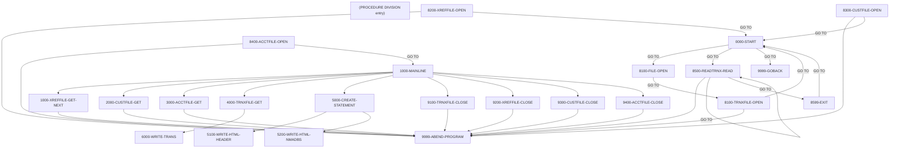

# Program CBSTM03A

| Item | Value |
|---|---|
| Source | `app/cbl/CBSTM03A.CBL` |
| Lines | 924 total, 784 code, 50 comment, 90 blank |
| PROGRAM-ID | CBSTM03A |
| Author | AWS |
| Runtime | batch-main |
| Module | base |
| CICS transactions | None in CSD |
| JCL steps | [CREASTMT](../06-batch/jobs/CREASTMT.md).STEP040 (`app/jcl/CREASTMT.JCL:79`) |
| Paragraphs | 26 |
| Semantic analysis | validated (batch B02) |
| Version banner |  |

## Summary

CBSTM03A is the batch account-statement program; it writes each statement in two formats, an 80-byte plain-text file (STMTFILE) and a 100-byte HTML file (HTMLFILE). All file access goes through subroutine CBSTM03B. It first displays the job's DD names from the z/OS TIOT, then uses an ALTER/GO TO state machine to open the transaction file, load every transaction into an in-memory table grouped by card number (max 51 cards x 10 transactions), and open the cross-reference, customer and account files. For each card cross-reference record it reads the customer and account by key, writes a statement header (name, address, account id, balance, FICO score), lists that card's transactions and prints their total. Read failures for cross-reference, customer or account abend the run. The header says the program deliberately uses control-block addressing, ALTER/GO TO, COMP/COMP-3, a 2-D array and a subroutine call to exercise modernization tooling. (Confirmed)

Evidence: `app/cbl/CBSTM03A.CBL:4-35`, `app/cbl/CBSTM03A.CBL:266-342`, `app/cbl/CBSTM03A.CBL:416-436`, `app/cbl/CBSTM03A.CBL:818-853`

Header comment (Unverified, `app/cbl/CBSTM03A.CBL:1-8`): Program     : CBSTM03A.CBL Application : CardDemo Type        : BATCH COBOL Program Function    : Print Account Statements from Transaction data in two formats : 1/plain text and 2/HTML All Rights Reserved.

## Divisions and sections

| Division / section | Lines | Notes |
|---|---|---|
| IDENTIFICATION DIVISION | `app/cbl/CBSTM03A.CBL:1-35` |  |
| ENVIRONMENT DIVISION | `app/cbl/CBSTM03A.CBL:36-41` |  |
| DATA DIVISION | `app/cbl/CBSTM03A.CBL:42-261` |  |
| PROCEDURE DIVISION | `app/cbl/CBSTM03A.CBL:262-924` |  |
| ENVIRONMENT / INPUT-OUTPUT SECTION | `app/cbl/CBSTM03A.CBL:37-41` |  |
| DATA / FILE SECTION | `app/cbl/CBSTM03A.CBL:43-48` |  |
| DATA / WORKING-STORAGE SECTION | `app/cbl/CBSTM03A.CBL:49-238` |  |
| DATA / LINKAGE SECTION | `app/cbl/CBSTM03A.CBL:239-261` |  |

## Files and data stores

| File | ASSIGN | Org | Access | Record key | Alt key | Status field | OPEN modes | Physical dataset (JCL) | Evidence |
|---|---|---|---|---|---|---|---|---|---|
| STMT-FILE | STMTFILE |  |  |  |  |  | OUTPUT (line 293) | AWS.M2.CARDDEMO.STATEMNT.PS (CREASTMT.STEP040 `app/jcl/CREASTMT.JCL:87-91`) | `app/cbl/CBSTM03A.CBL:39`, FD `app/cbl/CBSTM03A.CBL:44` |
| HTML-FILE | HTMLFILE |  |  |  |  |  | OUTPUT (line 293) | AWS.M2.CARDDEMO.STATEMNT.HTML (CREASTMT.STEP040 `app/jcl/CREASTMT.JCL:92-96`) | `app/cbl/CBSTM03A.CBL:40`, FD `app/cbl/CBSTM03A.CBL:46` |

CRUD summary from the program facts:

| Store | Kind | Ops | Evidence |
|---|---|---|---|
| HTML-FILE | logical | C | `app/cbl/CBSTM03A.CBL:440-721` |
| STMT-FILE | logical | C | `app/cbl/CBSTM03A.CBL:293` |

## Embedded CICS, SQL and DL/I commands

No EXEC blocks.

## Calls, transfers and callers

| Mechanism | Target | Parameters | Paragraph | Lines |
|---|---|---|---|---|
| CALL static | CBSTM03B | WS-M03B-AREA | 1000-XREFFILE-GET-NEXT | `app/cbl/CBSTM03A.CBL:351` |
| CALL static | CBSTM03B | WS-M03B-AREA | 2000-CUSTFILE-GET | `app/cbl/CBSTM03A.CBL:377` |
| CALL static | CBSTM03B | WS-M03B-AREA | 3000-ACCTFILE-GET | `app/cbl/CBSTM03A.CBL:401` |
| CALL static | CBSTM03B | WS-M03B-AREA | 8100-TRNXFILE-OPEN | `app/cbl/CBSTM03A.CBL:734` |
| CALL static | CBSTM03B | WS-M03B-AREA | 8100-TRNXFILE-OPEN | `app/cbl/CBSTM03A.CBL:746` |
| CALL static | CBSTM03B | WS-M03B-AREA | 8200-XREFFILE-OPEN | `app/cbl/CBSTM03A.CBL:769` |
| CALL static | CBSTM03B | WS-M03B-AREA | 8300-CUSTFILE-OPEN | `app/cbl/CBSTM03A.CBL:787` |
| CALL static | CBSTM03B | WS-M03B-AREA | 8400-ACCTFILE-OPEN | `app/cbl/CBSTM03A.CBL:805` |
| CALL static | CBSTM03B | WS-M03B-AREA | 8500-READTRNX-READ | `app/cbl/CBSTM03A.CBL:835` |
| CALL static | CBSTM03B | WS-M03B-AREA | 9100-TRNXFILE-CLOSE | `app/cbl/CBSTM03A.CBL:860` |
| CALL static | CBSTM03B | WS-M03B-AREA | 9200-XREFFILE-CLOSE | `app/cbl/CBSTM03A.CBL:877` |
| CALL static | CBSTM03B | WS-M03B-AREA | 9300-CUSTFILE-CLOSE | `app/cbl/CBSTM03A.CBL:893` |
| CALL static | CBSTM03B | WS-M03B-AREA | 9400-ACCTFILE-CLOSE | `app/cbl/CBSTM03A.CBL:909` |
| CALL system/LE | CEE3ABD |  | 9999-ABEND-PROGRAM | `app/cbl/CBSTM03A.CBL:923` |

## Copybooks

| Copybook | Statement | Resolution | Resolved path | REPLACING | Line |
|---|---|---|---|---|---|
| [COSTM01](../08-data/layouts/COSTM01.md) | COPY | inventory | app/cpy/COSTM01.CPY |  | `app/cbl/CBSTM03A.CBL:51` |
| [CVACT03Y](../08-data/layouts/CVACT03Y.md) | COPY | inventory | app/cpy/CVACT03Y.cpy |  | `app/cbl/CBSTM03A.CBL:53` |
| [CUSTREC](../08-data/layouts/CUSTREC.md) | COPY | inventory | app/cpy/CUSTREC.cpy |  | `app/cbl/CBSTM03A.CBL:55` |
| [CVACT01Y](../08-data/layouts/CVACT01Y.md) | COPY | inventory | app/cpy/CVACT01Y.cpy |  | `app/cbl/CBSTM03A.CBL:57` |

## Data division items

Every data entry coded in this source (copybook contents are on the copybook pages). Lengths are computed from PIC and USAGE.

| Section | Lvl | Name | PIC | Usage | Len | OCCURS | REDEFINES | VALUE | 88-levels | Line |
|---|---|---|---|---|---|---|---|---|---|---|
| FILE | 01 | FD-STMTFILE-REC | X(80) |  | 80 |  |  |  |  | 45 |
| FILE | 01 | FD-HTMLFILE-REC | X(100) |  | 100 |  |  |  |  | 47 |
| WORKING-STORAGE | 01 | COMP-VARIABLES |  | COMP |  |  |  |  |  | 59 |
| WORKING-STORAGE | 05 | CR-CNT | S9(4) |  | 4 |  |  | 0 |  | 60 |
| WORKING-STORAGE | 05 | TR-CNT | S9(4) |  | 4 |  |  | 0 |  | 61 |
| WORKING-STORAGE | 05 | CR-JMP | S9(4) |  | 4 |  |  | 0 |  | 62 |
| WORKING-STORAGE | 05 | TR-JMP | S9(4) |  | 4 |  |  | 0 |  | 63 |
| WORKING-STORAGE | 01 | COMP3-VARIABLES |  | COMP-3 |  |  |  |  |  | 64 |
| WORKING-STORAGE | 05 | WS-TOTAL-AMT | S9(9)V99 |  | 11 |  |  | 0 |  | 65 |
| WORKING-STORAGE | 01 | MISC-VARIABLES |  |  |  |  |  |  |  | 66 |
| WORKING-STORAGE | 05 | WS-FL-DD | X(8) |  | 8 |  |  | 'TRNXFILE' |  | 67 |
| WORKING-STORAGE | 05 | WS-TRN-AMT | S9(9)V99 |  | 11 |  |  | 0 |  | 68 |
| WORKING-STORAGE | 05 | WS-SAVE-CARD | X(16) |  | 16 |  |  | SPACES PIC X(16) |  | 69 |
| WORKING-STORAGE | 05 | END-OF-FILE | X(01) |  | 1 |  |  | 'N' |  | 70 |
| WORKING-STORAGE | 01 | WS-M03B-AREA |  |  |  |  |  |  |  | 71 |
| WORKING-STORAGE | 05 | WS-M03B-DD | X(08) |  | 8 |  |  |  |  | 72 |
| WORKING-STORAGE | 05 | WS-M03B-OPER | X(01) |  | 1 |  |  |  | M03B-OPEN = 'O'; M03B-CLOSE = 'C'; M03B-READ = 'R'; M03B-READ-K = 'K'; M03B-WRITE = 'W'; M03B-REWRITE = 'Z' | 73 |
| WORKING-STORAGE | 05 | WS-M03B-RC | X(02) |  | 2 |  |  |  |  | 80 |
| WORKING-STORAGE | 05 | WS-M03B-KEY | X(25) |  | 25 |  |  |  |  | 81 |
| WORKING-STORAGE | 05 | WS-M03B-KEY-LN | S9(4) |  | 4 |  |  |  |  | 82 |
| WORKING-STORAGE | 05 | WS-M03B-FLDT | X(1000) |  | 1000 |  |  |  |  | 83 |
| WORKING-STORAGE | 01 | STATEMENT-LINES |  |  |  |  |  |  |  | 85 |
| WORKING-STORAGE | 05 | ST-LINE0 |  |  |  |  |  |  |  | 86 |
| WORKING-STORAGE | 10 | FILLER | X(31) |  | 31 |  |  | ALL '*' PIC X(31) |  | 87 |
| WORKING-STORAGE | 10 | FILLER | X(18) |  | 18 |  |  | ALL 'START OF STATEMENT' PIC X(18) |  | 88 |
| WORKING-STORAGE | 10 | FILLER | X(31) |  | 31 |  |  | ALL '*' PIC X(31) |  | 89 |
| WORKING-STORAGE | 05 | ST-LINE1 |  |  |  |  |  |  |  | 90 |
| WORKING-STORAGE | 10 | ST-NAME | X(75) |  | 75 |  |  |  |  | 91 |
| WORKING-STORAGE | 10 | FILLER | X(05) |  | 5 |  |  | SPACES PIC X(05) |  | 92 |
| WORKING-STORAGE | 05 | ST-LINE2 |  |  |  |  |  |  |  | 93 |
| WORKING-STORAGE | 10 | ST-ADD1 | X(50) |  | 50 |  |  |  |  | 94 |
| WORKING-STORAGE | 10 | FILLER | X(30) |  | 30 |  |  | SPACES PIC X(30) |  | 95 |
| WORKING-STORAGE | 05 | ST-LINE3 |  |  |  |  |  |  |  | 96 |
| WORKING-STORAGE | 10 | ST-ADD2 | X(50) |  | 50 |  |  |  |  | 97 |
| WORKING-STORAGE | 10 | FILLER | X(30) |  | 30 |  |  | SPACES PIC X(30) |  | 98 |
| WORKING-STORAGE | 05 | ST-LINE4 |  |  |  |  |  |  |  | 99 |
| WORKING-STORAGE | 10 | ST-ADD3 | X(80) |  | 80 |  |  |  |  | 100 |
| WORKING-STORAGE | 05 | ST-LINE5 |  |  |  |  |  |  |  | 101 |
| WORKING-STORAGE | 10 | FILLER | X(80) |  | 80 |  |  | ALL '-' PIC X(80) |  | 102 |
| WORKING-STORAGE | 05 | ST-LINE6 |  |  |  |  |  |  |  | 103 |
| WORKING-STORAGE | 10 | FILLER | X(33) |  | 33 |  |  | SPACES PIC X(33) |  | 104 |
| WORKING-STORAGE | 10 | FILLER | X(14) |  | 14 |  |  | 'Basic Details' PIC X(14) |  | 105 |
| WORKING-STORAGE | 10 | FILLER | X(33) |  | 33 |  |  | SPACES PIC X(33) |  | 106 |
| WORKING-STORAGE | 05 | ST-LINE7 |  |  |  |  |  |  |  | 107 |
| WORKING-STORAGE | 10 | FILLER | X(20) |  | 20 |  |  | 'Account ID :' PIC X(20) |  | 108 |
| WORKING-STORAGE | 10 | ST-ACCT-ID | X(20) |  | 20 |  |  |  |  | 109 |
| WORKING-STORAGE | 10 | FILLER | X(40) |  | 40 |  |  | SPACES PIC X(40) |  | 110 |
| WORKING-STORAGE | 05 | ST-LINE8 |  |  |  |  |  |  |  | 111 |
| WORKING-STORAGE | 10 | FILLER | X(20) |  | 20 |  |  | 'Current Balance :' PIC X(20) |  | 112 |
| WORKING-STORAGE | 10 | ST-CURR-BAL | 9(9).99- |  | 13 |  |  |  |  | 113 |
| WORKING-STORAGE | 10 | FILLER | X(07) |  | 7 |  |  | SPACES PIC X(07) |  | 114 |
| WORKING-STORAGE | 10 | FILLER | X(40) |  | 40 |  |  | SPACES PIC X(40) |  | 115 |
| WORKING-STORAGE | 05 | ST-LINE9 |  |  |  |  |  |  |  | 116 |
| WORKING-STORAGE | 10 | FILLER | X(20) |  | 20 |  |  | 'FICO Score :' PIC X(20) |  | 117 |
| WORKING-STORAGE | 10 | ST-FICO-SCORE | X(20) |  | 20 |  |  |  |  | 118 |
| WORKING-STORAGE | 10 | FILLER | X(40) |  | 40 |  |  | SPACES PIC X(40) |  | 119 |
| WORKING-STORAGE | 05 | ST-LINE10 |  |  |  |  |  |  |  | 120 |
| WORKING-STORAGE | 10 | FILLER | X(80) |  | 80 |  |  | ALL '-' PIC X(80) |  | 121 |
| WORKING-STORAGE | 05 | ST-LINE11 |  |  |  |  |  |  |  | 122 |
| WORKING-STORAGE | 10 | FILLER | X(30) |  | 30 |  |  | SPACES PIC X(30) |  | 123 |
| WORKING-STORAGE | 10 | FILLER | X(20) |  | 20 |  |  | 'TRANSACTION SUMMARY ' PIC X(20) |  | 124 |
| WORKING-STORAGE | 10 | FILLER | X(30) |  | 30 |  |  | SPACES PIC X(30) |  | 125 |
| WORKING-STORAGE | 05 | ST-LINE12 |  |  |  |  |  |  |  | 126 |
| WORKING-STORAGE | 10 | FILLER | X(80) |  | 80 |  |  | ALL '-' PIC X(80) |  | 127 |
| WORKING-STORAGE | 05 | ST-LINE13 |  |  |  |  |  |  |  | 128 |
| WORKING-STORAGE | 10 | FILLER | X(16) |  | 16 |  |  | 'Tran ID ' PIC X(16) |  | 129 |
| WORKING-STORAGE | 10 | FILLER | X(51) |  | 51 |  |  | 'Tran Details ' PIC X(51) |  | 130 |
| WORKING-STORAGE | 10 | FILLER | X(13) |  | 13 |  |  | ' Tran Amount' PIC X(13) |  | 131 |
| WORKING-STORAGE | 05 | ST-LINE14 |  |  |  |  |  |  |  | 132 |
| WORKING-STORAGE | 10 | ST-TRANID | X(16) |  | 16 |  |  |  |  | 133 |
| WORKING-STORAGE | 10 | FILLER | X(01) |  | 1 |  |  | ' ' PIC X(01) |  | 134 |
| WORKING-STORAGE | 10 | ST-TRANDT | X(49) |  | 49 |  |  |  |  | 135 |
| WORKING-STORAGE | 10 | FILLER | X(01) |  | 1 |  |  | '$' PIC X(01) |  | 136 |
| WORKING-STORAGE | 10 | ST-TRANAMT | Z(9).99- |  | 13 |  |  |  |  | 137 |
| WORKING-STORAGE | 05 | ST-LINE14A |  |  |  |  |  |  |  | 138 |
| WORKING-STORAGE | 10 | FILLER | X(10) |  | 10 |  |  | 'Total EXP:' PIC X(10) |  | 139 |
| WORKING-STORAGE | 10 | FILLER | X(56) |  | 56 |  |  | SPACES PIC X(56) |  | 140 |
| WORKING-STORAGE | 10 | FILLER | X(01) |  | 1 |  |  | '$' PIC X(01) |  | 141 |
| WORKING-STORAGE | 10 | ST-TOTAL-TRAMT | Z(9).99- |  | 13 |  |  |  |  | 142 |
| WORKING-STORAGE | 05 | ST-LINE15 |  |  |  |  |  |  |  | 143 |
| WORKING-STORAGE | 10 | FILLER | X(32) |  | 32 |  |  | ALL '*' PIC X(32) |  | 144 |
| WORKING-STORAGE | 10 | FILLER | X(16) |  | 16 |  |  | ALL 'END OF STATEMENT' PIC X(16) |  | 145 |
| WORKING-STORAGE | 10 | FILLER | X(32) |  | 32 |  |  | ALL '*' PIC X(32) |  | 146 |
| WORKING-STORAGE | 01 | HTML-LINES |  |  |  |  |  |  |  | 148 |
| WORKING-STORAGE | 05 | HTML-FIXED-LN | X(100) |  | 100 |  |  |  | HTML-L01 = '<!DOCTYPE html>'; HTML-L02 = '<html lang="en">'; HTML-L03 = '<head>'; HTML-L04 = '<meta charset="utf-8">'; HTML-L05 = '<title>HTML Table Layout</title>'; HTML-L06 = '</head>'; HTML-L07 = ' | 149 |
| WORKING-STORAGE | 05 | HTML-L11 |  |  |  |  |  |  |  | 212 |
| WORKING-STORAGE | 10 | FILLER | X(34) |  | 34 |  |  | '<h3>Statement for Account Number: ' |  | 213 |
| WORKING-STORAGE | 10 | L11-ACCT | X(20) |  | 20 |  |  |  |  | 215 |
| WORKING-STORAGE | 10 | FILLER | X(05) |  | 5 |  |  | '</h3>' |  | 216 |
| WORKING-STORAGE | 05 | HTML-L23 |  |  |  |  |  |  |  | 217 |
| WORKING-STORAGE | 10 | FILLER | X(26) |  | 26 |  |  | '
' |  | 218 |
| WORKING-STORAGE | 10 | L23-NAME | X(50) |  | 50 |  |  |  |  | 220 |
| WORKING-STORAGE | 05 | HTML-ADDR-LN | X(100) |  | 100 |  |  |  |  | 221 |
| WORKING-STORAGE | 05 | HTML-BSIC-LN | X(100) |  | 100 |  |  |  |  | 222 |
| WORKING-STORAGE | 05 | HTML-TRAN-LN | X(100) |  | 100 |  |  |  |  | 223 |
| WORKING-STORAGE | 01 | WS-TRNX-TABLE |  |  |  |  |  |  |  | 225 |
| WORKING-STORAGE | 05 | WS-CARD-TBL |  |  |  | 51 |  |  |  | 226 |
| WORKING-STORAGE | 10 | WS-CARD-NUM | X(16) |  | 16 |  |  |  |  | 227 |
| WORKING-STORAGE | 10 | WS-TRAN-TBL |  |  |  | 10 |  |  |  | 228 |
| WORKING-STORAGE | 15 | WS-TRAN-NUM | X(16) |  | 16 |  |  |  |  | 229 |
| WORKING-STORAGE | 15 | WS-TRAN-REST | X(318) |  | 318 |  |  |  |  | 230 |
| WORKING-STORAGE | 01 | WS-TRN-TBL-CNTR |  |  |  |  |  |  |  | 231 |
| WORKING-STORAGE | 05 | WS-TRN-TBL-CTR |  |  |  | 51 |  |  |  | 232 |
| WORKING-STORAGE | 10 | WS-TRCT | S9(4) | COMP | 2 |  |  |  |  | 233 |
| WORKING-STORAGE | 01 | PSAPTR |  | POINTER |  |  |  |  |  | 235 |
| WORKING-STORAGE | 01 | BUMP-TIOT | S9(08) | BINARY | 4 |  |  | ZERO |  | 236 |
| WORKING-STORAGE | 01 | TIOT-INDEX |  | POINTER |  |  | BUMP-TIOT |  |  | 237 |
| LINKAGE | 01 | ALIGN-PSA | 9(16) | BINARY | 8 |  |  |  |  | 240 |
| LINKAGE | 01 | PSA-BLOCK |  |  |  |  |  |  |  | 241 |
| LINKAGE | 05 | FILLER | X(536) |  | 536 |  |  |  |  | 242 |
| LINKAGE | 05 | TCB-POINT |  | POINTER |  |  |  |  |  | 243 |
| LINKAGE | 01 | TCB-BLOCK |  |  |  |  |  |  |  | 244 |
| LINKAGE | 05 | FILLER | X(12) |  | 12 |  |  |  |  | 245 |
| LINKAGE | 05 | TIOT-POINT |  | POINTER |  |  |  |  |  | 246 |
| LINKAGE | 01 | TIOT-BLOCK |  |  |  |  |  |  |  | 247 |
| LINKAGE | 05 | TIOTNJOB | X(08) |  | 8 |  |  |  |  | 248 |
| LINKAGE | 05 | TIOTJSTP | X(08) |  | 8 |  |  |  |  | 249 |
| LINKAGE | 05 | TIOTPSTP | X(08) |  | 8 |  |  |  |  | 250 |
| LINKAGE | 01 | TIOT-ENTRY |  |  |  |  |  |  |  | 251 |
| LINKAGE | 05 | TIOT-SEG |  |  |  |  |  |  |  | 252 |
| LINKAGE | 10 | TIO-LEN | X(01) |  | 1 |  |  |  |  | 253 |
| LINKAGE | 10 | FILLER | X(03) |  | 3 |  |  |  |  | 254 |
| LINKAGE | 10 | TIOCDDNM | X(08) |  | 8 |  |  |  |  | 255 |
| LINKAGE | 10 | FILLER | X(05) |  | 5 |  |  |  |  | 256 |
| LINKAGE | 10 | UCB-ADDR | X(03) |  | 3 |  |  |  | NULL-UCB = LOW-VALUES | 257 |
| LINKAGE | 05 | FILLER | X(04) |  | 4 |  |  |  | END-OF-TIOT = LOW-VALUES | 259 |

## Statement inventory

Every procedure statement the parser recorded, by kind. Each one is listed with its line under Paragraph details.

| Kind | Count |
|---|---|
| Decisions (IF, EVALUATE, WHEN, loops, handlers) | 40 |
| Calculations | 7 |
| File I/O | 97 |
| EXEC CICS / SQL / DLI | 0 |
| CALL | 14 |
| PERFORM | 29 |
| GO TO | 14 |
| MOVE literal | 21 |
| MOVE field | 58 |
| SET | 83 |
| STRING, UNSTRING, INSPECT, INITIALIZE, COPY, ENTRY and others | 18 |
| DISPLAY | 33 |
| GOBACK, STOP RUN, RETURN, XCTL | 1 |
| Not classified by the parser | 0 |

## Control flow

| Paragraph | Lines | Logic | Performs | Performed by | Reachable |
|---|---|---|---|---|---|
| [(PROCEDURE DIVISION entry)](#para-procedure-division-entry) | 266-294 | Addresses the PSA, TCB and TIOT control blocks, displays the job and step name and every DD name from the TIOT with its UCB status, then opens STMT-FILE and HTML-FILE for output and initializes the transaction table and counters. Falls through into 0000-START. (Confirmed) |  |  | yes |
| [0000-START](#para-0000-start) | 296-314 | Dispatches on WS-FL-DD: for TRNXFILE, XREFFILE, CUSTFILE or ACCTFILE it ALTERs 8100-FILE-OPEN to the matching open paragraph and GOes TO it; 'READTRNX' goes to 8500-READTRNX-READ; any other value goes to 9999-GOBACK. (Confirmed) |  | (PROCEDURE DIVISION entry), 8100-TRNXFILE-OPEN, 8200-XREFFILE-OPEN, 8300-CUSTFILE-OPEN, 8599-EXIT | yes |
| [1000-MAINLINE](#para-1000-mainline) | 316-339 | Loops until END-OF-FILE = 'Y': reads the next cross-reference record and, if found, reads the customer and account, writes the statement header, resets WS-TOTAL-AMT and writes the card's transactions and totals. Then closes TRNXFILE, XREFFILE, CUSTFILE, ACCTFILE (through CBSTM03B) and STMT-FILE/HTML-FILE. (Confirmed) | 1000-XREFFILE-GET-NEXT, 2000-CUSTFILE-GET, 3000-ACCTFILE-GET, 4000-TRNXFILE-GET, 5000-CREATE-STATEMENT, 9100-TRNXFILE-CLOSE, 9200-XREFFILE-CLOSE, 9300-CUSTFILE-CLOSE, 9400-ACCTFILE-CLOSE | 8400-ACCTFILE-OPEN | no static path |
| [9999-GOBACK](#para-9999-goback) | 341-342 | GOBACK - ends the program. (Confirmed) |  | 0000-START | yes |
| [1000-XREFFILE-GET-NEXT](#para-1000-xreffile-get-next) | 345-366 | Calls CBSTM03B to read the next XREFFILE record. RC '00' continues, '10' sets END-OF-FILE 'Y', any other displays 'ERROR READING XREFFILE' with the return code and abends. Moves the returned data to CARD-XREF-RECORD. (Confirmed) | 9999-ABEND-PROGRAM | 1000-MAINLINE | no static path |
| [2000-CUSTFILE-GET](#para-2000-custfile-get) | 368-390 | Calls CBSTM03B for a keyed read of CUSTFILE with XREF-CUST-ID (key length = length of XREF-CUST-ID). RC other than '00' displays 'ERROR READING CUSTFILE' and abends; otherwise moves the data to CUSTOMER-RECORD. (Confirmed) | 9999-ABEND-PROGRAM | 1000-MAINLINE | no static path |
| [3000-ACCTFILE-GET](#para-3000-acctfile-get) | 392-414 | Calls CBSTM03B for a keyed read of ACCTFILE with XREF-ACCT-ID. RC other than '00' displays 'ERROR READING ACCTFILE' and abends; otherwise moves the data to ACCOUNT-RECORD. (Confirmed) | 9999-ABEND-PROGRAM | 1000-MAINLINE | no static path |
| [4000-TRNXFILE-GET](#para-4000-trnxfile-get) | 416-456 | Scans the card table until past CR-CNT or a table card number greater than XREF-CARD-NUM; for the matching card, writes every stored transaction via 6000-WRITE-TRANS and adds TRNX-AMT to WS-TOTAL-AMT. Then writes the 'Total EXP:' total line and end-of-statement line to STMT-FILE and the closing HTML rows and tags to HTML-FILE. (Confirmed) | 6000-WRITE-TRANS | 1000-MAINLINE | no static path |
| [5000-CREATE-STATEMENT](#para-5000-create-statement) | 458-504 | Initializes STATEMENT-LINES, writes the start banner and HTML header, builds ST-NAME from first, middle and last names and ST-ADD3 from address line 3, state, country and ZIP, moves address lines 1-2, ACCT-ID, ACCT-CURR-BAL and CUST-FICO-CREDIT-SCORE, writes the HTML name/address/basic-details block and then the plain-text header lines 1-13. (Confirmed) | 5100-WRITE-HTML-HEADER, 5200-WRITE-HTML-NMADBS | 1000-MAINLINE | no static path |
| [5100-WRITE-HTML-HEADER](#para-5100-write-html-header) | 506-552 | Writes the fixed HTML document header (DOCTYPE, head, table), the 'Statement for Account Number:' heading with ACCT-ID, and the bank name/address block. (Confirmed) |  | 5000-CREATE-STATEMENT | no static path |
| [5100-EXIT](#para-5100-exit) | 554-555 | End of the 5100 PERFORM THRU range (EXIT). (Confirmed) |  | 5000-CREATE-STATEMENT | no static path |
| [5200-WRITE-HTML-NMADBS](#para-5200-write-html-nmadbs) | 558-669 | Writes FD-HTMLFILE-REC lines for the statement header: ST-NAME (via L23-NAME) in a 16px paragraph, then ST-ADD1, ST-ADD2 and ST-ADD3 through HTML-ADDR-LN; the 'Account ID', 'Current Balance' and 'FICO Score' lines built from ST-ACCT-ID, ST-CURR-BAL and ST-FICO-SCORE through HTML-BSIC-LN; and fixed table markup by SETting 88-levels of HTML-FIXED-LN (HTML-LTDE, HTML-LTRE, HTML-LTRS, HTML-L22-35, HTML-L30-42) including HTML-L43 'Transaction Summary' and the column headings HTML-L48 'Tran ID', HTML-L51 'Tran Details' and HTML-L54 'Amount'. (Confirmed) |  | 5000-CREATE-STATEMENT | no static path |
| [5200-EXIT](#para-5200-exit) | 671-672 | End of the 5200 PERFORM THRU range (EXIT). (Confirmed) |  | 5000-CREATE-STATEMENT | no static path |
| [6000-WRITE-TRANS](#para-6000-write-trans) | 675-723 | Moves TRNX-ID, TRNX-DESC and TRNX-AMT to statement line 14 and writes it to STMT-FILE, then writes an HTML table row with the same three values. (Confirmed) |  | 4000-TRNXFILE-GET | no static path |
| [8100-FILE-OPEN](#para-8100-file-open) | 726-728 | ALTERable GO TO target; initially GO TO 8100-TRNXFILE-OPEN, redirected by 0000-START to the next file-open paragraph. (Confirmed) |  | 0000-START | yes |
| [8100-TRNXFILE-OPEN](#para-8100-trnxfile-open) | 730-762 | Opens TRNXFILE and reads its first record through CBSTM03B (abend unless RC '00' or '04'), saves the card number in WS-SAVE-CARD, sets CR-CNT 1 and TR-CNT 0, sets WS-FL-DD to 'READTRNX' and returns to 0000-START. (Confirmed) | 9999-ABEND-PROGRAM | 8100-FILE-OPEN | yes |
| [8200-XREFFILE-OPEN](#para-8200-xreffile-open) | 765-781 | Opens XREFFILE through CBSTM03B (abend unless RC '00' or '04'), sets WS-FL-DD to 'CUSTFILE' and returns to 0000-START. (Confirmed) | 9999-ABEND-PROGRAM |  | no static path |
| [8300-CUSTFILE-OPEN](#para-8300-custfile-open) | 783-799 | Opens CUSTFILE through CBSTM03B (abend unless RC '00' or '04'), sets WS-FL-DD to 'ACCTFILE' and returns to 0000-START. (Confirmed) | 9999-ABEND-PROGRAM |  | no static path |
| [8400-ACCTFILE-OPEN](#para-8400-acctfile-open) | 801-816 | Opens ACCTFILE through CBSTM03B (abend unless RC '00' or '04') and GOes TO 1000-MAINLINE. (Confirmed) | 9999-ABEND-PROGRAM |  | no static path |
| [8500-READTRNX-READ](#para-8500-readtrnx-read) | 818-847 | Stores the current transaction in WS-TRNX-TABLE: same card as WS-SAVE-CARD increments TR-CNT, a new card saves the previous count in WS-TRCT, increments CR-CNT and restarts TR-CNT at 1. Reads the next TRNXFILE record through CBSTM03B and loops on RC '00', goes to 8599-EXIT on '10', abends otherwise. (Confirmed) | 9999-ABEND-PROGRAM | 0000-START | yes |
| [8599-EXIT](#para-8599-exit) | 849-853 | Saves the last card's transaction count in WS-TRCT(CR-CNT), sets WS-FL-DD to 'XREFFILE' and returns to 0000-START. (Confirmed) |  | 8500-READTRNX-READ | yes |
| [9100-TRNXFILE-CLOSE](#para-9100-trnxfile-close) | 856-870 | Closes TRNXFILE through CBSTM03B; abends with 'ERROR CLOSING TRNXFILE' unless RC '00' or '04'. (Confirmed) | 9999-ABEND-PROGRAM | 1000-MAINLINE | no static path |
| [9200-XREFFILE-CLOSE](#para-9200-xreffile-close) | 873-887 | Closes XREFFILE through CBSTM03B; abends with 'ERROR CLOSING XREFFILE' unless RC '00' or '04'. (Confirmed) | 9999-ABEND-PROGRAM | 1000-MAINLINE | no static path |
| [9300-CUSTFILE-CLOSE](#para-9300-custfile-close) | 889-903 | Closes CUSTFILE through CBSTM03B; abends with 'ERROR CLOSING CUSTFILE' unless RC '00' or '04'. (Confirmed) | 9999-ABEND-PROGRAM | 1000-MAINLINE | no static path |
| [9400-ACCTFILE-CLOSE](#para-9400-acctfile-close) | 905-919 | Closes ACCTFILE through CBSTM03B; abends with 'ERROR CLOSING ACCTFILE' unless RC '00' or '04'. (Confirmed) | 9999-ABEND-PROGRAM | 1000-MAINLINE | no static path |
| [9999-ABEND-PROGRAM](#para-9999-abend-program) | 921-923 | Displays 'ABENDING PROGRAM' and calls CEE3ABD without parameters. (Confirmed) |  | 1000-XREFFILE-GET-NEXT, 2000-CUSTFILE-GET, 3000-ACCTFILE-GET, 8100-TRNXFILE-OPEN, 8200-XREFFILE-OPEN, 8300-CUSTFILE-OPEN, 8400-ACCTFILE-OPEN, 8500-READTRNX-READ, 9100-TRNXFILE-CLOSE, 9200-XREFFILE-CLOSE, 9300-CUSTFILE-CLOSE, 9400-ACCTFILE-CLOSE | yes |

## Paragraph details

### Para (PROCEDURE DIVISION entry)

Lines `app/cbl/CBSTM03A.CBL:266-294`. 

Logic: Addresses the PSA, TCB and TIOT control blocks, displays the job and step name and every DD name from the TIOT with its UCB status, then opens STMT-FILE and HTML-FILE for output and initializes the transaction table and counters. Falls through into 0000-START. (Confirmed)

Statements in source order:

- `SET ADDRESS OF PSA-BLOCK TO PSAPTR` at `app/cbl/CBSTM03A.CBL:266`
- `SET ADDRESS OF TCB-BLOCK TO TCB-POINT` at `app/cbl/CBSTM03A.CBL:267`
- `SET ADDRESS OF TIOT-BLOCK TO TIOT-POINT` at `app/cbl/CBSTM03A.CBL:268`
- `SET TIOT-INDEX TO TIOT-POINT` at `app/cbl/CBSTM03A.CBL:269`
- `DISPLAY 'Running JCL : ' TIOTNJOB ' Step ' TIOTJSTP` at `app/cbl/CBSTM03A.CBL:270`
- Calculation `COMPUTE BUMP-TIOT = BUMP-TIOT + LENGTH OF TIOT-BLOCK` at `app/cbl/CBSTM03A.CBL:272` (no ROUNDED)
- `SET ADDRESS OF TIOT-ENTRY TO TIOT-INDEX` at `app/cbl/CBSTM03A.CBL:273`
- `DISPLAY 'DD Names from TIOT: '` at `app/cbl/CBSTM03A.CBL:275`
- LOOP `UNTIL END-OF-TIOT OR TIO-LEN = LOW-VALUES` at `app/cbl/CBSTM03A.CBL:276-277` (business-candidate)
- Inline PERFORM `UNTIL END-OF-TIOT OR TIO-LEN = LOW-VALUES` at `app/cbl/CBSTM03A.CBL:276-277`
- IF `NOT NULL-UCB` at `app/cbl/CBSTM03A.CBL:278` (business-candidate)
- `DISPLAY ': ' TIOCDDNM ' -- valid UCB'` at `app/cbl/CBSTM03A.CBL:279`
- `DISPLAY ': ' TIOCDDNM ' -- null UCB'` at `app/cbl/CBSTM03A.CBL:281`
- Calculation `COMPUTE BUMP-TIOT = BUMP-TIOT + LENGTH OF TIOT-SEG` at `app/cbl/CBSTM03A.CBL:283` (no ROUNDED)
- `SET ADDRESS OF TIOT-ENTRY TO TIOT-INDEX` at `app/cbl/CBSTM03A.CBL:284`
- IF `NOT NULL-UCB` at `app/cbl/CBSTM03A.CBL:287` (business-candidate)
- `DISPLAY ': ' TIOCDDNM ' -- valid UCB'` at `app/cbl/CBSTM03A.CBL:288`
- `DISPLAY ': ' TIOCDDNM ' -- null UCB'` at `app/cbl/CBSTM03A.CBL:290`
- File I/O `OPEN OUTPUT STMT-FILE HTML-FILE` at `app/cbl/CBSTM03A.CBL:293`
- `INITIALIZE WS-TRNX-TABLE WS-TRN-TBL-CNTR` at `app/cbl/CBSTM03A.CBL:294`

### Para 0000-START

Lines `app/cbl/CBSTM03A.CBL:296-314`. 

Logic: Dispatches on WS-FL-DD: for TRNXFILE, XREFFILE, CUSTFILE or ACCTFILE it ALTERs 8100-FILE-OPEN to the matching open paragraph and GOes TO it; 'READTRNX' goes to 8500-READTRNX-READ; any other value goes to 9999-GOBACK. (Confirmed)

Statements in source order:

- EVALUATE `WS-FL-DD` at `app/cbl/CBSTM03A.CBL:298` (business-candidate)
- WHEN `'TRNXFILE'` at `app/cbl/CBSTM03A.CBL:299` (business-candidate)
- `ALTER 8100-FILE-OPEN TO PROCEED TO 8100-TRNXFILE-OPEN` at `app/cbl/CBSTM03A.CBL:300`
- GO TO 8100-FILE-OPEN at `app/cbl/CBSTM03A.CBL:301`
- WHEN `'XREFFILE'` at `app/cbl/CBSTM03A.CBL:302` (business-candidate)
- `ALTER 8100-FILE-OPEN TO PROCEED TO 8200-XREFFILE-OPEN` at `app/cbl/CBSTM03A.CBL:303`
- GO TO 8100-FILE-OPEN at `app/cbl/CBSTM03A.CBL:304`
- WHEN `'CUSTFILE'` at `app/cbl/CBSTM03A.CBL:305` (business-candidate)
- `ALTER 8100-FILE-OPEN TO PROCEED TO 8300-CUSTFILE-OPEN` at `app/cbl/CBSTM03A.CBL:306`
- GO TO 8100-FILE-OPEN at `app/cbl/CBSTM03A.CBL:307`
- WHEN `'ACCTFILE'` at `app/cbl/CBSTM03A.CBL:308` (business-candidate)
- `ALTER 8100-FILE-OPEN TO PROCEED TO 8400-ACCTFILE-OPEN` at `app/cbl/CBSTM03A.CBL:309`
- GO TO 8100-FILE-OPEN at `app/cbl/CBSTM03A.CBL:310`
- WHEN `'READTRNX'` at `app/cbl/CBSTM03A.CBL:311` (business-candidate)
- GO TO 8500-READTRNX-READ at `app/cbl/CBSTM03A.CBL:312`
- WHEN `OTHER` at `app/cbl/CBSTM03A.CBL:313` (business-candidate)
- GO TO 9999-GOBACK at `app/cbl/CBSTM03A.CBL:314`

### Para 1000-MAINLINE

Lines `app/cbl/CBSTM03A.CBL:316-339`. 

Logic: Loops until END-OF-FILE = 'Y': reads the next cross-reference record and, if found, reads the customer and account, writes the statement header, resets WS-TOTAL-AMT and writes the card's transactions and totals. Then closes TRNXFILE, XREFFILE, CUSTFILE, ACCTFILE (through CBSTM03B) and STMT-FILE/HTML-FILE. (Confirmed)

Rules: [BR-CBSTM03A-006](../09-business-rules-catalog.md#br-cbstm03a-006)

Statements in source order:

- LOOP `UNTIL END-OF-FILE = 'Y'` at `app/cbl/CBSTM03A.CBL:317` (io-status)
- Inline PERFORM `UNTIL END-OF-FILE = 'Y'` at `app/cbl/CBSTM03A.CBL:317`
- IF `END-OF-FILE = 'N'` at `app/cbl/CBSTM03A.CBL:318` (io-status)
- PERFORM 1000-XREFFILE-GET-NEXT at `app/cbl/CBSTM03A.CBL:319`
- IF `END-OF-FILE = 'N'` at `app/cbl/CBSTM03A.CBL:320` (io-status)
- PERFORM 2000-CUSTFILE-GET at `app/cbl/CBSTM03A.CBL:321`
- PERFORM 3000-ACCTFILE-GET at `app/cbl/CBSTM03A.CBL:322`
- PERFORM 5000-CREATE-STATEMENT at `app/cbl/CBSTM03A.CBL:323`
- MOVE `1` TO CR-JMP at `app/cbl/CBSTM03A.CBL:324`
- `MOVE ZERO TO WS-TOTAL-AMT` at `app/cbl/CBSTM03A.CBL:325`
- PERFORM 4000-TRNXFILE-GET at `app/cbl/CBSTM03A.CBL:326`
- PERFORM 9100-TRNXFILE-CLOSE at `app/cbl/CBSTM03A.CBL:331`
- PERFORM 9200-XREFFILE-CLOSE at `app/cbl/CBSTM03A.CBL:333`
- PERFORM 9300-CUSTFILE-CLOSE at `app/cbl/CBSTM03A.CBL:335`
- PERFORM 9400-ACCTFILE-CLOSE at `app/cbl/CBSTM03A.CBL:337`
- File I/O `CLOSE STMT-FILE HTML-FILE` at `app/cbl/CBSTM03A.CBL:339`

### Para 9999-GOBACK

Lines `app/cbl/CBSTM03A.CBL:341-342`. 

Logic: GOBACK - ends the program. (Confirmed)

Statements in source order:

- Ends with GOBACK at `app/cbl/CBSTM03A.CBL:342`

### Para 1000-XREFFILE-GET-NEXT

Lines `app/cbl/CBSTM03A.CBL:345-366`. 

Logic: Calls CBSTM03B to read the next XREFFILE record. RC '00' continues, '10' sets END-OF-FILE 'Y', any other displays 'ERROR READING XREFFILE' with the return code and abends. Moves the returned data to CARD-XREF-RECORD. (Confirmed)

Statements in source order:

- MOVE `'XREFFILE'` TO WS-M03B-DD at `app/cbl/CBSTM03A.CBL:347`
- `SET M03B-READ TO TRUE` at `app/cbl/CBSTM03A.CBL:348`
- `MOVE ZERO TO WS-M03B-RC` at `app/cbl/CBSTM03A.CBL:349`
- `MOVE SPACES TO WS-M03B-FLDT` at `app/cbl/CBSTM03A.CBL:350`
- CALL CBSTM03B at `app/cbl/CBSTM03A.CBL:351`
- EVALUATE `WS-M03B-RC` at `app/cbl/CBSTM03A.CBL:353` (business-candidate)
- WHEN `'00'` at `app/cbl/CBSTM03A.CBL:354` (business-candidate)
- WHEN `'10'` at `app/cbl/CBSTM03A.CBL:356` (business-candidate)
- MOVE `'Y'` TO END-OF-FILE at `app/cbl/CBSTM03A.CBL:357`
- WHEN `OTHER` at `app/cbl/CBSTM03A.CBL:358` (business-candidate)
- `DISPLAY 'ERROR READING XREFFILE'` at `app/cbl/CBSTM03A.CBL:359`
- `DISPLAY 'RETURN CODE: ' WS-M03B-RC` at `app/cbl/CBSTM03A.CBL:360`
- PERFORM 9999-ABEND-PROGRAM at `app/cbl/CBSTM03A.CBL:361`
- `MOVE WS-M03B-FLDT TO CARD-XREF-RECORD` at `app/cbl/CBSTM03A.CBL:364`

### Para 2000-CUSTFILE-GET

Lines `app/cbl/CBSTM03A.CBL:368-390`. 

Logic: Calls CBSTM03B for a keyed read of CUSTFILE with XREF-CUST-ID (key length = length of XREF-CUST-ID). RC other than '00' displays 'ERROR READING CUSTFILE' and abends; otherwise moves the data to CUSTOMER-RECORD. (Confirmed)

Rules: [BR-CBSTM03A-004](../09-business-rules-catalog.md#br-cbstm03a-004)

Statements in source order:

- MOVE `'CUSTFILE'` TO WS-M03B-DD at `app/cbl/CBSTM03A.CBL:370`
- `SET M03B-READ-K TO TRUE` at `app/cbl/CBSTM03A.CBL:371`
- `MOVE XREF-CUST-ID TO WS-M03B-KEY` at `app/cbl/CBSTM03A.CBL:372`
- `MOVE ZERO TO WS-M03B-KEY-LN` at `app/cbl/CBSTM03A.CBL:373`
- Calculation `COMPUTE WS-M03B-KEY-LN = LENGTH OF XREF-CUST-ID` at `app/cbl/CBSTM03A.CBL:374` (no ROUNDED)
- `MOVE ZERO TO WS-M03B-RC` at `app/cbl/CBSTM03A.CBL:375`
- `MOVE SPACES TO WS-M03B-FLDT` at `app/cbl/CBSTM03A.CBL:376`
- CALL CBSTM03B at `app/cbl/CBSTM03A.CBL:377`
- EVALUATE `WS-M03B-RC` at `app/cbl/CBSTM03A.CBL:379` (business-candidate)
- WHEN `'00'` at `app/cbl/CBSTM03A.CBL:380` (business-candidate)
- WHEN `OTHER` at `app/cbl/CBSTM03A.CBL:382` (business-candidate)
- `DISPLAY 'ERROR READING CUSTFILE'` at `app/cbl/CBSTM03A.CBL:383`
- `DISPLAY 'RETURN CODE: ' WS-M03B-RC` at `app/cbl/CBSTM03A.CBL:384`
- PERFORM 9999-ABEND-PROGRAM at `app/cbl/CBSTM03A.CBL:385`
- `MOVE WS-M03B-FLDT TO CUSTOMER-RECORD` at `app/cbl/CBSTM03A.CBL:388`

### Para 3000-ACCTFILE-GET

Lines `app/cbl/CBSTM03A.CBL:392-414`. 

Logic: Calls CBSTM03B for a keyed read of ACCTFILE with XREF-ACCT-ID. RC other than '00' displays 'ERROR READING ACCTFILE' and abends; otherwise moves the data to ACCOUNT-RECORD. (Confirmed)

Statements in source order:

- MOVE `'ACCTFILE'` TO WS-M03B-DD at `app/cbl/CBSTM03A.CBL:394`
- `SET M03B-READ-K TO TRUE` at `app/cbl/CBSTM03A.CBL:395`
- `MOVE XREF-ACCT-ID TO WS-M03B-KEY` at `app/cbl/CBSTM03A.CBL:396`
- `MOVE ZERO TO WS-M03B-KEY-LN` at `app/cbl/CBSTM03A.CBL:397`
- Calculation `COMPUTE WS-M03B-KEY-LN = LENGTH OF XREF-ACCT-ID` at `app/cbl/CBSTM03A.CBL:398` (no ROUNDED)
- `MOVE ZERO TO WS-M03B-RC` at `app/cbl/CBSTM03A.CBL:399`
- `MOVE SPACES TO WS-M03B-FLDT` at `app/cbl/CBSTM03A.CBL:400`
- CALL CBSTM03B at `app/cbl/CBSTM03A.CBL:401`
- EVALUATE `WS-M03B-RC` at `app/cbl/CBSTM03A.CBL:403` (business-candidate)
- WHEN `'00'` at `app/cbl/CBSTM03A.CBL:404` (business-candidate)
- WHEN `OTHER` at `app/cbl/CBSTM03A.CBL:406` (business-candidate)
- `DISPLAY 'ERROR READING ACCTFILE'` at `app/cbl/CBSTM03A.CBL:407`
- `DISPLAY 'RETURN CODE: ' WS-M03B-RC` at `app/cbl/CBSTM03A.CBL:408`
- PERFORM 9999-ABEND-PROGRAM at `app/cbl/CBSTM03A.CBL:409`
- `MOVE WS-M03B-FLDT TO ACCOUNT-RECORD` at `app/cbl/CBSTM03A.CBL:412`

### Para 4000-TRNXFILE-GET

Lines `app/cbl/CBSTM03A.CBL:416-456`. 

Logic: Scans the card table until past CR-CNT or a table card number greater than XREF-CARD-NUM; for the matching card, writes every stored transaction via 6000-WRITE-TRANS and adds TRNX-AMT to WS-TOTAL-AMT. Then writes the 'Total EXP:' total line and end-of-statement line to STMT-FILE and the closing HTML rows and tags to HTML-FILE. (Confirmed)

Rules: [BR-CBSTM03A-002](../09-business-rules-catalog.md#br-cbstm03a-002), [BR-CBSTM03A-003](../09-business-rules-catalog.md#br-cbstm03a-003)

Statements in source order:

- LOOP `VARYING CR-JMP FROM 1 BY 1 UNTIL CR-JMP > CR-CNT OR (WS-CARD-NUM (CR-JMP) > XREF-CARD-NUM)` at `app/cbl/CBSTM03A.CBL:417-419` (business-candidate)
- Inline PERFORM `VARYING CR-JMP FROM 1 BY 1 UNTIL CR-JMP > CR-CNT OR (WS-CARD-NUM (CR-JMP) > XREF-CARD-NUM)` at `app/cbl/CBSTM03A.CBL:417-419`
- IF `XREF-CARD-NUM = WS-CARD-NUM (CR-JMP)` at `app/cbl/CBSTM03A.CBL:420` (business-candidate)
- `MOVE WS-CARD-NUM (CR-JMP) TO TRNX-CARD-NUM` at `app/cbl/CBSTM03A.CBL:421`
- LOOP `VARYING TR-JMP FROM 1 BY 1 UNTIL (TR-JMP > WS-TRCT (CR-JMP))` at `app/cbl/CBSTM03A.CBL:422-423` (business-candidate)
- Inline PERFORM `VARYING TR-JMP FROM 1 BY 1 UNTIL (TR-JMP > WS-TRCT (CR-JMP))` at `app/cbl/CBSTM03A.CBL:422-423`
- `MOVE WS-TRAN-NUM (CR-JMP, TR-JMP) TO TRNX-ID` at `app/cbl/CBSTM03A.CBL:424-425`
- `MOVE WS-TRAN-REST (CR-JMP, TR-JMP) TO TRNX-REST` at `app/cbl/CBSTM03A.CBL:426-427`
- PERFORM 6000-WRITE-TRANS at `app/cbl/CBSTM03A.CBL:428`
- Calculation `ADD TRNX-AMT TO WS-TOTAL-AMT` at `app/cbl/CBSTM03A.CBL:429`
- `MOVE WS-TOTAL-AMT TO WS-TRN-AMT` at `app/cbl/CBSTM03A.CBL:433`
- `MOVE WS-TRN-AMT TO ST-TOTAL-TRAMT` at `app/cbl/CBSTM03A.CBL:434`
- File I/O `WRITE FD-STMTFILE-REC FROM ST-LINE12` at `app/cbl/CBSTM03A.CBL:435`
- File I/O `WRITE FD-STMTFILE-REC FROM ST-LINE14A` at `app/cbl/CBSTM03A.CBL:436`
- File I/O `WRITE FD-STMTFILE-REC FROM ST-LINE15` at `app/cbl/CBSTM03A.CBL:437`
- `SET HTML-LTRS TO TRUE` at `app/cbl/CBSTM03A.CBL:439`
- File I/O `WRITE FD-HTMLFILE-REC FROM HTML-FIXED-LN` at `app/cbl/CBSTM03A.CBL:440`
- `SET HTML-L10 TO TRUE` at `app/cbl/CBSTM03A.CBL:441`
- File I/O `WRITE FD-HTMLFILE-REC FROM HTML-FIXED-LN` at `app/cbl/CBSTM03A.CBL:442`
- `SET HTML-L75 TO TRUE` at `app/cbl/CBSTM03A.CBL:443`
- File I/O `WRITE FD-HTMLFILE-REC FROM HTML-FIXED-LN` at `app/cbl/CBSTM03A.CBL:444`
- `SET HTML-LTDE TO TRUE` at `app/cbl/CBSTM03A.CBL:445`
- File I/O `WRITE FD-HTMLFILE-REC FROM HTML-FIXED-LN` at `app/cbl/CBSTM03A.CBL:446`
- `SET HTML-LTRE TO TRUE` at `app/cbl/CBSTM03A.CBL:447`
- File I/O `WRITE FD-HTMLFILE-REC FROM HTML-FIXED-LN` at `app/cbl/CBSTM03A.CBL:448`
- `SET HTML-L78 TO TRUE` at `app/cbl/CBSTM03A.CBL:449`
- File I/O `WRITE FD-HTMLFILE-REC FROM HTML-FIXED-LN` at `app/cbl/CBSTM03A.CBL:450`
- `SET HTML-L79 TO TRUE` at `app/cbl/CBSTM03A.CBL:451`
- File I/O `WRITE FD-HTMLFILE-REC FROM HTML-FIXED-LN` at `app/cbl/CBSTM03A.CBL:452`
- `SET HTML-L80 TO TRUE` at `app/cbl/CBSTM03A.CBL:453`
- File I/O `WRITE FD-HTMLFILE-REC FROM HTML-FIXED-LN` at `app/cbl/CBSTM03A.CBL:454`

### Para 5000-CREATE-STATEMENT

Lines `app/cbl/CBSTM03A.CBL:458-504`. 

Logic: Initializes STATEMENT-LINES, writes the start banner and HTML header, builds ST-NAME from first, middle and last names and ST-ADD3 from address line 3, state, country and ZIP, moves address lines 1-2, ACCT-ID, ACCT-CURR-BAL and CUST-FICO-CREDIT-SCORE, writes the HTML name/address/basic-details block and then the plain-text header lines 1-13. (Confirmed)

Rules: [BR-CBSTM03A-005](../09-business-rules-catalog.md#br-cbstm03a-005)

Statements in source order:

- `INITIALIZE STATEMENT-LINES` at `app/cbl/CBSTM03A.CBL:459`
- File I/O `WRITE FD-STMTFILE-REC FROM ST-LINE0` at `app/cbl/CBSTM03A.CBL:460`
- PERFORM 5100-WRITE-HTML-HEADER THRU 5100-EXIT at `app/cbl/CBSTM03A.CBL:461`
- `STRING CUST-FIRST-NAME DELIMITED BY ' ' ' ' DELIMITED BY SIZE CUST-MIDDLE-NAME DELIMITED BY ' ' ' ' DELIMITED BY SIZE CUST-LAST-NAME DELIMITED BY ' ' ' ' DELIMI` at `app/cbl/CBSTM03A.CBL:462-468`
- `MOVE CUST-ADDR-LINE-1 TO ST-ADD1` at `app/cbl/CBSTM03A.CBL:470`
- `MOVE CUST-ADDR-LINE-2 TO ST-ADD2` at `app/cbl/CBSTM03A.CBL:471`
- `STRING CUST-ADDR-LINE-3 DELIMITED BY ' ' ' ' DELIMITED BY SIZE CUST-ADDR-STATE-CD DELIMITED BY ' ' ' ' DELIMITED BY SIZE CUST-ADDR-COUNTRY-CD DELIMITED BY ' ' '` at `app/cbl/CBSTM03A.CBL:472-480`
- `MOVE ACCT-ID TO ST-ACCT-ID` at `app/cbl/CBSTM03A.CBL:483`
- `MOVE ACCT-CURR-BAL TO ST-CURR-BAL` at `app/cbl/CBSTM03A.CBL:484`
- `MOVE CUST-FICO-CREDIT-SCORE TO ST-FICO-SCORE` at `app/cbl/CBSTM03A.CBL:485`
- PERFORM 5200-WRITE-HTML-NMADBS THRU 5200-EXIT at `app/cbl/CBSTM03A.CBL:486`
- File I/O `WRITE FD-STMTFILE-REC FROM ST-LINE1` at `app/cbl/CBSTM03A.CBL:488`
- File I/O `WRITE FD-STMTFILE-REC FROM ST-LINE2` at `app/cbl/CBSTM03A.CBL:489`
- File I/O `WRITE FD-STMTFILE-REC FROM ST-LINE3` at `app/cbl/CBSTM03A.CBL:490`
- File I/O `WRITE FD-STMTFILE-REC FROM ST-LINE4` at `app/cbl/CBSTM03A.CBL:491`
- File I/O `WRITE FD-STMTFILE-REC FROM ST-LINE5` at `app/cbl/CBSTM03A.CBL:492`
- File I/O `WRITE FD-STMTFILE-REC FROM ST-LINE6` at `app/cbl/CBSTM03A.CBL:493`
- File I/O `WRITE FD-STMTFILE-REC FROM ST-LINE5` at `app/cbl/CBSTM03A.CBL:494`
- File I/O `WRITE FD-STMTFILE-REC FROM ST-LINE7` at `app/cbl/CBSTM03A.CBL:495`
- File I/O `WRITE FD-STMTFILE-REC FROM ST-LINE8` at `app/cbl/CBSTM03A.CBL:496`
- File I/O `WRITE FD-STMTFILE-REC FROM ST-LINE9` at `app/cbl/CBSTM03A.CBL:497`
- File I/O `WRITE FD-STMTFILE-REC FROM ST-LINE10` at `app/cbl/CBSTM03A.CBL:498`
- File I/O `WRITE FD-STMTFILE-REC FROM ST-LINE11` at `app/cbl/CBSTM03A.CBL:499`
- File I/O `WRITE FD-STMTFILE-REC FROM ST-LINE12` at `app/cbl/CBSTM03A.CBL:500`
- File I/O `WRITE FD-STMTFILE-REC FROM ST-LINE13` at `app/cbl/CBSTM03A.CBL:501`
- File I/O `WRITE FD-STMTFILE-REC FROM ST-LINE12` at `app/cbl/CBSTM03A.CBL:502`

### Para 5100-WRITE-HTML-HEADER

Lines `app/cbl/CBSTM03A.CBL:506-552`. 

Logic: Writes the fixed HTML document header (DOCTYPE, head, table), the 'Statement for Account Number:' heading with ACCT-ID, and the bank name/address block. (Confirmed)

Statements in source order:

- `SET HTML-L01 TO TRUE` at `app/cbl/CBSTM03A.CBL:508`
- File I/O `WRITE FD-HTMLFILE-REC FROM HTML-FIXED-LN` at `app/cbl/CBSTM03A.CBL:509`
- `SET HTML-L02 TO TRUE` at `app/cbl/CBSTM03A.CBL:510`
- File I/O `WRITE FD-HTMLFILE-REC FROM HTML-FIXED-LN` at `app/cbl/CBSTM03A.CBL:511`
- `SET HTML-L03 TO TRUE` at `app/cbl/CBSTM03A.CBL:512`
- File I/O `WRITE FD-HTMLFILE-REC FROM HTML-FIXED-LN` at `app/cbl/CBSTM03A.CBL:513`
- `SET HTML-L04 TO TRUE` at `app/cbl/CBSTM03A.CBL:514`
- File I/O `WRITE FD-HTMLFILE-REC FROM HTML-FIXED-LN` at `app/cbl/CBSTM03A.CBL:515`
- `SET HTML-L05 TO TRUE` at `app/cbl/CBSTM03A.CBL:516`
- File I/O `WRITE FD-HTMLFILE-REC FROM HTML-FIXED-LN` at `app/cbl/CBSTM03A.CBL:517`
- `SET HTML-L06 TO TRUE` at `app/cbl/CBSTM03A.CBL:518`
- File I/O `WRITE FD-HTMLFILE-REC FROM HTML-FIXED-LN` at `app/cbl/CBSTM03A.CBL:519`
- `SET HTML-L07 TO TRUE` at `app/cbl/CBSTM03A.CBL:520`
- File I/O `WRITE FD-HTMLFILE-REC FROM HTML-FIXED-LN` at `app/cbl/CBSTM03A.CBL:521`
- `SET HTML-L08 TO TRUE` at `app/cbl/CBSTM03A.CBL:522`
- File I/O `WRITE FD-HTMLFILE-REC FROM HTML-FIXED-LN` at `app/cbl/CBSTM03A.CBL:523`
- `SET HTML-LTRS TO TRUE` at `app/cbl/CBSTM03A.CBL:524`
- File I/O `WRITE FD-HTMLFILE-REC FROM HTML-FIXED-LN` at `app/cbl/CBSTM03A.CBL:525`
- `SET HTML-L10 TO TRUE` at `app/cbl/CBSTM03A.CBL:526`
- File I/O `WRITE FD-HTMLFILE-REC FROM HTML-FIXED-LN` at `app/cbl/CBSTM03A.CBL:527`
- `MOVE ACCT-ID TO L11-ACCT` at `app/cbl/CBSTM03A.CBL:529`
- File I/O `WRITE FD-HTMLFILE-REC FROM HTML-L11` at `app/cbl/CBSTM03A.CBL:530`
- `SET HTML-LTDE TO TRUE` at `app/cbl/CBSTM03A.CBL:531`
- File I/O `WRITE FD-HTMLFILE-REC FROM HTML-FIXED-LN` at `app/cbl/CBSTM03A.CBL:532`
- `SET HTML-LTRE TO TRUE` at `app/cbl/CBSTM03A.CBL:533`
- File I/O `WRITE FD-HTMLFILE-REC FROM HTML-FIXED-LN` at `app/cbl/CBSTM03A.CBL:534`
- `SET HTML-LTRS TO TRUE` at `app/cbl/CBSTM03A.CBL:535`
- File I/O `WRITE FD-HTMLFILE-REC FROM HTML-FIXED-LN` at `app/cbl/CBSTM03A.CBL:536`
- `SET HTML-L15 TO TRUE` at `app/cbl/CBSTM03A.CBL:537`
- File I/O `WRITE FD-HTMLFILE-REC FROM HTML-FIXED-LN` at `app/cbl/CBSTM03A.CBL:538`
- `SET HTML-L16 TO TRUE` at `app/cbl/CBSTM03A.CBL:539`
- File I/O `WRITE FD-HTMLFILE-REC FROM HTML-FIXED-LN` at `app/cbl/CBSTM03A.CBL:540`
- `SET HTML-L17 TO TRUE` at `app/cbl/CBSTM03A.CBL:541`
- File I/O `WRITE FD-HTMLFILE-REC FROM HTML-FIXED-LN` at `app/cbl/CBSTM03A.CBL:542`
- `SET HTML-L18 TO TRUE` at `app/cbl/CBSTM03A.CBL:543`
- File I/O `WRITE FD-HTMLFILE-REC FROM HTML-FIXED-LN` at `app/cbl/CBSTM03A.CBL:544`
- `SET HTML-LTDE TO TRUE` at `app/cbl/CBSTM03A.CBL:545`
- File I/O `WRITE FD-HTMLFILE-REC FROM HTML-FIXED-LN` at `app/cbl/CBSTM03A.CBL:546`
- `SET HTML-LTRE TO TRUE` at `app/cbl/CBSTM03A.CBL:547`
- File I/O `WRITE FD-HTMLFILE-REC FROM HTML-FIXED-LN` at `app/cbl/CBSTM03A.CBL:548`
- `SET HTML-LTRS TO TRUE` at `app/cbl/CBSTM03A.CBL:549`
- File I/O `WRITE FD-HTMLFILE-REC FROM HTML-FIXED-LN` at `app/cbl/CBSTM03A.CBL:550`
- `SET HTML-L22-35 TO TRUE` at `app/cbl/CBSTM03A.CBL:551`
- File I/O `WRITE FD-HTMLFILE-REC FROM HTML-FIXED-LN` at `app/cbl/CBSTM03A.CBL:552`

### Para 5100-EXIT

Lines `app/cbl/CBSTM03A.CBL:554-555`. 

Logic: End of the 5100 PERFORM THRU range (EXIT). (Confirmed)

### Para 5200-WRITE-HTML-NMADBS

Lines `app/cbl/CBSTM03A.CBL:558-669`. 

Logic: Writes FD-HTMLFILE-REC lines for the statement header: ST-NAME (via L23-NAME) in a 16px paragraph, then ST-ADD1, ST-ADD2 and ST-ADD3 through HTML-ADDR-LN; the 'Account ID', 'Current Balance' and 'FICO Score' lines built from ST-ACCT-ID, ST-CURR-BAL and ST-FICO-SCORE through HTML-BSIC-LN; and fixed table markup by SETting 88-levels of HTML-FIXED-LN (HTML-LTDE, HTML-LTRE, HTML-LTRS, HTML-L22-35, HTML-L30-42) including HTML-L43 'Transaction Summary' and the column headings HTML-L48 'Tran ID', HTML-L51 'Tran Details' and HTML-L54 'Amount'. (Confirmed)

Statements in source order:

- `MOVE ST-NAME TO L23-NAME` at `app/cbl/CBSTM03A.CBL:560`
- `MOVE SPACES TO FD-HTMLFILE-REC` at `app/cbl/CBSTM03A.CBL:561`
- `STRING '
' DELIMITED BY '*' L23-NAME DELIMITED BY ' ' ' ' DELIMITED BY SIZE '
' DELIMITED BY '*' INTO FD-HTMLFILE-REC` at `app/cbl/CBSTM03A.CBL:562-566`
- File I/O `WRITE FD-HTMLFILE-REC` at `app/cbl/CBSTM03A.CBL:568`
- `MOVE SPACES TO HTML-ADDR-LN` at `app/cbl/CBSTM03A.CBL:569`
- `STRING '
' DELIMITED BY '*' ST-ADD1 DELIMITED BY ' ' ' ' DELIMITED BY SIZE '
' DELIMITED BY '*' INTO HTML-ADDR-LN` at `app/cbl/CBSTM03A.CBL:570-574`
- File I/O `WRITE FD-HTMLFILE-REC FROM HTML-ADDR-LN` at `app/cbl/CBSTM03A.CBL:576`
- `MOVE SPACES TO HTML-ADDR-LN` at `app/cbl/CBSTM03A.CBL:577`
- `STRING '
' DELIMITED BY '*' ST-ADD2 DELIMITED BY ' ' ' ' DELIMITED BY SIZE '
' DELIMITED BY '*' INTO HTML-ADDR-LN` at `app/cbl/CBSTM03A.CBL:578-582`
- File I/O `WRITE FD-HTMLFILE-REC FROM HTML-ADDR-LN` at `app/cbl/CBSTM03A.CBL:584`
- `MOVE SPACES TO HTML-ADDR-LN` at `app/cbl/CBSTM03A.CBL:585`
- `STRING '
' DELIMITED BY '*' ST-ADD3 DELIMITED BY ' ' ' ' DELIMITED BY SIZE '
' DELIMITED BY '*' INTO HTML-ADDR-LN` at `app/cbl/CBSTM03A.CBL:586-590`
- File I/O `WRITE FD-HTMLFILE-REC FROM HTML-ADDR-LN` at `app/cbl/CBSTM03A.CBL:592`
- `SET HTML-LTDE TO TRUE` at `app/cbl/CBSTM03A.CBL:594`
- File I/O `WRITE FD-HTMLFILE-REC FROM HTML-FIXED-LN` at `app/cbl/CBSTM03A.CBL:595`
- `SET HTML-LTRE TO TRUE` at `app/cbl/CBSTM03A.CBL:596`
- File I/O `WRITE FD-HTMLFILE-REC FROM HTML-FIXED-LN` at `app/cbl/CBSTM03A.CBL:597`
- `SET HTML-LTRS TO TRUE` at `app/cbl/CBSTM03A.CBL:598`
- File I/O `WRITE FD-HTMLFILE-REC FROM HTML-FIXED-LN` at `app/cbl/CBSTM03A.CBL:599`
- `SET HTML-L30-42 TO TRUE` at `app/cbl/CBSTM03A.CBL:600`
- File I/O `WRITE FD-HTMLFILE-REC FROM HTML-FIXED-LN` at `app/cbl/CBSTM03A.CBL:601`
- `SET HTML-L31 TO TRUE` at `app/cbl/CBSTM03A.CBL:602`
- File I/O `WRITE FD-HTMLFILE-REC FROM HTML-FIXED-LN` at `app/cbl/CBSTM03A.CBL:603`
- `SET HTML-LTDE TO TRUE` at `app/cbl/CBSTM03A.CBL:604`
- File I/O `WRITE FD-HTMLFILE-REC FROM HTML-FIXED-LN` at `app/cbl/CBSTM03A.CBL:605`
- `SET HTML-LTRE TO TRUE` at `app/cbl/CBSTM03A.CBL:606`
- File I/O `WRITE FD-HTMLFILE-REC FROM HTML-FIXED-LN` at `app/cbl/CBSTM03A.CBL:607`
- `SET HTML-LTRS TO TRUE` at `app/cbl/CBSTM03A.CBL:608`
- File I/O `WRITE FD-HTMLFILE-REC FROM HTML-FIXED-LN` at `app/cbl/CBSTM03A.CBL:609`
- `SET HTML-L22-35 TO TRUE` at `app/cbl/CBSTM03A.CBL:610`
- File I/O `WRITE FD-HTMLFILE-REC FROM HTML-FIXED-LN` at `app/cbl/CBSTM03A.CBL:611`
- `MOVE SPACES TO HTML-BSIC-LN` at `app/cbl/CBSTM03A.CBL:613`
- `STRING '
Account ID : ' DELIMITED BY '*' ST-ACCT-ID DELIMITED BY '*' '
' DELIMITED BY '*' INTO HTML-BSIC-LN` at `app/cbl/CBSTM03A.CBL:614-617`
- File I/O `WRITE FD-HTMLFILE-REC FROM HTML-BSIC-LN` at `app/cbl/CBSTM03A.CBL:619`
- `MOVE SPACES TO HTML-BSIC-LN` at `app/cbl/CBSTM03A.CBL:620`
- `STRING '
Current Balance : ' DELIMITED BY '*' ST-CURR-BAL DELIMITED BY '*' '
' DELIMITED BY '*' INTO HTML-BSIC-LN` at `app/cbl/CBSTM03A.CBL:621-624`
- File I/O `WRITE FD-HTMLFILE-REC FROM HTML-BSIC-LN` at `app/cbl/CBSTM03A.CBL:626`
- `MOVE SPACES TO HTML-BSIC-LN` at `app/cbl/CBSTM03A.CBL:627`
- `STRING '
FICO Score : ' DELIMITED BY '*' ST-FICO-SCORE DELIMITED BY '*' '
' DELIMITED BY '*' INTO HTML-BSIC-LN` at `app/cbl/CBSTM03A.CBL:628-631`
- File I/O `WRITE FD-HTMLFILE-REC FROM HTML-BSIC-LN` at `app/cbl/CBSTM03A.CBL:633`
- `SET HTML-LTDE TO TRUE` at `app/cbl/CBSTM03A.CBL:634`
- File I/O `WRITE FD-HTMLFILE-REC FROM HTML-FIXED-LN` at `app/cbl/CBSTM03A.CBL:635`
- `SET HTML-LTRE TO TRUE` at `app/cbl/CBSTM03A.CBL:636`
- File I/O `WRITE FD-HTMLFILE-REC FROM HTML-FIXED-LN` at `app/cbl/CBSTM03A.CBL:637`
- `SET HTML-LTRS TO TRUE` at `app/cbl/CBSTM03A.CBL:638`
- File I/O `WRITE FD-HTMLFILE-REC FROM HTML-FIXED-LN` at `app/cbl/CBSTM03A.CBL:639`
- `SET HTML-L30-42 TO TRUE` at `app/cbl/CBSTM03A.CBL:640`
- File I/O `WRITE FD-HTMLFILE-REC FROM HTML-FIXED-LN` at `app/cbl/CBSTM03A.CBL:641`
- `SET HTML-L43 TO TRUE` at `app/cbl/CBSTM03A.CBL:642`
- File I/O `WRITE FD-HTMLFILE-REC FROM HTML-FIXED-LN` at `app/cbl/CBSTM03A.CBL:643`
- `SET HTML-LTDE TO TRUE` at `app/cbl/CBSTM03A.CBL:644`
- File I/O `WRITE FD-HTMLFILE-REC FROM HTML-FIXED-LN` at `app/cbl/CBSTM03A.CBL:645`
- `SET HTML-LTRE TO TRUE` at `app/cbl/CBSTM03A.CBL:646`
- File I/O `WRITE FD-HTMLFILE-REC FROM HTML-FIXED-LN` at `app/cbl/CBSTM03A.CBL:647`
- `SET HTML-LTRS TO TRUE` at `app/cbl/CBSTM03A.CBL:648`
- File I/O `WRITE FD-HTMLFILE-REC FROM HTML-FIXED-LN` at `app/cbl/CBSTM03A.CBL:649`
- `SET HTML-L47 TO TRUE` at `app/cbl/CBSTM03A.CBL:650`
- File I/O `WRITE FD-HTMLFILE-REC FROM HTML-FIXED-LN` at `app/cbl/CBSTM03A.CBL:651`
- `SET HTML-L48 TO TRUE` at `app/cbl/CBSTM03A.CBL:652`
- File I/O `WRITE FD-HTMLFILE-REC FROM HTML-FIXED-LN` at `app/cbl/CBSTM03A.CBL:653`
- `SET HTML-LTDE TO TRUE` at `app/cbl/CBSTM03A.CBL:654`
- File I/O `WRITE FD-HTMLFILE-REC FROM HTML-FIXED-LN` at `app/cbl/CBSTM03A.CBL:655`
- `SET HTML-L50 TO TRUE` at `app/cbl/CBSTM03A.CBL:656`
- File I/O `WRITE FD-HTMLFILE-REC FROM HTML-FIXED-LN` at `app/cbl/CBSTM03A.CBL:657`
- `SET HTML-L51 TO TRUE` at `app/cbl/CBSTM03A.CBL:658`
- File I/O `WRITE FD-HTMLFILE-REC FROM HTML-FIXED-LN` at `app/cbl/CBSTM03A.CBL:659`
- `SET HTML-LTDE TO TRUE` at `app/cbl/CBSTM03A.CBL:660`
- File I/O `WRITE FD-HTMLFILE-REC FROM HTML-FIXED-LN` at `app/cbl/CBSTM03A.CBL:661`
- `SET HTML-L53 TO TRUE` at `app/cbl/CBSTM03A.CBL:662`
- File I/O `WRITE FD-HTMLFILE-REC FROM HTML-FIXED-LN` at `app/cbl/CBSTM03A.CBL:663`
- `SET HTML-L54 TO TRUE` at `app/cbl/CBSTM03A.CBL:664`
- File I/O `WRITE FD-HTMLFILE-REC FROM HTML-FIXED-LN` at `app/cbl/CBSTM03A.CBL:665`
- `SET HTML-LTDE TO TRUE` at `app/cbl/CBSTM03A.CBL:666`
- File I/O `WRITE FD-HTMLFILE-REC FROM HTML-FIXED-LN` at `app/cbl/CBSTM03A.CBL:667`
- `SET HTML-LTRE TO TRUE` at `app/cbl/CBSTM03A.CBL:668`
- File I/O `WRITE FD-HTMLFILE-REC FROM HTML-FIXED-LN` at `app/cbl/CBSTM03A.CBL:669`

### Para 5200-EXIT

Lines `app/cbl/CBSTM03A.CBL:671-672`. 

Logic: End of the 5200 PERFORM THRU range (EXIT). (Confirmed)

### Para 6000-WRITE-TRANS

Lines `app/cbl/CBSTM03A.CBL:675-723`. 

Logic: Moves TRNX-ID, TRNX-DESC and TRNX-AMT to statement line 14 and writes it to STMT-FILE, then writes an HTML table row with the same three values. (Confirmed)

Statements in source order:

- `MOVE TRNX-ID TO ST-TRANID` at `app/cbl/CBSTM03A.CBL:676`
- `MOVE TRNX-DESC TO ST-TRANDT` at `app/cbl/CBSTM03A.CBL:677`
- `MOVE TRNX-AMT TO ST-TRANAMT` at `app/cbl/CBSTM03A.CBL:678`
- File I/O `WRITE FD-STMTFILE-REC FROM ST-LINE14` at `app/cbl/CBSTM03A.CBL:679`
- `SET HTML-LTRS TO TRUE` at `app/cbl/CBSTM03A.CBL:681`
- File I/O `WRITE FD-HTMLFILE-REC FROM HTML-FIXED-LN` at `app/cbl/CBSTM03A.CBL:682`
- `SET HTML-L58 TO TRUE` at `app/cbl/CBSTM03A.CBL:684`
- File I/O `WRITE FD-HTMLFILE-REC FROM HTML-FIXED-LN` at `app/cbl/CBSTM03A.CBL:685`
- `MOVE SPACES TO HTML-TRAN-LN` at `app/cbl/CBSTM03A.CBL:686`
- `STRING '
' DELIMITED BY '*' ST-TRANID DELIMITED BY '*' '
' DELIMITED BY '*' INTO HTML-TRAN-LN` at `app/cbl/CBSTM03A.CBL:687-690`
- File I/O `WRITE FD-HTMLFILE-REC FROM HTML-TRAN-LN` at `app/cbl/CBSTM03A.CBL:692`
- `SET HTML-LTDE TO TRUE` at `app/cbl/CBSTM03A.CBL:693`
- File I/O `WRITE FD-HTMLFILE-REC FROM HTML-FIXED-LN` at `app/cbl/CBSTM03A.CBL:694`
- `SET HTML-L61 TO TRUE` at `app/cbl/CBSTM03A.CBL:696`
- File I/O `WRITE FD-HTMLFILE-REC FROM HTML-FIXED-LN` at `app/cbl/CBSTM03A.CBL:697`
- `MOVE SPACES TO HTML-TRAN-LN` at `app/cbl/CBSTM03A.CBL:698`
- `STRING '
' DELIMITED BY '*' ST-TRANDT DELIMITED BY '*' '
' DELIMITED BY '*' INTO HTML-TRAN-LN` at `app/cbl/CBSTM03A.CBL:699-702`
- File I/O `WRITE FD-HTMLFILE-REC FROM HTML-TRAN-LN` at `app/cbl/CBSTM03A.CBL:704`
- `SET HTML-LTDE TO TRUE` at `app/cbl/CBSTM03A.CBL:705`
- File I/O `WRITE FD-HTMLFILE-REC FROM HTML-FIXED-LN` at `app/cbl/CBSTM03A.CBL:706`
- `SET HTML-L64 TO TRUE` at `app/cbl/CBSTM03A.CBL:708`
- File I/O `WRITE FD-HTMLFILE-REC FROM HTML-FIXED-LN` at `app/cbl/CBSTM03A.CBL:709`
- `MOVE SPACES TO HTML-TRAN-LN` at `app/cbl/CBSTM03A.CBL:710`
- `STRING '
' DELIMITED BY '*' ST-TRANAMT DELIMITED BY '*' '
' DELIMITED BY '*' INTO HTML-TRAN-LN` at `app/cbl/CBSTM03A.CBL:711-714`
- File I/O `WRITE FD-HTMLFILE-REC FROM HTML-TRAN-LN` at `app/cbl/CBSTM03A.CBL:716`
- `SET HTML-LTDE TO TRUE` at `app/cbl/CBSTM03A.CBL:717`
- File I/O `WRITE FD-HTMLFILE-REC FROM HTML-FIXED-LN` at `app/cbl/CBSTM03A.CBL:718`
- `SET HTML-LTRE TO TRUE` at `app/cbl/CBSTM03A.CBL:720`
- File I/O `WRITE FD-HTMLFILE-REC FROM HTML-FIXED-LN` at `app/cbl/CBSTM03A.CBL:721`

### Para 8100-FILE-OPEN

Lines `app/cbl/CBSTM03A.CBL:726-728`. 

Logic: ALTERable GO TO target; initially GO TO 8100-TRNXFILE-OPEN, redirected by 0000-START to the next file-open paragraph. (Confirmed)

Statements in source order:

- GO TO 8100-TRNXFILE-OPEN at `app/cbl/CBSTM03A.CBL:727-728`

### Para 8100-TRNXFILE-OPEN

Lines `app/cbl/CBSTM03A.CBL:730-762`. 

Logic: Opens TRNXFILE and reads its first record through CBSTM03B (abend unless RC '00' or '04'), saves the card number in WS-SAVE-CARD, sets CR-CNT 1 and TR-CNT 0, sets WS-FL-DD to 'READTRNX' and returns to 0000-START. (Confirmed)

Statements in source order:

- MOVE `'TRNXFILE'` TO WS-M03B-DD at `app/cbl/CBSTM03A.CBL:731`
- `SET M03B-OPEN TO TRUE` at `app/cbl/CBSTM03A.CBL:732`
- `MOVE ZERO TO WS-M03B-RC` at `app/cbl/CBSTM03A.CBL:733`
- CALL CBSTM03B at `app/cbl/CBSTM03A.CBL:734`
- IF `WS-M03B-RC = '00' OR '04'` at `app/cbl/CBSTM03A.CBL:736` (business-candidate)
- `DISPLAY 'ERROR OPENING TRNXFILE'` at `app/cbl/CBSTM03A.CBL:739`
- `DISPLAY 'RETURN CODE: ' WS-M03B-RC` at `app/cbl/CBSTM03A.CBL:740`
- PERFORM 9999-ABEND-PROGRAM at `app/cbl/CBSTM03A.CBL:741`
- `SET M03B-READ TO TRUE` at `app/cbl/CBSTM03A.CBL:744`
- `MOVE SPACES TO WS-M03B-FLDT` at `app/cbl/CBSTM03A.CBL:745`
- CALL CBSTM03B at `app/cbl/CBSTM03A.CBL:746`
- IF `WS-M03B-RC = '00' OR '04'` at `app/cbl/CBSTM03A.CBL:748` (business-candidate)
- `DISPLAY 'ERROR READING TRNXFILE'` at `app/cbl/CBSTM03A.CBL:751`
- `DISPLAY 'RETURN CODE: ' WS-M03B-RC` at `app/cbl/CBSTM03A.CBL:752`
- PERFORM 9999-ABEND-PROGRAM at `app/cbl/CBSTM03A.CBL:753`
- `MOVE WS-M03B-FLDT TO TRNX-RECORD` at `app/cbl/CBSTM03A.CBL:756`
- `MOVE TRNX-CARD-NUM TO WS-SAVE-CARD` at `app/cbl/CBSTM03A.CBL:757`
- MOVE `1` TO CR-CNT at `app/cbl/CBSTM03A.CBL:758`
- MOVE `0` TO TR-CNT at `app/cbl/CBSTM03A.CBL:759`
- MOVE `'READTRNX'` TO WS-FL-DD at `app/cbl/CBSTM03A.CBL:760`
- GO TO 0000-START at `app/cbl/CBSTM03A.CBL:761`

### Para 8200-XREFFILE-OPEN

Lines `app/cbl/CBSTM03A.CBL:765-781`. 

Logic: Opens XREFFILE through CBSTM03B (abend unless RC '00' or '04'), sets WS-FL-DD to 'CUSTFILE' and returns to 0000-START. (Confirmed)

Statements in source order:

- MOVE `'XREFFILE'` TO WS-M03B-DD at `app/cbl/CBSTM03A.CBL:766`
- `SET M03B-OPEN TO TRUE` at `app/cbl/CBSTM03A.CBL:767`
- `MOVE ZERO TO WS-M03B-RC` at `app/cbl/CBSTM03A.CBL:768`
- CALL CBSTM03B at `app/cbl/CBSTM03A.CBL:769`
- IF `WS-M03B-RC = '00' OR '04'` at `app/cbl/CBSTM03A.CBL:771` (business-candidate)
- `DISPLAY 'ERROR OPENING XREFFILE'` at `app/cbl/CBSTM03A.CBL:774`
- `DISPLAY 'RETURN CODE: ' WS-M03B-RC` at `app/cbl/CBSTM03A.CBL:775`
- PERFORM 9999-ABEND-PROGRAM at `app/cbl/CBSTM03A.CBL:776`
- MOVE `'CUSTFILE'` TO WS-FL-DD at `app/cbl/CBSTM03A.CBL:779`
- GO TO 0000-START at `app/cbl/CBSTM03A.CBL:780`

### Para 8300-CUSTFILE-OPEN

Lines `app/cbl/CBSTM03A.CBL:783-799`. 

Logic: Opens CUSTFILE through CBSTM03B (abend unless RC '00' or '04'), sets WS-FL-DD to 'ACCTFILE' and returns to 0000-START. (Confirmed)

Statements in source order:

- MOVE `'CUSTFILE'` TO WS-M03B-DD at `app/cbl/CBSTM03A.CBL:784`
- `SET M03B-OPEN TO TRUE` at `app/cbl/CBSTM03A.CBL:785`
- `MOVE ZERO TO WS-M03B-RC` at `app/cbl/CBSTM03A.CBL:786`
- CALL CBSTM03B at `app/cbl/CBSTM03A.CBL:787`
- IF `WS-M03B-RC = '00' OR '04'` at `app/cbl/CBSTM03A.CBL:789` (business-candidate)
- `DISPLAY 'ERROR OPENING CUSTFILE'` at `app/cbl/CBSTM03A.CBL:792`
- `DISPLAY 'RETURN CODE: ' WS-M03B-RC` at `app/cbl/CBSTM03A.CBL:793`
- PERFORM 9999-ABEND-PROGRAM at `app/cbl/CBSTM03A.CBL:794`
- MOVE `'ACCTFILE'` TO WS-FL-DD at `app/cbl/CBSTM03A.CBL:797`
- GO TO 0000-START at `app/cbl/CBSTM03A.CBL:798`

### Para 8400-ACCTFILE-OPEN

Lines `app/cbl/CBSTM03A.CBL:801-816`. 

Logic: Opens ACCTFILE through CBSTM03B (abend unless RC '00' or '04') and GOes TO 1000-MAINLINE. (Confirmed)

Statements in source order:

- MOVE `'ACCTFILE'` TO WS-M03B-DD at `app/cbl/CBSTM03A.CBL:802`
- `SET M03B-OPEN TO TRUE` at `app/cbl/CBSTM03A.CBL:803`
- `MOVE ZERO TO WS-M03B-RC` at `app/cbl/CBSTM03A.CBL:804`
- CALL CBSTM03B at `app/cbl/CBSTM03A.CBL:805`
- IF `WS-M03B-RC = '00' OR '04'` at `app/cbl/CBSTM03A.CBL:807` (business-candidate)
- `DISPLAY 'ERROR OPENING ACCTFILE'` at `app/cbl/CBSTM03A.CBL:810`
- `DISPLAY 'RETURN CODE: ' WS-M03B-RC` at `app/cbl/CBSTM03A.CBL:811`
- PERFORM 9999-ABEND-PROGRAM at `app/cbl/CBSTM03A.CBL:812`
- GO TO 1000-MAINLINE at `app/cbl/CBSTM03A.CBL:815`

### Para 8500-READTRNX-READ

Lines `app/cbl/CBSTM03A.CBL:818-847`. 

Logic: Stores the current transaction in WS-TRNX-TABLE: same card as WS-SAVE-CARD increments TR-CNT, a new card saves the previous count in WS-TRCT, increments CR-CNT and restarts TR-CNT at 1. Reads the next TRNXFILE record through CBSTM03B and loops on RC '00', goes to 8599-EXIT on '10', abends otherwise. (Confirmed)

Rules: [BR-CBSTM03A-001](../09-business-rules-catalog.md#br-cbstm03a-001)

Statements in source order:

- IF `WS-SAVE-CARD = TRNX-CARD-NUM` at `app/cbl/CBSTM03A.CBL:819` (business-candidate)
- Calculation `ADD 1 TO TR-CNT` at `app/cbl/CBSTM03A.CBL:820`
- `MOVE TR-CNT TO WS-TRCT (CR-CNT)` at `app/cbl/CBSTM03A.CBL:822`
- Calculation `ADD 1 TO CR-CNT` at `app/cbl/CBSTM03A.CBL:823`
- MOVE `1` TO TR-CNT at `app/cbl/CBSTM03A.CBL:824`
- `MOVE TRNX-CARD-NUM TO WS-CARD-NUM (CR-CNT)` at `app/cbl/CBSTM03A.CBL:827`
- `MOVE TRNX-ID TO WS-TRAN-NUM (CR-CNT, TR-CNT)` at `app/cbl/CBSTM03A.CBL:828`
- `MOVE TRNX-REST TO WS-TRAN-REST (CR-CNT, TR-CNT)` at `app/cbl/CBSTM03A.CBL:829`
- `MOVE TRNX-CARD-NUM TO WS-SAVE-CARD` at `app/cbl/CBSTM03A.CBL:830`
- MOVE `'TRNXFILE'` TO WS-M03B-DD at `app/cbl/CBSTM03A.CBL:832`
- `SET M03B-READ TO TRUE` at `app/cbl/CBSTM03A.CBL:833`
- `MOVE SPACES TO WS-M03B-FLDT` at `app/cbl/CBSTM03A.CBL:834`
- CALL CBSTM03B at `app/cbl/CBSTM03A.CBL:835`
- EVALUATE `WS-M03B-RC` at `app/cbl/CBSTM03A.CBL:837` (business-candidate)
- WHEN `'00'` at `app/cbl/CBSTM03A.CBL:838` (business-candidate)
- `MOVE WS-M03B-FLDT TO TRNX-RECORD` at `app/cbl/CBSTM03A.CBL:839`
- GO TO 8500-READTRNX-READ at `app/cbl/CBSTM03A.CBL:840`
- WHEN `'10'` at `app/cbl/CBSTM03A.CBL:841` (business-candidate)
- GO TO 8599-EXIT at `app/cbl/CBSTM03A.CBL:842`
- WHEN `OTHER` at `app/cbl/CBSTM03A.CBL:843` (business-candidate)
- `DISPLAY 'ERROR READING TRNXFILE'` at `app/cbl/CBSTM03A.CBL:844`
- `DISPLAY 'RETURN CODE: ' WS-M03B-RC` at `app/cbl/CBSTM03A.CBL:845`
- PERFORM 9999-ABEND-PROGRAM at `app/cbl/CBSTM03A.CBL:846`

### Para 8599-EXIT

Lines `app/cbl/CBSTM03A.CBL:849-853`. 

Logic: Saves the last card's transaction count in WS-TRCT(CR-CNT), sets WS-FL-DD to 'XREFFILE' and returns to 0000-START. (Confirmed)

Statements in source order:

- `MOVE TR-CNT TO WS-TRCT (CR-CNT)` at `app/cbl/CBSTM03A.CBL:850`
- MOVE `'XREFFILE'` TO WS-FL-DD at `app/cbl/CBSTM03A.CBL:851`
- GO TO 0000-START at `app/cbl/CBSTM03A.CBL:852`

### Para 9100-TRNXFILE-CLOSE

Lines `app/cbl/CBSTM03A.CBL:856-870`. 

Logic: Closes TRNXFILE through CBSTM03B; abends with 'ERROR CLOSING TRNXFILE' unless RC '00' or '04'. (Confirmed)

Statements in source order:

- MOVE `'TRNXFILE'` TO WS-M03B-DD at `app/cbl/CBSTM03A.CBL:857`
- `SET M03B-CLOSE TO TRUE` at `app/cbl/CBSTM03A.CBL:858`
- `MOVE ZERO TO WS-M03B-RC` at `app/cbl/CBSTM03A.CBL:859`
- CALL CBSTM03B at `app/cbl/CBSTM03A.CBL:860`
- IF `WS-M03B-RC = '00' OR '04'` at `app/cbl/CBSTM03A.CBL:862` (business-candidate)
- `DISPLAY 'ERROR CLOSING TRNXFILE'` at `app/cbl/CBSTM03A.CBL:865`
- `DISPLAY 'RETURN CODE: ' WS-M03B-RC` at `app/cbl/CBSTM03A.CBL:866`
- PERFORM 9999-ABEND-PROGRAM at `app/cbl/CBSTM03A.CBL:867`

### Para 9200-XREFFILE-CLOSE

Lines `app/cbl/CBSTM03A.CBL:873-887`. 

Logic: Closes XREFFILE through CBSTM03B; abends with 'ERROR CLOSING XREFFILE' unless RC '00' or '04'. (Confirmed)

Statements in source order:

- MOVE `'XREFFILE'` TO WS-M03B-DD at `app/cbl/CBSTM03A.CBL:874`
- `SET M03B-CLOSE TO TRUE` at `app/cbl/CBSTM03A.CBL:875`
- `MOVE ZERO TO WS-M03B-RC` at `app/cbl/CBSTM03A.CBL:876`
- CALL CBSTM03B at `app/cbl/CBSTM03A.CBL:877`
- IF `WS-M03B-RC = '00' OR '04'` at `app/cbl/CBSTM03A.CBL:879` (business-candidate)
- `DISPLAY 'ERROR CLOSING XREFFILE'` at `app/cbl/CBSTM03A.CBL:882`
- `DISPLAY 'RETURN CODE: ' WS-M03B-RC` at `app/cbl/CBSTM03A.CBL:883`
- PERFORM 9999-ABEND-PROGRAM at `app/cbl/CBSTM03A.CBL:884`

### Para 9300-CUSTFILE-CLOSE

Lines `app/cbl/CBSTM03A.CBL:889-903`. 

Logic: Closes CUSTFILE through CBSTM03B; abends with 'ERROR CLOSING CUSTFILE' unless RC '00' or '04'. (Confirmed)

Statements in source order:

- MOVE `'CUSTFILE'` TO WS-M03B-DD at `app/cbl/CBSTM03A.CBL:890`
- `SET M03B-CLOSE TO TRUE` at `app/cbl/CBSTM03A.CBL:891`
- `MOVE ZERO TO WS-M03B-RC` at `app/cbl/CBSTM03A.CBL:892`
- CALL CBSTM03B at `app/cbl/CBSTM03A.CBL:893`
- IF `WS-M03B-RC = '00' OR '04'` at `app/cbl/CBSTM03A.CBL:895` (business-candidate)
- `DISPLAY 'ERROR CLOSING CUSTFILE'` at `app/cbl/CBSTM03A.CBL:898`
- `DISPLAY 'RETURN CODE: ' WS-M03B-RC` at `app/cbl/CBSTM03A.CBL:899`
- PERFORM 9999-ABEND-PROGRAM at `app/cbl/CBSTM03A.CBL:900`

### Para 9400-ACCTFILE-CLOSE

Lines `app/cbl/CBSTM03A.CBL:905-919`. 

Logic: Closes ACCTFILE through CBSTM03B; abends with 'ERROR CLOSING ACCTFILE' unless RC '00' or '04'. (Confirmed)

Statements in source order:

- MOVE `'ACCTFILE'` TO WS-M03B-DD at `app/cbl/CBSTM03A.CBL:906`
- `SET M03B-CLOSE TO TRUE` at `app/cbl/CBSTM03A.CBL:907`
- `MOVE ZERO TO WS-M03B-RC` at `app/cbl/CBSTM03A.CBL:908`
- CALL CBSTM03B at `app/cbl/CBSTM03A.CBL:909`
- IF `WS-M03B-RC = '00' OR '04'` at `app/cbl/CBSTM03A.CBL:911` (business-candidate)
- `DISPLAY 'ERROR CLOSING ACCTFILE'` at `app/cbl/CBSTM03A.CBL:914`
- `DISPLAY 'RETURN CODE: ' WS-M03B-RC` at `app/cbl/CBSTM03A.CBL:915`
- PERFORM 9999-ABEND-PROGRAM at `app/cbl/CBSTM03A.CBL:916`

### Para 9999-ABEND-PROGRAM

Lines `app/cbl/CBSTM03A.CBL:921-923`. 

Logic: Displays 'ABENDING PROGRAM' and calls CEE3ABD without parameters. (Confirmed)

Statements in source order:

- `DISPLAY 'ABENDING PROGRAM'` at `app/cbl/CBSTM03A.CBL:922`
- CALL CEE3ABD at `app/cbl/CBSTM03A.CBL:923`

## Business rules

| Rule | Category | Statement | Paragraph | Source | Confidence |
|---|---|---|---|---|---|
| [BR-CBSTM03A-001](../09-business-rules-catalog.md#br-cbstm03a-001) | decision | Before any statement is produced, all transactions are loaded into a two-dimensional in-memory table grouped by card number: consecutive transactions with the same TRNX-CARD-NUM are stored under one card entry, and a change of card number starts a new card entry. The table holds up to 51 cards with up to 10 transactions each. | 8500-READTRNX-READ | `app/cbl/CBSTM03A.CBL:819-830`, `app/cbl/CBSTM03A.CBL:225-233`, `app/cbl/CBSTM03A.CBL:849-850` | Confirmed |
| [BR-CBSTM03A-002](../09-business-rules-catalog.md#br-cbstm03a-002) | decision | A statement lists only the transactions whose card number equals the cross-reference card number being processed. The table search stops at the first table card number greater than the cross-reference card, which assumes both files are in ascending card-number order (TRNXFILE is keyed by card number + transaction id in CBSTM03B). | 4000-TRNXFILE-GET | `app/cbl/CBSTM03A.CBL:417-431`, `app/cbl/CBSTM03B.CBL:31-35` | Confirmed |
| [BR-CBSTM03A-003](../09-business-rules-catalog.md#br-cbstm03a-003) | calculation | The statement total ('Total EXP:') is the sum of TRNX-AMT of all transactions listed for the card; it is reset to zero for each cross-reference record. | 4000-TRNXFILE-GET | `app/cbl/CBSTM03A.CBL:429-436`, `app/cbl/CBSTM03A.CBL:325` | Confirmed |
| [BR-CBSTM03A-004](../09-business-rules-catalog.md#br-cbstm03a-004) | error-policy | Every card cross-reference must resolve to an existing customer (XREF-CUST-ID) and account (XREF-ACCT-ID); if either keyed read fails, or the cross-reference read fails other than end of file, the statement run abends instead of skipping the card. | 2000-CUSTFILE-GET | `app/cbl/CBSTM03A.CBL:379-385`, `app/cbl/CBSTM03A.CBL:403-410`, `app/cbl/CBSTM03A.CBL:353-362` | Confirmed |
| [BR-CBSTM03A-005](../09-business-rules-catalog.md#br-cbstm03a-005) | transformation | The statement header shows the customer name as first, middle and last name each truncated at the first space and separated by single spaces, address lines 1 and 2, a third address line combining address line 3, state, country and ZIP, plus account id, current balance and FICO score. | 5000-CREATE-STATEMENT | `app/cbl/CBSTM03A.CBL:462-484` | Confirmed |
| [BR-CBSTM03A-006](../09-business-rules-catalog.md#br-cbstm03a-006) | decision | One statement (text and HTML) is produced for every record in the card cross-reference file, in cross-reference order, until end of file. | 1000-MAINLINE | `app/cbl/CBSTM03A.CBL:317-329` | Confirmed |

Decision points reviewed and classified as not business rules:

| Lines | Reason |
|---|---|
| `app/cbl/CBSTM03A.CBL:275-291` | Walks the z/OS TIOT control block and DISPLAYs each DD name with 'valid UCB' or 'null UCB'; diagnostic output only, no effect on processing. |
| `app/cbl/CBSTM03A.CBL:298-314` | Technical state machine: WS-FL-DD selects which file to open next via ALTER/GO TO (TRNXFILE, XREFFILE, CUSTFILE, ACCTFILE, then READTRNX loading); OTHER ends the program. |
| `app/cbl/CBSTM03A.CBL:736-742` | Defensive status check after opening TRNXFILE: return codes '00' or '04' accepted, otherwise abend. |
| `app/cbl/CBSTM03A.CBL:748-754` | Defensive status check after reading the first TRNXFILE record: '00' or '04' accepted, otherwise abend. |
| `app/cbl/CBSTM03A.CBL:771-777` | Defensive status check after opening XREFFILE. |
| `app/cbl/CBSTM03A.CBL:789-795` | Defensive status check after opening CUSTFILE. |
| `app/cbl/CBSTM03A.CBL:807-813` | Defensive status check after opening ACCTFILE. |
| `app/cbl/CBSTM03A.CBL:837-847` | Read-loop control for TRNXFILE: '00' loops back to load the next record, '10' ends loading, anything else abends. |
| `app/cbl/CBSTM03A.CBL:862-868` | Defensive status check after closing TRNXFILE. |
| `app/cbl/CBSTM03A.CBL:879-885` | Defensive status check after closing XREFFILE. |
| `app/cbl/CBSTM03A.CBL:895-901` | Defensive status check after closing CUSTFILE. |
| `app/cbl/CBSTM03A.CBL:911-917` | Defensive status check after closing ACCTFILE. |

Decision coverage: 37 of 37 business-candidate decision points are linked to a rule or a no-rule reason (14 inside rule ranges).

## Error handling

| Paragraph | Kind | Detail | Lines |
|---|---|---|---|
| 1000-MAINLINE | check | `UNTIL END-OF-FILE = 'Y'` | `app/cbl/CBSTM03A.CBL:317` |
| 1000-MAINLINE | check | `END-OF-FILE = 'N'` | `app/cbl/CBSTM03A.CBL:318` |
| 1000-MAINLINE | check | `END-OF-FILE = 'N'` | `app/cbl/CBSTM03A.CBL:320` |
| 9999-ABEND-PROGRAM | abend | CALL CEE3ABD | `app/cbl/CBSTM03A.CBL:923` |

## Observations and SME questions

- anomaly: The in-memory transaction table holds at most 51 cards x 10 transactions (WS-CARD-TBL OCCURS 51, WS-TRAN-TBL OCCURS 10), but 8500-READTRNX-READ increments CR-CNT and TR-CNT with no bounds check; larger transaction files overwrite storage beyond the table. (`app/cbl/CBSTM03A.CBL:819-829`)
- anomaly: Control flow uses ALTER and GO TO (8100-FILE-OPEN is altered to the next open paragraph) and a hand-built state machine driven by WS-FL-DD; the header states these constructs are deliberately included to exercise modernization tooling. (`app/cbl/CBSTM03A.CBL:298-314`)
- anomaly: PSA-BLOCK is addressed through PSAPTR, which is never set (null pointer, i.e. absolute address 0 where the z/OS PSA resides); the program then chains PSA+536 to the TCB and TCB+12 to the TIOT. This is platform-specific control-block access with no portable equivalent. (`app/cbl/CBSTM03A.CBL:266-273`)
- hardcoded-value: The HTML statement header hardcodes the bank name and address 'Bank of XYZ', '410 Terry Ave N', 'Seattle WA 99999'. (`app/cbl/CBSTM03A.CBL:167-172`)
- unchecked-io: STMT-FILE and HTML-FILE have no FILE STATUS clause; their OPEN, WRITE and CLOSE results are never checked. (`app/cbl/CBSTM03A.CBL:39-40`)
- anomaly: 9999-ABEND-PROGRAM calls CEE3ABD with no abend code or timing parameters. (`app/cbl/CBSTM03A.CBL:921-923`)
- anomaly: Statements are produced per card cross-reference record, not per account; an account with several cards gets one statement per card, each showing the full account balance but only that card's transactions (Inferred from the XREFFILE-driven main loop and card-number matching). (`app/cbl/CBSTM03A.CBL:317-329`)
- earlier pass: Paragraph 1000-MAINLINE has no PERFORM, GO TO, or fall-through path from the first paragraph (Inferred, `app/cbl/CBSTM03A.CBL:316`)
- earlier pass: Paragraph 1000-XREFFILE-GET-NEXT has no PERFORM, GO TO, or fall-through path from the first paragraph (Inferred, `app/cbl/CBSTM03A.CBL:345`)
- earlier pass: Paragraph 2000-CUSTFILE-GET has no PERFORM, GO TO, or fall-through path from the first paragraph (Inferred, `app/cbl/CBSTM03A.CBL:368`)
- earlier pass: Paragraph 3000-ACCTFILE-GET has no PERFORM, GO TO, or fall-through path from the first paragraph (Inferred, `app/cbl/CBSTM03A.CBL:392`)
- earlier pass: Paragraph 4000-TRNXFILE-GET has no PERFORM, GO TO, or fall-through path from the first paragraph (Inferred, `app/cbl/CBSTM03A.CBL:416`)
- earlier pass: Paragraph 5000-CREATE-STATEMENT has no PERFORM, GO TO, or fall-through path from the first paragraph (Inferred, `app/cbl/CBSTM03A.CBL:458`)
- earlier pass: Paragraph 5100-WRITE-HTML-HEADER has no PERFORM, GO TO, or fall-through path from the first paragraph (Inferred, `app/cbl/CBSTM03A.CBL:506`)
- earlier pass: Paragraph 5100-EXIT has no PERFORM, GO TO, or fall-through path from the first paragraph (Inferred, `app/cbl/CBSTM03A.CBL:554`)
- earlier pass: Paragraph 5200-WRITE-HTML-NMADBS has no PERFORM, GO TO, or fall-through path from the first paragraph (Inferred, `app/cbl/CBSTM03A.CBL:558`)
- earlier pass: Paragraph 5200-EXIT has no PERFORM, GO TO, or fall-through path from the first paragraph (Inferred, `app/cbl/CBSTM03A.CBL:671`)
- earlier pass: Paragraph 6000-WRITE-TRANS has no PERFORM, GO TO, or fall-through path from the first paragraph (Inferred, `app/cbl/CBSTM03A.CBL:675`)
- earlier pass: Paragraph 8200-XREFFILE-OPEN has no PERFORM, GO TO, or fall-through path from the first paragraph (Inferred, `app/cbl/CBSTM03A.CBL:765`)
- earlier pass: Paragraph 8300-CUSTFILE-OPEN has no PERFORM, GO TO, or fall-through path from the first paragraph (Inferred, `app/cbl/CBSTM03A.CBL:783`)
- earlier pass: Paragraph 8400-ACCTFILE-OPEN has no PERFORM, GO TO, or fall-through path from the first paragraph (Inferred, `app/cbl/CBSTM03A.CBL:801`)
- earlier pass: Paragraph 9100-TRNXFILE-CLOSE has no PERFORM, GO TO, or fall-through path from the first paragraph (Inferred, `app/cbl/CBSTM03A.CBL:856`)
- earlier pass: Paragraph 9200-XREFFILE-CLOSE has no PERFORM, GO TO, or fall-through path from the first paragraph (Inferred, `app/cbl/CBSTM03A.CBL:873`)
- earlier pass: Paragraph 9300-CUSTFILE-CLOSE has no PERFORM, GO TO, or fall-through path from the first paragraph (Inferred, `app/cbl/CBSTM03A.CBL:889`)
- earlier pass: Paragraph 9400-ACCTFILE-CLOSE has no PERFORM, GO TO, or fall-through path from the first paragraph (Inferred, `app/cbl/CBSTM03A.CBL:905`)
- SME question: Should statements be produced per account (aggregating all cards) instead of per card cross-reference record? (`app/cbl/CBSTM03A.CBL:317-329`)
- SME question: What are the real volume limits for the statement run? The table allows only 51 cards and 10 transactions per card with no overflow check. (`app/cbl/CBSTM03A.CBL:225-233`)
- SME question: Why is CBSTM03B return code '04' accepted as success on open, first read and close? Which condition is expected to produce it? (`app/cbl/CBSTM03A.CBL:736-742`)

## Sources

- `app/cbl/CBSTM03A.CBL`
- `docs/_work/structure/programs/CBSTM03A.json`
- `docs/_work/semantic/programs/CBSTM03A.json`
- `docs/_work/programs/CBSTM03A.json`

## Confidence

Structure tables (divisions, items, paragraphs, statements, line numbers) are Confirmed: they are parsed from the source. Paragraph logic and rule statements carry their own Confirmed/Inferred tag from the batch analysis, and every rule anchor was checked against the cited lines. Decision-point classes are a keyword heuristic used only for coverage measurement. Header comments are Unverified.
