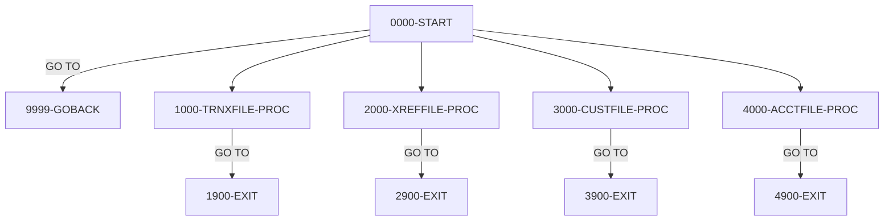

# Program CBSTM03B

| Item | Value |
|---|---|
| Source | `app/cbl/CBSTM03B.CBL` |
| Lines | 230 total, 162 code, 26 comment, 42 blank |
| PROGRAM-ID | CBSTM03B |
| Author | AWS |
| Runtime | subprogram |
| Module | base |
| CICS transactions | None in CSD |
| JCL steps | None |
| Paragraphs | 14 |
| Semantic analysis | validated (batch B02) |
| Version banner |  |

## Summary

CBSTM03B is a batch COBOL subroutine called by the statement program CBSTM03A to perform all file I/O. The caller passes a DD name (TRNXFILE, XREFFILE, CUSTFILE or ACCTFILE), an operation code (O open, R sequential read, K keyed read, C close), an optional key and key length. The routine opens the file for input, reads the next record (transaction and cross-reference files, sequential) or reads by key (customer and account files, random), or closes it, returning the record in the 1000-byte LK-M03B-FLDT area and the two-byte file status in LK-M03B-RC. It writes no files and performs no business logic. (Confirmed)

Evidence: `app/cbl/CBSTM03B.CBL:4-8`, `app/cbl/CBSTM03B.CBL:30-53`, `app/cbl/CBSTM03B.CBL:99-128`

Header comment (Unverified, `app/cbl/CBSTM03B.CBL:1-8`): Program     : CBSTM03B.CBL Application : CardDemo Type        : BATCH COBOL Subroutine Function    : Does file processing related to Transact Report All Rights Reserved. http://www.apache.org/licenses/LICENSE-2.0

## Divisions and sections

| Division / section | Lines | Notes |
|---|---|---|
| IDENTIFICATION DIVISION | `app/cbl/CBSTM03B.CBL:1-27` |  |
| ENVIRONMENT DIVISION | `app/cbl/CBSTM03B.CBL:28-55` |  |
| DATA DIVISION | `app/cbl/CBSTM03B.CBL:56-113` |  |
| PROCEDURE DIVISION | `app/cbl/CBSTM03B.CBL:114-230` | USING LK-M03B-AREA |
| ENVIRONMENT / INPUT-OUTPUT SECTION | `app/cbl/CBSTM03B.CBL:29-55` |  |
| DATA / FILE SECTION | `app/cbl/CBSTM03B.CBL:57-79` |  |
| DATA / WORKING-STORAGE SECTION | `app/cbl/CBSTM03B.CBL:80-98` |  |
| DATA / LINKAGE SECTION | `app/cbl/CBSTM03B.CBL:99-113` |  |

## Files and data stores

| File | ASSIGN | Org | Access | Record key | Alt key | Status field | OPEN modes | Physical dataset (JCL) | Evidence |
|---|---|---|---|---|---|---|---|---|---|
| TRNX-FILE | TRNXFILE | INDEXED | SEQUENTIAL | FD-TRNXS-ID |  | TRNXFILE-STATUS | INPUT (line 136) | No JCL step found for this program | `app/cbl/CBSTM03B.CBL:31-35`, FD `app/cbl/CBSTM03B.CBL:58` |
| XREF-FILE | XREFFILE | INDEXED | SEQUENTIAL | FD-XREF-CARD-NUM |  | XREFFILE-STATUS | INPUT (line 160) | No JCL step found for this program | `app/cbl/CBSTM03B.CBL:37-41`, FD `app/cbl/CBSTM03B.CBL:65` |
| CUST-FILE | CUSTFILE | INDEXED | RANDOM | FD-CUST-ID |  | CUSTFILE-STATUS | INPUT (line 184) | No JCL step found for this program | `app/cbl/CBSTM03B.CBL:43-47`, FD `app/cbl/CBSTM03B.CBL:70` |
| ACCT-FILE | ACCTFILE | INDEXED | RANDOM | FD-ACCT-ID |  | ACCTFILE-STATUS | INPUT (line 209) | No JCL step found for this program | `app/cbl/CBSTM03B.CBL:49-53`, FD `app/cbl/CBSTM03B.CBL:75` |

CRUD summary from the program facts:

| Store | Kind | Ops | Evidence |
|---|---|---|---|
| ACCT-FILE | logical | R | `app/cbl/CBSTM03B.CBL:209-215` |
| XREF-FILE | logical | R | `app/cbl/CBSTM03B.CBL:160-165` |
| CUST-FILE | logical | R | `app/cbl/CBSTM03B.CBL:184-190` |
| TRNX-FILE | logical | R | `app/cbl/CBSTM03B.CBL:136-141` |

## Embedded CICS, SQL and DL/I commands

No EXEC blocks.

## Calls, transfers and callers

No CALL, XCTL, LINK or START.

Programs that transfer to or call this program (from `docs/_work/xref/call-graph.json`):

| Caller | Mechanism | Confidence | Evidence |
|---|---|---|---|
| CBSTM03A | CALL-static | Confirmed | `app/cbl/CBSTM03A.CBL:351` |
| CBSTM03A | CALL-static | Confirmed | `app/cbl/CBSTM03A.CBL:377` |
| CBSTM03A | CALL-static | Confirmed | `app/cbl/CBSTM03A.CBL:401` |
| CBSTM03A | CALL-static | Confirmed | `app/cbl/CBSTM03A.CBL:734` |
| CBSTM03A | CALL-static | Confirmed | `app/cbl/CBSTM03A.CBL:746` |
| CBSTM03A | CALL-static | Confirmed | `app/cbl/CBSTM03A.CBL:769` |
| CBSTM03A | CALL-static | Confirmed | `app/cbl/CBSTM03A.CBL:787` |
| CBSTM03A | CALL-static | Confirmed | `app/cbl/CBSTM03A.CBL:805` |
| CBSTM03A | CALL-static | Confirmed | `app/cbl/CBSTM03A.CBL:835` |
| CBSTM03A | CALL-static | Confirmed | `app/cbl/CBSTM03A.CBL:860` |
| CBSTM03A | CALL-static | Confirmed | `app/cbl/CBSTM03A.CBL:877` |
| CBSTM03A | CALL-static | Confirmed | `app/cbl/CBSTM03A.CBL:893` |
| CBSTM03A | CALL-static | Confirmed | `app/cbl/CBSTM03A.CBL:909` |

## Copybooks

No COPY statements.

## Data division items

Every data entry coded in this source (copybook contents are on the copybook pages). Lengths are computed from PIC and USAGE.

| Section | Lvl | Name | PIC | Usage | Len | OCCURS | REDEFINES | VALUE | 88-levels | Line |
|---|---|---|---|---|---|---|---|---|---|---|
| FILE | 01 | FD-TRNXFILE-REC |  |  |  |  |  |  |  | 59 |
| FILE | 05 | FD-TRNXS-ID |  |  |  |  |  |  |  | 60 |
| FILE | 10 | FD-TRNX-CARD | X(16) |  | 16 |  |  |  |  | 61 |
| FILE | 10 | FD-TRNX-ID | X(16) |  | 16 |  |  |  |  | 62 |
| FILE | 05 | FD-ACCT-DATA | X(318) |  | 318 |  |  |  |  | 63 |
| FILE | 01 | FD-XREFFILE-REC |  |  |  |  |  |  |  | 66 |
| FILE | 05 | FD-XREF-CARD-NUM | X(16) |  | 16 |  |  |  |  | 67 |
| FILE | 05 | FD-XREF-DATA | X(34) |  | 34 |  |  |  |  | 68 |
| FILE | 01 | FD-CUSTFILE-REC |  |  |  |  |  |  |  | 71 |
| FILE | 05 | FD-CUST-ID | X(09) |  | 9 |  |  |  |  | 72 |
| FILE | 05 | FD-CUST-DATA | X(491) |  | 491 |  |  |  |  | 73 |
| FILE | 01 | FD-ACCTFILE-REC |  |  |  |  |  |  |  | 76 |
| FILE | 05 | FD-ACCT-ID | 9(11) |  | 11 |  |  |  |  | 77 |
| FILE | 05 | FD-ACCT-DATA | X(289) |  | 289 |  |  |  |  | 78 |
| WORKING-STORAGE | 01 | TRNXFILE-STATUS |  |  |  |  |  |  |  | 83 |
| WORKING-STORAGE | 05 | TRNXFILE-STAT1 | X |  | 1 |  |  |  |  | 84 |
| WORKING-STORAGE | 05 | TRNXFILE-STAT2 | X |  | 1 |  |  |  |  | 85 |
| WORKING-STORAGE | 01 | XREFFILE-STATUS |  |  |  |  |  |  |  | 87 |
| WORKING-STORAGE | 05 | XREFFILE-STAT1 | X |  | 1 |  |  |  |  | 88 |
| WORKING-STORAGE | 05 | XREFFILE-STAT2 | X |  | 1 |  |  |  |  | 89 |
| WORKING-STORAGE | 01 | CUSTFILE-STATUS |  |  |  |  |  |  |  | 91 |
| WORKING-STORAGE | 05 | CUSTFILE-STAT1 | X |  | 1 |  |  |  |  | 92 |
| WORKING-STORAGE | 05 | CUSTFILE-STAT2 | X |  | 1 |  |  |  |  | 93 |
| WORKING-STORAGE | 01 | ACCTFILE-STATUS |  |  |  |  |  |  |  | 95 |
| WORKING-STORAGE | 05 | ACCTFILE-STAT1 | X |  | 1 |  |  |  |  | 96 |
| WORKING-STORAGE | 05 | ACCTFILE-STAT2 | X |  | 1 |  |  |  |  | 97 |
| LINKAGE | 01 | LK-M03B-AREA |  |  |  |  |  |  |  | 100 |
| LINKAGE | 05 | LK-M03B-DD | X(08) |  | 8 |  |  |  |  | 101 |
| LINKAGE | 05 | LK-M03B-OPER | X(01) |  | 1 |  |  |  | M03B-OPEN = 'O'; M03B-CLOSE = 'C'; M03B-READ = 'R'; M03B-READ-K = 'K'; M03B-WRITE = 'W'; M03B-REWRITE = 'Z' | 102 |
| LINKAGE | 05 | LK-M03B-RC | X(02) |  | 2 |  |  |  |  | 109 |
| LINKAGE | 05 | LK-M03B-KEY | X(25) |  | 25 |  |  |  |  | 110 |
| LINKAGE | 05 | LK-M03B-KEY-LN | S9(4) |  | 4 |  |  |  |  | 111 |
| LINKAGE | 05 | LK-M03B-FLDT | X(1000) |  | 1000 |  |  |  |  | 112 |

## Statement inventory

Every procedure statement the parser recorded, by kind. Each one is listed with its line under Paragraph details.

| Kind | Count |
|---|---|
| Decisions (IF, EVALUATE, WHEN, loops, handlers) | 18 |
| Calculations | 0 |
| File I/O | 12 |
| EXEC CICS / SQL / DLI | 0 |
| CALL | 0 |
| PERFORM | 4 |
| GO TO | 13 |
| MOVE literal | 0 |
| MOVE field | 6 |
| SET | 0 |
| STRING, UNSTRING, INSPECT, INITIALIZE, COPY, ENTRY and others | 0 |
| DISPLAY | 0 |
| GOBACK, STOP RUN, RETURN, XCTL | 1 |
| Not classified by the parser | 0 |

## Control flow

| Paragraph | Lines | Logic | Performs | Performed by | Reachable |
|---|---|---|---|---|---|
| [0000-START](#para-0000-start) | 116-128 | EVALUATEs LK-M03B-DD and performs the matching file routine (1000 TRNXFILE, 2000 XREFFILE, 3000 CUSTFILE, 4000 ACCTFILE) THRU its x999 exit; any other DD name goes to 9999-GOBACK. (Confirmed) | 1000-TRNXFILE-PROC, 2000-XREFFILE-PROC, 3000-CUSTFILE-PROC, 4000-ACCTFILE-PROC |  | yes |
| [9999-GOBACK](#para-9999-goback) | 130-131 | Returns to the caller (GOBACK). (Confirmed) |  | 0000-START | yes |
| [1000-TRNXFILE-PROC](#para-1000-trnxfile-proc) | 133-149 | For TRNX-FILE: on M03B-OPEN opens it for input, on M03B-READ reads the next record into LK-M03B-FLDT, on M03B-CLOSE closes it; each branch jumps to 1900-EXIT. (Confirmed) |  | 0000-START | yes |
| [1900-EXIT](#para-1900-exit) | 151-152 | Moves TRNXFILE-STATUS to LK-M03B-RC. (Confirmed) |  | 0000-START, 1000-TRNXFILE-PROC | yes |
| [1999-EXIT](#para-1999-exit) | 154-155 | End of the TRNXFILE PERFORM THRU range (EXIT). (Confirmed) |  | 0000-START | yes |
| [2000-XREFFILE-PROC](#para-2000-xreffile-proc) | 157-173 | For XREF-FILE: on M03B-OPEN opens it for input, on M03B-READ reads the next record into LK-M03B-FLDT, on M03B-CLOSE closes it; each branch jumps to 2900-EXIT. (Confirmed) |  | 0000-START | yes |
| [2900-EXIT](#para-2900-exit) | 175-176 | Moves XREFFILE-STATUS to LK-M03B-RC. (Confirmed) |  | 0000-START, 2000-XREFFILE-PROC | yes |
| [2999-EXIT](#para-2999-exit) | 178-179 | End of the XREFFILE PERFORM THRU range (EXIT). (Confirmed) |  | 0000-START | yes |
| [3000-CUSTFILE-PROC](#para-3000-custfile-proc) | 181-198 | For CUST-FILE: on M03B-OPEN opens it for input; on M03B-READ-K moves LK-M03B-KEY(1:LK-M03B-KEY-LN) to FD-CUST-ID and reads randomly into LK-M03B-FLDT; on M03B-CLOSE closes it; each branch jumps to 3900-EXIT. (Confirmed) |  | 0000-START | yes |
| [3900-EXIT](#para-3900-exit) | 200-201 | Moves CUSTFILE-STATUS to LK-M03B-RC. (Confirmed) |  | 0000-START, 3000-CUSTFILE-PROC | yes |
| [3999-EXIT](#para-3999-exit) | 203-204 | End of the CUSTFILE PERFORM THRU range (EXIT). (Confirmed) |  | 0000-START | yes |
| [4000-ACCTFILE-PROC](#para-4000-acctfile-proc) | 206-223 | For ACCT-FILE: on M03B-OPEN opens it for input; on M03B-READ-K moves LK-M03B-KEY(1:LK-M03B-KEY-LN) to FD-ACCT-ID and reads randomly into LK-M03B-FLDT; on M03B-CLOSE closes it; each branch jumps to 4900-EXIT. (Confirmed) |  | 0000-START | yes |
| [4900-EXIT](#para-4900-exit) | 225-226 | Moves ACCTFILE-STATUS to LK-M03B-RC. (Confirmed) |  | 0000-START, 4000-ACCTFILE-PROC | yes |
| [4999-EXIT](#para-4999-exit) | 228-229 | End of the ACCTFILE PERFORM THRU range (EXIT). (Confirmed) |  | 0000-START | yes |

## Paragraph details

### Para 0000-START

Lines `app/cbl/CBSTM03B.CBL:116-128`. 

Logic: EVALUATEs LK-M03B-DD and performs the matching file routine (1000 TRNXFILE, 2000 XREFFILE, 3000 CUSTFILE, 4000 ACCTFILE) THRU its x999 exit; any other DD name goes to 9999-GOBACK. (Confirmed)

Statements in source order:

- EVALUATE `LK-M03B-DD` at `app/cbl/CBSTM03B.CBL:118` (business-candidate)
- WHEN `'TRNXFILE'` at `app/cbl/CBSTM03B.CBL:119` (business-candidate)
- PERFORM 1000-TRNXFILE-PROC THRU 1999-EXIT at `app/cbl/CBSTM03B.CBL:120`
- WHEN `'XREFFILE'` at `app/cbl/CBSTM03B.CBL:121` (business-candidate)
- PERFORM 2000-XREFFILE-PROC THRU 2999-EXIT at `app/cbl/CBSTM03B.CBL:122`
- WHEN `'CUSTFILE'` at `app/cbl/CBSTM03B.CBL:123` (business-candidate)
- PERFORM 3000-CUSTFILE-PROC THRU 3999-EXIT at `app/cbl/CBSTM03B.CBL:124`
- WHEN `'ACCTFILE'` at `app/cbl/CBSTM03B.CBL:125` (business-candidate)
- PERFORM 4000-ACCTFILE-PROC THRU 4999-EXIT at `app/cbl/CBSTM03B.CBL:126`
- WHEN `OTHER` at `app/cbl/CBSTM03B.CBL:127` (business-candidate)
- GO TO 9999-GOBACK at `app/cbl/CBSTM03B.CBL:128`

### Para 9999-GOBACK

Lines `app/cbl/CBSTM03B.CBL:130-131`. 

Logic: Returns to the caller (GOBACK). (Confirmed)

Statements in source order:

- Ends with GOBACK at `app/cbl/CBSTM03B.CBL:131`

### Para 1000-TRNXFILE-PROC

Lines `app/cbl/CBSTM03B.CBL:133-149`. 

Logic: For TRNX-FILE: on M03B-OPEN opens it for input, on M03B-READ reads the next record into LK-M03B-FLDT, on M03B-CLOSE closes it; each branch jumps to 1900-EXIT. (Confirmed)

Statements in source order:

- IF `M03B-OPEN` at `app/cbl/CBSTM03B.CBL:135` (business-candidate)
- File I/O `OPEN INPUT TRNX-FILE` at `app/cbl/CBSTM03B.CBL:136`
- GO TO 1900-EXIT at `app/cbl/CBSTM03B.CBL:137`
- IF `M03B-READ` at `app/cbl/CBSTM03B.CBL:140` (business-candidate)
- File I/O `READ TRNX-FILE INTO LK-M03B-FLDT` at `app/cbl/CBSTM03B.CBL:141`
- GO TO 1900-EXIT at `app/cbl/CBSTM03B.CBL:143`
- IF `M03B-CLOSE` at `app/cbl/CBSTM03B.CBL:146` (business-candidate)
- File I/O `CLOSE TRNX-FILE` at `app/cbl/CBSTM03B.CBL:147`
- GO TO 1900-EXIT at `app/cbl/CBSTM03B.CBL:148`

### Para 1900-EXIT

Lines `app/cbl/CBSTM03B.CBL:151-152`. 

Logic: Moves TRNXFILE-STATUS to LK-M03B-RC. (Confirmed)

Statements in source order:

- `MOVE TRNXFILE-STATUS TO LK-M03B-RC` at `app/cbl/CBSTM03B.CBL:152`

### Para 1999-EXIT

Lines `app/cbl/CBSTM03B.CBL:154-155`. 

Logic: End of the TRNXFILE PERFORM THRU range (EXIT). (Confirmed)

### Para 2000-XREFFILE-PROC

Lines `app/cbl/CBSTM03B.CBL:157-173`. 

Logic: For XREF-FILE: on M03B-OPEN opens it for input, on M03B-READ reads the next record into LK-M03B-FLDT, on M03B-CLOSE closes it; each branch jumps to 2900-EXIT. (Confirmed)

Statements in source order:

- IF `M03B-OPEN` at `app/cbl/CBSTM03B.CBL:159` (business-candidate)
- File I/O `OPEN INPUT XREF-FILE` at `app/cbl/CBSTM03B.CBL:160`
- GO TO 2900-EXIT at `app/cbl/CBSTM03B.CBL:161`
- IF `M03B-READ` at `app/cbl/CBSTM03B.CBL:164` (business-candidate)
- File I/O `READ XREF-FILE INTO LK-M03B-FLDT` at `app/cbl/CBSTM03B.CBL:165`
- GO TO 2900-EXIT at `app/cbl/CBSTM03B.CBL:167`
- IF `M03B-CLOSE` at `app/cbl/CBSTM03B.CBL:170` (business-candidate)
- File I/O `CLOSE XREF-FILE` at `app/cbl/CBSTM03B.CBL:171`
- GO TO 2900-EXIT at `app/cbl/CBSTM03B.CBL:172`

### Para 2900-EXIT

Lines `app/cbl/CBSTM03B.CBL:175-176`. 

Logic: Moves XREFFILE-STATUS to LK-M03B-RC. (Confirmed)

Statements in source order:

- `MOVE XREFFILE-STATUS TO LK-M03B-RC` at `app/cbl/CBSTM03B.CBL:176`

### Para 2999-EXIT

Lines `app/cbl/CBSTM03B.CBL:178-179`. 

Logic: End of the XREFFILE PERFORM THRU range (EXIT). (Confirmed)

### Para 3000-CUSTFILE-PROC

Lines `app/cbl/CBSTM03B.CBL:181-198`. 

Logic: For CUST-FILE: on M03B-OPEN opens it for input; on M03B-READ-K moves LK-M03B-KEY(1:LK-M03B-KEY-LN) to FD-CUST-ID and reads randomly into LK-M03B-FLDT; on M03B-CLOSE closes it; each branch jumps to 3900-EXIT. (Confirmed)

Statements in source order:

- IF `M03B-OPEN` at `app/cbl/CBSTM03B.CBL:183` (business-candidate)
- File I/O `OPEN INPUT CUST-FILE` at `app/cbl/CBSTM03B.CBL:184`
- GO TO 3900-EXIT at `app/cbl/CBSTM03B.CBL:185`
- IF `M03B-READ-K` at `app/cbl/CBSTM03B.CBL:188` (business-candidate)
- `MOVE LK-M03B-KEY (1:LK-M03B-KEY-LN) TO FD-CUST-ID` at `app/cbl/CBSTM03B.CBL:189`
- File I/O `READ CUST-FILE INTO LK-M03B-FLDT` at `app/cbl/CBSTM03B.CBL:190`
- GO TO 3900-EXIT at `app/cbl/CBSTM03B.CBL:192`
- IF `M03B-CLOSE` at `app/cbl/CBSTM03B.CBL:195` (business-candidate)
- File I/O `CLOSE CUST-FILE` at `app/cbl/CBSTM03B.CBL:196`
- GO TO 3900-EXIT at `app/cbl/CBSTM03B.CBL:197`

### Para 3900-EXIT

Lines `app/cbl/CBSTM03B.CBL:200-201`. 

Logic: Moves CUSTFILE-STATUS to LK-M03B-RC. (Confirmed)

Statements in source order:

- `MOVE CUSTFILE-STATUS TO LK-M03B-RC` at `app/cbl/CBSTM03B.CBL:201`

### Para 3999-EXIT

Lines `app/cbl/CBSTM03B.CBL:203-204`. 

Logic: End of the CUSTFILE PERFORM THRU range (EXIT). (Confirmed)

### Para 4000-ACCTFILE-PROC

Lines `app/cbl/CBSTM03B.CBL:206-223`. 

Logic: For ACCT-FILE: on M03B-OPEN opens it for input; on M03B-READ-K moves LK-M03B-KEY(1:LK-M03B-KEY-LN) to FD-ACCT-ID and reads randomly into LK-M03B-FLDT; on M03B-CLOSE closes it; each branch jumps to 4900-EXIT. (Confirmed)

Statements in source order:

- IF `M03B-OPEN` at `app/cbl/CBSTM03B.CBL:208` (business-candidate)
- File I/O `OPEN INPUT ACCT-FILE` at `app/cbl/CBSTM03B.CBL:209`
- GO TO 4900-EXIT at `app/cbl/CBSTM03B.CBL:210`
- IF `M03B-READ-K` at `app/cbl/CBSTM03B.CBL:213` (business-candidate)
- `MOVE LK-M03B-KEY (1:LK-M03B-KEY-LN) TO FD-ACCT-ID` at `app/cbl/CBSTM03B.CBL:214`
- File I/O `READ ACCT-FILE INTO LK-M03B-FLDT` at `app/cbl/CBSTM03B.CBL:215`
- GO TO 4900-EXIT at `app/cbl/CBSTM03B.CBL:217`
- IF `M03B-CLOSE` at `app/cbl/CBSTM03B.CBL:220` (business-candidate)
- File I/O `CLOSE ACCT-FILE` at `app/cbl/CBSTM03B.CBL:221`
- GO TO 4900-EXIT at `app/cbl/CBSTM03B.CBL:222`

### Para 4900-EXIT

Lines `app/cbl/CBSTM03B.CBL:225-226`. 

Logic: Moves ACCTFILE-STATUS to LK-M03B-RC. (Confirmed)

Statements in source order:

- `MOVE ACCTFILE-STATUS TO LK-M03B-RC` at `app/cbl/CBSTM03B.CBL:226`

### Para 4999-EXIT

Lines `app/cbl/CBSTM03B.CBL:228-229`. 

Logic: End of the ACCTFILE PERFORM THRU range (EXIT). (Confirmed)

## Business rules

No business rules identified: CBSTM03B is a file-access subroutine for CBSTM03A. Based on the DD name and operation code passed in LK-M03B-AREA it opens, reads (sequentially or by key) or closes one of four indexed files and returns the file status in LK-M03B-RC. It makes no business decisions; its conditional logic is only the dispatch on file name and operation code.

Decision points reviewed and classified as not business rules:

| Lines | Reason |
|---|---|
| `app/cbl/CBSTM03B.CBL:118-128` | Technical dispatch on the DD name requested by the caller (TRNXFILE, XREFFILE, CUSTFILE, ACCTFILE); unknown names simply GOBACK. |
| `app/cbl/CBSTM03B.CBL:135-148` | Dispatch on operation code (open, sequential read, close) for TRNXFILE; pure I/O. |
| `app/cbl/CBSTM03B.CBL:159-172` | Dispatch on operation code (open, sequential read, close) for XREFFILE; pure I/O. |
| `app/cbl/CBSTM03B.CBL:183-197` | Dispatch on operation code (open, keyed read, close) for CUSTFILE; pure I/O. |
| `app/cbl/CBSTM03B.CBL:208-222` | Dispatch on operation code (open, keyed read, close) for ACCTFILE; pure I/O. |

Decision coverage: 18 of 18 business-candidate decision points are linked to a rule or a no-rule reason (0 inside rule ranges).

## Error handling

No status checks, abends or return-code settings were found.

## Observations and SME questions

- anomaly: For an unknown DD name the routine GOBACKs without setting LK-M03B-RC, so the caller sees whatever it pre-loaded (CBSTM03A moves ZERO, i.e. '00' = success). (`app/cbl/CBSTM03B.CBL:127-131`)
- anomaly: Operation codes declared but not implemented (M03B-WRITE 'W', M03B-REWRITE 'Z', and keyed/sequential reads on the 'wrong' file) fall through to the exit paragraph and return the previous file status, which can look like success. (`app/cbl/CBSTM03B.CBL:103-108`)
- anomaly: TRNXFILE is keyed by FD-TRNXS-ID = card number (16) + transaction id (16), so a sequential read returns transactions ordered by card number; CBSTM03A relies on this order when grouping transactions by card. (`app/cbl/CBSTM03B.CBL:31-35`)

## Sources

- `app/cbl/CBSTM03B.CBL`
- `docs/_work/structure/programs/CBSTM03B.json`
- `docs/_work/semantic/programs/CBSTM03B.json`
- `docs/_work/programs/CBSTM03B.json`

## Confidence

Structure tables (divisions, items, paragraphs, statements, line numbers) are Confirmed: they are parsed from the source. Paragraph logic and rule statements carry their own Confirmed/Inferred tag from the batch analysis, and every rule anchor was checked against the cited lines. Decision-point classes are a keyword heuristic used only for coverage measurement. Header comments are Unverified.
