# Program CBTRN01C

| Item | Value |
|---|---|
| Source | `app/cbl/CBTRN01C.cbl` |
| Lines | 494 total, 415 code, 45 comment, 34 blank |
| PROGRAM-ID | CBTRN01C |
| Author | AWS |
| Runtime | batch-main |
| Module | base |
| CICS transactions | None in CSD |
| JCL steps | None |
| Paragraphs | 18 |
| Semantic analysis | validated (batch B02) |
| Version banner | * Ver: CardDemo_v2.0-25-gdb72e6b-235 Date: 2025-04-29 11:01:28 CDT |

## Summary

CBTRN01C is a batch COBOL program that reads the sequential daily transaction file DALYTRAN and verifies each transaction against the master files. For each record it looks up the card number in the card cross-reference KSDS (XREFFILE) and, if found, reads the linked account in ACCTFILE, DISPLAYing the results; unknown cards are reported and skipped, missing accounts are reported. Although its header says it posts transactions, it writes nothing: the customer, card and transaction files are opened for input only and never used. Open, close and daily-file read errors abend with code 999. (Confirmed)

Evidence: `app/cbl/CBTRN01C.cbl:1-5`, `app/cbl/CBTRN01C.cbl:28-62`, `app/cbl/CBTRN01C.cbl:155-197`, `app/cbl/CBTRN01C.cbl:227-250`

Header comment (Unverified, `app/cbl/CBTRN01C.cbl:1-8`): Program     : CBTRN01C.CBL Application : CardDemo Type        : BATCH COBOL Program Function    : Post the records from daily transaction file. All Rights Reserved. http://www.apache.org/licenses/LICENSE-2.0

## Divisions and sections

| Division / section | Lines | Notes |
|---|---|---|
| IDENTIFICATION DIVISION | `app/cbl/CBTRN01C.cbl:22-25` |  |
| ENVIRONMENT DIVISION | `app/cbl/CBTRN01C.cbl:26-63` |  |
| DATA DIVISION | `app/cbl/CBTRN01C.cbl:64-153` |  |
| PROCEDURE DIVISION | `app/cbl/CBTRN01C.cbl:154-494` |  |
| ENVIRONMENT / INPUT-OUTPUT SECTION | `app/cbl/CBTRN01C.cbl:27-63` |  |
| DATA / FILE SECTION | `app/cbl/CBTRN01C.cbl:65-95` |  |
| DATA / WORKING-STORAGE SECTION | `app/cbl/CBTRN01C.cbl:96-153` |  |

## Files and data stores

| File | ASSIGN | Org | Access | Record key | Alt key | Status field | OPEN modes | Physical dataset (JCL) | Evidence |
|---|---|---|---|---|---|---|---|---|---|
| DALYTRAN-FILE | DALYTRAN | SEQUENTIAL | SEQUENTIAL |  |  | DALYTRAN-STATUS | INPUT (line 254) | No JCL step found for this program | `app/cbl/CBTRN01C.cbl:29-32`, FD `app/cbl/CBTRN01C.cbl:66` |
| CUSTOMER-FILE | CUSTFILE | INDEXED | RANDOM | FD-CUST-ID |  | CUSTFILE-STATUS | INPUT (line 273) | No JCL step found for this program | `app/cbl/CBTRN01C.cbl:34-38`, FD `app/cbl/CBTRN01C.cbl:71` |
| XREF-FILE | XREFFILE | INDEXED | RANDOM | FD-XREF-CARD-NUM |  | XREFFILE-STATUS | INPUT (line 291) | No JCL step found for this program | `app/cbl/CBTRN01C.cbl:40-44`, FD `app/cbl/CBTRN01C.cbl:76` |
| CARD-FILE | CARDFILE | INDEXED | RANDOM | FD-CARD-NUM |  | CARDFILE-STATUS | INPUT (line 309) | No JCL step found for this program | `app/cbl/CBTRN01C.cbl:46-50`, FD `app/cbl/CBTRN01C.cbl:81` |
| ACCOUNT-FILE | ACCTFILE | INDEXED | RANDOM | FD-ACCT-ID |  | ACCTFILE-STATUS | INPUT (line 327) | No JCL step found for this program | `app/cbl/CBTRN01C.cbl:52-56`, FD `app/cbl/CBTRN01C.cbl:86` |
| TRANSACT-FILE | TRANFILE | INDEXED | RANDOM | FD-TRANS-ID |  | TRANFILE-STATUS | INPUT (line 345) | No JCL step found for this program | `app/cbl/CBTRN01C.cbl:58-62`, FD `app/cbl/CBTRN01C.cbl:91` |

CRUD summary from the program facts:

| Store | Kind | Ops | Evidence |
|---|---|---|---|
| TRANSACT-FILE | logical | R | `app/cbl/CBTRN01C.cbl:345` |
| XREF-FILE | logical | R | `app/cbl/CBTRN01C.cbl:229-291` |
| CARD-FILE | logical | R | `app/cbl/CBTRN01C.cbl:309` |
| ACCOUNT-FILE | logical | R | `app/cbl/CBTRN01C.cbl:243-327` |
| CUSTOMER-FILE | logical | R | `app/cbl/CBTRN01C.cbl:273` |
| DALYTRAN-FILE | logical | R | `app/cbl/CBTRN01C.cbl:203-254` |

## Embedded CICS, SQL and DL/I commands

No EXEC blocks.

## Calls, transfers and callers

| Mechanism | Target | Parameters | Paragraph | Lines |
|---|---|---|---|---|
| CALL system/LE | CEE3ABD | ABCODE, TIMING | Z-ABEND-PROGRAM | `app/cbl/CBTRN01C.cbl:473` |

## Copybooks

| Copybook | Statement | Resolution | Resolved path | REPLACING | Line |
|---|---|---|---|---|---|
| [CVTRA06Y](../08-data/layouts/CVTRA06Y.md) | COPY | inventory | app/cpy/CVTRA06Y.cpy |  | `app/cbl/CBTRN01C.cbl:99` |
| [CVCUS01Y](../08-data/layouts/CVCUS01Y.md) | COPY | inventory | app/cpy/CVCUS01Y.cpy |  | `app/cbl/CBTRN01C.cbl:104` |
| [CVACT03Y](../08-data/layouts/CVACT03Y.md) | COPY | inventory | app/cpy/CVACT03Y.cpy |  | `app/cbl/CBTRN01C.cbl:109` |
| [CVACT02Y](../08-data/layouts/CVACT02Y.md) | COPY | inventory | app/cpy/CVACT02Y.cpy |  | `app/cbl/CBTRN01C.cbl:114` |
| [CVACT01Y](../08-data/layouts/CVACT01Y.md) | COPY | inventory | app/cpy/CVACT01Y.cpy |  | `app/cbl/CBTRN01C.cbl:119` |
| [CVTRA05Y](../08-data/layouts/CVTRA05Y.md) | COPY | inventory | app/cpy/CVTRA05Y.cpy |  | `app/cbl/CBTRN01C.cbl:124` |

## Data division items

Every data entry coded in this source (copybook contents are on the copybook pages). Lengths are computed from PIC and USAGE.

| Section | Lvl | Name | PIC | Usage | Len | OCCURS | REDEFINES | VALUE | 88-levels | Line |
|---|---|---|---|---|---|---|---|---|---|---|
| FILE | 01 | FD-TRAN-RECORD |  |  |  |  |  |  |  | 67 |
| FILE | 05 | FD-TRAN-ID | X(16) |  | 16 |  |  |  |  | 68 |
| FILE | 05 | FD-CUST-DATA | X(334) |  | 334 |  |  |  |  | 69 |
| FILE | 01 | FD-CUSTFILE-REC |  |  |  |  |  |  |  | 72 |
| FILE | 05 | FD-CUST-ID | 9(09) |  | 9 |  |  |  |  | 73 |
| FILE | 05 | FD-CUST-DATA | X(491) |  | 491 |  |  |  |  | 74 |
| FILE | 01 | FD-XREFFILE-REC |  |  |  |  |  |  |  | 77 |
| FILE | 05 | FD-XREF-CARD-NUM | X(16) |  | 16 |  |  |  |  | 78 |
| FILE | 05 | FD-XREF-DATA | X(34) |  | 34 |  |  |  |  | 79 |
| FILE | 01 | FD-CARDFILE-REC |  |  |  |  |  |  |  | 82 |
| FILE | 05 | FD-CARD-NUM | X(16) |  | 16 |  |  |  |  | 83 |
| FILE | 05 | FD-CARD-DATA | X(134) |  | 134 |  |  |  |  | 84 |
| FILE | 01 | FD-ACCTFILE-REC |  |  |  |  |  |  |  | 87 |
| FILE | 05 | FD-ACCT-ID | 9(11) |  | 11 |  |  |  |  | 88 |
| FILE | 05 | FD-ACCT-DATA | X(289) |  | 289 |  |  |  |  | 89 |
| FILE | 01 | FD-TRANFILE-REC |  |  |  |  |  |  |  | 92 |
| FILE | 05 | FD-TRANS-ID | X(16) |  | 16 |  |  |  |  | 93 |
| FILE | 05 | FD-ACCT-DATA | X(334) |  | 334 |  |  |  |  | 94 |
| WORKING-STORAGE | 01 | DALYTRAN-STATUS |  |  |  |  |  |  |  | 100 |
| WORKING-STORAGE | 05 | DALYTRAN-STAT1 | X |  | 1 |  |  |  |  | 101 |
| WORKING-STORAGE | 05 | DALYTRAN-STAT2 | X |  | 1 |  |  |  |  | 102 |
| WORKING-STORAGE | 01 | CUSTFILE-STATUS |  |  |  |  |  |  |  | 105 |
| WORKING-STORAGE | 05 | CUSTFILE-STAT1 | X |  | 1 |  |  |  |  | 106 |
| WORKING-STORAGE | 05 | CUSTFILE-STAT2 | X |  | 1 |  |  |  |  | 107 |
| WORKING-STORAGE | 01 | XREFFILE-STATUS |  |  |  |  |  |  |  | 110 |
| WORKING-STORAGE | 05 | XREFFILE-STAT1 | X |  | 1 |  |  |  |  | 111 |
| WORKING-STORAGE | 05 | XREFFILE-STAT2 | X |  | 1 |  |  |  |  | 112 |
| WORKING-STORAGE | 01 | CARDFILE-STATUS |  |  |  |  |  |  |  | 115 |
| WORKING-STORAGE | 05 | CARDFILE-STAT1 | X |  | 1 |  |  |  |  | 116 |
| WORKING-STORAGE | 05 | CARDFILE-STAT2 | X |  | 1 |  |  |  |  | 117 |
| WORKING-STORAGE | 01 | ACCTFILE-STATUS |  |  |  |  |  |  |  | 120 |
| WORKING-STORAGE | 05 | ACCTFILE-STAT1 | X |  | 1 |  |  |  |  | 121 |
| WORKING-STORAGE | 05 | ACCTFILE-STAT2 | X |  | 1 |  |  |  |  | 122 |
| WORKING-STORAGE | 01 | TRANFILE-STATUS |  |  |  |  |  |  |  | 125 |
| WORKING-STORAGE | 05 | TRANFILE-STAT1 | X |  | 1 |  |  |  |  | 126 |
| WORKING-STORAGE | 05 | TRANFILE-STAT2 | X |  | 1 |  |  |  |  | 127 |
| WORKING-STORAGE | 01 | IO-STATUS |  |  |  |  |  |  |  | 129 |
| WORKING-STORAGE | 05 | IO-STAT1 | X |  | 1 |  |  |  |  | 130 |
| WORKING-STORAGE | 05 | IO-STAT2 | X |  | 1 |  |  |  |  | 131 |
| WORKING-STORAGE | 01 | TWO-BYTES-BINARY | 9(4) | BINARY | 2 |  |  |  |  | 133 |
| WORKING-STORAGE | 01 | TWO-BYTES-ALPHA |  | BINARY |  |  | TWO-BYTES-BINARY |  |  | 134 |
| WORKING-STORAGE | 05 | TWO-BYTES-LEFT | X |  | 1 |  |  |  |  | 135 |
| WORKING-STORAGE | 05 | TWO-BYTES-RIGHT | X |  | 1 |  |  |  |  | 136 |
| WORKING-STORAGE | 01 | IO-STATUS-04 |  |  |  |  |  |  |  | 138 |
| WORKING-STORAGE | 05 | IO-STATUS-0401 | 9 |  | 1 |  |  | 0 |  | 139 |
| WORKING-STORAGE | 05 | IO-STATUS-0403 | 999 |  | 3 |  |  | 0 |  | 140 |
| WORKING-STORAGE | 01 | APPL-RESULT | S9(9) | COMP | 4 |  |  |  | APPL-AOK = 0; APPL-EOF = 16 | 142 |
| WORKING-STORAGE | 01 | END-OF-DAILY-TRANS-FILE | X(01) |  | 1 |  |  | 'N' |  | 146 |
| WORKING-STORAGE | 01 | ABCODE | S9(9) | BINARY | 4 |  |  |  |  | 147 |
| WORKING-STORAGE | 01 | TIMING | S9(9) | BINARY | 4 |  |  |  |  | 148 |
| WORKING-STORAGE | 01 | WS-MISC-VARIABLES |  |  |  |  |  |  |  | 149 |
| WORKING-STORAGE | 05 | WS-XREF-READ-STATUS | 9(04) |  | 4 |  |  |  |  | 150 |
| WORKING-STORAGE | 05 | WS-ACCT-READ-STATUS | 9(04) |  | 4 |  |  |  |  | 151 |

## Statement inventory

Every procedure statement the parser recorded, by kind. Each one is listed with its line under Paragraph details.

| Kind | Count |
|---|---|
| Decisions (IF, EVALUATE, WHEN, loops, handlers) | 38 |
| Calculations | 6 |
| File I/O | 15 |
| EXEC CICS / SQL / DLI | 0 |
| CALL | 1 |
| PERFORM | 42 |
| GO TO | 0 |
| MOVE literal | 42 |
| MOVE field | 21 |
| SET | 0 |
| STRING, UNSTRING, INSPECT, INITIALIZE, COPY, ENTRY and others | 0 |
| DISPLAY | 28 |
| GOBACK, STOP RUN, RETURN, XCTL | 1 |
| Not classified by the parser | 0 |

## Control flow

```mermaid
flowchart TD
    P0["MAIN-PARA"]
    P1["1000-DALYTRAN-GET-NEXT"]
    P2["2000-LOOKUP-XREF"]
    P3["3000-READ-ACCOUNT"]
    P4["0000-DALYTRAN-OPEN"]
    P5["0100-CUSTFILE-OPEN"]
    P6["0200-XREFFILE-OPEN"]
    P7["0300-CARDFILE-OPEN"]
    P8["0400-ACCTFILE-OPEN"]
    P9["0500-TRANFILE-OPEN"]
    P10["9000-DALYTRAN-CLOSE"]
    P11["9100-CUSTFILE-CLOSE"]
    P12["9200-XREFFILE-CLOSE"]
    P13["9300-CARDFILE-CLOSE"]
    P14["9400-ACCTFILE-CLOSE"]
    P15["9500-TRANFILE-CLOSE"]
    P16["Z-ABEND-PROGRAM"]
    P17["Z-DISPLAY-IO-STATUS"]
    P0 --> P4
    P0 --> P5
    P0 --> P6
    P0 --> P7
    P0 --> P8
    P0 --> P9
    P0 --> P1
    P0 --> P2
    P0 --> P3
    P0 --> P10
    P0 --> P11
    P0 --> P12
    P0 --> P13
    P0 --> P14
    P0 --> P15
    P1 --> P16
    P1 --> P17
    P4 --> P16
    P4 --> P17
    P5 --> P16
    P5 --> P17
    P6 --> P16
    P6 --> P17
    P7 --> P16
    P7 --> P17
    P8 --> P16
    P8 --> P17
    P9 --> P16
    P9 --> P17
    P10 --> P16
    P10 --> P17
    P11 --> P16
    P11 --> P17
    P12 --> P16
    P12 --> P17
    P13 --> P16
    P13 --> P17
    P14 --> P16
    P14 --> P17
    P15 --> P16
    P15 --> P17
```

| Paragraph | Lines | Logic | Performs | Performed by | Reachable |
|---|---|---|---|---|---|
| [MAIN-PARA](#para-main-para) | 155-197 | Opens DALYTRAN, CUSTFILE, XREFFILE, CARDFILE, ACCTFILE and TRANFILE (all input). For each daily transaction it displays the record, looks up DALYTRAN-CARD-NUM in the cross-reference; if found it reads the account XREF-ACCT-ID and displays 'ACCOUNT ... NOT FOUND' when missing, otherwise displays 'CARD NUMBER ... COULD NOT BE VERIFIED. SKIPPING TRANSACTION ID-'. Closes all files and GOBACKs. (Confirmed) | 0000-DALYTRAN-OPEN, 0100-CUSTFILE-OPEN, 0200-XREFFILE-OPEN, 0300-CARDFILE-OPEN, 0400-ACCTFILE-OPEN, 0500-TRANFILE-OPEN, 1000-DALYTRAN-GET-NEXT, 2000-LOOKUP-XREF, 3000-READ-ACCOUNT, 9000-DALYTRAN-CLOSE, 9100-CUSTFILE-CLOSE, 9200-XREFFILE-CLOSE, 9300-CARDFILE-CLOSE, 9400-ACCTFILE-CLOSE, 9500-TRANFILE-CLOSE |  | yes |
| [1000-DALYTRAN-GET-NEXT](#para-1000-dalytran-get-next) | 202-225 | Reads the next DALYTRAN-FILE record into DALYTRAN-RECORD. Status '10' sets END-OF-DAILY-TRANS-FILE 'Y'; a status other than '00'/'10' displays 'ERROR READING DAILY TRANSACTION FILE', the status, and abends. (Confirmed) | Z-ABEND-PROGRAM, Z-DISPLAY-IO-STATUS | MAIN-PARA | yes |
| [2000-LOOKUP-XREF](#para-2000-lookup-xref) | 227-239 | Reads XREF-FILE by card number; on INVALID KEY displays 'INVALID CARD NUMBER FOR XREF' and sets WS-XREF-READ-STATUS 4, otherwise displays the card number, account id and customer id found. (Confirmed) |  | MAIN-PARA | yes |
| [3000-READ-ACCOUNT](#para-3000-read-account) | 241-250 | Reads ACCOUNT-FILE by ACCT-ID; on INVALID KEY displays 'INVALID ACCOUNT NUMBER FOUND' and sets WS-ACCT-READ-STATUS 4, otherwise displays 'SUCCESSFUL READ OF ACCOUNT FILE'. (Confirmed) |  | MAIN-PARA | yes |
| [0000-DALYTRAN-OPEN](#para-0000-dalytran-open) | 252-268 | Opens DALYTRAN-FILE for input; a status other than '00' displays 'ERROR OPENING DAILY TRANSACTION FILE', the status, and abends. (Confirmed) | Z-ABEND-PROGRAM, Z-DISPLAY-IO-STATUS | MAIN-PARA | yes |
| [0100-CUSTFILE-OPEN](#para-0100-custfile-open) | 271-287 | Opens CUSTOMER-FILE for input; a status other than '00' displays 'ERROR OPENING CUSTOMER FILE', the status, and abends. (Confirmed) | Z-ABEND-PROGRAM, Z-DISPLAY-IO-STATUS | MAIN-PARA | yes |
| [0200-XREFFILE-OPEN](#para-0200-xreffile-open) | 289-305 | Opens XREF-FILE for input; a status other than '00' displays 'ERROR OPENING CROSS REF FILE', the status, and abends. (Confirmed) | Z-ABEND-PROGRAM, Z-DISPLAY-IO-STATUS | MAIN-PARA | yes |
| [0300-CARDFILE-OPEN](#para-0300-cardfile-open) | 307-323 | Opens CARD-FILE for input; a status other than '00' displays 'ERROR OPENING CARD FILE', the status, and abends. (Confirmed) | Z-ABEND-PROGRAM, Z-DISPLAY-IO-STATUS | MAIN-PARA | yes |
| [0400-ACCTFILE-OPEN](#para-0400-acctfile-open) | 325-341 | Opens ACCOUNT-FILE for input; a status other than '00' displays 'ERROR OPENING ACCOUNT FILE', the status, and abends. (Confirmed) | Z-ABEND-PROGRAM, Z-DISPLAY-IO-STATUS | MAIN-PARA | yes |
| [0500-TRANFILE-OPEN](#para-0500-tranfile-open) | 343-359 | Opens TRANSACT-FILE for input; a status other than '00' displays 'ERROR OPENING TRANSACTION FILE', the status, and abends. (Confirmed) | Z-ABEND-PROGRAM, Z-DISPLAY-IO-STATUS | MAIN-PARA | yes |
| [9000-DALYTRAN-CLOSE](#para-9000-dalytran-close) | 361-377 | Closes DALYTRAN-FILE; a status other than '00' displays 'ERROR CLOSING CUSTOMER FILE' with CUSTFILE-STATUS (wrong file) and abends. (Confirmed) | Z-ABEND-PROGRAM, Z-DISPLAY-IO-STATUS | MAIN-PARA | yes |
| [9100-CUSTFILE-CLOSE](#para-9100-custfile-close) | 379-395 | Closes CUSTOMER-FILE; a status other than '00' displays 'ERROR CLOSING CUSTOMER FILE' and abends. (Confirmed) | Z-ABEND-PROGRAM, Z-DISPLAY-IO-STATUS | MAIN-PARA | yes |
| [9200-XREFFILE-CLOSE](#para-9200-xreffile-close) | 397-413 | Closes XREF-FILE; a status other than '00' displays 'ERROR CLOSING CROSS REF FILE' and abends. (Confirmed) | Z-ABEND-PROGRAM, Z-DISPLAY-IO-STATUS | MAIN-PARA | yes |
| [9300-CARDFILE-CLOSE](#para-9300-cardfile-close) | 415-431 | Closes CARD-FILE; a status other than '00' displays 'ERROR CLOSING CARD FILE' and abends. (Confirmed) | Z-ABEND-PROGRAM, Z-DISPLAY-IO-STATUS | MAIN-PARA | yes |
| [9400-ACCTFILE-CLOSE](#para-9400-acctfile-close) | 433-449 | Closes ACCOUNT-FILE; a status other than '00' displays 'ERROR CLOSING ACCOUNT FILE' and abends. (Confirmed) | Z-ABEND-PROGRAM, Z-DISPLAY-IO-STATUS | MAIN-PARA | yes |
| [9500-TRANFILE-CLOSE](#para-9500-tranfile-close) | 451-467 | Closes TRANSACT-FILE; a status other than '00' displays 'ERROR CLOSING TRANSACTION FILE' and abends. (Confirmed) | Z-ABEND-PROGRAM, Z-DISPLAY-IO-STATUS | MAIN-PARA | yes |
| [Z-ABEND-PROGRAM](#para-z-abend-program) | 469-473 | Displays 'ABENDING PROGRAM' and calls CEE3ABD with ABCODE 999 and TIMING 0. (Confirmed) |  | 0000-DALYTRAN-OPEN, 0100-CUSTFILE-OPEN, 0200-XREFFILE-OPEN, 0300-CARDFILE-OPEN, 0400-ACCTFILE-OPEN, 0500-TRANFILE-OPEN, 1000-DALYTRAN-GET-NEXT, 9000-DALYTRAN-CLOSE, 9100-CUSTFILE-CLOSE, 9200-XREFFILE-CLOSE, 9300-CARDFILE-CLOSE, 9400-ACCTFILE-CLOSE, 9500-TRANFILE-CLOSE | yes |
| [Z-DISPLAY-IO-STATUS](#para-z-display-io-status) | 476-489 | Formats IO-STATUS into the 4-digit IO-STATUS-04 (binary conversion of the second byte for non-numeric or '9x' statuses, otherwise zero-padded) and displays 'FILE STATUS IS: NNNN' with it. (Confirmed) |  | 0000-DALYTRAN-OPEN, 0100-CUSTFILE-OPEN, 0200-XREFFILE-OPEN, 0300-CARDFILE-OPEN, 0400-ACCTFILE-OPEN, 0500-TRANFILE-OPEN, 1000-DALYTRAN-GET-NEXT, 9000-DALYTRAN-CLOSE, 9100-CUSTFILE-CLOSE, 9200-XREFFILE-CLOSE, 9300-CARDFILE-CLOSE, 9400-ACCTFILE-CLOSE, 9500-TRANFILE-CLOSE | yes |

## Paragraph details

### Para MAIN-PARA

Lines `app/cbl/CBTRN01C.cbl:155-197`. 

Logic: Opens DALYTRAN, CUSTFILE, XREFFILE, CARDFILE, ACCTFILE and TRANFILE (all input). For each daily transaction it displays the record, looks up DALYTRAN-CARD-NUM in the cross-reference; if found it reads the account XREF-ACCT-ID and displays 'ACCOUNT ... NOT FOUND' when missing, otherwise displays 'CARD NUMBER ... COULD NOT BE VERIFIED. SKIPPING TRANSACTION ID-'. Closes all files and GOBACKs. (Confirmed)

Rules: [BR-CBTRN01C-001](../09-business-rules-catalog.md#br-cbtrn01c-001), [BR-CBTRN01C-002](../09-business-rules-catalog.md#br-cbtrn01c-002)

Statements in source order:

- `DISPLAY 'START OF EXECUTION OF PROGRAM CBTRN01C'` at `app/cbl/CBTRN01C.cbl:156`
- PERFORM 0000-DALYTRAN-OPEN at `app/cbl/CBTRN01C.cbl:157`
- PERFORM 0100-CUSTFILE-OPEN at `app/cbl/CBTRN01C.cbl:158`
- PERFORM 0200-XREFFILE-OPEN at `app/cbl/CBTRN01C.cbl:159`
- PERFORM 0300-CARDFILE-OPEN at `app/cbl/CBTRN01C.cbl:160`
- PERFORM 0400-ACCTFILE-OPEN at `app/cbl/CBTRN01C.cbl:161`
- PERFORM 0500-TRANFILE-OPEN at `app/cbl/CBTRN01C.cbl:162`
- LOOP `UNTIL END-OF-DAILY-TRANS-FILE = 'Y'` at `app/cbl/CBTRN01C.cbl:164` (business-candidate)
- Inline PERFORM `UNTIL END-OF-DAILY-TRANS-FILE = 'Y'` at `app/cbl/CBTRN01C.cbl:164`
- IF `END-OF-DAILY-TRANS-FILE = 'N'` at `app/cbl/CBTRN01C.cbl:165` (business-candidate)
- PERFORM 1000-DALYTRAN-GET-NEXT at `app/cbl/CBTRN01C.cbl:166`
- IF `END-OF-DAILY-TRANS-FILE = 'N'` at `app/cbl/CBTRN01C.cbl:167` (business-candidate)
- `DISPLAY DALYTRAN-RECORD` at `app/cbl/CBTRN01C.cbl:168`
- MOVE `0` TO WS-XREF-READ-STATUS at `app/cbl/CBTRN01C.cbl:170`
- `MOVE DALYTRAN-CARD-NUM TO XREF-CARD-NUM` at `app/cbl/CBTRN01C.cbl:171`
- PERFORM 2000-LOOKUP-XREF at `app/cbl/CBTRN01C.cbl:172`
- IF `WS-XREF-READ-STATUS = 0` at `app/cbl/CBTRN01C.cbl:173` (io-status)
- MOVE `0` TO WS-ACCT-READ-STATUS at `app/cbl/CBTRN01C.cbl:174`
- `MOVE XREF-ACCT-ID TO ACCT-ID` at `app/cbl/CBTRN01C.cbl:175`
- PERFORM 3000-READ-ACCOUNT at `app/cbl/CBTRN01C.cbl:176`
- IF `WS-ACCT-READ-STATUS NOT = 0` at `app/cbl/CBTRN01C.cbl:177` (io-status)
- `DISPLAY 'ACCOUNT ' ACCT-ID ' NOT FOUND'` at `app/cbl/CBTRN01C.cbl:178`
- `DISPLAY 'CARD NUMBER ' DALYTRAN-CARD-NUM ' COULD NOT BE VERIFIED. SKIPPING TRANSACTION ID-' DALYTRAN-ID` at `app/cbl/CBTRN01C.cbl:181-183`
- PERFORM 9000-DALYTRAN-CLOSE at `app/cbl/CBTRN01C.cbl:188`
- PERFORM 9100-CUSTFILE-CLOSE at `app/cbl/CBTRN01C.cbl:189`
- PERFORM 9200-XREFFILE-CLOSE at `app/cbl/CBTRN01C.cbl:190`
- PERFORM 9300-CARDFILE-CLOSE at `app/cbl/CBTRN01C.cbl:191`
- PERFORM 9400-ACCTFILE-CLOSE at `app/cbl/CBTRN01C.cbl:192`
- PERFORM 9500-TRANFILE-CLOSE at `app/cbl/CBTRN01C.cbl:193`
- `DISPLAY 'END OF EXECUTION OF PROGRAM CBTRN01C'` at `app/cbl/CBTRN01C.cbl:195`
- Ends with GOBACK at `app/cbl/CBTRN01C.cbl:197`

### Para 1000-DALYTRAN-GET-NEXT

Lines `app/cbl/CBTRN01C.cbl:202-225`. 

Logic: Reads the next DALYTRAN-FILE record into DALYTRAN-RECORD. Status '10' sets END-OF-DAILY-TRANS-FILE 'Y'; a status other than '00'/'10' displays 'ERROR READING DAILY TRANSACTION FILE', the status, and abends. (Confirmed)

Rules: [BR-CBTRN01C-003](../09-business-rules-catalog.md#br-cbtrn01c-003)

Statements in source order:

- File I/O `READ DALYTRAN-FILE INTO DALYTRAN-RECORD` at `app/cbl/CBTRN01C.cbl:203`
- IF `DALYTRAN-STATUS = '00'` at `app/cbl/CBTRN01C.cbl:204` (io-status)
- MOVE `0` TO APPL-RESULT at `app/cbl/CBTRN01C.cbl:205`
- IF `DALYTRAN-STATUS = '10'` at `app/cbl/CBTRN01C.cbl:207` (io-status)
- MOVE `16` TO APPL-RESULT at `app/cbl/CBTRN01C.cbl:208`
- MOVE `12` TO APPL-RESULT at `app/cbl/CBTRN01C.cbl:210`
- IF `APPL-AOK` at `app/cbl/CBTRN01C.cbl:213` (io-status)
- IF `APPL-EOF` at `app/cbl/CBTRN01C.cbl:216` (io-status)
- MOVE `'Y'` TO END-OF-DAILY-TRANS-FILE at `app/cbl/CBTRN01C.cbl:217`
- `DISPLAY 'ERROR READING DAILY TRANSACTION FILE'` at `app/cbl/CBTRN01C.cbl:219`
- `MOVE DALYTRAN-STATUS TO IO-STATUS` at `app/cbl/CBTRN01C.cbl:220`
- PERFORM Z-DISPLAY-IO-STATUS at `app/cbl/CBTRN01C.cbl:221`
- PERFORM Z-ABEND-PROGRAM at `app/cbl/CBTRN01C.cbl:222`

### Para 2000-LOOKUP-XREF

Lines `app/cbl/CBTRN01C.cbl:227-239`. 

Logic: Reads XREF-FILE by card number; on INVALID KEY displays 'INVALID CARD NUMBER FOR XREF' and sets WS-XREF-READ-STATUS 4, otherwise displays the card number, account id and customer id found. (Confirmed)

Statements in source order:

- `MOVE XREF-CARD-NUM TO FD-XREF-CARD-NUM` at `app/cbl/CBTRN01C.cbl:228`
- File I/O `READ XREF-FILE RECORD INTO CARD-XREF-RECORD KEY IS FD-XREF-CARD-NUM` at `app/cbl/CBTRN01C.cbl:229-230`
- HANDLER `INVALID KEY` at `app/cbl/CBTRN01C.cbl:231` (io-status)
- `DISPLAY 'INVALID CARD NUMBER FOR XREF'` at `app/cbl/CBTRN01C.cbl:232`
- MOVE `4` TO WS-XREF-READ-STATUS at `app/cbl/CBTRN01C.cbl:233`
- HANDLER `NOT INVALID KEY` at `app/cbl/CBTRN01C.cbl:234` (io-status)
- `DISPLAY 'SUCCESSFUL READ OF XREF'` at `app/cbl/CBTRN01C.cbl:235`
- `DISPLAY 'CARD NUMBER: ' XREF-CARD-NUM` at `app/cbl/CBTRN01C.cbl:236`
- `DISPLAY 'ACCOUNT ID : ' XREF-ACCT-ID` at `app/cbl/CBTRN01C.cbl:237`
- `DISPLAY 'CUSTOMER ID: ' XREF-CUST-ID` at `app/cbl/CBTRN01C.cbl:238`

### Para 3000-READ-ACCOUNT

Lines `app/cbl/CBTRN01C.cbl:241-250`. 

Logic: Reads ACCOUNT-FILE by ACCT-ID; on INVALID KEY displays 'INVALID ACCOUNT NUMBER FOUND' and sets WS-ACCT-READ-STATUS 4, otherwise displays 'SUCCESSFUL READ OF ACCOUNT FILE'. (Confirmed)

Statements in source order:

- `MOVE ACCT-ID TO FD-ACCT-ID` at `app/cbl/CBTRN01C.cbl:242`
- File I/O `READ ACCOUNT-FILE RECORD INTO ACCOUNT-RECORD KEY IS FD-ACCT-ID` at `app/cbl/CBTRN01C.cbl:243-244`
- HANDLER `INVALID KEY` at `app/cbl/CBTRN01C.cbl:245` (io-status)
- `DISPLAY 'INVALID ACCOUNT NUMBER FOUND'` at `app/cbl/CBTRN01C.cbl:246`
- MOVE `4` TO WS-ACCT-READ-STATUS at `app/cbl/CBTRN01C.cbl:247`
- HANDLER `NOT INVALID KEY` at `app/cbl/CBTRN01C.cbl:248` (io-status)
- `DISPLAY 'SUCCESSFUL READ OF ACCOUNT FILE'` at `app/cbl/CBTRN01C.cbl:249`

### Para 0000-DALYTRAN-OPEN

Lines `app/cbl/CBTRN01C.cbl:252-268`. 

Logic: Opens DALYTRAN-FILE for input; a status other than '00' displays 'ERROR OPENING DAILY TRANSACTION FILE', the status, and abends. (Confirmed)

Statements in source order:

- MOVE `8` TO APPL-RESULT at `app/cbl/CBTRN01C.cbl:253`
- File I/O `OPEN INPUT DALYTRAN-FILE` at `app/cbl/CBTRN01C.cbl:254`
- IF `DALYTRAN-STATUS = '00'` at `app/cbl/CBTRN01C.cbl:255` (io-status)
- MOVE `0` TO APPL-RESULT at `app/cbl/CBTRN01C.cbl:256`
- MOVE `12` TO APPL-RESULT at `app/cbl/CBTRN01C.cbl:258`
- IF `APPL-AOK` at `app/cbl/CBTRN01C.cbl:260` (io-status)
- `DISPLAY 'ERROR OPENING DAILY TRANSACTION FILE'` at `app/cbl/CBTRN01C.cbl:263`
- `MOVE DALYTRAN-STATUS TO IO-STATUS` at `app/cbl/CBTRN01C.cbl:264`
- PERFORM Z-DISPLAY-IO-STATUS at `app/cbl/CBTRN01C.cbl:265`
- PERFORM Z-ABEND-PROGRAM at `app/cbl/CBTRN01C.cbl:266`

### Para 0100-CUSTFILE-OPEN

Lines `app/cbl/CBTRN01C.cbl:271-287`. 

Logic: Opens CUSTOMER-FILE for input; a status other than '00' displays 'ERROR OPENING CUSTOMER FILE', the status, and abends. (Confirmed)

Statements in source order:

- MOVE `8` TO APPL-RESULT at `app/cbl/CBTRN01C.cbl:272`
- File I/O `OPEN INPUT CUSTOMER-FILE` at `app/cbl/CBTRN01C.cbl:273`
- IF `CUSTFILE-STATUS = '00'` at `app/cbl/CBTRN01C.cbl:274` (io-status)
- MOVE `0` TO APPL-RESULT at `app/cbl/CBTRN01C.cbl:275`
- MOVE `12` TO APPL-RESULT at `app/cbl/CBTRN01C.cbl:277`
- IF `APPL-AOK` at `app/cbl/CBTRN01C.cbl:279` (io-status)
- `DISPLAY 'ERROR OPENING CUSTOMER FILE'` at `app/cbl/CBTRN01C.cbl:282`
- `MOVE CUSTFILE-STATUS TO IO-STATUS` at `app/cbl/CBTRN01C.cbl:283`
- PERFORM Z-DISPLAY-IO-STATUS at `app/cbl/CBTRN01C.cbl:284`
- PERFORM Z-ABEND-PROGRAM at `app/cbl/CBTRN01C.cbl:285`

### Para 0200-XREFFILE-OPEN

Lines `app/cbl/CBTRN01C.cbl:289-305`. 

Logic: Opens XREF-FILE for input; a status other than '00' displays 'ERROR OPENING CROSS REF FILE', the status, and abends. (Confirmed)

Statements in source order:

- MOVE `8` TO APPL-RESULT at `app/cbl/CBTRN01C.cbl:290`
- File I/O `OPEN INPUT XREF-FILE` at `app/cbl/CBTRN01C.cbl:291`
- IF `XREFFILE-STATUS = '00'` at `app/cbl/CBTRN01C.cbl:292` (io-status)
- MOVE `0` TO APPL-RESULT at `app/cbl/CBTRN01C.cbl:293`
- MOVE `12` TO APPL-RESULT at `app/cbl/CBTRN01C.cbl:295`
- IF `APPL-AOK` at `app/cbl/CBTRN01C.cbl:297` (io-status)
- `DISPLAY 'ERROR OPENING CROSS REF FILE'` at `app/cbl/CBTRN01C.cbl:300`
- `MOVE XREFFILE-STATUS TO IO-STATUS` at `app/cbl/CBTRN01C.cbl:301`
- PERFORM Z-DISPLAY-IO-STATUS at `app/cbl/CBTRN01C.cbl:302`
- PERFORM Z-ABEND-PROGRAM at `app/cbl/CBTRN01C.cbl:303`

### Para 0300-CARDFILE-OPEN

Lines `app/cbl/CBTRN01C.cbl:307-323`. 

Logic: Opens CARD-FILE for input; a status other than '00' displays 'ERROR OPENING CARD FILE', the status, and abends. (Confirmed)

Statements in source order:

- MOVE `8` TO APPL-RESULT at `app/cbl/CBTRN01C.cbl:308`
- File I/O `OPEN INPUT CARD-FILE` at `app/cbl/CBTRN01C.cbl:309`
- IF `CARDFILE-STATUS = '00'` at `app/cbl/CBTRN01C.cbl:310` (io-status)
- MOVE `0` TO APPL-RESULT at `app/cbl/CBTRN01C.cbl:311`
- MOVE `12` TO APPL-RESULT at `app/cbl/CBTRN01C.cbl:313`
- IF `APPL-AOK` at `app/cbl/CBTRN01C.cbl:315` (io-status)
- `DISPLAY 'ERROR OPENING CARD FILE'` at `app/cbl/CBTRN01C.cbl:318`
- `MOVE CARDFILE-STATUS TO IO-STATUS` at `app/cbl/CBTRN01C.cbl:319`
- PERFORM Z-DISPLAY-IO-STATUS at `app/cbl/CBTRN01C.cbl:320`
- PERFORM Z-ABEND-PROGRAM at `app/cbl/CBTRN01C.cbl:321`

### Para 0400-ACCTFILE-OPEN

Lines `app/cbl/CBTRN01C.cbl:325-341`. 

Logic: Opens ACCOUNT-FILE for input; a status other than '00' displays 'ERROR OPENING ACCOUNT FILE', the status, and abends. (Confirmed)

Statements in source order:

- MOVE `8` TO APPL-RESULT at `app/cbl/CBTRN01C.cbl:326`
- File I/O `OPEN INPUT ACCOUNT-FILE` at `app/cbl/CBTRN01C.cbl:327`
- IF `ACCTFILE-STATUS = '00'` at `app/cbl/CBTRN01C.cbl:328` (io-status)
- MOVE `0` TO APPL-RESULT at `app/cbl/CBTRN01C.cbl:329`
- MOVE `12` TO APPL-RESULT at `app/cbl/CBTRN01C.cbl:331`
- IF `APPL-AOK` at `app/cbl/CBTRN01C.cbl:333` (io-status)
- `DISPLAY 'ERROR OPENING ACCOUNT FILE'` at `app/cbl/CBTRN01C.cbl:336`
- `MOVE ACCTFILE-STATUS TO IO-STATUS` at `app/cbl/CBTRN01C.cbl:337`
- PERFORM Z-DISPLAY-IO-STATUS at `app/cbl/CBTRN01C.cbl:338`
- PERFORM Z-ABEND-PROGRAM at `app/cbl/CBTRN01C.cbl:339`

### Para 0500-TRANFILE-OPEN

Lines `app/cbl/CBTRN01C.cbl:343-359`. 

Logic: Opens TRANSACT-FILE for input; a status other than '00' displays 'ERROR OPENING TRANSACTION FILE', the status, and abends. (Confirmed)

Statements in source order:

- MOVE `8` TO APPL-RESULT at `app/cbl/CBTRN01C.cbl:344`
- File I/O `OPEN INPUT TRANSACT-FILE` at `app/cbl/CBTRN01C.cbl:345`
- IF `TRANFILE-STATUS = '00'` at `app/cbl/CBTRN01C.cbl:346` (io-status)
- MOVE `0` TO APPL-RESULT at `app/cbl/CBTRN01C.cbl:347`
- MOVE `12` TO APPL-RESULT at `app/cbl/CBTRN01C.cbl:349`
- IF `APPL-AOK` at `app/cbl/CBTRN01C.cbl:351` (io-status)
- `DISPLAY 'ERROR OPENING TRANSACTION FILE'` at `app/cbl/CBTRN01C.cbl:354`
- `MOVE TRANFILE-STATUS TO IO-STATUS` at `app/cbl/CBTRN01C.cbl:355`
- PERFORM Z-DISPLAY-IO-STATUS at `app/cbl/CBTRN01C.cbl:356`
- PERFORM Z-ABEND-PROGRAM at `app/cbl/CBTRN01C.cbl:357`

### Para 9000-DALYTRAN-CLOSE

Lines `app/cbl/CBTRN01C.cbl:361-377`. 

Logic: Closes DALYTRAN-FILE; a status other than '00' displays 'ERROR CLOSING CUSTOMER FILE' with CUSTFILE-STATUS (wrong file) and abends. (Confirmed)

Statements in source order:

- Calculation `ADD 8 TO ZERO GIVING APPL-RESULT` at `app/cbl/CBTRN01C.cbl:362`
- File I/O `CLOSE DALYTRAN-FILE` at `app/cbl/CBTRN01C.cbl:363`
- IF `DALYTRAN-STATUS = '00'` at `app/cbl/CBTRN01C.cbl:364` (io-status)
- MOVE `0` TO APPL-RESULT at `app/cbl/CBTRN01C.cbl:365`
- MOVE `12` TO APPL-RESULT at `app/cbl/CBTRN01C.cbl:367`
- IF `APPL-AOK` at `app/cbl/CBTRN01C.cbl:369` (io-status)
- `DISPLAY 'ERROR CLOSING CUSTOMER FILE'` at `app/cbl/CBTRN01C.cbl:372`
- `MOVE CUSTFILE-STATUS TO IO-STATUS` at `app/cbl/CBTRN01C.cbl:373`
- PERFORM Z-DISPLAY-IO-STATUS at `app/cbl/CBTRN01C.cbl:374`
- PERFORM Z-ABEND-PROGRAM at `app/cbl/CBTRN01C.cbl:375`

### Para 9100-CUSTFILE-CLOSE

Lines `app/cbl/CBTRN01C.cbl:379-395`. 

Logic: Closes CUSTOMER-FILE; a status other than '00' displays 'ERROR CLOSING CUSTOMER FILE' and abends. (Confirmed)

Statements in source order:

- Calculation `ADD 8 TO ZERO GIVING APPL-RESULT` at `app/cbl/CBTRN01C.cbl:380`
- File I/O `CLOSE CUSTOMER-FILE` at `app/cbl/CBTRN01C.cbl:381`
- IF `CUSTFILE-STATUS = '00'` at `app/cbl/CBTRN01C.cbl:382` (io-status)
- MOVE `0` TO APPL-RESULT at `app/cbl/CBTRN01C.cbl:383`
- MOVE `12` TO APPL-RESULT at `app/cbl/CBTRN01C.cbl:385`
- IF `APPL-AOK` at `app/cbl/CBTRN01C.cbl:387` (io-status)
- `DISPLAY 'ERROR CLOSING CUSTOMER FILE'` at `app/cbl/CBTRN01C.cbl:390`
- `MOVE CUSTFILE-STATUS TO IO-STATUS` at `app/cbl/CBTRN01C.cbl:391`
- PERFORM Z-DISPLAY-IO-STATUS at `app/cbl/CBTRN01C.cbl:392`
- PERFORM Z-ABEND-PROGRAM at `app/cbl/CBTRN01C.cbl:393`

### Para 9200-XREFFILE-CLOSE

Lines `app/cbl/CBTRN01C.cbl:397-413`. 

Logic: Closes XREF-FILE; a status other than '00' displays 'ERROR CLOSING CROSS REF FILE' and abends. (Confirmed)

Statements in source order:

- Calculation `ADD 8 TO ZERO GIVING APPL-RESULT` at `app/cbl/CBTRN01C.cbl:398`
- File I/O `CLOSE XREF-FILE` at `app/cbl/CBTRN01C.cbl:399`
- IF `XREFFILE-STATUS = '00'` at `app/cbl/CBTRN01C.cbl:400` (io-status)
- MOVE `0` TO APPL-RESULT at `app/cbl/CBTRN01C.cbl:401`
- MOVE `12` TO APPL-RESULT at `app/cbl/CBTRN01C.cbl:403`
- IF `APPL-AOK` at `app/cbl/CBTRN01C.cbl:405` (io-status)
- `DISPLAY 'ERROR CLOSING CROSS REF FILE'` at `app/cbl/CBTRN01C.cbl:408`
- `MOVE XREFFILE-STATUS TO IO-STATUS` at `app/cbl/CBTRN01C.cbl:409`
- PERFORM Z-DISPLAY-IO-STATUS at `app/cbl/CBTRN01C.cbl:410`
- PERFORM Z-ABEND-PROGRAM at `app/cbl/CBTRN01C.cbl:411`

### Para 9300-CARDFILE-CLOSE

Lines `app/cbl/CBTRN01C.cbl:415-431`. 

Logic: Closes CARD-FILE; a status other than '00' displays 'ERROR CLOSING CARD FILE' and abends. (Confirmed)

Statements in source order:

- Calculation `ADD 8 TO ZERO GIVING APPL-RESULT` at `app/cbl/CBTRN01C.cbl:416`
- File I/O `CLOSE CARD-FILE` at `app/cbl/CBTRN01C.cbl:417`
- IF `CARDFILE-STATUS = '00'` at `app/cbl/CBTRN01C.cbl:418` (io-status)
- MOVE `0` TO APPL-RESULT at `app/cbl/CBTRN01C.cbl:419`
- MOVE `12` TO APPL-RESULT at `app/cbl/CBTRN01C.cbl:421`
- IF `APPL-AOK` at `app/cbl/CBTRN01C.cbl:423` (io-status)
- `DISPLAY 'ERROR CLOSING CARD FILE'` at `app/cbl/CBTRN01C.cbl:426`
- `MOVE CARDFILE-STATUS TO IO-STATUS` at `app/cbl/CBTRN01C.cbl:427`
- PERFORM Z-DISPLAY-IO-STATUS at `app/cbl/CBTRN01C.cbl:428`
- PERFORM Z-ABEND-PROGRAM at `app/cbl/CBTRN01C.cbl:429`

### Para 9400-ACCTFILE-CLOSE

Lines `app/cbl/CBTRN01C.cbl:433-449`. 

Logic: Closes ACCOUNT-FILE; a status other than '00' displays 'ERROR CLOSING ACCOUNT FILE' and abends. (Confirmed)

Statements in source order:

- Calculation `ADD 8 TO ZERO GIVING APPL-RESULT` at `app/cbl/CBTRN01C.cbl:434`
- File I/O `CLOSE ACCOUNT-FILE` at `app/cbl/CBTRN01C.cbl:435`
- IF `ACCTFILE-STATUS = '00'` at `app/cbl/CBTRN01C.cbl:436` (io-status)
- MOVE `0` TO APPL-RESULT at `app/cbl/CBTRN01C.cbl:437`
- MOVE `12` TO APPL-RESULT at `app/cbl/CBTRN01C.cbl:439`
- IF `APPL-AOK` at `app/cbl/CBTRN01C.cbl:441` (io-status)
- `DISPLAY 'ERROR CLOSING ACCOUNT FILE'` at `app/cbl/CBTRN01C.cbl:444`
- `MOVE ACCTFILE-STATUS TO IO-STATUS` at `app/cbl/CBTRN01C.cbl:445`
- PERFORM Z-DISPLAY-IO-STATUS at `app/cbl/CBTRN01C.cbl:446`
- PERFORM Z-ABEND-PROGRAM at `app/cbl/CBTRN01C.cbl:447`

### Para 9500-TRANFILE-CLOSE

Lines `app/cbl/CBTRN01C.cbl:451-467`. 

Logic: Closes TRANSACT-FILE; a status other than '00' displays 'ERROR CLOSING TRANSACTION FILE' and abends. (Confirmed)

Statements in source order:

- Calculation `ADD 8 TO ZERO GIVING APPL-RESULT` at `app/cbl/CBTRN01C.cbl:452`
- File I/O `CLOSE TRANSACT-FILE` at `app/cbl/CBTRN01C.cbl:453`
- IF `TRANFILE-STATUS = '00'` at `app/cbl/CBTRN01C.cbl:454` (io-status)
- MOVE `0` TO APPL-RESULT at `app/cbl/CBTRN01C.cbl:455`
- MOVE `12` TO APPL-RESULT at `app/cbl/CBTRN01C.cbl:457`
- IF `APPL-AOK` at `app/cbl/CBTRN01C.cbl:459` (io-status)
- `DISPLAY 'ERROR CLOSING TRANSACTION FILE'` at `app/cbl/CBTRN01C.cbl:462`
- `MOVE TRANFILE-STATUS TO IO-STATUS` at `app/cbl/CBTRN01C.cbl:463`
- PERFORM Z-DISPLAY-IO-STATUS at `app/cbl/CBTRN01C.cbl:464`
- PERFORM Z-ABEND-PROGRAM at `app/cbl/CBTRN01C.cbl:465`

### Para Z-ABEND-PROGRAM

Lines `app/cbl/CBTRN01C.cbl:469-473`. 

Logic: Displays 'ABENDING PROGRAM' and calls CEE3ABD with ABCODE 999 and TIMING 0. (Confirmed)

Statements in source order:

- `DISPLAY 'ABENDING PROGRAM'` at `app/cbl/CBTRN01C.cbl:470`
- MOVE `0` TO TIMING at `app/cbl/CBTRN01C.cbl:471`
- MOVE `999` TO ABCODE at `app/cbl/CBTRN01C.cbl:472`
- CALL CEE3ABD at `app/cbl/CBTRN01C.cbl:473`

### Para Z-DISPLAY-IO-STATUS

Lines `app/cbl/CBTRN01C.cbl:476-489`. 

Logic: Formats IO-STATUS into the 4-digit IO-STATUS-04 (binary conversion of the second byte for non-numeric or '9x' statuses, otherwise zero-padded) and displays 'FILE STATUS IS: NNNN' with it. (Confirmed)

Statements in source order:

- IF `IO-STATUS NOT NUMERIC OR IO-STAT1 = '9'` at `app/cbl/CBTRN01C.cbl:477-478` (io-status)
- `MOVE IO-STAT1 TO IO-STATUS-04(1:1)` at `app/cbl/CBTRN01C.cbl:479`
- MOVE `0` TO TWO-BYTES-BINARY at `app/cbl/CBTRN01C.cbl:480`
- `MOVE IO-STAT2 TO TWO-BYTES-RIGHT` at `app/cbl/CBTRN01C.cbl:481`
- `MOVE TWO-BYTES-BINARY TO IO-STATUS-0403` at `app/cbl/CBTRN01C.cbl:482`
- `DISPLAY 'FILE STATUS IS: NNNN' IO-STATUS-04` at `app/cbl/CBTRN01C.cbl:483`
- MOVE `'0000'` TO IO-STATUS-04 at `app/cbl/CBTRN01C.cbl:485`
- `MOVE IO-STATUS TO IO-STATUS-04(3:2)` at `app/cbl/CBTRN01C.cbl:486`
- `DISPLAY 'FILE STATUS IS: NNNN' IO-STATUS-04` at `app/cbl/CBTRN01C.cbl:487`

## Business rules

| Rule | Category | Statement | Paragraph | Source | Confidence |
|---|---|---|---|---|---|
| [BR-CBTRN01C-001](../09-business-rules-catalog.md#br-cbtrn01c-001) | validation | A daily transaction is accepted for further checking only if its card number exists in the card cross-reference file; otherwise the transaction is reported as unverifiable and skipped. | MAIN-PARA | `app/cbl/CBTRN01C.cbl:170-183`, `app/cbl/CBTRN01C.cbl:228-239` | Confirmed |
| [BR-CBTRN01C-002](../09-business-rules-catalog.md#br-cbtrn01c-002) | validation | For a transaction whose card is in the cross-reference, the linked account (XREF-ACCT-ID) must exist in the account master; if not, the program reports 'ACCOUNT <id> NOT FOUND'. No further action (posting or rejection file) follows either way. | MAIN-PARA | `app/cbl/CBTRN01C.cbl:173-179`, `app/cbl/CBTRN01C.cbl:242-250` | Confirmed |
| [BR-CBTRN01C-003](../09-business-rules-catalog.md#br-cbtrn01c-003) | error-policy | A read error on the daily transaction file (status other than '00' or '10') aborts the run with abend code 999, while card or account lookup failures only skip/report the transaction. | 1000-DALYTRAN-GET-NEXT | `app/cbl/CBTRN01C.cbl:213-224` | Confirmed |

Decision points reviewed and classified as not business rules:

| Lines | Reason |
|---|---|
| `app/cbl/CBTRN01C.cbl:164-169` | Read-loop control on END-OF-DAILY-TRANS-FILE and display of the record just read; technical iteration, not a business decision. |

Decision coverage: 3 of 3 business-candidate decision points are linked to a rule or a no-rule reason (0 inside rule ranges).

## Error handling

| Paragraph | Kind | Detail | Lines |
|---|---|---|---|
| MAIN-PARA | check | `WS-XREF-READ-STATUS = 0` | `app/cbl/CBTRN01C.cbl:173` |
| MAIN-PARA | check | `WS-ACCT-READ-STATUS NOT = 0` | `app/cbl/CBTRN01C.cbl:177` |
| 1000-DALYTRAN-GET-NEXT | check | `DALYTRAN-STATUS = '00'` | `app/cbl/CBTRN01C.cbl:204` |
| 1000-DALYTRAN-GET-NEXT | check | `DALYTRAN-STATUS = '10'` | `app/cbl/CBTRN01C.cbl:207` |
| 1000-DALYTRAN-GET-NEXT | check | `APPL-AOK` | `app/cbl/CBTRN01C.cbl:213` |
| 1000-DALYTRAN-GET-NEXT | check | `APPL-EOF` | `app/cbl/CBTRN01C.cbl:216` |
| 2000-LOOKUP-XREF | check | `INVALID KEY` | `app/cbl/CBTRN01C.cbl:231` |
| 2000-LOOKUP-XREF | check | `NOT INVALID KEY` | `app/cbl/CBTRN01C.cbl:234` |
| 3000-READ-ACCOUNT | check | `INVALID KEY` | `app/cbl/CBTRN01C.cbl:245` |
| 3000-READ-ACCOUNT | check | `NOT INVALID KEY` | `app/cbl/CBTRN01C.cbl:248` |
| 0000-DALYTRAN-OPEN | check | `DALYTRAN-STATUS = '00'` | `app/cbl/CBTRN01C.cbl:255` |
| 0000-DALYTRAN-OPEN | check | `APPL-AOK` | `app/cbl/CBTRN01C.cbl:260` |
| 0100-CUSTFILE-OPEN | check | `CUSTFILE-STATUS = '00'` | `app/cbl/CBTRN01C.cbl:274` |
| 0100-CUSTFILE-OPEN | check | `APPL-AOK` | `app/cbl/CBTRN01C.cbl:279` |
| 0200-XREFFILE-OPEN | check | `XREFFILE-STATUS = '00'` | `app/cbl/CBTRN01C.cbl:292` |
| 0200-XREFFILE-OPEN | check | `APPL-AOK` | `app/cbl/CBTRN01C.cbl:297` |
| 0300-CARDFILE-OPEN | check | `CARDFILE-STATUS = '00'` | `app/cbl/CBTRN01C.cbl:310` |
| 0300-CARDFILE-OPEN | check | `APPL-AOK` | `app/cbl/CBTRN01C.cbl:315` |
| 0400-ACCTFILE-OPEN | check | `ACCTFILE-STATUS = '00'` | `app/cbl/CBTRN01C.cbl:328` |
| 0400-ACCTFILE-OPEN | check | `APPL-AOK` | `app/cbl/CBTRN01C.cbl:333` |
| 0500-TRANFILE-OPEN | check | `TRANFILE-STATUS = '00'` | `app/cbl/CBTRN01C.cbl:346` |
| 0500-TRANFILE-OPEN | check | `APPL-AOK` | `app/cbl/CBTRN01C.cbl:351` |
| 9000-DALYTRAN-CLOSE | check | `DALYTRAN-STATUS = '00'` | `app/cbl/CBTRN01C.cbl:364` |
| 9000-DALYTRAN-CLOSE | check | `APPL-AOK` | `app/cbl/CBTRN01C.cbl:369` |
| 9100-CUSTFILE-CLOSE | check | `CUSTFILE-STATUS = '00'` | `app/cbl/CBTRN01C.cbl:382` |
| 9100-CUSTFILE-CLOSE | check | `APPL-AOK` | `app/cbl/CBTRN01C.cbl:387` |
| 9200-XREFFILE-CLOSE | check | `XREFFILE-STATUS = '00'` | `app/cbl/CBTRN01C.cbl:400` |
| 9200-XREFFILE-CLOSE | check | `APPL-AOK` | `app/cbl/CBTRN01C.cbl:405` |
| 9300-CARDFILE-CLOSE | check | `CARDFILE-STATUS = '00'` | `app/cbl/CBTRN01C.cbl:418` |
| 9300-CARDFILE-CLOSE | check | `APPL-AOK` | `app/cbl/CBTRN01C.cbl:423` |
| 9400-ACCTFILE-CLOSE | check | `ACCTFILE-STATUS = '00'` | `app/cbl/CBTRN01C.cbl:436` |
| 9400-ACCTFILE-CLOSE | check | `APPL-AOK` | `app/cbl/CBTRN01C.cbl:441` |
| 9500-TRANFILE-CLOSE | check | `TRANFILE-STATUS = '00'` | `app/cbl/CBTRN01C.cbl:454` |
| 9500-TRANFILE-CLOSE | check | `APPL-AOK` | `app/cbl/CBTRN01C.cbl:459` |
| Z-ABEND-PROGRAM | abend | CALL CEE3ABD | `app/cbl/CBTRN01C.cbl:473` |
| Z-DISPLAY-IO-STATUS | check | `IO-STATUS NOT NUMERIC OR IO-STAT1 = '9'` | `app/cbl/CBTRN01C.cbl:477-478` |

## Observations and SME questions

- conflict: The header says the program posts the daily transaction records, but no record is written or updated: TRANSACT-FILE is opened INPUT and never accessed, and the program only verifies card and account existence and DISPLAYs results. (`app/cbl/CBTRN01C.cbl:343-345`)
- anomaly: After the end-of-file read, the cross-reference and account lookups (outside the inner END-OF-DAILY-TRANS-FILE = 'N' test) still run once more with the stale last DALYTRAN-RECORD, so the last transaction is verified twice. (`app/cbl/CBTRN01C.cbl:165-184`)
- dead-code: CUSTOMER-FILE and CARD-FILE are opened and closed but never read. (`app/cbl/CBTRN01C.cbl:271-323`)
- anomaly: 9000-DALYTRAN-CLOSE reports 'ERROR CLOSING CUSTOMER FILE' and displays CUSTFILE-STATUS instead of DALYTRAN-STATUS when closing the daily transaction file fails. (`app/cbl/CBTRN01C.cbl:369-375`)
- anomaly: Keyed reads of XREF-FILE and ACCOUNT-FILE only distinguish INVALID KEY; other I/O errors on these reads are not detected (the file status is not checked). (`app/cbl/CBTRN01C.cbl:228-250`)
- earlier pass: DD name TRANFILE is used with more than one dataset name across jobs. Each name is tied to the JCL line in physical_names. (Confirmed, `app/cbl/CBTRN01C.cbl:58-62`)
- SME question: Is CBTRN01C a verification-only predecessor of the posting program CBTRN02C, or is posting to TRANSACT expected here (the header says 'Post the records')? (`app/cbl/CBTRN01C.cbl:155-197`)
- SME question: Are CUSTFILE and CARDFILE supposed to be used for additional checks (card active/expired, customer status)? They are opened but never read. (`app/cbl/CBTRN01C.cbl:271-323`)

## Sources

- `app/cbl/CBTRN01C.cbl`
- `docs/_work/structure/programs/CBTRN01C.json`
- `docs/_work/semantic/programs/CBTRN01C.json`
- `docs/_work/programs/CBTRN01C.json`

## Confidence

Structure tables (divisions, items, paragraphs, statements, line numbers) are Confirmed: they are parsed from the source. Paragraph logic and rule statements carry their own Confirmed/Inferred tag from the batch analysis, and every rule anchor was checked against the cited lines. Decision-point classes are a keyword heuristic used only for coverage measurement. Header comments are Unverified.
