# Program CBTRN02C

| Item | Value |
|---|---|
| Source | `app/cbl/CBTRN02C.cbl` |
| Lines | 731 total, 619 code, 59 comment, 53 blank |
| PROGRAM-ID | CBTRN02C |
| Author | AWS |
| Runtime | batch-main |
| Module | base |
| CICS transactions | None in CSD |
| JCL steps | [POSTTRAN](../06-batch/jobs/POSTTRAN.md).STEP15 (`app/jcl/POSTTRAN.jcl:23`) |
| Paragraphs | 27 |
| Semantic analysis | validated (batch B03) |
| Version banner | * Ver: CardDemo_v2.0-25-gdb72e6b-235 Date: 2025-04-29 11:01:29 CDT |

## Summary

CBTRN02C is a batch COBOL program (run by job POSTTRAN, step STEP15) that posts the daily transaction file. It reads the sequential DALYTRAN file and validates each record against the card cross-reference KSDS (XREFFILE) and the account master KSDS (ACCTFILE): unknown card (reason 100), unknown account (101), over credit limit (102) or received after account expiration (103). Valid transactions are posted: the transaction category balance (TCATBALF, keyed by account/type/category) is created or incremented, the account current balance and cycle credit/debit totals are updated and rewritten, and the transaction is written to the transaction master (TRANFILE) with a current processing timestamp. Invalid transactions are written to the DALYREJS file with an 80-byte reason trailer. At the end it displays processed/rejected counts and sets return code 4 if any record was rejected; fatal file errors abend with code 999. (Confirmed)

Evidence: `app/cbl/CBTRN02C.cbl:1-5`, `app/cbl/CBTRN02C.cbl:194-234`, `app/cbl/CBTRN02C.cbl:370-422`, `app/cbl/CBTRN02C.cbl:424-444`, `app/cbl/CBTRN02C.cbl:467-560`, `app/jcl/POSTTRAN.jcl:23-42`

Header comment (Unverified, `app/cbl/CBTRN02C.cbl:1-8`): Program     : CBTRN02C.CBL Application : CardDemo Type        : BATCH COBOL Program Function    : Post the records from daily transaction file. All Rights Reserved. http://www.apache.org/licenses/LICENSE-2.0

## Divisions and sections

| Division / section | Lines | Notes |
|---|---|---|
| IDENTIFICATION DIVISION | `app/cbl/CBTRN02C.cbl:22-25` |  |
| ENVIRONMENT DIVISION | `app/cbl/CBTRN02C.cbl:26-63` |  |
| DATA DIVISION | `app/cbl/CBTRN02C.cbl:64-192` |  |
| PROCEDURE DIVISION | `app/cbl/CBTRN02C.cbl:193-731` |  |
| ENVIRONMENT / INPUT-OUTPUT SECTION | `app/cbl/CBTRN02C.cbl:27-63` |  |
| DATA / FILE SECTION | `app/cbl/CBTRN02C.cbl:65-98` |  |
| DATA / WORKING-STORAGE SECTION | `app/cbl/CBTRN02C.cbl:99-192` |  |

## Files and data stores

| File | ASSIGN | Org | Access | Record key | Alt key | Status field | OPEN modes | Physical dataset (JCL) | Evidence |
|---|---|---|---|---|---|---|---|---|---|
| DALYTRAN-FILE | DALYTRAN | SEQUENTIAL | SEQUENTIAL |  |  | DALYTRAN-STATUS | INPUT (line 238) | AWS.M2.CARDDEMO.DALYTRAN.PS (POSTTRAN.STEP15 `app/jcl/POSTTRAN.jcl:30-31`) | `app/cbl/CBTRN02C.cbl:29-32`, FD `app/cbl/CBTRN02C.cbl:66` |
| TRANSACT-FILE | TRANFILE | INDEXED | RANDOM | FD-TRANS-ID |  | TRANFILE-STATUS | OUTPUT (line 256) | AWS.M2.CARDDEMO.TRANSACT.VSAM.KSDS (POSTTRAN.STEP15 `app/jcl/POSTTRAN.jcl:28-29`) | `app/cbl/CBTRN02C.cbl:34-38`, FD `app/cbl/CBTRN02C.cbl:71` |
| XREF-FILE | XREFFILE | INDEXED | RANDOM | FD-XREF-CARD-NUM |  | XREFFILE-STATUS | INPUT (line 275) | AWS.M2.CARDDEMO.CARDXREF.VSAM.KSDS (POSTTRAN.STEP15 `app/jcl/POSTTRAN.jcl:32-33`) | `app/cbl/CBTRN02C.cbl:40-44`, FD `app/cbl/CBTRN02C.cbl:76` |
| DALYREJS-FILE | DALYREJS | SEQUENTIAL | SEQUENTIAL |  |  | DALYREJS-STATUS | OUTPUT (line 293) | AWS.M2.CARDDEMO.DALYREJS(+1) (POSTTRAN.STEP15 `app/jcl/POSTTRAN.jcl:34-38`) | `app/cbl/CBTRN02C.cbl:46-49`, FD `app/cbl/CBTRN02C.cbl:81` |
| ACCOUNT-FILE | ACCTFILE | INDEXED | RANDOM | FD-ACCT-ID |  | ACCTFILE-STATUS | I-O (line 311) | AWS.M2.CARDDEMO.ACCTDATA.VSAM.KSDS (POSTTRAN.STEP15 `app/jcl/POSTTRAN.jcl:39-40`) | `app/cbl/CBTRN02C.cbl:51-55`, FD `app/cbl/CBTRN02C.cbl:86` |
| TCATBAL-FILE | TCATBALF | INDEXED | RANDOM | FD-TRAN-CAT-KEY |  | TCATBALF-STATUS | I-O (line 329) | AWS.M2.CARDDEMO.TCATBALF.VSAM.KSDS (POSTTRAN.STEP15 `app/jcl/POSTTRAN.jcl:41-42`) | `app/cbl/CBTRN02C.cbl:57-61`, FD `app/cbl/CBTRN02C.cbl:91` |

CRUD summary from the program facts:

| Store | Kind | Ops | Evidence |
|---|---|---|---|
| TRANSACT-FILE | logical | C | `app/cbl/CBTRN02C.cbl:256` |
| DALYREJS-FILE | logical | C | `app/cbl/CBTRN02C.cbl:293` |
| XREF-FILE | logical | R | `app/cbl/CBTRN02C.cbl:275-383` |
| ACCOUNT-FILE | logical | R, U | `app/cbl/CBTRN02C.cbl:311-395` |
| TCATBAL-FILE | logical | C, R, U | `app/cbl/CBTRN02C.cbl:329-474` |
| DALYTRAN-FILE | logical | R | `app/cbl/CBTRN02C.cbl:238-346` |

## Embedded CICS, SQL and DL/I commands

No EXEC blocks.

## Calls, transfers and callers

| Mechanism | Target | Parameters | Paragraph | Lines |
|---|---|---|---|---|
| CALL system/LE | CEE3ABD | ABCODE, TIMING | 9999-ABEND-PROGRAM | `app/cbl/CBTRN02C.cbl:711` |

## Copybooks

| Copybook | Statement | Resolution | Resolved path | REPLACING | Line |
|---|---|---|---|---|---|
| [CVTRA06Y](../08-data/layouts/CVTRA06Y.md) | COPY | inventory | app/cpy/CVTRA06Y.cpy |  | `app/cbl/CBTRN02C.cbl:102` |
| [CVTRA05Y](../08-data/layouts/CVTRA05Y.md) | COPY | inventory | app/cpy/CVTRA05Y.cpy |  | `app/cbl/CBTRN02C.cbl:107` |
| [CVACT03Y](../08-data/layouts/CVACT03Y.md) | COPY | inventory | app/cpy/CVACT03Y.cpy |  | `app/cbl/CBTRN02C.cbl:112` |
| [CVACT01Y](../08-data/layouts/CVACT01Y.md) | COPY | inventory | app/cpy/CVACT01Y.cpy |  | `app/cbl/CBTRN02C.cbl:121` |
| [CVTRA01Y](../08-data/layouts/CVTRA01Y.md) | COPY | inventory | app/cpy/CVTRA01Y.cpy |  | `app/cbl/CBTRN02C.cbl:126` |

## Data division items

Every data entry coded in this source (copybook contents are on the copybook pages). Lengths are computed from PIC and USAGE.

| Section | Lvl | Name | PIC | Usage | Len | OCCURS | REDEFINES | VALUE | 88-levels | Line |
|---|---|---|---|---|---|---|---|---|---|---|
| FILE | 01 | FD-TRAN-RECORD |  |  |  |  |  |  |  | 67 |
| FILE | 05 | FD-TRAN-ID | X(16) |  | 16 |  |  |  |  | 68 |
| FILE | 05 | FD-CUST-DATA | X(334) |  | 334 |  |  |  |  | 69 |
| FILE | 01 | FD-TRANFILE-REC |  |  |  |  |  |  |  | 72 |
| FILE | 05 | FD-TRANS-ID | X(16) |  | 16 |  |  |  |  | 73 |
| FILE | 05 | FD-ACCT-DATA | X(334) |  | 334 |  |  |  |  | 74 |
| FILE | 01 | FD-XREFFILE-REC |  |  |  |  |  |  |  | 77 |
| FILE | 05 | FD-XREF-CARD-NUM | X(16) |  | 16 |  |  |  |  | 78 |
| FILE | 05 | FD-XREF-DATA | X(34) |  | 34 |  |  |  |  | 79 |
| FILE | 01 | FD-REJS-RECORD |  |  |  |  |  |  |  | 82 |
| FILE | 05 | FD-REJECT-RECORD | X(350) |  | 350 |  |  |  |  | 83 |
| FILE | 05 | FD-VALIDATION-TRAILER | X(80) |  | 80 |  |  |  |  | 84 |
| FILE | 01 | FD-ACCTFILE-REC |  |  |  |  |  |  |  | 87 |
| FILE | 05 | FD-ACCT-ID | 9(11) |  | 11 |  |  |  |  | 88 |
| FILE | 05 | FD-ACCT-DATA | X(289) |  | 289 |  |  |  |  | 89 |
| FILE | 01 | FD-TRAN-CAT-BAL-RECORD |  |  |  |  |  |  |  | 92 |
| FILE | 05 | FD-TRAN-CAT-KEY |  |  |  |  |  |  |  | 93 |
| FILE | 10 | FD-TRANCAT-ACCT-ID | 9(11) |  | 11 |  |  |  |  | 94 |
| FILE | 10 | FD-TRANCAT-TYPE-CD | X(02) |  | 2 |  |  |  |  | 95 |
| FILE | 10 | FD-TRANCAT-CD | 9(04) |  | 4 |  |  |  |  | 96 |
| FILE | 05 | FD-FD-TRAN-CAT-DATA | X(33) |  | 33 |  |  |  |  | 97 |
| WORKING-STORAGE | 01 | DALYTRAN-STATUS |  |  |  |  |  |  |  | 103 |
| WORKING-STORAGE | 05 | DALYTRAN-STAT1 | X |  | 1 |  |  |  |  | 104 |
| WORKING-STORAGE | 05 | DALYTRAN-STAT2 | X |  | 1 |  |  |  |  | 105 |
| WORKING-STORAGE | 01 | TRANFILE-STATUS |  |  |  |  |  |  |  | 108 |
| WORKING-STORAGE | 05 | TRANFILE-STAT1 | X |  | 1 |  |  |  |  | 109 |
| WORKING-STORAGE | 05 | TRANFILE-STAT2 | X |  | 1 |  |  |  |  | 110 |
| WORKING-STORAGE | 01 | XREFFILE-STATUS |  |  |  |  |  |  |  | 113 |
| WORKING-STORAGE | 05 | XREFFILE-STAT1 | X |  | 1 |  |  |  |  | 114 |
| WORKING-STORAGE | 05 | XREFFILE-STAT2 | X |  | 1 |  |  |  |  | 115 |
| WORKING-STORAGE | 01 | DALYREJS-STATUS |  |  |  |  |  |  |  | 117 |
| WORKING-STORAGE | 05 | DALYREJS-STAT1 | X |  | 1 |  |  |  |  | 118 |
| WORKING-STORAGE | 05 | DALYREJS-STAT2 | X |  | 1 |  |  |  |  | 119 |
| WORKING-STORAGE | 01 | ACCTFILE-STATUS |  |  |  |  |  |  |  | 122 |
| WORKING-STORAGE | 05 | ACCTFILE-STAT1 | X |  | 1 |  |  |  |  | 123 |
| WORKING-STORAGE | 05 | ACCTFILE-STAT2 | X |  | 1 |  |  |  |  | 124 |
| WORKING-STORAGE | 01 | TCATBALF-STATUS |  |  |  |  |  |  |  | 127 |
| WORKING-STORAGE | 05 | TCATBALF-STAT1 | X |  | 1 |  |  |  |  | 128 |
| WORKING-STORAGE | 05 | TCATBALF-STAT2 | X |  | 1 |  |  |  |  | 129 |
| WORKING-STORAGE | 01 | IO-STATUS |  |  |  |  |  |  |  | 131 |
| WORKING-STORAGE | 05 | IO-STAT1 | X |  | 1 |  |  |  |  | 132 |
| WORKING-STORAGE | 05 | IO-STAT2 | X |  | 1 |  |  |  |  | 133 |
| WORKING-STORAGE | 01 | TWO-BYTES-BINARY | 9(4) | BINARY | 2 |  |  |  |  | 134 |
| WORKING-STORAGE | 01 | TWO-BYTES-ALPHA |  | BINARY |  |  | TWO-BYTES-BINARY |  |  | 135 |
| WORKING-STORAGE | 05 | TWO-BYTES-LEFT | X |  | 1 |  |  |  |  | 136 |
| WORKING-STORAGE | 05 | TWO-BYTES-RIGHT | X |  | 1 |  |  |  |  | 137 |
| WORKING-STORAGE | 01 | IO-STATUS-04 |  |  |  |  |  |  |  | 138 |
| WORKING-STORAGE | 05 | IO-STATUS-0401 | 9 |  | 1 |  |  | 0 |  | 139 |
| WORKING-STORAGE | 05 | IO-STATUS-0403 | 999 |  | 3 |  |  | 0 |  | 140 |
| WORKING-STORAGE | 01 | APPL-RESULT | S9(9) | COMP | 4 |  |  |  | APPL-AOK = 0; APPL-EOF = 16 | 142 |
| WORKING-STORAGE | 01 | END-OF-FILE | X(01) |  | 1 |  |  | 'N' |  | 146 |
| WORKING-STORAGE | 01 | ABCODE | S9(9) | BINARY | 4 |  |  |  |  | 147 |
| WORKING-STORAGE | 01 | TIMING | S9(9) | BINARY | 4 |  |  |  |  | 148 |
| WORKING-STORAGE | 01 | COBOL-TS |  |  |  |  |  |  |  | 150 |
| WORKING-STORAGE | 05 | COB-YYYY | X(04) |  | 4 |  |  |  |  | 151 |
| WORKING-STORAGE | 05 | COB-MM | X(02) |  | 2 |  |  |  |  | 152 |
| WORKING-STORAGE | 05 | COB-DD | X(02) |  | 2 |  |  |  |  | 153 |
| WORKING-STORAGE | 05 | COB-HH | X(02) |  | 2 |  |  |  |  | 154 |
| WORKING-STORAGE | 05 | COB-MIN | X(02) |  | 2 |  |  |  |  | 155 |
| WORKING-STORAGE | 05 | COB-SS | X(02) |  | 2 |  |  |  |  | 156 |
| WORKING-STORAGE | 05 | COB-MIL | X(02) |  | 2 |  |  |  |  | 157 |
| WORKING-STORAGE | 05 | COB-REST | X(05) |  | 5 |  |  |  |  | 158 |
| WORKING-STORAGE | 01 | DB2-FORMAT-TS | X(26) |  | 26 |  |  |  |  | 159 |
| WORKING-STORAGE | 01 | FILLER |  |  |  |  | DB2-FORMAT-TS |  |  | 160 |
| WORKING-STORAGE | 06 | DB2-YYYY | X(004) |  | 4 |  |  |  |  | 161 |
| WORKING-STORAGE | 06 | DB2-STREEP-1 | X |  | 1 |  |  |  |  | 162 |
| WORKING-STORAGE | 06 | DB2-MM | X(002) |  | 2 |  |  |  |  | 163 |
| WORKING-STORAGE | 06 | DB2-STREEP-2 | X |  | 1 |  |  |  |  | 164 |
| WORKING-STORAGE | 06 | DB2-DD | X(002) |  | 2 |  |  |  |  | 165 |
| WORKING-STORAGE | 06 | DB2-STREEP-3 | X |  | 1 |  |  |  |  | 166 |
| WORKING-STORAGE | 06 | DB2-HH | X(002) |  | 2 |  |  |  |  | 167 |
| WORKING-STORAGE | 06 | DB2-DOT-1 | X |  | 1 |  |  |  |  | 168 |
| WORKING-STORAGE | 06 | DB2-MIN | X(002) |  | 2 |  |  |  |  | 169 |
| WORKING-STORAGE | 06 | DB2-DOT-2 | X |  | 1 |  |  |  |  | 170 |
| WORKING-STORAGE | 06 | DB2-SS | X(002) |  | 2 |  |  |  |  | 171 |
| WORKING-STORAGE | 06 | DB2-DOT-3 | X |  | 1 |  |  |  |  | 172 |
| WORKING-STORAGE | 06 | DB2-MIL | 9(002) |  | 2 |  |  |  |  | 173 |
| WORKING-STORAGE | 06 | DB2-REST | X(04) |  | 4 |  |  |  |  | 174 |
| WORKING-STORAGE | 01 | REJECT-RECORD |  |  |  |  |  |  |  | 176 |
| WORKING-STORAGE | 05 | REJECT-TRAN-DATA | X(350) |  | 350 |  |  |  |  | 177 |
| WORKING-STORAGE | 05 | VALIDATION-TRAILER | X(80) |  | 80 |  |  |  |  | 178 |
| WORKING-STORAGE | 01 | WS-VALIDATION-TRAILER |  |  |  |  |  |  |  | 180 |
| WORKING-STORAGE | 05 | WS-VALIDATION-FAIL-REASON | 9(04) |  | 4 |  |  |  |  | 181 |
| WORKING-STORAGE | 05 | WS-VALIDATION-FAIL-REASON-DESC | X(76) |  | 76 |  |  |  |  | 182 |
| WORKING-STORAGE | 01 | WS-COUNTERS |  |  |  |  |  |  |  | 184 |
| WORKING-STORAGE | 05 | WS-TRANSACTION-COUNT | 9(09) |  | 9 |  |  | 0 |  | 185 |
| WORKING-STORAGE | 05 | WS-REJECT-COUNT | 9(09) |  | 9 |  |  | 0 |  | 186 |
| WORKING-STORAGE | 05 | WS-TEMP-BAL | S9(09)V99 |  | 11 |  |  |  |  | 187 |
| WORKING-STORAGE | 01 | WS-FLAGS |  |  |  |  |  |  |  | 189 |
| WORKING-STORAGE | 05 | WS-CREATE-TRANCAT-REC | X(01) |  | 1 |  |  | 'N' |  | 190 |

## Statement inventory

Every procedure statement the parser recorded, by kind. Each one is listed with its line under Paragraph details.

| Kind | Count |
|---|---|
| Decisions (IF, EVALUATE, WHEN, loops, handlers) | 55 |
| Calculations | 8 |
| File I/O | 21 |
| EXEC CICS / SQL / DLI | 0 |
| CALL | 1 |
| PERFORM | 61 |
| GO TO | 0 |
| MOVE literal | 73 |
| MOVE field | 54 |
| SET | 0 |
| STRING, UNSTRING, INSPECT, INITIALIZE, COPY, ENTRY and others | 1 |
| DISPLAY | 26 |
| GOBACK, STOP RUN, RETURN, XCTL | 1 |
| Not classified by the parser | 0 |

## Control flow

```mermaid
flowchart TD
    P0["(PROCEDURE DIVISION entry)"]
    P1["0000-DALYTRAN-OPEN"]
    P2["0100-TRANFILE-OPEN"]
    P3["0200-XREFFILE-OPEN"]
    P4["0300-DALYREJS-OPEN"]
    P5["0400-ACCTFILE-OPEN"]
    P6["0500-TCATBALF-OPEN"]
    P7["1000-DALYTRAN-GET-NEXT"]
    P8["1500-VALIDATE-TRAN"]
    P9["1500-A-LOOKUP-XREF"]
    P10["1500-B-LOOKUP-ACCT"]
    P11["2000-POST-TRANSACTION"]
    P12["2500-WRITE-REJECT-REC"]
    P13["2700-UPDATE-TCATBAL"]
    P14["2700-A-CREATE-TCATBAL-REC"]
    P15["2700-B-UPDATE-TCATBAL-REC"]
    P16["2800-UPDATE-ACCOUNT-REC"]
    P17["2900-WRITE-TRANSACTION-FILE"]
    P18["9000-DALYTRAN-CLOSE"]
    P19["9100-TRANFILE-CLOSE"]
    P20["9200-XREFFILE-CLOSE"]
    P21["9300-DALYREJS-CLOSE"]
    P22["9400-ACCTFILE-CLOSE"]
    P23["9500-TCATBALF-CLOSE"]
    P24["Z-GET-DB2-FORMAT-TIMESTAMP"]
    P25["9999-ABEND-PROGRAM"]
    P26["9910-DISPLAY-IO-STATUS"]
    P0 --> P1
    P0 --> P2
    P0 --> P3
    P0 --> P4
    P0 --> P5
    P0 --> P6
    P0 --> P7
    P0 --> P8
    P0 --> P11
    P0 --> P12
    P0 --> P18
    P0 --> P19
    P0 --> P20
    P0 --> P21
    P0 --> P22
    P0 --> P23
    P1 --> P26
    P1 --> P25
    P2 --> P26
    P2 --> P25
    P3 --> P26
    P3 --> P25
    P4 --> P26
    P4 --> P25
    P5 --> P26
    P5 --> P25
    P6 --> P26
    P6 --> P25
    P7 --> P26
    P7 --> P25
    P8 --> P9
    P8 --> P10
    P11 --> P13
    P11 --> P16
    P11 --> P17
    P11 --> P24
    P12 --> P26
    P12 --> P25
    P13 --> P14
    P13 --> P15
    P13 --> P26
    P13 --> P25
    P14 --> P26
    P14 --> P25
    P15 --> P26
    P15 --> P25
    P17 --> P26
    P17 --> P25
    P18 --> P26
    P18 --> P25
    P19 --> P26
    P19 --> P25
    P20 --> P26
    P20 --> P25
    P21 --> P26
    P21 --> P25
    P22 --> P26
    P22 --> P25
    P23 --> P26
    P23 --> P25
```

| Paragraph | Lines | Logic | Performs | Performed by | Reachable |
|---|---|---|---|---|---|
| [(PROCEDURE DIVISION entry)](#para-procedure-division-entry) | 194-234 | Opens the six files (DALYTRAN, TRANFILE, XREFFILE, DALYREJS, ACCTFILE, TCATBALF), then reads DALYTRAN until END-OF-FILE = 'Y'. For each record it adds 1 to WS-TRANSACTION-COUNT, clears the validation trailer, performs 1500-VALIDATE-TRAN, and either posts the transaction (WS-VALIDATION-FAIL-REASON = 0) or adds 1 to WS-REJECT-COUNT and writes a reject record. After closing all files it displays the processed/rejected counts and sets RETURN-CODE 4 when WS-REJECT-COUNT > 0. (Confirmed) | 0000-DALYTRAN-OPEN, 0100-TRANFILE-OPEN, 0200-XREFFILE-OPEN, 0300-DALYREJS-OPEN, 0400-ACCTFILE-OPEN, 0500-TCATBALF-OPEN, 1000-DALYTRAN-GET-NEXT, 1500-VALIDATE-TRAN, 2000-POST-TRANSACTION, 2500-WRITE-REJECT-REC, 9000-DALYTRAN-CLOSE, 9100-TRANFILE-CLOSE, 9200-XREFFILE-CLOSE, 9300-DALYREJS-CLOSE, 9400-ACCTFILE-CLOSE, 9500-TCATBALF-CLOSE |  | yes |
| [0000-DALYTRAN-OPEN](#para-0000-dalytran-open) | 236-252 | Opens DALYTRAN-FILE for INPUT; any status other than '00' displays 'ERROR OPENING DALYTRAN', shows the file status and abends. (Confirmed) | 9910-DISPLAY-IO-STATUS, 9999-ABEND-PROGRAM | (PROCEDURE DIVISION entry) | yes |
| [0100-TRANFILE-OPEN](#para-0100-tranfile-open) | 254-270 | Opens TRANSACT-FILE (DD TRANFILE) for OUTPUT; a status other than '00' displays 'ERROR OPENING TRANSACTION FILE' and abends. (Confirmed) | 9910-DISPLAY-IO-STATUS, 9999-ABEND-PROGRAM | (PROCEDURE DIVISION entry) | yes |
| [0200-XREFFILE-OPEN](#para-0200-xreffile-open) | 273-289 | Opens XREF-FILE (card cross-reference KSDS) for INPUT; a status other than '00' displays 'ERROR OPENING CROSS REF FILE' and abends. (Confirmed) | 9910-DISPLAY-IO-STATUS, 9999-ABEND-PROGRAM | (PROCEDURE DIVISION entry) | yes |
| [0300-DALYREJS-OPEN](#para-0300-dalyrejs-open) | 291-307 | Opens DALYREJS-FILE for OUTPUT; a status other than '00' displays 'ERROR OPENING DALY REJECTS FILE' and abends. (Confirmed) | 9910-DISPLAY-IO-STATUS, 9999-ABEND-PROGRAM | (PROCEDURE DIVISION entry) | yes |
| [0400-ACCTFILE-OPEN](#para-0400-acctfile-open) | 309-325 | Opens ACCOUNT-FILE for I-O (read and rewrite); a status other than '00' displays 'ERROR OPENING ACCOUNT MASTER FILE' and abends. (Confirmed) | 9910-DISPLAY-IO-STATUS, 9999-ABEND-PROGRAM | (PROCEDURE DIVISION entry) | yes |
| [0500-TCATBALF-OPEN](#para-0500-tcatbalf-open) | 327-343 | Opens TCATBAL-FILE (transaction category balance KSDS) for I-O; a status other than '00' displays 'ERROR OPENING TRANSACTION BALANCE FILE' and abends. (Confirmed) | 9910-DISPLAY-IO-STATUS, 9999-ABEND-PROGRAM | (PROCEDURE DIVISION entry) | yes |
| [1000-DALYTRAN-GET-NEXT](#para-1000-dalytran-get-next) | 345-369 | Reads the next DALYTRAN record into DALYTRAN-RECORD. Status '00' continues, '10' sets END-OF-FILE to 'Y', any other status displays 'ERROR READING DALYTRAN FILE' and abends. (Confirmed) | 9910-DISPLAY-IO-STATUS, 9999-ABEND-PROGRAM | (PROCEDURE DIVISION entry) | yes |
| [1500-VALIDATE-TRAN](#para-1500-validate-tran) | 370-378 | Performs the card cross-reference lookup and, only if WS-VALIDATION-FAIL-REASON is still 0, the account lookup with credit-limit and expiration checks. (Confirmed) | 1500-A-LOOKUP-XREF, 1500-B-LOOKUP-ACCT | (PROCEDURE DIVISION entry) | yes |
| [1500-A-LOOKUP-XREF](#para-1500-a-lookup-xref) | 380-392 | Reads XREF-FILE by DALYTRAN-CARD-NUM into CARD-XREF-RECORD; on INVALID KEY sets reason 100 'INVALID CARD NUMBER FOUND'. (Confirmed) |  | 1500-VALIDATE-TRAN | yes |
| [1500-B-LOOKUP-ACCT](#para-1500-b-lookup-acct) | 393-422 | Reads ACCOUNT-FILE by XREF-ACCT-ID into ACCOUNT-RECORD; on INVALID KEY sets reason 101 'ACCOUNT RECORD NOT FOUND'. If found, computes WS-TEMP-BAL = ACCT-CURR-CYC-CREDIT - ACCT-CURR-CYC-DEBIT + DALYTRAN-AMT and sets reason 102 'OVERLIMIT TRANSACTION' when ACCT-CREDIT-LIMIT < WS-TEMP-BAL, then sets reason 103 'TRANSACTION RECEIVED AFTER ACCT EXPIRATION' when ACCT-EXPIRAION-DATE < DALYTRAN-ORIG-TS(1:10). (Confirmed) |  | 1500-VALIDATE-TRAN | yes |
| [2000-POST-TRANSACTION](#para-2000-post-transaction) | 424-444 | Builds TRAN-RECORD from the DALYTRAN fields (id, type, category, source, description, amount, merchant data, card number, origin timestamp) and sets TRAN-PROC-TS to the current timestamp in DB2 format. Then updates the category balance, updates the account record and writes the transaction master record. (Confirmed) | 2700-UPDATE-TCATBAL, 2800-UPDATE-ACCOUNT-REC, 2900-WRITE-TRANSACTION-FILE, Z-GET-DB2-FORMAT-TIMESTAMP | (PROCEDURE DIVISION entry) | yes |
| [2500-WRITE-REJECT-REC](#para-2500-write-reject-rec) | 446-465 | Writes a 430-byte reject record to DALYREJS: the 350-byte DALYTRAN-RECORD followed by the 80-byte trailer (4-digit WS-VALIDATION-FAIL-REASON and 76-byte description). A write status other than '00' displays 'ERROR WRITING TO REJECTS FILE' and abends. (Confirmed) | 9910-DISPLAY-IO-STATUS, 9999-ABEND-PROGRAM | (PROCEDURE DIVISION entry) | yes |
| [2700-UPDATE-TCATBAL](#para-2700-update-tcatbal) | 467-501 | Builds the TCATBAL key from XREF-ACCT-ID, DALYTRAN-TYPE-CD and DALYTRAN-CAT-CD and reads TCATBAL-FILE; INVALID KEY sets WS-CREATE-TRANCAT-REC to 'Y'. Status '00' or '23' is accepted, anything else abends with 'ERROR READING TRANSACTION BALANCE FILE'. Then creates a new balance record when the flag is 'Y', otherwise updates the existing one. (Confirmed) | 2700-A-CREATE-TCATBAL-REC, 2700-B-UPDATE-TCATBAL-REC, 9910-DISPLAY-IO-STATUS, 9999-ABEND-PROGRAM | 2000-POST-TRANSACTION | yes |
| [2700-A-CREATE-TCATBAL-REC](#para-2700-a-create-tcatbal-rec) | 503-524 | Initializes TRAN-CAT-BAL-RECORD, sets the key (account, type, category), adds DALYTRAN-AMT to the zeroed TRAN-CAT-BAL and WRITEs the new record; a status other than '00' displays 'ERROR WRITING TRANSACTION BALANCE FILE' and abends. (Confirmed) | 9910-DISPLAY-IO-STATUS, 9999-ABEND-PROGRAM | 2700-UPDATE-TCATBAL | yes |
| [2700-B-UPDATE-TCATBAL-REC](#para-2700-b-update-tcatbal-rec) | 526-542 | Adds DALYTRAN-AMT to TRAN-CAT-BAL of the record just read and REWRITEs it; a status other than '00' displays 'ERROR REWRITING TRANSACTION BALANCE FILE' and abends. (Confirmed) | 9910-DISPLAY-IO-STATUS, 9999-ABEND-PROGRAM | 2700-UPDATE-TCATBAL | yes |
| [2800-UPDATE-ACCOUNT-REC](#para-2800-update-account-rec) | 545-560 | Adds DALYTRAN-AMT to ACCT-CURR-BAL; adds it to ACCT-CURR-CYC-CREDIT when the amount is >= 0, otherwise to ACCT-CURR-CYC-DEBIT; then REWRITEs the account. On INVALID KEY it sets reason 109 'ACCOUNT RECORD NOT FOUND', which is not acted on afterwards. (Confirmed) |  | 2000-POST-TRANSACTION | yes |
| [2900-WRITE-TRANSACTION-FILE](#para-2900-write-transaction-file) | 562-579 | Writes TRAN-RECORD to TRANSACT-FILE; a status other than '00' displays 'ERROR WRITING TO TRANSACTION FILE' and abends. (Confirmed) | 9910-DISPLAY-IO-STATUS, 9999-ABEND-PROGRAM | 2000-POST-TRANSACTION | yes |
| [9000-DALYTRAN-CLOSE](#para-9000-dalytran-close) | 582-598 | Closes DALYTRAN-FILE; a status other than '00' displays 'ERROR CLOSING DALYTRAN FILE' and abends. (Confirmed) | 9910-DISPLAY-IO-STATUS, 9999-ABEND-PROGRAM | (PROCEDURE DIVISION entry) | yes |
| [9100-TRANFILE-CLOSE](#para-9100-tranfile-close) | 600-616 | Closes TRANSACT-FILE; a status other than '00' displays 'ERROR CLOSING TRANSACTION FILE' and abends. (Confirmed) | 9910-DISPLAY-IO-STATUS, 9999-ABEND-PROGRAM | (PROCEDURE DIVISION entry) | yes |
| [9200-XREFFILE-CLOSE](#para-9200-xreffile-close) | 619-635 | Closes XREF-FILE; a status other than '00' displays 'ERROR CLOSING CROSS REF FILE' and abends. (Confirmed) | 9910-DISPLAY-IO-STATUS, 9999-ABEND-PROGRAM | (PROCEDURE DIVISION entry) | yes |
| [9300-DALYREJS-CLOSE](#para-9300-dalyrejs-close) | 637-653 | Closes DALYREJS-FILE; a status other than '00' displays 'ERROR CLOSING DAILY REJECTS FILE' and abends, but moves XREFFILE-STATUS (not DALYREJS-STATUS) into IO-STATUS for the diagnostic. (Confirmed) | 9910-DISPLAY-IO-STATUS, 9999-ABEND-PROGRAM | (PROCEDURE DIVISION entry) | yes |
| [9400-ACCTFILE-CLOSE](#para-9400-acctfile-close) | 655-671 | Closes ACCOUNT-FILE; a status other than '00' displays 'ERROR CLOSING ACCOUNT FILE' and abends. (Confirmed) | 9910-DISPLAY-IO-STATUS, 9999-ABEND-PROGRAM | (PROCEDURE DIVISION entry) | yes |
| [9500-TCATBALF-CLOSE](#para-9500-tcatbalf-close) | 674-690 | Closes TCATBAL-FILE; a status other than '00' displays 'ERROR CLOSING TRANSACTION BALANCE FILE' and abends. (Confirmed) | 9910-DISPLAY-IO-STATUS, 9999-ABEND-PROGRAM | (PROCEDURE DIVISION entry) | yes |
| [Z-GET-DB2-FORMAT-TIMESTAMP](#para-z-get-db2-format-timestamp) | 692-705 | Moves FUNCTION CURRENT-DATE into COBOL-TS and reformats it into the 26-byte DB2-FORMAT-TS 'YYYY-MM-DD-HH.MM.SS.hh0000', inserting '-' and '.' separators and forcing the last four characters to '0000'. (Confirmed) |  | 2000-POST-TRANSACTION | yes |
| [9999-ABEND-PROGRAM](#para-9999-abend-program) | 707-711 | Displays 'ABENDING PROGRAM' and calls the Language Environment service CEE3ABD with ABCODE 999 and TIMING 0 to abend the step. (Confirmed) |  | 0000-DALYTRAN-OPEN, 0100-TRANFILE-OPEN, 0200-XREFFILE-OPEN, 0300-DALYREJS-OPEN, 0400-ACCTFILE-OPEN, 0500-TCATBALF-OPEN, 1000-DALYTRAN-GET-NEXT, 2500-WRITE-REJECT-REC, 2700-A-CREATE-TCATBAL-REC, 2700-B-UPDATE-TCATBAL-REC, 2700-UPDATE-TCATBAL, 2900-WRITE-TRANSACTION-FILE, 9000-DALYTRAN-CLOSE, 9100-TRANFILE-CLOSE, 9200-XREFFILE-CLOSE, 9300-DALYREJS-CLOSE, 9400-ACCTFILE-CLOSE, 9500-TCATBALF-CLOSE | yes |
| [9910-DISPLAY-IO-STATUS](#para-9910-display-io-status) | 714-727 | Formats IO-STATUS into the 4-character IO-STATUS-04 and displays 'FILE STATUS IS: NNNN'; when the status is non-numeric or starts with '9', the second byte is converted from binary to a 3-digit number. (Confirmed) |  | 0000-DALYTRAN-OPEN, 0100-TRANFILE-OPEN, 0200-XREFFILE-OPEN, 0300-DALYREJS-OPEN, 0400-ACCTFILE-OPEN, 0500-TCATBALF-OPEN, 1000-DALYTRAN-GET-NEXT, 2500-WRITE-REJECT-REC, 2700-A-CREATE-TCATBAL-REC, 2700-B-UPDATE-TCATBAL-REC, 2700-UPDATE-TCATBAL, 2900-WRITE-TRANSACTION-FILE, 9000-DALYTRAN-CLOSE, 9100-TRANFILE-CLOSE, 9200-XREFFILE-CLOSE, 9300-DALYREJS-CLOSE, 9400-ACCTFILE-CLOSE, 9500-TCATBALF-CLOSE | yes |

## Paragraph details

### Para (PROCEDURE DIVISION entry)

Lines `app/cbl/CBTRN02C.cbl:194-234`. 

Logic: Opens the six files (DALYTRAN, TRANFILE, XREFFILE, DALYREJS, ACCTFILE, TCATBALF), then reads DALYTRAN until END-OF-FILE = 'Y'. For each record it adds 1 to WS-TRANSACTION-COUNT, clears the validation trailer, performs 1500-VALIDATE-TRAN, and either posts the transaction (WS-VALIDATION-FAIL-REASON = 0) or adds 1 to WS-REJECT-COUNT and writes a reject record. After closing all files it displays the processed/rejected counts and sets RETURN-CODE 4 when WS-REJECT-COUNT > 0. (Confirmed)

Rules: [BR-CBTRN02C-007](../09-business-rules-catalog.md#br-cbtrn02c-007), [BR-CBTRN02C-009](../09-business-rules-catalog.md#br-cbtrn02c-009)

Statements in source order:

- `DISPLAY 'START OF EXECUTION OF PROGRAM CBTRN02C'` at `app/cbl/CBTRN02C.cbl:194`
- PERFORM 0000-DALYTRAN-OPEN at `app/cbl/CBTRN02C.cbl:195`
- PERFORM 0100-TRANFILE-OPEN at `app/cbl/CBTRN02C.cbl:196`
- PERFORM 0200-XREFFILE-OPEN at `app/cbl/CBTRN02C.cbl:197`
- PERFORM 0300-DALYREJS-OPEN at `app/cbl/CBTRN02C.cbl:198`
- PERFORM 0400-ACCTFILE-OPEN at `app/cbl/CBTRN02C.cbl:199`
- PERFORM 0500-TCATBALF-OPEN at `app/cbl/CBTRN02C.cbl:200`
- LOOP `UNTIL END-OF-FILE = 'Y'` at `app/cbl/CBTRN02C.cbl:202` (io-status)
- Inline PERFORM `UNTIL END-OF-FILE = 'Y'` at `app/cbl/CBTRN02C.cbl:202`
- IF `END-OF-FILE = 'N'` at `app/cbl/CBTRN02C.cbl:203` (io-status)
- PERFORM 1000-DALYTRAN-GET-NEXT at `app/cbl/CBTRN02C.cbl:204`
- IF `END-OF-FILE = 'N'` at `app/cbl/CBTRN02C.cbl:205` (io-status)
- Calculation `ADD 1 TO WS-TRANSACTION-COUNT` at `app/cbl/CBTRN02C.cbl:206`
- MOVE `0` TO WS-VALIDATION-FAIL-REASON at `app/cbl/CBTRN02C.cbl:208`
- `MOVE SPACES TO WS-VALIDATION-FAIL-REASON-DESC` at `app/cbl/CBTRN02C.cbl:209`
- PERFORM 1500-VALIDATE-TRAN at `app/cbl/CBTRN02C.cbl:210`
- IF `WS-VALIDATION-FAIL-REASON = 0` at `app/cbl/CBTRN02C.cbl:211` (io-status)
- PERFORM 2000-POST-TRANSACTION at `app/cbl/CBTRN02C.cbl:212`
- Calculation `ADD 1 TO WS-REJECT-COUNT` at `app/cbl/CBTRN02C.cbl:214`
- PERFORM 2500-WRITE-REJECT-REC at `app/cbl/CBTRN02C.cbl:215`
- PERFORM 9000-DALYTRAN-CLOSE at `app/cbl/CBTRN02C.cbl:221`
- PERFORM 9100-TRANFILE-CLOSE at `app/cbl/CBTRN02C.cbl:222`
- PERFORM 9200-XREFFILE-CLOSE at `app/cbl/CBTRN02C.cbl:223`
- PERFORM 9300-DALYREJS-CLOSE at `app/cbl/CBTRN02C.cbl:224`
- PERFORM 9400-ACCTFILE-CLOSE at `app/cbl/CBTRN02C.cbl:225`
- PERFORM 9500-TCATBALF-CLOSE at `app/cbl/CBTRN02C.cbl:226`
- `DISPLAY 'TRANSACTIONS PROCESSED :' WS-TRANSACTION-COUNT` at `app/cbl/CBTRN02C.cbl:227`
- `DISPLAY 'TRANSACTIONS REJECTED :' WS-REJECT-COUNT` at `app/cbl/CBTRN02C.cbl:228`
- IF `WS-REJECT-COUNT > 0` at `app/cbl/CBTRN02C.cbl:229` (business-candidate)
- MOVE `4` TO RETURN-CODE at `app/cbl/CBTRN02C.cbl:230`
- `DISPLAY 'END OF EXECUTION OF PROGRAM CBTRN02C'` at `app/cbl/CBTRN02C.cbl:232`
- Ends with GOBACK at `app/cbl/CBTRN02C.cbl:234`

### Para 0000-DALYTRAN-OPEN

Lines `app/cbl/CBTRN02C.cbl:236-252`. 

Logic: Opens DALYTRAN-FILE for INPUT; any status other than '00' displays 'ERROR OPENING DALYTRAN', shows the file status and abends. (Confirmed)

Statements in source order:

- MOVE `8` TO APPL-RESULT at `app/cbl/CBTRN02C.cbl:237`
- File I/O `OPEN INPUT DALYTRAN-FILE` at `app/cbl/CBTRN02C.cbl:238`
- IF `DALYTRAN-STATUS = '00'` at `app/cbl/CBTRN02C.cbl:239` (io-status)
- MOVE `0` TO APPL-RESULT at `app/cbl/CBTRN02C.cbl:240`
- MOVE `12` TO APPL-RESULT at `app/cbl/CBTRN02C.cbl:242`
- IF `APPL-AOK` at `app/cbl/CBTRN02C.cbl:244` (io-status)
- `DISPLAY 'ERROR OPENING DALYTRAN'` at `app/cbl/CBTRN02C.cbl:247`
- `MOVE DALYTRAN-STATUS TO IO-STATUS` at `app/cbl/CBTRN02C.cbl:248`
- PERFORM 9910-DISPLAY-IO-STATUS at `app/cbl/CBTRN02C.cbl:249`
- PERFORM 9999-ABEND-PROGRAM at `app/cbl/CBTRN02C.cbl:250`

### Para 0100-TRANFILE-OPEN

Lines `app/cbl/CBTRN02C.cbl:254-270`. 

Logic: Opens TRANSACT-FILE (DD TRANFILE) for OUTPUT; a status other than '00' displays 'ERROR OPENING TRANSACTION FILE' and abends. (Confirmed)

Statements in source order:

- MOVE `8` TO APPL-RESULT at `app/cbl/CBTRN02C.cbl:255`
- File I/O `OPEN OUTPUT TRANSACT-FILE` at `app/cbl/CBTRN02C.cbl:256`
- IF `TRANFILE-STATUS = '00'` at `app/cbl/CBTRN02C.cbl:257` (io-status)
- MOVE `0` TO APPL-RESULT at `app/cbl/CBTRN02C.cbl:258`
- MOVE `12` TO APPL-RESULT at `app/cbl/CBTRN02C.cbl:260`
- IF `APPL-AOK` at `app/cbl/CBTRN02C.cbl:262` (io-status)
- `DISPLAY 'ERROR OPENING TRANSACTION FILE'` at `app/cbl/CBTRN02C.cbl:265`
- `MOVE TRANFILE-STATUS TO IO-STATUS` at `app/cbl/CBTRN02C.cbl:266`
- PERFORM 9910-DISPLAY-IO-STATUS at `app/cbl/CBTRN02C.cbl:267`
- PERFORM 9999-ABEND-PROGRAM at `app/cbl/CBTRN02C.cbl:268`

### Para 0200-XREFFILE-OPEN

Lines `app/cbl/CBTRN02C.cbl:273-289`. 

Logic: Opens XREF-FILE (card cross-reference KSDS) for INPUT; a status other than '00' displays 'ERROR OPENING CROSS REF FILE' and abends. (Confirmed)

Statements in source order:

- MOVE `8` TO APPL-RESULT at `app/cbl/CBTRN02C.cbl:274`
- File I/O `OPEN INPUT XREF-FILE` at `app/cbl/CBTRN02C.cbl:275`
- IF `XREFFILE-STATUS = '00'` at `app/cbl/CBTRN02C.cbl:276` (io-status)
- MOVE `0` TO APPL-RESULT at `app/cbl/CBTRN02C.cbl:277`
- MOVE `12` TO APPL-RESULT at `app/cbl/CBTRN02C.cbl:279`
- IF `APPL-AOK` at `app/cbl/CBTRN02C.cbl:281` (io-status)
- `DISPLAY 'ERROR OPENING CROSS REF FILE'` at `app/cbl/CBTRN02C.cbl:284`
- `MOVE XREFFILE-STATUS TO IO-STATUS` at `app/cbl/CBTRN02C.cbl:285`
- PERFORM 9910-DISPLAY-IO-STATUS at `app/cbl/CBTRN02C.cbl:286`
- PERFORM 9999-ABEND-PROGRAM at `app/cbl/CBTRN02C.cbl:287`

### Para 0300-DALYREJS-OPEN

Lines `app/cbl/CBTRN02C.cbl:291-307`. 

Logic: Opens DALYREJS-FILE for OUTPUT; a status other than '00' displays 'ERROR OPENING DALY REJECTS FILE' and abends. (Confirmed)

Statements in source order:

- MOVE `8` TO APPL-RESULT at `app/cbl/CBTRN02C.cbl:292`
- File I/O `OPEN OUTPUT DALYREJS-FILE` at `app/cbl/CBTRN02C.cbl:293`
- IF `DALYREJS-STATUS = '00'` at `app/cbl/CBTRN02C.cbl:294` (io-status)
- MOVE `0` TO APPL-RESULT at `app/cbl/CBTRN02C.cbl:295`
- MOVE `12` TO APPL-RESULT at `app/cbl/CBTRN02C.cbl:297`
- IF `APPL-AOK` at `app/cbl/CBTRN02C.cbl:299` (io-status)
- `DISPLAY 'ERROR OPENING DALY REJECTS FILE'` at `app/cbl/CBTRN02C.cbl:302`
- `MOVE DALYREJS-STATUS TO IO-STATUS` at `app/cbl/CBTRN02C.cbl:303`
- PERFORM 9910-DISPLAY-IO-STATUS at `app/cbl/CBTRN02C.cbl:304`
- PERFORM 9999-ABEND-PROGRAM at `app/cbl/CBTRN02C.cbl:305`

### Para 0400-ACCTFILE-OPEN

Lines `app/cbl/CBTRN02C.cbl:309-325`. 

Logic: Opens ACCOUNT-FILE for I-O (read and rewrite); a status other than '00' displays 'ERROR OPENING ACCOUNT MASTER FILE' and abends. (Confirmed)

Statements in source order:

- MOVE `8` TO APPL-RESULT at `app/cbl/CBTRN02C.cbl:310`
- File I/O `OPEN I-O ACCOUNT-FILE` at `app/cbl/CBTRN02C.cbl:311`
- IF `ACCTFILE-STATUS = '00'` at `app/cbl/CBTRN02C.cbl:312` (io-status)
- MOVE `0` TO APPL-RESULT at `app/cbl/CBTRN02C.cbl:313`
- MOVE `12` TO APPL-RESULT at `app/cbl/CBTRN02C.cbl:315`
- IF `APPL-AOK` at `app/cbl/CBTRN02C.cbl:317` (io-status)
- `DISPLAY 'ERROR OPENING ACCOUNT MASTER FILE'` at `app/cbl/CBTRN02C.cbl:320`
- `MOVE ACCTFILE-STATUS TO IO-STATUS` at `app/cbl/CBTRN02C.cbl:321`
- PERFORM 9910-DISPLAY-IO-STATUS at `app/cbl/CBTRN02C.cbl:322`
- PERFORM 9999-ABEND-PROGRAM at `app/cbl/CBTRN02C.cbl:323`

### Para 0500-TCATBALF-OPEN

Lines `app/cbl/CBTRN02C.cbl:327-343`. 

Logic: Opens TCATBAL-FILE (transaction category balance KSDS) for I-O; a status other than '00' displays 'ERROR OPENING TRANSACTION BALANCE FILE' and abends. (Confirmed)

Statements in source order:

- MOVE `8` TO APPL-RESULT at `app/cbl/CBTRN02C.cbl:328`
- File I/O `OPEN I-O TCATBAL-FILE` at `app/cbl/CBTRN02C.cbl:329`
- IF `TCATBALF-STATUS = '00'` at `app/cbl/CBTRN02C.cbl:330` (io-status)
- MOVE `0` TO APPL-RESULT at `app/cbl/CBTRN02C.cbl:331`
- MOVE `12` TO APPL-RESULT at `app/cbl/CBTRN02C.cbl:333`
- IF `APPL-AOK` at `app/cbl/CBTRN02C.cbl:335` (io-status)
- `DISPLAY 'ERROR OPENING TRANSACTION BALANCE FILE'` at `app/cbl/CBTRN02C.cbl:338`
- `MOVE TCATBALF-STATUS TO IO-STATUS` at `app/cbl/CBTRN02C.cbl:339`
- PERFORM 9910-DISPLAY-IO-STATUS at `app/cbl/CBTRN02C.cbl:340`
- PERFORM 9999-ABEND-PROGRAM at `app/cbl/CBTRN02C.cbl:341`

### Para 1000-DALYTRAN-GET-NEXT

Lines `app/cbl/CBTRN02C.cbl:345-369`. 

Logic: Reads the next DALYTRAN record into DALYTRAN-RECORD. Status '00' continues, '10' sets END-OF-FILE to 'Y', any other status displays 'ERROR READING DALYTRAN FILE' and abends. (Confirmed)

Statements in source order:

- File I/O `READ DALYTRAN-FILE INTO DALYTRAN-RECORD` at `app/cbl/CBTRN02C.cbl:346`
- IF `DALYTRAN-STATUS = '00'` at `app/cbl/CBTRN02C.cbl:347` (io-status)
- MOVE `0` TO APPL-RESULT at `app/cbl/CBTRN02C.cbl:348`
- IF `DALYTRAN-STATUS = '10'` at `app/cbl/CBTRN02C.cbl:351` (io-status)
- MOVE `16` TO APPL-RESULT at `app/cbl/CBTRN02C.cbl:352`
- MOVE `12` TO APPL-RESULT at `app/cbl/CBTRN02C.cbl:354`
- IF `APPL-AOK` at `app/cbl/CBTRN02C.cbl:357` (io-status)
- IF `APPL-EOF` at `app/cbl/CBTRN02C.cbl:360` (io-status)
- MOVE `'Y'` TO END-OF-FILE at `app/cbl/CBTRN02C.cbl:361`
- `DISPLAY 'ERROR READING DALYTRAN FILE'` at `app/cbl/CBTRN02C.cbl:363`
- `MOVE DALYTRAN-STATUS TO IO-STATUS` at `app/cbl/CBTRN02C.cbl:364`
- PERFORM 9910-DISPLAY-IO-STATUS at `app/cbl/CBTRN02C.cbl:365`
- PERFORM 9999-ABEND-PROGRAM at `app/cbl/CBTRN02C.cbl:366`

### Para 1500-VALIDATE-TRAN

Lines `app/cbl/CBTRN02C.cbl:370-378`. 

Logic: Performs the card cross-reference lookup and, only if WS-VALIDATION-FAIL-REASON is still 0, the account lookup with credit-limit and expiration checks. (Confirmed)

Rules: [BR-CBTRN02C-002](../09-business-rules-catalog.md#br-cbtrn02c-002)

Statements in source order:

- PERFORM 1500-A-LOOKUP-XREF at `app/cbl/CBTRN02C.cbl:371`
- IF `WS-VALIDATION-FAIL-REASON = 0` at `app/cbl/CBTRN02C.cbl:372` (io-status)
- PERFORM 1500-B-LOOKUP-ACCT at `app/cbl/CBTRN02C.cbl:373`

### Para 1500-A-LOOKUP-XREF

Lines `app/cbl/CBTRN02C.cbl:380-392`. 

Logic: Reads XREF-FILE by DALYTRAN-CARD-NUM into CARD-XREF-RECORD; on INVALID KEY sets reason 100 'INVALID CARD NUMBER FOUND'. (Confirmed)

Rules: [BR-CBTRN02C-001](../09-business-rules-catalog.md#br-cbtrn02c-001)

Statements in source order:

- `MOVE DALYTRAN-CARD-NUM TO FD-XREF-CARD-NUM` at `app/cbl/CBTRN02C.cbl:382`
- File I/O `READ XREF-FILE INTO CARD-XREF-RECORD` at `app/cbl/CBTRN02C.cbl:383`
- HANDLER `INVALID KEY` at `app/cbl/CBTRN02C.cbl:384` (io-status)
- MOVE `100` TO WS-VALIDATION-FAIL-REASON at `app/cbl/CBTRN02C.cbl:385`
- MOVE `'INVALID CARD NUMBER FOUND'` TO WS-VALIDATION-FAIL-REASON-DESC at `app/cbl/CBTRN02C.cbl:386-387`
- HANDLER `NOT INVALID KEY` at `app/cbl/CBTRN02C.cbl:388` (io-status)

### Para 1500-B-LOOKUP-ACCT

Lines `app/cbl/CBTRN02C.cbl:393-422`. 

Logic: Reads ACCOUNT-FILE by XREF-ACCT-ID into ACCOUNT-RECORD; on INVALID KEY sets reason 101 'ACCOUNT RECORD NOT FOUND'. If found, computes WS-TEMP-BAL = ACCT-CURR-CYC-CREDIT - ACCT-CURR-CYC-DEBIT + DALYTRAN-AMT and sets reason 102 'OVERLIMIT TRANSACTION' when ACCT-CREDIT-LIMIT < WS-TEMP-BAL, then sets reason 103 'TRANSACTION RECEIVED AFTER ACCT EXPIRATION' when ACCT-EXPIRAION-DATE < DALYTRAN-ORIG-TS(1:10). (Confirmed)

Rules: [BR-CBTRN02C-003](../09-business-rules-catalog.md#br-cbtrn02c-003), [BR-CBTRN02C-004](../09-business-rules-catalog.md#br-cbtrn02c-004), [BR-CBTRN02C-005](../09-business-rules-catalog.md#br-cbtrn02c-005), [BR-CBTRN02C-006](../09-business-rules-catalog.md#br-cbtrn02c-006)

Statements in source order:

- `MOVE XREF-ACCT-ID TO FD-ACCT-ID` at `app/cbl/CBTRN02C.cbl:394`
- File I/O `READ ACCOUNT-FILE INTO ACCOUNT-RECORD` at `app/cbl/CBTRN02C.cbl:395`
- HANDLER `INVALID KEY` at `app/cbl/CBTRN02C.cbl:396` (io-status)
- MOVE `101` TO WS-VALIDATION-FAIL-REASON at `app/cbl/CBTRN02C.cbl:397`
- MOVE `'ACCOUNT RECORD NOT FOUND'` TO WS-VALIDATION-FAIL-REASON-DESC at `app/cbl/CBTRN02C.cbl:398-399`
- HANDLER `NOT INVALID KEY` at `app/cbl/CBTRN02C.cbl:400` (io-status)
- Calculation `COMPUTE WS-TEMP-BAL = ACCT-CURR-CYC-CREDIT - ACCT-CURR-CYC-DEBIT + DALYTRAN-AMT` at `app/cbl/CBTRN02C.cbl:403-405` (no ROUNDED)
- IF `ACCT-CREDIT-LIMIT >= WS-TEMP-BAL` at `app/cbl/CBTRN02C.cbl:407` (business-candidate)
- MOVE `102` TO WS-VALIDATION-FAIL-REASON at `app/cbl/CBTRN02C.cbl:410`
- MOVE `'OVERLIMIT TRANSACTION'` TO WS-VALIDATION-FAIL-REASON-DESC at `app/cbl/CBTRN02C.cbl:411-412`
- IF `ACCT-EXPIRAION-DATE >= DALYTRAN-ORIG-TS (1:10)` at `app/cbl/CBTRN02C.cbl:414` (business-candidate)
- MOVE `103` TO WS-VALIDATION-FAIL-REASON at `app/cbl/CBTRN02C.cbl:417`
- MOVE `'TRANSACTION RECEIVED AFTER ACCT EXPIRATION'` TO WS-VALIDATION-FAIL-REASON-DESC at `app/cbl/CBTRN02C.cbl:418-419`

### Para 2000-POST-TRANSACTION

Lines `app/cbl/CBTRN02C.cbl:424-444`. 

Logic: Builds TRAN-RECORD from the DALYTRAN fields (id, type, category, source, description, amount, merchant data, card number, origin timestamp) and sets TRAN-PROC-TS to the current timestamp in DB2 format. Then updates the category balance, updates the account record and writes the transaction master record. (Confirmed)

Rules: [BR-CBTRN02C-010](../09-business-rules-catalog.md#br-cbtrn02c-010)

Statements in source order:

- `MOVE DALYTRAN-ID TO TRAN-ID` at `app/cbl/CBTRN02C.cbl:425`
- `MOVE DALYTRAN-TYPE-CD TO TRAN-TYPE-CD` at `app/cbl/CBTRN02C.cbl:426`
- `MOVE DALYTRAN-CAT-CD TO TRAN-CAT-CD` at `app/cbl/CBTRN02C.cbl:427`
- `MOVE DALYTRAN-SOURCE TO TRAN-SOURCE` at `app/cbl/CBTRN02C.cbl:428`
- `MOVE DALYTRAN-DESC TO TRAN-DESC` at `app/cbl/CBTRN02C.cbl:429`
- `MOVE DALYTRAN-AMT TO TRAN-AMT` at `app/cbl/CBTRN02C.cbl:430`
- `MOVE DALYTRAN-MERCHANT-ID TO TRAN-MERCHANT-ID` at `app/cbl/CBTRN02C.cbl:431`
- `MOVE DALYTRAN-MERCHANT-NAME TO TRAN-MERCHANT-NAME` at `app/cbl/CBTRN02C.cbl:432`
- `MOVE DALYTRAN-MERCHANT-CITY TO TRAN-MERCHANT-CITY` at `app/cbl/CBTRN02C.cbl:433`
- `MOVE DALYTRAN-MERCHANT-ZIP TO TRAN-MERCHANT-ZIP` at `app/cbl/CBTRN02C.cbl:434`
- `MOVE DALYTRAN-CARD-NUM TO TRAN-CARD-NUM` at `app/cbl/CBTRN02C.cbl:435`
- `MOVE DALYTRAN-ORIG-TS TO TRAN-ORIG-TS` at `app/cbl/CBTRN02C.cbl:436`
- PERFORM Z-GET-DB2-FORMAT-TIMESTAMP at `app/cbl/CBTRN02C.cbl:437`
- `MOVE DB2-FORMAT-TS TO TRAN-PROC-TS` at `app/cbl/CBTRN02C.cbl:438`
- PERFORM 2700-UPDATE-TCATBAL at `app/cbl/CBTRN02C.cbl:440`
- PERFORM 2800-UPDATE-ACCOUNT-REC at `app/cbl/CBTRN02C.cbl:441`
- PERFORM 2900-WRITE-TRANSACTION-FILE at `app/cbl/CBTRN02C.cbl:442`

### Para 2500-WRITE-REJECT-REC

Lines `app/cbl/CBTRN02C.cbl:446-465`. 

Logic: Writes a 430-byte reject record to DALYREJS: the 350-byte DALYTRAN-RECORD followed by the 80-byte trailer (4-digit WS-VALIDATION-FAIL-REASON and 76-byte description). A write status other than '00' displays 'ERROR WRITING TO REJECTS FILE' and abends. (Confirmed)

Rules: [BR-CBTRN02C-008](../09-business-rules-catalog.md#br-cbtrn02c-008)

Statements in source order:

- `MOVE DALYTRAN-RECORD TO REJECT-TRAN-DATA` at `app/cbl/CBTRN02C.cbl:447`
- `MOVE WS-VALIDATION-TRAILER TO VALIDATION-TRAILER` at `app/cbl/CBTRN02C.cbl:448`
- MOVE `8` TO APPL-RESULT at `app/cbl/CBTRN02C.cbl:450`
- File I/O `WRITE FD-REJS-RECORD FROM REJECT-RECORD` at `app/cbl/CBTRN02C.cbl:451`
- IF `DALYREJS-STATUS = '00'` at `app/cbl/CBTRN02C.cbl:452` (io-status)
- MOVE `0` TO APPL-RESULT at `app/cbl/CBTRN02C.cbl:453`
- MOVE `12` TO APPL-RESULT at `app/cbl/CBTRN02C.cbl:455`
- IF `APPL-AOK` at `app/cbl/CBTRN02C.cbl:457` (io-status)
- `DISPLAY 'ERROR WRITING TO REJECTS FILE'` at `app/cbl/CBTRN02C.cbl:460`
- `MOVE DALYREJS-STATUS TO IO-STATUS` at `app/cbl/CBTRN02C.cbl:461`
- PERFORM 9910-DISPLAY-IO-STATUS at `app/cbl/CBTRN02C.cbl:462`
- PERFORM 9999-ABEND-PROGRAM at `app/cbl/CBTRN02C.cbl:463`

### Para 2700-UPDATE-TCATBAL

Lines `app/cbl/CBTRN02C.cbl:467-501`. 

Logic: Builds the TCATBAL key from XREF-ACCT-ID, DALYTRAN-TYPE-CD and DALYTRAN-CAT-CD and reads TCATBAL-FILE; INVALID KEY sets WS-CREATE-TRANCAT-REC to 'Y'. Status '00' or '23' is accepted, anything else abends with 'ERROR READING TRANSACTION BALANCE FILE'. Then creates a new balance record when the flag is 'Y', otherwise updates the existing one. (Confirmed)

Rules: [BR-CBTRN02C-011](../09-business-rules-catalog.md#br-cbtrn02c-011), [BR-CBTRN02C-016](../09-business-rules-catalog.md#br-cbtrn02c-016)

Statements in source order:

- `MOVE XREF-ACCT-ID TO FD-TRANCAT-ACCT-ID` at `app/cbl/CBTRN02C.cbl:469`
- `MOVE DALYTRAN-TYPE-CD TO FD-TRANCAT-TYPE-CD` at `app/cbl/CBTRN02C.cbl:470`
- `MOVE DALYTRAN-CAT-CD TO FD-TRANCAT-CD` at `app/cbl/CBTRN02C.cbl:471`
- MOVE `'N'` TO WS-CREATE-TRANCAT-REC at `app/cbl/CBTRN02C.cbl:473`
- File I/O `READ TCATBAL-FILE INTO TRAN-CAT-BAL-RECORD` at `app/cbl/CBTRN02C.cbl:474`
- HANDLER `INVALID KEY` at `app/cbl/CBTRN02C.cbl:475` (io-status)
- `DISPLAY 'TCATBAL record not found for key : ' FD-TRAN-CAT-KEY '.. Creating.'` at `app/cbl/CBTRN02C.cbl:476-477`
- MOVE `'Y'` TO WS-CREATE-TRANCAT-REC at `app/cbl/CBTRN02C.cbl:478`
- IF `TCATBALF-STATUS = '00' OR '23'` at `app/cbl/CBTRN02C.cbl:481` (io-status)
- MOVE `0` TO APPL-RESULT at `app/cbl/CBTRN02C.cbl:482`
- MOVE `12` TO APPL-RESULT at `app/cbl/CBTRN02C.cbl:484`
- IF `APPL-AOK` at `app/cbl/CBTRN02C.cbl:486` (io-status)
- `DISPLAY 'ERROR READING TRANSACTION BALANCE FILE'` at `app/cbl/CBTRN02C.cbl:489`
- `MOVE TCATBALF-STATUS TO IO-STATUS` at `app/cbl/CBTRN02C.cbl:490`
- PERFORM 9910-DISPLAY-IO-STATUS at `app/cbl/CBTRN02C.cbl:491`
- PERFORM 9999-ABEND-PROGRAM at `app/cbl/CBTRN02C.cbl:492`
- IF `WS-CREATE-TRANCAT-REC = 'Y'` at `app/cbl/CBTRN02C.cbl:495` (business-candidate)
- PERFORM 2700-A-CREATE-TCATBAL-REC at `app/cbl/CBTRN02C.cbl:496`
- PERFORM 2700-B-UPDATE-TCATBAL-REC at `app/cbl/CBTRN02C.cbl:498`

### Para 2700-A-CREATE-TCATBAL-REC

Lines `app/cbl/CBTRN02C.cbl:503-524`. 

Logic: Initializes TRAN-CAT-BAL-RECORD, sets the key (account, type, category), adds DALYTRAN-AMT to the zeroed TRAN-CAT-BAL and WRITEs the new record; a status other than '00' displays 'ERROR WRITING TRANSACTION BALANCE FILE' and abends. (Confirmed)

Rules: [BR-CBTRN02C-012](../09-business-rules-catalog.md#br-cbtrn02c-012)

Statements in source order:

- `INITIALIZE TRAN-CAT-BAL-RECORD` at `app/cbl/CBTRN02C.cbl:504`
- `MOVE XREF-ACCT-ID TO TRANCAT-ACCT-ID` at `app/cbl/CBTRN02C.cbl:505`
- `MOVE DALYTRAN-TYPE-CD TO TRANCAT-TYPE-CD` at `app/cbl/CBTRN02C.cbl:506`
- `MOVE DALYTRAN-CAT-CD TO TRANCAT-CD` at `app/cbl/CBTRN02C.cbl:507`
- Calculation `ADD DALYTRAN-AMT TO TRAN-CAT-BAL` at `app/cbl/CBTRN02C.cbl:508`
- File I/O `WRITE FD-TRAN-CAT-BAL-RECORD FROM TRAN-CAT-BAL-RECORD` at `app/cbl/CBTRN02C.cbl:510`
- IF `TCATBALF-STATUS = '00'` at `app/cbl/CBTRN02C.cbl:512` (io-status)
- MOVE `0` TO APPL-RESULT at `app/cbl/CBTRN02C.cbl:513`
- MOVE `12` TO APPL-RESULT at `app/cbl/CBTRN02C.cbl:515`
- IF `APPL-AOK` at `app/cbl/CBTRN02C.cbl:517` (io-status)
- `DISPLAY 'ERROR WRITING TRANSACTION BALANCE FILE'` at `app/cbl/CBTRN02C.cbl:520`
- `MOVE TCATBALF-STATUS TO IO-STATUS` at `app/cbl/CBTRN02C.cbl:521`
- PERFORM 9910-DISPLAY-IO-STATUS at `app/cbl/CBTRN02C.cbl:522`
- PERFORM 9999-ABEND-PROGRAM at `app/cbl/CBTRN02C.cbl:523`

### Para 2700-B-UPDATE-TCATBAL-REC

Lines `app/cbl/CBTRN02C.cbl:526-542`. 

Logic: Adds DALYTRAN-AMT to TRAN-CAT-BAL of the record just read and REWRITEs it; a status other than '00' displays 'ERROR REWRITING TRANSACTION BALANCE FILE' and abends. (Confirmed)

Rules: [BR-CBTRN02C-013](../09-business-rules-catalog.md#br-cbtrn02c-013)

Statements in source order:

- Calculation `ADD DALYTRAN-AMT TO TRAN-CAT-BAL` at `app/cbl/CBTRN02C.cbl:527`
- File I/O `REWRITE FD-TRAN-CAT-BAL-RECORD FROM TRAN-CAT-BAL-RECORD` at `app/cbl/CBTRN02C.cbl:528`
- IF `TCATBALF-STATUS = '00'` at `app/cbl/CBTRN02C.cbl:530` (io-status)
- MOVE `0` TO APPL-RESULT at `app/cbl/CBTRN02C.cbl:531`
- MOVE `12` TO APPL-RESULT at `app/cbl/CBTRN02C.cbl:533`
- IF `APPL-AOK` at `app/cbl/CBTRN02C.cbl:535` (io-status)
- `DISPLAY 'ERROR REWRITING TRANSACTION BALANCE FILE'` at `app/cbl/CBTRN02C.cbl:538`
- `MOVE TCATBALF-STATUS TO IO-STATUS` at `app/cbl/CBTRN02C.cbl:539`
- PERFORM 9910-DISPLAY-IO-STATUS at `app/cbl/CBTRN02C.cbl:540`
- PERFORM 9999-ABEND-PROGRAM at `app/cbl/CBTRN02C.cbl:541`

### Para 2800-UPDATE-ACCOUNT-REC

Lines `app/cbl/CBTRN02C.cbl:545-560`. 

Logic: Adds DALYTRAN-AMT to ACCT-CURR-BAL; adds it to ACCT-CURR-CYC-CREDIT when the amount is >= 0, otherwise to ACCT-CURR-CYC-DEBIT; then REWRITEs the account. On INVALID KEY it sets reason 109 'ACCOUNT RECORD NOT FOUND', which is not acted on afterwards. (Confirmed)

Rules: [BR-CBTRN02C-014](../09-business-rules-catalog.md#br-cbtrn02c-014), [BR-CBTRN02C-015](../09-business-rules-catalog.md#br-cbtrn02c-015)

Statements in source order:

- Calculation `ADD DALYTRAN-AMT TO ACCT-CURR-BAL` at `app/cbl/CBTRN02C.cbl:547`
- IF `DALYTRAN-AMT >= 0` at `app/cbl/CBTRN02C.cbl:548` (business-candidate)
- Calculation `ADD DALYTRAN-AMT TO ACCT-CURR-CYC-CREDIT` at `app/cbl/CBTRN02C.cbl:549`
- Calculation `ADD DALYTRAN-AMT TO ACCT-CURR-CYC-DEBIT` at `app/cbl/CBTRN02C.cbl:551`
- File I/O `REWRITE FD-ACCTFILE-REC FROM ACCOUNT-RECORD` at `app/cbl/CBTRN02C.cbl:554`
- HANDLER `INVALID KEY` at `app/cbl/CBTRN02C.cbl:555` (io-status)
- MOVE `109` TO WS-VALIDATION-FAIL-REASON at `app/cbl/CBTRN02C.cbl:556`
- MOVE `'ACCOUNT RECORD NOT FOUND'` TO WS-VALIDATION-FAIL-REASON-DESC at `app/cbl/CBTRN02C.cbl:557-558`

### Para 2900-WRITE-TRANSACTION-FILE

Lines `app/cbl/CBTRN02C.cbl:562-579`. 

Logic: Writes TRAN-RECORD to TRANSACT-FILE; a status other than '00' displays 'ERROR WRITING TO TRANSACTION FILE' and abends. (Confirmed)

Statements in source order:

- MOVE `8` TO APPL-RESULT at `app/cbl/CBTRN02C.cbl:563`
- File I/O `WRITE FD-TRANFILE-REC FROM TRAN-RECORD` at `app/cbl/CBTRN02C.cbl:564`
- IF `TRANFILE-STATUS = '00'` at `app/cbl/CBTRN02C.cbl:566` (io-status)
- MOVE `0` TO APPL-RESULT at `app/cbl/CBTRN02C.cbl:567`
- MOVE `12` TO APPL-RESULT at `app/cbl/CBTRN02C.cbl:569`
- IF `APPL-AOK` at `app/cbl/CBTRN02C.cbl:571` (io-status)
- `DISPLAY 'ERROR WRITING TO TRANSACTION FILE'` at `app/cbl/CBTRN02C.cbl:574`
- `MOVE TRANFILE-STATUS TO IO-STATUS` at `app/cbl/CBTRN02C.cbl:575`
- PERFORM 9910-DISPLAY-IO-STATUS at `app/cbl/CBTRN02C.cbl:576`
- PERFORM 9999-ABEND-PROGRAM at `app/cbl/CBTRN02C.cbl:577`

### Para 9000-DALYTRAN-CLOSE

Lines `app/cbl/CBTRN02C.cbl:582-598`. 

Logic: Closes DALYTRAN-FILE; a status other than '00' displays 'ERROR CLOSING DALYTRAN FILE' and abends. (Confirmed)

Statements in source order:

- MOVE `8` TO APPL-RESULT at `app/cbl/CBTRN02C.cbl:583`
- File I/O `CLOSE DALYTRAN-FILE` at `app/cbl/CBTRN02C.cbl:584`
- IF `DALYTRAN-STATUS = '00'` at `app/cbl/CBTRN02C.cbl:585` (io-status)
- MOVE `0` TO APPL-RESULT at `app/cbl/CBTRN02C.cbl:586`
- MOVE `12` TO APPL-RESULT at `app/cbl/CBTRN02C.cbl:588`
- IF `APPL-AOK` at `app/cbl/CBTRN02C.cbl:590` (io-status)
- `DISPLAY 'ERROR CLOSING DALYTRAN FILE'` at `app/cbl/CBTRN02C.cbl:593`
- `MOVE DALYTRAN-STATUS TO IO-STATUS` at `app/cbl/CBTRN02C.cbl:594`
- PERFORM 9910-DISPLAY-IO-STATUS at `app/cbl/CBTRN02C.cbl:595`
- PERFORM 9999-ABEND-PROGRAM at `app/cbl/CBTRN02C.cbl:596`

### Para 9100-TRANFILE-CLOSE

Lines `app/cbl/CBTRN02C.cbl:600-616`. 

Logic: Closes TRANSACT-FILE; a status other than '00' displays 'ERROR CLOSING TRANSACTION FILE' and abends. (Confirmed)

Statements in source order:

- MOVE `8` TO APPL-RESULT at `app/cbl/CBTRN02C.cbl:601`
- File I/O `CLOSE TRANSACT-FILE` at `app/cbl/CBTRN02C.cbl:602`
- IF `TRANFILE-STATUS = '00'` at `app/cbl/CBTRN02C.cbl:603` (io-status)
- MOVE `0` TO APPL-RESULT at `app/cbl/CBTRN02C.cbl:604`
- MOVE `12` TO APPL-RESULT at `app/cbl/CBTRN02C.cbl:606`
- IF `APPL-AOK` at `app/cbl/CBTRN02C.cbl:608` (io-status)
- `DISPLAY 'ERROR CLOSING TRANSACTION FILE'` at `app/cbl/CBTRN02C.cbl:611`
- `MOVE TRANFILE-STATUS TO IO-STATUS` at `app/cbl/CBTRN02C.cbl:612`
- PERFORM 9910-DISPLAY-IO-STATUS at `app/cbl/CBTRN02C.cbl:613`
- PERFORM 9999-ABEND-PROGRAM at `app/cbl/CBTRN02C.cbl:614`

### Para 9200-XREFFILE-CLOSE

Lines `app/cbl/CBTRN02C.cbl:619-635`. 

Logic: Closes XREF-FILE; a status other than '00' displays 'ERROR CLOSING CROSS REF FILE' and abends. (Confirmed)

Statements in source order:

- MOVE `8` TO APPL-RESULT at `app/cbl/CBTRN02C.cbl:620`
- File I/O `CLOSE XREF-FILE` at `app/cbl/CBTRN02C.cbl:621`
- IF `XREFFILE-STATUS = '00'` at `app/cbl/CBTRN02C.cbl:622` (io-status)
- MOVE `0` TO APPL-RESULT at `app/cbl/CBTRN02C.cbl:623`
- MOVE `12` TO APPL-RESULT at `app/cbl/CBTRN02C.cbl:625`
- IF `APPL-AOK` at `app/cbl/CBTRN02C.cbl:627` (io-status)
- `DISPLAY 'ERROR CLOSING CROSS REF FILE'` at `app/cbl/CBTRN02C.cbl:630`
- `MOVE XREFFILE-STATUS TO IO-STATUS` at `app/cbl/CBTRN02C.cbl:631`
- PERFORM 9910-DISPLAY-IO-STATUS at `app/cbl/CBTRN02C.cbl:632`
- PERFORM 9999-ABEND-PROGRAM at `app/cbl/CBTRN02C.cbl:633`

### Para 9300-DALYREJS-CLOSE

Lines `app/cbl/CBTRN02C.cbl:637-653`. 

Logic: Closes DALYREJS-FILE; a status other than '00' displays 'ERROR CLOSING DAILY REJECTS FILE' and abends, but moves XREFFILE-STATUS (not DALYREJS-STATUS) into IO-STATUS for the diagnostic. (Confirmed)

Statements in source order:

- MOVE `8` TO APPL-RESULT at `app/cbl/CBTRN02C.cbl:638`
- File I/O `CLOSE DALYREJS-FILE` at `app/cbl/CBTRN02C.cbl:639`
- IF `DALYREJS-STATUS = '00'` at `app/cbl/CBTRN02C.cbl:640` (io-status)
- MOVE `0` TO APPL-RESULT at `app/cbl/CBTRN02C.cbl:641`
- MOVE `12` TO APPL-RESULT at `app/cbl/CBTRN02C.cbl:643`
- IF `APPL-AOK` at `app/cbl/CBTRN02C.cbl:645` (io-status)
- `DISPLAY 'ERROR CLOSING DAILY REJECTS FILE'` at `app/cbl/CBTRN02C.cbl:648`
- `MOVE XREFFILE-STATUS TO IO-STATUS` at `app/cbl/CBTRN02C.cbl:649`
- PERFORM 9910-DISPLAY-IO-STATUS at `app/cbl/CBTRN02C.cbl:650`
- PERFORM 9999-ABEND-PROGRAM at `app/cbl/CBTRN02C.cbl:651`

### Para 9400-ACCTFILE-CLOSE

Lines `app/cbl/CBTRN02C.cbl:655-671`. 

Logic: Closes ACCOUNT-FILE; a status other than '00' displays 'ERROR CLOSING ACCOUNT FILE' and abends. (Confirmed)

Statements in source order:

- MOVE `8` TO APPL-RESULT at `app/cbl/CBTRN02C.cbl:656`
- File I/O `CLOSE ACCOUNT-FILE` at `app/cbl/CBTRN02C.cbl:657`
- IF `ACCTFILE-STATUS = '00'` at `app/cbl/CBTRN02C.cbl:658` (io-status)
- MOVE `0` TO APPL-RESULT at `app/cbl/CBTRN02C.cbl:659`
- MOVE `12` TO APPL-RESULT at `app/cbl/CBTRN02C.cbl:661`
- IF `APPL-AOK` at `app/cbl/CBTRN02C.cbl:663` (io-status)
- `DISPLAY 'ERROR CLOSING ACCOUNT FILE'` at `app/cbl/CBTRN02C.cbl:666`
- `MOVE ACCTFILE-STATUS TO IO-STATUS` at `app/cbl/CBTRN02C.cbl:667`
- PERFORM 9910-DISPLAY-IO-STATUS at `app/cbl/CBTRN02C.cbl:668`
- PERFORM 9999-ABEND-PROGRAM at `app/cbl/CBTRN02C.cbl:669`

### Para 9500-TCATBALF-CLOSE

Lines `app/cbl/CBTRN02C.cbl:674-690`. 

Logic: Closes TCATBAL-FILE; a status other than '00' displays 'ERROR CLOSING TRANSACTION BALANCE FILE' and abends. (Confirmed)

Statements in source order:

- MOVE `8` TO APPL-RESULT at `app/cbl/CBTRN02C.cbl:675`
- File I/O `CLOSE TCATBAL-FILE` at `app/cbl/CBTRN02C.cbl:676`
- IF `TCATBALF-STATUS = '00'` at `app/cbl/CBTRN02C.cbl:677` (io-status)
- MOVE `0` TO APPL-RESULT at `app/cbl/CBTRN02C.cbl:678`
- MOVE `12` TO APPL-RESULT at `app/cbl/CBTRN02C.cbl:680`
- IF `APPL-AOK` at `app/cbl/CBTRN02C.cbl:682` (io-status)
- `DISPLAY 'ERROR CLOSING TRANSACTION BALANCE FILE'` at `app/cbl/CBTRN02C.cbl:685`
- `MOVE TCATBALF-STATUS TO IO-STATUS` at `app/cbl/CBTRN02C.cbl:686`
- PERFORM 9910-DISPLAY-IO-STATUS at `app/cbl/CBTRN02C.cbl:687`
- PERFORM 9999-ABEND-PROGRAM at `app/cbl/CBTRN02C.cbl:688`

### Para Z-GET-DB2-FORMAT-TIMESTAMP

Lines `app/cbl/CBTRN02C.cbl:692-705`. 

Logic: Moves FUNCTION CURRENT-DATE into COBOL-TS and reformats it into the 26-byte DB2-FORMAT-TS 'YYYY-MM-DD-HH.MM.SS.hh0000', inserting '-' and '.' separators and forcing the last four characters to '0000'. (Confirmed)

Statements in source order:

- `MOVE FUNCTION CURRENT-DATE TO COBOL-TS` at `app/cbl/CBTRN02C.cbl:693`
- `MOVE COB-YYYY TO DB2-YYYY` at `app/cbl/CBTRN02C.cbl:694`
- `MOVE COB-MM TO DB2-MM` at `app/cbl/CBTRN02C.cbl:695`
- `MOVE COB-DD TO DB2-DD` at `app/cbl/CBTRN02C.cbl:696`
- `MOVE COB-HH TO DB2-HH` at `app/cbl/CBTRN02C.cbl:697`
- `MOVE COB-MIN TO DB2-MIN` at `app/cbl/CBTRN02C.cbl:698`
- `MOVE COB-SS TO DB2-SS` at `app/cbl/CBTRN02C.cbl:699`
- `MOVE COB-MIL TO DB2-MIL` at `app/cbl/CBTRN02C.cbl:700`
- MOVE `'0000'` TO DB2-REST at `app/cbl/CBTRN02C.cbl:701`
- MOVE `'-'` TO DB2-STREEP-1 DB2-STREEP-2 DB2-STREEP-3 at `app/cbl/CBTRN02C.cbl:702`
- MOVE `'.'` TO DB2-DOT-1 DB2-DOT-2 DB2-DOT-3 at `app/cbl/CBTRN02C.cbl:703`

### Para 9999-ABEND-PROGRAM

Lines `app/cbl/CBTRN02C.cbl:707-711`. 

Logic: Displays 'ABENDING PROGRAM' and calls the Language Environment service CEE3ABD with ABCODE 999 and TIMING 0 to abend the step. (Confirmed)

Rules: [BR-CBTRN02C-017](../09-business-rules-catalog.md#br-cbtrn02c-017)

Statements in source order:

- `DISPLAY 'ABENDING PROGRAM'` at `app/cbl/CBTRN02C.cbl:708`
- MOVE `0` TO TIMING at `app/cbl/CBTRN02C.cbl:709`
- MOVE `999` TO ABCODE at `app/cbl/CBTRN02C.cbl:710`
- CALL CEE3ABD at `app/cbl/CBTRN02C.cbl:711`

### Para 9910-DISPLAY-IO-STATUS

Lines `app/cbl/CBTRN02C.cbl:714-727`. 

Logic: Formats IO-STATUS into the 4-character IO-STATUS-04 and displays 'FILE STATUS IS: NNNN'; when the status is non-numeric or starts with '9', the second byte is converted from binary to a 3-digit number. (Confirmed)

Statements in source order:

- IF `IO-STATUS NOT NUMERIC OR IO-STAT1 = '9'` at `app/cbl/CBTRN02C.cbl:715-716` (io-status)
- `MOVE IO-STAT1 TO IO-STATUS-04(1:1)` at `app/cbl/CBTRN02C.cbl:717`
- MOVE `0` TO TWO-BYTES-BINARY at `app/cbl/CBTRN02C.cbl:718`
- `MOVE IO-STAT2 TO TWO-BYTES-RIGHT` at `app/cbl/CBTRN02C.cbl:719`
- `MOVE TWO-BYTES-BINARY TO IO-STATUS-0403` at `app/cbl/CBTRN02C.cbl:720`
- `DISPLAY 'FILE STATUS IS: NNNN' IO-STATUS-04` at `app/cbl/CBTRN02C.cbl:721`
- MOVE `'0000'` TO IO-STATUS-04 at `app/cbl/CBTRN02C.cbl:723`
- `MOVE IO-STATUS TO IO-STATUS-04(3:2)` at `app/cbl/CBTRN02C.cbl:724`
- `DISPLAY 'FILE STATUS IS: NNNN' IO-STATUS-04` at `app/cbl/CBTRN02C.cbl:725`

## Business rules

| Rule | Category | Statement | Paragraph | Source | Confidence |
|---|---|---|---|---|---|
| [BR-CBTRN02C-001](../09-business-rules-catalog.md#br-cbtrn02c-001) | validation | Each daily transaction's card number (DALYTRAN-CARD-NUM) must exist in the card cross-reference file; otherwise the transaction is rejected with reason 100 'INVALID CARD NUMBER FOUND'. | 1500-A-LOOKUP-XREF | `app/cbl/CBTRN02C.cbl:382-391` | Confirmed |
| [BR-CBTRN02C-002](../09-business-rules-catalog.md#br-cbtrn02c-002) | decision | Account-level validation (account existence, credit limit, expiration) is only performed when the card cross-reference lookup succeeded. | 1500-VALIDATE-TRAN | `app/cbl/CBTRN02C.cbl:372-376` | Confirmed |
| [BR-CBTRN02C-003](../09-business-rules-catalog.md#br-cbtrn02c-003) | validation | The account referenced by the card cross-reference (XREF-ACCT-ID) must exist in the account master; otherwise the transaction is rejected with reason 101 'ACCOUNT RECORD NOT FOUND'. | 1500-B-LOOKUP-ACCT | `app/cbl/CBTRN02C.cbl:394-399` | Confirmed |
| [BR-CBTRN02C-004](../09-business-rules-catalog.md#br-cbtrn02c-004) | calculation | The projected cycle balance used for the credit-limit check is WS-TEMP-BAL = ACCT-CURR-CYC-CREDIT - ACCT-CURR-CYC-DEBIT + DALYTRAN-AMT (the account's current balance ACCT-CURR-BAL is not used). | 1500-B-LOOKUP-ACCT | `app/cbl/CBTRN02C.cbl:403-405` | Confirmed |
| [BR-CBTRN02C-005](../09-business-rules-catalog.md#br-cbtrn02c-005) | validation | A transaction is rejected as over-limit (reason 102 'OVERLIMIT TRANSACTION') when the account credit limit is less than the projected cycle balance WS-TEMP-BAL; a projected balance equal to the limit is allowed. | 1500-B-LOOKUP-ACCT | `app/cbl/CBTRN02C.cbl:407-413` | Confirmed |
| [BR-CBTRN02C-006](../09-business-rules-catalog.md#br-cbtrn02c-006) | validation | A transaction whose origination date (first 10 characters of DALYTRAN-ORIG-TS) is later than the account expiration date ACCT-EXPIRAION-DATE is rejected with reason 103 'TRANSACTION RECEIVED AFTER ACCT EXPIRATION'; a transaction on the expiration date itself is accepted. This check runs even if the over-limit check already failed and then overrides reason 102. | 1500-B-LOOKUP-ACCT | `app/cbl/CBTRN02C.cbl:414-420` | Confirmed |
| [BR-CBTRN02C-007](../09-business-rules-catalog.md#br-cbtrn02c-007) | decision | A daily transaction that passes all validations (reason code 0) is posted; any non-zero reason code causes the transaction to be counted as rejected and written to the daily rejects file instead of being posted. | (PROCEDURE DIVISION entry) | `app/cbl/CBTRN02C.cbl:211-216` | Confirmed |
| [BR-CBTRN02C-008](../09-business-rules-catalog.md#br-cbtrn02c-008) | error-policy | A rejected transaction is written to DALYREJS as the full 350-byte input record followed by an 80-byte validation trailer containing the 4-digit reason code and its 76-character description. | 2500-WRITE-REJECT-REC | `app/cbl/CBTRN02C.cbl:447-451`, `app/cbl/CBTRN02C.cbl:176-182` | Confirmed |
| [BR-CBTRN02C-009](../09-business-rules-catalog.md#br-cbtrn02c-009) | error-policy | When at least one transaction was rejected, the job step ends with return code 4 (warning) instead of 0. | (PROCEDURE DIVISION entry) | `app/cbl/CBTRN02C.cbl:229-231` | Confirmed |
| [BR-CBTRN02C-010](../09-business-rules-catalog.md#br-cbtrn02c-010) | transformation | A posted transaction record copies all business fields from the daily transaction record and stamps TRAN-PROC-TS with the current system timestamp in DB2 format (the input DALYTRAN-PROC-TS is not used). | 2000-POST-TRANSACTION | `app/cbl/CBTRN02C.cbl:425-438`, `app/cbl/CBTRN02C.cbl:692-703` | Confirmed |
| [BR-CBTRN02C-011](../09-business-rules-catalog.md#br-cbtrn02c-011) | decision | Category balances are kept per account + transaction type + transaction category. If no balance record exists for that key, a new one is created; otherwise the existing record is updated. | 2700-UPDATE-TCATBAL | `app/cbl/CBTRN02C.cbl:495-499`, `app/cbl/CBTRN02C.cbl:469-478` | Confirmed |
| [BR-CBTRN02C-012](../09-business-rules-catalog.md#br-cbtrn02c-012) | calculation | A newly created category balance record starts at zero and is set to the transaction amount. | 2700-A-CREATE-TCATBAL-REC | `app/cbl/CBTRN02C.cbl:504-510` | Confirmed |
| [BR-CBTRN02C-013](../09-business-rules-catalog.md#br-cbtrn02c-013) | calculation | For an existing category balance record, the transaction amount (signed) is added to TRAN-CAT-BAL and the record is rewritten. | 2700-B-UPDATE-TCATBAL-REC | `app/cbl/CBTRN02C.cbl:527-528` | Confirmed |
| [BR-CBTRN02C-014](../09-business-rules-catalog.md#br-cbtrn02c-014) | calculation | Posting adds the signed transaction amount to the account current balance ACCT-CURR-BAL; non-negative amounts are also accumulated in ACCT-CURR-CYC-CREDIT and negative amounts in ACCT-CURR-CYC-DEBIT (as negative values). | 2800-UPDATE-ACCOUNT-REC | `app/cbl/CBTRN02C.cbl:547-552` | Confirmed |
| [BR-CBTRN02C-015](../09-business-rules-catalog.md#br-cbtrn02c-015) | error-policy | If the account rewrite fails with INVALID KEY, reason 109 'ACCOUNT RECORD NOT FOUND' is set but has no effect: the transaction is still written to the transaction master and is not rejected. | 2800-UPDATE-ACCOUNT-REC | `app/cbl/CBTRN02C.cbl:554-559`, `app/cbl/CBTRN02C.cbl:440-442` | Confirmed |
| [BR-CBTRN02C-016](../09-business-rules-catalog.md#br-cbtrn02c-016) | error-policy | When reading the category balance file, status '00' (found) and '23' (not found) are both normal; any other status stops the run with 'ERROR READING TRANSACTION BALANCE FILE' and an abend. | 2700-UPDATE-TCATBAL | `app/cbl/CBTRN02C.cbl:481-493` | Confirmed |
| [BR-CBTRN02C-017](../09-business-rules-catalog.md#br-cbtrn02c-017) | error-policy | Any fatal file error (open, read, write, rewrite or close failure that the program tests) terminates the job step with user abend code 999 through the Language Environment service CEE3ABD. | 9999-ABEND-PROGRAM | `app/cbl/CBTRN02C.cbl:707-711` | Confirmed |

Decision coverage: 5 of 5 business-candidate decision points are linked to a rule or a no-rule reason (5 inside rule ranges).

## Error handling

| Paragraph | Kind | Detail | Lines |
|---|---|---|---|
| (PROCEDURE DIVISION entry) | check | `UNTIL END-OF-FILE = 'Y'` | `app/cbl/CBTRN02C.cbl:202` |
| (PROCEDURE DIVISION entry) | check | `END-OF-FILE = 'N'` | `app/cbl/CBTRN02C.cbl:203` |
| (PROCEDURE DIVISION entry) | check | `END-OF-FILE = 'N'` | `app/cbl/CBTRN02C.cbl:205` |
| (PROCEDURE DIVISION entry) | check | `WS-VALIDATION-FAIL-REASON = 0` | `app/cbl/CBTRN02C.cbl:211` |
| (PROCEDURE DIVISION entry) | return code | MOVE 4 TO RETURN-CODE | `app/cbl/CBTRN02C.cbl:230` |
| 0000-DALYTRAN-OPEN | check | `DALYTRAN-STATUS = '00'` | `app/cbl/CBTRN02C.cbl:239` |
| 0000-DALYTRAN-OPEN | check | `APPL-AOK` | `app/cbl/CBTRN02C.cbl:244` |
| 0100-TRANFILE-OPEN | check | `TRANFILE-STATUS = '00'` | `app/cbl/CBTRN02C.cbl:257` |
| 0100-TRANFILE-OPEN | check | `APPL-AOK` | `app/cbl/CBTRN02C.cbl:262` |
| 0200-XREFFILE-OPEN | check | `XREFFILE-STATUS = '00'` | `app/cbl/CBTRN02C.cbl:276` |
| 0200-XREFFILE-OPEN | check | `APPL-AOK` | `app/cbl/CBTRN02C.cbl:281` |
| 0300-DALYREJS-OPEN | check | `DALYREJS-STATUS = '00'` | `app/cbl/CBTRN02C.cbl:294` |
| 0300-DALYREJS-OPEN | check | `APPL-AOK` | `app/cbl/CBTRN02C.cbl:299` |
| 0400-ACCTFILE-OPEN | check | `ACCTFILE-STATUS = '00'` | `app/cbl/CBTRN02C.cbl:312` |
| 0400-ACCTFILE-OPEN | check | `APPL-AOK` | `app/cbl/CBTRN02C.cbl:317` |
| 0500-TCATBALF-OPEN | check | `TCATBALF-STATUS = '00'` | `app/cbl/CBTRN02C.cbl:330` |
| 0500-TCATBALF-OPEN | check | `APPL-AOK` | `app/cbl/CBTRN02C.cbl:335` |
| 1000-DALYTRAN-GET-NEXT | check | `DALYTRAN-STATUS = '00'` | `app/cbl/CBTRN02C.cbl:347` |
| 1000-DALYTRAN-GET-NEXT | check | `DALYTRAN-STATUS = '10'` | `app/cbl/CBTRN02C.cbl:351` |
| 1000-DALYTRAN-GET-NEXT | check | `APPL-AOK` | `app/cbl/CBTRN02C.cbl:357` |
| 1000-DALYTRAN-GET-NEXT | check | `APPL-EOF` | `app/cbl/CBTRN02C.cbl:360` |
| 1500-VALIDATE-TRAN | check | `WS-VALIDATION-FAIL-REASON = 0` | `app/cbl/CBTRN02C.cbl:372` |
| 1500-A-LOOKUP-XREF | check | `INVALID KEY` | `app/cbl/CBTRN02C.cbl:384` |
| 1500-A-LOOKUP-XREF | check | `NOT INVALID KEY` | `app/cbl/CBTRN02C.cbl:388` |
| 1500-B-LOOKUP-ACCT | check | `INVALID KEY` | `app/cbl/CBTRN02C.cbl:396` |
| 1500-B-LOOKUP-ACCT | check | `NOT INVALID KEY` | `app/cbl/CBTRN02C.cbl:400` |
| 2500-WRITE-REJECT-REC | check | `DALYREJS-STATUS = '00'` | `app/cbl/CBTRN02C.cbl:452` |
| 2500-WRITE-REJECT-REC | check | `APPL-AOK` | `app/cbl/CBTRN02C.cbl:457` |
| 2700-UPDATE-TCATBAL | check | `INVALID KEY` | `app/cbl/CBTRN02C.cbl:475` |
| 2700-UPDATE-TCATBAL | check | `TCATBALF-STATUS = '00' OR '23'` | `app/cbl/CBTRN02C.cbl:481` |
| 2700-UPDATE-TCATBAL | check | `APPL-AOK` | `app/cbl/CBTRN02C.cbl:486` |
| 2700-A-CREATE-TCATBAL-REC | check | `TCATBALF-STATUS = '00'` | `app/cbl/CBTRN02C.cbl:512` |
| 2700-A-CREATE-TCATBAL-REC | check | `APPL-AOK` | `app/cbl/CBTRN02C.cbl:517` |
| 2700-B-UPDATE-TCATBAL-REC | check | `TCATBALF-STATUS = '00'` | `app/cbl/CBTRN02C.cbl:530` |
| 2700-B-UPDATE-TCATBAL-REC | check | `APPL-AOK` | `app/cbl/CBTRN02C.cbl:535` |
| 2800-UPDATE-ACCOUNT-REC | check | `INVALID KEY` | `app/cbl/CBTRN02C.cbl:555` |
| 2900-WRITE-TRANSACTION-FILE | check | `TRANFILE-STATUS = '00'` | `app/cbl/CBTRN02C.cbl:566` |
| 2900-WRITE-TRANSACTION-FILE | check | `APPL-AOK` | `app/cbl/CBTRN02C.cbl:571` |
| 9000-DALYTRAN-CLOSE | check | `DALYTRAN-STATUS = '00'` | `app/cbl/CBTRN02C.cbl:585` |
| 9000-DALYTRAN-CLOSE | check | `APPL-AOK` | `app/cbl/CBTRN02C.cbl:590` |
| 9100-TRANFILE-CLOSE | check | `TRANFILE-STATUS = '00'` | `app/cbl/CBTRN02C.cbl:603` |
| 9100-TRANFILE-CLOSE | check | `APPL-AOK` | `app/cbl/CBTRN02C.cbl:608` |
| 9200-XREFFILE-CLOSE | check | `XREFFILE-STATUS = '00'` | `app/cbl/CBTRN02C.cbl:622` |
| 9200-XREFFILE-CLOSE | check | `APPL-AOK` | `app/cbl/CBTRN02C.cbl:627` |
| 9300-DALYREJS-CLOSE | check | `DALYREJS-STATUS = '00'` | `app/cbl/CBTRN02C.cbl:640` |
| 9300-DALYREJS-CLOSE | check | `APPL-AOK` | `app/cbl/CBTRN02C.cbl:645` |
| 9400-ACCTFILE-CLOSE | check | `ACCTFILE-STATUS = '00'` | `app/cbl/CBTRN02C.cbl:658` |
| 9400-ACCTFILE-CLOSE | check | `APPL-AOK` | `app/cbl/CBTRN02C.cbl:663` |
| 9500-TCATBALF-CLOSE | check | `TCATBALF-STATUS = '00'` | `app/cbl/CBTRN02C.cbl:677` |
| 9500-TCATBALF-CLOSE | check | `APPL-AOK` | `app/cbl/CBTRN02C.cbl:682` |
| 9999-ABEND-PROGRAM | abend | CALL CEE3ABD | `app/cbl/CBTRN02C.cbl:711` |
| 9910-DISPLAY-IO-STATUS | check | `IO-STATUS NOT NUMERIC OR IO-STAT1 = '9'` | `app/cbl/CBTRN02C.cbl:715-716` |

## Observations and SME questions

- anomaly: The over-limit check (reason 102) and the expiration check (reason 103) are two independent IF statements executed one after the other; when both fail, the second MOVE overwrites the first, so the reject trailer only reports 103 'TRANSACTION RECEIVED AFTER ACCT EXPIRATION' and the over-limit condition is lost. Confirmed from code order. (`app/cbl/CBTRN02C.cbl:407-420`)
- anomaly: Credit-limit exposure is computed as ACCT-CURR-CYC-CREDIT - ACCT-CURR-CYC-DEBIT + DALYTRAN-AMT, not from ACCT-CURR-BAL. Because 2800-UPDATE-ACCOUNT-REC adds negative amounts into ACCT-CURR-CYC-DEBIT (line 551), the cycle-debit field accumulates negative values and subtracting it increases WS-TEMP-BAL. Inferred: chain is line 551 (negative amounts added to debit) + line 403-405 (debit subtracted); whether this is intended depends on the sign convention of the loaded account data. (`app/cbl/CBTRN02C.cbl:403-405`)
- anomaly: If the account REWRITE fails with INVALID KEY, reason 109 'ACCOUNT RECORD NOT FOUND' is moved to WS-VALIDATION-FAIL-REASON, but the program never tests it afterwards: no reject record is written, the reject count is not incremented, the transaction is still written to TRANSACT-FILE by 2900 and the category balance was already updated by 2700. Confirmed: 2000-POST-TRANSACTION performs 2800 then 2900 unconditionally (lines 440-442). (`app/cbl/CBTRN02C.cbl:554-559`)
- anomaly: Posting updates are not atomic: TCATBAL is written/rewritten first, then the account is rewritten, then the transaction is written. A failure writing TRANSACT-FILE (e.g. duplicate TRAN-ID) abends the program after the balances were already updated, with no backout logic in the program. Inferred from the perform order and the abend path in 2900. (`app/cbl/CBTRN02C.cbl:440-442`)
- anomaly: TRANSACT-FILE (an indexed file, DD TRANFILE = AWS.M2.CARDDEMO.TRANSACT.VSAM.KSDS with DISP=SHR in POSTTRAN.jcl:28-29) is opened OUTPUT, not I-O or EXTEND. Opening a populated KSDS for OUTPUT normally requires an empty or REUSE cluster; the effect on previously posted transactions cannot be settled from the code. Inferred. (`app/cbl/CBTRN02C.cbl:254-258`)
- anomaly: On an error closing the daily rejects file, the paragraph displays XREFFILE-STATUS instead of DALYREJS-STATUS, so the diagnostic file status shown is wrong. Confirmed. (`app/cbl/CBTRN02C.cbl:647-651`)
- unchecked-io: The READs of XREF-FILE and ACCOUNT-FILE and the REWRITE of ACCOUNT-FILE are only guarded by INVALID KEY; other non-zero file statuses (e.g. hardware or logic errors) are not tested, so processing continues with whatever is in CARD-XREF-RECORD/ACCOUNT-RECORD. Confirmed: no status test after these statements. (`app/cbl/CBTRN02C.cbl:382-391`)
- anomaly: Validation does not check ACCT-ACTIVE-STATUS (defined in CVACT01Y) or any card status; only xref existence, account existence, credit limit and expiration date are validated. The program itself marks the spot with the comment 'ADD MORE VALIDATIONS HERE' (secondary evidence). Confirmed absence in code. (`app/cbl/CBTRN02C.cbl:370-378`)
- anomaly: The expiration check compares ACCT-EXPIRAION-DATE PIC X(10) with the first 10 characters of DALYTRAN-ORIG-TS as character strings; it is only correct if both are in the same YYYY-MM-DD layout. The field name itself is misspelled (EXPIRAION) in CVACT01Y. Inferred. (`app/cbl/CBTRN02C.cbl:414`)
- hardcoded-value: Reject reason codes 100, 101, 102, 103 and 109 and their descriptions are hard-coded literals; abend code 999 is hard-coded for every fatal I/O error. (`app/cbl/CBTRN02C.cbl:707-711`)
- anomaly: DALYTRAN-PROC-TS from the input record is ignored; TRAN-PROC-TS is always set to the current system timestamp at posting time. DB2-MIL receives COB-MIL (hundredths of a second from FUNCTION CURRENT-DATE) and the last 4 positions are forced to '0000'. Confirmed. (`app/cbl/CBTRN02C.cbl:692-703`)
- earlier pass: DD name TRANFILE is used with more than one dataset name across jobs. Each name is tied to the JCL line in physical_names. (Confirmed, `app/cbl/CBTRN02C.cbl:34-38`)
- SME question: The credit-limit check uses ACCT-CURR-CYC-CREDIT - ACCT-CURR-CYC-DEBIT + DALYTRAN-AMT rather than ACCT-CURR-BAL, and negative amounts are accumulated into ACCT-CURR-CYC-DEBIT as negative values. What is the intended sign convention (are purchases positive and payments negative?) and is this exposure formula the intended business rule? (`app/cbl/CBTRN02C.cbl:403-407`)
- SME question: When a transaction is both over-limit and after account expiration, only reason 103 is recorded. Should the reject carry the first failure (102), all failures, or is the current last-wins behaviour accepted? (`app/cbl/CBTRN02C.cbl:407-420`)
- SME question: Reason 109 (account rewrite INVALID KEY) is set but never acted upon, so the transaction is still posted to TRANSACT-FILE. Should such transactions be rejected and the category balance update backed out? (`app/cbl/CBTRN02C.cbl:554-559`)
- SME question: TRANSACT-FILE (the transaction master KSDS) is opened OUTPUT. Is the cluster defined with REUSE or emptied before POSTTRAN, and is replacing its content each day the intended behaviour, or should posted transactions be appended (I-O/EXTEND)? (`app/cbl/CBTRN02C.cbl:254-258`)
- SME question: Should postings be blocked for inactive accounts (ACCT-ACTIVE-STATUS) or inactive cards? No such check exists and the code contains 'ADD MORE VALIDATIONS HERE'. (`app/cbl/CBTRN02C.cbl:370-378`)

## Sources

- `app/cbl/CBTRN02C.cbl`
- `docs/_work/structure/programs/CBTRN02C.json`
- `docs/_work/semantic/programs/CBTRN02C.json`
- `docs/_work/programs/CBTRN02C.json`

## Confidence

Structure tables (divisions, items, paragraphs, statements, line numbers) are Confirmed: they are parsed from the source. Paragraph logic and rule statements carry their own Confirmed/Inferred tag from the batch analysis, and every rule anchor was checked against the cited lines. Decision-point classes are a keyword heuristic used only for coverage measurement. Header comments are Unverified.
