# Program CBTRN03C

| Item | Value |
|---|---|
| Source | `app/cbl/CBTRN03C.cbl` |
| Lines | 649 total, 545 code, 53 comment, 51 blank |
| PROGRAM-ID | CBTRN03C |
| Author | AWS |
| Runtime | batch-main |
| Module | base |
| CICS transactions | None in CSD |
| JCL steps | [TRANREPT](../06-batch/jobs/TRANREPT.md).STEP10R (`app/jcl/TRANREPT.jcl:59`) |
| Paragraphs | 27 |
| Semantic analysis | validated (batch B03) |
| Version banner | * Ver: CardDemo_v2.0-25-gdb72e6b-235 Date: 2025-04-29 11:01:29 CDT |

## Summary

CBTRN03C is a batch COBOL program (job TRANREPT, step STEP10R) that prints the 'Daily Transaction Report' (DALYREPT). It reads a start/end date from the DATEPARM file and then reads the posted transaction file TRANFILE sequentially (in TRANREPT.jcl a backup of the transaction master, filtered by date and sorted by card number). For each transaction in the date range it looks up the account id in the card cross-reference (CARDXREF) and the type and category descriptions (TRANTYPE, TRANCATG), and writes a 133-byte detail line to TRANREPT. It prints headers, page totals every 20 lines, an 'Account Total' on every card-number change and a final page total and grand total. Missing reference data or any file error abends the step with code 999. (Confirmed)

Evidence: `app/cbl/CBTRN03C.cbl:1-5`, `app/cbl/CBTRN03C.cbl:160-217`, `app/cbl/CBTRN03C.cbl:220-243`, `app/cbl/CBTRN03C.cbl:274-374`, `app/jcl/TRANREPT.jcl:36-80`

Header comment (Unverified, `app/cbl/CBTRN03C.cbl:1-8`): Program     : CBTRN03C.CBL Application : CardDemo Type        : BATCH COBOL Program Function    : Print the transaction detail report. All Rights Reserved. http://www.apache.org/licenses/LICENSE-2.0

## Divisions and sections

| Division / section | Lines | Notes |
|---|---|---|
| IDENTIFICATION DIVISION | `app/cbl/CBTRN03C.cbl:22-25` |  |
| ENVIRONMENT DIVISION | `app/cbl/CBTRN03C.cbl:26-58` |  |
| DATA DIVISION | `app/cbl/CBTRN03C.cbl:59-158` |  |
| PROCEDURE DIVISION | `app/cbl/CBTRN03C.cbl:159-649` |  |
| ENVIRONMENT / INPUT-OUTPUT SECTION | `app/cbl/CBTRN03C.cbl:27-58` |  |
| DATA / FILE SECTION | `app/cbl/CBTRN03C.cbl:60-89` |  |
| DATA / WORKING-STORAGE SECTION | `app/cbl/CBTRN03C.cbl:90-158` |  |

## Files and data stores

| File | ASSIGN | Org | Access | Record key | Alt key | Status field | OPEN modes | Physical dataset (JCL) | Evidence |
|---|---|---|---|---|---|---|---|---|---|
| TRANSACT-FILE | TRANFILE | SEQUENTIAL |  |  |  | TRANFILE-STATUS | INPUT (line 378) | AWS.M2.CARDDEMO.TRANSACT.DALY(+1) (TRANREPT.STEP10R `app/jcl/TRANREPT.jcl:65-66`) | `app/cbl/CBTRN03C.cbl:29-31`, FD `app/cbl/CBTRN03C.cbl:61` |
| XREF-FILE | CARDXREF | INDEXED | RANDOM | FD-XREF-CARD-NUM |  | CARDXREF-STATUS | INPUT (line 414) | AWS.M2.CARDDEMO.CARDXREF.VSAM.KSDS (TRANREPT.STEP10R `app/jcl/TRANREPT.jcl:67-68`) | `app/cbl/CBTRN03C.cbl:33-37`, FD `app/cbl/CBTRN03C.cbl:67` |
| TRANTYPE-FILE | TRANTYPE | INDEXED | RANDOM | FD-TRAN-TYPE |  | TRANTYPE-STATUS | INPUT (line 432) | AWS.M2.CARDDEMO.TRANTYPE.VSAM.KSDS (TRANREPT.STEP10R `app/jcl/TRANREPT.jcl:69-70`) | `app/cbl/CBTRN03C.cbl:39-43`, FD `app/cbl/CBTRN03C.cbl:72` |
| TRANCATG-FILE | TRANCATG | INDEXED | RANDOM | FD-TRAN-CAT-KEY |  | TRANCATG-STATUS | INPUT (line 450) | AWS.M2.CARDDEMO.TRANCATG.VSAM.KSDS (TRANREPT.STEP10R `app/jcl/TRANREPT.jcl:71-72`) | `app/cbl/CBTRN03C.cbl:45-49`, FD `app/cbl/CBTRN03C.cbl:77` |
| REPORT-FILE | TRANREPT | SEQUENTIAL |  |  |  | TRANREPT-STATUS | OUTPUT (line 396) | AWS.M2.CARDDEMO.TRANREPT(+1) (TRANREPT.STEP10R `app/jcl/TRANREPT.jcl:76-80`) | `app/cbl/CBTRN03C.cbl:51-53`, FD `app/cbl/CBTRN03C.cbl:84` |
| DATE-PARMS-FILE | DATEPARM | SEQUENTIAL |  |  |  | DATEPARM-STATUS | INPUT (line 468) | AWS.M2.CARDDEMO.DATEPARM (TRANREPT.STEP10R `app/jcl/TRANREPT.jcl:73-74`) | `app/cbl/CBTRN03C.cbl:55-57`, FD `app/cbl/CBTRN03C.cbl:87` |

CRUD summary from the program facts:

| Store | Kind | Ops | Evidence |
|---|---|---|---|
| TRANSACT-FILE | logical | R | `app/cbl/CBTRN03C.cbl:249-378` |
| XREF-FILE | logical | R | `app/cbl/CBTRN03C.cbl:414-485` |
| TRANCATG-FILE | logical | R | `app/cbl/CBTRN03C.cbl:450-505` |
| REPORT-FILE | logical | C | `app/cbl/CBTRN03C.cbl:345` |
| DATE-PARMS-FILE | logical | R | `app/cbl/CBTRN03C.cbl:221-468` |
| TRANTYPE-FILE | logical | R | `app/cbl/CBTRN03C.cbl:432-495` |

## Embedded CICS, SQL and DL/I commands

No EXEC blocks.

## Calls, transfers and callers

| Mechanism | Target | Parameters | Paragraph | Lines |
|---|---|---|---|---|
| CALL system/LE | CEE3ABD | ABCODE, TIMING | 9999-ABEND-PROGRAM | `app/cbl/CBTRN03C.cbl:630` |

## Copybooks

| Copybook | Statement | Resolution | Resolved path | REPLACING | Line |
|---|---|---|---|---|---|
| [CVTRA05Y](../08-data/layouts/CVTRA05Y.md) | COPY | inventory | app/cpy/CVTRA05Y.cpy |  | `app/cbl/CBTRN03C.cbl:93` |
| [CVACT03Y](../08-data/layouts/CVACT03Y.md) | COPY | inventory | app/cpy/CVACT03Y.cpy |  | `app/cbl/CBTRN03C.cbl:98` |
| [CVTRA03Y](../08-data/layouts/CVTRA03Y.md) | COPY | inventory | app/cpy/CVTRA03Y.cpy |  | `app/cbl/CBTRN03C.cbl:103` |
| [CVTRA04Y](../08-data/layouts/CVTRA04Y.md) | COPY | inventory | app/cpy/CVTRA04Y.cpy |  | `app/cbl/CBTRN03C.cbl:108` |
| [CVTRA07Y](../08-data/layouts/CVTRA07Y.md) | COPY | inventory | app/cpy/CVTRA07Y.cpy |  | `app/cbl/CBTRN03C.cbl:113` |

## Data division items

Every data entry coded in this source (copybook contents are on the copybook pages). Lengths are computed from PIC and USAGE.

| Section | Lvl | Name | PIC | Usage | Len | OCCURS | REDEFINES | VALUE | 88-levels | Line |
|---|---|---|---|---|---|---|---|---|---|---|
| FILE | 01 | FD-TRANFILE-REC |  |  |  |  |  |  |  | 62 |
| FILE | 05 | FD-TRANS-DATA | X(304) |  | 304 |  |  |  |  | 63 |
| FILE | 05 | FD-TRAN-PROC-TS | X(26) |  | 26 |  |  |  |  | 64 |
| FILE | 05 | FD-FILLER | X(20) |  | 20 |  |  |  |  | 65 |
| FILE | 01 | FD-CARDXREF-REC |  |  |  |  |  |  |  | 68 |
| FILE | 05 | FD-XREF-CARD-NUM | X(16) |  | 16 |  |  |  |  | 69 |
| FILE | 05 | FD-XREF-DATA | X(34) |  | 34 |  |  |  |  | 70 |
| FILE | 01 | FD-TRANTYPE-REC |  |  |  |  |  |  |  | 73 |
| FILE | 05 | FD-TRAN-TYPE | X(02) |  | 2 |  |  |  |  | 74 |
| FILE | 05 | FD-TRAN-DATA | X(58) |  | 58 |  |  |  |  | 75 |
| FILE | 01 | FD-TRAN-CAT-RECORD |  |  |  |  |  |  |  | 78 |
| FILE | 05 | FD-TRAN-CAT-KEY |  |  |  |  |  |  |  | 79 |
| FILE | 10 | FD-TRAN-TYPE-CD | X(02) |  | 2 |  |  |  |  | 80 |
| FILE | 10 | FD-TRAN-CAT-CD | 9(04) |  | 4 |  |  |  |  | 81 |
| FILE | 05 | FD-TRAN-CAT-DATA | X(54) |  | 54 |  |  |  |  | 82 |
| FILE | 01 | FD-REPTFILE-REC | X(133) |  | 133 |  |  |  |  | 85 |
| FILE | 01 | FD-DATEPARM-REC | X(80) |  | 80 |  |  |  |  | 88 |
| WORKING-STORAGE | 01 | TRANFILE-STATUS |  |  |  |  |  |  |  | 94 |
| WORKING-STORAGE | 05 | TRANFILE-STAT1 | X |  | 1 |  |  |  |  | 95 |
| WORKING-STORAGE | 05 | TRANFILE-STAT2 | X |  | 1 |  |  |  |  | 96 |
| WORKING-STORAGE | 01 | CARDXREF-STATUS |  |  |  |  |  |  |  | 99 |
| WORKING-STORAGE | 05 | CARDXREF-STAT1 | X |  | 1 |  |  |  |  | 100 |
| WORKING-STORAGE | 05 | CARDXREF-STAT2 | X |  | 1 |  |  |  |  | 101 |
| WORKING-STORAGE | 01 | TRANTYPE-STATUS |  |  |  |  |  |  |  | 104 |
| WORKING-STORAGE | 05 | TRANTYPE-STAT1 | X |  | 1 |  |  |  |  | 105 |
| WORKING-STORAGE | 05 | TRANTYPE-STAT2 | X |  | 1 |  |  |  |  | 106 |
| WORKING-STORAGE | 01 | TRANCATG-STATUS |  |  |  |  |  |  |  | 109 |
| WORKING-STORAGE | 05 | TRANCATG-STAT1 | X |  | 1 |  |  |  |  | 110 |
| WORKING-STORAGE | 05 | TRANCATG-STAT2 | X |  | 1 |  |  |  |  | 111 |
| WORKING-STORAGE | 01 | TRANREPT-STATUS |  |  |  |  |  |  |  | 114 |
| WORKING-STORAGE | 05 | REPTFILE-STAT1 | X |  | 1 |  |  |  |  | 115 |
| WORKING-STORAGE | 05 | REPTFILE-STAT2 | X |  | 1 |  |  |  |  | 116 |
| WORKING-STORAGE | 01 | DATEPARM-STATUS |  |  |  |  |  |  |  | 118 |
| WORKING-STORAGE | 05 | DATEPARM-STAT1 | X |  | 1 |  |  |  |  | 119 |
| WORKING-STORAGE | 05 | DATEPARM-STAT2 | X |  | 1 |  |  |  |  | 120 |
| WORKING-STORAGE | 01 | WS-DATEPARM-RECORD |  |  |  |  |  |  |  | 122 |
| WORKING-STORAGE | 05 | WS-START-DATE | X(10) |  | 10 |  |  |  |  | 123 |
| WORKING-STORAGE | 05 | FILLER | X(01) |  | 1 |  |  |  |  | 124 |
| WORKING-STORAGE | 05 | WS-END-DATE | X(10) |  | 10 |  |  |  |  | 125 |
| WORKING-STORAGE | 01 | WS-REPORT-VARS |  |  |  |  |  |  |  | 127 |
| WORKING-STORAGE | 05 | WS-FIRST-TIME | X |  | 1 |  |  | 'Y' |  | 128 |
| WORKING-STORAGE | 05 | WS-LINE-COUNTER | 9(09) | COMP-3 | 5 |  |  | 0 |  | 129 |
| WORKING-STORAGE | 05 | WS-PAGE-SIZE | 9(03) | COMP-3 | 2 |  |  | 20 |  | 131 |
| WORKING-STORAGE | 05 | WS-BLANK-LINE | X(133) |  | 133 |  |  | SPACES |  | 133 |
| WORKING-STORAGE | 05 | WS-PAGE-TOTAL | S9(09)V99 |  | 11 |  |  | 0 |  | 134 |
| WORKING-STORAGE | 05 | WS-ACCOUNT-TOTAL | S9(09)V99 |  | 11 |  |  | 0 |  | 135 |
| WORKING-STORAGE | 05 | WS-GRAND-TOTAL | S9(09)V99 |  | 11 |  |  | 0 |  | 136 |
| WORKING-STORAGE | 05 | WS-CURR-CARD-NUM | X(16) |  | 16 |  |  | SPACES |  | 137 |
| WORKING-STORAGE | 01 | IO-STATUS |  |  |  |  |  |  |  | 139 |
| WORKING-STORAGE | 05 | IO-STAT1 | X |  | 1 |  |  |  |  | 140 |
| WORKING-STORAGE | 05 | IO-STAT2 | X |  | 1 |  |  |  |  | 141 |
| WORKING-STORAGE | 01 | TWO-BYTES-BINARY | 9(4) | BINARY | 2 |  |  |  |  | 142 |
| WORKING-STORAGE | 01 | TWO-BYTES-ALPHA |  | BINARY |  |  | TWO-BYTES-BINARY |  |  | 143 |
| WORKING-STORAGE | 05 | TWO-BYTES-LEFT | X |  | 1 |  |  |  |  | 144 |
| WORKING-STORAGE | 05 | TWO-BYTES-RIGHT | X |  | 1 |  |  |  |  | 145 |
| WORKING-STORAGE | 01 | IO-STATUS-04 |  |  |  |  |  |  |  | 146 |
| WORKING-STORAGE | 05 | IO-STATUS-0401 | 9 |  | 1 |  |  | 0 |  | 147 |
| WORKING-STORAGE | 05 | IO-STATUS-0403 | 999 |  | 3 |  |  | 0 |  | 148 |
| WORKING-STORAGE | 01 | APPL-RESULT | S9(9) | COMP | 4 |  |  |  | APPL-AOK = 0; APPL-EOF = 16 | 150 |
| WORKING-STORAGE | 01 | END-OF-FILE | X(01) |  | 1 |  |  | 'N' |  | 154 |
| WORKING-STORAGE | 01 | ABCODE | S9(9) | BINARY | 4 |  |  |  |  | 155 |
| WORKING-STORAGE | 01 | TIMING | S9(9) | BINARY | 4 |  |  |  |  | 156 |

## Statement inventory

Every procedure statement the parser recorded, by kind. Each one is listed with its line under Paragraph details.

| Kind | Count |
|---|---|
| Decisions (IF, EVALUATE, WHEN, loops, handlers) | 50 |
| Calculations | 18 |
| File I/O | 18 |
| EXEC CICS / SQL / DLI | 0 |
| CALL | 1 |
| PERFORM | 72 |
| GO TO | 0 |
| MOVE literal | 50 |
| MOVE field | 47 |
| SET | 0 |
| STRING, UNSTRING, INSPECT, INITIALIZE, COPY, ENTRY and others | 2 |
| DISPLAY | 27 |
| GOBACK, STOP RUN, RETURN, XCTL | 1 |
| Not classified by the parser | 0 |

## Control flow

```mermaid
flowchart TD
    P0["(PROCEDURE DIVISION entry)"]
    P1["0550-DATEPARM-READ"]
    P2["1000-TRANFILE-GET-NEXT"]
    P3["1100-WRITE-TRANSACTION-REPORT"]
    P4["1110-WRITE-PAGE-TOTALS"]
    P5["1120-WRITE-ACCOUNT-TOTALS"]
    P6["1110-WRITE-GRAND-TOTALS"]
    P7["1120-WRITE-HEADERS"]
    P8["1111-WRITE-REPORT-REC"]
    P9["1120-WRITE-DETAIL"]
    P10["0000-TRANFILE-OPEN"]
    P11["0100-REPTFILE-OPEN"]
    P12["0200-CARDXREF-OPEN"]
    P13["0300-TRANTYPE-OPEN"]
    P14["0400-TRANCATG-OPEN"]
    P15["0500-DATEPARM-OPEN"]
    P16["1500-A-LOOKUP-XREF"]
    P17["1500-B-LOOKUP-TRANTYPE"]
    P18["1500-C-LOOKUP-TRANCATG"]
    P19["9000-TRANFILE-CLOSE"]
    P20["9100-REPTFILE-CLOSE"]
    P21["9200-CARDXREF-CLOSE"]
    P22["9300-TRANTYPE-CLOSE"]
    P23["9400-TRANCATG-CLOSE"]
    P24["9500-DATEPARM-CLOSE"]
    P25["9999-ABEND-PROGRAM"]
    P26["9910-DISPLAY-IO-STATUS"]
    P0 --> P10
    P0 --> P11
    P0 --> P12
    P0 --> P13
    P0 --> P14
    P0 --> P15
    P0 --> P1
    P0 --> P2
    P0 --> P3
    P0 --> P6
    P0 --> P4
    P0 --> P5
    P0 --> P16
    P0 --> P17
    P0 --> P18
    P0 --> P19
    P0 --> P20
    P0 --> P21
    P0 --> P22
    P0 --> P23
    P0 --> P24
    P1 --> P26
    P1 --> P25
    P2 --> P26
    P2 --> P25
    P3 --> P4
    P3 --> P9
    P3 --> P7
    P4 --> P8
    P5 --> P8
    P6 --> P8
    P7 --> P8
    P8 --> P26
    P8 --> P25
    P9 --> P8
    P10 --> P26
    P10 --> P25
    P11 --> P26
    P11 --> P25
    P12 --> P26
    P12 --> P25
    P13 --> P26
    P13 --> P25
    P14 --> P26
    P14 --> P25
    P15 --> P26
    P15 --> P25
    P16 --> P26
    P16 --> P25
    P17 --> P26
    P17 --> P25
    P18 --> P26
    P18 --> P25
    P19 --> P26
    P19 --> P25
    P20 --> P26
    P20 --> P25
    P21 --> P26
    P21 --> P25
    P22 --> P26
    P22 --> P25
    P23 --> P26
    P23 --> P25
    P24 --> P26
    P24 --> P25
```

| Paragraph | Lines | Logic | Performs | Performed by | Reachable |
|---|---|---|---|---|---|
| [(PROCEDURE DIVISION entry)](#para-procedure-division-entry) | 160-217 | Opens TRANFILE, TRANREPT, CARDXREF, TRANTYPE, TRANCATG and DATEPARM, reads the date range, then loops until END-OF-FILE = 'Y'. For each transaction whose TRAN-PROC-TS(1:10) lies between WS-START-DATE and WS-END-DATE it displays the record, on a card-number change writes the previous account total (except the first time) and looks up the card xref, looks up the transaction type and category descriptions and writes the report detail. At end of file it adds TRAN-AMT to the page/account totals and writes the page total and grand total, then closes all files. (Confirmed) | 0000-TRANFILE-OPEN, 0100-REPTFILE-OPEN, 0200-CARDXREF-OPEN, 0300-TRANTYPE-OPEN, 0400-TRANCATG-OPEN, 0500-DATEPARM-OPEN, 0550-DATEPARM-READ, 1000-TRANFILE-GET-NEXT, 1100-WRITE-TRANSACTION-REPORT, 1110-WRITE-GRAND-TOTALS, 1110-WRITE-PAGE-TOTALS, 1120-WRITE-ACCOUNT-TOTALS, 1500-A-LOOKUP-XREF, 1500-B-LOOKUP-TRANTYPE, 1500-C-LOOKUP-TRANCATG, 9000-TRANFILE-CLOSE, 9100-REPTFILE-CLOSE, 9200-CARDXREF-CLOSE, 9300-TRANTYPE-CLOSE, 9400-TRANCATG-CLOSE, 9500-DATEPARM-CLOSE |  | yes |
| [0550-DATEPARM-READ](#para-0550-dateparm-read) | 220-243 | Reads one record from DATE-PARMS-FILE into WS-DATEPARM-RECORD (start date in positions 1-10, end date in 12-21). Status '00' displays 'Reporting from <start> to <end>', '10' (empty file) sets END-OF-FILE to 'Y', any other status displays 'ERROR READING DATEPARM FILE' and abends. (Confirmed) | 9910-DISPLAY-IO-STATUS, 9999-ABEND-PROGRAM | (PROCEDURE DIVISION entry) | yes |
| [1000-TRANFILE-GET-NEXT](#para-1000-tranfile-get-next) | 248-272 | Reads the next TRANSACT-FILE record into TRAN-RECORD; '00' continues, '10' sets END-OF-FILE to 'Y', any other status displays 'ERROR READING TRANSACTION FILE' and abends. (Confirmed) | 9910-DISPLAY-IO-STATUS, 9999-ABEND-PROGRAM | (PROCEDURE DIVISION entry) | yes |
| [1100-WRITE-TRANSACTION-REPORT](#para-1100-write-transaction-report) | 274-290 | On the first call sets WS-FIRST-TIME to 'N', moves the date range into REPT-START-DATE/REPT-END-DATE and writes the headers. When WS-LINE-COUNTER is a multiple of WS-PAGE-SIZE (20) it writes page totals and new headers. Then adds TRAN-AMT to WS-PAGE-TOTAL and WS-ACCOUNT-TOTAL and writes the detail line. (Confirmed) | 1110-WRITE-PAGE-TOTALS, 1120-WRITE-DETAIL, 1120-WRITE-HEADERS | (PROCEDURE DIVISION entry) | yes |
| [1110-WRITE-PAGE-TOTALS](#para-1110-write-page-totals) | 293-304 | Writes the 'Page Total' line with WS-PAGE-TOTAL, adds WS-PAGE-TOTAL to WS-GRAND-TOTAL, resets WS-PAGE-TOTAL to 0 and writes a dashed separator line; adds 2 to WS-LINE-COUNTER. (Confirmed) | 1111-WRITE-REPORT-REC | (PROCEDURE DIVISION entry), 1100-WRITE-TRANSACTION-REPORT | yes |
| [1120-WRITE-ACCOUNT-TOTALS](#para-1120-write-account-totals) | 306-316 | Writes the 'Account Total' line with WS-ACCOUNT-TOTAL, resets WS-ACCOUNT-TOTAL to 0 and writes a dashed separator line; adds 2 to WS-LINE-COUNTER. (Confirmed) | 1111-WRITE-REPORT-REC | (PROCEDURE DIVISION entry) | yes |
| [1110-WRITE-GRAND-TOTALS](#para-1110-write-grand-totals) | 318-322 | Writes the 'Grand Total' line with WS-GRAND-TOTAL. (Confirmed) | 1111-WRITE-REPORT-REC | (PROCEDURE DIVISION entry) | yes |
| [1120-WRITE-HEADERS](#para-1120-write-headers) | 324-341 | Writes the report name header (DALYREPT / 'Daily Transaction Report' / date range), a blank line, the column header line and a dashed line, adding 1 to WS-LINE-COUNTER for each. (Confirmed) | 1111-WRITE-REPORT-REC | 1100-WRITE-TRANSACTION-REPORT | yes |
| [1111-WRITE-REPORT-REC](#para-1111-write-report-rec) | 343-359 | Writes FD-REPTFILE-REC to the report file; a status other than '00' displays 'ERROR WRITING REPTFILE' and abends. (Confirmed) | 9910-DISPLAY-IO-STATUS, 9999-ABEND-PROGRAM | 1110-WRITE-GRAND-TOTALS, 1110-WRITE-PAGE-TOTALS, 1120-WRITE-ACCOUNT-TOTALS, 1120-WRITE-DETAIL, 1120-WRITE-HEADERS | yes |
| [1120-WRITE-DETAIL](#para-1120-write-detail) | 361-374 | Initializes TRANSACTION-DETAIL-REPORT and fills it with TRAN-ID, XREF-ACCT-ID, transaction type code and description, category code and description, TRAN-SOURCE and TRAN-AMT, writes it and adds 1 to WS-LINE-COUNTER. (Confirmed) | 1111-WRITE-REPORT-REC | 1100-WRITE-TRANSACTION-REPORT | yes |
| [0000-TRANFILE-OPEN](#para-0000-tranfile-open) | 376-392 | Opens TRANSACT-FILE (DD TRANFILE) for INPUT; a status other than '00' displays 'ERROR OPENING TRANFILE' and abends. (Confirmed) | 9910-DISPLAY-IO-STATUS, 9999-ABEND-PROGRAM | (PROCEDURE DIVISION entry) | yes |
| [0100-REPTFILE-OPEN](#para-0100-reptfile-open) | 394-410 | Opens REPORT-FILE (DD TRANREPT) for OUTPUT; a status other than '00' displays 'ERROR OPENING REPTFILE' and abends. (Confirmed) | 9910-DISPLAY-IO-STATUS, 9999-ABEND-PROGRAM | (PROCEDURE DIVISION entry) | yes |
| [0200-CARDXREF-OPEN](#para-0200-cardxref-open) | 412-428 | Opens XREF-FILE (DD CARDXREF) for INPUT; a status other than '00' displays 'ERROR OPENING CROSS REF FILE' and abends. (Confirmed) | 9910-DISPLAY-IO-STATUS, 9999-ABEND-PROGRAM | (PROCEDURE DIVISION entry) | yes |
| [0300-TRANTYPE-OPEN](#para-0300-trantype-open) | 430-446 | Opens TRANTYPE-FILE for INPUT; a status other than '00' displays 'ERROR OPENING TRANSACTION TYPE FILE' and abends. (Confirmed) | 9910-DISPLAY-IO-STATUS, 9999-ABEND-PROGRAM | (PROCEDURE DIVISION entry) | yes |
| [0400-TRANCATG-OPEN](#para-0400-trancatg-open) | 448-464 | Opens TRANCATG-FILE for INPUT; a status other than '00' displays 'ERROR OPENING TRANSACTION CATG FILE' and abends. (Confirmed) | 9910-DISPLAY-IO-STATUS, 9999-ABEND-PROGRAM | (PROCEDURE DIVISION entry) | yes |
| [0500-DATEPARM-OPEN](#para-0500-dateparm-open) | 466-482 | Opens DATE-PARMS-FILE for INPUT; a status other than '00' displays 'ERROR OPENING DATE PARM FILE' and abends. (Confirmed) | 9910-DISPLAY-IO-STATUS, 9999-ABEND-PROGRAM | (PROCEDURE DIVISION entry) | yes |
| [1500-A-LOOKUP-XREF](#para-1500-a-lookup-xref) | 484-492 | Reads XREF-FILE by card number into CARD-XREF-RECORD; on INVALID KEY displays 'INVALID CARD NUMBER : ' with the key, shows status 23 and abends. (Confirmed) | 9910-DISPLAY-IO-STATUS, 9999-ABEND-PROGRAM | (PROCEDURE DIVISION entry) | yes |
| [1500-B-LOOKUP-TRANTYPE](#para-1500-b-lookup-trantype) | 494-502 | Reads TRANTYPE-FILE by transaction type code into TRAN-TYPE-RECORD; on INVALID KEY displays 'INVALID TRANSACTION TYPE : ' with the key, shows status 23 and abends. (Confirmed) | 9910-DISPLAY-IO-STATUS, 9999-ABEND-PROGRAM | (PROCEDURE DIVISION entry) | yes |
| [1500-C-LOOKUP-TRANCATG](#para-1500-c-lookup-trancatg) | 504-512 | Reads TRANCATG-FILE by type code + category code into TRAN-CAT-RECORD; on INVALID KEY displays 'INVALID TRAN CATG KEY : ' with the key, shows status 23 and abends. (Confirmed) | 9910-DISPLAY-IO-STATUS, 9999-ABEND-PROGRAM | (PROCEDURE DIVISION entry) | yes |
| [9000-TRANFILE-CLOSE](#para-9000-tranfile-close) | 514-530 | Closes TRANSACT-FILE using ADD/SUBTRACT arithmetic to set APPL-RESULT; a status other than '00' displays 'ERROR CLOSING POSTED TRANSACTION FILE' and abends. (Confirmed) | 9910-DISPLAY-IO-STATUS, 9999-ABEND-PROGRAM | (PROCEDURE DIVISION entry) | yes |
| [9100-REPTFILE-CLOSE](#para-9100-reptfile-close) | 532-548 | Closes REPORT-FILE using the same ADD/SUBTRACT idiom; a status other than '00' displays 'ERROR CLOSING REPORT FILE' and abends. (Confirmed) | 9910-DISPLAY-IO-STATUS, 9999-ABEND-PROGRAM | (PROCEDURE DIVISION entry) | yes |
| [9200-CARDXREF-CLOSE](#para-9200-cardxref-close) | 551-567 | Closes XREF-FILE; a status other than '00' displays 'ERROR CLOSING CROSS REF FILE' and abends. (Confirmed) | 9910-DISPLAY-IO-STATUS, 9999-ABEND-PROGRAM | (PROCEDURE DIVISION entry) | yes |
| [9300-TRANTYPE-CLOSE](#para-9300-trantype-close) | 569-585 | Closes TRANTYPE-FILE; a status other than '00' displays 'ERROR CLOSING TRANSACTION TYPE FILE' and abends. (Confirmed) | 9910-DISPLAY-IO-STATUS, 9999-ABEND-PROGRAM | (PROCEDURE DIVISION entry) | yes |
| [9400-TRANCATG-CLOSE](#para-9400-trancatg-close) | 587-603 | Closes TRANCATG-FILE; a status other than '00' displays 'ERROR CLOSING TRANSACTION CATG FILE' and abends. (Confirmed) | 9910-DISPLAY-IO-STATUS, 9999-ABEND-PROGRAM | (PROCEDURE DIVISION entry) | yes |
| [9500-DATEPARM-CLOSE](#para-9500-dateparm-close) | 605-621 | Closes DATE-PARMS-FILE; a status other than '00' displays 'ERROR CLOSING DATE PARM FILE' and abends. (Confirmed) | 9910-DISPLAY-IO-STATUS, 9999-ABEND-PROGRAM | (PROCEDURE DIVISION entry) | yes |
| [9999-ABEND-PROGRAM](#para-9999-abend-program) | 626-630 | Displays 'ABENDING PROGRAM' and calls CEE3ABD with ABCODE 999 and TIMING 0 to abend the step. (Confirmed) |  | 0000-TRANFILE-OPEN, 0100-REPTFILE-OPEN, 0200-CARDXREF-OPEN, 0300-TRANTYPE-OPEN, 0400-TRANCATG-OPEN, 0500-DATEPARM-OPEN, 0550-DATEPARM-READ, 1000-TRANFILE-GET-NEXT, 1111-WRITE-REPORT-REC, 1500-A-LOOKUP-XREF, 1500-B-LOOKUP-TRANTYPE, 1500-C-LOOKUP-TRANCATG, 9000-TRANFILE-CLOSE, 9100-REPTFILE-CLOSE, 9200-CARDXREF-CLOSE, 9300-TRANTYPE-CLOSE, 9400-TRANCATG-CLOSE, 9500-DATEPARM-CLOSE | yes |
| [9910-DISPLAY-IO-STATUS](#para-9910-display-io-status) | 633-646 | Formats IO-STATUS into IO-STATUS-04 and displays 'FILE STATUS IS: NNNN'; non-numeric or '9x' statuses have the second byte converted from binary. (Confirmed) |  | 0000-TRANFILE-OPEN, 0100-REPTFILE-OPEN, 0200-CARDXREF-OPEN, 0300-TRANTYPE-OPEN, 0400-TRANCATG-OPEN, 0500-DATEPARM-OPEN, 0550-DATEPARM-READ, 1000-TRANFILE-GET-NEXT, 1111-WRITE-REPORT-REC, 1500-A-LOOKUP-XREF, 1500-B-LOOKUP-TRANTYPE, 1500-C-LOOKUP-TRANCATG, 9000-TRANFILE-CLOSE, 9100-REPTFILE-CLOSE, 9200-CARDXREF-CLOSE, 9300-TRANTYPE-CLOSE, 9400-TRANCATG-CLOSE, 9500-DATEPARM-CLOSE | yes |

## Paragraph details

### Para (PROCEDURE DIVISION entry)

Lines `app/cbl/CBTRN03C.cbl:160-217`. 

Logic: Opens TRANFILE, TRANREPT, CARDXREF, TRANTYPE, TRANCATG and DATEPARM, reads the date range, then loops until END-OF-FILE = 'Y'. For each transaction whose TRAN-PROC-TS(1:10) lies between WS-START-DATE and WS-END-DATE it displays the record, on a card-number change writes the previous account total (except the first time) and looks up the card xref, looks up the transaction type and category descriptions and writes the report detail. At end of file it adds TRAN-AMT to the page/account totals and writes the page total and grand total, then closes all files. (Confirmed)

Rules: [BR-CBTRN03C-001](../09-business-rules-catalog.md#br-cbtrn03c-001), [BR-CBTRN03C-002](../09-business-rules-catalog.md#br-cbtrn03c-002), [BR-CBTRN03C-011](../09-business-rules-catalog.md#br-cbtrn03c-011)

Statements in source order:

- `DISPLAY 'START OF EXECUTION OF PROGRAM CBTRN03C'` at `app/cbl/CBTRN03C.cbl:160`
- PERFORM 0000-TRANFILE-OPEN at `app/cbl/CBTRN03C.cbl:161`
- PERFORM 0100-REPTFILE-OPEN at `app/cbl/CBTRN03C.cbl:162`
- PERFORM 0200-CARDXREF-OPEN at `app/cbl/CBTRN03C.cbl:163`
- PERFORM 0300-TRANTYPE-OPEN at `app/cbl/CBTRN03C.cbl:164`
- PERFORM 0400-TRANCATG-OPEN at `app/cbl/CBTRN03C.cbl:165`
- PERFORM 0500-DATEPARM-OPEN at `app/cbl/CBTRN03C.cbl:166`
- PERFORM 0550-DATEPARM-READ at `app/cbl/CBTRN03C.cbl:168`
- LOOP `UNTIL END-OF-FILE = 'Y'` at `app/cbl/CBTRN03C.cbl:170` (io-status)
- Inline PERFORM `UNTIL END-OF-FILE = 'Y'` at `app/cbl/CBTRN03C.cbl:170`
- IF `END-OF-FILE = 'N'` at `app/cbl/CBTRN03C.cbl:171` (io-status)
- PERFORM 1000-TRANFILE-GET-NEXT at `app/cbl/CBTRN03C.cbl:172`
- IF `TRAN-PROC-TS (1:10) >= WS-START-DATE AND TRAN-PROC-TS (1:10) <= WS-END-DATE` at `app/cbl/CBTRN03C.cbl:173-174` (business-candidate)
- `NEXT SENTENCE` at `app/cbl/CBTRN03C.cbl:177`
- IF `END-OF-FILE = 'N'` at `app/cbl/CBTRN03C.cbl:179` (io-status)
- `DISPLAY TRAN-RECORD` at `app/cbl/CBTRN03C.cbl:180`
- IF `WS-CURR-CARD-NUM NOT= TRAN-CARD-NUM` at `app/cbl/CBTRN03C.cbl:181` (business-candidate)
- IF `WS-FIRST-TIME = 'N'` at `app/cbl/CBTRN03C.cbl:182` (pseudo-conversation)
- PERFORM 1120-WRITE-ACCOUNT-TOTALS at `app/cbl/CBTRN03C.cbl:183`
- `MOVE TRAN-CARD-NUM TO WS-CURR-CARD-NUM` at `app/cbl/CBTRN03C.cbl:185`
- `MOVE TRAN-CARD-NUM TO FD-XREF-CARD-NUM` at `app/cbl/CBTRN03C.cbl:186`
- PERFORM 1500-A-LOOKUP-XREF at `app/cbl/CBTRN03C.cbl:187`
- `MOVE TRAN-TYPE-CD OF TRAN-RECORD TO FD-TRAN-TYPE` at `app/cbl/CBTRN03C.cbl:189`
- PERFORM 1500-B-LOOKUP-TRANTYPE at `app/cbl/CBTRN03C.cbl:190`
- `MOVE TRAN-TYPE-CD OF TRAN-RECORD TO FD-TRAN-TYPE-CD OF FD-TRAN-CAT-KEY` at `app/cbl/CBTRN03C.cbl:191-192`
- `MOVE TRAN-CAT-CD OF TRAN-RECORD TO FD-TRAN-CAT-CD OF FD-TRAN-CAT-KEY` at `app/cbl/CBTRN03C.cbl:193-194`
- PERFORM 1500-C-LOOKUP-TRANCATG at `app/cbl/CBTRN03C.cbl:195`
- PERFORM 1100-WRITE-TRANSACTION-REPORT at `app/cbl/CBTRN03C.cbl:196`
- `DISPLAY 'TRAN-AMT ' TRAN-AMT` at `app/cbl/CBTRN03C.cbl:198`
- `DISPLAY 'WS-PAGE-TOTAL' WS-PAGE-TOTAL` at `app/cbl/CBTRN03C.cbl:199`
- Calculation `ADD TRAN-AMT TO WS-PAGE-TOTAL WS-ACCOUNT-TOTAL` at `app/cbl/CBTRN03C.cbl:200-201`
- PERFORM 1110-WRITE-PAGE-TOTALS at `app/cbl/CBTRN03C.cbl:202`
- PERFORM 1110-WRITE-GRAND-TOTALS at `app/cbl/CBTRN03C.cbl:203`
- PERFORM 9000-TRANFILE-CLOSE at `app/cbl/CBTRN03C.cbl:208`
- PERFORM 9100-REPTFILE-CLOSE at `app/cbl/CBTRN03C.cbl:209`
- PERFORM 9200-CARDXREF-CLOSE at `app/cbl/CBTRN03C.cbl:210`
- PERFORM 9300-TRANTYPE-CLOSE at `app/cbl/CBTRN03C.cbl:211`
- PERFORM 9400-TRANCATG-CLOSE at `app/cbl/CBTRN03C.cbl:212`
- PERFORM 9500-DATEPARM-CLOSE at `app/cbl/CBTRN03C.cbl:213`
- `DISPLAY 'END OF EXECUTION OF PROGRAM CBTRN03C'` at `app/cbl/CBTRN03C.cbl:215`
- Ends with GOBACK at `app/cbl/CBTRN03C.cbl:217`

### Para 0550-DATEPARM-READ

Lines `app/cbl/CBTRN03C.cbl:220-243`. 

Logic: Reads one record from DATE-PARMS-FILE into WS-DATEPARM-RECORD (start date in positions 1-10, end date in 12-21). Status '00' displays 'Reporting from <start> to <end>', '10' (empty file) sets END-OF-FILE to 'Y', any other status displays 'ERROR READING DATEPARM FILE' and abends. (Confirmed)

Rules: [BR-CBTRN03C-012](../09-business-rules-catalog.md#br-cbtrn03c-012)

Statements in source order:

- File I/O `READ DATE-PARMS-FILE INTO WS-DATEPARM-RECORD` at `app/cbl/CBTRN03C.cbl:221`
- EVALUATE `DATEPARM-STATUS` at `app/cbl/CBTRN03C.cbl:222` (io-status)
- WHEN `'00'` at `app/cbl/CBTRN03C.cbl:223` (io-status)
- MOVE `0` TO APPL-RESULT at `app/cbl/CBTRN03C.cbl:224`
- WHEN `'10'` at `app/cbl/CBTRN03C.cbl:225` (io-status)
- MOVE `16` TO APPL-RESULT at `app/cbl/CBTRN03C.cbl:226`
- WHEN `OTHER` at `app/cbl/CBTRN03C.cbl:227` (io-status)
- MOVE `12` TO APPL-RESULT at `app/cbl/CBTRN03C.cbl:228`
- IF `APPL-AOK` at `app/cbl/CBTRN03C.cbl:231` (io-status)
- `DISPLAY 'Reporting from ' WS-START-DATE ' to ' WS-END-DATE` at `app/cbl/CBTRN03C.cbl:232-233`
- IF `APPL-EOF` at `app/cbl/CBTRN03C.cbl:235` (io-status)
- MOVE `'Y'` TO END-OF-FILE at `app/cbl/CBTRN03C.cbl:236`
- `DISPLAY 'ERROR READING DATEPARM FILE'` at `app/cbl/CBTRN03C.cbl:238`
- `MOVE DATEPARM-STATUS TO IO-STATUS` at `app/cbl/CBTRN03C.cbl:239`
- PERFORM 9910-DISPLAY-IO-STATUS at `app/cbl/CBTRN03C.cbl:240`
- PERFORM 9999-ABEND-PROGRAM at `app/cbl/CBTRN03C.cbl:241`

### Para 1000-TRANFILE-GET-NEXT

Lines `app/cbl/CBTRN03C.cbl:248-272`. 

Logic: Reads the next TRANSACT-FILE record into TRAN-RECORD; '00' continues, '10' sets END-OF-FILE to 'Y', any other status displays 'ERROR READING TRANSACTION FILE' and abends. (Confirmed)

Statements in source order:

- File I/O `READ TRANSACT-FILE INTO TRAN-RECORD` at `app/cbl/CBTRN03C.cbl:249`
- EVALUATE `TRANFILE-STATUS` at `app/cbl/CBTRN03C.cbl:251` (io-status)
- WHEN `'00'` at `app/cbl/CBTRN03C.cbl:252` (io-status)
- MOVE `0` TO APPL-RESULT at `app/cbl/CBTRN03C.cbl:253`
- WHEN `'10'` at `app/cbl/CBTRN03C.cbl:254` (io-status)
- MOVE `16` TO APPL-RESULT at `app/cbl/CBTRN03C.cbl:255`
- WHEN `OTHER` at `app/cbl/CBTRN03C.cbl:256` (io-status)
- MOVE `12` TO APPL-RESULT at `app/cbl/CBTRN03C.cbl:257`
- IF `APPL-AOK` at `app/cbl/CBTRN03C.cbl:260` (io-status)
- IF `APPL-EOF` at `app/cbl/CBTRN03C.cbl:263` (io-status)
- MOVE `'Y'` TO END-OF-FILE at `app/cbl/CBTRN03C.cbl:264`
- `DISPLAY 'ERROR READING TRANSACTION FILE'` at `app/cbl/CBTRN03C.cbl:266`
- `MOVE TRANFILE-STATUS TO IO-STATUS` at `app/cbl/CBTRN03C.cbl:267`
- PERFORM 9910-DISPLAY-IO-STATUS at `app/cbl/CBTRN03C.cbl:268`
- PERFORM 9999-ABEND-PROGRAM at `app/cbl/CBTRN03C.cbl:269`

### Para 1100-WRITE-TRANSACTION-REPORT

Lines `app/cbl/CBTRN03C.cbl:274-290`. 

Logic: On the first call sets WS-FIRST-TIME to 'N', moves the date range into REPT-START-DATE/REPT-END-DATE and writes the headers. When WS-LINE-COUNTER is a multiple of WS-PAGE-SIZE (20) it writes page totals and new headers. Then adds TRAN-AMT to WS-PAGE-TOTAL and WS-ACCOUNT-TOTAL and writes the detail line. (Confirmed)

Rules: [BR-CBTRN03C-006](../09-business-rules-catalog.md#br-cbtrn03c-006), [BR-CBTRN03C-007](../09-business-rules-catalog.md#br-cbtrn03c-007), [BR-CBTRN03C-008](../09-business-rules-catalog.md#br-cbtrn03c-008)

Statements in source order:

- IF `WS-FIRST-TIME = 'Y'` at `app/cbl/CBTRN03C.cbl:275` (pseudo-conversation)
- MOVE `'N'` TO WS-FIRST-TIME at `app/cbl/CBTRN03C.cbl:276`
- `MOVE WS-START-DATE TO REPT-START-DATE` at `app/cbl/CBTRN03C.cbl:277`
- `MOVE WS-END-DATE TO REPT-END-DATE` at `app/cbl/CBTRN03C.cbl:278`
- PERFORM 1120-WRITE-HEADERS at `app/cbl/CBTRN03C.cbl:279`
- IF `FUNCTION MOD(WS-LINE-COUNTER, WS-PAGE-SIZE) = 0` at `app/cbl/CBTRN03C.cbl:282` (business-candidate)
- PERFORM 1110-WRITE-PAGE-TOTALS at `app/cbl/CBTRN03C.cbl:283`
- PERFORM 1120-WRITE-HEADERS at `app/cbl/CBTRN03C.cbl:284`
- Calculation `ADD TRAN-AMT TO WS-PAGE-TOTAL WS-ACCOUNT-TOTAL` at `app/cbl/CBTRN03C.cbl:287-288`
- PERFORM 1120-WRITE-DETAIL at `app/cbl/CBTRN03C.cbl:289`

### Para 1110-WRITE-PAGE-TOTALS

Lines `app/cbl/CBTRN03C.cbl:293-304`. 

Logic: Writes the 'Page Total' line with WS-PAGE-TOTAL, adds WS-PAGE-TOTAL to WS-GRAND-TOTAL, resets WS-PAGE-TOTAL to 0 and writes a dashed separator line; adds 2 to WS-LINE-COUNTER. (Confirmed)

Rules: [BR-CBTRN03C-009](../09-business-rules-catalog.md#br-cbtrn03c-009)

Statements in source order:

- `MOVE WS-PAGE-TOTAL TO REPT-PAGE-TOTAL` at `app/cbl/CBTRN03C.cbl:294`
- `MOVE REPORT-PAGE-TOTALS TO FD-REPTFILE-REC` at `app/cbl/CBTRN03C.cbl:295`
- PERFORM 1111-WRITE-REPORT-REC at `app/cbl/CBTRN03C.cbl:296`
- Calculation `ADD WS-PAGE-TOTAL TO WS-GRAND-TOTAL` at `app/cbl/CBTRN03C.cbl:297`
- MOVE `0` TO WS-PAGE-TOTAL at `app/cbl/CBTRN03C.cbl:298`
- Calculation `ADD 1 TO WS-LINE-COUNTER` at `app/cbl/CBTRN03C.cbl:299`
- `MOVE TRANSACTION-HEADER-2 TO FD-REPTFILE-REC` at `app/cbl/CBTRN03C.cbl:300`
- PERFORM 1111-WRITE-REPORT-REC at `app/cbl/CBTRN03C.cbl:301`
- Calculation `ADD 1 TO WS-LINE-COUNTER` at `app/cbl/CBTRN03C.cbl:302`

### Para 1120-WRITE-ACCOUNT-TOTALS

Lines `app/cbl/CBTRN03C.cbl:306-316`. 

Logic: Writes the 'Account Total' line with WS-ACCOUNT-TOTAL, resets WS-ACCOUNT-TOTAL to 0 and writes a dashed separator line; adds 2 to WS-LINE-COUNTER. (Confirmed)

Rules: [BR-CBTRN03C-010](../09-business-rules-catalog.md#br-cbtrn03c-010)

Statements in source order:

- `MOVE WS-ACCOUNT-TOTAL TO REPT-ACCOUNT-TOTAL` at `app/cbl/CBTRN03C.cbl:307`
- `MOVE REPORT-ACCOUNT-TOTALS TO FD-REPTFILE-REC` at `app/cbl/CBTRN03C.cbl:308`
- PERFORM 1111-WRITE-REPORT-REC at `app/cbl/CBTRN03C.cbl:309`
- MOVE `0` TO WS-ACCOUNT-TOTAL at `app/cbl/CBTRN03C.cbl:310`
- Calculation `ADD 1 TO WS-LINE-COUNTER` at `app/cbl/CBTRN03C.cbl:311`
- `MOVE TRANSACTION-HEADER-2 TO FD-REPTFILE-REC` at `app/cbl/CBTRN03C.cbl:312`
- PERFORM 1111-WRITE-REPORT-REC at `app/cbl/CBTRN03C.cbl:313`
- Calculation `ADD 1 TO WS-LINE-COUNTER` at `app/cbl/CBTRN03C.cbl:314`

### Para 1110-WRITE-GRAND-TOTALS

Lines `app/cbl/CBTRN03C.cbl:318-322`. 

Logic: Writes the 'Grand Total' line with WS-GRAND-TOTAL. (Confirmed)

Statements in source order:

- `MOVE WS-GRAND-TOTAL TO REPT-GRAND-TOTAL` at `app/cbl/CBTRN03C.cbl:319`
- `MOVE REPORT-GRAND-TOTALS TO FD-REPTFILE-REC` at `app/cbl/CBTRN03C.cbl:320`
- PERFORM 1111-WRITE-REPORT-REC at `app/cbl/CBTRN03C.cbl:321`

### Para 1120-WRITE-HEADERS

Lines `app/cbl/CBTRN03C.cbl:324-341`. 

Logic: Writes the report name header (DALYREPT / 'Daily Transaction Report' / date range), a blank line, the column header line and a dashed line, adding 1 to WS-LINE-COUNTER for each. (Confirmed)

Statements in source order:

- `MOVE REPORT-NAME-HEADER TO FD-REPTFILE-REC` at `app/cbl/CBTRN03C.cbl:325`
- PERFORM 1111-WRITE-REPORT-REC at `app/cbl/CBTRN03C.cbl:326`
- Calculation `ADD 1 TO WS-LINE-COUNTER` at `app/cbl/CBTRN03C.cbl:327`
- `MOVE WS-BLANK-LINE TO FD-REPTFILE-REC` at `app/cbl/CBTRN03C.cbl:329`
- PERFORM 1111-WRITE-REPORT-REC at `app/cbl/CBTRN03C.cbl:330`
- Calculation `ADD 1 TO WS-LINE-COUNTER` at `app/cbl/CBTRN03C.cbl:331`
- `MOVE TRANSACTION-HEADER-1 TO FD-REPTFILE-REC` at `app/cbl/CBTRN03C.cbl:333`
- PERFORM 1111-WRITE-REPORT-REC at `app/cbl/CBTRN03C.cbl:334`
- Calculation `ADD 1 TO WS-LINE-COUNTER` at `app/cbl/CBTRN03C.cbl:335`
- `MOVE TRANSACTION-HEADER-2 TO FD-REPTFILE-REC` at `app/cbl/CBTRN03C.cbl:337`
- PERFORM 1111-WRITE-REPORT-REC at `app/cbl/CBTRN03C.cbl:338`
- Calculation `ADD 1 TO WS-LINE-COUNTER` at `app/cbl/CBTRN03C.cbl:339`

### Para 1111-WRITE-REPORT-REC

Lines `app/cbl/CBTRN03C.cbl:343-359`. 

Logic: Writes FD-REPTFILE-REC to the report file; a status other than '00' displays 'ERROR WRITING REPTFILE' and abends. (Confirmed)

Statements in source order:

- File I/O `WRITE FD-REPTFILE-REC` at `app/cbl/CBTRN03C.cbl:345`
- IF `TRANREPT-STATUS = '00'` at `app/cbl/CBTRN03C.cbl:346` (io-status)
- MOVE `0` TO APPL-RESULT at `app/cbl/CBTRN03C.cbl:347`
- MOVE `12` TO APPL-RESULT at `app/cbl/CBTRN03C.cbl:349`
- IF `APPL-AOK` at `app/cbl/CBTRN03C.cbl:351` (io-status)
- `DISPLAY 'ERROR WRITING REPTFILE'` at `app/cbl/CBTRN03C.cbl:354`
- `MOVE TRANREPT-STATUS TO IO-STATUS` at `app/cbl/CBTRN03C.cbl:355`
- PERFORM 9910-DISPLAY-IO-STATUS at `app/cbl/CBTRN03C.cbl:356`
- PERFORM 9999-ABEND-PROGRAM at `app/cbl/CBTRN03C.cbl:357`

### Para 1120-WRITE-DETAIL

Lines `app/cbl/CBTRN03C.cbl:361-374`. 

Logic: Initializes TRANSACTION-DETAIL-REPORT and fills it with TRAN-ID, XREF-ACCT-ID, transaction type code and description, category code and description, TRAN-SOURCE and TRAN-AMT, writes it and adds 1 to WS-LINE-COUNTER. (Confirmed)

Rules: [BR-CBTRN03C-013](../09-business-rules-catalog.md#br-cbtrn03c-013)

Statements in source order:

- `INITIALIZE TRANSACTION-DETAIL-REPORT` at `app/cbl/CBTRN03C.cbl:362`
- `MOVE TRAN-ID TO TRAN-REPORT-TRANS-ID` at `app/cbl/CBTRN03C.cbl:363`
- `MOVE XREF-ACCT-ID TO TRAN-REPORT-ACCOUNT-ID` at `app/cbl/CBTRN03C.cbl:364`
- `MOVE TRAN-TYPE-CD OF TRAN-RECORD TO TRAN-REPORT-TYPE-CD` at `app/cbl/CBTRN03C.cbl:365`
- `MOVE TRAN-TYPE-DESC TO TRAN-REPORT-TYPE-DESC` at `app/cbl/CBTRN03C.cbl:366`
- `MOVE TRAN-CAT-CD OF TRAN-RECORD TO TRAN-REPORT-CAT-CD` at `app/cbl/CBTRN03C.cbl:367`
- `MOVE TRAN-CAT-TYPE-DESC TO TRAN-REPORT-CAT-DESC` at `app/cbl/CBTRN03C.cbl:368`
- `MOVE TRAN-SOURCE TO TRAN-REPORT-SOURCE` at `app/cbl/CBTRN03C.cbl:369`
- `MOVE TRAN-AMT TO TRAN-REPORT-AMT` at `app/cbl/CBTRN03C.cbl:370`
- `MOVE TRANSACTION-DETAIL-REPORT TO FD-REPTFILE-REC` at `app/cbl/CBTRN03C.cbl:371`
- PERFORM 1111-WRITE-REPORT-REC at `app/cbl/CBTRN03C.cbl:372`
- Calculation `ADD 1 TO WS-LINE-COUNTER` at `app/cbl/CBTRN03C.cbl:373`

### Para 0000-TRANFILE-OPEN

Lines `app/cbl/CBTRN03C.cbl:376-392`. 

Logic: Opens TRANSACT-FILE (DD TRANFILE) for INPUT; a status other than '00' displays 'ERROR OPENING TRANFILE' and abends. (Confirmed)

Statements in source order:

- MOVE `8` TO APPL-RESULT at `app/cbl/CBTRN03C.cbl:377`
- File I/O `OPEN INPUT TRANSACT-FILE` at `app/cbl/CBTRN03C.cbl:378`
- IF `TRANFILE-STATUS = '00'` at `app/cbl/CBTRN03C.cbl:379` (io-status)
- MOVE `0` TO APPL-RESULT at `app/cbl/CBTRN03C.cbl:380`
- MOVE `12` TO APPL-RESULT at `app/cbl/CBTRN03C.cbl:382`
- IF `APPL-AOK` at `app/cbl/CBTRN03C.cbl:384` (io-status)
- `DISPLAY 'ERROR OPENING TRANFILE'` at `app/cbl/CBTRN03C.cbl:387`
- `MOVE TRANFILE-STATUS TO IO-STATUS` at `app/cbl/CBTRN03C.cbl:388`
- PERFORM 9910-DISPLAY-IO-STATUS at `app/cbl/CBTRN03C.cbl:389`
- PERFORM 9999-ABEND-PROGRAM at `app/cbl/CBTRN03C.cbl:390`

### Para 0100-REPTFILE-OPEN

Lines `app/cbl/CBTRN03C.cbl:394-410`. 

Logic: Opens REPORT-FILE (DD TRANREPT) for OUTPUT; a status other than '00' displays 'ERROR OPENING REPTFILE' and abends. (Confirmed)

Statements in source order:

- MOVE `8` TO APPL-RESULT at `app/cbl/CBTRN03C.cbl:395`
- File I/O `OPEN OUTPUT REPORT-FILE` at `app/cbl/CBTRN03C.cbl:396`
- IF `TRANREPT-STATUS = '00'` at `app/cbl/CBTRN03C.cbl:397` (io-status)
- MOVE `0` TO APPL-RESULT at `app/cbl/CBTRN03C.cbl:398`
- MOVE `12` TO APPL-RESULT at `app/cbl/CBTRN03C.cbl:400`
- IF `APPL-AOK` at `app/cbl/CBTRN03C.cbl:402` (io-status)
- `DISPLAY 'ERROR OPENING REPTFILE'` at `app/cbl/CBTRN03C.cbl:405`
- `MOVE TRANREPT-STATUS TO IO-STATUS` at `app/cbl/CBTRN03C.cbl:406`
- PERFORM 9910-DISPLAY-IO-STATUS at `app/cbl/CBTRN03C.cbl:407`
- PERFORM 9999-ABEND-PROGRAM at `app/cbl/CBTRN03C.cbl:408`

### Para 0200-CARDXREF-OPEN

Lines `app/cbl/CBTRN03C.cbl:412-428`. 

Logic: Opens XREF-FILE (DD CARDXREF) for INPUT; a status other than '00' displays 'ERROR OPENING CROSS REF FILE' and abends. (Confirmed)

Statements in source order:

- MOVE `8` TO APPL-RESULT at `app/cbl/CBTRN03C.cbl:413`
- File I/O `OPEN INPUT XREF-FILE` at `app/cbl/CBTRN03C.cbl:414`
- IF `CARDXREF-STATUS = '00'` at `app/cbl/CBTRN03C.cbl:415` (io-status)
- MOVE `0` TO APPL-RESULT at `app/cbl/CBTRN03C.cbl:416`
- MOVE `12` TO APPL-RESULT at `app/cbl/CBTRN03C.cbl:418`
- IF `APPL-AOK` at `app/cbl/CBTRN03C.cbl:420` (io-status)
- `DISPLAY 'ERROR OPENING CROSS REF FILE'` at `app/cbl/CBTRN03C.cbl:423`
- `MOVE CARDXREF-STATUS TO IO-STATUS` at `app/cbl/CBTRN03C.cbl:424`
- PERFORM 9910-DISPLAY-IO-STATUS at `app/cbl/CBTRN03C.cbl:425`
- PERFORM 9999-ABEND-PROGRAM at `app/cbl/CBTRN03C.cbl:426`

### Para 0300-TRANTYPE-OPEN

Lines `app/cbl/CBTRN03C.cbl:430-446`. 

Logic: Opens TRANTYPE-FILE for INPUT; a status other than '00' displays 'ERROR OPENING TRANSACTION TYPE FILE' and abends. (Confirmed)

Statements in source order:

- MOVE `8` TO APPL-RESULT at `app/cbl/CBTRN03C.cbl:431`
- File I/O `OPEN INPUT TRANTYPE-FILE` at `app/cbl/CBTRN03C.cbl:432`
- IF `TRANTYPE-STATUS = '00'` at `app/cbl/CBTRN03C.cbl:433` (io-status)
- MOVE `0` TO APPL-RESULT at `app/cbl/CBTRN03C.cbl:434`
- MOVE `12` TO APPL-RESULT at `app/cbl/CBTRN03C.cbl:436`
- IF `APPL-AOK` at `app/cbl/CBTRN03C.cbl:438` (io-status)
- `DISPLAY 'ERROR OPENING TRANSACTION TYPE FILE'` at `app/cbl/CBTRN03C.cbl:441`
- `MOVE TRANTYPE-STATUS TO IO-STATUS` at `app/cbl/CBTRN03C.cbl:442`
- PERFORM 9910-DISPLAY-IO-STATUS at `app/cbl/CBTRN03C.cbl:443`
- PERFORM 9999-ABEND-PROGRAM at `app/cbl/CBTRN03C.cbl:444`

### Para 0400-TRANCATG-OPEN

Lines `app/cbl/CBTRN03C.cbl:448-464`. 

Logic: Opens TRANCATG-FILE for INPUT; a status other than '00' displays 'ERROR OPENING TRANSACTION CATG FILE' and abends. (Confirmed)

Statements in source order:

- MOVE `8` TO APPL-RESULT at `app/cbl/CBTRN03C.cbl:449`
- File I/O `OPEN INPUT TRANCATG-FILE` at `app/cbl/CBTRN03C.cbl:450`
- IF `TRANCATG-STATUS = '00'` at `app/cbl/CBTRN03C.cbl:451` (io-status)
- MOVE `0` TO APPL-RESULT at `app/cbl/CBTRN03C.cbl:452`
- MOVE `12` TO APPL-RESULT at `app/cbl/CBTRN03C.cbl:454`
- IF `APPL-AOK` at `app/cbl/CBTRN03C.cbl:456` (io-status)
- `DISPLAY 'ERROR OPENING TRANSACTION CATG FILE'` at `app/cbl/CBTRN03C.cbl:459`
- `MOVE TRANCATG-STATUS TO IO-STATUS` at `app/cbl/CBTRN03C.cbl:460`
- PERFORM 9910-DISPLAY-IO-STATUS at `app/cbl/CBTRN03C.cbl:461`
- PERFORM 9999-ABEND-PROGRAM at `app/cbl/CBTRN03C.cbl:462`

### Para 0500-DATEPARM-OPEN

Lines `app/cbl/CBTRN03C.cbl:466-482`. 

Logic: Opens DATE-PARMS-FILE for INPUT; a status other than '00' displays 'ERROR OPENING DATE PARM FILE' and abends. (Confirmed)

Statements in source order:

- MOVE `8` TO APPL-RESULT at `app/cbl/CBTRN03C.cbl:467`
- File I/O `OPEN INPUT DATE-PARMS-FILE` at `app/cbl/CBTRN03C.cbl:468`
- IF `DATEPARM-STATUS = '00'` at `app/cbl/CBTRN03C.cbl:469` (io-status)
- MOVE `0` TO APPL-RESULT at `app/cbl/CBTRN03C.cbl:470`
- MOVE `12` TO APPL-RESULT at `app/cbl/CBTRN03C.cbl:472`
- IF `APPL-AOK` at `app/cbl/CBTRN03C.cbl:474` (io-status)
- `DISPLAY 'ERROR OPENING DATE PARM FILE'` at `app/cbl/CBTRN03C.cbl:477`
- `MOVE DATEPARM-STATUS TO IO-STATUS` at `app/cbl/CBTRN03C.cbl:478`
- PERFORM 9910-DISPLAY-IO-STATUS at `app/cbl/CBTRN03C.cbl:479`
- PERFORM 9999-ABEND-PROGRAM at `app/cbl/CBTRN03C.cbl:480`

### Para 1500-A-LOOKUP-XREF

Lines `app/cbl/CBTRN03C.cbl:484-492`. 

Logic: Reads XREF-FILE by card number into CARD-XREF-RECORD; on INVALID KEY displays 'INVALID CARD NUMBER : ' with the key, shows status 23 and abends. (Confirmed)

Rules: [BR-CBTRN03C-003](../09-business-rules-catalog.md#br-cbtrn03c-003)

Statements in source order:

- File I/O `READ XREF-FILE INTO CARD-XREF-RECORD` at `app/cbl/CBTRN03C.cbl:485`
- HANDLER `INVALID KEY` at `app/cbl/CBTRN03C.cbl:486` (io-status)
- `DISPLAY 'INVALID CARD NUMBER : ' FD-XREF-CARD-NUM` at `app/cbl/CBTRN03C.cbl:487`
- MOVE `23` TO IO-STATUS at `app/cbl/CBTRN03C.cbl:488`
- PERFORM 9910-DISPLAY-IO-STATUS at `app/cbl/CBTRN03C.cbl:489`
- PERFORM 9999-ABEND-PROGRAM at `app/cbl/CBTRN03C.cbl:490`

### Para 1500-B-LOOKUP-TRANTYPE

Lines `app/cbl/CBTRN03C.cbl:494-502`. 

Logic: Reads TRANTYPE-FILE by transaction type code into TRAN-TYPE-RECORD; on INVALID KEY displays 'INVALID TRANSACTION TYPE : ' with the key, shows status 23 and abends. (Confirmed)

Rules: [BR-CBTRN03C-004](../09-business-rules-catalog.md#br-cbtrn03c-004)

Statements in source order:

- File I/O `READ TRANTYPE-FILE INTO TRAN-TYPE-RECORD` at `app/cbl/CBTRN03C.cbl:495`
- HANDLER `INVALID KEY` at `app/cbl/CBTRN03C.cbl:496` (io-status)
- `DISPLAY 'INVALID TRANSACTION TYPE : ' FD-TRAN-TYPE` at `app/cbl/CBTRN03C.cbl:497`
- MOVE `23` TO IO-STATUS at `app/cbl/CBTRN03C.cbl:498`
- PERFORM 9910-DISPLAY-IO-STATUS at `app/cbl/CBTRN03C.cbl:499`
- PERFORM 9999-ABEND-PROGRAM at `app/cbl/CBTRN03C.cbl:500`

### Para 1500-C-LOOKUP-TRANCATG

Lines `app/cbl/CBTRN03C.cbl:504-512`. 

Logic: Reads TRANCATG-FILE by type code + category code into TRAN-CAT-RECORD; on INVALID KEY displays 'INVALID TRAN CATG KEY : ' with the key, shows status 23 and abends. (Confirmed)

Rules: [BR-CBTRN03C-005](../09-business-rules-catalog.md#br-cbtrn03c-005)

Statements in source order:

- File I/O `READ TRANCATG-FILE INTO TRAN-CAT-RECORD` at `app/cbl/CBTRN03C.cbl:505`
- HANDLER `INVALID KEY` at `app/cbl/CBTRN03C.cbl:506` (io-status)
- `DISPLAY 'INVALID TRAN CATG KEY : ' FD-TRAN-CAT-KEY` at `app/cbl/CBTRN03C.cbl:507`
- MOVE `23` TO IO-STATUS at `app/cbl/CBTRN03C.cbl:508`
- PERFORM 9910-DISPLAY-IO-STATUS at `app/cbl/CBTRN03C.cbl:509`
- PERFORM 9999-ABEND-PROGRAM at `app/cbl/CBTRN03C.cbl:510`

### Para 9000-TRANFILE-CLOSE

Lines `app/cbl/CBTRN03C.cbl:514-530`. 

Logic: Closes TRANSACT-FILE using ADD/SUBTRACT arithmetic to set APPL-RESULT; a status other than '00' displays 'ERROR CLOSING POSTED TRANSACTION FILE' and abends. (Confirmed)

Statements in source order:

- Calculation `ADD 8 TO ZERO GIVING APPL-RESULT` at `app/cbl/CBTRN03C.cbl:515`
- File I/O `CLOSE TRANSACT-FILE` at `app/cbl/CBTRN03C.cbl:516`
- IF `TRANFILE-STATUS = '00'` at `app/cbl/CBTRN03C.cbl:517` (io-status)
- Calculation `SUBTRACT APPL-RESULT FROM APPL-RESULT` at `app/cbl/CBTRN03C.cbl:518`
- Calculation `ADD 12 TO ZERO GIVING APPL-RESULT` at `app/cbl/CBTRN03C.cbl:520`
- IF `APPL-AOK` at `app/cbl/CBTRN03C.cbl:522` (io-status)
- `DISPLAY 'ERROR CLOSING POSTED TRANSACTION FILE'` at `app/cbl/CBTRN03C.cbl:525`
- `MOVE TRANFILE-STATUS TO IO-STATUS` at `app/cbl/CBTRN03C.cbl:526`
- PERFORM 9910-DISPLAY-IO-STATUS at `app/cbl/CBTRN03C.cbl:527`
- PERFORM 9999-ABEND-PROGRAM at `app/cbl/CBTRN03C.cbl:528`

### Para 9100-REPTFILE-CLOSE

Lines `app/cbl/CBTRN03C.cbl:532-548`. 

Logic: Closes REPORT-FILE using the same ADD/SUBTRACT idiom; a status other than '00' displays 'ERROR CLOSING REPORT FILE' and abends. (Confirmed)

Statements in source order:

- Calculation `ADD 8 TO ZERO GIVING APPL-RESULT` at `app/cbl/CBTRN03C.cbl:533`
- File I/O `CLOSE REPORT-FILE` at `app/cbl/CBTRN03C.cbl:534`
- IF `TRANREPT-STATUS = '00'` at `app/cbl/CBTRN03C.cbl:535` (io-status)
- Calculation `SUBTRACT APPL-RESULT FROM APPL-RESULT` at `app/cbl/CBTRN03C.cbl:536`
- Calculation `ADD 12 TO ZERO GIVING APPL-RESULT` at `app/cbl/CBTRN03C.cbl:538`
- IF `APPL-AOK` at `app/cbl/CBTRN03C.cbl:540` (io-status)
- `DISPLAY 'ERROR CLOSING REPORT FILE'` at `app/cbl/CBTRN03C.cbl:543`
- `MOVE TRANREPT-STATUS TO IO-STATUS` at `app/cbl/CBTRN03C.cbl:544`
- PERFORM 9910-DISPLAY-IO-STATUS at `app/cbl/CBTRN03C.cbl:545`
- PERFORM 9999-ABEND-PROGRAM at `app/cbl/CBTRN03C.cbl:546`

### Para 9200-CARDXREF-CLOSE

Lines `app/cbl/CBTRN03C.cbl:551-567`. 

Logic: Closes XREF-FILE; a status other than '00' displays 'ERROR CLOSING CROSS REF FILE' and abends. (Confirmed)

Statements in source order:

- MOVE `8` TO APPL-RESULT at `app/cbl/CBTRN03C.cbl:552`
- File I/O `CLOSE XREF-FILE` at `app/cbl/CBTRN03C.cbl:553`
- IF `CARDXREF-STATUS = '00'` at `app/cbl/CBTRN03C.cbl:554` (io-status)
- MOVE `0` TO APPL-RESULT at `app/cbl/CBTRN03C.cbl:555`
- MOVE `12` TO APPL-RESULT at `app/cbl/CBTRN03C.cbl:557`
- IF `APPL-AOK` at `app/cbl/CBTRN03C.cbl:559` (io-status)
- `DISPLAY 'ERROR CLOSING CROSS REF FILE'` at `app/cbl/CBTRN03C.cbl:562`
- `MOVE CARDXREF-STATUS TO IO-STATUS` at `app/cbl/CBTRN03C.cbl:563`
- PERFORM 9910-DISPLAY-IO-STATUS at `app/cbl/CBTRN03C.cbl:564`
- PERFORM 9999-ABEND-PROGRAM at `app/cbl/CBTRN03C.cbl:565`

### Para 9300-TRANTYPE-CLOSE

Lines `app/cbl/CBTRN03C.cbl:569-585`. 

Logic: Closes TRANTYPE-FILE; a status other than '00' displays 'ERROR CLOSING TRANSACTION TYPE FILE' and abends. (Confirmed)

Statements in source order:

- MOVE `8` TO APPL-RESULT at `app/cbl/CBTRN03C.cbl:570`
- File I/O `CLOSE TRANTYPE-FILE` at `app/cbl/CBTRN03C.cbl:571`
- IF `TRANTYPE-STATUS = '00'` at `app/cbl/CBTRN03C.cbl:572` (io-status)
- MOVE `0` TO APPL-RESULT at `app/cbl/CBTRN03C.cbl:573`
- MOVE `12` TO APPL-RESULT at `app/cbl/CBTRN03C.cbl:575`
- IF `APPL-AOK` at `app/cbl/CBTRN03C.cbl:577` (io-status)
- `DISPLAY 'ERROR CLOSING TRANSACTION TYPE FILE'` at `app/cbl/CBTRN03C.cbl:580`
- `MOVE TRANTYPE-STATUS TO IO-STATUS` at `app/cbl/CBTRN03C.cbl:581`
- PERFORM 9910-DISPLAY-IO-STATUS at `app/cbl/CBTRN03C.cbl:582`
- PERFORM 9999-ABEND-PROGRAM at `app/cbl/CBTRN03C.cbl:583`

### Para 9400-TRANCATG-CLOSE

Lines `app/cbl/CBTRN03C.cbl:587-603`. 

Logic: Closes TRANCATG-FILE; a status other than '00' displays 'ERROR CLOSING TRANSACTION CATG FILE' and abends. (Confirmed)

Statements in source order:

- MOVE `8` TO APPL-RESULT at `app/cbl/CBTRN03C.cbl:588`
- File I/O `CLOSE TRANCATG-FILE` at `app/cbl/CBTRN03C.cbl:589`
- IF `TRANCATG-STATUS = '00'` at `app/cbl/CBTRN03C.cbl:590` (io-status)
- MOVE `0` TO APPL-RESULT at `app/cbl/CBTRN03C.cbl:591`
- MOVE `12` TO APPL-RESULT at `app/cbl/CBTRN03C.cbl:593`
- IF `APPL-AOK` at `app/cbl/CBTRN03C.cbl:595` (io-status)
- `DISPLAY 'ERROR CLOSING TRANSACTION CATG FILE'` at `app/cbl/CBTRN03C.cbl:598`
- `MOVE TRANCATG-STATUS TO IO-STATUS` at `app/cbl/CBTRN03C.cbl:599`
- PERFORM 9910-DISPLAY-IO-STATUS at `app/cbl/CBTRN03C.cbl:600`
- PERFORM 9999-ABEND-PROGRAM at `app/cbl/CBTRN03C.cbl:601`

### Para 9500-DATEPARM-CLOSE

Lines `app/cbl/CBTRN03C.cbl:605-621`. 

Logic: Closes DATE-PARMS-FILE; a status other than '00' displays 'ERROR CLOSING DATE PARM FILE' and abends. (Confirmed)

Statements in source order:

- MOVE `8` TO APPL-RESULT at `app/cbl/CBTRN03C.cbl:606`
- File I/O `CLOSE DATE-PARMS-FILE` at `app/cbl/CBTRN03C.cbl:607`
- IF `DATEPARM-STATUS = '00'` at `app/cbl/CBTRN03C.cbl:608` (io-status)
- MOVE `0` TO APPL-RESULT at `app/cbl/CBTRN03C.cbl:609`
- MOVE `12` TO APPL-RESULT at `app/cbl/CBTRN03C.cbl:611`
- IF `APPL-AOK` at `app/cbl/CBTRN03C.cbl:613` (io-status)
- `DISPLAY 'ERROR CLOSING DATE PARM FILE'` at `app/cbl/CBTRN03C.cbl:616`
- `MOVE DATEPARM-STATUS TO IO-STATUS` at `app/cbl/CBTRN03C.cbl:617`
- PERFORM 9910-DISPLAY-IO-STATUS at `app/cbl/CBTRN03C.cbl:618`
- PERFORM 9999-ABEND-PROGRAM at `app/cbl/CBTRN03C.cbl:619`

### Para 9999-ABEND-PROGRAM

Lines `app/cbl/CBTRN03C.cbl:626-630`. 

Logic: Displays 'ABENDING PROGRAM' and calls CEE3ABD with ABCODE 999 and TIMING 0 to abend the step. (Confirmed)

Rules: [BR-CBTRN03C-014](../09-business-rules-catalog.md#br-cbtrn03c-014)

Statements in source order:

- `DISPLAY 'ABENDING PROGRAM'` at `app/cbl/CBTRN03C.cbl:627`
- MOVE `0` TO TIMING at `app/cbl/CBTRN03C.cbl:628`
- MOVE `999` TO ABCODE at `app/cbl/CBTRN03C.cbl:629`
- CALL CEE3ABD at `app/cbl/CBTRN03C.cbl:630`

### Para 9910-DISPLAY-IO-STATUS

Lines `app/cbl/CBTRN03C.cbl:633-646`. 

Logic: Formats IO-STATUS into IO-STATUS-04 and displays 'FILE STATUS IS: NNNN'; non-numeric or '9x' statuses have the second byte converted from binary. (Confirmed)

Statements in source order:

- IF `IO-STATUS NOT NUMERIC OR IO-STAT1 = '9'` at `app/cbl/CBTRN03C.cbl:634-635` (io-status)
- `MOVE IO-STAT1 TO IO-STATUS-04(1:1)` at `app/cbl/CBTRN03C.cbl:636`
- MOVE `0` TO TWO-BYTES-BINARY at `app/cbl/CBTRN03C.cbl:637`
- `MOVE IO-STAT2 TO TWO-BYTES-RIGHT` at `app/cbl/CBTRN03C.cbl:638`
- `MOVE TWO-BYTES-BINARY TO IO-STATUS-0403` at `app/cbl/CBTRN03C.cbl:639`
- `DISPLAY 'FILE STATUS IS: NNNN' IO-STATUS-04` at `app/cbl/CBTRN03C.cbl:640`
- MOVE `'0000'` TO IO-STATUS-04 at `app/cbl/CBTRN03C.cbl:642`
- `MOVE IO-STATUS TO IO-STATUS-04(3:2)` at `app/cbl/CBTRN03C.cbl:643`
- `DISPLAY 'FILE STATUS IS: NNNN' IO-STATUS-04` at `app/cbl/CBTRN03C.cbl:644`

## Business rules

| Rule | Category | Statement | Paragraph | Source | Confidence |
|---|---|---|---|---|---|
| [BR-CBTRN03C-001](../09-business-rules-catalog.md#br-cbtrn03c-001) | decision | Only transactions whose processing date (first 10 characters of TRAN-PROC-TS) is between the DATEPARM start date and end date, both inclusive, are reported. The comparison is a character comparison. An out-of-range record executes NEXT SENTENCE, which (Inferred) leaves the read loop rather than skipping just that record. | (PROCEDURE DIVISION entry) | `app/cbl/CBTRN03C.cbl:173-178`, `app/cbl/CBTRN03C.cbl:122-125` | Confirmed |
| [BR-CBTRN03C-002](../09-business-rules-catalog.md#br-cbtrn03c-002) | decision | When the card number changes from the previous transaction, the accumulated 'Account Total' of the previous card is printed (not before the first detail line) and the card cross-reference is read to obtain the account id for the new card. Correct grouping relies on the input being sorted by card number (done by the SORT step in TRANREPT.jcl). | (PROCEDURE DIVISION entry) | `app/cbl/CBTRN03C.cbl:181-187`, `app/jcl/TRANREPT.jcl:46` | Confirmed |
| [BR-CBTRN03C-003](../09-business-rules-catalog.md#br-cbtrn03c-003) | error-policy | A reported transaction whose card number is not in the card cross-reference file stops the report run with an abend. | 1500-A-LOOKUP-XREF | `app/cbl/CBTRN03C.cbl:485-491` | Confirmed |
| [BR-CBTRN03C-004](../09-business-rules-catalog.md#br-cbtrn03c-004) | error-policy | A reported transaction whose type code is not in the transaction type file stops the report run with an abend. | 1500-B-LOOKUP-TRANTYPE | `app/cbl/CBTRN03C.cbl:495-501` | Confirmed |
| [BR-CBTRN03C-005](../09-business-rules-catalog.md#br-cbtrn03c-005) | error-policy | A reported transaction whose type + category combination is not in the transaction category file stops the report run with an abend. | 1500-C-LOOKUP-TRANCATG | `app/cbl/CBTRN03C.cbl:505-511` | Confirmed |
| [BR-CBTRN03C-006](../09-business-rules-catalog.md#br-cbtrn03c-006) | transformation | Before the first detail line the report header is written once with the DATEPARM start and end dates as the report date range. | 1100-WRITE-TRANSACTION-REPORT | `app/cbl/CBTRN03C.cbl:275-280` | Confirmed |
| [BR-CBTRN03C-007](../09-business-rules-catalog.md#br-cbtrn03c-007) | decision | A page break (page total line followed by new headers) occurs before a detail line whenever the running line count is an exact multiple of the page size of 20 lines. | 1100-WRITE-TRANSACTION-REPORT | `app/cbl/CBTRN03C.cbl:282-284`, `app/cbl/CBTRN03C.cbl:129-132` | Confirmed |
| [BR-CBTRN03C-008](../09-business-rules-catalog.md#br-cbtrn03c-008) | calculation | Each reported transaction amount is added to both the current page total and the current account (card) total. | 1100-WRITE-TRANSACTION-REPORT | `app/cbl/CBTRN03C.cbl:286-288` | Confirmed |
| [BR-CBTRN03C-009](../09-business-rules-catalog.md#br-cbtrn03c-009) | calculation | The grand total is the sum of the page totals: when a page total is printed it is added to WS-GRAND-TOTAL and the page total is reset to zero. | 1110-WRITE-PAGE-TOTALS | `app/cbl/CBTRN03C.cbl:294-298` | Confirmed |
| [BR-CBTRN03C-010](../09-business-rules-catalog.md#br-cbtrn03c-010) | calculation | When an account (card) total is printed, WS-ACCOUNT-TOTAL is reset to zero for the next card. | 1120-WRITE-ACCOUNT-TOTALS | `app/cbl/CBTRN03C.cbl:307-310` | Confirmed |
| [BR-CBTRN03C-011](../09-business-rules-catalog.md#br-cbtrn03c-011) | decision | At end of the transaction file the program adds TRAN-AMT (still holding the last record read) to the page and account totals, then prints the final page total and the grand total; no final account total is printed. | (PROCEDURE DIVISION entry) | `app/cbl/CBTRN03C.cbl:197-203` | Confirmed |
| [BR-CBTRN03C-012](../09-business-rules-catalog.md#br-cbtrn03c-012) | error-policy | The report date range comes from the first DATEPARM record; if DATEPARM is empty the run ends without reading transactions or writing a report line, and any other read error abends. | 0550-DATEPARM-READ | `app/cbl/CBTRN03C.cbl:231-242` | Confirmed |
| [BR-CBTRN03C-013](../09-business-rules-catalog.md#br-cbtrn03c-013) | transformation | Each detail line shows transaction id, account id (from the card xref), type code and description, category code and description, source and amount; descriptions are truncated to the report column widths (15 and 29 characters). | 1120-WRITE-DETAIL | `app/cbl/CBTRN03C.cbl:362-371`, `app/cpy/CVTRA07Y.cpy:15-31` | Confirmed |
| [BR-CBTRN03C-014](../09-business-rules-catalog.md#br-cbtrn03c-014) | error-policy | Any fatal file error tested by the program terminates the step with user abend code 999 via CEE3ABD. | 9999-ABEND-PROGRAM | `app/cbl/CBTRN03C.cbl:626-630` | Confirmed |

Decision coverage: 3 of 3 business-candidate decision points are linked to a rule or a no-rule reason (3 inside rule ranges).

## Error handling

| Paragraph | Kind | Detail | Lines |
|---|---|---|---|
| (PROCEDURE DIVISION entry) | check | `UNTIL END-OF-FILE = 'Y'` | `app/cbl/CBTRN03C.cbl:170` |
| (PROCEDURE DIVISION entry) | check | `END-OF-FILE = 'N'` | `app/cbl/CBTRN03C.cbl:171` |
| (PROCEDURE DIVISION entry) | check | `END-OF-FILE = 'N'` | `app/cbl/CBTRN03C.cbl:179` |
| 0550-DATEPARM-READ | check | `DATEPARM-STATUS` | `app/cbl/CBTRN03C.cbl:222` |
| 0550-DATEPARM-READ | check | `'00'` | `app/cbl/CBTRN03C.cbl:223` |
| 0550-DATEPARM-READ | check | `'10'` | `app/cbl/CBTRN03C.cbl:225` |
| 0550-DATEPARM-READ | check | `OTHER` | `app/cbl/CBTRN03C.cbl:227` |
| 0550-DATEPARM-READ | check | `APPL-AOK` | `app/cbl/CBTRN03C.cbl:231` |
| 0550-DATEPARM-READ | check | `APPL-EOF` | `app/cbl/CBTRN03C.cbl:235` |
| 1000-TRANFILE-GET-NEXT | check | `TRANFILE-STATUS` | `app/cbl/CBTRN03C.cbl:251` |
| 1000-TRANFILE-GET-NEXT | check | `'00'` | `app/cbl/CBTRN03C.cbl:252` |
| 1000-TRANFILE-GET-NEXT | check | `'10'` | `app/cbl/CBTRN03C.cbl:254` |
| 1000-TRANFILE-GET-NEXT | check | `OTHER` | `app/cbl/CBTRN03C.cbl:256` |
| 1000-TRANFILE-GET-NEXT | check | `APPL-AOK` | `app/cbl/CBTRN03C.cbl:260` |
| 1000-TRANFILE-GET-NEXT | check | `APPL-EOF` | `app/cbl/CBTRN03C.cbl:263` |
| 1111-WRITE-REPORT-REC | check | `TRANREPT-STATUS = '00'` | `app/cbl/CBTRN03C.cbl:346` |
| 1111-WRITE-REPORT-REC | check | `APPL-AOK` | `app/cbl/CBTRN03C.cbl:351` |
| 0000-TRANFILE-OPEN | check | `TRANFILE-STATUS = '00'` | `app/cbl/CBTRN03C.cbl:379` |
| 0000-TRANFILE-OPEN | check | `APPL-AOK` | `app/cbl/CBTRN03C.cbl:384` |
| 0100-REPTFILE-OPEN | check | `TRANREPT-STATUS = '00'` | `app/cbl/CBTRN03C.cbl:397` |
| 0100-REPTFILE-OPEN | check | `APPL-AOK` | `app/cbl/CBTRN03C.cbl:402` |
| 0200-CARDXREF-OPEN | check | `CARDXREF-STATUS = '00'` | `app/cbl/CBTRN03C.cbl:415` |
| 0200-CARDXREF-OPEN | check | `APPL-AOK` | `app/cbl/CBTRN03C.cbl:420` |
| 0300-TRANTYPE-OPEN | check | `TRANTYPE-STATUS = '00'` | `app/cbl/CBTRN03C.cbl:433` |
| 0300-TRANTYPE-OPEN | check | `APPL-AOK` | `app/cbl/CBTRN03C.cbl:438` |
| 0400-TRANCATG-OPEN | check | `TRANCATG-STATUS = '00'` | `app/cbl/CBTRN03C.cbl:451` |
| 0400-TRANCATG-OPEN | check | `APPL-AOK` | `app/cbl/CBTRN03C.cbl:456` |
| 0500-DATEPARM-OPEN | check | `DATEPARM-STATUS = '00'` | `app/cbl/CBTRN03C.cbl:469` |
| 0500-DATEPARM-OPEN | check | `APPL-AOK` | `app/cbl/CBTRN03C.cbl:474` |
| 1500-A-LOOKUP-XREF | check | `INVALID KEY` | `app/cbl/CBTRN03C.cbl:486` |
| 1500-B-LOOKUP-TRANTYPE | check | `INVALID KEY` | `app/cbl/CBTRN03C.cbl:496` |
| 1500-C-LOOKUP-TRANCATG | check | `INVALID KEY` | `app/cbl/CBTRN03C.cbl:506` |
| 9000-TRANFILE-CLOSE | check | `TRANFILE-STATUS = '00'` | `app/cbl/CBTRN03C.cbl:517` |
| 9000-TRANFILE-CLOSE | check | `APPL-AOK` | `app/cbl/CBTRN03C.cbl:522` |
| 9100-REPTFILE-CLOSE | check | `TRANREPT-STATUS = '00'` | `app/cbl/CBTRN03C.cbl:535` |
| 9100-REPTFILE-CLOSE | check | `APPL-AOK` | `app/cbl/CBTRN03C.cbl:540` |
| 9200-CARDXREF-CLOSE | check | `CARDXREF-STATUS = '00'` | `app/cbl/CBTRN03C.cbl:554` |
| 9200-CARDXREF-CLOSE | check | `APPL-AOK` | `app/cbl/CBTRN03C.cbl:559` |
| 9300-TRANTYPE-CLOSE | check | `TRANTYPE-STATUS = '00'` | `app/cbl/CBTRN03C.cbl:572` |
| 9300-TRANTYPE-CLOSE | check | `APPL-AOK` | `app/cbl/CBTRN03C.cbl:577` |
| 9400-TRANCATG-CLOSE | check | `TRANCATG-STATUS = '00'` | `app/cbl/CBTRN03C.cbl:590` |
| 9400-TRANCATG-CLOSE | check | `APPL-AOK` | `app/cbl/CBTRN03C.cbl:595` |
| 9500-DATEPARM-CLOSE | check | `DATEPARM-STATUS = '00'` | `app/cbl/CBTRN03C.cbl:608` |
| 9500-DATEPARM-CLOSE | check | `APPL-AOK` | `app/cbl/CBTRN03C.cbl:613` |
| 9999-ABEND-PROGRAM | abend | CALL CEE3ABD | `app/cbl/CBTRN03C.cbl:630` |
| 9910-DISPLAY-IO-STATUS | check | `IO-STATUS NOT NUMERIC OR IO-STAT1 = '9'` | `app/cbl/CBTRN03C.cbl:634-635` |

## Observations and SME questions

- anomaly: The out-of-range branch of the date filter uses NEXT SENTENCE inside an inline PERFORM. NEXT SENTENCE transfers control past the next separator period, which is the one after END-PERFORM (line 206), so the first transaction outside the date range ends the read loop entirely and no page/grand totals are written. Inferred from COBOL NEXT SENTENCE semantics; in TRANREPT.jcl the input is pre-filtered by SORT INCLUDE (app/jcl/TRANREPT.jcl:46-48), which normally hides this behaviour. (`app/cbl/CBTRN03C.cbl:173-178`)
- anomaly: At end of file the program adds TRAN-AMT to WS-PAGE-TOTAL and WS-ACCOUNT-TOTAL again. Because READ ... INTO does not move data when the read fails with status '10', TRAN-RECORD still holds the last transaction, which was already added in 1100-WRITE-TRANSACTION-REPORT (line 286-287); the last transaction amount is therefore counted twice in the final page total and in the grand total. Inferred: chain is lines 249 (READ INTO), 286-287 (first add) and 200-201 (second add). (`app/cbl/CBTRN03C.cbl:197-203`)
- anomaly: The end-of-file branch writes page totals and grand totals but never performs 1120-WRITE-ACCOUNT-TOTALS, so the account total for the last card number in the file is never printed. Confirmed. (`app/cbl/CBTRN03C.cbl:197-203`)
- anomaly: The page-break test FUNCTION MOD(WS-LINE-COUNTER, WS-PAGE-SIZE) = 0 only fires when the counter lands exactly on a multiple of 20. Account-total and page-total blocks add 2 lines at a time (lines 299-302, 311-314) and headers add 4, so the counter can step over a multiple of 20 and a page break is skipped. Inferred from the increment pattern. (`app/cbl/CBTRN03C.cbl:282-284`)
- anomaly: The 'Account Total' control break is driven by a change of TRAN-CARD-NUM, not of account id; an account with several cards gets one 'Account Total' line per card. Confirmed (condition compares WS-CURR-CARD-NUM to TRAN-CARD-NUM). (`app/cbl/CBTRN03C.cbl:181-187`)
- anomaly: The detail line truncates the 50-character transaction type description to 15 characters (TRAN-REPORT-TYPE-DESC) and the 50-character category description to 29 characters (TRAN-REPORT-CAT-DESC). Confirmed from CVTRA07Y.cpy:22 and :26 versus CVTRA03Y.cpy:6 and CVTRA04Y.cpy:8. (`app/cbl/CBTRN03C.cbl:365-368`)
- conflict: TRANREPT.jcl pre-filters the transaction backup with hard-coded SORT symbols PARM-START-DATE C'2022-01-01' and PARM-END-DATE C'2022-07-06', while CBTRN03C filters again using the dates read from the DATEPARM dataset. If the two ranges differ, the report header shows the DATEPARM range but only the intersection of both ranges can appear. Confirmed for the literals; impact Inferred. (`app/jcl/TRANREPT.jcl:40-48`)
- hardcoded-value: The page size is hard-coded as WS-PAGE-SIZE VALUE 20 (lines, including header and total lines). (`app/cbl/CBTRN03C.cbl:131-132`)
- anomaly: Every transaction record read is DISPLAYed to SYSOUT, as are TRAN-AMT and WS-PAGE-TOTAL at end of file; this looks like leftover debugging output and can produce large spool volumes. Inferred. (`app/cbl/CBTRN03C.cbl:180`)
- anomaly: If the transaction file is empty, no headers are written (headers are only written from 1100-WRITE-TRANSACTION-REPORT) but the end-of-file branch still writes a page-total and grand-total line, adding TRAN-AMT from a TRAN-RECORD that was never populated (no VALUE clause in CVTRA05Y). Inferred. (`app/cbl/CBTRN03C.cbl:197-203`)
- unchecked-io: The lookups of XREF-FILE, TRANTYPE-FILE and TRANCATG-FILE only handle INVALID KEY; other non-zero statuses are not tested and the report would use stale record contents. Confirmed. (`app/cbl/CBTRN03C.cbl:484-512`)
- earlier pass: DD name TRANFILE is used with more than one dataset name across jobs. Each name is tied to the JCL line in physical_names. (Confirmed, `app/cbl/CBTRN03C.cbl:29-31`)
- earlier pass: DD name TRANTYPE is used with more than one dataset name across jobs. Each name is tied to the JCL line in physical_names. (Confirmed, `app/cbl/CBTRN03C.cbl:39-43`)
- earlier pass: DD name TRANCATG is used with more than one dataset name across jobs. Each name is tied to the JCL line in physical_names. (Confirmed, `app/cbl/CBTRN03C.cbl:45-49`)
- SME question: Out-of-range transactions trigger NEXT SENTENCE, which exits the whole read loop. Was the intent to skip only that record (e.g. CONTINUE to the next read)? Is the program always run behind the SORT INCLUDE filter so this never happens? (`app/cbl/CBTRN03C.cbl:173-178`)
- SME question: At end of file TRAN-AMT of the last record is added again to the page/account totals, and no final account total is printed. Are the published report totals known to be off by the last transaction amount, and should the last account total be printed? (`app/cbl/CBTRN03C.cbl:197-203`)
- SME question: Should 'Account Total' break on account id (XREF-ACCT-ID) rather than card number, given that an account can have several cards? (`app/cbl/CBTRN03C.cbl:181-187`)
- SME question: TRANREPT.jcl hard-codes the SORT filter dates 2022-01-01 to 2022-07-06 while the program reads its range from DATEPARM. Which is the authoritative report date range, and how are the two kept in sync? (`app/jcl/TRANREPT.jcl:40-48`)

## Sources

- `app/cbl/CBTRN03C.cbl`
- `docs/_work/structure/programs/CBTRN03C.json`
- `docs/_work/semantic/programs/CBTRN03C.json`
- `docs/_work/programs/CBTRN03C.json`

## Confidence

Structure tables (divisions, items, paragraphs, statements, line numbers) are Confirmed: they are parsed from the source. Paragraph logic and rule statements carry their own Confirmed/Inferred tag from the batch analysis, and every rule anchor was checked against the cited lines. Decision-point classes are a keyword heuristic used only for coverage measurement. Header comments are Unverified.
