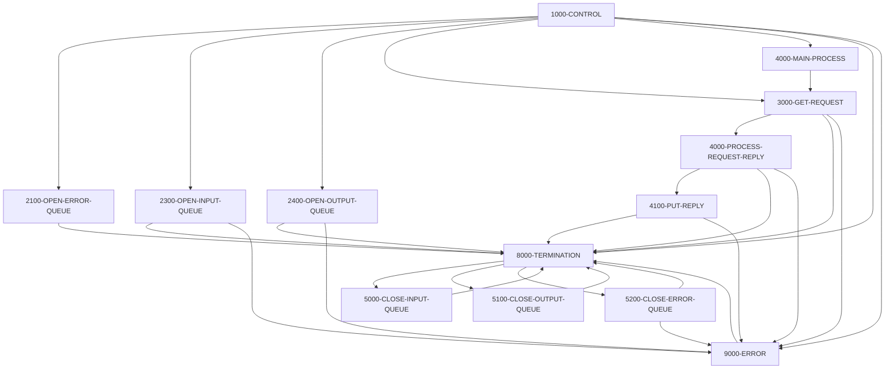

# Program COACCT01

| Item | Value |
|---|---|
| Source | `app/app-vsam-mq/cbl/COACCT01.cbl` |
| Lines | 620 total, 500 code, 19 comment, 101 blank |
| PROGRAM-ID | COACCT01 IS INITIAL |
| Author | AWS |
| Runtime | cics-mq-triggered, mq |
| Module | vsammq |
| CICS transactions | CDRA (`app/app-vsam-mq/csd/CRDDEMOM.csd:17-26`) |
| JCL steps | None |
| Paragraphs | 13 |
| Semantic analysis | validated (batch B09) |
| Version banner |  |

## Summary

COACCT01 is a CICS program started by an IBM MQ trigger; it retrieves the trigger message (MQTM) to learn the input queue name. It opens the error queue CARD.DEMO.ERROR, the triggered input queue and the fixed reply queue CARD.DEMO.REPLY.ACCT. It then reads request messages one at a time (5-second wait, under syncpoint) until the queue is empty, committing after each message. Each request carries a 4-character function code and an 11-digit account number; for function 'INQA' with a non-zero account it reads the VSAM account file ACCTDAT (layout CVACT01Y) and replies with a labelled text record of account status, balances, limits, dates and group id. Invalid requests and unknown accounts get an 'INVALID REQUEST PARAMETERS' text reply; MQ or file errors are written to the error queue and end the transaction. (Confirmed)

Evidence: `app/app-vsam-mq/cbl/COACCT01.cbl:178-220`, `app/app-vsam-mq/cbl/COACCT01.cbl:334-388`, `app/app-vsam-mq/cbl/COACCT01.cbl:390-460`, `app/app-vsam-mq/cbl/COACCT01.cbl:462-499`

Header comment (Unverified, `app/app-vsam-mq/cbl/COACCT01.cbl:1`): See the comment block at the top of the source. Unverified until matched to code.

## Divisions and sections

| Division / section | Lines | Notes |
|---|---|---|
| IDENTIFICATION DIVISION | `app/app-vsam-mq/cbl/COACCT01.cbl:1-6` |  |
| ENVIRONMENT DIVISION | `app/app-vsam-mq/cbl/COACCT01.cbl:7-8` |  |
| DATA DIVISION | `app/app-vsam-mq/cbl/COACCT01.cbl:9-175` |  |
| PROCEDURE DIVISION | `app/app-vsam-mq/cbl/COACCT01.cbl:176-620` |  |
| DATA / WORKING-STORAGE SECTION | `app/app-vsam-mq/cbl/COACCT01.cbl:11-173` |  |
| DATA / LINKAGE SECTION | `app/app-vsam-mq/cbl/COACCT01.cbl:174-175` |  |

## Files and data stores

No SELECT entries (no COBOL file I/O).

CICS file commands (file name resolved from VALUE clauses and the CSD):

| Command | FILE option | Resolved name | CSD DSNAME | CSD evidence | Line |
|---|---|---|---|---|---|
| READ | LIT-ACCTFILENAME | ACCTDAT | AWS.M2.CARDDEMO.ACCTDATA.VSAM.KSDS | `app/csd/CARDDEMO.CSD:1-12` | `app/app-vsam-mq/cbl/COACCT01.cbl:396-404` |

CRUD summary from the program facts:

| Store | Kind | Ops | Evidence |
|---|---|---|---|
| ACCTDAT | cics-file | R | `app/app-vsam-mq/cbl/COACCT01.cbl:396` |
| MQ-GET | logical | R | `app/app-vsam-mq/cbl/COACCT01.cbl:352` |
| MQ-PUT | logical | C | `app/app-vsam-mq/cbl/COACCT01.cbl:479` |

## Embedded CICS, SQL and DL/I commands

| Paragraph | Kind | Verb | Resources | Response | Lines |
|---|---|---|---|---|---|
| 1000-CONTROL | CICS | RETRIEVE |  | RESP | `app/app-vsam-mq/cbl/COACCT01.cbl:191-195` |
| 4000-MAIN-PROCESS | CICS | SYNCPOINT |  |  | `app/app-vsam-mq/cbl/COACCT01.cbl:326-328` |
| 4000-PROCESS-REQUEST-REPLY | CICS | READ | DATASET(LIT-ACCTFILENAME) | RESP | `app/app-vsam-mq/cbl/COACCT01.cbl:396-404` |
| 8000-TERMINATION | CICS | RETURN |  |  | `app/app-vsam-mq/cbl/COACCT01.cbl:549` |

## Calls, transfers and callers

| Mechanism | Target | Parameters | Paragraph | Lines |
|---|---|---|---|---|
| CALL system/LE | MQOPEN | QMGR-HANDLE-CONN, MQ-OBJECT-DESCRIPTOR, MQ-OPTIONS, MQ-HOBJ, MQ-CONDITION-CODE, MQ-REASON-CODE | 2300-OPEN-INPUT-QUEUE | `app/app-vsam-mq/cbl/COACCT01.cbl:233-238` |
| CALL system/LE | MQOPEN | QMGR-HANDLE-CONN, MQ-OBJECT-DESCRIPTOR, MQ-OPTIONS, MQ-HOBJ, MQ-CONDITION-CODE, MQ-REASON-CODE | 2400-OPEN-OUTPUT-QUEUE | `app/app-vsam-mq/cbl/COACCT01.cbl:267-272` |
| CALL system/LE | MQOPEN | QMGR-HANDLE-CONN, MQ-OBJECT-DESCRIPTOR, MQ-OPTIONS, MQ-HOBJ, MQ-CONDITION-CODE, MQ-REASON-CODE | 2100-OPEN-ERROR-QUEUE | `app/app-vsam-mq/cbl/COACCT01.cbl:302-307` |
| CALL system/LE | MQGET | MQ-HCONN, MQ-HOBJ, MQ-MESSAGE-DESCRIPTOR, MQ-GET-MESSAGE-OPTIONS, MQ-BUFFER-LENGTH, MQ-BUFFER, MQ-DATA-LENGTH, MQ-CONDITION-CODE, MQ-REASON-CODE | 3000-GET-REQUEST | `app/app-vsam-mq/cbl/COACCT01.cbl:352-360` |
| CALL system/LE | MQPUT | MQ-HCONN, OUTPUT-QUEUE-HANDLE, MQ-MESSAGE-DESCRIPTOR, MQ-PUT-MESSAGE-OPTIONS, MQ-BUFFER-LENGTH, MQ-BUFFER, MQ-CONDITION-CODE, MQ-REASON-CODE | 4100-PUT-REPLY | `app/app-vsam-mq/cbl/COACCT01.cbl:479-486` |
| CALL system/LE | MQPUT | MQ-HCONN, ERROR-QUEUE-HANDLE, MQ-MESSAGE-DESCRIPTOR, MQ-PUT-MESSAGE-OPTIONS, MQ-BUFFER-LENGTH, MQ-BUFFER, MQ-CONDITION-CODE, MQ-REASON-CODE | 9000-ERROR | `app/app-vsam-mq/cbl/COACCT01.cbl:516-523` |
| CALL system/LE | MQCLOSE | MQ-HCONN, MQ-HOBJ, MQ-OPTIONS, MQ-CONDITION-CODE, MQ-REASON-CODE | 5000-CLOSE-INPUT-QUEUE | `app/app-vsam-mq/cbl/COACCT01.cbl:557-561` |
| CALL system/LE | MQCLOSE | MQ-HCONN, MQ-HOBJ, MQ-OPTIONS, MQ-CONDITION-CODE, MQ-REASON-CODE | 5100-CLOSE-OUTPUT-QUEUE | `app/app-vsam-mq/cbl/COACCT01.cbl:579-583` |
| CALL system/LE | MQCLOSE | MQ-HCONN, MQ-HOBJ, MQ-OPTIONS, MQ-CONDITION-CODE, MQ-REASON-CODE | 5200-CLOSE-ERROR-QUEUE | `app/app-vsam-mq/cbl/COACCT01.cbl:602-606` |

## Copybooks

| Copybook | Statement | Resolution | Resolved path | REPLACING | Line |
|---|---|---|---|---|---|
| CMQGMOV | COPY | system |  |  | `app/app-vsam-mq/cbl/COACCT01.cbl:71` |
| CMQPMOV | COPY | system |  |  | `app/app-vsam-mq/cbl/COACCT01.cbl:75` |
| CMQMDV | COPY | system |  |  | `app/app-vsam-mq/cbl/COACCT01.cbl:79` |
| CMQODV | COPY | system |  |  | `app/app-vsam-mq/cbl/COACCT01.cbl:83` |
| CMQV | COPY | system |  |  | `app/app-vsam-mq/cbl/COACCT01.cbl:87` |
| CMQTML | COPY | system |  |  | `app/app-vsam-mq/cbl/COACCT01.cbl:90` |
| [CVACT01Y](../08-data/layouts/CVACT01Y.md) | COPY | inventory | app/cpy/CVACT01Y.cpy |  | `app/app-vsam-mq/cbl/COACCT01.cbl:171` |

## Data division items

Every data entry coded in this source (copybook contents are on the copybook pages). Lengths are computed from PIC and USAGE.

| Section | Lvl | Name | PIC | Usage | Len | OCCURS | REDEFINES | VALUE | 88-levels | Line |
|---|---|---|---|---|---|---|---|---|---|---|
| WORKING-STORAGE | 01 | WS-MQ-MSG-FLAG | X(01) |  | 1 |  |  | 'N' | NO-MORE-MSGS = 'Y' | 13 |
| WORKING-STORAGE | 01 | WS-RESP-QUEUE-STS | X(01) |  | 1 |  |  | 'N' | RESP-QUEUE-OPEN = 'Y' | 16 |
| WORKING-STORAGE | 01 | WS-ERR-QUEUE-STS | X(01) |  | 1 |  |  | 'N' | ERR-QUEUE-OPEN = 'Y' | 19 |
| WORKING-STORAGE | 01 | WS-REPLY-QUEUE-STS | X(01) |  | 1 |  |  | 'N' | REPLY-QUEUE-OPEN = 'Y' | 22 |
| WORKING-STORAGE | 01 | WS-CICS-RESP-CDS |  |  |  |  |  |  |  | 26 |
| WORKING-STORAGE | 05 | WS-CICS-RESP1-CD | S9(08) | COMP | 4 |  |  | ZERO |  | 27 |
| WORKING-STORAGE | 05 | WS-CICS-RESP2-CD | S9(08) | COMP | 4 |  |  | ZERO |  | 28 |
| WORKING-STORAGE | 05 | WS-CICS-RESP1-CD-D | 9(08) |  | 8 |  |  | ZERO |  | 29 |
| WORKING-STORAGE | 05 | WS-CICS-RESP2-CD-D | 9(08) |  | 8 |  |  | ZERO |  | 30 |
| WORKING-STORAGE | 01 | WS-DATE-TIME |  |  |  |  |  |  |  | 35 |
| WORKING-STORAGE | 10 | WS-ABS-TIME | S9(15) | COMP-3 | 8 |  |  | ZERO |  | 36 |
| WORKING-STORAGE | 10 | WS-MMDDYYYY | X(10) |  | 10 |  |  | SPACES |  | 37 |
| WORKING-STORAGE | 10 | WS-TIME | X(8) |  | 8 |  |  | SPACES |  | 38 |
| WORKING-STORAGE | 01 | MQ-QUEUE | X(48) |  | 48 |  |  |  |  | 42 |
| WORKING-STORAGE | 01 | MQ-QUEUE-REPLY | X(48) |  | 48 |  |  |  |  | 43 |
| WORKING-STORAGE | 01 | MQ-HCONN | S9(09) | BINARY | 4 |  |  | 0 |  | 44 |
| WORKING-STORAGE | 01 | MQ-CONDITION-CODE | S9(09) | BINARY | 4 |  |  | 0 |  | 45 |
| WORKING-STORAGE | 01 | MQ-REASON-CODE | S9(09) | BINARY | 4 |  |  | 0 |  | 46 |
| WORKING-STORAGE | 01 | MQ-HOBJ | S9(09) | BINARY | 4 |  |  | 0 |  | 47 |
| WORKING-STORAGE | 01 | MQ-OPTIONS | S9(09) | BINARY | 4 |  |  | 0 |  | 48 |
| WORKING-STORAGE | 01 | MQ-BUFFER-LENGTH | S9(09) | BINARY | 4 |  |  |  |  | 49 |
| WORKING-STORAGE | 01 | MQ-BUFFER | X(1000) |  | 1000 |  |  |  |  | 50 |
| WORKING-STORAGE | 01 | MQ-DATA-LENGTH | S9(09) | BINARY | 4 |  |  |  |  | 51 |
| WORKING-STORAGE | 01 | MQ-CORRELID | X(24) |  | 24 |  |  |  |  | 52 |
| WORKING-STORAGE | 01 | MQ-MSG-ID | X(24) |  | 24 |  |  |  |  | 53 |
| WORKING-STORAGE | 01 | MQ-MSG-COUNT | 9(09) |  | 9 |  |  |  |  | 54 |
| WORKING-STORAGE | 01 | SAVE-CORELID | X(24) |  | 24 |  |  |  |  | 55 |
| WORKING-STORAGE | 01 | SAVE-MSGID | X(24) |  | 24 |  |  |  |  | 56 |
| WORKING-STORAGE | 01 | SAVE-REPLY2Q | X(48) |  | 48 |  |  |  |  | 57 |
| WORKING-STORAGE | 01 | MQ-ERR-DISPLAY |  |  |  |  |  |  |  | 58 |
| WORKING-STORAGE | 05 | MQ-ERROR-PARA | X(25) |  | 25 |  |  |  |  | 59 |
| WORKING-STORAGE | 05 | FILLER | X(02) |  | 2 |  |  | SPACES |  | 60 |
| WORKING-STORAGE | 05 | MQ-APPL-RETURN-MESSAGE | X(25) |  | 25 |  |  |  |  | 61 |
| WORKING-STORAGE | 05 | FILLER | X(02) |  | 2 |  |  | SPACES |  | 62 |
| WORKING-STORAGE | 05 | MQ-APPL-CONDITION-CODE | 9(02) |  | 2 |  |  |  |  | 63 |
| WORKING-STORAGE | 05 | FILLER | X(02) |  | 2 |  |  | SPACES |  | 64 |
| WORKING-STORAGE | 05 | MQ-APPL-REASON-CODE | 9(05) |  | 5 |  |  |  |  | 65 |
| WORKING-STORAGE | 05 | FILLER | X(02) |  | 2 |  |  | SPACES |  | 66 |
| WORKING-STORAGE | 05 | MQ-APPL-QUEUE-NAME | X(48) |  | 48 |  |  |  |  | 67 |
| WORKING-STORAGE | 01 | MQ-GET-MESSAGE-OPTIONS |  |  |  |  |  |  |  | 70 |
| WORKING-STORAGE | 01 | MQ-PUT-MESSAGE-OPTIONS |  |  |  |  |  |  |  | 74 |
| WORKING-STORAGE | 01 | MQ-MESSAGE-DESCRIPTOR |  |  |  |  |  |  |  | 78 |
| WORKING-STORAGE | 01 | MQ-OBJECT-DESCRIPTOR |  |  |  |  |  |  |  | 82 |
| WORKING-STORAGE | 01 | MQ-CONSTANTS |  |  |  |  |  |  |  | 86 |
| WORKING-STORAGE | 01 | MQ-GET-QUEUE-MESSAGE |  |  |  |  |  |  |  | 89 |
| WORKING-STORAGE | 01 | QUEUE-INFO |  |  |  |  |  |  |  | 92 |
| WORKING-STORAGE | 05 | QMGR-NAME | X(48) |  | 48 |  |  | SPACES |  | 93 |
| WORKING-STORAGE | 05 | INPUT-QUEUE-NAME | X(48) |  | 48 |  |  | SPACES |  | 94 |
| WORKING-STORAGE | 05 | REPLY-QUEUE-NAME | X(48) |  | 48 |  |  | SPACES |  | 95 |
| WORKING-STORAGE | 05 | ERROR-QUEUE-NAME | X(48) |  | 48 |  |  | SPACES |  | 96 |
| WORKING-STORAGE | 01 | INPUT-QUEUE-HANDLE | S9(09) | BINARY | 4 |  |  | 0 |  | 98 |
| WORKING-STORAGE | 01 | OUTPUT-QUEUE-HANDLE | S9(09) | BINARY | 4 |  |  | 0 |  | 100 |
| WORKING-STORAGE | 01 | ERROR-QUEUE-HANDLE | S9(09) | BINARY | 4 |  |  | 0 |  | 102 |
| WORKING-STORAGE | 01 | QMGR-HANDLE-CONN | S9(09) | BINARY | 4 |  |  | 0 |  | 104 |
| WORKING-STORAGE | 01 | QUEUE-MESSAGE | X(1000) |  | 1000 |  |  |  |  | 105 |
| WORKING-STORAGE | 01 | REQUEST-MESSAGE | X(1000) |  | 1000 |  |  |  |  | 106 |
| WORKING-STORAGE | 01 | REPLY-MESSAGE | X(1000) |  | 1000 |  |  |  |  | 107 |
| WORKING-STORAGE | 01 | ERROR-MESSAGE | X(1000) |  | 1000 |  |  |  |  | 108 |
| WORKING-STORAGE | 01 | REQUEST-MSG-COPY |  |  |  |  |  |  |  | 109 |
| WORKING-STORAGE | 10 | WS-FUNC | X(04) |  | 4 |  |  | SPACES |  | 110 |
| WORKING-STORAGE | 10 | WS-KEY | 9(11) |  | 11 |  |  | ZEROES |  | 111 |
| WORKING-STORAGE | 10 | WS-FILLER | X(985) |  | 985 |  |  | SPACES |  | 112 |
| WORKING-STORAGE | 01 | WS-VARIABLES |  |  |  |  |  |  |  | 114 |
| WORKING-STORAGE | 05 | LIT-ACCTFILENAME | X(8) |  | 8 |  |  | 'ACCTDAT ' |  | 115 |
| WORKING-STORAGE | 05 | WS-RESP-CD | S9(09) | COMP | 4 |  |  | ZEROS |  | 117 |
| WORKING-STORAGE | 05 | WS-REAS-CD | S9(09) | COMP | 4 |  |  | ZEROS |  | 119 |
| WORKING-STORAGE | 05 | WS-XREF-RID |  |  |  |  |  |  |  | 121 |
| WORKING-STORAGE | 10 | WS-CARD-RID-CARDNUM | X(16) |  | 16 |  |  |  |  | 122 |
| WORKING-STORAGE | 10 | WS-CARD-RID-CUST-ID | 9(09) |  | 9 |  |  |  |  | 123 |
| WORKING-STORAGE | 10 | WS-CARD-RID-CUST-ID-X | X(09) |  | 9 |  | WS-CARD-RID-CUST-ID |  |  | 124 |
| WORKING-STORAGE | 10 | WS-CARD-RID-ACCT-ID | 9(11) |  | 11 |  |  |  |  | 126 |
| WORKING-STORAGE | 10 | WS-CARD-RID-ACCT-ID-X | X(11) |  | 11 |  | WS-CARD-RID-ACCT-ID |  |  | 127 |
| WORKING-STORAGE | 01 | WS-ACCT-RESPONSE |  |  |  |  |  |  |  | 130 |
| WORKING-STORAGE | 05 | WS-ACCT-LBL | X(13) |  | 13 |  |  | 'ACCOUNT ID : ' |  | 132 |
| WORKING-STORAGE | 05 | WS-ACCT-ID | 9(11) |  | 11 |  |  | ZEROES |  | 134 |
| WORKING-STORAGE | 05 | WS-STATUS-LBL | X(17) |  | 17 |  |  | 'ACCOUNT STATUS : ' |  | 135 |
| WORKING-STORAGE | 05 | WS-ACCT-ACTIVE-STATUS | X(01) |  | 1 |  |  | SPACES |  | 137 |
| WORKING-STORAGE | 05 | WS-CURR-BAL-LBL | X(10) |  | 10 |  |  | 'BALANCE : ' |  | 138 |
| WORKING-STORAGE | 05 | WS-ACCT-CURR-BAL | S9(10)V99 |  | 12 |  |  | ZEROES |  | 140 |
| WORKING-STORAGE | 05 | WS-CRDT-LMT-LBL | X(15) |  | 15 |  |  | 'CREDIT LIMIT : ' |  | 142 |
| WORKING-STORAGE | 05 | WS-ACCT-CREDIT-LIMIT | S9(10)V99 |  | 12 |  |  | ZEROES |  | 144 |
| WORKING-STORAGE | 05 | WS-CASH-LIMIT-LBL | X(13) |  | 13 |  |  | 'CASH LIMIT : ' |  | 146 |
| WORKING-STORAGE | 05 | WS-ACCT-CASH-CREDIT-LIMIT | S9(10)V99 |  | 12 |  |  | ZEROES |  | 148 |
| WORKING-STORAGE | 05 | WS-OPEN-DATE-LBL | X(12) |  | 12 |  |  | 'OPEN DATE : ' |  | 150 |
| WORKING-STORAGE | 05 | WS-ACCT-OPEN-DATE | X(10) |  | 10 |  |  | SPACES |  | 152 |
| WORKING-STORAGE | 05 | WS-EXPR-DATE-LBL | X(12) |  | 12 |  |  | 'EXPR DATE : ' |  | 153 |
| WORKING-STORAGE | 05 | WS-ACCT-EXPIRAION-DATE | X(10) |  | 10 |  |  | SPACES |  | 155 |
| WORKING-STORAGE | 05 | WS-REISSUE-DT-LBL | X(12) |  | 12 |  |  | 'REIS DATE : ' |  | 156 |
| WORKING-STORAGE | 05 | WS-ACCT-REISSUE-DATE | X(10) |  | 10 |  |  | SPACES |  | 158 |
| WORKING-STORAGE | 05 | WS-CURR-CYC-CREDIT-LBL | X(13) |  | 13 |  |  | 'CREDIT BAL : ' |  | 159 |
| WORKING-STORAGE | 05 | WS-ACCT-CURR-CYC-CREDIT | S9(10)V99 |  | 12 |  |  | ZEROES |  | 161 |
| WORKING-STORAGE | 05 | WS-CURR-CYC-DEBIT-LBL | X(12) |  | 12 |  |  | 'DEBIT BAL : ' |  | 163 |
| WORKING-STORAGE | 05 | WS-ACCT-CURR-CYC-DEBIT | S9(10)V99 |  | 12 |  |  | ZEROES |  | 165 |
| WORKING-STORAGE | 05 | WS-ACCT-GRP-LBL | X(11) |  | 11 |  |  | 'GROUP ID : ' |  | 167 |
| WORKING-STORAGE | 05 | WS-ACCT-GROUP-ID | X(10) |  | 10 |  |  | SPACES |  | 169 |

## Statement inventory

Every procedure statement the parser recorded, by kind. Each one is listed with its line under Paragraph details.

| Kind | Count |
|---|---|
| Decisions (IF, EVALUATE, WHEN, loops, handlers) | 35 |
| Calculations | 12 |
| File I/O | 0 |
| EXEC CICS / SQL / DLI | 4 |
| CALL | 9 |
| PERFORM | 32 |
| GO TO | 0 |
| MOVE literal | 17 |
| MOVE field | 102 |
| SET | 4 |
| STRING, UNSTRING, INSPECT, INITIALIZE, COPY, ENTRY and others | 6 |
| DISPLAY | 2 |
| GOBACK, STOP RUN, RETURN, XCTL | 2 |
| Not classified by the parser | 0 |

## Control flow

| Paragraph | Lines | Logic | Performs | Performed by | Reachable |
|---|---|---|---|---|---|
| [1000-CONTROL](#para-1000-control) | 178-220 | Clears INPUT-QUEUE-NAME, QMGR-NAME, QUEUE-MESSAGE and MQ-ERR-DISPLAY, opens the error queue, then issues EXEC CICS RETRIEVE into the MQ trigger message MQTM. On NORMAL it takes the input queue name from MQTM-QNAME and sets REPLY-QUEUE-NAME to 'CARD.DEMO.REPLY.ACCT'; otherwise it builds a 'RESP:' error text, performs 9000-ERROR and 8000-TERMINATION. It then opens the input and reply queues, gets the first request and performs 4000-MAIN-PROCESS until NO-MORE-MSGS, finishing with 8000-TERMINATION. (Confirmed) | 2100-OPEN-ERROR-QUEUE, 2300-OPEN-INPUT-QUEUE, 2400-OPEN-OUTPUT-QUEUE, 3000-GET-REQUEST, 4000-MAIN-PROCESS, 8000-TERMINATION, 9000-ERROR |  | yes |
| [2300-OPEN-INPUT-QUEUE](#para-2300-open-input-queue) | 222-253 | MQOPENs the queue named in INPUT-QUEUE-NAME with MQOO-INPUT-SHARED + MQOO-SAVE-ALL-CONTEXT + MQOO-FAIL-IF-QUIESCING. On MQCC-OK saves MQ-HOBJ in INPUT-QUEUE-HANDLE and sets REPLY-QUEUE-OPEN; otherwise records the codes with 'INP MQOPEN ERR', performs 9000-ERROR and 8000-TERMINATION. (Confirmed) | 8000-TERMINATION, 9000-ERROR | 1000-CONTROL | yes |
| [2400-OPEN-OUTPUT-QUEUE](#para-2400-open-output-queue) | 255-287 | MQOPENs REPLY-QUEUE-NAME for output with MQOO-OUTPUT + MQOO-PASS-ALL-CONTEXT + MQOO-FAIL-IF-QUIESCING. On MQCC-OK saves the handle in OUTPUT-QUEUE-HANDLE and sets RESP-QUEUE-OPEN; otherwise records 'OUT MQOPEN ERR', performs 9000-ERROR and 8000-TERMINATION. (Confirmed) | 8000-TERMINATION, 9000-ERROR | 1000-CONTROL | yes |
| [2100-OPEN-ERROR-QUEUE](#para-2100-open-error-queue) | 289-322 | Sets ERROR-QUEUE-NAME to 'CARD.DEMO.ERROR' and MQOPENs it for output. On MQCC-OK saves ERROR-QUEUE-HANDLE and sets ERR-QUEUE-OPEN; otherwise records 'ERR MQOPEN ERR', DISPLAYs MQ-ERR-DISPLAY and performs 8000-TERMINATION. (Confirmed) | 8000-TERMINATION | 1000-CONTROL | yes |
| [4000-MAIN-PROCESS](#para-4000-main-process) | 325-331 | Issues EXEC CICS SYNCPOINT to commit the previous message's get and reply, then performs 3000-GET-REQUEST for the next message. (Confirmed) | 3000-GET-REQUEST | 1000-CONTROL | yes |
| [3000-GET-REQUEST](#para-3000-get-request) | 334-388 | Prepares an MQGET on INPUT-QUEUE-HANDLE with a 5000 ms wait, 1000-byte buffer, no MsgId/CorrelId match and options SYNCPOINT + FAIL-IF-QUIESCING + CONVERT + WAIT, after initialising REQUEST-MSG-COPY. On MQCC-OK saves MsgId, CorrelId and ReplyToQ, copies the buffer into REQUEST-MSG-COPY (WS-FUNC, WS-KEY), performs 4000-PROCESS-REQUEST-REPLY and adds 1 to MQ-MSG-COUNT. If the reason is MQRC-NO-MSG-AVAILABLE it sets NO-MORE-MSGS; any other failure records 'INP MQGET ERR:', performs 9000-ERROR and 8000-TERMINATION. (Confirmed) | 4000-PROCESS-REQUEST-REPLY, 8000-TERMINATION, 9000-ERROR | 1000-CONTROL, 4000-MAIN-PROCESS | yes |
| [4000-PROCESS-REQUEST-REPLY](#para-4000-process-request-reply) | 390-460 | Clears REPLY-MESSAGE. If WS-FUNC = 'INQA' and WS-KEY > 0 it reads the ACCTDAT file by the 11-digit account id into ACCOUNT-RECORD: NORMAL formats WS-ACCT-RESPONSE with labelled account fields and puts it as the reply; NOTFND replies 'INVALID REQUEST PARAMETERS ACCT ID : ' + WS-KEY; any other response sends 'ERROR WHILE READING ACCTFILE' to the error queue and terminates. Otherwise it replies 'INVALID REQUEST PARAMETERS ACCT ID : ' + WS-KEY + 'FUNCTION : ' + WS-FUNC. (Confirmed) | 4100-PUT-REPLY, 8000-TERMINATION, 9000-ERROR | 3000-GET-REQUEST | yes |
| [4100-PUT-REPLY](#para-4100-put-reply) | 462-499 | Moves REPLY-MESSAGE into MQ-BUFFER (length 1000), sets MQMD-MSGID/MQMD-CORRELID from the saved request ids, format MQFMT-STRING and CCSID MQCCSI-Q-MGR, and MQPUTs to OUTPUT-QUEUE-HANDLE under syncpoint with default context. On failure records 'MQPUT ERR', performs 9000-ERROR and 8000-TERMINATION. (Confirmed) | 8000-TERMINATION, 9000-ERROR | 4000-PROCESS-REQUEST-REPLY | yes |
| [9000-ERROR](#para-9000-error) | 501-537 | Copies MQ-ERR-DISPLAY (paragraph, message, condition and reason codes, queue name) into a 1000-byte string message and MQPUTs it to ERROR-QUEUE-HANDLE under syncpoint. If that put fails it records 'MQPUT ERR', DISPLAYs MQ-ERR-DISPLAY and performs 8000-TERMINATION. (Confirmed) | 8000-TERMINATION | 1000-CONTROL, 2300-OPEN-INPUT-QUEUE, 2400-OPEN-OUTPUT-QUEUE, 3000-GET-REQUEST, 4000-PROCESS-REQUEST-REPLY, 4100-PUT-REPLY, 5200-CLOSE-ERROR-QUEUE | yes |
| [8000-TERMINATION](#para-8000-termination) | 538-550 | Closes the input queue if REPLY-QUEUE-OPEN, the reply queue if RESP-QUEUE-OPEN and the error queue if ERR-QUEUE-OPEN, then issues EXEC CICS RETURN and GOBACK. (Confirmed) | 5000-CLOSE-INPUT-QUEUE, 5100-CLOSE-OUTPUT-QUEUE, 5200-CLOSE-ERROR-QUEUE | 1000-CONTROL, 2100-OPEN-ERROR-QUEUE, 2300-OPEN-INPUT-QUEUE, 2400-OPEN-OUTPUT-QUEUE, 3000-GET-REQUEST, 4000-PROCESS-REQUEST-REPLY, 4100-PUT-REPLY, 5000-CLOSE-INPUT-QUEUE, 5100-CLOSE-OUTPUT-QUEUE, 5200-CLOSE-ERROR-QUEUE, 9000-ERROR | yes |
| [5000-CLOSE-INPUT-QUEUE](#para-5000-close-input-queue) | 552-573 | MQCLOSEs INPUT-QUEUE-HANDLE with MQCO-NONE; on failure records 'MQCLOSE ERR' with INPUT-QUEUE-NAME and performs 8000-TERMINATION. (Confirmed) | 8000-TERMINATION | 8000-TERMINATION | yes |
| [5100-CLOSE-OUTPUT-QUEUE](#para-5100-close-output-queue) | 574-595 | MQCLOSEs OUTPUT-QUEUE-HANDLE with MQCO-NONE; on failure records 'MQCLOSE ERR' (with INPUT-QUEUE-NAME as queue name) and performs 8000-TERMINATION. (Confirmed) | 8000-TERMINATION | 8000-TERMINATION | yes |
| [5200-CLOSE-ERROR-QUEUE](#para-5200-close-error-queue) | 597-619 | MQCLOSEs ERROR-QUEUE-HANDLE with MQCO-NONE; on failure records 'MQCLOSE ERR' with ERROR-QUEUE-NAME, performs 9000-ERROR and 8000-TERMINATION. (Confirmed) | 8000-TERMINATION, 9000-ERROR | 8000-TERMINATION | yes |

## Paragraph details

### Para 1000-CONTROL

Lines `app/app-vsam-mq/cbl/COACCT01.cbl:178-220`. 

Logic: Clears INPUT-QUEUE-NAME, QMGR-NAME, QUEUE-MESSAGE and MQ-ERR-DISPLAY, opens the error queue, then issues EXEC CICS RETRIEVE into the MQ trigger message MQTM. On NORMAL it takes the input queue name from MQTM-QNAME and sets REPLY-QUEUE-NAME to 'CARD.DEMO.REPLY.ACCT'; otherwise it builds a 'RESP:' error text, performs 9000-ERROR and 8000-TERMINATION. It then opens the input and reply queues, gets the first request and performs 4000-MAIN-PROCESS until NO-MORE-MSGS, finishing with 8000-TERMINATION. (Confirmed)

Rules: [BR-COACCT01-008](../09-business-rules-catalog.md#br-coacct01-008)

Statements in source order:

- `MOVE SPACES TO INPUT-QUEUE-NAME QMGR-NAME QUEUE-MESSAGE` at `app/app-vsam-mq/cbl/COACCT01.cbl:180-183`
- `INITIALIZE MQ-ERR-DISPLAY` at `app/app-vsam-mq/cbl/COACCT01.cbl:185`
- PERFORM 2100-OPEN-ERROR-QUEUE at `app/app-vsam-mq/cbl/COACCT01.cbl:187`
- EXEC CICS RETRIEVE at `app/app-vsam-mq/cbl/COACCT01.cbl:191-195`
- IF `WS-CICS-RESP1-CD = DFHRESP(NORMAL)` at `app/app-vsam-mq/cbl/COACCT01.cbl:196` (io-status)
- `MOVE MQTM-QNAME TO INPUT-QUEUE-NAME` at `app/app-vsam-mq/cbl/COACCT01.cbl:197`
- MOVE `'CARD.DEMO.REPLY.ACCT'` TO REPLY-QUEUE-NAME at `app/app-vsam-mq/cbl/COACCT01.cbl:198`
- MOVE `'CICS RETREIVE'` TO MQ-ERROR-PARA at `app/app-vsam-mq/cbl/COACCT01.cbl:200`
- `MOVE WS-CICS-RESP1-CD TO WS-CICS-RESP1-CD-D` at `app/app-vsam-mq/cbl/COACCT01.cbl:201`
- `MOVE WS-CICS-RESP2-CD TO WS-CICS-RESP2-CD` at `app/app-vsam-mq/cbl/COACCT01.cbl:202`
- `STRING 'RESP: ', WS-CICS-RESP1-CD-D , WS-CICS-RESP2-CD-D, 'END' DELIMITED BY SIZE INTO MQ-APPL-RETURN-MESSAGE` at `app/app-vsam-mq/cbl/COACCT01.cbl:203-205`
- PERFORM 9000-ERROR at `app/app-vsam-mq/cbl/COACCT01.cbl:208`
- PERFORM 8000-TERMINATION at `app/app-vsam-mq/cbl/COACCT01.cbl:209`
- PERFORM 2300-OPEN-INPUT-QUEUE at `app/app-vsam-mq/cbl/COACCT01.cbl:212`
- PERFORM 2400-OPEN-OUTPUT-QUEUE at `app/app-vsam-mq/cbl/COACCT01.cbl:213`
- PERFORM 3000-GET-REQUEST at `app/app-vsam-mq/cbl/COACCT01.cbl:214`
- PERFORM 4000-MAIN-PROCESS `UNTIL NO-MORE-MSGS` at `app/app-vsam-mq/cbl/COACCT01.cbl:215-216`
- PERFORM 8000-TERMINATION at `app/app-vsam-mq/cbl/COACCT01.cbl:218`

### Para 2300-OPEN-INPUT-QUEUE

Lines `app/app-vsam-mq/cbl/COACCT01.cbl:222-253`. 

Logic: MQOPENs the queue named in INPUT-QUEUE-NAME with MQOO-INPUT-SHARED + MQOO-SAVE-ALL-CONTEXT + MQOO-FAIL-IF-QUIESCING. On MQCC-OK saves MQ-HOBJ in INPUT-QUEUE-HANDLE and sets REPLY-QUEUE-OPEN; otherwise records the codes with 'INP MQOPEN ERR', performs 9000-ERROR and 8000-TERMINATION. (Confirmed)

Rules: [BR-COACCT01-007](../09-business-rules-catalog.md#br-coacct01-007)

Statements in source order:

- `MOVE SPACES TO MQOD-OBJECTQMGRNAME` at `app/app-vsam-mq/cbl/COACCT01.cbl:226`
- `MOVE INPUT-QUEUE-NAME TO MQOD-OBJECTNAME` at `app/app-vsam-mq/cbl/COACCT01.cbl:227`
- Calculation `COMPUTE MQ-OPTIONS = MQOO-INPUT-SHARED + MQOO-SAVE-ALL-CONTEXT + MQOO-FAIL-IF-QUIESCING` at `app/app-vsam-mq/cbl/COACCT01.cbl:229-231` (no ROUNDED)
- CALL MQOPEN at `app/app-vsam-mq/cbl/COACCT01.cbl:233-238`
- EVALUATE `MQ-CONDITION-CODE` at `app/app-vsam-mq/cbl/COACCT01.cbl:240` (business-candidate)
- WHEN `MQCC-OK` at `app/app-vsam-mq/cbl/COACCT01.cbl:241` (io-status)
- `MOVE MQ-CONDITION-CODE TO MQ-APPL-CONDITION-CODE` at `app/app-vsam-mq/cbl/COACCT01.cbl:242`
- `MOVE MQ-REASON-CODE TO MQ-APPL-REASON-CODE` at `app/app-vsam-mq/cbl/COACCT01.cbl:243`
- `MOVE MQ-HOBJ TO INPUT-QUEUE-HANDLE` at `app/app-vsam-mq/cbl/COACCT01.cbl:244`
- `SET REPLY-QUEUE-OPEN TO TRUE` at `app/app-vsam-mq/cbl/COACCT01.cbl:245`
- WHEN `OTHER` at `app/app-vsam-mq/cbl/COACCT01.cbl:246` (business-candidate)
- `MOVE MQ-CONDITION-CODE TO MQ-APPL-CONDITION-CODE` at `app/app-vsam-mq/cbl/COACCT01.cbl:247`
- `MOVE MQ-REASON-CODE TO MQ-APPL-REASON-CODE` at `app/app-vsam-mq/cbl/COACCT01.cbl:248`
- `MOVE INPUT-QUEUE-NAME TO MQ-APPL-QUEUE-NAME` at `app/app-vsam-mq/cbl/COACCT01.cbl:249`
- MOVE `'INP MQOPEN ERR'` TO MQ-APPL-RETURN-MESSAGE at `app/app-vsam-mq/cbl/COACCT01.cbl:250`
- PERFORM 9000-ERROR at `app/app-vsam-mq/cbl/COACCT01.cbl:251`
- PERFORM 8000-TERMINATION at `app/app-vsam-mq/cbl/COACCT01.cbl:252`

### Para 2400-OPEN-OUTPUT-QUEUE

Lines `app/app-vsam-mq/cbl/COACCT01.cbl:255-287`. 

Logic: MQOPENs REPLY-QUEUE-NAME for output with MQOO-OUTPUT + MQOO-PASS-ALL-CONTEXT + MQOO-FAIL-IF-QUIESCING. On MQCC-OK saves the handle in OUTPUT-QUEUE-HANDLE and sets RESP-QUEUE-OPEN; otherwise records 'OUT MQOPEN ERR', performs 9000-ERROR and 8000-TERMINATION. (Confirmed)

Statements in source order:

- `MOVE SPACES TO MQOD-OBJECTQMGRNAME` at `app/app-vsam-mq/cbl/COACCT01.cbl:260`
- `MOVE REPLY-QUEUE-NAME TO MQOD-OBJECTNAME` at `app/app-vsam-mq/cbl/COACCT01.cbl:261`
- Calculation `COMPUTE MQ-OPTIONS = MQOO-OUTPUT + MQOO-PASS-ALL-CONTEXT + MQOO-FAIL-IF-QUIESCING` at `app/app-vsam-mq/cbl/COACCT01.cbl:263-265` (no ROUNDED)
- CALL MQOPEN at `app/app-vsam-mq/cbl/COACCT01.cbl:267-272`
- EVALUATE `MQ-CONDITION-CODE` at `app/app-vsam-mq/cbl/COACCT01.cbl:274` (business-candidate)
- WHEN `MQCC-OK` at `app/app-vsam-mq/cbl/COACCT01.cbl:275` (io-status)
- `MOVE MQ-CONDITION-CODE TO MQ-APPL-CONDITION-CODE` at `app/app-vsam-mq/cbl/COACCT01.cbl:276`
- `MOVE MQ-REASON-CODE TO MQ-APPL-REASON-CODE` at `app/app-vsam-mq/cbl/COACCT01.cbl:277`
- `MOVE MQ-HOBJ TO OUTPUT-QUEUE-HANDLE` at `app/app-vsam-mq/cbl/COACCT01.cbl:278`
- `SET RESP-QUEUE-OPEN TO TRUE` at `app/app-vsam-mq/cbl/COACCT01.cbl:279`
- WHEN `OTHER` at `app/app-vsam-mq/cbl/COACCT01.cbl:280` (business-candidate)
- `MOVE MQ-CONDITION-CODE TO MQ-APPL-CONDITION-CODE` at `app/app-vsam-mq/cbl/COACCT01.cbl:281`
- `MOVE MQ-REASON-CODE TO MQ-APPL-REASON-CODE` at `app/app-vsam-mq/cbl/COACCT01.cbl:282`
- `MOVE REPLY-QUEUE-NAME TO MQ-APPL-QUEUE-NAME` at `app/app-vsam-mq/cbl/COACCT01.cbl:283`
- MOVE `'OUT MQOPEN ERR'` TO MQ-APPL-RETURN-MESSAGE at `app/app-vsam-mq/cbl/COACCT01.cbl:284`
- PERFORM 9000-ERROR at `app/app-vsam-mq/cbl/COACCT01.cbl:285`
- PERFORM 8000-TERMINATION at `app/app-vsam-mq/cbl/COACCT01.cbl:286`

### Para 2100-OPEN-ERROR-QUEUE

Lines `app/app-vsam-mq/cbl/COACCT01.cbl:289-322`. 

Logic: Sets ERROR-QUEUE-NAME to 'CARD.DEMO.ERROR' and MQOPENs it for output. On MQCC-OK saves ERROR-QUEUE-HANDLE and sets ERR-QUEUE-OPEN; otherwise records 'ERR MQOPEN ERR', DISPLAYs MQ-ERR-DISPLAY and performs 8000-TERMINATION. (Confirmed)

Statements in source order:

- MOVE `'CARD.DEMO.ERROR'` TO ERROR-QUEUE-NAME at `app/app-vsam-mq/cbl/COACCT01.cbl:294`
- `MOVE SPACES TO MQOD-OBJECTQMGRNAME` at `app/app-vsam-mq/cbl/COACCT01.cbl:295`
- `MOVE ERROR-QUEUE-NAME TO MQOD-OBJECTNAME` at `app/app-vsam-mq/cbl/COACCT01.cbl:296`
- Calculation `COMPUTE MQ-OPTIONS = MQOO-OUTPUT + MQOO-PASS-ALL-CONTEXT + MQOO-FAIL-IF-QUIESCING` at `app/app-vsam-mq/cbl/COACCT01.cbl:298-300` (no ROUNDED)
- CALL MQOPEN at `app/app-vsam-mq/cbl/COACCT01.cbl:302-307`
- EVALUATE `MQ-CONDITION-CODE` at `app/app-vsam-mq/cbl/COACCT01.cbl:309` (business-candidate)
- WHEN `MQCC-OK` at `app/app-vsam-mq/cbl/COACCT01.cbl:310` (io-status)
- `MOVE MQ-CONDITION-CODE TO MQ-APPL-CONDITION-CODE` at `app/app-vsam-mq/cbl/COACCT01.cbl:311`
- `MOVE MQ-REASON-CODE TO MQ-APPL-REASON-CODE` at `app/app-vsam-mq/cbl/COACCT01.cbl:312`
- `MOVE MQ-HOBJ TO ERROR-QUEUE-HANDLE` at `app/app-vsam-mq/cbl/COACCT01.cbl:313`
- `SET ERR-QUEUE-OPEN TO TRUE` at `app/app-vsam-mq/cbl/COACCT01.cbl:314`
- WHEN `OTHER` at `app/app-vsam-mq/cbl/COACCT01.cbl:315` (business-candidate)
- `MOVE MQ-CONDITION-CODE TO MQ-APPL-CONDITION-CODE` at `app/app-vsam-mq/cbl/COACCT01.cbl:316`
- `MOVE MQ-REASON-CODE TO MQ-APPL-REASON-CODE` at `app/app-vsam-mq/cbl/COACCT01.cbl:317`
- `MOVE ERROR-QUEUE-NAME TO MQ-APPL-QUEUE-NAME` at `app/app-vsam-mq/cbl/COACCT01.cbl:318`
- MOVE `'ERR MQOPEN ERR'` TO MQ-APPL-RETURN-MESSAGE at `app/app-vsam-mq/cbl/COACCT01.cbl:319`
- `DISPLAY MQ-ERR-DISPLAY` at `app/app-vsam-mq/cbl/COACCT01.cbl:320`
- PERFORM 8000-TERMINATION at `app/app-vsam-mq/cbl/COACCT01.cbl:321`

### Para 4000-MAIN-PROCESS

Lines `app/app-vsam-mq/cbl/COACCT01.cbl:325-331`. 

Logic: Issues EXEC CICS SYNCPOINT to commit the previous message's get and reply, then performs 3000-GET-REQUEST for the next message. (Confirmed)

Statements in source order:

- EXEC CICS SYNCPOINT at `app/app-vsam-mq/cbl/COACCT01.cbl:326-328`
- PERFORM 3000-GET-REQUEST at `app/app-vsam-mq/cbl/COACCT01.cbl:330-331`

### Para 3000-GET-REQUEST

Lines `app/app-vsam-mq/cbl/COACCT01.cbl:334-388`. 

Logic: Prepares an MQGET on INPUT-QUEUE-HANDLE with a 5000 ms wait, 1000-byte buffer, no MsgId/CorrelId match and options SYNCPOINT + FAIL-IF-QUIESCING + CONVERT + WAIT, after initialising REQUEST-MSG-COPY. On MQCC-OK saves MsgId, CorrelId and ReplyToQ, copies the buffer into REQUEST-MSG-COPY (WS-FUNC, WS-KEY), performs 4000-PROCESS-REQUEST-REPLY and adds 1 to MQ-MSG-COUNT. If the reason is MQRC-NO-MSG-AVAILABLE it sets NO-MORE-MSGS; any other failure records 'INP MQGET ERR:', performs 9000-ERROR and 8000-TERMINATION. (Confirmed)

Rules: [BR-COACCT01-006](../09-business-rules-catalog.md#br-coacct01-006)

Statements in source order:

- MOVE `5000` TO MQGMO-WAITINTERVAL at `app/app-vsam-mq/cbl/COACCT01.cbl:337`
- `MOVE SPACES TO MQ-CORRELID` at `app/app-vsam-mq/cbl/COACCT01.cbl:338`
- `MOVE SPACES TO MQ-MSG-ID` at `app/app-vsam-mq/cbl/COACCT01.cbl:339`
- `MOVE INPUT-QUEUE-NAME TO MQ-QUEUE` at `app/app-vsam-mq/cbl/COACCT01.cbl:340`
- `MOVE INPUT-QUEUE-HANDLE TO MQ-HOBJ` at `app/app-vsam-mq/cbl/COACCT01.cbl:341`
- MOVE `1000` TO MQ-BUFFER-LENGTH at `app/app-vsam-mq/cbl/COACCT01.cbl:342`
- `MOVE MQMI-NONE TO MQMD-MSGID` at `app/app-vsam-mq/cbl/COACCT01.cbl:343`
- `MOVE MQCI-NONE TO MQMD-CORRELID` at `app/app-vsam-mq/cbl/COACCT01.cbl:344`
- `INITIALIZE REQUEST-MSG-COPY REPLACING NUMERIC BY ZEROES` at `app/app-vsam-mq/cbl/COACCT01.cbl:345`
- Calculation `COMPUTE MQGMO-OPTIONS = MQGMO-SYNCPOINT + MQGMO-FAIL-IF-QUIESCING + MQGMO-CONVERT + MQGMO-WAIT` at `app/app-vsam-mq/cbl/COACCT01.cbl:347-350` (no ROUNDED)
- CALL MQGET at `app/app-vsam-mq/cbl/COACCT01.cbl:352-360`
- IF `MQ-CONDITION-CODE = MQCC-OK` at `app/app-vsam-mq/cbl/COACCT01.cbl:363` (io-status)
- `MOVE MQMD-MSGID TO MQ-MSG-ID` at `app/app-vsam-mq/cbl/COACCT01.cbl:364`
- `MOVE MQMD-CORRELID TO MQ-CORRELID` at `app/app-vsam-mq/cbl/COACCT01.cbl:365`
- `MOVE MQMD-REPLYTOQ TO MQ-QUEUE-REPLY` at `app/app-vsam-mq/cbl/COACCT01.cbl:366`
- `MOVE MQ-CONDITION-CODE TO MQ-APPL-CONDITION-CODE` at `app/app-vsam-mq/cbl/COACCT01.cbl:367`
- `MOVE MQ-REASON-CODE TO MQ-APPL-REASON-CODE` at `app/app-vsam-mq/cbl/COACCT01.cbl:368`
- `MOVE MQ-BUFFER TO REQUEST-MESSAGE` at `app/app-vsam-mq/cbl/COACCT01.cbl:369`
- `MOVE MQ-CORRELID TO SAVE-CORELID` at `app/app-vsam-mq/cbl/COACCT01.cbl:370`
- `MOVE MQ-QUEUE-REPLY TO SAVE-REPLY2Q` at `app/app-vsam-mq/cbl/COACCT01.cbl:371`
- `MOVE MQ-MSG-ID TO SAVE-MSGID` at `app/app-vsam-mq/cbl/COACCT01.cbl:372`
- `MOVE REQUEST-MESSAGE TO REQUEST-MSG-COPY` at `app/app-vsam-mq/cbl/COACCT01.cbl:373`
- PERFORM 4000-PROCESS-REQUEST-REPLY at `app/app-vsam-mq/cbl/COACCT01.cbl:374`
- Calculation `ADD 1 TO MQ-MSG-COUNT` at `app/app-vsam-mq/cbl/COACCT01.cbl:375`
- IF `MQ-REASON-CODE = MQRC-NO-MSG-AVAILABLE` at `app/app-vsam-mq/cbl/COACCT01.cbl:377` (io-status)
- `SET NO-MORE-MSGS TO TRUE` at `app/app-vsam-mq/cbl/COACCT01.cbl:378`
- `MOVE MQ-CONDITION-CODE TO MQ-APPL-CONDITION-CODE` at `app/app-vsam-mq/cbl/COACCT01.cbl:381`
- `MOVE MQ-REASON-CODE TO MQ-APPL-REASON-CODE` at `app/app-vsam-mq/cbl/COACCT01.cbl:382`
- `MOVE INPUT-QUEUE-NAME TO MQ-APPL-QUEUE-NAME` at `app/app-vsam-mq/cbl/COACCT01.cbl:383`
- MOVE `'INP MQGET ERR:'` TO MQ-APPL-RETURN-MESSAGE at `app/app-vsam-mq/cbl/COACCT01.cbl:384`
- PERFORM 9000-ERROR at `app/app-vsam-mq/cbl/COACCT01.cbl:385`
- PERFORM 8000-TERMINATION at `app/app-vsam-mq/cbl/COACCT01.cbl:386`

### Para 4000-PROCESS-REQUEST-REPLY

Lines `app/app-vsam-mq/cbl/COACCT01.cbl:390-460`. 

Logic: Clears REPLY-MESSAGE. If WS-FUNC = 'INQA' and WS-KEY > 0 it reads the ACCTDAT file by the 11-digit account id into ACCOUNT-RECORD: NORMAL formats WS-ACCT-RESPONSE with labelled account fields and puts it as the reply; NOTFND replies 'INVALID REQUEST PARAMETERS ACCT ID : ' + WS-KEY; any other response sends 'ERROR WHILE READING ACCTFILE' to the error queue and terminates. Otherwise it replies 'INVALID REQUEST PARAMETERS ACCT ID : ' + WS-KEY + 'FUNCTION : ' + WS-FUNC. (Confirmed)

Rules: [BR-COACCT01-001](../09-business-rules-catalog.md#br-coacct01-001), [BR-COACCT01-002](../09-business-rules-catalog.md#br-coacct01-002), [BR-COACCT01-003](../09-business-rules-catalog.md#br-coacct01-003), [BR-COACCT01-004](../09-business-rules-catalog.md#br-coacct01-004)

Statements in source order:

- `MOVE SPACES TO REPLY-MESSAGE` at `app/app-vsam-mq/cbl/COACCT01.cbl:391`
- `INITIALIZE WS-DATE-TIME REPLACING NUMERIC BY ZEROES` at `app/app-vsam-mq/cbl/COACCT01.cbl:392`
- IF `WS-FUNC = 'INQA' AND WS-KEY > ZEROES` at `app/app-vsam-mq/cbl/COACCT01.cbl:393` (business-candidate)
- `MOVE WS-KEY TO WS-CARD-RID-ACCT-ID` at `app/app-vsam-mq/cbl/COACCT01.cbl:394`
- EXEC CICS READ at `app/app-vsam-mq/cbl/COACCT01.cbl:396-404`
- EVALUATE `WS-RESP-CD` at `app/app-vsam-mq/cbl/COACCT01.cbl:406` (io-status)
- WHEN `DFHRESP(NORMAL)` at `app/app-vsam-mq/cbl/COACCT01.cbl:407` (io-status)
- `MOVE ACCT-ID TO WS-ACCT-ID` at `app/app-vsam-mq/cbl/COACCT01.cbl:408`
- `MOVE ACCT-ACTIVE-STATUS TO WS-ACCT-ACTIVE-STATUS` at `app/app-vsam-mq/cbl/COACCT01.cbl:409-410`
- `MOVE ACCT-CURR-BAL TO WS-ACCT-CURR-BAL` at `app/app-vsam-mq/cbl/COACCT01.cbl:411`
- `MOVE ACCT-CREDIT-LIMIT TO WS-ACCT-CREDIT-LIMIT` at `app/app-vsam-mq/cbl/COACCT01.cbl:412-413`
- `MOVE ACCT-CASH-CREDIT-LIMIT TO WS-ACCT-CASH-CREDIT-LIMIT` at `app/app-vsam-mq/cbl/COACCT01.cbl:414-415`
- `MOVE ACCT-OPEN-DATE TO WS-ACCT-OPEN-DATE` at `app/app-vsam-mq/cbl/COACCT01.cbl:416`
- `MOVE ACCT-EXPIRAION-DATE TO WS-ACCT-EXPIRAION-DATE` at `app/app-vsam-mq/cbl/COACCT01.cbl:417-418`
- `MOVE ACCT-REISSUE-DATE TO WS-ACCT-REISSUE-DATE` at `app/app-vsam-mq/cbl/COACCT01.cbl:419-420`
- `MOVE ACCT-CURR-CYC-CREDIT TO WS-ACCT-CURR-CYC-CREDIT` at `app/app-vsam-mq/cbl/COACCT01.cbl:421-422`
- `MOVE ACCT-CURR-CYC-DEBIT TO WS-ACCT-CURR-CYC-DEBIT` at `app/app-vsam-mq/cbl/COACCT01.cbl:423-424`
- `MOVE ACCT-GROUP-ID TO WS-ACCT-GROUP-ID` at `app/app-vsam-mq/cbl/COACCT01.cbl:425`
- `MOVE WS-ACCT-RESPONSE TO REPLY-MESSAGE` at `app/app-vsam-mq/cbl/COACCT01.cbl:426`
- PERFORM 4100-PUT-REPLY at `app/app-vsam-mq/cbl/COACCT01.cbl:427`
- WHEN `DFHRESP(NOTFND)` at `app/app-vsam-mq/cbl/COACCT01.cbl:428` (io-status)
- `STRING 'INVALID REQUEST PARAMETERS ' 'ACCT ID : 'WS-KEY DELIMITED BY SIZE INTO REPLY-MESSAGE` at `app/app-vsam-mq/cbl/COACCT01.cbl:429-433`
- PERFORM 4100-PUT-REPLY at `app/app-vsam-mq/cbl/COACCT01.cbl:435`
- WHEN `OTHER` at `app/app-vsam-mq/cbl/COACCT01.cbl:437` (io-status)
- `MOVE WS-RESP-CD TO MQ-APPL-CONDITION-CODE` at `app/app-vsam-mq/cbl/COACCT01.cbl:439`
- `MOVE WS-REAS-CD TO MQ-APPL-REASON-CODE` at `app/app-vsam-mq/cbl/COACCT01.cbl:440`
- `MOVE INPUT-QUEUE-NAME TO MQ-APPL-QUEUE-NAME` at `app/app-vsam-mq/cbl/COACCT01.cbl:441`
- MOVE `'ERROR WHILE READING ACCTFILE'` TO MQ-APPL-RETURN-MESSAGE at `app/app-vsam-mq/cbl/COACCT01.cbl:442-443`
- PERFORM 9000-ERROR at `app/app-vsam-mq/cbl/COACCT01.cbl:444`
- PERFORM 8000-TERMINATION at `app/app-vsam-mq/cbl/COACCT01.cbl:445`
- `STRING 'INVALID REQUEST PARAMETERS ' 'ACCT ID : 'WS-KEY 'FUNCTION : 'WS-FUNC DELIMITED BY SIZE INTO REPLY-MESSAGE` at `app/app-vsam-mq/cbl/COACCT01.cbl:449-454`
- PERFORM 4100-PUT-REPLY at `app/app-vsam-mq/cbl/COACCT01.cbl:456`

### Para 4100-PUT-REPLY

Lines `app/app-vsam-mq/cbl/COACCT01.cbl:462-499`. 

Logic: Moves REPLY-MESSAGE into MQ-BUFFER (length 1000), sets MQMD-MSGID/MQMD-CORRELID from the saved request ids, format MQFMT-STRING and CCSID MQCCSI-Q-MGR, and MQPUTs to OUTPUT-QUEUE-HANDLE under syncpoint with default context. On failure records 'MQPUT ERR', performs 9000-ERROR and 8000-TERMINATION. (Confirmed)

Rules: [BR-COACCT01-005](../09-business-rules-catalog.md#br-coacct01-005)

Statements in source order:

- `MOVE REPLY-MESSAGE TO MQ-BUFFER` at `app/app-vsam-mq/cbl/COACCT01.cbl:467`
- MOVE `1000` TO MQ-BUFFER-LENGTH at `app/app-vsam-mq/cbl/COACCT01.cbl:468`
- `MOVE SAVE-MSGID TO MQMD-MSGID` at `app/app-vsam-mq/cbl/COACCT01.cbl:469`
- `MOVE SAVE-CORELID TO MQMD-CORRELID` at `app/app-vsam-mq/cbl/COACCT01.cbl:470`
- `MOVE MQFMT-STRING TO MQMD-FORMAT` at `app/app-vsam-mq/cbl/COACCT01.cbl:471`
- Calculation `COMPUTE MQMD-CODEDCHARSETID = MQCCSI-Q-MGR` at `app/app-vsam-mq/cbl/COACCT01.cbl:473` (no ROUNDED)
- Calculation `COMPUTE MQPMO-OPTIONS = MQPMO-SYNCPOINT + MQPMO-DEFAULT-CONTEXT + MQPMO-FAIL-IF-QUIESCING` at `app/app-vsam-mq/cbl/COACCT01.cbl:475-477` (no ROUNDED)
- CALL MQPUT at `app/app-vsam-mq/cbl/COACCT01.cbl:479-486`
- EVALUATE `MQ-CONDITION-CODE` at `app/app-vsam-mq/cbl/COACCT01.cbl:488` (business-candidate)
- WHEN `MQCC-OK` at `app/app-vsam-mq/cbl/COACCT01.cbl:489` (io-status)
- `MOVE MQ-CONDITION-CODE TO MQ-APPL-CONDITION-CODE` at `app/app-vsam-mq/cbl/COACCT01.cbl:490`
- `MOVE MQ-REASON-CODE TO MQ-APPL-REASON-CODE` at `app/app-vsam-mq/cbl/COACCT01.cbl:491`
- WHEN `OTHER` at `app/app-vsam-mq/cbl/COACCT01.cbl:492` (business-candidate)
- `MOVE MQ-CONDITION-CODE TO MQ-APPL-CONDITION-CODE` at `app/app-vsam-mq/cbl/COACCT01.cbl:493`
- `MOVE MQ-REASON-CODE TO MQ-APPL-REASON-CODE` at `app/app-vsam-mq/cbl/COACCT01.cbl:494`
- `MOVE REPLY-QUEUE-NAME TO MQ-APPL-QUEUE-NAME` at `app/app-vsam-mq/cbl/COACCT01.cbl:495`
- MOVE `'MQPUT ERR'` TO MQ-APPL-RETURN-MESSAGE at `app/app-vsam-mq/cbl/COACCT01.cbl:496`
- PERFORM 9000-ERROR at `app/app-vsam-mq/cbl/COACCT01.cbl:497`
- PERFORM 8000-TERMINATION at `app/app-vsam-mq/cbl/COACCT01.cbl:498`

### Para 9000-ERROR

Lines `app/app-vsam-mq/cbl/COACCT01.cbl:501-537`. 

Logic: Copies MQ-ERR-DISPLAY (paragraph, message, condition and reason codes, queue name) into a 1000-byte string message and MQPUTs it to ERROR-QUEUE-HANDLE under syncpoint. If that put fails it records 'MQPUT ERR', DISPLAYs MQ-ERR-DISPLAY and performs 8000-TERMINATION. (Confirmed)

Statements in source order:

- `MOVE MQ-ERR-DISPLAY TO ERROR-MESSAGE,` at `app/app-vsam-mq/cbl/COACCT01.cbl:505`
- `MOVE ERROR-MESSAGE TO MQ-BUFFER` at `app/app-vsam-mq/cbl/COACCT01.cbl:506`
- MOVE `1000` TO MQ-BUFFER-LENGTH at `app/app-vsam-mq/cbl/COACCT01.cbl:507`
- `MOVE MQFMT-STRING TO MQMD-FORMAT` at `app/app-vsam-mq/cbl/COACCT01.cbl:508`
- Calculation `COMPUTE MQMD-CODEDCHARSETID = MQCCSI-Q-MGR` at `app/app-vsam-mq/cbl/COACCT01.cbl:510` (no ROUNDED)
- Calculation `COMPUTE MQPMO-OPTIONS = MQPMO-SYNCPOINT + MQPMO-DEFAULT-CONTEXT + MQPMO-FAIL-IF-QUIESCING` at `app/app-vsam-mq/cbl/COACCT01.cbl:512-514` (no ROUNDED)
- CALL MQPUT at `app/app-vsam-mq/cbl/COACCT01.cbl:516-523`
- EVALUATE `MQ-CONDITION-CODE` at `app/app-vsam-mq/cbl/COACCT01.cbl:525` (business-candidate)
- WHEN `MQCC-OK` at `app/app-vsam-mq/cbl/COACCT01.cbl:526` (io-status)
- `MOVE MQ-CONDITION-CODE TO MQ-APPL-CONDITION-CODE` at `app/app-vsam-mq/cbl/COACCT01.cbl:527`
- `MOVE MQ-REASON-CODE TO MQ-APPL-REASON-CODE` at `app/app-vsam-mq/cbl/COACCT01.cbl:528`
- WHEN `OTHER` at `app/app-vsam-mq/cbl/COACCT01.cbl:529` (business-candidate)
- `MOVE MQ-CONDITION-CODE TO MQ-APPL-CONDITION-CODE` at `app/app-vsam-mq/cbl/COACCT01.cbl:530`
- `MOVE MQ-REASON-CODE TO MQ-APPL-REASON-CODE` at `app/app-vsam-mq/cbl/COACCT01.cbl:531`
- `MOVE ERROR-QUEUE-NAME TO MQ-APPL-QUEUE-NAME` at `app/app-vsam-mq/cbl/COACCT01.cbl:532`
- MOVE `'MQPUT ERR'` TO MQ-APPL-RETURN-MESSAGE at `app/app-vsam-mq/cbl/COACCT01.cbl:533`
- `DISPLAY MQ-ERR-DISPLAY` at `app/app-vsam-mq/cbl/COACCT01.cbl:534`
- PERFORM 8000-TERMINATION at `app/app-vsam-mq/cbl/COACCT01.cbl:535`

### Para 8000-TERMINATION

Lines `app/app-vsam-mq/cbl/COACCT01.cbl:538-550`. 

Logic: Closes the input queue if REPLY-QUEUE-OPEN, the reply queue if RESP-QUEUE-OPEN and the error queue if ERR-QUEUE-OPEN, then issues EXEC CICS RETURN and GOBACK. (Confirmed)

Statements in source order:

- IF `REPLY-QUEUE-OPEN` at `app/app-vsam-mq/cbl/COACCT01.cbl:540` (business-candidate)
- PERFORM 5000-CLOSE-INPUT-QUEUE at `app/app-vsam-mq/cbl/COACCT01.cbl:541`
- IF `RESP-QUEUE-OPEN` at `app/app-vsam-mq/cbl/COACCT01.cbl:543` (io-status)
- PERFORM 5100-CLOSE-OUTPUT-QUEUE at `app/app-vsam-mq/cbl/COACCT01.cbl:544`
- IF `ERR-QUEUE-OPEN` at `app/app-vsam-mq/cbl/COACCT01.cbl:546` (business-candidate)
- PERFORM 5200-CLOSE-ERROR-QUEUE at `app/app-vsam-mq/cbl/COACCT01.cbl:547`
- EXEC CICS RETURN at `app/app-vsam-mq/cbl/COACCT01.cbl:549`
- Ends with EXEC CICS RETURN at `app/app-vsam-mq/cbl/COACCT01.cbl:549`
- Ends with GOBACK at `app/app-vsam-mq/cbl/COACCT01.cbl:550`

### Para 5000-CLOSE-INPUT-QUEUE

Lines `app/app-vsam-mq/cbl/COACCT01.cbl:552-573`. 

Logic: MQCLOSEs INPUT-QUEUE-HANDLE with MQCO-NONE; on failure records 'MQCLOSE ERR' with INPUT-QUEUE-NAME and performs 8000-TERMINATION. (Confirmed)

Statements in source order:

- `MOVE INPUT-QUEUE-NAME TO MQ-QUEUE` at `app/app-vsam-mq/cbl/COACCT01.cbl:553`
- `MOVE INPUT-QUEUE-HANDLE TO MQ-HOBJ` at `app/app-vsam-mq/cbl/COACCT01.cbl:554`
- Calculation `COMPUTE MQ-OPTIONS = MQCO-NONE` at `app/app-vsam-mq/cbl/COACCT01.cbl:555` (no ROUNDED)
- CALL MQCLOSE at `app/app-vsam-mq/cbl/COACCT01.cbl:557-561`
- EVALUATE `MQ-CONDITION-CODE` at `app/app-vsam-mq/cbl/COACCT01.cbl:563` (business-candidate)
- WHEN `MQCC-OK` at `app/app-vsam-mq/cbl/COACCT01.cbl:564` (io-status)
- `MOVE MQ-CONDITION-CODE TO MQ-APPL-CONDITION-CODE` at `app/app-vsam-mq/cbl/COACCT01.cbl:565`
- `MOVE MQ-REASON-CODE TO MQ-APPL-REASON-CODE` at `app/app-vsam-mq/cbl/COACCT01.cbl:566`
- WHEN `OTHER` at `app/app-vsam-mq/cbl/COACCT01.cbl:567` (business-candidate)
- `MOVE MQ-CONDITION-CODE TO MQ-APPL-CONDITION-CODE` at `app/app-vsam-mq/cbl/COACCT01.cbl:568`
- `MOVE MQ-REASON-CODE TO MQ-APPL-REASON-CODE` at `app/app-vsam-mq/cbl/COACCT01.cbl:569`
- `MOVE INPUT-QUEUE-NAME TO MQ-APPL-QUEUE-NAME` at `app/app-vsam-mq/cbl/COACCT01.cbl:570`
- MOVE `'MQCLOSE ERR'` TO MQ-APPL-RETURN-MESSAGE at `app/app-vsam-mq/cbl/COACCT01.cbl:571`
- PERFORM 8000-TERMINATION at `app/app-vsam-mq/cbl/COACCT01.cbl:572`

### Para 5100-CLOSE-OUTPUT-QUEUE

Lines `app/app-vsam-mq/cbl/COACCT01.cbl:574-595`. 

Logic: MQCLOSEs OUTPUT-QUEUE-HANDLE with MQCO-NONE; on failure records 'MQCLOSE ERR' (with INPUT-QUEUE-NAME as queue name) and performs 8000-TERMINATION. (Confirmed)

Statements in source order:

- `MOVE REPLY-QUEUE-NAME TO MQ-QUEUE` at `app/app-vsam-mq/cbl/COACCT01.cbl:575`
- `MOVE OUTPUT-QUEUE-HANDLE TO MQ-HOBJ` at `app/app-vsam-mq/cbl/COACCT01.cbl:576`
- Calculation `COMPUTE MQ-OPTIONS = MQCO-NONE` at `app/app-vsam-mq/cbl/COACCT01.cbl:577` (no ROUNDED)
- CALL MQCLOSE at `app/app-vsam-mq/cbl/COACCT01.cbl:579-583`
- EVALUATE `MQ-CONDITION-CODE` at `app/app-vsam-mq/cbl/COACCT01.cbl:585` (business-candidate)
- WHEN `MQCC-OK` at `app/app-vsam-mq/cbl/COACCT01.cbl:586` (io-status)
- `MOVE MQ-CONDITION-CODE TO MQ-APPL-CONDITION-CODE` at `app/app-vsam-mq/cbl/COACCT01.cbl:587`
- `MOVE MQ-REASON-CODE TO MQ-APPL-REASON-CODE` at `app/app-vsam-mq/cbl/COACCT01.cbl:588`
- WHEN `OTHER` at `app/app-vsam-mq/cbl/COACCT01.cbl:589` (business-candidate)
- `MOVE MQ-CONDITION-CODE TO MQ-APPL-CONDITION-CODE` at `app/app-vsam-mq/cbl/COACCT01.cbl:590`
- `MOVE MQ-REASON-CODE TO MQ-APPL-REASON-CODE` at `app/app-vsam-mq/cbl/COACCT01.cbl:591`
- `MOVE INPUT-QUEUE-NAME TO MQ-APPL-QUEUE-NAME` at `app/app-vsam-mq/cbl/COACCT01.cbl:592`
- MOVE `'MQCLOSE ERR'` TO MQ-APPL-RETURN-MESSAGE at `app/app-vsam-mq/cbl/COACCT01.cbl:593`
- PERFORM 8000-TERMINATION at `app/app-vsam-mq/cbl/COACCT01.cbl:594`

### Para 5200-CLOSE-ERROR-QUEUE

Lines `app/app-vsam-mq/cbl/COACCT01.cbl:597-619`. 

Logic: MQCLOSEs ERROR-QUEUE-HANDLE with MQCO-NONE; on failure records 'MQCLOSE ERR' with ERROR-QUEUE-NAME, performs 9000-ERROR and 8000-TERMINATION. (Confirmed)

Statements in source order:

- `MOVE ERROR-QUEUE-NAME TO MQ-QUEUE` at `app/app-vsam-mq/cbl/COACCT01.cbl:598`
- `MOVE ERROR-QUEUE-HANDLE TO MQ-HOBJ` at `app/app-vsam-mq/cbl/COACCT01.cbl:599`
- Calculation `COMPUTE MQ-OPTIONS = MQCO-NONE` at `app/app-vsam-mq/cbl/COACCT01.cbl:600` (no ROUNDED)
- CALL MQCLOSE at `app/app-vsam-mq/cbl/COACCT01.cbl:602-606`
- EVALUATE `MQ-CONDITION-CODE` at `app/app-vsam-mq/cbl/COACCT01.cbl:608` (business-candidate)
- WHEN `MQCC-OK` at `app/app-vsam-mq/cbl/COACCT01.cbl:609` (io-status)
- `MOVE MQ-CONDITION-CODE TO MQ-APPL-CONDITION-CODE` at `app/app-vsam-mq/cbl/COACCT01.cbl:610`
- `MOVE MQ-REASON-CODE TO MQ-APPL-REASON-CODE` at `app/app-vsam-mq/cbl/COACCT01.cbl:611`
- WHEN `OTHER` at `app/app-vsam-mq/cbl/COACCT01.cbl:612` (business-candidate)
- `MOVE MQ-CONDITION-CODE TO MQ-APPL-CONDITION-CODE` at `app/app-vsam-mq/cbl/COACCT01.cbl:613`
- `MOVE MQ-REASON-CODE TO MQ-APPL-REASON-CODE` at `app/app-vsam-mq/cbl/COACCT01.cbl:614`
- `MOVE ERROR-QUEUE-NAME TO MQ-APPL-QUEUE-NAME` at `app/app-vsam-mq/cbl/COACCT01.cbl:615`
- MOVE `'MQCLOSE ERR'` TO MQ-APPL-RETURN-MESSAGE at `app/app-vsam-mq/cbl/COACCT01.cbl:616`
- PERFORM 9000-ERROR at `app/app-vsam-mq/cbl/COACCT01.cbl:617`
- PERFORM 8000-TERMINATION at `app/app-vsam-mq/cbl/COACCT01.cbl:618`

## Business rules

| Rule | Category | Statement | Paragraph | Source | Confidence |
|---|---|---|---|---|---|
| [BR-COACCT01-001](../09-business-rules-catalog.md#br-coacct01-001) | validation | An account inquiry request is accepted only when the 4-character function code WS-FUNC equals 'INQA' and the 11-digit account number WS-KEY is greater than zero. Otherwise no file read happens and the reply is 'INVALID REQUEST PARAMETERS ACCT ID : ' followed by WS-KEY and 'FUNCTION : ' followed by WS-FUNC. | 4000-PROCESS-REQUEST-REPLY | `app/app-vsam-mq/cbl/COACCT01.cbl:393-394`, `app/app-vsam-mq/cbl/COACCT01.cbl:447-455` | Confirmed |
| [BR-COACCT01-002](../09-business-rules-catalog.md#br-coacct01-002) | transformation | When the account is found in ACCTDAT, the reply is the fixed-layout text record WS-ACCT-RESPONSE: labels 'ACCOUNT ID : ', 'ACCOUNT STATUS : ', 'BALANCE : ', 'CREDIT LIMIT : ', 'CASH LIMIT : ', 'OPEN DATE : ', 'EXPR DATE : ', 'REIS DATE : ', 'CREDIT BAL : ', 'DEBIT BAL : ', 'GROUP ID : ' each followed by the matching ACCOUNT-RECORD field. ACCT-ADDR-ZIP is not returned. | 4000-PROCESS-REQUEST-REPLY | `app/app-vsam-mq/cbl/COACCT01.cbl:406-427`, `app/app-vsam-mq/cbl/COACCT01.cbl:130-169`, `app/cpy/CVACT01Y.cpy:4-17` | Confirmed |
| [BR-COACCT01-003](../09-business-rules-catalog.md#br-coacct01-003) | error-policy | If the requested account number is not on ACCTDAT (NOTFND), the requester receives the reply 'INVALID REQUEST PARAMETERS ACCT ID : ' followed by WS-KEY; processing continues with the next message. | 4000-PROCESS-REQUEST-REPLY | `app/app-vsam-mq/cbl/COACCT01.cbl:428-434` | Confirmed |
| [BR-COACCT01-004](../09-business-rules-catalog.md#br-coacct01-004) | error-policy | Any other ACCTDAT READ response (not NORMAL or NOTFND) sends an error record 'ERROR WHILE READING ACCTFILE' with the RESP/RESP2 values to the error queue and ends the transaction; no reply is sent to the requester and remaining messages are left for a later trigger. | 4000-PROCESS-REQUEST-REPLY | `app/app-vsam-mq/cbl/COACCT01.cbl:437-445` | Confirmed |
| [BR-COACCT01-005](../09-business-rules-catalog.md#br-coacct01-005) | routing | Replies are always put on the fixed queue CARD.DEMO.REPLY.ACCT (not the request's ReplyToQ) with the reply MsgId and CorrelId copied from the request message, as an MQFMT-STRING message in the queue manager CCSID. | 4100-PUT-REPLY | `app/app-vsam-mq/cbl/COACCT01.cbl:466-477`, `app/app-vsam-mq/cbl/COACCT01.cbl:196-198` | Confirmed |
| [BR-COACCT01-006](../09-business-rules-catalog.md#br-coacct01-006) | decision | The transaction drains the triggered input queue: it keeps getting messages (waiting up to 5 seconds each time) and commits with CICS SYNCPOINT after each one, stopping normally when MQGET returns MQRC-NO-MSG-AVAILABLE. Any other MQGET failure is reported as 'INP MQGET ERR:' on the error queue and ends the transaction. | 3000-GET-REQUEST | `app/app-vsam-mq/cbl/COACCT01.cbl:363-387`, `app/app-vsam-mq/cbl/COACCT01.cbl:337-338`, `app/app-vsam-mq/cbl/COACCT01.cbl:325-331`, `app/app-vsam-mq/cbl/COACCT01.cbl:214-216` | Confirmed |
| [BR-COACCT01-007](../09-business-rules-catalog.md#br-coacct01-007) | error-policy | If the input queue or reply queue cannot be opened, or a reply cannot be put, the program writes an error record (paragraph text, condition code, reason code, queue name and 'INP MQOPEN ERR' / 'OUT MQOPEN ERR' / 'MQPUT ERR') to CARD.DEMO.ERROR and ends the transaction. | 2300-OPEN-INPUT-QUEUE | `app/app-vsam-mq/cbl/COACCT01.cbl:240-252`, `app/app-vsam-mq/cbl/COACCT01.cbl:274-286`, `app/app-vsam-mq/cbl/COACCT01.cbl:488-498` | Confirmed |
| [BR-COACCT01-008](../09-business-rules-catalog.md#br-coacct01-008) | error-policy | If the CICS trigger data cannot be retrieved (RETRIEVE response not NORMAL), the program reports 'CICS RETREIVE' with the RESP code to the error queue and ends without processing any request. | 1000-CONTROL | `app/app-vsam-mq/cbl/COACCT01.cbl:195-210` | Confirmed |

Decision points reviewed and classified as not business rules:

| Lines | Reason |
|---|---|
| `app/app-vsam-mq/cbl/COACCT01.cbl:309-321` | Technical MQOPEN check for the error queue CARD.DEMO.ERROR: on success the handle is saved and ERR-QUEUE-OPEN set; on failure the error is only DISPLAYed (no queue is available to report to) and 8000-TERMINATION is performed. Infrastructure error handling, no business outcome beyond ending the transaction. |
| `app/app-vsam-mq/cbl/COACCT01.cbl:525-535` | Technical check of the MQPUT to the error queue inside 9000-ERROR: failure is DISPLAYed and the transaction terminates. Error-reporting housekeeping. |
| `app/app-vsam-mq/cbl/COACCT01.cbl:540-548` | Termination closes only the queues whose open flag is set (REPLY-QUEUE-OPEN for the input queue, RESP-QUEUE-OPEN for the reply queue, ERR-QUEUE-OPEN for the error queue) and then issues EXEC CICS RETURN. Resource cleanup, not a business rule. |
| `app/app-vsam-mq/cbl/COACCT01.cbl:563-572` | MQCLOSE completion-code check for the input queue; failure only records codes in MQ-ERR-DISPLAY and re-performs 8000-TERMINATION (no error message is sent). Technical cleanup. |
| `app/app-vsam-mq/cbl/COACCT01.cbl:585-594` | MQCLOSE completion-code check for the reply queue; failure only records codes and re-performs 8000-TERMINATION. Technical cleanup. |
| `app/app-vsam-mq/cbl/COACCT01.cbl:608-618` | MQCLOSE completion-code check for the error queue; failure performs 9000-ERROR and 8000-TERMINATION. Technical cleanup. |

Decision coverage: 19 of 19 business-candidate decision points are linked to a rule or a no-rule reason (7 inside rule ranges).

## Error handling

| Paragraph | Kind | Detail | Lines |
|---|---|---|---|
| 1000-CONTROL | check | `WS-CICS-RESP1-CD = DFHRESP(NORMAL)` | `app/app-vsam-mq/cbl/COACCT01.cbl:196` |
| 2300-OPEN-INPUT-QUEUE | check | `MQCC-OK` | `app/app-vsam-mq/cbl/COACCT01.cbl:241` |
| 2400-OPEN-OUTPUT-QUEUE | check | `MQCC-OK` | `app/app-vsam-mq/cbl/COACCT01.cbl:275` |
| 2100-OPEN-ERROR-QUEUE | check | `MQCC-OK` | `app/app-vsam-mq/cbl/COACCT01.cbl:310` |
| 3000-GET-REQUEST | check | `MQ-CONDITION-CODE = MQCC-OK` | `app/app-vsam-mq/cbl/COACCT01.cbl:363` |
| 3000-GET-REQUEST | check | `MQ-REASON-CODE = MQRC-NO-MSG-AVAILABLE` | `app/app-vsam-mq/cbl/COACCT01.cbl:377` |
| 4000-PROCESS-REQUEST-REPLY | check | `WS-RESP-CD` | `app/app-vsam-mq/cbl/COACCT01.cbl:406` |
| 4000-PROCESS-REQUEST-REPLY | check | `DFHRESP(NORMAL)` | `app/app-vsam-mq/cbl/COACCT01.cbl:407` |
| 4000-PROCESS-REQUEST-REPLY | check | `DFHRESP(NOTFND)` | `app/app-vsam-mq/cbl/COACCT01.cbl:428` |
| 4000-PROCESS-REQUEST-REPLY | check | `OTHER` | `app/app-vsam-mq/cbl/COACCT01.cbl:437` |
| 4100-PUT-REPLY | check | `MQCC-OK` | `app/app-vsam-mq/cbl/COACCT01.cbl:489` |
| 9000-ERROR | check | `MQCC-OK` | `app/app-vsam-mq/cbl/COACCT01.cbl:526` |
| 8000-TERMINATION | check | `RESP-QUEUE-OPEN` | `app/app-vsam-mq/cbl/COACCT01.cbl:543` |
| 5000-CLOSE-INPUT-QUEUE | check | `MQCC-OK` | `app/app-vsam-mq/cbl/COACCT01.cbl:564` |
| 5100-CLOSE-OUTPUT-QUEUE | check | `MQCC-OK` | `app/app-vsam-mq/cbl/COACCT01.cbl:586` |
| 5200-CLOSE-ERROR-QUEUE | check | `MQCC-OK` | `app/app-vsam-mq/cbl/COACCT01.cbl:609` |

## Observations and SME questions

- anomaly: In the CICS RETRIEVE failure branch the RESP2 value is moved to itself (WS-CICS-RESP2-CD TO WS-CICS-RESP2-CD) instead of to the display field WS-CICS-RESP2-CD-D, so the error text always shows RESP2 as zeros. The literal is also misspelt 'CICS RETREIVE'. (`app/app-vsam-mq/cbl/COACCT01.cbl:200-206`)
- anomaly: A successful MQOPEN of the INPUT queue sets REPLY-QUEUE-OPEN, while the reply (output) queue open sets RESP-QUEUE-OPEN. Termination is consistent with this (REPLY-QUEUE-OPEN closes the input queue) but the flag names are swapped relative to their meaning. (`app/app-vsam-mq/cbl/COACCT01.cbl:240-245`)
- anomaly: The reply-to queue from the request descriptor (MQMD-REPLYTOQ) is captured into MQ-QUEUE-REPLY and SAVE-REPLY2Q but never used; all replies go to the hardcoded queue CARD.DEMO.REPLY.ACCT opened at start-up. (`app/app-vsam-mq/cbl/COACCT01.cbl:366-371`)
- hardcoded-value: Queue names are hardcoded: reply queue 'CARD.DEMO.REPLY.ACCT' and error queue 'CARD.DEMO.ERROR'. The input queue name comes from the CICS trigger message (MQTM-QNAME). (`app/app-vsam-mq/cbl/COACCT01.cbl:196-198`)
- hardcoded-value: The account file is addressed by the literal CICS file name 'ACCTDAT ' (LIT-ACCTFILENAME). (`app/app-vsam-mq/cbl/COACCT01.cbl:115-116`)
- anomaly: Possible endless recursion: a failing MQCLOSE in 5000/5100 performs 8000-TERMINATION again, and the open flags are never reset after a close, so 8000-TERMINATION would retry the same close. 5200-CLOSE-ERROR-QUEUE failure performs 9000-ERROR then 8000-TERMINATION, which again closes the error queue. Inferred from the PERFORM chain; actual behaviour depends on CICS RETURN being reached first. (`app/app-vsam-mq/cbl/COACCT01.cbl:563-572`)
- anomaly: 5100-CLOSE-OUTPUT-QUEUE reports INPUT-QUEUE-NAME as the failing queue although it closes the reply queue (REPLY-QUEUE-NAME / OUTPUT-QUEUE-HANDLE). 5000 and 5100 also never perform 9000-ERROR, so close failures are not reported anywhere. (`app/app-vsam-mq/cbl/COACCT01.cbl:589-594`)
- anomaly: MQOPEN calls pass QMGR-HANDLE-CONN while MQGET/MQPUT/MQCLOSE pass MQ-HCONN. Both are initialised to 0 (the CICS default connection), so they behave the same, but two different connection-handle fields are used. (`app/app-vsam-mq/cbl/COACCT01.cbl:232-237`)
- anomaly: For an unexpected ACCTDAT READ response the CICS RESP/RESP2 values are moved into MQ-APPL-CONDITION-CODE PIC 9(02) and MQ-APPL-REASON-CODE PIC 9(05), which can truncate them, and the queue reported is INPUT-QUEUE-NAME rather than the file. No reply is sent to the requester in this case. (`app/app-vsam-mq/cbl/COACCT01.cbl:437-445`)
- anomaly: MQ-BUFFER is not cleared before MQGET and MQ-DATA-LENGTH is not checked; the whole 1000-byte buffer is copied to REQUEST-MSG-COPY. A request shorter than 15 bytes would leave bytes from the previous buffer contents (e.g. the last reply) in WS-FUNC/WS-KEY. Inferred: MQGET only overwrites the returned data length. (`app/app-vsam-mq/cbl/COACCT01.cbl:363-373`)
- anomaly: The reply copies both the request MsgId and CorrelId into MQMD-MSGID/MQMD-CORRELID. A requester correlating on CorrelId = request MsgId would only match if it set CorrelId itself. (`app/app-vsam-mq/cbl/COACCT01.cbl:466-471`)
- anomaly: Monetary fields are placed in the text reply as zoned-decimal PIC S9(10)V99 with no decimal point or separate sign (WS-ACCT-CURR-BAL etc.), so negative values appear with an overpunched last digit in an MQFMT-STRING message. (`app/app-vsam-mq/cbl/COACCT01.cbl:138-141`)
- unchecked-io: WS-KEY is PIC 9(11) and is compared with ZEROES without a NUMERIC test; non-numeric request text in positions 5-15 gives undefined comparison results. (`app/app-vsam-mq/cbl/COACCT01.cbl:393-393`)
- dead-code: MQ-MSG-COUNT is incremented per message but has no VALUE clause and is never read. WS-DATE-TIME is initialised but not used. The 'PERFORM SEND-LONG-TEXT' line is commented out. (`app/app-vsam-mq/cbl/COACCT01.cbl:375-375`)
- anomaly: MQGET and the MQPUTs run under syncpoint and the program never issues SYNCPOINT ROLLBACK. On error 8000-TERMINATION issues EXEC CICS RETURN, which commits the unit of work (Inferred), so the failing request is consumed from the input queue rather than backed out. (`app/app-vsam-mq/cbl/COACCT01.cbl:538-550`)
- earlier pass: DATASET(LIT-ACCTFILENAME) is the literal ACCTDAT (VALUE at app/app-vsam-mq/cbl/COACCT01.cbl:116). (Confirmed, `app/app-vsam-mq/cbl/COACCT01.cbl:396`)
- SME question: Should replies honour the requester's MQMD-REPLYTOQ (captured in SAVE-REPLY2Q) instead of the fixed CARD.DEMO.REPLY.ACCT queue, and should the reply CorrelId be set to the request MsgId (the usual MQ request/reply convention) rather than copying both ids? (`app/app-vsam-mq/cbl/COACCT01.cbl:466-471`)
- SME question: When the ACCTDAT read fails with an unexpected response, the requester gets no reply and the request appears to be committed on CICS RETURN. Is this the intended policy, or should the unit of work be backed out (SYNCPOINT ROLLBACK) so the request is retried? (`app/app-vsam-mq/cbl/COACCT01.cbl:437-445`)
- SME question: What is the agreed request message layout (4-byte function 'INQA' + 11-digit zero-padded account id)? Is there a client specification, and should non-numeric account ids be rejected explicitly? (`app/app-vsam-mq/cbl/COACCT01.cbl:109-112`)
- SME question: Which CICS transaction and MQ process definition trigger COACCT01, and what is the input queue name supplied in MQTM-QNAME? (`app/app-vsam-mq/cbl/COACCT01.cbl:191-198`)

## Sources

- `app/app-vsam-mq/cbl/COACCT01.cbl`
- `docs/_work/structure/programs/COACCT01.json`
- `docs/_work/semantic/programs/COACCT01.json`
- `docs/_work/programs/COACCT01.json`

## Confidence

Structure tables (divisions, items, paragraphs, statements, line numbers) are Confirmed: they are parsed from the source. Paragraph logic and rule statements carry their own Confirmed/Inferred tag from the batch analysis, and every rule anchor was checked against the cited lines. Decision-point classes are a keyword heuristic used only for coverage measurement. Header comments are Unverified.
