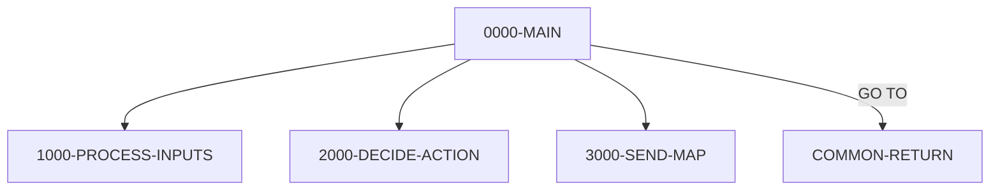

# Program COACTUPC

| Item | Value |
|---|---|
| Source | `app/cbl/COACTUPC.cbl` |
| Lines | 4236 total, 3368 code, 492 comment, 376 blank |
| PROGRAM-ID |  |
| Author |  |
| Runtime | cics-online |
| Module | base |
| CICS transactions | CAUP (`app/csd/CARDDEMO.CSD:306-316`) |
| JCL steps | None |
| Paragraphs | 85 |
| Semantic analysis | validated (batch B04) |
| Version banner | * Ver: CardDemo_v1.0-15-g27d6c6f-68 Date: 2022-07-19 23:12:32 CDT |

## Summary

COACTUPC is a pseudo-conversational CICS program (transaction CAUP, map CACTUPA in mapset COACTUP) that lets a signed-on user update one credit-card account and its customer. On the first screen the user keys an 11-digit account number; the program reads the card cross-reference file through alternate index CXACAIX, then ACCTDAT and CUSTDAT, and shows the current account and customer values. When the user changes values and presses Enter, every field is edited (Y/N flags, signed amounts, CCYYMMDD dates with leap-year and LE checks, SSN, FICO 300-850, alpha-only names, US state, state/zip prefix, North American phone numbers, EFT account) and the first failing edit is reported. When all edits pass the program asks for confirmation; PF5 reads both records for UPDATE, rejects the save if either record changed since it was fetched, then REWRITEs ACCTDAT and CUSTDAT and rolls back if the customer rewrite fails. PF12 discards changes and re-reads the account, and PF3 returns to the calling program or the main menu COMEN01C. State between screens is kept in the CARDDEMO-COMMAREA plus a program area holding the old and new values and the change-action flag. (Confirmed)

Evidence: `app/cbl/COACTUPC.cbl:533-582`, `app/cbl/COACTUPC.cbl:652-668`, `app/cbl/COACTUPC.cbl:880-1004`, `app/cbl/COACTUPC.cbl:1429-1676`, `app/cbl/COACTUPC.cbl:2562-2642`, `app/cbl/COACTUPC.cbl:3608-3644`, `app/cbl/COACTUPC.cbl:3888-4104`

Header comment (Unverified, `app/cbl/COACTUPC.cbl:1-8`): Program:     COACTUPC.CBL Layer:       Business logic Function:    Accept and process ACCOUNT UPDATE All Rights Reserved. http://www.apache.org/licenses/LICENSE-2.0 Unless required by applicable law or agreed to in writing,

## Divisions and sections

| Division / section | Lines | Notes |
|---|---|---|
| IDENTIFICATION DIVISION | `app/cbl/COACTUPC.cbl:21-28` |  |
| ENVIRONMENT DIVISION | `app/cbl/COACTUPC.cbl:29-31` |  |
| DATA DIVISION | `app/cbl/COACTUPC.cbl:32-857` |  |
| PROCEDURE DIVISION | `app/cbl/COACTUPC.cbl:858-4236` |  |
| ENVIRONMENT / INPUT-OUTPUT SECTION | `app/cbl/COACTUPC.cbl:30-31` |  |
| DATA / WORKING-STORAGE SECTION | `app/cbl/COACTUPC.cbl:34-852` |  |
| DATA / LINKAGE SECTION | `app/cbl/COACTUPC.cbl:853-857` |  |

## Files and data stores

No SELECT entries (no COBOL file I/O).

CICS file commands (file name resolved from VALUE clauses and the CSD):

| Command | FILE option | Resolved name | CSD DSNAME | CSD evidence | Line |
|---|---|---|---|---|---|
| READ | LIT-CARDXREFNAME-ACCT-PATH | CXACAIX | AWS.M2.CARDDEMO.CARDXREF.VSAM.AIX.PATH | `app/csd/CARDDEMO.CSD:63-75` | `app/cbl/COACTUPC.cbl:3654-3662` |
| READ | LIT-ACCTFILENAME | ACCTDAT | AWS.M2.CARDDEMO.ACCTDATA.VSAM.KSDS | `app/csd/CARDDEMO.CSD:1-12` | `app/cbl/COACTUPC.cbl:3703-3711` |
| READ | LIT-CUSTFILENAME | CUSTDAT | AWS.M2.CARDDEMO.CUSTDATA.VSAM.KSDS | `app/csd/CARDDEMO.CSD:50-62` | `app/cbl/COACTUPC.cbl:3753-3761` |
| READ | LIT-ACCTFILENAME | ACCTDAT | AWS.M2.CARDDEMO.ACCTDATA.VSAM.KSDS | `app/csd/CARDDEMO.CSD:1-12` | `app/cbl/COACTUPC.cbl:3894-3903` |
| READ | LIT-CUSTFILENAME | CUSTDAT | AWS.M2.CARDDEMO.CUSTDATA.VSAM.KSDS | `app/csd/CARDDEMO.CSD:50-62` | `app/cbl/COACTUPC.cbl:3921-3930` |
| REWRITE | LIT-ACCTFILENAME | ACCTDAT | AWS.M2.CARDDEMO.ACCTDATA.VSAM.KSDS | `app/csd/CARDDEMO.CSD:1-12` | `app/cbl/COACTUPC.cbl:4065-4071` |
| REWRITE | LIT-CUSTFILENAME | CUSTDAT | AWS.M2.CARDDEMO.CUSTDATA.VSAM.KSDS | `app/csd/CARDDEMO.CSD:50-62` | `app/cbl/COACTUPC.cbl:4085-4091` |

## Embedded CICS, SQL and DL/I commands

| Paragraph | Kind | Verb | Resources | Response | Lines |
|---|---|---|---|---|---|
| 0000-MAIN | CICS | HANDLE ABEND |  |  | `app/cbl/COACTUPC.cbl:862-864` |
| 0000-MAIN | CICS | SYNCPOINT |  |  | `app/cbl/COACTUPC.cbl:952-954` |
| 0000-MAIN | CICS | XCTL | PROGRAM(CDEMO-TO-PROGRAM) |  | `app/cbl/COACTUPC.cbl:956-959` |
| COMMON-RETURN | CICS | RETURN | TRANSID(LIT-THISTRANID) |  | `app/cbl/COACTUPC.cbl:1015-1019` |
| 1100-RECEIVE-MAP | CICS | RECEIVE MAP | MAP(LIT-THISMAP), MAPSET(LIT-THISMAPSET) | RESP | `app/cbl/COACTUPC.cbl:1040-1045` |
| 3400-SEND-SCREEN | CICS | SEND MAP | MAP(CCARD-NEXT-MAP), MAPSET(CCARD-NEXT-MAPSET) | RESP | `app/cbl/COACTUPC.cbl:3594-3601` |
| 9200-GETCARDXREF-BYACCT | CICS | READ | DATASET(LIT-CARDXREFNAME-ACCT-PATH) | RESP | `app/cbl/COACTUPC.cbl:3654-3662` |
| 9300-GETACCTDATA-BYACCT | CICS | READ | DATASET(LIT-ACCTFILENAME) | RESP | `app/cbl/COACTUPC.cbl:3703-3711` |
| 9400-GETCUSTDATA-BYCUST | CICS | READ | DATASET(LIT-CUSTFILENAME) | RESP | `app/cbl/COACTUPC.cbl:3753-3761` |
| 9600-WRITE-PROCESSING | CICS | READ | FILE(LIT-ACCTFILENAME) | RESP | `app/cbl/COACTUPC.cbl:3894-3903` |
| 9600-WRITE-PROCESSING | CICS | READ | FILE(LIT-CUSTFILENAME) | RESP | `app/cbl/COACTUPC.cbl:3921-3930` |
| 9600-WRITE-PROCESSING | CICS | REWRITE | FILE(LIT-ACCTFILENAME) | RESP | `app/cbl/COACTUPC.cbl:4065-4071` |
| 9600-WRITE-PROCESSING | CICS | REWRITE | FILE(LIT-CUSTFILENAME) | RESP | `app/cbl/COACTUPC.cbl:4085-4091` |
| 9600-WRITE-PROCESSING | CICS | SYNCPOINT |  |  | `app/cbl/COACTUPC.cbl:4099-4101` |
| ABEND-ROUTINE | CICS | SEND |  | NOHANDLE | `app/cbl/COACTUPC.cbl:4211-4216` |
| ABEND-ROUTINE | CICS | HANDLE ABEND |  |  | `app/cbl/COACTUPC.cbl:4218-4220` |
| ABEND-ROUTINE | CICS | ABEND |  |  | `app/cbl/COACTUPC.cbl:4222-4224` |

## Calls, transfers and callers

| Mechanism | Target | Parameters | Paragraph | Lines |
|---|---|---|---|---|
| EXEC CICS XCTL | CDEMO-TO-PROGRAM = COMEN01C | CARDDEMO-COMMAREA | 0000-MAIN | `app/cbl/COACTUPC.cbl:956-959` |
| EXEC CICS RETURN | LIT-THISTRANID = CAUP | WS-COMMAREA | COMMON-RETURN | `app/cbl/COACTUPC.cbl:1015-1019` |

Programs that transfer to or call this program (from `docs/_work/xref/call-graph.json`):

| Caller | Mechanism | Confidence | Evidence |
|---|---|---|---|
| COMEN01C | XCTL | Confirmed | `app/cbl/COMEN01C.cbl:185` |

## Copybooks

| Copybook | Statement | Resolution | Resolved path | REPLACING | Line |
|---|---|---|---|---|---|
| [CSUTLDWY](../08-data/layouts/CSUTLDWY.md) | COPY | inventory | app/cpy/CSUTLDWY.cpy |  | `app/cbl/COACTUPC.cbl:166` |
| [CVCRD01Y](../08-data/layouts/CVCRD01Y.md) | COPY | inventory | app/cpy/CVCRD01Y.cpy |  | `app/cbl/COACTUPC.cbl:597` |
| [CSLKPCDY](../08-data/layouts/CSLKPCDY.md) | COPY | inventory | app/cpy/CSLKPCDY.cpy |  | `app/cbl/COACTUPC.cbl:602` |
| DFHBMSCA | COPY | system |  |  | `app/cbl/COACTUPC.cbl:615` |
| DFHAID | COPY | system |  |  | `app/cbl/COACTUPC.cbl:616` |
| [COTTL01Y](../08-data/layouts/COTTL01Y.md) | COPY | inventory | app/cpy/COTTL01Y.cpy |  | `app/cbl/COACTUPC.cbl:620` |
| COACTUP | COPY | inventory | app/cpy-bms/COACTUP.CPY |  | `app/cbl/COACTUPC.cbl:623` |
| [CSDAT01Y](../08-data/layouts/CSDAT01Y.md) | COPY | inventory | app/cpy/CSDAT01Y.cpy |  | `app/cbl/COACTUPC.cbl:626` |
| [CSMSG01Y](../08-data/layouts/CSMSG01Y.md) | COPY | inventory | app/cpy/CSMSG01Y.cpy |  | `app/cbl/COACTUPC.cbl:629` |
| [CSMSG02Y](../08-data/layouts/CSMSG02Y.md) | COPY | inventory | app/cpy/CSMSG02Y.cpy |  | `app/cbl/COACTUPC.cbl:632` |
| [CSUSR01Y](../08-data/layouts/CSUSR01Y.md) | COPY | inventory | app/cpy/CSUSR01Y.cpy |  | `app/cbl/COACTUPC.cbl:635` |
| [CVACT01Y](../08-data/layouts/CVACT01Y.md) | COPY | inventory | app/cpy/CVACT01Y.cpy |  | `app/cbl/COACTUPC.cbl:640` |
| [CVACT03Y](../08-data/layouts/CVACT03Y.md) | COPY | inventory | app/cpy/CVACT03Y.cpy |  | `app/cbl/COACTUPC.cbl:643` |
| [CVCUS01Y](../08-data/layouts/CVCUS01Y.md) | COPY | inventory | app/cpy/CVCUS01Y.cpy |  | `app/cbl/COACTUPC.cbl:646` |
| [COCOM01Y](../08-data/layouts/COCOM01Y.md) | COPY | inventory | app/cpy/COCOM01Y.cpy |  | `app/cbl/COACTUPC.cbl:650` |
| [CSSETATY](../08-data/layouts/CSSETATY.md) | COPY | inventory | app/cpy/CSSETATY.cpy | ==(TESTVAR1)== BY ==ACCT-STATUS== ==(SCRNVAR2)== BY ==ACSTTUS== ==(MAPNAME3)== BY ==CACTUPA== | `app/cbl/COACTUPC.cbl:3208-3211` |
| [CSSETATY](../08-data/layouts/CSSETATY.md) | COPY | inventory | app/cpy/CSSETATY.cpy | ==(TESTVAR1)== BY ==OPEN-YEAR== ==(SCRNVAR2)== BY ==OPNYEAR== ==(MAPNAME3)== BY ==CACTUPA== | `app/cbl/COACTUPC.cbl:3214-3217` |
| [CSSETATY](../08-data/layouts/CSSETATY.md) | COPY | inventory | app/cpy/CSSETATY.cpy | ==(TESTVAR1)== BY ==OPEN-MONTH== ==(SCRNVAR2)== BY ==OPNMON== ==(MAPNAME3)== BY ==CACTUPA== | `app/cbl/COACTUPC.cbl:3220-3223` |
| [CSSETATY](../08-data/layouts/CSSETATY.md) | COPY | inventory | app/cpy/CSSETATY.cpy | ==(TESTVAR1)== BY ==OPEN-DAY== ==(SCRNVAR2)== BY ==OPNDAY== ==(MAPNAME3)== BY ==CACTUPA== | `app/cbl/COACTUPC.cbl:3226-3229` |
| [CSSETATY](../08-data/layouts/CSSETATY.md) | COPY | inventory | app/cpy/CSSETATY.cpy | ==(TESTVAR1)== BY ==CRED-LIMIT== ==(SCRNVAR2)== BY ==ACRDLIM== ==(MAPNAME3)== BY ==CACTUPA== | `app/cbl/COACTUPC.cbl:3232-3235` |
| [CSSETATY](../08-data/layouts/CSSETATY.md) | COPY | inventory | app/cpy/CSSETATY.cpy | ==(TESTVAR1)== BY ==EXPIRY-YEAR== ==(SCRNVAR2)== BY ==EXPYEAR== ==(MAPNAME3)== BY ==CACTUPA== | `app/cbl/COACTUPC.cbl:3238-3241` |
| [CSSETATY](../08-data/layouts/CSSETATY.md) | COPY | inventory | app/cpy/CSSETATY.cpy | ==(TESTVAR1)== BY ==EXPIRY-MONTH== ==(SCRNVAR2)== BY ==EXPMON== ==(MAPNAME3)== BY ==CACTUPA== | `app/cbl/COACTUPC.cbl:3244-3247` |
| [CSSETATY](../08-data/layouts/CSSETATY.md) | COPY | inventory | app/cpy/CSSETATY.cpy | ==(TESTVAR1)== BY ==EXPIRY-DAY== ==(SCRNVAR2)== BY ==EXPDAY== ==(MAPNAME3)== BY ==CACTUPA== | `app/cbl/COACTUPC.cbl:3250-3253` |
| [CSSETATY](../08-data/layouts/CSSETATY.md) | COPY | inventory | app/cpy/CSSETATY.cpy | ==(TESTVAR1)== BY ==CASH-CREDIT-LIMIT== ==(SCRNVAR2)== BY ==ACSHLIM== ==(MAPNAME3)== BY ==CACTUPA== | `app/cbl/COACTUPC.cbl:3256-3259` |
| [CSSETATY](../08-data/layouts/CSSETATY.md) | COPY | inventory | app/cpy/CSSETATY.cpy | ==(TESTVAR1)== BY ==REISSUE-YEAR== ==(SCRNVAR2)== BY ==RISYEAR== ==(MAPNAME3)== BY ==CACTUPA== | `app/cbl/COACTUPC.cbl:3262-3265` |
| [CSSETATY](../08-data/layouts/CSSETATY.md) | COPY | inventory | app/cpy/CSSETATY.cpy | ==(TESTVAR1)== BY ==REISSUE-MONTH== ==(SCRNVAR2)== BY ==RISMON== ==(MAPNAME3)== BY ==CACTUPA== | `app/cbl/COACTUPC.cbl:3268-3271` |
| [CSSETATY](../08-data/layouts/CSSETATY.md) | COPY | inventory | app/cpy/CSSETATY.cpy | ==(TESTVAR1)== BY ==REISSUE-DAY== ==(SCRNVAR2)== BY ==RISDAY== ==(MAPNAME3)== BY ==CACTUPA== | `app/cbl/COACTUPC.cbl:3274-3277` |
| [CSSETATY](../08-data/layouts/CSSETATY.md) | COPY | inventory | app/cpy/CSSETATY.cpy | ==(TESTVAR1)== BY ==CURR-BAL== ==(SCRNVAR2)== BY ==ACURBAL== ==(MAPNAME3)== BY ==CACTUPA== | `app/cbl/COACTUPC.cbl:3280-3283` |
| [CSSETATY](../08-data/layouts/CSSETATY.md) | COPY | inventory | app/cpy/CSSETATY.cpy | ==(TESTVAR1)== BY ==CURR-CYC-CREDIT== ==(SCRNVAR2)== BY ==ACRCYCR== ==(MAPNAME3)== BY ==CACTUPA== | `app/cbl/COACTUPC.cbl:3286-3289` |
| [CSSETATY](../08-data/layouts/CSSETATY.md) | COPY | inventory | app/cpy/CSSETATY.cpy | ==(TESTVAR1)== BY ==CURR-CYC-DEBIT== ==(SCRNVAR2)== BY ==ACRCYDB== ==(MAPNAME3)== BY ==CACTUPA== | `app/cbl/COACTUPC.cbl:3292-3295` |
| [CSSETATY](../08-data/layouts/CSSETATY.md) | COPY | inventory | app/cpy/CSSETATY.cpy | ==(TESTVAR1)== BY ==EDIT-US-SSN-PART1== ==(SCRNVAR2)== BY ==ACTSSN1== ==(MAPNAME3)== BY ==CACTUPA== | `app/cbl/COACTUPC.cbl:3298-3301` |
| [CSSETATY](../08-data/layouts/CSSETATY.md) | COPY | inventory | app/cpy/CSSETATY.cpy | ==(TESTVAR1)== BY ==EDIT-US-SSN-PART2== ==(SCRNVAR2)== BY ==ACTSSN2== ==(MAPNAME3)== BY ==CACTUPA== | `app/cbl/COACTUPC.cbl:3304-3307` |
| [CSSETATY](../08-data/layouts/CSSETATY.md) | COPY | inventory | app/cpy/CSSETATY.cpy | ==(TESTVAR1)== BY ==EDIT-US-SSN-PART3== ==(SCRNVAR2)== BY ==ACTSSN3== ==(MAPNAME3)== BY ==CACTUPA== | `app/cbl/COACTUPC.cbl:3310-3313` |
| [CSSETATY](../08-data/layouts/CSSETATY.md) | COPY | inventory | app/cpy/CSSETATY.cpy | ==(TESTVAR1)== BY ==DT-OF-BIRTH-YEAR== ==(SCRNVAR2)== BY ==DOBYEAR== ==(MAPNAME3)== BY ==CACTUPA== | `app/cbl/COACTUPC.cbl:3316-3319` |
| [CSSETATY](../08-data/layouts/CSSETATY.md) | COPY | inventory | app/cpy/CSSETATY.cpy | ==(TESTVAR1)== BY ==DT-OF-BIRTH-MONTH== ==(SCRNVAR2)== BY ==DOBMON== ==(MAPNAME3)== BY ==CACTUPA== | `app/cbl/COACTUPC.cbl:3322-3325` |
| [CSSETATY](../08-data/layouts/CSSETATY.md) | COPY | inventory | app/cpy/CSSETATY.cpy | ==(TESTVAR1)== BY ==DT-OF-BIRTH-DAY== ==(SCRNVAR2)== BY ==DOBDAY== ==(MAPNAME3)== BY ==CACTUPA== | `app/cbl/COACTUPC.cbl:3328-3331` |
| [CSSETATY](../08-data/layouts/CSSETATY.md) | COPY | inventory | app/cpy/CSSETATY.cpy | ==(TESTVAR1)== BY ==FICO-SCORE== ==(SCRNVAR2)== BY ==ACSTFCO== ==(MAPNAME3)== BY ==CACTUPA== | `app/cbl/COACTUPC.cbl:3334-3337` |
| [CSSETATY](../08-data/layouts/CSSETATY.md) | COPY | inventory | app/cpy/CSSETATY.cpy | ==(TESTVAR1)== BY ==FIRST-NAME== ==(SCRNVAR2)== BY ==ACSFNAM== ==(MAPNAME3)== BY ==CACTUPA== | `app/cbl/COACTUPC.cbl:3340-3343` |
| [CSSETATY](../08-data/layouts/CSSETATY.md) | COPY | inventory | app/cpy/CSSETATY.cpy | ==(TESTVAR1)== BY ==MIDDLE-NAME== ==(SCRNVAR2)== BY ==ACSMNAM== ==(MAPNAME3)== BY ==CACTUPA== | `app/cbl/COACTUPC.cbl:3346-3349` |
| [CSSETATY](../08-data/layouts/CSSETATY.md) | COPY | inventory | app/cpy/CSSETATY.cpy | ==(TESTVAR1)== BY ==LAST-NAME== ==(SCRNVAR2)== BY ==ACSLNAM== ==(MAPNAME3)== BY ==CACTUPA== | `app/cbl/COACTUPC.cbl:3352-3355` |
| [CSSETATY](../08-data/layouts/CSSETATY.md) | COPY | inventory | app/cpy/CSSETATY.cpy | ==(TESTVAR1)== BY ==ADDRESS-LINE-1== ==(SCRNVAR2)== BY ==ACSADL1== ==(MAPNAME3)== BY ==CACTUPA== | `app/cbl/COACTUPC.cbl:3358-3361` |
| [CSSETATY](../08-data/layouts/CSSETATY.md) | COPY | inventory | app/cpy/CSSETATY.cpy | ==(TESTVAR1)== BY ==STATE== ==(SCRNVAR2)== BY ==ACSSTTE== ==(MAPNAME3)== BY ==CACTUPA== | `app/cbl/COACTUPC.cbl:3364-3367` |
| [CSSETATY](../08-data/layouts/CSSETATY.md) | COPY | inventory | app/cpy/CSSETATY.cpy | ==(TESTVAR1)== BY ==ADDRESS-LINE-2== ==(SCRNVAR2)== BY ==ACSADL2== ==(MAPNAME3)== BY ==CACTUPA== | `app/cbl/COACTUPC.cbl:3370-3373` |
| [CSSETATY](../08-data/layouts/CSSETATY.md) | COPY | inventory | app/cpy/CSSETATY.cpy | ==(TESTVAR1)== BY ==ZIPCODE== ==(SCRNVAR2)== BY ==ACSZIPC== ==(MAPNAME3)== BY ==CACTUPA== | `app/cbl/COACTUPC.cbl:3376-3379` |
| [CSSETATY](../08-data/layouts/CSSETATY.md) | COPY | inventory | app/cpy/CSSETATY.cpy | ==(TESTVAR1)== BY ==CITY== ==(SCRNVAR2)== BY ==ACSCITY== ==(MAPNAME3)== BY ==CACTUPA== | `app/cbl/COACTUPC.cbl:3382-3385` |
| [CSSETATY](../08-data/layouts/CSSETATY.md) | COPY | inventory | app/cpy/CSSETATY.cpy | ==(TESTVAR1)== BY ==COUNTRY== ==(SCRNVAR2)== BY ==ACSCTRY== ==(MAPNAME3)== BY ==CACTUPA== | `app/cbl/COACTUPC.cbl:3388-3391` |
| [CSSETATY](../08-data/layouts/CSSETATY.md) | COPY | inventory | app/cpy/CSSETATY.cpy | ==(TESTVAR1)== BY ==PHONE-NUM-1A== ==(SCRNVAR2)== BY ==ACSPH1A== ==(MAPNAME3)== BY ==CACTUPA== | `app/cbl/COACTUPC.cbl:3394-3397` |
| [CSSETATY](../08-data/layouts/CSSETATY.md) | COPY | inventory | app/cpy/CSSETATY.cpy | ==(TESTVAR1)== BY ==PHONE-NUM-1B== ==(SCRNVAR2)== BY ==ACSPH1B== ==(MAPNAME3)== BY ==CACTUPA== | `app/cbl/COACTUPC.cbl:3400-3403` |
| [CSSETATY](../08-data/layouts/CSSETATY.md) | COPY | inventory | app/cpy/CSSETATY.cpy | ==(TESTVAR1)== BY ==PHONE-NUM-1C== ==(SCRNVAR2)== BY ==ACSPH1C== ==(MAPNAME3)== BY ==CACTUPA== | `app/cbl/COACTUPC.cbl:3405-3408` |
| [CSSETATY](../08-data/layouts/CSSETATY.md) | COPY | inventory | app/cpy/CSSETATY.cpy | ==(TESTVAR1)== BY ==PHONE-NUM-2A== ==(SCRNVAR2)== BY ==ACSPH2A== ==(MAPNAME3)== BY ==CACTUPA== | `app/cbl/COACTUPC.cbl:3411-3414` |
| [CSSETATY](../08-data/layouts/CSSETATY.md) | COPY | inventory | app/cpy/CSSETATY.cpy | ==(TESTVAR1)== BY ==PHONE-NUM-2B== ==(SCRNVAR2)== BY ==ACSPH2B== ==(MAPNAME3)== BY ==CACTUPA== | `app/cbl/COACTUPC.cbl:3417-3420` |
| [CSSETATY](../08-data/layouts/CSSETATY.md) | COPY | inventory | app/cpy/CSSETATY.cpy | ==(TESTVAR1)== BY ==PHONE-NUM-2C== ==(SCRNVAR2)== BY ==ACSPH2C== ==(MAPNAME3)== BY ==CACTUPA== | `app/cbl/COACTUPC.cbl:3422-3425` |
| [CSSETATY](../08-data/layouts/CSSETATY.md) | COPY | inventory | app/cpy/CSSETATY.cpy | ==(TESTVAR1)== BY ==PRI-CARDHOLDER== ==(SCRNVAR2)== BY ==ACSPFLG== ==(MAPNAME3)== BY ==CACTUPA== | `app/cbl/COACTUPC.cbl:3427-3430` |
| [CSSETATY](../08-data/layouts/CSSETATY.md) | COPY | inventory | app/cpy/CSSETATY.cpy | ==(TESTVAR1)== BY ==EFT-ACCOUNT-ID== ==(SCRNVAR2)== BY ==ACSEFTC== ==(MAPNAME3)== BY ==CACTUPA== | `app/cbl/COACTUPC.cbl:3432-3435` |
| [CSSTRPFY](../08-data/layouts/CSSTRPFY.md) | COPY | inventory | app/cpy/CSSTRPFY.cpy |  | `app/cbl/COACTUPC.cbl:4199` |
| [CSUTLDPY](../08-data/layouts/CSUTLDPY.md) | COPY | inventory | app/cpy/CSUTLDPY.cpy |  | `app/cbl/COACTUPC.cbl:4232` |

## Data division items

Every data entry coded in this source (copybook contents are on the copybook pages). Lengths are computed from PIC and USAGE.

| Section | Lvl | Name | PIC | Usage | Len | OCCURS | REDEFINES | VALUE | 88-levels | Line |
|---|---|---|---|---|---|---|---|---|---|---|
| WORKING-STORAGE | 01 | WS-MISC-STORAGE |  |  |  |  |  |  |  | 35 |
| WORKING-STORAGE | 05 | WS-CICS-PROCESSNG-VARS |  |  |  |  |  |  |  | 39 |
| WORKING-STORAGE | 07 | WS-RESP-CD | S9(09) | COMP | 4 |  |  | ZEROS |  | 40 |
| WORKING-STORAGE | 07 | WS-REAS-CD | S9(09) | COMP | 4 |  |  | ZEROS |  | 42 |
| WORKING-STORAGE | 07 | WS-TRANID | X(4) |  | 4 |  |  | SPACES |  | 44 |
| WORKING-STORAGE | 07 | WS-UCTRANS | X(4) |  | 4 |  |  | SPACES |  | 46 |
| WORKING-STORAGE | 05 | WS-GENERIC-EDITS |  |  |  |  |  |  |  | 52 |
| WORKING-STORAGE | 10 | WS-EDIT-VARIABLE-NAME | X(25) |  | 25 |  |  |  |  | 53 |
| WORKING-STORAGE | 10 | WS-EDIT-SIGNED-NUMBER-9V2-X | X(15) |  | 15 |  |  |  |  | 55 |
| WORKING-STORAGE | 10 | WS-FLG-SIGNED-NUMBER-EDIT | X(1) |  | 1 |  |  |  | FLG-SIGNED-NUMBER-ISVALID = LOW-VALUES; FLG-SIGNED-NUMBER-NOT-OK = '0'; FLG-SIGNED-NUMBER-BLANK = 'B' | 56 |
| WORKING-STORAGE | 10 | WS-EDIT-ALPHANUM-ONLY | X(256) |  | 256 |  |  |  |  | 61 |
| WORKING-STORAGE | 10 | WS-EDIT-ALPHANUM-LENGTH | S9(4) | COMP-3 | 3 |  |  |  |  | 62 |
| WORKING-STORAGE | 10 | WS-EDIT-ALPHA-ONLY-FLAGS | X(1) |  | 1 |  |  |  | FLG-ALPHA-ISVALID = LOW-VALUES; FLG-ALPHA-NOT-OK = '0'; FLG-ALPHA-BLANK = 'B' | 64 |
| WORKING-STORAGE | 10 | WS-EDIT-ALPHANUM-ONLY-FLAGS | X(1) |  | 1 |  |  |  | FLG-ALPHNANUM-ISVALID = LOW-VALUES; FLG-ALPHNANUM-NOT-OK = '0'; FLG-ALPHNANUM-BLANK = 'B' | 68 |
| WORKING-STORAGE | 10 | WS-EDIT-MANDATORY-FLAGS | X(1) |  | 1 |  |  |  | FLG-MANDATORY-ISVALID = LOW-VALUES; FLG-MANDATORY-NOT-OK = '0'; FLG-MANDATORY-BLANK = 'B' | 72 |
| WORKING-STORAGE | 10 | WS-EDIT-YES-NO | X(1) |  | 1 |  |  | 'N' | FLG-YES-NO-ISVALID = 'Y', 'N'; FLG-YES-NO-NOT-OK = '0'; FLG-YES-NO-BLANK = 'B' | 76 |
| WORKING-STORAGE | 10 | WS-EDIT-US-PHONE-NUM | X(15) |  | 15 |  |  |  |  | 82 |
| WORKING-STORAGE | 10 | WS-EDIT-US-PHONE-NUM-X |  |  |  |  | WS-EDIT-US-PHONE-NUM |  |  | 83 |
| WORKING-STORAGE | 20 | FILLER | X(1) |  | 1 |  |  |  |  | 85 |
| WORKING-STORAGE | 20 | WS-EDIT-US-PHONE-NUMA | X(3) |  | 3 |  |  |  |  | 87 |
| WORKING-STORAGE | 20 | WS-EDIT-US-PHONE-NUMA-N | 9(3) |  | 3 |  | WS-EDIT-US-PHONE-NUMA |  |  | 88 |
| WORKING-STORAGE | 20 | FILLER | X(1) |  | 1 |  |  |  |  | 90 |
| WORKING-STORAGE | 20 | WS-EDIT-US-PHONE-NUMB | X(3) |  | 3 |  |  |  |  | 92 |
| WORKING-STORAGE | 20 | WS-EDIT-US-PHONE-NUMB-N | 9(3) |  | 3 |  | WS-EDIT-US-PHONE-NUMB |  |  | 93 |
| WORKING-STORAGE | 20 | FILLER | X(1) |  | 1 |  |  |  |  | 95 |
| WORKING-STORAGE | 20 | WS-EDIT-US-PHONE-NUMC | X(4) |  | 4 |  |  |  |  | 97 |
| WORKING-STORAGE | 20 | WS-EDIT-US-PHONE-NUMC-N | 9(4) |  | 4 |  | WS-EDIT-US-PHONE-NUMC |  |  | 98 |
| WORKING-STORAGE | 20 | FILLER | X(2) |  | 2 |  |  |  |  | 100 |
| WORKING-STORAGE | 10 | WS-EDIT-US-PHONE-NUM-FLGS |  |  |  |  |  |  | WS-EDIT-US-PHONE-IS-INVALID = '000'; WS-EDIT-US-PHONE-IS-VALID = LOW-VALUES | 101 |
| WORKING-STORAGE | 20 | WS-EDIT-US-PHONEA-FLG | X(01) |  | 1 |  |  |  | FLG-EDIT-US-PHONEA-ISVALID = LOW-VALUES; FLG-EDIT-US-PHONEA-NOT-OK = '0'; FLG-EDIT-US-PHONEA-BLANK = 'B' | 104 |
| WORKING-STORAGE | 20 | WS-EDIT-EDIT-US-PHONEB | X(01) |  | 1 |  |  |  | FLG-EDIT-US-PHONEB-ISVALID = LOW-VALUES; FLG-EDIT-US-PHONEB-NOT-OK = '0'; FLG-EDIT-US-PHONEB-BLANK = 'B' | 108 |
| WORKING-STORAGE | 20 | WS-EDIT-EDIT-PHONEC | X(01) |  | 1 |  |  |  | FLG-EDIT-US-PHONEC-ISVALID = LOW-VALUES; FLG-EDIT-US-PHONEC-NOT-OK = '0'; FLG-EDIT-US-PHONEC-BLANK = 'B' | 112 |
| WORKING-STORAGE | 10 | WS-EDIT-US-SSN |  |  |  |  |  |  |  | 117 |
| WORKING-STORAGE | 20 | WS-EDIT-US-SSN-PART1 | X(3) |  | 3 |  |  |  |  | 118 |
| WORKING-STORAGE | 20 | WS-EDIT-US-SSN-PART1-N | 9(3) |  | 3 |  | WS-EDIT-US-SSN-PART1 |  | INVALID-SSN-PART1 = 0, 666, 900 THRU 999 | 119 |
| WORKING-STORAGE | 20 | WS-EDIT-US-SSN-PART2 | X(2) |  | 2 |  |  |  |  | 124 |
| WORKING-STORAGE | 20 | WS-EDIT-US-SSN-PART2-N | 9(2) |  | 2 |  | WS-EDIT-US-SSN-PART2 |  |  | 125 |
| WORKING-STORAGE | 20 | WS-EDIT-US-SSN-PART3 | X(4) |  | 4 |  |  |  |  | 127 |
| WORKING-STORAGE | 20 | WS-EDIT-US-SSN-PART3-N | 9(4) |  | 4 |  | WS-EDIT-US-SSN-PART3 |  |  | 128 |
| WORKING-STORAGE | 10 | WS-EDIT-US-SSN-N | 9(09) |  | 9 |  | WS-EDIT-US-SSN |  |  | 130 |
| WORKING-STORAGE | 10 | WS-EDIT-US-SSN-FLGS |  |  |  |  |  |  | WS-EDIT-US-SSN-IS-INVALID = '000'; WS-EDIT-US-SSN-IS-VALID = LOW-VALUES | 132 |
| WORKING-STORAGE | 20 | WS-EDIT-US-SSN-PART1-FLGS | X(01) |  | 1 |  |  |  | FLG-EDIT-US-SSN-PART1-ISVALID = LOW-VALUES; FLG-EDIT-US-SSN-PART1-NOT-OK = '0'; FLG-EDIT-US-SSN-PART1-BLANK = 'B' | 135 |
| WORKING-STORAGE | 20 | WS-EDIT-US-SSN-PART2-FLGS | X(01) |  | 1 |  |  |  | FLG-EDIT-US-SSN-PART2-ISVALID = LOW-VALUES; FLG-EDIT-US-SSN-PART2-NOT-OK = '0'; FLG-EDIT-US-SSN-PART2-BLANK = 'B' | 139 |
| WORKING-STORAGE | 20 | WS-EDIT-US-SSN-PART3-FLGS | X(01) |  | 1 |  |  |  | FLG-EDIT-US-SSN-PART3-ISVALID = LOW-VALUES; FLG-EDIT-US-SSN-PART3-NOT-OK = '0'; FLG-EDIT-US-SSN-PART3-BLANK = 'B' | 143 |
| WORKING-STORAGE | 05 | WS-CALCULATION-VARS |  |  |  |  |  |  |  | 151 |
| WORKING-STORAGE | 10 | WS-DIV-BY | S9(4) | COMP-3 | 3 |  |  | 4 |  | 152 |
| WORKING-STORAGE | 10 | WS-DIVIDEND | S9(4) | COMP-3 | 3 |  |  | 0 |  | 154 |
| WORKING-STORAGE | 10 | WS-REMAINDER | S9(4) | COMP-3 | 3 |  |  | 0 |  | 157 |
| WORKING-STORAGE | 10 | WS-CURR-DATE | X(21) |  | 21 |  |  | SPACES |  | 159 |
| WORKING-STORAGE | 05 | WS-DATACHANGED-FLAG | X(1) |  | 1 |  |  |  | NO-CHANGES-FOUND = '0'; CHANGE-HAS-OCCURRED = '1' | 168 |
| WORKING-STORAGE | 05 | WS-INPUT-FLAG | X(1) |  | 1 |  |  |  | INPUT-OK = '0'; INPUT-ERROR = '1'; INPUT-PENDING = LOW-VALUES | 171 |
| WORKING-STORAGE | 05 | WS-RETURN-FLAG | X(1) |  | 1 |  |  |  | WS-RETURN-FLAG-OFF = LOW-VALUES; WS-RETURN-FLAG-ON = '1' | 175 |
| WORKING-STORAGE | 05 | WS-PFK-FLAG | X(1) |  | 1 |  |  |  | PFK-VALID = '0'; PFK-INVALID = '1' | 178 |
| WORKING-STORAGE | 05 | WS-EDIT-ACCT-FLAG | X(1) |  | 1 |  |  |  | FLG-ACCTFILTER-ISVALID = '1'; FLG-ACCTFILTER-NOT-OK = '0'; FLG-ACCTFILTER-BLANK = ' ' | 183 |
| WORKING-STORAGE | 05 | WS-EDIT-CUST-FLAG | X(1) |  | 1 |  |  |  | FLG-CUSTFILTER-ISVALID = '1'; FLG-CUSTFILTER-NOT-OK = '0'; FLG-CUSTFILTER-BLANK = ' ' | 187 |
| WORKING-STORAGE | 05 | WS-NON-KEY-FLAGS |  |  |  |  |  |  |  | 191 |
| WORKING-STORAGE | 10 | WS-EDIT-ACCT-STATUS | X(1) |  | 1 |  |  |  | FLG-ACCT-STATUS-ISVALID = 'Y', 'N'; FLG-ACCT-STATUS-NOT-OK = '0'; FLG-ACCT-STATUS-BLANK = 'B' | 192 |
| WORKING-STORAGE | 10 | WS-EDIT-CREDIT-LIMIT | X(1) |  | 1 |  |  |  | FLG-CRED-LIMIT-ISVALID = LOW-VALUES; FLG-CRED-LIMIT-NOT-OK = '0'; FLG-CRED-LIMIT-BLANK = 'B' | 196 |
| WORKING-STORAGE | 10 | WS-EDIT-CASH-CREDIT-LIMIT | X(1) |  | 1 |  |  |  | FLG-CASH-CREDIT-LIMIT-ISVALID = LOW-VALUES; FLG-CASH-CREDIT-LIMIT-NOT-OK = '0'; FLG-CASH-CREDIT-LIMIT-BLANK = 'B' | 200 |
| WORKING-STORAGE | 10 | WS-EDIT-CURR-BAL | X(1) |  | 1 |  |  |  | FLG-CURR-BAL-ISVALID = LOW-VALUES; FLG-CURR-BAL-NOT-OK = '0'; FLG-CURR-BAL-BLANK = 'B' | 204 |
| WORKING-STORAGE | 10 | WS-EDIT-CURR-CYC-CREDIT | X(1) |  | 1 |  |  |  | FLG-CURR-CYC-CREDIT-ISVALID = LOW-VALUES; FLG-CURR-CYC-CREDIT-NOT-OK = '0'; FLG-CURR-CYC-CREDIT-BLANK = 'B' | 208 |
| WORKING-STORAGE | 10 | WS-EDIT-CURR-CYC-DEBIT | X(1) |  | 1 |  |  |  | FLG-CURR-CYC-DEBIT-ISVALID = LOW-VALUES; FLG-CURR-CYC-DEBIT-NOT-OK = '0'; FLG-CURR-CYC-DEBIT-BLANK = 'B' | 212 |
| WORKING-STORAGE | 10 | WS-EDIT-DT-OF-BIRTH-FLGS |  |  |  |  |  |  | WS-EDIT-DT-OF-BIRTH-INVALID = '000'; WS-EDIT-DT-OF-BIRTH-ISVALID = LOW-VALUES | 216 |
| WORKING-STORAGE | 20 | WS-EDIT-DT-OF-BIRTH-YEAR-FLG | X(01) |  | 1 |  |  |  | FLG-DT-OF-BIRTH-YEAR-ISVALID = LOW-VALUES; FLG-DT-OF-BIRTH-YEAR-NOT-OK = '0'; FLG-DT-OF-BIRTH-YEAR-BLANK = 'B' | 219 |
| WORKING-STORAGE | 20 | WS-EDIT-DT-OF-BIRTH-MONTH | X(01) |  | 1 |  |  |  | FLG-DT-OF-BIRTH-MONTH-ISVALID = LOW-VALUES; FLG-DT-OF-BIRTH-MONTH-NOT-OK = '0'; FLG-DT-OF-BIRTH-MONTH-BLANK = 'B' | 223 |
| WORKING-STORAGE | 20 | WS-EDIT-DT-OF-BIRTH-DAY | X(01) |  | 1 |  |  |  | FLG-DT-OF-BIRTH-DAY-ISVALID = LOW-VALUES; FLG-DT-OF-BIRTH-DAY-NOT-OK = '0'; FLG-DT-OF-BIRTH-DAY-BLANK = 'B' | 227 |
| WORKING-STORAGE | 10 | WS-EDIT-FICO-SCORE-FLGS | X(1) |  | 1 |  |  |  | FLG-FICO-SCORE-ISVALID = LOW-VALUES; FLG-FICO-SCORE-NOT-OK = '0'; FLG-FICO-SCORE-BLANK = 'B' | 231 |
| WORKING-STORAGE | 10 | WS-EDIT-OPEN-DATE-FLGS |  |  |  |  |  |  | WS-EDIT-OPEN-DATE-IS-INVALID = '000' | 235 |
| WORKING-STORAGE | 20 | WS-EDIT-OPEN-YEAR-FLG | X(01) |  | 1 |  |  |  | FLG-OPEN-YEAR-ISVALID = LOW-VALUES; FLG-OPEN-YEAR-NOT-OK = '0'; FLG-OPEN-YEAR-BLANK = 'B' | 237 |
| WORKING-STORAGE | 20 | WS-EDIT-OPEN-MONTH | X(01) |  | 1 |  |  |  | FLG-OPEN-MONTH-ISVALID = LOW-VALUES; FLG-OPEN-MONTH-NOT-OK = '0'; FLG-OPEN-MONTH-BLANK = 'B' | 241 |
| WORKING-STORAGE | 20 | WS-EDIT-OPEN-DAY | X(01) |  | 1 |  |  |  | FLG-OPEN-DAY-ISVALID = LOW-VALUES; FLG-OPEN-DAY-NOT-OK = '0'; FLG-OPEN-DAY-BLANK = 'B' | 245 |
| WORKING-STORAGE | 10 | WS-EXPIRY-DATE-FLGS |  |  |  |  |  |  | WS-EDIT-EXPIRY-IS-INVALID = '000' | 249 |
| WORKING-STORAGE | 20 | WS-EDIT-EXPIRY-YEAR-FLG | X(01) |  | 1 |  |  |  | FLG-EXPIRY-YEAR-ISVALID = LOW-VALUES; FLG-EXPIRY-YEAR-NOT-OK = '0'; FLG-EXPIRY-YEAR-BLANK = 'B' | 251 |
| WORKING-STORAGE | 20 | WS-EDIT-EXPIRY-MONTH | X(01) |  | 1 |  |  |  | FLG-EXPIRY-MONTH-ISVALID = LOW-VALUES; FLG-EXPIRY-MONTH-NOT-OK = '0'; FLG-EXPIRY-MONTH-BLANK = 'B' | 255 |
| WORKING-STORAGE | 20 | WS-EDIT-EXPIRY-DAY | X(01) |  | 1 |  |  |  | FLG-EXPIRY-DAY-ISVALID = LOW-VALUES; FLG-EXPIRY-DAY-NOT-OK = '0'; FLG-EXPIRY-DAY-BLANK = 'B' | 259 |
| WORKING-STORAGE | 10 | WS-EDIT-REISSUE-DATE-FLGS |  |  |  |  |  |  | WS-EDIT-REISSUE-DATE-INVALID = '000' | 263 |
| WORKING-STORAGE | 20 | WS-EDIT-REISSUE-YEAR-FLG | X(01) |  | 1 |  |  |  | FLG-REISSUE-YEAR-ISVALID = LOW-VALUES; FLG-REISSUE-YEAR-NOT-OK = '0'; FLG-REISSUE-YEAR-BLANK = 'B' | 265 |
| WORKING-STORAGE | 20 | WS-EDIT-REISSUE-MONTH | X(01) |  | 1 |  |  |  | FLG-REISSUE-MONTH-ISVALID = LOW-VALUES; FLG-REISSUE-MONTH-NOT-OK = '0'; FLG-REISSUE-MONTH-BLANK = 'B' | 269 |
| WORKING-STORAGE | 20 | WS-EDIT-REISSUE-DAY | X(01) |  | 1 |  |  |  | FLG-REISSUE-DAY-ISVALID = LOW-VALUES; FLG-REISSUE-DAY-NOT-OK = '0'; FLG-REISSUE-DAY-BLANK = 'B' | 273 |
| WORKING-STORAGE | 10 | WS-EDIT-NAME-FLAGS |  |  |  |  |  |  |  | 277 |
| WORKING-STORAGE | 20 | WS-EDIT-FIRST-NAME-FLGS | X(01) |  | 1 |  |  |  | FLG-FIRST-NAME-ISVALID = LOW-VALUES; FLG-FIRST-NAME-NOT-OK = '0'; FLG-FIRST-NAME-BLANK = 'B' | 278 |
| WORKING-STORAGE | 20 | WS-EDIT-MIDDLE-NAME-FLGS | X(01) |  | 1 |  |  |  | FLG-MIDDLE-NAME-ISVALID = LOW-VALUES; FLG-MIDDLE-NAME-NOT-OK = '0'; FLG-MIDDLE-NAME-BLANK = 'B' | 282 |
| WORKING-STORAGE | 20 | WS-EDIT-LAST-NAME-FLGS | X(01) |  | 1 |  |  |  | FLG-LAST-NAME-ISVALID = LOW-VALUES; FLG-LAST-NAME-NOT-OK = '0'; FLG-LAST-NAME-BLANK = 'B' | 286 |
| WORKING-STORAGE | 10 | WS-EDIT-ADDRESS-FLAGS |  |  |  |  |  |  |  | 290 |
| WORKING-STORAGE | 20 | WS-EDIT-ADDRESS-LINE-1-FLGS | X(01) |  | 1 |  |  |  | FLG-ADDRESS-LINE-1-ISVALID = LOW-VALUES; FLG-ADDRESS-LINE-1-NOT-OK = '0'; FLG-ADDRESS-LINE-1-BLANK = 'B' | 291 |
| WORKING-STORAGE | 20 | WS-EDIT-ADDRESS-LINE-2-FLGS | X(01) |  | 1 |  |  |  | FLG-ADDRESS-LINE-2-ISVALID = LOW-VALUES; FLG-ADDRESS-LINE-2-NOT-OK = '0'; FLG-ADDRESS-LINE-2-BLANK = 'B' | 295 |
| WORKING-STORAGE | 20 | WS-EDIT-CITY-FLGS | X(01) |  | 1 |  |  |  | FLG-CITY-ISVALID = LOW-VALUES; FLG-CITY-NOT-OK = '0'; FLG-CITY-BLANK = 'B' | 299 |
| WORKING-STORAGE | 20 | WS-EDIT-STATE-FLGS | X(01) |  | 1 |  |  |  | FLG-STATE-ISVALID = LOW-VALUES; FLG-STATE-NOT-OK = '0'; FLG-STATE-BLANK = 'B' | 303 |
| WORKING-STORAGE | 20 | WS-EDIT-ZIPCODE-FLGS | X(01) |  | 1 |  |  |  | FLG-ZIPCODE-ISVALID = LOW-VALUES; FLG-ZIPCODE-NOT-OK = '0'; FLG-ZIPCODE-BLANK = 'B' | 307 |
| WORKING-STORAGE | 20 | WS-EDIT-COUNTRY-FLGS | X(01) |  | 1 |  |  |  | FLG-COUNTRY-ISVALID = LOW-VALUES; FLG-COUNTRY-NOT-OK = '0'; FLG-COUNTRY-BLANK = 'B' | 311 |
| WORKING-STORAGE | 20 | WS-EDIT-PHONE-NUM-1-FLGS |  |  |  |  |  |  | WS-EDIT-PHONE-NUM-1-IS-INVALID = '000' | 315 |
| WORKING-STORAGE | 30 | WS-EDIT-PHONE-NUM-1A-FLG | X(01) |  | 1 |  |  |  | FLG-PHONE-NUM-1A-ISVALID = LOW-VALUES; FLG-PHONE-NUM-1A-NOT-OK = '0'; FLG-PHONE-NUM-1A-BLANK = 'B' | 318 |
| WORKING-STORAGE | 30 | WS-EDIT-PHONE-NUM-1B | X(01) |  | 1 |  |  |  | FLG-PHONE-NUM-1B-ISVALID = LOW-VALUES; FLG-PHONE-NUM-1B-NOT-OK = '0'; FLG-PHONE-NUM-1B-BLANK = 'B' | 322 |
| WORKING-STORAGE | 30 | WS-EDIT-PHONE-NUM-1C | X(01) |  | 1 |  |  |  | FLG-PHONE-NUM-1C-ISVALID = LOW-VALUES; FLG-PHONE-NUM-1C-NOT-OK = '0'; FLG-PHONE-NUM-1C-BLANK = 'B' | 326 |
| WORKING-STORAGE | 20 | WS-EDIT-PHONE-NUM-2-FLGS |  |  |  |  |  |  | WS-EDIT-PHONE-NUM-2-IS-INVALID = '000' | 330 |
| WORKING-STORAGE | 30 | WS-EDIT-PHONE-NUM-2A-FLG | X(01) |  | 1 |  |  |  | FLG-PHONE-NUM-2A-ISVALID = LOW-VALUES; FLG-PHONE-NUM-2A-NOT-OK = '0'; FLG-PHONE-NUM-2A-BLANK = 'B' | 333 |
| WORKING-STORAGE | 30 | WS-EDIT-PHONE-NUM-2B | X(01) |  | 1 |  |  |  | FLG-PHONE-NUM-2B-ISVALID = LOW-VALUES; FLG-PHONE-NUM-2B-NOT-OK = '0'; FLG-PHONE-NUM-2B-BLANK = 'B' | 337 |
| WORKING-STORAGE | 30 | WS-EDIT-PHONE-NUM-2C | X(01) |  | 1 |  |  |  | FLG-PHONE-NUM-2C-ISVALID = LOW-VALUES; FLG-PHONE-NUM-2C-NOT-OK = '0'; FLG-PHONE-NUM-2C-BLANK = 'B' | 341 |
| WORKING-STORAGE | 10 | WS-EFT-ACCOUNT-ID-FLGS | X(01) |  | 1 |  |  |  | FLG-EFT-ACCOUNT-ID-ISVALID = LOW-VALUES; FLG-EFT-ACCOUNT-ID-NOT-OK = '0'; FLG-EFT-ACCOUNT-ID-BLANK = 'B' | 345 |
| WORKING-STORAGE | 10 | WS-EDIT-PRI-CARDHOLDER | X(1) |  | 1 |  |  |  | FLG-PRI-CARDHOLDER-ISVALID = 'Y', 'N'; FLG-PRI-CARDHOLDER-NOT-OK = '0'; FLG-PRI-CARDHOLDER-BLANK = 'B' | 349 |
| WORKING-STORAGE | 05 | CICS-OUTPUT-EDIT-VARS |  |  |  |  |  |  |  | 357 |
| WORKING-STORAGE | 10 | CUST-ACCT-ID-X | X(11) |  | 11 |  |  |  |  | 358 |
| WORKING-STORAGE | 10 | CUST-ACCT-ID-N | 9(11) |  | 11 |  | CUST-ACCT-ID-X |  |  | 359 |
| WORKING-STORAGE | 10 | WS-EDIT-DATE-X | X(10) |  | 10 |  |  |  |  | 361 |
| WORKING-STORAGE | 10 | FILLER |  |  |  |  | WS-EDIT-DATE-X |  |  | 362 |
| WORKING-STORAGE | 20 | WS-EDIT-DATE-X-YEAR | X(4) |  | 4 |  |  |  |  | 363 |
| WORKING-STORAGE | 20 | FILLER | X(1) |  | 1 |  |  |  |  | 364 |
| WORKING-STORAGE | 20 | WS-EDIT-DATE-MONTH | X(2) |  | 2 |  |  |  |  | 365 |
| WORKING-STORAGE | 20 | FILLER | X(1) |  | 1 |  |  |  |  | 366 |
| WORKING-STORAGE | 20 | WS-EDIT-DATE-DAY | X(2) |  | 2 |  |  |  |  | 367 |
| WORKING-STORAGE | 10 | WS-EDIT-DATE-X | 9(10) |  | 10 |  | WS-EDIT-DATE-X |  |  | 368 |
| WORKING-STORAGE | 10 | WS-EDIT-CURRENCY-9-2 | X(15) |  | 15 |  |  |  |  | 370 |
| WORKING-STORAGE | 10 | WS-EDIT-CURRENCY-9-2-F | +ZZZ,ZZZ,ZZZ.99 |  | 15 |  |  |  |  | 371 |
| WORKING-STORAGE | 05 | WS-XREF-RID |  |  |  |  |  |  |  | 376 |
| WORKING-STORAGE | 10 | WS-CARD-RID-CARDNUM | X(16) |  | 16 |  |  |  |  | 377 |
| WORKING-STORAGE | 10 | WS-CARD-RID-CUST-ID | 9(09) |  | 9 |  |  |  |  | 378 |
| WORKING-STORAGE | 10 | WS-CARD-RID-CUST-ID-X | X(09) |  | 9 |  | WS-CARD-RID-CUST-ID |  |  | 379 |
| WORKING-STORAGE | 10 | WS-CARD-RID-ACCT-ID | 9(11) |  | 11 |  |  |  |  | 381 |
| WORKING-STORAGE | 10 | WS-CARD-RID-ACCT-ID-X | X(11) |  | 11 |  | WS-CARD-RID-ACCT-ID |  |  | 382 |
| WORKING-STORAGE | 05 | WS-FILE-READ-FLAGS |  |  |  |  |  |  |  | 384 |
| WORKING-STORAGE | 10 | WS-ACCOUNT-MASTER-READ-FLAG | X(1) |  | 1 |  |  |  | FOUND-ACCT-IN-MASTER = '1' | 385 |
| WORKING-STORAGE | 10 | WS-CUST-MASTER-READ-FLAG | X(1) |  | 1 |  |  |  | FOUND-CUST-IN-MASTER = '1' | 387 |
| WORKING-STORAGE | 05 | WS-FILE-ERROR-MESSAGE |  |  |  |  |  |  |  | 389 |
| WORKING-STORAGE | 10 | FILLER | X(12) |  | 12 |  |  | 'File Error: ' |  | 390 |
| WORKING-STORAGE | 10 | ERROR-OPNAME | X(8) |  | 8 |  |  | SPACES |  | 392 |
| WORKING-STORAGE | 10 | FILLER | X(4) |  | 4 |  |  | ' on ' |  | 394 |
| WORKING-STORAGE | 10 | ERROR-FILE | X(9) |  | 9 |  |  | SPACES |  | 396 |
| WORKING-STORAGE | 10 | FILLER | X(15) |  | 15 |  |  | ' returned RESP ' |  | 398 |
| WORKING-STORAGE | 10 | ERROR-RESP | X(10) |  | 10 |  |  | SPACES |  | 401 |
| WORKING-STORAGE | 10 | FILLER | X(7) |  | 7 |  |  | ',RESP2 ' |  | 403 |
| WORKING-STORAGE | 10 | ERROR-RESP2 | X(10) |  | 10 |  |  | SPACES |  | 405 |
| WORKING-STORAGE | 10 | FILLER | X(5) |  | 5 |  |  | SPACES |  | 407 |
| WORKING-STORAGE | 05 | ALPHA-VARS-FOR-DATA-EDITING |  |  |  |  |  |  |  | 411 |
| WORKING-STORAGE | 15 | ACUP-NEW-CREDIT-LIMIT-X | X(15) |  | 15 |  |  |  |  | 412 |
| WORKING-STORAGE | 15 | ACUP-NEW-CASH-CREDIT-LIMIT-X | X(15) |  | 15 |  |  |  |  | 413 |
| WORKING-STORAGE | 15 | ACUP-NEW-CURR-BAL-X | X(15) |  | 15 |  |  |  |  | 414 |
| WORKING-STORAGE | 15 | ACUP-NEW-CURR-CYC-CREDIT-X | X(15) |  | 15 |  |  |  |  | 415 |
| WORKING-STORAGE | 15 | ACUP-NEW-CURR-CYC-DEBIT-X | X(15) |  | 15 |  |  |  |  | 416 |
| WORKING-STORAGE | 05 | ACCT-UPDATE-RECORD |  |  |  |  |  |  |  | 418 |
| WORKING-STORAGE | 15 | ACCT-UPDATE-ID | 9(11) |  | 11 |  |  |  |  | 422 |
| WORKING-STORAGE | 15 | ACCT-UPDATE-ACTIVE-STATUS | X(01) |  | 1 |  |  |  |  | 423 |
| WORKING-STORAGE | 15 | ACCT-UPDATE-CURR-BAL | S9(10)V99 |  | 12 |  |  |  |  | 424 |
| WORKING-STORAGE | 15 | ACCT-UPDATE-CREDIT-LIMIT | S9(10)V99 |  | 12 |  |  |  |  | 425 |
| WORKING-STORAGE | 15 | ACCT-UPDATE-CASH-CREDIT-LIMIT | S9(10)V99 |  | 12 |  |  |  |  | 426 |
| WORKING-STORAGE | 15 | ACCT-UPDATE-OPEN-DATE | X(10) |  | 10 |  |  |  |  | 427 |
| WORKING-STORAGE | 15 | ACCT-UPDATE-EXPIRAION-DATE | X(10) |  | 10 |  |  |  |  | 428 |
| WORKING-STORAGE | 15 | ACCT-UPDATE-REISSUE-DATE | X(10) |  | 10 |  |  |  |  | 429 |
| WORKING-STORAGE | 15 | ACCT-UPDATE-CURR-CYC-CREDIT | S9(10)V99 |  | 12 |  |  |  |  | 430 |
| WORKING-STORAGE | 15 | ACCT-UPDATE-CURR-CYC-DEBIT | S9(10)V99 |  | 12 |  |  |  |  | 431 |
| WORKING-STORAGE | 15 | ACCT-UPDATE-GROUP-ID | X(10) |  | 10 |  |  |  |  | 432 |
| WORKING-STORAGE | 15 | FILLER | X(188) |  | 188 |  |  |  |  | 433 |
| WORKING-STORAGE | 05 | CUST-UPDATE-RECORD |  |  |  |  |  |  |  | 434 |
| WORKING-STORAGE | 15 | CUST-UPDATE-ID | 9(09) |  | 9 |  |  |  |  | 438 |
| WORKING-STORAGE | 15 | CUST-UPDATE-FIRST-NAME | X(25) |  | 25 |  |  |  |  | 439 |
| WORKING-STORAGE | 15 | CUST-UPDATE-MIDDLE-NAME | X(25) |  | 25 |  |  |  |  | 440 |
| WORKING-STORAGE | 15 | CUST-UPDATE-LAST-NAME | X(25) |  | 25 |  |  |  |  | 441 |
| WORKING-STORAGE | 15 | CUST-UPDATE-ADDR-LINE-1 | X(50) |  | 50 |  |  |  |  | 442 |
| WORKING-STORAGE | 15 | CUST-UPDATE-ADDR-LINE-2 | X(50) |  | 50 |  |  |  |  | 443 |
| WORKING-STORAGE | 15 | CUST-UPDATE-ADDR-LINE-3 | X(50) |  | 50 |  |  |  |  | 444 |
| WORKING-STORAGE | 15 | CUST-UPDATE-ADDR-STATE-CD | X(02) |  | 2 |  |  |  |  | 445 |
| WORKING-STORAGE | 15 | CUST-UPDATE-ADDR-COUNTRY-CD | X(03) |  | 3 |  |  |  |  | 446 |
| WORKING-STORAGE | 15 | CUST-UPDATE-ADDR-ZIP | X(10) |  | 10 |  |  |  |  | 447 |
| WORKING-STORAGE | 15 | CUST-UPDATE-PHONE-NUM-1 | X(15) |  | 15 |  |  |  |  | 448 |
| WORKING-STORAGE | 15 | CUST-UPDATE-PHONE-NUM-2 | X(15) |  | 15 |  |  |  |  | 449 |
| WORKING-STORAGE | 15 | CUST-UPDATE-SSN | 9(09) |  | 9 |  |  |  |  | 450 |
| WORKING-STORAGE | 15 | CUST-UPDATE-GOVT-ISSUED-ID | X(20) |  | 20 |  |  |  |  | 451 |
| WORKING-STORAGE | 15 | CUST-UPDATE-DOB-YYYY-MM-DD | X(10) |  | 10 |  |  |  |  | 452 |
| WORKING-STORAGE | 15 | CUST-UPDATE-EFT-ACCOUNT-ID | X(10) |  | 10 |  |  |  |  | 453 |
| WORKING-STORAGE | 15 | CUST-UPDATE-PRI-CARD-IND | X(01) |  | 1 |  |  |  |  | 454 |
| WORKING-STORAGE | 15 | CUST-UPDATE-FICO-CREDIT-SCORE | 9(03) |  | 3 |  |  |  |  | 455 |
| WORKING-STORAGE | 15 | FILLER | X(168) |  | 168 |  |  |  |  | 456 |
| WORKING-STORAGE | 05 | WS-LONG-MSG | X(500) |  | 500 |  |  |  |  | 462 |
| WORKING-STORAGE | 05 | WS-INFO-MSG | X(40) |  | 40 |  |  |  | WS-NO-INFO-MESSAGE = SPACES LOW-VALUES; FOUND-ACCOUNT-DATA = 'Details of selected account shown above'; PROMPT-FOR-SEARCH-KEYS = 'Enter or update id of account to update'; PROMPT-FOR-CHANGES = 'Update | 463 |
| WORKING-STORAGE | 05 | WS-RETURN-MSG | X(75) |  | 75 |  |  |  | WS-RETURN-MSG-OFF = SPACES; WS-EXIT-MESSAGE = 'PF03 pressed.Exiting '; WS-PROMPT-FOR-ACCT = 'Account number not provided'; WS-PROMPT-FOR-LASTNAME = 'Last name not provided'; WS-NAME-MUST-BE-ALPHA = 'N | 479 |
| WORKING-STORAGE | 01 | WS-LITERALS |  |  |  |  |  |  |  | 532 |
| WORKING-STORAGE | 05 | LIT-THISPGM | X(8) |  | 8 |  |  | 'COACTUPC' |  | 533 |
| WORKING-STORAGE | 05 | LIT-THISTRANID | X(4) |  | 4 |  |  | 'CAUP' |  | 535 |
| WORKING-STORAGE | 05 | LIT-THISMAPSET | X(8) |  | 8 |  |  | 'COACTUP ' |  | 537 |
| WORKING-STORAGE | 05 | LIT-THISMAP | X(7) |  | 7 |  |  | 'CACTUPA' |  | 539 |
| WORKING-STORAGE | 05 | LIT-CARDUPDATE-PGM | X(8) |  | 8 |  |  | 'COCRDUPC' |  | 541 |
| WORKING-STORAGE | 05 | LIT-CARDUPDATE-TRANID | X(4) |  | 4 |  |  | 'CCUP' |  | 543 |
| WORKING-STORAGE | 05 | LIT-CARDUPDATE-MAPSET | X(8) |  | 8 |  |  | 'COCRDUP ' |  | 545 |
| WORKING-STORAGE | 05 | LIT-CARDUPDATE-MAP | X(7) |  | 7 |  |  | 'CCRDUPA' |  | 547 |
| WORKING-STORAGE | 05 | LIT-CCLISTPGM | X(8) |  | 8 |  |  | 'COCRDLIC' |  | 549 |
| WORKING-STORAGE | 05 | LIT-CCLISTTRANID | X(4) |  | 4 |  |  | 'CCLI' |  | 551 |
| WORKING-STORAGE | 05 | LIT-CCLISTMAPSET | X(7) |  | 7 |  |  | 'COCRDLI' |  | 553 |
| WORKING-STORAGE | 05 | LIT-CCLISTMAP | X(7) |  | 7 |  |  | 'CCRDSLA' |  | 555 |
| WORKING-STORAGE | 05 | LIT-MENUPGM | X(8) |  | 8 |  |  | 'COMEN01C' |  | 557 |
| WORKING-STORAGE | 05 | LIT-MENUTRANID | X(4) |  | 4 |  |  | 'CM00' |  | 559 |
| WORKING-STORAGE | 05 | LIT-MENUMAPSET | X(7) |  | 7 |  |  | 'COMEN01' |  | 561 |
| WORKING-STORAGE | 05 | LIT-MENUMAP | X(7) |  | 7 |  |  | 'COMEN1A' |  | 563 |
| WORKING-STORAGE | 05 | LIT-CARDDTLPGM | X(8) |  | 8 |  |  | 'COCRDSLC' |  | 565 |
| WORKING-STORAGE | 05 | LIT-CARDDTLTRANID | X(4) |  | 4 |  |  | 'CCDL' |  | 567 |
| WORKING-STORAGE | 05 | LIT-CARDDTLMAPSET | X(7) |  | 7 |  |  | 'COCRDSL' |  | 569 |
| WORKING-STORAGE | 05 | LIT-CARDDTLMAP | X(7) |  | 7 |  |  | 'CCRDSLA' |  | 571 |
| WORKING-STORAGE | 05 | LIT-ACCTFILENAME | X(8) |  | 8 |  |  | 'ACCTDAT ' |  | 573 |
| WORKING-STORAGE | 05 | LIT-CUSTFILENAME | X(8) |  | 8 |  |  | 'CUSTDAT ' |  | 575 |
| WORKING-STORAGE | 05 | LIT-CARDFILENAME | X(8) |  | 8 |  |  | 'CARDDAT ' |  | 577 |
| WORKING-STORAGE | 05 | LIT-CARDFILENAME-ACCT-PATH | X(8) |  | 8 |  |  | 'CARDAIX ' |  | 579 |
| WORKING-STORAGE | 05 | LIT-CARDXREFNAME-ACCT-PATH | X(8) |  | 8 |  |  | 'CXACAIX ' |  | 581 |
| WORKING-STORAGE | 05 | LIT-ALL-ALPHANUM-FROM-X |  |  |  |  |  |  |  | 586 |
| WORKING-STORAGE | 10 | LIT-ALL-ALPHA-FROM-X |  |  |  |  |  |  |  | 587 |
| WORKING-STORAGE | 15 | LIT-UPPER | X(26) |  | 26 |  |  | 'ABCDEFGHIJKLMNOPQRSTUVWXYZ' |  | 588 |
| WORKING-STORAGE | 15 | LIT-LOWER | X(26) |  | 26 |  |  | 'abcdefghijklmnopqrstuvwxyz' |  | 590 |
| WORKING-STORAGE | 10 | LIT-NUMBERS | X(10) |  | 10 |  |  | '0123456789' |  | 592 |
| WORKING-STORAGE | 01 | LIT-ALL-ALPHA-FROM | X(52) |  | 52 |  |  | SPACES |  | 607 |
| WORKING-STORAGE | 01 | LIT-ALL-ALPHANUM-FROM | X(62) |  | 62 |  |  | SPACES |  | 608 |
| WORKING-STORAGE | 01 | LIT-ALL-NUM-FROM | X(10) |  | 10 |  |  | SPACES |  | 609 |
| WORKING-STORAGE | 77 | LIT-ALPHA-SPACES-TO | X(52) |  | 52 |  |  | SPACES |  | 610 |
| WORKING-STORAGE | 77 | LIT-ALPHANUM-SPACES-TO | X(62) |  | 62 |  |  | SPACES |  | 611 |
| WORKING-STORAGE | 77 | LIT-NUM-SPACES-TO | X(10) |  | 10 |  |  | SPACES |  | 612 |
| WORKING-STORAGE | 01 | WS-THIS-PROGCOMMAREA |  |  |  |  |  |  |  | 652 |
| WORKING-STORAGE | 05 | ACCT-UPDATE-SCREEN-DATA |  |  |  |  |  |  |  | 653 |
| WORKING-STORAGE | 10 | ACUP-CHANGE-ACTION | X(1) |  | 1 |  |  | LOW-VALUES | ACUP-DETAILS-NOT-FETCHED = LOW-VALUES, SPACES; ACUP-SHOW-DETAILS = 'S'; ACUP-CHANGES-MADE = 'E', 'N' , 'C', 'L' , 'F'; ACUP-CHANGES-NOT-OK = 'E'; ACUP-CHANGES-OK-NOT-CONFIRMED = 'N'; ACUP-CHANGES-OKAY | 654 |
| WORKING-STORAGE | 05 | ACUP-OLD-DETAILS |  |  |  |  |  |  |  | 669 |
| WORKING-STORAGE | 10 | ACUP-OLD-ACCT-DATA |  |  |  |  |  |  |  | 670 |
| WORKING-STORAGE | 15 | ACUP-OLD-ACCT-ID-X | X(11) |  | 11 |  |  |  |  | 671 |
| WORKING-STORAGE | 15 | ACUP-OLD-ACCT-ID | 9(11) |  | 11 |  | ACUP-OLD-ACCT-ID-X |  |  | 672 |
| WORKING-STORAGE | 15 | ACUP-OLD-ACTIVE-STATUS | X(01) |  | 1 |  |  |  |  | 674 |
| WORKING-STORAGE | 15 | ACUP-OLD-CURR-BAL | X(12) |  | 12 |  |  |  |  | 675 |
| WORKING-STORAGE | 15 | ACUP-OLD-CURR-BAL-N | S9(10)V99 |  | 12 |  | ACUP-OLD-CURR-BAL |  |  | 676 |
| WORKING-STORAGE | 15 | ACUP-OLD-CREDIT-LIMIT | X(12) |  | 12 |  |  |  |  | 678 |
| WORKING-STORAGE | 15 | ACUP-OLD-CREDIT-LIMIT-N | S9(10)V99 |  | 12 |  | ACUP-OLD-CREDIT-LIMIT |  |  | 679 |
| WORKING-STORAGE | 15 | ACUP-OLD-CASH-CREDIT-LIMIT | X(12) |  | 12 |  |  |  |  | 681 |
| WORKING-STORAGE | 15 | ACUP-OLD-CASH-CREDIT-LIMIT-N | S9(10)V99 |  | 12 |  | ACUP-OLD-CASH-CREDIT-LIMIT |  |  | 682 |
| WORKING-STORAGE | 15 | ACUP-OLD-OPEN-DATE | X(08) |  | 8 |  |  |  |  | 684 |
| WORKING-STORAGE | 15 | ACUP-OLD-OPEN-DATE-PARTS |  |  |  |  | ACUP-OLD-OPEN-DATE |  |  | 685 |
| WORKING-STORAGE | 20 | ACUP-OLD-OPEN-YEAR | X(4) |  | 4 |  |  |  |  | 687 |
| WORKING-STORAGE | 20 | ACUP-OLD-OPEN-MON | X(2) |  | 2 |  |  |  |  | 688 |
| WORKING-STORAGE | 20 | ACUP-OLD-OPEN-DAY | X(2) |  | 2 |  |  |  |  | 689 |
| WORKING-STORAGE | 15 | ACUP-OLD-EXPIRAION-DATE | X(08) |  | 8 |  |  |  |  | 690 |
| WORKING-STORAGE | 15 | ACUP-OLD-EXPIRAION-DATE-PARTS |  |  |  |  | ACUP-OLD-EXPIRAION-DATE |  |  | 691 |
| WORKING-STORAGE | 20 | ACUP-OLD-EXP-YEAR | X(4) |  | 4 |  |  |  |  | 693 |
| WORKING-STORAGE | 20 | ACUP-OLD-EXP-MON | X(2) |  | 2 |  |  |  |  | 694 |
| WORKING-STORAGE | 20 | ACUP-OLD-EXP-DAY | X(2) |  | 2 |  |  |  |  | 695 |
| WORKING-STORAGE | 15 | ACUP-OLD-REISSUE-DATE | X(08) |  | 8 |  |  |  |  | 696 |
| WORKING-STORAGE | 15 | ACUP-OLD-REISSUE-DATE-PARTS |  |  |  |  | ACUP-OLD-REISSUE-DATE |  |  | 697 |
| WORKING-STORAGE | 20 | ACUP-OLD-REISSUE-YEAR | X(4) |  | 4 |  |  |  |  | 699 |
| WORKING-STORAGE | 20 | ACUP-OLD-REISSUE-MON | X(2) |  | 2 |  |  |  |  | 700 |
| WORKING-STORAGE | 20 | ACUP-OLD-REISSUE-DAY | X(2) |  | 2 |  |  |  |  | 701 |
| WORKING-STORAGE | 15 | ACUP-OLD-CURR-CYC-CREDIT | X(12) |  | 12 |  |  |  |  | 702 |
| WORKING-STORAGE | 15 | ACUP-OLD-CURR-CYC-CREDIT-N | S9(10)V99 |  | 12 |  | ACUP-OLD-CURR-CYC-CREDIT |  |  | 703 |
| WORKING-STORAGE | 15 | ACUP-OLD-CURR-CYC-DEBIT | X(12) |  | 12 |  |  |  |  | 705 |
| WORKING-STORAGE | 15 | ACUP-OLD-CURR-CYC-DEBIT-N | S9(10)V99 |  | 12 |  | ACUP-OLD-CURR-CYC-DEBIT |  |  | 706 |
| WORKING-STORAGE | 15 | ACUP-OLD-GROUP-ID | X(10) |  | 10 |  |  |  |  | 708 |
| WORKING-STORAGE | 10 | ACUP-OLD-CUST-DATA |  |  |  |  |  |  |  | 709 |
| WORKING-STORAGE | 15 | ACUP-OLD-CUST-ID-X | X(09) |  | 9 |  |  |  |  | 710 |
| WORKING-STORAGE | 15 | ACUP-OLD-CUST-ID | 9(09) |  | 9 |  | ACUP-OLD-CUST-ID-X |  |  | 711 |
| WORKING-STORAGE | 15 | ACUP-OLD-CUST-FIRST-NAME | X(25) |  | 25 |  |  |  |  | 713 |
| WORKING-STORAGE | 15 | ACUP-OLD-CUST-MIDDLE-NAME | X(25) |  | 25 |  |  |  |  | 714 |
| WORKING-STORAGE | 15 | ACUP-OLD-CUST-LAST-NAME | X(25) |  | 25 |  |  |  |  | 715 |
| WORKING-STORAGE | 15 | ACUP-OLD-CUST-ADDR-LINE-1 | X(50) |  | 50 |  |  |  |  | 716 |
| WORKING-STORAGE | 15 | ACUP-OLD-CUST-ADDR-LINE-2 | X(50) |  | 50 |  |  |  |  | 717 |
| WORKING-STORAGE | 15 | ACUP-OLD-CUST-ADDR-LINE-3 | X(50) |  | 50 |  |  |  |  | 718 |
| WORKING-STORAGE | 15 | ACUP-OLD-CUST-ADDR-STATE-CD | X(02) |  | 2 |  |  |  |  | 719 |
| WORKING-STORAGE | 15 | ACUP-OLD-CUST-ADDR-COUNTRY-CD | X(03) |  | 3 |  |  |  |  | 720 |
| WORKING-STORAGE | 15 | ACUP-OLD-CUST-ADDR-ZIP | X(10) |  | 10 |  |  |  |  | 721 |
| WORKING-STORAGE | 15 | ACUP-OLD-CUST-PHONE-NUM-1 | X(15) |  | 15 |  |  |  |  | 722 |
| WORKING-STORAGE | 15 | ACUP-OLD-CUST-PHONE-NUM-1-X |  |  |  |  | ACUP-OLD-CUST-PHONE-NUM-1 |  |  | 723 |
| WORKING-STORAGE | 20 | FILLER | X(1) |  | 1 |  |  |  |  | 725 |
| WORKING-STORAGE | 20 | ACUP-OLD-CUST-PHONE-NUM-1A | X(3) |  | 3 |  |  |  |  | 726 |
| WORKING-STORAGE | 20 | FILLER | X(1) |  | 1 |  |  |  |  | 727 |
| WORKING-STORAGE | 20 | ACUP-OLD-CUST-PHONE-NUM-1B | X(3) |  | 3 |  |  |  |  | 728 |
| WORKING-STORAGE | 20 | FILLER | X(1) |  | 1 |  |  |  |  | 729 |
| WORKING-STORAGE | 20 | ACUP-OLD-CUST-PHONE-NUM-1C | X(4) |  | 4 |  |  |  |  | 730 |
| WORKING-STORAGE | 20 | FILLER | X(2) |  | 2 |  |  |  |  | 731 |
| WORKING-STORAGE | 15 | ACUP-OLD-CUST-PHONE-NUM-2 | X(15) |  | 15 |  |  |  |  | 732 |
| WORKING-STORAGE | 15 | ACUP-OLD-CUST-PHONE-NUM-2-X |  |  |  |  | ACUP-OLD-CUST-PHONE-NUM-2 |  |  | 733 |
| WORKING-STORAGE | 20 | FILLER | X(1) |  | 1 |  |  |  |  | 735 |
| WORKING-STORAGE | 20 | ACUP-OLD-CUST-PHONE-NUM-2A | X(3) |  | 3 |  |  |  |  | 736 |
| WORKING-STORAGE | 20 | FILLER | X(1) |  | 1 |  |  |  |  | 737 |
| WORKING-STORAGE | 20 | ACUP-OLD-CUST-PHONE-NUM-2B | X(3) |  | 3 |  |  |  |  | 738 |
| WORKING-STORAGE | 20 | FILLER | X(1) |  | 1 |  |  |  |  | 739 |
| WORKING-STORAGE | 20 | ACUP-OLD-CUST-PHONE-NUM-2C | X(4) |  | 4 |  |  |  |  | 740 |
| WORKING-STORAGE | 20 | FILLER | X(2) |  | 2 |  |  |  |  | 741 |
| WORKING-STORAGE | 15 | ACUP-OLD-CUST-SSN-X | X(09) |  | 9 |  |  |  |  | 742 |
| WORKING-STORAGE | 15 | ACUP-OLD-CUST-SSN | 9(09) |  | 9 |  | ACUP-OLD-CUST-SSN-X |  |  | 743 |
| WORKING-STORAGE | 15 | ACUP-OLD-CUST-GOVT-ISSUED-ID | X(20) |  | 20 |  |  |  |  | 745 |
| WORKING-STORAGE | 15 | ACUP-OLD-CUST-DOB-YYYY-MM-DD | X(08) |  | 8 |  |  |  |  | 746 |
| WORKING-STORAGE | 15 | ACUP-OLD-CUST-DOB-PARTS |  |  |  |  | ACUP-OLD-CUST-DOB-YYYY-MM-DD |  |  | 747 |
| WORKING-STORAGE | 20 | ACUP-OLD-CUST-DOB-YEAR | X(4) |  | 4 |  |  |  |  | 749 |
| WORKING-STORAGE | 20 | ACUP-OLD-CUST-DOB-MON | X(2) |  | 2 |  |  |  |  | 750 |
| WORKING-STORAGE | 20 | ACUP-OLD-CUST-DOB-DAY | X(2) |  | 2 |  |  |  |  | 751 |
| WORKING-STORAGE | 15 | ACUP-OLD-CUST-EFT-ACCOUNT-ID | X(10) |  | 10 |  |  |  |  | 752 |
| WORKING-STORAGE | 15 | ACUP-OLD-CUST-PRI-HOLDER-IND | X(01) |  | 1 |  |  |  |  | 753 |
| WORKING-STORAGE | 15 | ACUP-OLD-CUST-FICO-SCORE-X | X(03) |  | 3 |  |  |  |  | 754 |
| WORKING-STORAGE | 15 | ACUP-OLD-CUST-FICO-SCORE | 9(03) |  | 3 |  | ACUP-OLD-CUST-FICO-SCORE-X |  |  | 755 |
| WORKING-STORAGE | 05 | ACUP-NEW-DETAILS |  |  |  |  |  |  |  | 757 |
| WORKING-STORAGE | 10 | ACUP-NEW-ACCT-DATA |  |  |  |  |  |  |  | 758 |
| WORKING-STORAGE | 15 | ACUP-NEW-ACCT-ID-X | X(11) |  | 11 |  |  |  |  | 759 |
| WORKING-STORAGE | 15 | ACUP-NEW-ACCT-ID | 9(11) |  | 11 |  | ACUP-NEW-ACCT-ID-X |  |  | 760 |
| WORKING-STORAGE | 15 | ACUP-NEW-ACTIVE-STATUS | X(01) |  | 1 |  |  |  |  | 762 |
| WORKING-STORAGE | 15 | ACUP-NEW-CURR-BAL | X(12) |  | 12 |  |  |  |  | 763 |
| WORKING-STORAGE | 15 | ACUP-NEW-CURR-BAL-N | S9(10)V99 |  | 12 |  | ACUP-NEW-CURR-BAL |  |  | 764 |
| WORKING-STORAGE | 15 | ACUP-NEW-CREDIT-LIMIT | X(12) |  | 12 |  |  |  |  | 766 |
| WORKING-STORAGE | 15 | ACUP-NEW-CREDIT-LIMIT-N | S9(10)V99 |  | 12 |  | ACUP-NEW-CREDIT-LIMIT |  |  | 767 |
| WORKING-STORAGE | 15 | ACUP-NEW-CASH-CREDIT-LIMIT | X(12) |  | 12 |  |  |  |  | 769 |
| WORKING-STORAGE | 15 | ACUP-NEW-CASH-CREDIT-LIMIT-N | S9(10)V99 |  | 12 |  | ACUP-NEW-CASH-CREDIT-LIMIT |  |  | 770 |
| WORKING-STORAGE | 15 | ACUP-NEW-OPEN-DATE | X(08) |  | 8 |  |  |  |  | 772 |
| WORKING-STORAGE | 15 | ACUP-NEW-OPEN-DATE-PARTS |  |  |  |  | ACUP-NEW-OPEN-DATE |  |  | 773 |
| WORKING-STORAGE | 20 | ACUP-NEW-OPEN-YEAR | X(4) |  | 4 |  |  |  |  | 775 |
| WORKING-STORAGE | 20 | ACUP-NEW-OPEN-MON | X(2) |  | 2 |  |  |  |  | 776 |
| WORKING-STORAGE | 20 | ACUP-NEW-OPEN-DAY | X(2) |  | 2 |  |  |  |  | 777 |
| WORKING-STORAGE | 15 | ACUP-NEW-EXPIRAION-DATE | X(08) |  | 8 |  |  |  |  | 778 |
| WORKING-STORAGE | 15 | ACUP-NEW-EXPIRAION-DATE-PARTS |  |  |  |  | ACUP-NEW-EXPIRAION-DATE |  |  | 779 |
| WORKING-STORAGE | 20 | ACUP-NEW-EXP-YEAR | X(4) |  | 4 |  |  |  |  | 781 |
| WORKING-STORAGE | 20 | ACUP-NEW-EXP-MON | X(2) |  | 2 |  |  |  |  | 782 |
| WORKING-STORAGE | 20 | ACUP-NEW-EXP-DAY | X(2) |  | 2 |  |  |  |  | 783 |
| WORKING-STORAGE | 15 | ACUP-NEW-REISSUE-DATE | X(08) |  | 8 |  |  |  |  | 784 |
| WORKING-STORAGE | 15 | ACUP-NEW-REISSUE-DATE-PARTS |  |  |  |  | ACUP-NEW-REISSUE-DATE |  |  | 785 |
| WORKING-STORAGE | 20 | ACUP-NEW-REISSUE-YEAR | X(4) |  | 4 |  |  |  |  | 787 |
| WORKING-STORAGE | 20 | ACUP-NEW-REISSUE-MON | X(2) |  | 2 |  |  |  |  | 788 |
| WORKING-STORAGE | 20 | ACUP-NEW-REISSUE-DAY | X(2) |  | 2 |  |  |  |  | 789 |
| WORKING-STORAGE | 15 | ACUP-NEW-CURR-CYC-CREDIT | X(12) |  | 12 |  |  |  |  | 790 |
| WORKING-STORAGE | 15 | ACUP-NEW-CURR-CYC-CREDIT-N | S9(10)V99 |  | 12 |  | ACUP-NEW-CURR-CYC-CREDIT |  |  | 791 |
| WORKING-STORAGE | 15 | ACUP-NEW-CURR-CYC-DEBIT | X(12) |  | 12 |  |  |  |  | 793 |
| WORKING-STORAGE | 15 | ACUP-NEW-CURR-CYC-DEBIT-N | S9(10)V99 |  | 12 |  | ACUP-NEW-CURR-CYC-DEBIT |  |  | 794 |
| WORKING-STORAGE | 15 | ACUP-NEW-GROUP-ID | X(10) |  | 10 |  |  |  |  | 796 |
| WORKING-STORAGE | 10 | ACUP-NEW-CUST-DATA |  |  |  |  |  |  |  | 797 |
| WORKING-STORAGE | 15 | ACUP-NEW-CUST-ID-X | X(09) |  | 9 |  |  |  |  | 798 |
| WORKING-STORAGE | 15 | ACUP-NEW-CUST-ID | 9(09) |  | 9 |  | ACUP-NEW-CUST-ID-X |  |  | 799 |
| WORKING-STORAGE | 15 | ACUP-NEW-CUST-FIRST-NAME | X(25) |  | 25 |  |  |  |  | 801 |
| WORKING-STORAGE | 15 | ACUP-NEW-CUST-MIDDLE-NAME | X(25) |  | 25 |  |  |  |  | 802 |
| WORKING-STORAGE | 15 | ACUP-NEW-CUST-LAST-NAME | X(25) |  | 25 |  |  |  |  | 803 |
| WORKING-STORAGE | 15 | ACUP-NEW-CUST-ADDR-LINE-1 | X(50) |  | 50 |  |  |  |  | 804 |
| WORKING-STORAGE | 15 | ACUP-NEW-CUST-ADDR-LINE-2 | X(50) |  | 50 |  |  |  |  | 805 |
| WORKING-STORAGE | 15 | ACUP-NEW-CUST-ADDR-LINE-3 | X(50) |  | 50 |  |  |  |  | 806 |
| WORKING-STORAGE | 15 | ACUP-NEW-CUST-ADDR-STATE-CD | X(02) |  | 2 |  |  |  |  | 807 |
| WORKING-STORAGE | 15 | ACUP-NEW-CUST-ADDR-COUNTRY-CD | X(03) |  | 3 |  |  |  |  | 808 |
| WORKING-STORAGE | 15 | ACUP-NEW-CUST-ADDR-ZIP | X(10) |  | 10 |  |  |  |  | 809 |
| WORKING-STORAGE | 15 | ACUP-NEW-CUST-PHONE-NUM-1 | X(15) |  | 15 |  |  |  |  | 810 |
| WORKING-STORAGE | 15 | ACUP-NEW-CUST-PHONE-NUM-1-X |  |  |  |  | ACUP-NEW-CUST-PHONE-NUM-1 |  |  | 811 |
| WORKING-STORAGE | 20 | FILLER | X(1) |  | 1 |  |  |  |  | 813 |
| WORKING-STORAGE | 20 | ACUP-NEW-CUST-PHONE-NUM-1A | X(3) |  | 3 |  |  |  |  | 814 |
| WORKING-STORAGE | 20 | FILLER | X(1) |  | 1 |  |  |  |  | 815 |
| WORKING-STORAGE | 20 | ACUP-NEW-CUST-PHONE-NUM-1B | X(3) |  | 3 |  |  |  |  | 816 |
| WORKING-STORAGE | 20 | FILLER | X(1) |  | 1 |  |  |  |  | 817 |
| WORKING-STORAGE | 20 | ACUP-NEW-CUST-PHONE-NUM-1C | X(4) |  | 4 |  |  |  |  | 818 |
| WORKING-STORAGE | 20 | FILLER | X(2) |  | 2 |  |  |  |  | 819 |
| WORKING-STORAGE | 15 | ACUP-NEW-CUST-PHONE-NUM-2 | X(15) |  | 15 |  |  |  |  | 820 |
| WORKING-STORAGE | 15 | ACUP-NEW-CUST-PHONE-NUM-2-X |  |  |  |  | ACUP-NEW-CUST-PHONE-NUM-2 |  |  | 821 |
| WORKING-STORAGE | 20 | FILLER | X(1) |  | 1 |  |  |  |  | 823 |
| WORKING-STORAGE | 20 | ACUP-NEW-CUST-PHONE-NUM-2A | X(3) |  | 3 |  |  |  |  | 824 |
| WORKING-STORAGE | 20 | FILLER | X(1) |  | 1 |  |  |  |  | 825 |
| WORKING-STORAGE | 20 | ACUP-NEW-CUST-PHONE-NUM-2B | X(3) |  | 3 |  |  |  |  | 826 |
| WORKING-STORAGE | 20 | FILLER | X(1) |  | 1 |  |  |  |  | 827 |
| WORKING-STORAGE | 20 | ACUP-NEW-CUST-PHONE-NUM-2C | X(4) |  | 4 |  |  |  |  | 828 |
| WORKING-STORAGE | 20 | FILLER | X(2) |  | 2 |  |  |  |  | 829 |
| WORKING-STORAGE | 15 | ACUP-NEW-CUST-SSN-X |  |  |  |  |  |  |  | 830 |
| WORKING-STORAGE | 20 | ACUP-NEW-CUST-SSN-1 | X(03) |  | 3 |  |  |  |  | 831 |
| WORKING-STORAGE | 20 | ACUP-NEW-CUST-SSN-2 | X(02) |  | 2 |  |  |  |  | 832 |
| WORKING-STORAGE | 20 | ACUP-NEW-CUST-SSN-3 | X(04) |  | 4 |  |  |  |  | 833 |
| WORKING-STORAGE | 15 | ACUP-NEW-CUST-SSN | 9(09) |  | 9 |  | ACUP-NEW-CUST-SSN-X |  |  | 834 |
| WORKING-STORAGE | 15 | ACUP-NEW-CUST-GOVT-ISSUED-ID | X(20) |  | 20 |  |  |  |  | 836 |
| WORKING-STORAGE | 15 | ACUP-NEW-CUST-DOB-YYYY-MM-DD | X(08) |  | 8 |  |  |  |  | 837 |
| WORKING-STORAGE | 15 | ACUP-NEW-CUST-DOB-PARTS |  |  |  |  | ACUP-NEW-CUST-DOB-YYYY-MM-DD |  |  | 838 |
| WORKING-STORAGE | 20 | ACUP-NEW-CUST-DOB-YEAR | X(4) |  | 4 |  |  |  |  | 840 |
| WORKING-STORAGE | 20 | ACUP-NEW-CUST-DOB-MON | X(2) |  | 2 |  |  |  |  | 841 |
| WORKING-STORAGE | 20 | ACUP-NEW-CUST-DOB-DAY | X(2) |  | 2 |  |  |  |  | 842 |
| WORKING-STORAGE | 15 | ACUP-NEW-CUST-EFT-ACCOUNT-ID | X(10) |  | 10 |  |  |  |  | 843 |
| WORKING-STORAGE | 15 | ACUP-NEW-CUST-PRI-HOLDER-IND | X(01) |  | 1 |  |  |  |  | 844 |
| WORKING-STORAGE | 15 | ACUP-NEW-CUST-FICO-SCORE-X | X(03) |  | 3 |  |  |  |  | 845 |
| WORKING-STORAGE | 15 | ACUP-NEW-CUST-FICO-SCORE | 9(03) |  | 3 |  | ACUP-NEW-CUST-FICO-SCORE-X |  | FICO-RANGE-IS-VALID = 300 THROUGH 850 | 846 |
| WORKING-STORAGE | 01 | WS-COMMAREA | X(2000) |  | 2000 |  |  |  |  | 850 |
| LINKAGE | 01 | DFHCOMMAREA |  |  |  |  |  |  |  | 854 |
| LINKAGE | 05 | FILLER | X(1) |  | 1 | 1 TO 32767 DEPENDING ON EIBCALEN |  |  |  | 855 |

## Statement inventory

Every procedure statement the parser recorded, by kind. Each one is listed with its line under Paragraph details.

| Kind | Count |
|---|---|
| Decisions (IF, EVALUATE, WHEN, loops, handlers) | 301 |
| Calculations | 5 |
| File I/O | 0 |
| EXEC CICS / SQL / DLI | 17 |
| CALL | 0 |
| PERFORM | 61 |
| GO TO | 51 |
| MOVE literal | 88 |
| MOVE field | 407 |
| SET | 152 |
| STRING, UNSTRING, INSPECT, INITIALIZE, COPY, ENTRY and others | 93 |
| DISPLAY | 0 |
| GOBACK, STOP RUN, RETURN, XCTL | 3 |
| Not classified by the parser | 0 |

## Control flow

The diagram shows the entry paragraph and the paragraphs it performs directly (the full graph has more than 40 nodes). The paragraph table lists every PERFORM edge.

| Paragraph | Lines | Logic | Performs | Performed by | Reachable |
|---|---|---|---|---|---|
| [0000-MAIN](#para-0000-main) | 859-1005 | Sets HANDLE ABEND to ABEND-ROUTINE, initializes work areas and clears WS-RETURN-MSG. If EIBCALEN is 0 or the caller is COMEN01C on a first entry it initializes CARDDEMO-COMMAREA and the program area and sets ACUP-DETAILS-NOT-FETCHED, otherwise it restores both from DFHCOMMAREA. It maps the AID (YYYY-STORE-PFKEY), forces invalid keys to Enter, then EVALUATEs: PF3 exits by XCTL; a fresh entry sends the empty search screen; a finished or failed update resets state and re-prompts; anything else runs 1000-PROCESS-INPUTS, 2000-DECIDE-ACTION and 3000-SEND-MAP and goes to COMMON-RETURN. (Confirmed) | 1000-PROCESS-INPUTS, 2000-DECIDE-ACTION, 3000-SEND-MAP, YYYY-STORE-PFKEY |  | yes |
| [COMMON-RETURN](#para-common-return) | 1007-1020 | Copies WS-RETURN-MSG to CCARD-ERROR-MSG, packs CARDDEMO-COMMAREA followed by WS-THIS-PROGCOMMAREA into the 2000-byte WS-COMMAREA and issues EXEC CICS RETURN TRANSID('CAUP') with that commarea. (Confirmed) |  | 0000-MAIN | yes |
| [0000-MAIN-EXIT](#para-0000-main-exit) | 1021-1023 | Exit point of 0000-MAIN; contains only EXIT. (Confirmed) |  |  | no static path |
| [1000-PROCESS-INPUTS](#para-1000-process-inputs) | 1025-1034 | Performs 1100-RECEIVE-MAP and 1200-EDIT-MAP-INPUTS, then copies WS-RETURN-MSG to CCARD-ERROR-MSG and sets CCARD-NEXT-PROG/MAPSET/MAP to this program, mapset COACTUP and map CACTUPA. (Confirmed) | 1100-RECEIVE-MAP, 1200-EDIT-MAP-INPUTS | 0000-MAIN | yes |
| [1000-PROCESS-INPUTS-EXIT](#para-1000-process-inputs-exit) | 1036-1038 | Exit point of 1000-PROCESS-INPUTS; contains only EXIT. (Confirmed) |  | 0000-MAIN | yes |
| [1100-RECEIVE-MAP](#para-1100-receive-map) | 1039-1425 | RECEIVEs map CACTUPA into CACTUPAI (RESP not tested) and initializes ACUP-NEW-DETAILS. Each input field equal to '*' or spaces is stored as LOW-VALUES, otherwise copied to the matching ACUP-NEW-* field; the account id also goes to CC-ACCT-ID. If no account has been fetched yet it stops after the account id. The five amount fields are converted with NUMVAL-C into the numeric ACUP-NEW-*-N fields only when TEST-NUMVAL-C returns 0; dates, SSN and phone numbers are captured as separate parts. (Confirmed) |  | 1000-PROCESS-INPUTS | yes |
| [1100-RECEIVE-MAP-EXIT](#para-1100-receive-map-exit) | 1426-1428 | Exit point of 1100-RECEIVE-MAP; also the GO TO target when only the account id is captured. (Confirmed) |  | 1000-PROCESS-INPUTS, 1100-RECEIVE-MAP | yes |
| [1200-EDIT-MAP-INPUTS](#para-1200-edit-map-inputs) | 1429-1676 | Sets INPUT-OK. Before an account is fetched it edits only the account id (1210-EDIT-ACCOUNT), sets 'No input received' when blank, and exits. Otherwise it marks the account/customer as found, runs 1205-COMPARE-OLD-NEW and skips all edits when nothing changed or the changes are already validated or committed. Else it sets ACUP-CHANGES-NOT-OK and edits, in order: status, open date, credit limit, expiry date, cash limit, reissue date, balance, cycle credit, cycle debit, SSN, date of birth (plus not-in-future), FICO, names, address line 1, state, zip, city, country, phones 1 and 2, EFT account, primary holder, then the state/zip cross edit; with no INPUT-ERROR it sets ACUP-CHANGES-OK-NOT-CONFIRMED. (Confirmed) | 1205-COMPARE-OLD-NEW, 1210-EDIT-ACCOUNT, 1215-EDIT-MANDATORY, 1220-EDIT-YESNO, 1225-EDIT-ALPHA-REQD, 1235-EDIT-ALPHA-OPT, 1245-EDIT-NUM-REQD, 1250-EDIT-SIGNED-9V2, 1260-EDIT-US-PHONE-NUM, 1265-EDIT-US-SSN, 1270-EDIT-US-STATE-CD, 1275-EDIT-FICO-SCORE, 1280-EDIT-US-STATE-ZIP-CD, EDIT-DATE-CCYYMMDD, EDIT-DATE-OF-BIRTH | 1000-PROCESS-INPUTS | yes |
| [1200-EDIT-MAP-INPUTS-EXIT](#para-1200-edit-map-inputs-exit) | 1678-1680 | Exit point of 1200-EDIT-MAP-INPUTS; GO TO target for the early exits. (Confirmed) |  | 1000-PROCESS-INPUTS, 1200-EDIT-MAP-INPUTS | yes |
| [1205-COMPARE-OLD-NEW](#para-1205-compare-old-new) | 1681-1775 | Sets NO-CHANGES-FOUND, then compares every ACUP-NEW account field with ACUP-OLD (status upper-cased, group id trimmed and upper-cased, amounts and dates exactly) and every customer field (text trimmed and upper-cased; phone parts, SSN, DOB, EFT id and FICO exactly). Any difference sets CHANGE-HAS-OCCURRED; full equality sets the message 'No change detected with respect to values fetched.'. (Confirmed) |  | 1200-EDIT-MAP-INPUTS | yes |
| [1205-COMPARE-OLD-NEW-EXIT](#para-1205-compare-old-new-exit) | 1777-1779 | Exit point of 1205-COMPARE-OLD-NEW; GO TO target when a change is found. (Confirmed) |  | 1200-EDIT-MAP-INPUTS, 1205-COMPARE-OLD-NEW | yes |
| [1210-EDIT-ACCOUNT](#para-1210-edit-account) | 1783-1818 | Sets FLG-ACCTFILTER-NOT-OK. A CC-ACCT-ID of low-values or spaces sets INPUT-ERROR, FLG-ACCTFILTER-BLANK and 'Account number not provided' and zeroes CDEMO-ACCT-ID. A non-numeric or all-zero id sets INPUT-ERROR and 'Account Number if supplied must be a 11 digit Non-Zero Number'. A valid id is copied to CDEMO-ACCT-ID and FLG-ACCTFILTER-ISVALID is set. (Confirmed) |  | 1200-EDIT-MAP-INPUTS | yes |
| [1210-EDIT-ACCOUNT-EXIT](#para-1210-edit-account-exit) | 1820-1822 | Exit point of 1210-EDIT-ACCOUNT; contains only EXIT. (Confirmed) |  | 1200-EDIT-MAP-INPUTS, 1210-EDIT-ACCOUNT | yes |
| [1215-EDIT-MANDATORY](#para-1215-edit-mandatory) | 1824-1851 | Generic required-field edit on WS-EDIT-ALPHANUM-ONLY(1:WS-EDIT-ALPHANUM-LENGTH): low-values, spaces or zero trimmed length sets INPUT-ERROR, FLG-MANDATORY-BLANK and '<field> must be supplied.'; otherwise FLG-MANDATORY-ISVALID. Used only for Address Line 1. (Confirmed) |  | 1200-EDIT-MAP-INPUTS | yes |
| [1215-EDIT-MANDATORY-EXIT](#para-1215-edit-mandatory-exit) | 1852-1854 | Exit point of 1215-EDIT-MANDATORY; contains only EXIT. (Confirmed) |  | 1200-EDIT-MAP-INPUTS, 1215-EDIT-MANDATORY | yes |
| [1220-EDIT-YESNO](#para-1220-edit-yesno) | 1856-1893 | Edits WS-EDIT-YES-NO: low-values, spaces or zero sets INPUT-ERROR, FLG-YES-NO-BLANK and '<field> must be supplied.'; a value other than 'Y' or 'N' sets INPUT-ERROR, FLG-YES-NO-NOT-OK and '<field> must be Y or N.'. Used for Account Status and Primary Card Holder. (Confirmed) |  | 1200-EDIT-MAP-INPUTS | yes |
| [1220-EDIT-YESNO-EXIT](#para-1220-edit-yesno-exit) | 1894-1896 | Exit point of 1220-EDIT-YESNO; contains only EXIT. (Confirmed) |  | 1200-EDIT-MAP-INPUTS, 1220-EDIT-YESNO | yes |
| [1225-EDIT-ALPHA-REQD](#para-1225-edit-alpha-reqd) | 1898-1950 | Required alphabetic edit: a blank value sets INPUT-ERROR, FLG-ALPHA-BLANK and '<field> must be supplied.'. Otherwise it INSPECT-CONVERTs A-Z and a-z to spaces and, if anything non-blank remains, sets INPUT-ERROR, FLG-ALPHA-NOT-OK and '<field> can have alphabets only.'; else FLG-ALPHA-ISVALID. Used for first name, last name, state, city and country. (Confirmed) |  | 1200-EDIT-MAP-INPUTS | yes |
| [1225-EDIT-ALPHA-REQD-EXIT](#para-1225-edit-alpha-reqd-exit) | 1951-1953 | Exit point of 1225-EDIT-ALPHA-REQD; contains only EXIT. (Confirmed) |  | 1200-EDIT-MAP-INPUTS, 1225-EDIT-ALPHA-REQD | yes |
| [1230-EDIT-ALPHANUM-REQD](#para-1230-edit-alphanum-reqd) | 1955-2008 | Required alphanumeric edit: blank gives '<field> must be supplied.'; any character other than letters and digits (after INSPECT CONVERTING them to spaces) gives '<field> can have numbers or alphabets only.'. No PERFORM of this paragraph exists in the program. (Confirmed) |  |  | no static path |
| [1230-EDIT-ALPHANUM-REQD-EXIT](#para-1230-edit-alphanum-reqd-exit) | 2009-2011 | Exit point of the unused 1230-EDIT-ALPHANUM-REQD; contains only EXIT. (Confirmed) |  | 1230-EDIT-ALPHANUM-REQD | no static path |
| [1235-EDIT-ALPHA-OPT](#para-1235-edit-alpha-opt) | 2012-2056 | Optional alphabetic edit: a blank value is accepted (FLG-ALPHA-ISVALID); a non-blank value with characters other than letters and spaces sets INPUT-ERROR, FLG-ALPHA-NOT-OK and '<field> can have alphabets only.'. Used for Middle Name. (Confirmed) |  | 1200-EDIT-MAP-INPUTS | yes |
| [1235-EDIT-ALPHA-OPT-EXIT](#para-1235-edit-alpha-opt-exit) | 2057-2059 | Exit point of 1235-EDIT-ALPHA-OPT; contains only EXIT. (Confirmed) |  | 1200-EDIT-MAP-INPUTS, 1235-EDIT-ALPHA-OPT | yes |
| [1240-EDIT-ALPHANUM-OPT](#para-1240-edit-alphanum-opt) | 2061-2104 | Optional alphanumeric edit: blank is accepted; other characters than letters and digits give '<field> can have numbers or alphabets only.'. No PERFORM of this paragraph exists in the program. (Confirmed) |  |  | no static path |
| [1240-EDIT-ALPHANUM-OPT-EXIT](#para-1240-edit-alphanum-opt-exit) | 2105-2107 | Exit point of the unused 1240-EDIT-ALPHANUM-OPT; contains only EXIT. (Confirmed) |  | 1240-EDIT-ALPHANUM-OPT | no static path |
| [1245-EDIT-NUM-REQD](#para-1245-edit-num-reqd) | 2109-2175 | Required numeric edit on the first WS-EDIT-ALPHANUM-LENGTH characters: blank gives '<field> must be supplied.', not NUMERIC gives '<field> must be all numeric.', NUMVAL = 0 gives '<field> must not be zero.'; each failure sets INPUT-ERROR and a flag, success sets FLG-ALPHNANUM-ISVALID. Used for FICO (3), zip (5), EFT account (10) and the three SSN parts. (Confirmed) |  | 1200-EDIT-MAP-INPUTS, 1265-EDIT-US-SSN | yes |
| [1245-EDIT-NUM-REQD-EXIT](#para-1245-edit-num-reqd-exit) | 2176-2178 | Exit point of 1245-EDIT-NUM-REQD; contains only EXIT. (Confirmed) |  | 1200-EDIT-MAP-INPUTS, 1245-EDIT-NUM-REQD, 1265-EDIT-US-SSN | yes |
| [1250-EDIT-SIGNED-9V2](#para-1250-edit-signed-9v2) | 2180-2219 | Edits WS-EDIT-SIGNED-NUMBER-9V2-X: low-values or spaces sets INPUT-ERROR, FLG-SIGNED-NUMBER-BLANK and '<field> must be supplied.'; a value failing FUNCTION TEST-NUMVAL-C sets INPUT-ERROR and '<field> is not valid'; else FLG-SIGNED-NUMBER-ISVALID. No range or sign limit is applied. (Confirmed) |  | 1200-EDIT-MAP-INPUTS | yes |
| [1250-EDIT-SIGNED-9V2-EXIT](#para-1250-edit-signed-9v2-exit) | 2221-2223 | Exit point of 1250-EDIT-SIGNED-9V2; contains only EXIT. (Confirmed) |  | 1200-EDIT-MAP-INPUTS, 1250-EDIT-SIGNED-9V2 | yes |
| [1260-EDIT-US-PHONE-NUM](#para-1260-edit-us-phone-num) | 2225-2245 | Starts the phone edit with WS-EDIT-US-PHONE-IS-INVALID. When the area code and prefix are blank and the third test (written against NUMA spaces or NUMC low-values) is true, the phone is accepted as not entered and control jumps to EDIT-US-PHONE-EXIT; otherwise it falls through into EDIT-AREA-CODE. (Confirmed) |  | 1200-EDIT-MAP-INPUTS | yes |
| [EDIT-AREA-CODE](#para-edit-area-code) | 2246-2315 | Area code WS-EDIT-US-PHONE-NUMA must be supplied, numeric, non-zero and a VALID-GENERAL-PURP-CODE from CSLKPCDY; each failure sets INPUT-ERROR, FLG-EDIT-US-PHONEA-BLANK/NOT-OK and a '<field>: Area code ...' message and continues at EDIT-US-PHONE-PREFIX. (Confirmed) |  | 1200-EDIT-MAP-INPUTS | yes |
| [EDIT-US-PHONE-PREFIX](#para-edit-us-phone-prefix) | 2316-2368 | Prefix WS-EDIT-US-PHONE-NUMB must be supplied, numeric and non-zero; failures set INPUT-ERROR, FLG-EDIT-US-PHONEB-* and a '<field>: Prefix code ...' message and continue at EDIT-US-PHONE-LINENUM. (Confirmed) |  | 1200-EDIT-MAP-INPUTS, EDIT-AREA-CODE | yes |
| [EDIT-US-PHONE-LINENUM](#para-edit-us-phone-linenum) | 2370-2422 | Line number WS-EDIT-US-PHONE-NUMC must be supplied, numeric (4 digits) and non-zero; failures set INPUT-ERROR, FLG-EDIT-US-PHONEC-* and a '<field>: Line number code ...' message. (Confirmed) |  | 1200-EDIT-MAP-INPUTS, EDIT-US-PHONE-PREFIX | yes |
| [EDIT-US-PHONE-EXIT](#para-edit-us-phone-exit) | 2424-2426 | Exit label inside the phone edit range; GO TO target for a blank phone and line-number failures. (Confirmed) |  | 1200-EDIT-MAP-INPUTS, 1260-EDIT-US-PHONE-NUM, EDIT-US-PHONE-LINENUM | yes |
| [1260-EDIT-US-PHONE-NUM-EXIT](#para-1260-edit-us-phone-num-exit) | 2427-2429 | End of the PERFORM 1260-EDIT-US-PHONE-NUM THRU range; contains only EXIT. (Confirmed) |  | 1200-EDIT-MAP-INPUTS | yes |
| [1265-EDIT-US-SSN](#para-1265-edit-us-ssn) | 2431-2488 | Edits the SSN in three parts through 1245-EDIT-NUM-REQD: part 1 (3 digits), part 2 (2 digits), part 3 (4 digits). When part 1 passes, it is also rejected if INVALID-SSN-PART1 (0, 666 or 900-999) with ': should not be 000, 666, or between 900 and 999'. Each part's flag is saved to WS-EDIT-US-SSN-PARTn-FLGS. (Confirmed) | 1245-EDIT-NUM-REQD | 1200-EDIT-MAP-INPUTS | yes |
| [1265-EDIT-US-SSN-EXIT](#para-1265-edit-us-ssn-exit) | 2489-2491 | Exit point of 1265-EDIT-US-SSN; contains only EXIT. (Confirmed) |  | 1200-EDIT-MAP-INPUTS | yes |
| [1270-EDIT-US-STATE-CD](#para-1270-edit-us-state-cd) | 2493-2510 | Moves ACUP-NEW-CUST-ADDR-STATE-CD to US-STATE-CODE-TO-EDIT; if it is not a VALID-US-STATE-CODE (CSLKPCDY list) it sets INPUT-ERROR, FLG-STATE-NOT-OK and '<field>: is not a valid state code'. (Confirmed) |  | 1200-EDIT-MAP-INPUTS | yes |
| [1270-EDIT-US-STATE-CD-EXIT](#para-1270-edit-us-state-cd-exit) | 2511-2513 | Exit point of 1270-EDIT-US-STATE-CD; contains only EXIT. (Confirmed) |  | 1200-EDIT-MAP-INPUTS, 1270-EDIT-US-STATE-CD | yes |
| [1275-EDIT-FICO-SCORE](#para-1275-edit-fico-score) | 2514-2530 | If ACUP-NEW-CUST-FICO-SCORE is not in FICO-RANGE-IS-VALID (300 through 850) it sets INPUT-ERROR, FLG-FICO-SCORE-NOT-OK and '<field>: should be between 300 and 850'. (Confirmed) |  | 1200-EDIT-MAP-INPUTS | yes |
| [1275-EDIT-FICO-SCORE-EXIT](#para-1275-edit-fico-score-exit) | 2531-2533 | Exit point of 1275-EDIT-FICO-SCORE; contains only EXIT. (Confirmed) |  | 1200-EDIT-MAP-INPUTS, 1275-EDIT-FICO-SCORE | yes |
| [1280-EDIT-US-STATE-ZIP-CD](#para-1280-edit-us-state-zip-cd) | 2536-2557 | Builds US-STATE-AND-FIRST-ZIP2 from the state code and first two zip characters; if it is not a VALID-US-STATE-ZIP-CD2-COMBO it sets INPUT-ERROR, both FLG-STATE-NOT-OK and FLG-ZIPCODE-NOT-OK and 'Invalid zip code for state'. (Confirmed) |  | 1200-EDIT-MAP-INPUTS | yes |
| [1280-EDIT-US-STATE-ZIP-CD-EXIT](#para-1280-edit-us-state-zip-cd-exit) | 2558-2560 | Exit point of 1280-EDIT-US-STATE-ZIP-CD; contains only EXIT. (Confirmed) |  | 1200-EDIT-MAP-INPUTS, 1280-EDIT-US-STATE-ZIP-CD | yes |
| [2000-DECIDE-ACTION](#para-2000-decide-action) | 2562-2642 | EVALUATE on the change-action state: not fetched or PF12 with a valid account id re-reads the data (9000-READ-ACCT) and sets ACUP-SHOW-DETAILS when the customer was found; ACUP-SHOW-DETAILS without errors or no-change moves to confirmation; ACUP-CHANGES-NOT-OK does nothing; confirmation plus PF5 runs 9600-WRITE-PROCESSING and maps its outcome to lock-error, failed, show-details again or done; confirmation without PF5 waits; any other state abends with code '0001' 'UNEXPECTED DATA SCENARIO'. (Confirmed) | 9000-READ-ACCT, 9600-WRITE-PROCESSING, ABEND-ROUTINE | 0000-MAIN | yes |
| [2000-DECIDE-ACTION-EXIT](#para-2000-decide-action-exit) | 2643-2645 | Exit point of 2000-DECIDE-ACTION; contains only EXIT. (Confirmed) |  | 0000-MAIN | yes |
| [3000-SEND-MAP](#para-3000-send-map) | 2649-2662 | Builds and sends the screen by performing 3100-SCREEN-INIT, 3200-SETUP-SCREEN-VARS, 3250-SETUP-INFOMSG, 3300-SETUP-SCREEN-ATTRS, 3390-SETUP-INFOMSG-ATTRS and 3400-SEND-SCREEN. (Confirmed) | 3100-SCREEN-INIT, 3200-SETUP-SCREEN-VARS, 3250-SETUP-INFOMSG, 3300-SETUP-SCREEN-ATTRS, 3390-SETUP-INFOMSG-ATTRS, 3400-SEND-SCREEN | 0000-MAIN | yes |
| [3000-SEND-MAP-EXIT](#para-3000-send-map-exit) | 2664-2666 | Exit point of 3000-SEND-MAP; contains only EXIT. (Confirmed) |  | 0000-MAIN | yes |
| [3100-SCREEN-INIT](#para-3100-screen-init) | 2668-2692 | Clears CACTUPAO and fills the header: titles from COTTL01Y, transaction CAUP, program COACTUPC, and the current date (MM/DD/YY) and time (HH:MM:SS) from FUNCTION CURRENT-DATE via CSDAT01Y fields. (Confirmed) |  | 3000-SEND-MAP | yes |
| [3100-SCREEN-INIT-EXIT](#para-3100-screen-init-exit) | 2694-2696 | Exit point of 3100-SCREEN-INIT; contains only EXIT. (Confirmed) |  | 3000-SEND-MAP | yes |
| [3200-SETUP-SCREEN-VARS](#para-3200-setup-screen-vars) | 2698-2726 | Skips on first entry (CDEMO-PGM-ENTER). Otherwise shows the account id (blank when zero but valid) and chooses the field values: empty fields when not fetched or account id zero, fetched values for ACUP-SHOW-DETAILS, the user's new values for any changes-made state, fetched values otherwise. (Confirmed) | 3201-SHOW-INITIAL-VALUES, 3202-SHOW-ORIGINAL-VALUES, 3203-SHOW-UPDATED-VALUES | 3000-SEND-MAP | yes |
| [3200-SETUP-SCREEN-VARS-EXIT](#para-3200-setup-screen-vars-exit) | 2727-2729 | Exit point of 3200-SETUP-SCREEN-VARS; contains only EXIT. (Confirmed) |  | 3000-SEND-MAP | yes |
| [3201-SHOW-INITIAL-VALUES](#para-3201-show-initial-values) | 2731-2781 | Moves LOW-VALUES to every account and customer output field of CACTUPAO so the screen shows empty fields. (Confirmed) |  | 3200-SETUP-SCREEN-VARS | yes |
| [3201-SHOW-INITIAL-VALUES-EXIT](#para-3201-show-initial-values-exit) | 2783-2785 | Exit point of 3201-SHOW-INITIAL-VALUES; contains only EXIT. (Confirmed) |  | 3200-SETUP-SCREEN-VARS | yes |
| [3202-SHOW-ORIGINAL-VALUES](#para-3202-show-original-values) | 2787-2865 | Moves LOW-VALUES to WS-NON-KEY-FLAGS and sets PROMPT-FOR-CHANGES. When FOUND-ACCT-IN-MASTER or FOUND-CUST-IN-MASTER it moves the ACUP-OLD account values to CACTUPAO: ACUP-OLD-ACTIVE-STATUS, the five amounts (current balance, credit limit, cash credit limit, cycle credit, cycle debit) edited through WS-EDIT-CURRENCY-9-2-F, open/expiry/reissue year-month-day and ACUP-OLD-GROUP-ID. When FOUND-CUST-IN-MASTER it also moves the customer values: id, ACUP-OLD-CUST-SSN-X split (1:3), (4:2), (6:4), FICO score, date of birth, names, address lines, state, zip, country, phone numbers 1 and 2 split at positions (2:3), (6:3), (10:4), government id, EFT account id and primary-holder flag. (Confirmed) |  | 3200-SETUP-SCREEN-VARS | yes |
| [3202-SHOW-ORIGINAL-VALUES-EXIT](#para-3202-show-original-values-exit) | 2867-2869 | Exit point of 3202-SHOW-ORIGINAL-VALUES; contains only EXIT. (Confirmed) |  | 3200-SETUP-SCREEN-VARS | yes |
| [3203-SHOW-UPDATED-VALUES](#para-3203-show-updated-values) | 2870-2949 | Moves ACUP-NEW-ACTIVE-STATUS to ACSTTUSO. For credit limit, cash credit limit, current balance, cycle credit and cycle debit it shows the numeric value edited through WS-EDIT-CURRENCY-9-2-F when the matching flag (FLG-CRED-LIMIT-ISVALID, FLG-CASH-CREDIT-LIMIT-ISVALID, FLG-CURR-BAL-ISVALID, FLG-CURR-CYC-CREDIT-ISVALID, FLG-CURR-CYC-DEBIT-ISVALID) is set, otherwise the keyed text (the -X field). All other ACUP-NEW fields (dates, group id, customer id, SSN parts, FICO, names, address, phone parts, government id, EFT account, primary-holder flag) are moved to CACTUPAO as entered. (Confirmed) |  | 3200-SETUP-SCREEN-VARS | yes |
| [3203-SHOW-UPDATED-VALUES-EXIT](#para-3203-show-updated-values-exit) | 2951-2953 | Exit point of 3203-SHOW-UPDATED-VALUES; contains only EXIT. (Confirmed) |  | 3200-SETUP-SCREEN-VARS | yes |
| [3250-SETUP-INFOMSG](#para-3250-setup-infomsg) | 2955-2982 | Chooses WS-INFO-MSG from the state: search prompt on entry or before fetch, 'Update account details presented above.' for show/error states, 'Changes validated.Press F5 to save' for awaiting confirmation, 'Changes committed to database' when done, 'Changes unsuccessful. Please try again' on lock or update failure. Moves it to INFOMSGO and WS-RETURN-MSG to ERRMSGO. (Confirmed) |  | 3000-SEND-MAP | yes |
| [3250-SETUP-INFOMSG-EXIT](#para-3250-setup-infomsg-exit) | 2983-2985 | Exit point of 3250-SETUP-INFOMSG; contains only EXIT. (Confirmed) |  | 3000-SEND-MAP | yes |
| [3300-SETUP-SCREEN-ATTRS](#para-3300-setup-screen-attrs) | 2986-3436 | Protects all fields, then unprotects only the account id before fetch, or the editable fields (3320) in show/error states; confirmation and done states stay protected. Positions the cursor on the first field in error (screen order), colours the account id red when invalid or blank, and for every other field uses COPY CSSETATY to show it red (and '*' when blank) if its edit flag is not OK on a re-entry. (Confirmed) | 3310-PROTECT-ALL-ATTRS, 3320-UNPROTECT-FEW-ATTRS | 3000-SEND-MAP | yes |
| [3300-SETUP-SCREEN-ATTRS-EXIT](#para-3300-setup-screen-attrs-exit) | 3437-3439 | Exit point of 3300-SETUP-SCREEN-ATTRS; GO TO target when no account is fetched or the account id is in error. (Confirmed) |  | 3000-SEND-MAP, 3300-SETUP-SCREEN-ATTRS | yes |
| [3310-PROTECT-ALL-ATTRS](#para-3310-protect-all-attrs) | 3441-3495 | Moves DFHBMPRF (protected) to the attribute byte of every input field, including the account id and INFOMSG. (Confirmed) |  | 3300-SETUP-SCREEN-ATTRS | yes |
| [3310-PROTECT-ALL-ATTRS-EXIT](#para-3310-protect-all-attrs-exit) | 3496-3498 | Exit point of 3310-PROTECT-ALL-ATTRS; contains only EXIT. (Confirmed) |  | 3300-SETUP-SCREEN-ATTRS | yes |
| [3320-UNPROTECT-FEW-ATTRS](#para-3320-unprotect-few-attrs) | 3500-3561 | Moves DFHBMFSE (unprotected) to status, limits, balances, all dates, group id, SSN, FICO, names, address lines, city, state, zip, both phones, government id, EFT account and primary holder; keeps the customer id and the country protected (comment: edits are USA-specific). (Confirmed) |  | 3300-SETUP-SCREEN-ATTRS | yes |
| [3320-UNPROTECT-FEW-ATTRS-EXIT](#para-3320-unprotect-few-attrs-exit) | 3562-3564 | Exit point of 3320-UNPROTECT-FEW-ATTRS; contains only EXIT. (Confirmed) |  | 3300-SETUP-SCREEN-ATTRS | yes |
| [3390-SETUP-INFOMSG-ATTRS](#para-3390-setup-infomsg-attrs) | 3566-3583 | Hides INFOMSG (DFHBMDAR) when there is no info message, otherwise brightens it; brightens the PF12 label while changes are pending and the PF5 and PF12 labels when confirmation is being asked. (Confirmed) |  | 3000-SEND-MAP | yes |
| [3390-SETUP-INFOMSG-ATTRS-EXIT](#para-3390-setup-infomsg-attrs-exit) | 3584-3586 | Exit point of 3390-SETUP-INFOMSG-ATTRS; contains only EXIT. (Confirmed) |  | 3000-SEND-MAP | yes |
| [3400-SEND-SCREEN](#para-3400-send-screen) | 3589-3602 | Sets CCARD-NEXT-MAPSET/MAP and issues EXEC CICS SEND MAP(CACTUPA) MAPSET(COACTUP) FROM(CACTUPAO) with CURSOR, ERASE and FREEKB; RESP is captured but not tested. (Confirmed) |  | 3000-SEND-MAP | yes |
| [3400-SEND-SCREEN-EXIT](#para-3400-send-screen-exit) | 3603-3605 | Exit point of 3400-SEND-SCREEN; contains only EXIT. (Confirmed) |  | 3000-SEND-MAP | yes |
| [9000-READ-ACCT](#para-9000-read-acct) | 3608-3644 | Initializes ACUP-OLD-DETAILS and the info message, keys on CC-ACCT-ID, reads the cross-reference (9200) and stops if the account filter failed; reads the account (9300) and the customer by CDEMO-CUST-ID (9400), testing message condition names to stop early, then stores the fetched data (9500). (Confirmed) | 9200-GETCARDXREF-BYACCT, 9300-GETACCTDATA-BYACCT, 9400-GETCUSTDATA-BYCUST, 9500-STORE-FETCHED-DATA | 2000-DECIDE-ACTION | yes |
| [9000-READ-ACCT-EXIT](#para-9000-read-acct-exit) | 3647-3649 | Exit point of 9000-READ-ACCT; GO TO target for the early stops. (Confirmed) |  | 2000-DECIDE-ACTION, 9000-READ-ACCT | yes |
| [9200-GETCARDXREF-BYACCT](#para-9200-getcardxref-byacct) | 3650-3697 | EXEC CICS READ of CXACAIX (card xref by account id). NORMAL copies XREF-CUST-ID and XREF-CARD-NUM to the commarea; NOTFND sets INPUT-ERROR, FLG-ACCTFILTER-NOT-OK and 'Account:<id> not found in Cross ref file. Resp:.. Reas:..'; other responses set the same flags and a 'File Error: READ on CXACAIX ...' message. (Confirmed) |  | 9000-READ-ACCT | yes |
| [9200-GETCARDXREF-BYACCT-EXIT](#para-9200-getcardxref-byacct-exit) | 3698-3700 | Exit point of 9200-GETCARDXREF-BYACCT; contains only EXIT. (Confirmed) |  | 9000-READ-ACCT | yes |
| [9300-GETACCTDATA-BYACCT](#para-9300-getacctdata-byacct) | 3701-3747 | EXEC CICS READ of ACCTDAT by account id into ACCOUNT-RECORD. NORMAL sets FOUND-ACCT-IN-MASTER; NOTFND sets INPUT-ERROR, FLG-ACCTFILTER-NOT-OK and 'Account:<id> not found in Acct Master file...'; other responses build the generic file-error message. (Confirmed) |  | 9000-READ-ACCT | yes |
| [9300-GETACCTDATA-BYACCT-EXIT](#para-9300-getacctdata-byacct-exit) | 3748-3750 | Exit point of 9300-GETACCTDATA-BYACCT; contains only EXIT. (Confirmed) |  | 9000-READ-ACCT | yes |
| [9400-GETCUSTDATA-BYCUST](#para-9400-getcustdata-bycust) | 3752-3796 | EXEC CICS READ of CUSTDAT by customer id into CUSTOMER-RECORD. NORMAL sets FOUND-CUST-IN-MASTER; NOTFND sets INPUT-ERROR, FLG-CUSTFILTER-NOT-OK and 'CustId:<id> not found in customer master...'; other responses build the generic file-error message. (Confirmed) |  | 9000-READ-ACCT | yes |
| [9400-GETCUSTDATA-BYCUST-EXIT](#para-9400-getcustdata-bycust-exit) | 3797-3799 | Exit point of 9400-GETCUSTDATA-BYCUST; contains only EXIT. (Confirmed) |  | 9000-READ-ACCT | yes |
| [9500-STORE-FETCHED-DATA](#para-9500-store-fetched-data) | 3801-3884 | Copies account id, customer id and names, account status and card number into CARDDEMO-COMMAREA, then copies every ACCOUNT-RECORD and CUSTOMER-RECORD field into ACUP-OLD-DETAILS, splitting YYYY-MM-DD dates into year, month and day parts. (Confirmed) |  | 9000-READ-ACCT | yes |
| [9500-STORE-FETCHED-DATA-EXIT](#para-9500-store-fetched-data-exit) | 3885-3887 | Exit point of 9500-STORE-FETCHED-DATA; contains only EXIT. (Confirmed) |  | 9000-READ-ACCT | yes |
| [9600-WRITE-PROCESSING](#para-9600-write-processing) | 3888-4104 | READs ACCTDAT then CUSTDAT with UPDATE; a failure sets INPUT-ERROR and 'Could not lock account/customer record for update' and exits. Runs 9700-CHECK-CHANGE-IN-REC and exits if data changed. Builds ACCT-UPDATE-RECORD and CUST-UPDATE-RECORD from the new values (dates as YYYY-MM-DD, phones as (AAA)BBB-CCCC), REWRITEs ACCTDAT (failure: 'Update of record failed') and then CUSTDAT (failure: same message plus SYNCPOINT ROLLBACK). (Confirmed) | 9700-CHECK-CHANGE-IN-REC | 2000-DECIDE-ACTION | yes |
| [9600-WRITE-PROCESSING-EXIT](#para-9600-write-processing-exit) | 4105-4107 | Exit point of 9600-WRITE-PROCESSING; also the GO TO target used from inside 9700-CHECK-CHANGE-IN-REC. (Confirmed) |  | 2000-DECIDE-ACTION, 9600-WRITE-PROCESSING, 9700-CHECK-CHANGE-IN-REC | yes |
| [9700-CHECK-CHANGE-IN-REC](#para-9700-check-change-in-rec) | 4109-4192 | Compares the records just read for update with ACUP-OLD-DETAILS captured at fetch time: account status, amounts, open/expiry/reissue date parts and group id (lower-cased), then customer names, address, state, country (upper-cased), zip, phones, SSN, government id, DOB parts, EFT id, primary holder and FICO. Any difference sets 'Record changed by some one else. Please review' and jumps to 9600-WRITE-PROCESSING-EXIT. (Confirmed) |  | 9600-WRITE-PROCESSING | yes |
| [9700-CHECK-CHANGE-IN-REC-EXIT](#para-9700-check-change-in-rec-exit) | 4193-4200 | Exit point of 9700-CHECK-CHANGE-IN-REC; the range also holds COPY 'CSSTRPFY', which brings in paragraph YYYY-STORE-PFKEY (AID to CCARD-AID mapping). (Confirmed) |  | 9600-WRITE-PROCESSING | yes |
| [ABEND-ROUTINE](#para-abend-routine) | 4203-4225 | Defaults ABEND-MSG to 'UNEXPECTED ABEND OCCURRED.' when empty, sets ABEND-CULPRIT to COACTUPC, SENDs ABEND-DATA to the terminal (NOHANDLE, ERASE), cancels the abend handler and issues EXEC CICS ABEND ABCODE('9999'). (Confirmed) |  | 2000-DECIDE-ACTION | yes |
| [ABEND-ROUTINE-EXIT](#para-abend-routine-exit) | 4226-4233 | Exit point of ABEND-ROUTINE; the range also holds COPY CSUTLDPY, which brings in the date edit paragraphs EDIT-DATE-CCYYMMDD through EDIT-DATE-OF-BIRTH-EXIT. (Confirmed) |  | 2000-DECIDE-ACTION | yes |

## Paragraph details

### Para 0000-MAIN

Lines `app/cbl/COACTUPC.cbl:859-1005`. 

Logic: Sets HANDLE ABEND to ABEND-ROUTINE, initializes work areas and clears WS-RETURN-MSG. If EIBCALEN is 0 or the caller is COMEN01C on a first entry it initializes CARDDEMO-COMMAREA and the program area and sets ACUP-DETAILS-NOT-FETCHED, otherwise it restores both from DFHCOMMAREA. It maps the AID (YYYY-STORE-PFKEY), forces invalid keys to Enter, then EVALUATEs: PF3 exits by XCTL; a fresh entry sends the empty search screen; a finished or failed update resets state and re-prompts; anything else runs 1000-PROCESS-INPUTS, 2000-DECIDE-ACTION and 3000-SEND-MAP and goes to COMMON-RETURN. (Confirmed)

Rules: [BR-COACTUPC-001](../09-business-rules-catalog.md#br-coactupc-001), [BR-COACTUPC-002](../09-business-rules-catalog.md#br-coactupc-002), [BR-COACTUPC-003](../09-business-rules-catalog.md#br-coactupc-003), [BR-COACTUPC-020](../09-business-rules-catalog.md#br-coactupc-020)

Statements in source order:

- EXEC CICS HANDLE ABEND at `app/cbl/COACTUPC.cbl:862-864`
- `INITIALIZE CC-WORK-AREA WS-MISC-STORAGE WS-COMMAREA` at `app/cbl/COACTUPC.cbl:866-868`
- `MOVE LIT-THISTRANID TO WS-TRANID` at `app/cbl/COACTUPC.cbl:872`
- `SET WS-RETURN-MSG-OFF TO TRUE` at `app/cbl/COACTUPC.cbl:876`
- IF `EIBCALEN IS EQUAL TO 0 OR (CDEMO-FROM-PROGRAM = LIT-MENUPGM AND NOT CDEMO-PGM-REENTER)` at `app/cbl/COACTUPC.cbl:880-882` (pseudo-conversation)
- `INITIALIZE CARDDEMO-COMMAREA WS-THIS-PROGCOMMAREA` at `app/cbl/COACTUPC.cbl:883-884`
- `SET CDEMO-PGM-ENTER TO TRUE` at `app/cbl/COACTUPC.cbl:885`
- `SET ACUP-DETAILS-NOT-FETCHED TO TRUE` at `app/cbl/COACTUPC.cbl:886`
- `MOVE DFHCOMMAREA (1:LENGTH OF CARDDEMO-COMMAREA) TO CARDDEMO-COMMAREA` at `app/cbl/COACTUPC.cbl:888-889`
- `MOVE DFHCOMMAREA(LENGTH OF CARDDEMO-COMMAREA + 1: LENGTH OF WS-THIS-PROGCOMMAREA ) TO WS-THIS-PROGCOMMAREA` at `app/cbl/COACTUPC.cbl:890-892`
- PERFORM YYYY-STORE-PFKEY THRU YYYY-STORE-PFKEY-EXIT at `app/cbl/COACTUPC.cbl:898-899`
- `SET PFK-INVALID TO TRUE` at `app/cbl/COACTUPC.cbl:905`
- IF `CCARD-AID-ENTER OR CCARD-AID-PFK03 OR (CCARD-AID-PFK05 AND ACUP-CHANGES-OK-NOT-CONFIRMED) OR (CCARD-AID-PFK12 AND NOT ACUP-DETAILS-NOT-FETCHED)` at `app/cbl/COACTUPC.cbl:906-910` (screen-key)
- `SET PFK-VALID TO TRUE` at `app/cbl/COACTUPC.cbl:911`
- IF `PFK-INVALID` at `app/cbl/COACTUPC.cbl:914` (screen-key)
- `SET CCARD-AID-ENTER TO TRUE` at `app/cbl/COACTUPC.cbl:915`
- EVALUATE `TRUE` at `app/cbl/COACTUPC.cbl:921` (business-candidate)
- WHEN `CCARD-AID-PFK03` at `app/cbl/COACTUPC.cbl:927` (screen-key)
- `SET CCARD-AID-PFK03 TO TRUE` at `app/cbl/COACTUPC.cbl:928`
- IF `CDEMO-FROM-TRANID EQUAL LOW-VALUES OR CDEMO-FROM-TRANID EQUAL SPACES` at `app/cbl/COACTUPC.cbl:930-931` (business-candidate)
- `MOVE LIT-MENUTRANID TO CDEMO-TO-TRANID` at `app/cbl/COACTUPC.cbl:932`
- `MOVE CDEMO-FROM-TRANID TO CDEMO-TO-TRANID` at `app/cbl/COACTUPC.cbl:934`
- IF `CDEMO-FROM-PROGRAM EQUAL LOW-VALUES OR CDEMO-FROM-PROGRAM EQUAL SPACES` at `app/cbl/COACTUPC.cbl:937-938` (pseudo-conversation)
- `MOVE LIT-MENUPGM TO CDEMO-TO-PROGRAM` at `app/cbl/COACTUPC.cbl:939`
- `MOVE CDEMO-FROM-PROGRAM TO CDEMO-TO-PROGRAM` at `app/cbl/COACTUPC.cbl:941`
- `MOVE LIT-THISTRANID TO CDEMO-FROM-TRANID` at `app/cbl/COACTUPC.cbl:944`
- `MOVE LIT-THISPGM TO CDEMO-FROM-PROGRAM` at `app/cbl/COACTUPC.cbl:945`
- `SET CDEMO-USRTYP-USER TO TRUE` at `app/cbl/COACTUPC.cbl:947`
- `SET CDEMO-PGM-ENTER TO TRUE` at `app/cbl/COACTUPC.cbl:948`
- `MOVE LIT-THISMAPSET TO CDEMO-LAST-MAPSET` at `app/cbl/COACTUPC.cbl:949`
- `MOVE LIT-THISMAP TO CDEMO-LAST-MAP` at `app/cbl/COACTUPC.cbl:950`
- EXEC CICS SYNCPOINT at `app/cbl/COACTUPC.cbl:952-954`
- EXEC CICS XCTL at `app/cbl/COACTUPC.cbl:956-959`
- Ends with EXEC CICS XCTL at `app/cbl/COACTUPC.cbl:956-959`
- WHEN `ACUP-DETAILS-NOT-FETCHED AND CDEMO-PGM-ENTER` at `app/cbl/COACTUPC.cbl:964-965` (pseudo-conversation)
- WHEN `CDEMO-FROM-PROGRAM EQUAL LIT-MENUPGM AND NOT CDEMO-PGM-REENTER` at `app/cbl/COACTUPC.cbl:966-967` (pseudo-conversation)
- `INITIALIZE WS-THIS-PROGCOMMAREA` at `app/cbl/COACTUPC.cbl:968`
- PERFORM 3000-SEND-MAP THRU 3000-SEND-MAP-EXIT at `app/cbl/COACTUPC.cbl:969-970`
- `SET CDEMO-PGM-REENTER TO TRUE` at `app/cbl/COACTUPC.cbl:971`
- `SET ACUP-DETAILS-NOT-FETCHED TO TRUE` at `app/cbl/COACTUPC.cbl:972`
- GO TO COMMON-RETURN at `app/cbl/COACTUPC.cbl:973`
- WHEN `ACUP-CHANGES-OKAYED-AND-DONE` at `app/cbl/COACTUPC.cbl:979` (business-candidate)
- WHEN `ACUP-CHANGES-FAILED` at `app/cbl/COACTUPC.cbl:980` (business-candidate)
- `INITIALIZE WS-THIS-PROGCOMMAREA WS-MISC-STORAGE CDEMO-ACCT-ID` at `app/cbl/COACTUPC.cbl:981-983`
- `SET CDEMO-PGM-ENTER TO TRUE` at `app/cbl/COACTUPC.cbl:984`
- PERFORM 3000-SEND-MAP THRU 3000-SEND-MAP-EXIT at `app/cbl/COACTUPC.cbl:985-986`
- `SET CDEMO-PGM-REENTER TO TRUE` at `app/cbl/COACTUPC.cbl:987`
- `SET ACUP-DETAILS-NOT-FETCHED TO TRUE` at `app/cbl/COACTUPC.cbl:988`
- GO TO COMMON-RETURN at `app/cbl/COACTUPC.cbl:989`
- WHEN `OTHER` at `app/cbl/COACTUPC.cbl:996` (business-candidate)
- PERFORM 1000-PROCESS-INPUTS THRU 1000-PROCESS-INPUTS-EXIT at `app/cbl/COACTUPC.cbl:997-998`
- PERFORM 2000-DECIDE-ACTION THRU 2000-DECIDE-ACTION-EXIT at `app/cbl/COACTUPC.cbl:999-1000`
- PERFORM 3000-SEND-MAP THRU 3000-SEND-MAP-EXIT at `app/cbl/COACTUPC.cbl:1001-1002`
- GO TO COMMON-RETURN at `app/cbl/COACTUPC.cbl:1003`

### Para COMMON-RETURN

Lines `app/cbl/COACTUPC.cbl:1007-1020`. 

Logic: Copies WS-RETURN-MSG to CCARD-ERROR-MSG, packs CARDDEMO-COMMAREA followed by WS-THIS-PROGCOMMAREA into the 2000-byte WS-COMMAREA and issues EXEC CICS RETURN TRANSID('CAUP') with that commarea. (Confirmed)

Statements in source order:

- `MOVE WS-RETURN-MSG TO CCARD-ERROR-MSG` at `app/cbl/COACTUPC.cbl:1008`
- `MOVE CARDDEMO-COMMAREA TO WS-COMMAREA` at `app/cbl/COACTUPC.cbl:1010`
- `MOVE WS-THIS-PROGCOMMAREA TO WS-COMMAREA(LENGTH OF CARDDEMO-COMMAREA + 1: LENGTH OF WS-THIS-PROGCOMMAREA )` at `app/cbl/COACTUPC.cbl:1011-1013`
- EXEC CICS RETURN at `app/cbl/COACTUPC.cbl:1015-1019`
- Ends with EXEC CICS RETURN at `app/cbl/COACTUPC.cbl:1015-1019`

### Para 0000-MAIN-EXIT

Lines `app/cbl/COACTUPC.cbl:1021-1023`. 

Logic: Exit point of 0000-MAIN; contains only EXIT. (Confirmed)

### Para 1000-PROCESS-INPUTS

Lines `app/cbl/COACTUPC.cbl:1025-1034`. 

Logic: Performs 1100-RECEIVE-MAP and 1200-EDIT-MAP-INPUTS, then copies WS-RETURN-MSG to CCARD-ERROR-MSG and sets CCARD-NEXT-PROG/MAPSET/MAP to this program, mapset COACTUP and map CACTUPA. (Confirmed)

Statements in source order:

- PERFORM 1100-RECEIVE-MAP THRU 1100-RECEIVE-MAP-EXIT at `app/cbl/COACTUPC.cbl:1026-1027`
- PERFORM 1200-EDIT-MAP-INPUTS THRU 1200-EDIT-MAP-INPUTS-EXIT at `app/cbl/COACTUPC.cbl:1028-1029`
- `MOVE WS-RETURN-MSG TO CCARD-ERROR-MSG` at `app/cbl/COACTUPC.cbl:1030`
- `MOVE LIT-THISPGM TO CCARD-NEXT-PROG` at `app/cbl/COACTUPC.cbl:1031`
- `MOVE LIT-THISMAPSET TO CCARD-NEXT-MAPSET` at `app/cbl/COACTUPC.cbl:1032`
- `MOVE LIT-THISMAP TO CCARD-NEXT-MAP` at `app/cbl/COACTUPC.cbl:1033-1034`

### Para 1000-PROCESS-INPUTS-EXIT

Lines `app/cbl/COACTUPC.cbl:1036-1038`. 

Logic: Exit point of 1000-PROCESS-INPUTS; contains only EXIT. (Confirmed)

### Para 1100-RECEIVE-MAP

Lines `app/cbl/COACTUPC.cbl:1039-1425`. 

Logic: RECEIVEs map CACTUPA into CACTUPAI (RESP not tested) and initializes ACUP-NEW-DETAILS. Each input field equal to '*' or spaces is stored as LOW-VALUES, otherwise copied to the matching ACUP-NEW-* field; the account id also goes to CC-ACCT-ID. If no account has been fetched yet it stops after the account id. The five amount fields are converted with NUMVAL-C into the numeric ACUP-NEW-*-N fields only when TEST-NUMVAL-C returns 0; dates, SSN and phone numbers are captured as separate parts. (Confirmed)

Rules: [BR-COACTUPC-004](../09-business-rules-catalog.md#br-coactupc-004), [BR-COACTUPC-005](../09-business-rules-catalog.md#br-coactupc-005)

Statements in source order:

- EXEC CICS RECEIVE MAP at `app/cbl/COACTUPC.cbl:1040-1045`
- `INITIALIZE ACUP-NEW-DETAILS` at `app/cbl/COACTUPC.cbl:1047`
- IF `ACCTSIDI OF CACTUPAI = '*' OR ACCTSIDI OF CACTUPAI = SPACES` at `app/cbl/COACTUPC.cbl:1051-1052` (business-candidate)
- `MOVE LOW-VALUES TO CC-ACCT-ID ACUP-NEW-ACCT-ID-X` at `app/cbl/COACTUPC.cbl:1053-1054`
- `MOVE ACCTSIDI OF CACTUPAI TO CC-ACCT-ID ACUP-NEW-ACCT-ID-X` at `app/cbl/COACTUPC.cbl:1056-1057`
- IF `ACUP-DETAILS-NOT-FETCHED` at `app/cbl/COACTUPC.cbl:1060` (business-candidate)
- GO TO 1100-RECEIVE-MAP-EXIT at `app/cbl/COACTUPC.cbl:1061`
- IF `ACSTTUSI OF CACTUPAI = '*' OR ACSTTUSI OF CACTUPAI = SPACES` at `app/cbl/COACTUPC.cbl:1065-1066` (business-candidate)
- `MOVE LOW-VALUES TO ACUP-NEW-ACTIVE-STATUS` at `app/cbl/COACTUPC.cbl:1067`
- `MOVE ACSTTUSI OF CACTUPAI TO ACUP-NEW-ACTIVE-STATUS` at `app/cbl/COACTUPC.cbl:1069`
- IF `ACRDLIMI OF CACTUPAI = '*' OR ACRDLIMI OF CACTUPAI = SPACES` at `app/cbl/COACTUPC.cbl:1073-1074` (business-candidate)
- `MOVE LOW-VALUES TO ACUP-NEW-CREDIT-LIMIT-X` at `app/cbl/COACTUPC.cbl:1075`
- `MOVE ACRDLIMI OF CACTUPAI TO ACUP-NEW-CREDIT-LIMIT-X` at `app/cbl/COACTUPC.cbl:1077`
- IF `FUNCTION TEST-NUMVAL-C(ACUP-NEW-CREDIT-LIMIT-X) = 0` at `app/cbl/COACTUPC.cbl:1078` (business-candidate)
- Calculation `COMPUTE ACUP-NEW-CREDIT-LIMIT-N = FUNCTION NUMVAL-C(ACRDLIMI OF CACTUPAI)` at `app/cbl/COACTUPC.cbl:1079-1080` (no ROUNDED)
- IF `ACSHLIMI OF CACTUPAI = '*' OR ACSHLIMI OF CACTUPAI = SPACES` at `app/cbl/COACTUPC.cbl:1087-1088` (business-candidate)
- `MOVE LOW-VALUES TO ACUP-NEW-CASH-CREDIT-LIMIT-X` at `app/cbl/COACTUPC.cbl:1089`
- `MOVE ACSHLIMI OF CACTUPAI TO ACUP-NEW-CASH-CREDIT-LIMIT-X` at `app/cbl/COACTUPC.cbl:1091`
- IF `FUNCTION TEST-NUMVAL-C(ACUP-NEW-CASH-CREDIT-LIMIT-X) = 0` at `app/cbl/COACTUPC.cbl:1092` (business-candidate)
- Calculation `COMPUTE ACUP-NEW-CASH-CREDIT-LIMIT-N = FUNCTION NUMVAL-C(ACSHLIMI OF CACTUPAI)` at `app/cbl/COACTUPC.cbl:1093-1094` (no ROUNDED)
- IF `ACURBALI OF CACTUPAI = '*' OR ACURBALI OF CACTUPAI = SPACES` at `app/cbl/COACTUPC.cbl:1101-1102` (business-candidate)
- `MOVE LOW-VALUES TO ACUP-NEW-CURR-BAL-X` at `app/cbl/COACTUPC.cbl:1103`
- `MOVE ACURBALI OF CACTUPAI TO ACUP-NEW-CURR-BAL-X` at `app/cbl/COACTUPC.cbl:1105`
- IF `FUNCTION TEST-NUMVAL-C(ACUP-NEW-CURR-BAL-X) = 0` at `app/cbl/COACTUPC.cbl:1106` (business-candidate)
- Calculation `COMPUTE ACUP-NEW-CURR-BAL-N = FUNCTION NUMVAL-C(ACUP-NEW-CURR-BAL-X)` at `app/cbl/COACTUPC.cbl:1107-1108` (no ROUNDED)
- IF `ACRCYCRI OF CACTUPAI = '*' OR ACRCYCRI OF CACTUPAI = SPACES` at `app/cbl/COACTUPC.cbl:1115-1116` (business-candidate)
- `MOVE LOW-VALUES TO ACUP-NEW-CURR-CYC-CREDIT-X` at `app/cbl/COACTUPC.cbl:1117`
- `MOVE ACRCYCRI OF CACTUPAI TO ACUP-NEW-CURR-CYC-CREDIT-X` at `app/cbl/COACTUPC.cbl:1119`
- IF `FUNCTION TEST-NUMVAL-C(ACUP-NEW-CURR-CYC-CREDIT-X) = 0` at `app/cbl/COACTUPC.cbl:1120` (business-candidate)
- Calculation `COMPUTE ACUP-NEW-CURR-CYC-CREDIT-N = FUNCTION NUMVAL-C(ACRCYCRI OF CACTUPAI)` at `app/cbl/COACTUPC.cbl:1121-1122` (no ROUNDED)
- IF `ACRCYDBI OF CACTUPAI = '*' OR ACRCYDBI OF CACTUPAI = SPACES` at `app/cbl/COACTUPC.cbl:1129-1130` (business-candidate)
- `MOVE LOW-VALUES TO ACUP-NEW-CURR-CYC-DEBIT-X` at `app/cbl/COACTUPC.cbl:1131`
- `MOVE ACRCYDBI OF CACTUPAI TO ACUP-NEW-CURR-CYC-DEBIT-X` at `app/cbl/COACTUPC.cbl:1133`
- IF `FUNCTION TEST-NUMVAL-C(ACUP-NEW-CURR-CYC-DEBIT-X) = 0` at `app/cbl/COACTUPC.cbl:1134` (business-candidate)
- Calculation `COMPUTE ACUP-NEW-CURR-CYC-DEBIT-N = FUNCTION NUMVAL-C(ACRCYDBI OF CACTUPAI)` at `app/cbl/COACTUPC.cbl:1135-1136` (no ROUNDED)
- IF `OPNYEARI OF CACTUPAI = '*' OR OPNYEARI OF CACTUPAI = SPACES` at `app/cbl/COACTUPC.cbl:1144-1145` (business-candidate)
- `MOVE LOW-VALUES TO ACUP-NEW-OPEN-YEAR` at `app/cbl/COACTUPC.cbl:1146`
- `MOVE OPNYEARI OF CACTUPAI TO ACUP-NEW-OPEN-YEAR` at `app/cbl/COACTUPC.cbl:1148`
- IF `OPNMONI OF CACTUPAI = '*' OR OPNMONI OF CACTUPAI = SPACES` at `app/cbl/COACTUPC.cbl:1151-1152` (business-candidate)
- `MOVE LOW-VALUES TO ACUP-NEW-OPEN-MON` at `app/cbl/COACTUPC.cbl:1153`
- `MOVE OPNMONI OF CACTUPAI TO ACUP-NEW-OPEN-MON` at `app/cbl/COACTUPC.cbl:1155`
- IF `OPNDAYI OF CACTUPAI = '*' OR OPNDAYI OF CACTUPAI = SPACES` at `app/cbl/COACTUPC.cbl:1158-1159` (business-candidate)
- `MOVE LOW-VALUES TO ACUP-NEW-OPEN-DAY` at `app/cbl/COACTUPC.cbl:1160`
- `MOVE OPNDAYI OF CACTUPAI TO ACUP-NEW-OPEN-DAY` at `app/cbl/COACTUPC.cbl:1162`
- IF `EXPYEARI OF CACTUPAI = '*' OR EXPYEARI OF CACTUPAI = SPACES` at `app/cbl/COACTUPC.cbl:1167-1168` (business-candidate)
- `MOVE LOW-VALUES TO ACUP-NEW-EXP-YEAR` at `app/cbl/COACTUPC.cbl:1169`
- `MOVE EXPYEARI OF CACTUPAI TO ACUP-NEW-EXP-YEAR` at `app/cbl/COACTUPC.cbl:1171`
- IF `EXPMONI OF CACTUPAI = '*' OR EXPMONI OF CACTUPAI = SPACES` at `app/cbl/COACTUPC.cbl:1174-1175` (business-candidate)
- `MOVE LOW-VALUES TO ACUP-NEW-EXP-MON` at `app/cbl/COACTUPC.cbl:1176`
- `MOVE EXPMONI OF CACTUPAI TO ACUP-NEW-EXP-MON` at `app/cbl/COACTUPC.cbl:1178`
- IF `EXPDAYI OF CACTUPAI = '*' OR EXPDAYI OF CACTUPAI = SPACES` at `app/cbl/COACTUPC.cbl:1181-1182` (business-candidate)
- `MOVE LOW-VALUES TO ACUP-NEW-EXP-DAY` at `app/cbl/COACTUPC.cbl:1183`
- `MOVE EXPDAYI OF CACTUPAI TO ACUP-NEW-EXP-DAY` at `app/cbl/COACTUPC.cbl:1185`
- IF `RISYEARI OF CACTUPAI = '*' OR RISYEARI OF CACTUPAI = SPACES` at `app/cbl/COACTUPC.cbl:1190-1191` (business-candidate)
- `MOVE LOW-VALUES TO ACUP-NEW-REISSUE-YEAR` at `app/cbl/COACTUPC.cbl:1192`
- `MOVE RISYEARI OF CACTUPAI TO ACUP-NEW-REISSUE-YEAR` at `app/cbl/COACTUPC.cbl:1194`
- IF `RISMONI OF CACTUPAI = '*' OR RISMONI OF CACTUPAI = SPACES` at `app/cbl/COACTUPC.cbl:1197-1198` (business-candidate)
- `MOVE LOW-VALUES TO ACUP-NEW-REISSUE-MON` at `app/cbl/COACTUPC.cbl:1199`
- `MOVE RISMONI OF CACTUPAI TO ACUP-NEW-REISSUE-MON` at `app/cbl/COACTUPC.cbl:1201`
- IF `RISDAYI OF CACTUPAI = '*' OR RISDAYI OF CACTUPAI = SPACES` at `app/cbl/COACTUPC.cbl:1204-1205` (business-candidate)
- `MOVE LOW-VALUES TO ACUP-NEW-REISSUE-DAY` at `app/cbl/COACTUPC.cbl:1206`
- `MOVE RISDAYI OF CACTUPAI TO ACUP-NEW-REISSUE-DAY` at `app/cbl/COACTUPC.cbl:1208`
- IF `AADDGRPI OF CACTUPAI = '*' OR AADDGRPI OF CACTUPAI = SPACES` at `app/cbl/COACTUPC.cbl:1213-1214` (business-candidate)
- `MOVE LOW-VALUES TO ACUP-NEW-GROUP-ID` at `app/cbl/COACTUPC.cbl:1215`
- `MOVE AADDGRPI OF CACTUPAI TO ACUP-NEW-GROUP-ID` at `app/cbl/COACTUPC.cbl:1217`
- IF `ACSTNUMI OF CACTUPAI = '*' OR ACSTNUMI OF CACTUPAI = SPACES` at `app/cbl/COACTUPC.cbl:1224-1225` (business-candidate)
- `MOVE LOW-VALUES TO ACUP-NEW-CUST-ID-X` at `app/cbl/COACTUPC.cbl:1226`
- `MOVE ACSTNUMI OF CACTUPAI TO ACUP-NEW-CUST-ID-X` at `app/cbl/COACTUPC.cbl:1228`
- IF `ACTSSN1I OF CACTUPAI = '*' OR ACTSSN1I OF CACTUPAI = SPACES` at `app/cbl/COACTUPC.cbl:1233-1234` (business-candidate)
- `MOVE LOW-VALUES TO ACUP-NEW-CUST-SSN-1` at `app/cbl/COACTUPC.cbl:1235`
- `MOVE ACTSSN1I OF CACTUPAI TO ACUP-NEW-CUST-SSN-1` at `app/cbl/COACTUPC.cbl:1237`
- IF `ACTSSN2I OF CACTUPAI = '*' OR ACTSSN2I OF CACTUPAI = SPACES` at `app/cbl/COACTUPC.cbl:1240-1241` (business-candidate)
- `MOVE LOW-VALUES TO ACUP-NEW-CUST-SSN-2` at `app/cbl/COACTUPC.cbl:1242`
- `MOVE ACTSSN2I OF CACTUPAI TO ACUP-NEW-CUST-SSN-2` at `app/cbl/COACTUPC.cbl:1244`
- IF `ACTSSN3I OF CACTUPAI = '*' OR ACTSSN3I OF CACTUPAI = SPACES` at `app/cbl/COACTUPC.cbl:1247-1248` (business-candidate)
- `MOVE LOW-VALUES TO ACUP-NEW-CUST-SSN-3` at `app/cbl/COACTUPC.cbl:1249`
- `MOVE ACTSSN3I OF CACTUPAI TO ACUP-NEW-CUST-SSN-3` at `app/cbl/COACTUPC.cbl:1251`
- IF `DOBYEARI OF CACTUPAI = '*' OR DOBYEARI OF CACTUPAI = SPACES` at `app/cbl/COACTUPC.cbl:1256-1257` (business-candidate)
- `MOVE LOW-VALUES TO ACUP-NEW-CUST-DOB-YEAR` at `app/cbl/COACTUPC.cbl:1258`
- `MOVE DOBYEARI OF CACTUPAI TO ACUP-NEW-CUST-DOB-YEAR` at `app/cbl/COACTUPC.cbl:1260`
- IF `DOBMONI OF CACTUPAI = '*' OR DOBMONI OF CACTUPAI = SPACES` at `app/cbl/COACTUPC.cbl:1263-1264` (business-candidate)
- `MOVE LOW-VALUES TO ACUP-NEW-CUST-DOB-MON` at `app/cbl/COACTUPC.cbl:1265`
- `MOVE DOBMONI OF CACTUPAI TO ACUP-NEW-CUST-DOB-MON` at `app/cbl/COACTUPC.cbl:1267`
- IF `DOBDAYI OF CACTUPAI = '*' OR DOBDAYI OF CACTUPAI = SPACES` at `app/cbl/COACTUPC.cbl:1270-1271` (business-candidate)
- `MOVE LOW-VALUES TO ACUP-NEW-CUST-DOB-DAY` at `app/cbl/COACTUPC.cbl:1272`
- `MOVE DOBDAYI OF CACTUPAI TO ACUP-NEW-CUST-DOB-DAY` at `app/cbl/COACTUPC.cbl:1274`
- IF `ACSTFCOI OF CACTUPAI = '*' OR ACSTFCOI OF CACTUPAI = SPACES` at `app/cbl/COACTUPC.cbl:1279-1280` (business-candidate)
- `MOVE LOW-VALUES TO ACUP-NEW-CUST-FICO-SCORE-X` at `app/cbl/COACTUPC.cbl:1281`
- `MOVE ACSTFCOI OF CACTUPAI TO ACUP-NEW-CUST-FICO-SCORE-X` at `app/cbl/COACTUPC.cbl:1283`
- IF `ACSFNAMI OF CACTUPAI = '*' OR ACSFNAMI OF CACTUPAI = SPACES` at `app/cbl/COACTUPC.cbl:1288-1289` (business-candidate)
- `MOVE LOW-VALUES TO ACUP-NEW-CUST-FIRST-NAME` at `app/cbl/COACTUPC.cbl:1290`
- `MOVE ACSFNAMI OF CACTUPAI TO ACUP-NEW-CUST-FIRST-NAME` at `app/cbl/COACTUPC.cbl:1292`
- IF `ACSMNAMI OF CACTUPAI = '*' OR ACSMNAMI OF CACTUPAI = SPACES` at `app/cbl/COACTUPC.cbl:1297-1298` (business-candidate)
- `MOVE LOW-VALUES TO ACUP-NEW-CUST-MIDDLE-NAME` at `app/cbl/COACTUPC.cbl:1299`
- `MOVE ACSMNAMI OF CACTUPAI TO ACUP-NEW-CUST-MIDDLE-NAME` at `app/cbl/COACTUPC.cbl:1301`
- IF `ACSLNAMI OF CACTUPAI = '*' OR ACSLNAMI OF CACTUPAI = SPACES` at `app/cbl/COACTUPC.cbl:1306-1307` (business-candidate)
- `MOVE LOW-VALUES TO ACUP-NEW-CUST-LAST-NAME` at `app/cbl/COACTUPC.cbl:1308`
- `MOVE ACSLNAMI OF CACTUPAI TO ACUP-NEW-CUST-LAST-NAME` at `app/cbl/COACTUPC.cbl:1310`
- IF `ACSADL1I OF CACTUPAI = '*' OR ACSADL1I OF CACTUPAI = SPACES` at `app/cbl/COACTUPC.cbl:1315-1316` (business-candidate)
- `MOVE LOW-VALUES TO ACUP-NEW-CUST-ADDR-LINE-1` at `app/cbl/COACTUPC.cbl:1317`
- `MOVE ACSADL1I OF CACTUPAI TO ACUP-NEW-CUST-ADDR-LINE-1` at `app/cbl/COACTUPC.cbl:1319`
- IF `ACSADL2I OF CACTUPAI = '*' OR ACSADL2I OF CACTUPAI = SPACES` at `app/cbl/COACTUPC.cbl:1322-1323` (business-candidate)
- `MOVE LOW-VALUES TO ACUP-NEW-CUST-ADDR-LINE-2` at `app/cbl/COACTUPC.cbl:1324`
- `MOVE ACSADL2I OF CACTUPAI TO ACUP-NEW-CUST-ADDR-LINE-2` at `app/cbl/COACTUPC.cbl:1326`
- IF `ACSCITYI OF CACTUPAI = '*' OR ACSCITYI OF CACTUPAI = SPACES` at `app/cbl/COACTUPC.cbl:1329-1330` (business-candidate)
- `MOVE LOW-VALUES TO ACUP-NEW-CUST-ADDR-LINE-3` at `app/cbl/COACTUPC.cbl:1331`
- `MOVE ACSCITYI OF CACTUPAI TO ACUP-NEW-CUST-ADDR-LINE-3` at `app/cbl/COACTUPC.cbl:1333`
- IF `ACSSTTEI OF CACTUPAI = '*' OR ACSSTTEI OF CACTUPAI = SPACES` at `app/cbl/COACTUPC.cbl:1336-1337` (business-candidate)
- `MOVE LOW-VALUES TO ACUP-NEW-CUST-ADDR-STATE-CD` at `app/cbl/COACTUPC.cbl:1338`
- `MOVE ACSSTTEI OF CACTUPAI TO ACUP-NEW-CUST-ADDR-STATE-CD` at `app/cbl/COACTUPC.cbl:1340`
- IF `ACSCTRYI OF CACTUPAI = '*' OR ACSCTRYI OF CACTUPAI = SPACES` at `app/cbl/COACTUPC.cbl:1343-1344` (business-candidate)
- `MOVE LOW-VALUES TO ACUP-NEW-CUST-ADDR-COUNTRY-CD` at `app/cbl/COACTUPC.cbl:1345`
- `MOVE ACSCTRYI OF CACTUPAI TO ACUP-NEW-CUST-ADDR-COUNTRY-CD` at `app/cbl/COACTUPC.cbl:1347`
- IF `ACSZIPCI OF CACTUPAI = '*' OR ACSZIPCI OF CACTUPAI = SPACES` at `app/cbl/COACTUPC.cbl:1350-1351` (business-candidate)
- `MOVE LOW-VALUES TO ACUP-NEW-CUST-ADDR-ZIP` at `app/cbl/COACTUPC.cbl:1352`
- `MOVE ACSZIPCI OF CACTUPAI TO ACUP-NEW-CUST-ADDR-ZIP` at `app/cbl/COACTUPC.cbl:1354`
- IF `ACSPH1AI OF CACTUPAI = '*' OR ACSPH1AI OF CACTUPAI = SPACES` at `app/cbl/COACTUPC.cbl:1357-1358` (business-candidate)
- `MOVE LOW-VALUES TO ACUP-NEW-CUST-PHONE-NUM-1A` at `app/cbl/COACTUPC.cbl:1359`
- `MOVE ACSPH1AI OF CACTUPAI TO ACUP-NEW-CUST-PHONE-NUM-1A` at `app/cbl/COACTUPC.cbl:1361`
- IF `ACSPH1BI OF CACTUPAI = '*' OR ACSPH1BI OF CACTUPAI = SPACES` at `app/cbl/COACTUPC.cbl:1364-1365` (business-candidate)
- `MOVE LOW-VALUES TO ACUP-NEW-CUST-PHONE-NUM-1B` at `app/cbl/COACTUPC.cbl:1366`
- `MOVE ACSPH1BI OF CACTUPAI TO ACUP-NEW-CUST-PHONE-NUM-1B` at `app/cbl/COACTUPC.cbl:1368`
- IF `ACSPH1CI OF CACTUPAI = '*' OR ACSPH1CI OF CACTUPAI = SPACES` at `app/cbl/COACTUPC.cbl:1371-1372` (business-candidate)
- `MOVE LOW-VALUES TO ACUP-NEW-CUST-PHONE-NUM-1C` at `app/cbl/COACTUPC.cbl:1373`
- `MOVE ACSPH1CI OF CACTUPAI TO ACUP-NEW-CUST-PHONE-NUM-1C` at `app/cbl/COACTUPC.cbl:1375`
- IF `ACSPH2AI OF CACTUPAI = '*' OR ACSPH2AI OF CACTUPAI = SPACES` at `app/cbl/COACTUPC.cbl:1378-1379` (business-candidate)
- `MOVE LOW-VALUES TO ACUP-NEW-CUST-PHONE-NUM-2A` at `app/cbl/COACTUPC.cbl:1380`
- `MOVE ACSPH2AI OF CACTUPAI TO ACUP-NEW-CUST-PHONE-NUM-2A` at `app/cbl/COACTUPC.cbl:1382`
- IF `ACSPH2BI OF CACTUPAI = '*' OR ACSPH2BI OF CACTUPAI = SPACES` at `app/cbl/COACTUPC.cbl:1385-1386` (business-candidate)
- `MOVE LOW-VALUES TO ACUP-NEW-CUST-PHONE-NUM-2B` at `app/cbl/COACTUPC.cbl:1387`
- `MOVE ACSPH2BI OF CACTUPAI TO ACUP-NEW-CUST-PHONE-NUM-2B` at `app/cbl/COACTUPC.cbl:1389`
- IF `ACSPH2CI OF CACTUPAI = '*' OR ACSPH2CI OF CACTUPAI = SPACES` at `app/cbl/COACTUPC.cbl:1392-1393` (business-candidate)
- `MOVE LOW-VALUES TO ACUP-NEW-CUST-PHONE-NUM-2C` at `app/cbl/COACTUPC.cbl:1394`
- `MOVE ACSPH2CI OF CACTUPAI TO ACUP-NEW-CUST-PHONE-NUM-2C` at `app/cbl/COACTUPC.cbl:1396`
- IF `ACSGOVTI OF CACTUPAI = '*' OR ACSGOVTI OF CACTUPAI = SPACES` at `app/cbl/COACTUPC.cbl:1401-1402` (business-candidate)
- `MOVE LOW-VALUES TO ACUP-NEW-CUST-GOVT-ISSUED-ID` at `app/cbl/COACTUPC.cbl:1403`
- `MOVE ACSGOVTI OF CACTUPAI TO ACUP-NEW-CUST-GOVT-ISSUED-ID` at `app/cbl/COACTUPC.cbl:1405`
- IF `ACSEFTCI OF CACTUPAI = '*' OR ACSEFTCI OF CACTUPAI = SPACES` at `app/cbl/COACTUPC.cbl:1410-1411` (business-candidate)
- `MOVE LOW-VALUES TO ACUP-NEW-CUST-EFT-ACCOUNT-ID` at `app/cbl/COACTUPC.cbl:1412`
- `MOVE ACSEFTCI OF CACTUPAI TO ACUP-NEW-CUST-EFT-ACCOUNT-ID` at `app/cbl/COACTUPC.cbl:1414`
- IF `ACSPFLGI OF CACTUPAI = '*' OR ACSPFLGI OF CACTUPAI = SPACES` at `app/cbl/COACTUPC.cbl:1419-1420` (business-candidate)
- `MOVE LOW-VALUES TO ACUP-NEW-CUST-PRI-HOLDER-IND` at `app/cbl/COACTUPC.cbl:1421`
- `MOVE ACSPFLGI OF CACTUPAI TO ACUP-NEW-CUST-PRI-HOLDER-IND` at `app/cbl/COACTUPC.cbl:1423`

### Para 1100-RECEIVE-MAP-EXIT

Lines `app/cbl/COACTUPC.cbl:1426-1428`. 

Logic: Exit point of 1100-RECEIVE-MAP; also the GO TO target when only the account id is captured. (Confirmed)

### Para 1200-EDIT-MAP-INPUTS

Lines `app/cbl/COACTUPC.cbl:1429-1676`. 

Logic: Sets INPUT-OK. Before an account is fetched it edits only the account id (1210-EDIT-ACCOUNT), sets 'No input received' when blank, and exits. Otherwise it marks the account/customer as found, runs 1205-COMPARE-OLD-NEW and skips all edits when nothing changed or the changes are already validated or committed. Else it sets ACUP-CHANGES-NOT-OK and edits, in order: status, open date, credit limit, expiry date, cash limit, reissue date, balance, cycle credit, cycle debit, SSN, date of birth (plus not-in-future), FICO, names, address line 1, state, zip, city, country, phones 1 and 2, EFT account, primary holder, then the state/zip cross edit; with no INPUT-ERROR it sets ACUP-CHANGES-OK-NOT-CONFIRMED. (Confirmed)

Rules: [BR-BASE-004](../09-business-rules-catalog.md#br-base-004), [BR-BASE-COACTUPC-001](../09-business-rules-catalog.md#br-base-coactupc-001), [BR-BASE-COACTUPC-002](../09-business-rules-catalog.md#br-base-coactupc-002), [BR-BASE-COACTUPC-003](../09-business-rules-catalog.md#br-base-coactupc-003), [BR-BASE-COACTUPC-004](../09-business-rules-catalog.md#br-base-coactupc-004), [BR-BASE-COACTUPC-005](../09-business-rules-catalog.md#br-base-coactupc-005), [BR-BASE-COACTUPC-008](../09-business-rules-catalog.md#br-base-coactupc-008), [BR-BASE-COACTUPC-010](../09-business-rules-catalog.md#br-base-coactupc-010), [BR-BASE-COACTUPC-011](../09-business-rules-catalog.md#br-base-coactupc-011), [BR-BASE-COACTUPC-012](../09-business-rules-catalog.md#br-base-coactupc-012), [BR-BASE-COACTUPC-013](../09-business-rules-catalog.md#br-base-coactupc-013), [BR-BASE-COACTUPC-014](../09-business-rules-catalog.md#br-base-coactupc-014), [BR-BASE-COACTUPC-015](../09-business-rules-catalog.md#br-base-coactupc-015), [BR-COACTUPC-006](../09-business-rules-catalog.md#br-coactupc-006), [BR-COACTUPC-007](../09-business-rules-catalog.md#br-coactupc-007)

Statements in source order:

- `SET INPUT-OK TO TRUE` at `app/cbl/COACTUPC.cbl:1431`
- IF `ACUP-DETAILS-NOT-FETCHED` at `app/cbl/COACTUPC.cbl:1433` (business-candidate)
- PERFORM 1210-EDIT-ACCOUNT THRU 1210-EDIT-ACCOUNT-EXIT at `app/cbl/COACTUPC.cbl:1435-1436`
- `MOVE LOW-VALUES TO ACUP-OLD-ACCT-DATA` at `app/cbl/COACTUPC.cbl:1438`
- IF `FLG-ACCTFILTER-BLANK` at `app/cbl/COACTUPC.cbl:1441` (business-candidate)
- `SET NO-SEARCH-CRITERIA-RECEIVED TO TRUE` at `app/cbl/COACTUPC.cbl:1442`
- GO TO 1200-EDIT-MAP-INPUTS-EXIT at `app/cbl/COACTUPC.cbl:1446`
- `SET FOUND-ACCOUNT-DATA TO TRUE` at `app/cbl/COACTUPC.cbl:1452`
- `SET FOUND-ACCT-IN-MASTER TO TRUE` at `app/cbl/COACTUPC.cbl:1453`
- `SET FLG-ACCTFILTER-ISVALID TO TRUE` at `app/cbl/COACTUPC.cbl:1454`
- `SET FOUND-CUST-IN-MASTER TO TRUE` at `app/cbl/COACTUPC.cbl:1456`
- `SET FLG-CUSTFILTER-ISVALID TO TRUE` at `app/cbl/COACTUPC.cbl:1457`
- PERFORM 1205-COMPARE-OLD-NEW THRU 1205-COMPARE-OLD-NEW-EXIT at `app/cbl/COACTUPC.cbl:1460-1461`
- IF `NO-CHANGES-FOUND OR ACUP-CHANGES-OK-NOT-CONFIRMED OR ACUP-CHANGES-OKAYED-AND-DONE` at `app/cbl/COACTUPC.cbl:1463-1465` (business-candidate)
- `MOVE LOW-VALUES TO WS-NON-KEY-FLAGS` at `app/cbl/COACTUPC.cbl:1466`
- GO TO 1200-EDIT-MAP-INPUTS-EXIT at `app/cbl/COACTUPC.cbl:1467`
- `SET ACUP-CHANGES-NOT-OK TO TRUE` at `app/cbl/COACTUPC.cbl:1470`
- MOVE `'Account Status'` TO WS-EDIT-VARIABLE-NAME at `app/cbl/COACTUPC.cbl:1472`
- `MOVE ACUP-NEW-ACTIVE-STATUS TO WS-EDIT-YES-NO` at `app/cbl/COACTUPC.cbl:1473`
- PERFORM 1220-EDIT-YESNO THRU 1220-EDIT-YESNO-EXIT at `app/cbl/COACTUPC.cbl:1474-1475`
- `MOVE WS-EDIT-YES-NO TO WS-EDIT-ACCT-STATUS` at `app/cbl/COACTUPC.cbl:1476`
- MOVE `'Open Date'` TO WS-EDIT-VARIABLE-NAME at `app/cbl/COACTUPC.cbl:1478`
- `MOVE ACUP-NEW-OPEN-DATE TO WS-EDIT-DATE-CCYYMMDD` at `app/cbl/COACTUPC.cbl:1479`
- PERFORM EDIT-DATE-CCYYMMDD THRU EDIT-DATE-CCYYMMDD-EXIT at `app/cbl/COACTUPC.cbl:1480-1481`
- `MOVE WS-EDIT-DATE-FLGS TO WS-EDIT-OPEN-DATE-FLGS` at `app/cbl/COACTUPC.cbl:1482`
- MOVE `'Credit Limit'` TO WS-EDIT-VARIABLE-NAME at `app/cbl/COACTUPC.cbl:1484`
- `MOVE ACUP-NEW-CREDIT-LIMIT-X TO WS-EDIT-SIGNED-NUMBER-9V2-X` at `app/cbl/COACTUPC.cbl:1485`
- PERFORM 1250-EDIT-SIGNED-9V2 THRU 1250-EDIT-SIGNED-9V2-EXIT at `app/cbl/COACTUPC.cbl:1486-1487`
- `MOVE WS-FLG-SIGNED-NUMBER-EDIT TO WS-EDIT-CREDIT-LIMIT` at `app/cbl/COACTUPC.cbl:1488`
- MOVE `'Expiry Date'` TO WS-EDIT-VARIABLE-NAME at `app/cbl/COACTUPC.cbl:1490`
- `MOVE ACUP-NEW-EXPIRAION-DATE TO WS-EDIT-DATE-CCYYMMDD` at `app/cbl/COACTUPC.cbl:1491`
- PERFORM EDIT-DATE-CCYYMMDD THRU EDIT-DATE-CCYYMMDD-EXIT at `app/cbl/COACTUPC.cbl:1492-1493`
- `MOVE WS-EDIT-DATE-FLGS TO WS-EXPIRY-DATE-FLGS` at `app/cbl/COACTUPC.cbl:1494`
- MOVE `'Cash Credit Limit'` TO WS-EDIT-VARIABLE-NAME at `app/cbl/COACTUPC.cbl:1496`
- `MOVE ACUP-NEW-CASH-CREDIT-LIMIT-X TO WS-EDIT-SIGNED-NUMBER-9V2-X` at `app/cbl/COACTUPC.cbl:1497-1498`
- PERFORM 1250-EDIT-SIGNED-9V2 THRU 1250-EDIT-SIGNED-9V2-EXIT at `app/cbl/COACTUPC.cbl:1499-1500`
- `MOVE WS-FLG-SIGNED-NUMBER-EDIT TO WS-EDIT-CASH-CREDIT-LIMIT` at `app/cbl/COACTUPC.cbl:1501`
- MOVE `'Reissue Date'` TO WS-EDIT-VARIABLE-NAME at `app/cbl/COACTUPC.cbl:1503`
- `MOVE ACUP-NEW-REISSUE-DATE TO WS-EDIT-DATE-CCYYMMDD` at `app/cbl/COACTUPC.cbl:1504`
- PERFORM EDIT-DATE-CCYYMMDD THRU EDIT-DATE-CCYYMMDD-EXIT at `app/cbl/COACTUPC.cbl:1505-1506`
- `MOVE WS-EDIT-DATE-FLGS TO WS-EDIT-REISSUE-DATE-FLGS` at `app/cbl/COACTUPC.cbl:1507`
- MOVE `'Current Balance'` TO WS-EDIT-VARIABLE-NAME at `app/cbl/COACTUPC.cbl:1509`
- `MOVE ACUP-NEW-CURR-BAL-X TO WS-EDIT-SIGNED-NUMBER-9V2-X` at `app/cbl/COACTUPC.cbl:1510`
- PERFORM 1250-EDIT-SIGNED-9V2 THRU 1250-EDIT-SIGNED-9V2-EXIT at `app/cbl/COACTUPC.cbl:1511-1512`
- `MOVE WS-FLG-SIGNED-NUMBER-EDIT TO WS-EDIT-CURR-BAL` at `app/cbl/COACTUPC.cbl:1513`
- MOVE `'Current Cycle Credit Limit'` TO WS-EDIT-VARIABLE-NAME at `app/cbl/COACTUPC.cbl:1515`
- `MOVE ACUP-NEW-CURR-CYC-CREDIT-X TO WS-EDIT-SIGNED-NUMBER-9V2-X` at `app/cbl/COACTUPC.cbl:1516-1517`
- PERFORM 1250-EDIT-SIGNED-9V2 THRU 1250-EDIT-SIGNED-9V2-EXIT at `app/cbl/COACTUPC.cbl:1518-1519`
- `MOVE WS-FLG-SIGNED-NUMBER-EDIT TO WS-EDIT-CURR-CYC-CREDIT` at `app/cbl/COACTUPC.cbl:1520`
- MOVE `'Current Cycle Debit Limit'` TO WS-EDIT-VARIABLE-NAME at `app/cbl/COACTUPC.cbl:1522`
- `MOVE ACUP-NEW-CURR-CYC-DEBIT-X TO WS-EDIT-SIGNED-NUMBER-9V2-X` at `app/cbl/COACTUPC.cbl:1523-1524`
- PERFORM 1250-EDIT-SIGNED-9V2 THRU 1250-EDIT-SIGNED-9V2-EXIT at `app/cbl/COACTUPC.cbl:1525-1526`
- `MOVE WS-FLG-SIGNED-NUMBER-EDIT TO WS-EDIT-CURR-CYC-DEBIT` at `app/cbl/COACTUPC.cbl:1527`
- MOVE `'SSN'` TO WS-EDIT-VARIABLE-NAME at `app/cbl/COACTUPC.cbl:1529`
- PERFORM 1265-EDIT-US-SSN THRU 1265-EDIT-US-SSN-EXIT at `app/cbl/COACTUPC.cbl:1530-1531`
- MOVE `'Date of Birth'` TO WS-EDIT-VARIABLE-NAME at `app/cbl/COACTUPC.cbl:1533`
- `MOVE ACUP-NEW-CUST-DOB-YYYY-MM-DD TO WS-EDIT-DATE-CCYYMMDD` at `app/cbl/COACTUPC.cbl:1534-1535`
- PERFORM EDIT-DATE-CCYYMMDD THRU EDIT-DATE-CCYYMMDD-EXIT at `app/cbl/COACTUPC.cbl:1536-1537`
- `MOVE WS-EDIT-DATE-FLGS TO WS-EDIT-DT-OF-BIRTH-FLGS` at `app/cbl/COACTUPC.cbl:1538`
- IF `WS-EDIT-DT-OF-BIRTH-ISVALID` at `app/cbl/COACTUPC.cbl:1539` (business-candidate)
- PERFORM EDIT-DATE-OF-BIRTH THRU EDIT-DATE-OF-BIRTH-EXIT at `app/cbl/COACTUPC.cbl:1540-1541`
- `MOVE WS-EDIT-DATE-FLGS TO WS-EDIT-DT-OF-BIRTH-FLGS` at `app/cbl/COACTUPC.cbl:1542`
- MOVE `'FICO Score'` TO WS-EDIT-VARIABLE-NAME at `app/cbl/COACTUPC.cbl:1545`
- `MOVE ACUP-NEW-CUST-FICO-SCORE-X TO WS-EDIT-ALPHANUM-ONLY` at `app/cbl/COACTUPC.cbl:1546-1547`
- MOVE `3` TO WS-EDIT-ALPHANUM-LENGTH at `app/cbl/COACTUPC.cbl:1548`
- PERFORM 1245-EDIT-NUM-REQD THRU 1245-EDIT-NUM-REQD-EXIT at `app/cbl/COACTUPC.cbl:1549-1550`
- `MOVE WS-EDIT-ALPHANUM-ONLY-FLAGS TO WS-EDIT-FICO-SCORE-FLGS` at `app/cbl/COACTUPC.cbl:1551-1552`
- IF `FLG-FICO-SCORE-ISVALID` at `app/cbl/COACTUPC.cbl:1553` (business-candidate)
- PERFORM 1275-EDIT-FICO-SCORE THRU 1275-EDIT-FICO-SCORE-EXIT at `app/cbl/COACTUPC.cbl:1554-1555`
- MOVE `'First Name'` TO WS-EDIT-VARIABLE-NAME at `app/cbl/COACTUPC.cbl:1560`
- `MOVE ACUP-NEW-CUST-FIRST-NAME TO WS-EDIT-ALPHANUM-ONLY` at `app/cbl/COACTUPC.cbl:1561`
- MOVE `25` TO WS-EDIT-ALPHANUM-LENGTH at `app/cbl/COACTUPC.cbl:1562`
- PERFORM 1225-EDIT-ALPHA-REQD THRU 1225-EDIT-ALPHA-REQD-EXIT at `app/cbl/COACTUPC.cbl:1563-1564`
- `MOVE WS-EDIT-ALPHA-ONLY-FLAGS TO WS-EDIT-FIRST-NAME-FLGS` at `app/cbl/COACTUPC.cbl:1565-1566`
- MOVE `'Middle Name'` TO WS-EDIT-VARIABLE-NAME at `app/cbl/COACTUPC.cbl:1568`
- `MOVE ACUP-NEW-CUST-MIDDLE-NAME TO WS-EDIT-ALPHANUM-ONLY` at `app/cbl/COACTUPC.cbl:1569`
- MOVE `25` TO WS-EDIT-ALPHANUM-LENGTH at `app/cbl/COACTUPC.cbl:1570`
- PERFORM 1235-EDIT-ALPHA-OPT THRU 1235-EDIT-ALPHA-OPT-EXIT at `app/cbl/COACTUPC.cbl:1571-1572`
- `MOVE WS-EDIT-ALPHA-ONLY-FLAGS TO WS-EDIT-MIDDLE-NAME-FLGS` at `app/cbl/COACTUPC.cbl:1573-1574`
- MOVE `'Last Name'` TO WS-EDIT-VARIABLE-NAME at `app/cbl/COACTUPC.cbl:1576`
- `MOVE ACUP-NEW-CUST-LAST-NAME TO WS-EDIT-ALPHANUM-ONLY` at `app/cbl/COACTUPC.cbl:1577`
- MOVE `25` TO WS-EDIT-ALPHANUM-LENGTH at `app/cbl/COACTUPC.cbl:1578`
- PERFORM 1225-EDIT-ALPHA-REQD THRU 1225-EDIT-ALPHA-REQD-EXIT at `app/cbl/COACTUPC.cbl:1579-1580`
- `MOVE WS-EDIT-ALPHA-ONLY-FLAGS TO WS-EDIT-LAST-NAME-FLGS` at `app/cbl/COACTUPC.cbl:1581-1582`
- MOVE `'Address Line 1'` TO WS-EDIT-VARIABLE-NAME at `app/cbl/COACTUPC.cbl:1584`
- `MOVE ACUP-NEW-CUST-ADDR-LINE-1 TO WS-EDIT-ALPHANUM-ONLY` at `app/cbl/COACTUPC.cbl:1585`
- MOVE `50` TO WS-EDIT-ALPHANUM-LENGTH at `app/cbl/COACTUPC.cbl:1586`
- PERFORM 1215-EDIT-MANDATORY THRU 1215-EDIT-MANDATORY-EXIT at `app/cbl/COACTUPC.cbl:1587-1588`
- `MOVE WS-EDIT-MANDATORY-FLAGS TO WS-EDIT-ADDRESS-LINE-1-FLGS` at `app/cbl/COACTUPC.cbl:1589-1590`
- MOVE `'State'` TO WS-EDIT-VARIABLE-NAME at `app/cbl/COACTUPC.cbl:1592`
- `MOVE ACUP-NEW-CUST-ADDR-STATE-CD TO WS-EDIT-ALPHANUM-ONLY` at `app/cbl/COACTUPC.cbl:1593`
- MOVE `2` TO WS-EDIT-ALPHANUM-LENGTH at `app/cbl/COACTUPC.cbl:1594`
- PERFORM 1225-EDIT-ALPHA-REQD THRU 1225-EDIT-ALPHA-REQD-EXIT at `app/cbl/COACTUPC.cbl:1595-1596`
- `MOVE WS-EDIT-ALPHA-ONLY-FLAGS TO WS-EDIT-STATE-FLGS` at `app/cbl/COACTUPC.cbl:1597-1598`
- IF `FLG-ALPHA-ISVALID` at `app/cbl/COACTUPC.cbl:1599` (business-candidate)
- PERFORM 1270-EDIT-US-STATE-CD THRU 1270-EDIT-US-STATE-CD-EXIT at `app/cbl/COACTUPC.cbl:1600-1601`
- MOVE `'Zip'` TO WS-EDIT-VARIABLE-NAME at `app/cbl/COACTUPC.cbl:1605`
- `MOVE ACUP-NEW-CUST-ADDR-ZIP TO WS-EDIT-ALPHANUM-ONLY` at `app/cbl/COACTUPC.cbl:1606`
- MOVE `5` TO WS-EDIT-ALPHANUM-LENGTH at `app/cbl/COACTUPC.cbl:1607`
- PERFORM 1245-EDIT-NUM-REQD THRU 1245-EDIT-NUM-REQD-EXIT at `app/cbl/COACTUPC.cbl:1608-1609`
- `MOVE WS-EDIT-ALPHANUM-ONLY-FLAGS TO WS-EDIT-ZIPCODE-FLGS` at `app/cbl/COACTUPC.cbl:1610-1611`
- MOVE `'City'` TO WS-EDIT-VARIABLE-NAME at `app/cbl/COACTUPC.cbl:1615`
- `MOVE ACUP-NEW-CUST-ADDR-LINE-3 TO WS-EDIT-ALPHANUM-ONLY` at `app/cbl/COACTUPC.cbl:1616`
- MOVE `50` TO WS-EDIT-ALPHANUM-LENGTH at `app/cbl/COACTUPC.cbl:1617`
- PERFORM 1225-EDIT-ALPHA-REQD THRU 1225-EDIT-ALPHA-REQD-EXIT at `app/cbl/COACTUPC.cbl:1618-1619`
- `MOVE WS-EDIT-ALPHA-ONLY-FLAGS TO WS-EDIT-CITY-FLGS` at `app/cbl/COACTUPC.cbl:1620-1621`
- MOVE `'Country'` TO WS-EDIT-VARIABLE-NAME at `app/cbl/COACTUPC.cbl:1623`
- `MOVE ACUP-NEW-CUST-ADDR-COUNTRY-CD TO WS-EDIT-ALPHANUM-ONLY` at `app/cbl/COACTUPC.cbl:1624-1625`
- MOVE `3` TO WS-EDIT-ALPHANUM-LENGTH at `app/cbl/COACTUPC.cbl:1626`
- PERFORM 1225-EDIT-ALPHA-REQD THRU 1225-EDIT-ALPHA-REQD-EXIT at `app/cbl/COACTUPC.cbl:1627-1628`
- `MOVE WS-EDIT-ALPHA-ONLY-FLAGS TO WS-EDIT-COUNTRY-FLGS` at `app/cbl/COACTUPC.cbl:1629-1630`
- MOVE `'Phone Number 1'` TO WS-EDIT-VARIABLE-NAME at `app/cbl/COACTUPC.cbl:1632`
- `MOVE ACUP-NEW-CUST-PHONE-NUM-1 TO WS-EDIT-US-PHONE-NUM` at `app/cbl/COACTUPC.cbl:1633-1634`
- PERFORM 1260-EDIT-US-PHONE-NUM THRU 1260-EDIT-US-PHONE-NUM-EXIT at `app/cbl/COACTUPC.cbl:1635-1636`
- `MOVE WS-EDIT-US-PHONE-NUM-FLGS TO WS-EDIT-PHONE-NUM-1-FLGS` at `app/cbl/COACTUPC.cbl:1637-1638`
- MOVE `'Phone Number 2'` TO WS-EDIT-VARIABLE-NAME at `app/cbl/COACTUPC.cbl:1640`
- `MOVE ACUP-NEW-CUST-PHONE-NUM-2 TO WS-EDIT-US-PHONE-NUM` at `app/cbl/COACTUPC.cbl:1641-1642`
- PERFORM 1260-EDIT-US-PHONE-NUM THRU 1260-EDIT-US-PHONE-NUM-EXIT at `app/cbl/COACTUPC.cbl:1643-1644`
- `MOVE WS-EDIT-US-PHONE-NUM-FLGS TO WS-EDIT-PHONE-NUM-2-FLGS` at `app/cbl/COACTUPC.cbl:1645-1646`
- MOVE `'EFT Account Id'` TO WS-EDIT-VARIABLE-NAME at `app/cbl/COACTUPC.cbl:1648`
- `MOVE ACUP-NEW-CUST-EFT-ACCOUNT-ID TO WS-EDIT-ALPHANUM-ONLY` at `app/cbl/COACTUPC.cbl:1649-1650`
- MOVE `10` TO WS-EDIT-ALPHANUM-LENGTH at `app/cbl/COACTUPC.cbl:1651`
- PERFORM 1245-EDIT-NUM-REQD THRU 1245-EDIT-NUM-REQD-EXIT at `app/cbl/COACTUPC.cbl:1652-1653`
- `MOVE WS-EDIT-ALPHANUM-ONLY-FLAGS TO WS-EFT-ACCOUNT-ID-FLGS` at `app/cbl/COACTUPC.cbl:1654-1655`
- MOVE `'Primary Card Holder'` TO WS-EDIT-VARIABLE-NAME at `app/cbl/COACTUPC.cbl:1657`
- `MOVE ACUP-NEW-CUST-PRI-HOLDER-IND TO WS-EDIT-YES-NO` at `app/cbl/COACTUPC.cbl:1658-1659`
- PERFORM 1220-EDIT-YESNO THRU 1220-EDIT-YESNO-EXIT at `app/cbl/COACTUPC.cbl:1660-1661`
- `MOVE WS-EDIT-YES-NO TO WS-EDIT-PRI-CARDHOLDER` at `app/cbl/COACTUPC.cbl:1662`
- IF `FLG-STATE-ISVALID AND FLG-ZIPCODE-ISVALID` at `app/cbl/COACTUPC.cbl:1665-1666` (business-candidate)
- PERFORM 1280-EDIT-US-STATE-ZIP-CD THRU 1280-EDIT-US-STATE-ZIP-CD-EXIT at `app/cbl/COACTUPC.cbl:1667-1668`
- IF `INPUT-ERROR` at `app/cbl/COACTUPC.cbl:1671` (error-flag)
- `SET ACUP-CHANGES-OK-NOT-CONFIRMED TO TRUE` at `app/cbl/COACTUPC.cbl:1674`

### Para 1200-EDIT-MAP-INPUTS-EXIT

Lines `app/cbl/COACTUPC.cbl:1678-1680`. 

Logic: Exit point of 1200-EDIT-MAP-INPUTS; GO TO target for the early exits. (Confirmed)

### Para 1205-COMPARE-OLD-NEW

Lines `app/cbl/COACTUPC.cbl:1681-1775`. 

Logic: Sets NO-CHANGES-FOUND, then compares every ACUP-NEW account field with ACUP-OLD (status upper-cased, group id trimmed and upper-cased, amounts and dates exactly) and every customer field (text trimmed and upper-cased; phone parts, SSN, DOB, EFT id and FICO exactly). Any difference sets CHANGE-HAS-OCCURRED; full equality sets the message 'No change detected with respect to values fetched.'. (Confirmed)

Rules: [BR-BASE-COACTUPC-002](../09-business-rules-catalog.md#br-base-coactupc-002)

Statements in source order:

- `SET NO-CHANGES-FOUND TO TRUE` at `app/cbl/COACTUPC.cbl:1682`
- IF `ACUP-NEW-ACCT-ID-X = ACUP-OLD-ACCT-ID-X AND FUNCTION UPPER-CASE ( ACUP-NEW-ACTIVE-STATUS) = FUNCTION UPPER-CASE ( ACUP-OLD-ACTIVE-STATUS) AND ACUP-NEW-CURR-BAL = ACUP-OLD-CURR-BAL AND ACUP-NEW-CREDIT-` at `app/cbl/COACTUPC.cbl:1684-1700` (io-status)
- `SET CHANGE-HAS-OCCURRED TO TRUE` at `app/cbl/COACTUPC.cbl:1703`
- GO TO 1205-COMPARE-OLD-NEW-EXIT at `app/cbl/COACTUPC.cbl:1704`
- IF `FUNCTION UPPER-CASE ( FUNCTION TRIM (ACUP-NEW-CUST-ID-X))= FUNCTION UPPER-CASE ( FUNCTION TRIM (ACUP-OLD-CUST-ID-X)) AND FUNCTION UPPER-CASE ( FUNCTION TRIM (ACUP-NEW-CUST-FIRST-NAME))= FUNCTION UPPER` at `app/cbl/COACTUPC.cbl:1708-1768` (business-candidate)
- `SET NO-CHANGES-DETECTED TO TRUE` at `app/cbl/COACTUPC.cbl:1769`
- `SET CHANGE-HAS-OCCURRED TO TRUE` at `app/cbl/COACTUPC.cbl:1771`
- GO TO 1205-COMPARE-OLD-NEW-EXIT at `app/cbl/COACTUPC.cbl:1772`

### Para 1205-COMPARE-OLD-NEW-EXIT

Lines `app/cbl/COACTUPC.cbl:1777-1779`. 

Logic: Exit point of 1205-COMPARE-OLD-NEW; GO TO target when a change is found. (Confirmed)

### Para 1210-EDIT-ACCOUNT

Lines `app/cbl/COACTUPC.cbl:1783-1818`. 

Logic: Sets FLG-ACCTFILTER-NOT-OK. A CC-ACCT-ID of low-values or spaces sets INPUT-ERROR, FLG-ACCTFILTER-BLANK and 'Account number not provided' and zeroes CDEMO-ACCT-ID. A non-numeric or all-zero id sets INPUT-ERROR and 'Account Number if supplied must be a 11 digit Non-Zero Number'. A valid id is copied to CDEMO-ACCT-ID and FLG-ACCTFILTER-ISVALID is set. (Confirmed)

Rules: [BR-BASE-003](../09-business-rules-catalog.md#br-base-003), [BR-BASE-COACTUPC-001](../09-business-rules-catalog.md#br-base-coactupc-001)

Statements in source order:

- `SET FLG-ACCTFILTER-NOT-OK TO TRUE` at `app/cbl/COACTUPC.cbl:1784`
- IF `CC-ACCT-ID EQUAL LOW-VALUES OR CC-ACCT-ID EQUAL SPACES` at `app/cbl/COACTUPC.cbl:1787-1788` (business-candidate)
- `SET INPUT-ERROR TO TRUE` at `app/cbl/COACTUPC.cbl:1789`
- `SET FLG-ACCTFILTER-BLANK TO TRUE` at `app/cbl/COACTUPC.cbl:1790`
- IF `WS-RETURN-MSG-OFF` at `app/cbl/COACTUPC.cbl:1791` (error-flag)
- `SET WS-PROMPT-FOR-ACCT TO TRUE` at `app/cbl/COACTUPC.cbl:1792`
- `MOVE ZEROES TO CDEMO-ACCT-ID ACUP-NEW-ACCT-ID` at `app/cbl/COACTUPC.cbl:1794-1795`
- GO TO 1210-EDIT-ACCOUNT-EXIT at `app/cbl/COACTUPC.cbl:1796`
- `MOVE CC-ACCT-ID TO ACUP-NEW-ACCT-ID` at `app/cbl/COACTUPC.cbl:1801`
- IF `CC-ACCT-ID IS NOT NUMERIC OR CC-ACCT-ID-N EQUAL ZEROS` at `app/cbl/COACTUPC.cbl:1802-1803` (business-candidate)
- `SET INPUT-ERROR TO TRUE` at `app/cbl/COACTUPC.cbl:1804`
- IF `WS-RETURN-MSG-OFF` at `app/cbl/COACTUPC.cbl:1805` (error-flag)
- `STRING 'Account Number if supplied must be a 11 digit' ' Non-Zero Number' DELIMITED BY SIZE INTO WS-RETURN-MSG` at `app/cbl/COACTUPC.cbl:1806-1810`
- `MOVE ZEROES TO CDEMO-ACCT-ID` at `app/cbl/COACTUPC.cbl:1812`
- GO TO 1210-EDIT-ACCOUNT-EXIT at `app/cbl/COACTUPC.cbl:1813`
- `MOVE CC-ACCT-ID TO CDEMO-ACCT-ID` at `app/cbl/COACTUPC.cbl:1815`
- `SET FLG-ACCTFILTER-ISVALID TO TRUE` at `app/cbl/COACTUPC.cbl:1816`

### Para 1210-EDIT-ACCOUNT-EXIT

Lines `app/cbl/COACTUPC.cbl:1820-1822`. 

Logic: Exit point of 1210-EDIT-ACCOUNT; contains only EXIT. (Confirmed)

### Para 1215-EDIT-MANDATORY

Lines `app/cbl/COACTUPC.cbl:1824-1851`. 

Logic: Generic required-field edit on WS-EDIT-ALPHANUM-ONLY(1:WS-EDIT-ALPHANUM-LENGTH): low-values, spaces or zero trimmed length sets INPUT-ERROR, FLG-MANDATORY-BLANK and '<field> must be supplied.'; otherwise FLG-MANDATORY-ISVALID. Used only for Address Line 1. (Confirmed)

Rules: [BR-BASE-COACTUPC-012](../09-business-rules-catalog.md#br-base-coactupc-012)

Statements in source order:

- `SET FLG-MANDATORY-NOT-OK TO TRUE` at `app/cbl/COACTUPC.cbl:1826`
- IF `WS-EDIT-ALPHANUM-ONLY(1:WS-EDIT-ALPHANUM-LENGTH) EQUAL LOW-VALUES OR WS-EDIT-ALPHANUM-ONLY(1:WS-EDIT-ALPHANUM-LENGTH) EQUAL SPACES OR FUNCTION LENGTH(FUNCTION TRIM( WS-EDIT-ALPHANUM-ONLY(1:WS-EDIT-ALP` at `app/cbl/COACTUPC.cbl:1829-1834` (business-candidate)
- `SET INPUT-ERROR TO TRUE` at `app/cbl/COACTUPC.cbl:1836`
- `SET FLG-MANDATORY-BLANK TO TRUE` at `app/cbl/COACTUPC.cbl:1837`
- IF `WS-RETURN-MSG-OFF` at `app/cbl/COACTUPC.cbl:1838` (error-flag)
- `STRING FUNCTION TRIM(WS-EDIT-VARIABLE-NAME) ' must be supplied.' DELIMITED BY SIZE INTO WS-RETURN-MSG` at `app/cbl/COACTUPC.cbl:1839-1843`
- GO TO 1215-EDIT-MANDATORY-EXIT at `app/cbl/COACTUPC.cbl:1847`
- `SET FLG-MANDATORY-ISVALID TO TRUE` at `app/cbl/COACTUPC.cbl:1850-1851`

### Para 1215-EDIT-MANDATORY-EXIT

Lines `app/cbl/COACTUPC.cbl:1852-1854`. 

Logic: Exit point of 1215-EDIT-MANDATORY; contains only EXIT. (Confirmed)

### Para 1220-EDIT-YESNO

Lines `app/cbl/COACTUPC.cbl:1856-1893`. 

Logic: Edits WS-EDIT-YES-NO: low-values, spaces or zero sets INPUT-ERROR, FLG-YES-NO-BLANK and '<field> must be supplied.'; a value other than 'Y' or 'N' sets INPUT-ERROR, FLG-YES-NO-NOT-OK and '<field> must be Y or N.'. Used for Account Status and Primary Card Holder. (Confirmed)

Rules: [BR-BASE-COACTUPC-003](../09-business-rules-catalog.md#br-base-coactupc-003)

Statements in source order:

- IF `WS-EDIT-YES-NO EQUAL LOW-VALUES OR WS-EDIT-YES-NO EQUAL SPACES OR WS-EDIT-YES-NO EQUAL ZEROS` at `app/cbl/COACTUPC.cbl:1861-1863` (business-candidate)
- `SET INPUT-ERROR TO TRUE` at `app/cbl/COACTUPC.cbl:1864`
- `SET FLG-YES-NO-BLANK TO TRUE` at `app/cbl/COACTUPC.cbl:1865`
- IF `WS-RETURN-MSG-OFF` at `app/cbl/COACTUPC.cbl:1866` (error-flag)
- `STRING FUNCTION TRIM(WS-EDIT-VARIABLE-NAME) ' must be supplied.' DELIMITED BY SIZE INTO WS-RETURN-MSG` at `app/cbl/COACTUPC.cbl:1867-1871`
- GO TO 1220-EDIT-YESNO-EXIT at `app/cbl/COACTUPC.cbl:1874`
- IF `FLG-YES-NO-ISVALID` at `app/cbl/COACTUPC.cbl:1878` (business-candidate)
- `SET INPUT-ERROR TO TRUE` at `app/cbl/COACTUPC.cbl:1881`
- `SET FLG-YES-NO-NOT-OK TO TRUE` at `app/cbl/COACTUPC.cbl:1882`
- IF `WS-RETURN-MSG-OFF` at `app/cbl/COACTUPC.cbl:1883` (error-flag)
- `STRING FUNCTION TRIM(WS-EDIT-VARIABLE-NAME) ' must be Y or N.' DELIMITED BY SIZE INTO WS-RETURN-MSG` at `app/cbl/COACTUPC.cbl:1884-1888`
- GO TO 1220-EDIT-YESNO-EXIT at `app/cbl/COACTUPC.cbl:1891`

### Para 1220-EDIT-YESNO-EXIT

Lines `app/cbl/COACTUPC.cbl:1894-1896`. 

Logic: Exit point of 1220-EDIT-YESNO; contains only EXIT. (Confirmed)

### Para 1225-EDIT-ALPHA-REQD

Lines `app/cbl/COACTUPC.cbl:1898-1950`. 

Logic: Required alphabetic edit: a blank value sets INPUT-ERROR, FLG-ALPHA-BLANK and '<field> must be supplied.'. Otherwise it INSPECT-CONVERTs A-Z and a-z to spaces and, if anything non-blank remains, sets INPUT-ERROR, FLG-ALPHA-NOT-OK and '<field> can have alphabets only.'; else FLG-ALPHA-ISVALID. Used for first name, last name, state, city and country. (Confirmed)

Rules: [BR-BASE-COACTUPC-011](../09-business-rules-catalog.md#br-base-coactupc-011)

Statements in source order:

- `SET FLG-ALPHA-NOT-OK TO TRUE` at `app/cbl/COACTUPC.cbl:1900`
- IF `WS-EDIT-ALPHANUM-ONLY(1:WS-EDIT-ALPHANUM-LENGTH) EQUAL LOW-VALUES OR WS-EDIT-ALPHANUM-ONLY(1:WS-EDIT-ALPHANUM-LENGTH) EQUAL SPACES OR FUNCTION LENGTH(FUNCTION TRIM( WS-EDIT-ALPHANUM-ONLY(1:WS-EDIT-ALP` at `app/cbl/COACTUPC.cbl:1903-1908` (business-candidate)
- `SET INPUT-ERROR TO TRUE` at `app/cbl/COACTUPC.cbl:1910`
- `SET FLG-ALPHA-BLANK TO TRUE` at `app/cbl/COACTUPC.cbl:1911`
- IF `WS-RETURN-MSG-OFF` at `app/cbl/COACTUPC.cbl:1912` (error-flag)
- `STRING FUNCTION TRIM(WS-EDIT-VARIABLE-NAME) ' must be supplied.' DELIMITED BY SIZE INTO WS-RETURN-MSG` at `app/cbl/COACTUPC.cbl:1913-1917`
- GO TO 1225-EDIT-ALPHA-REQD-EXIT at `app/cbl/COACTUPC.cbl:1921`
- `MOVE LIT-ALL-ALPHA-FROM-X TO LIT-ALL-ALPHA-FROM` at `app/cbl/COACTUPC.cbl:1925`
- `INSPECT WS-EDIT-ALPHANUM-ONLY(1:WS-EDIT-ALPHANUM-LENGTH) CONVERTING LIT-ALL-ALPHA-FROM TO LIT-ALPHA-SPACES-TO` at `app/cbl/COACTUPC.cbl:1926-1928`
- IF `FUNCTION LENGTH( FUNCTION TRIM( WS-EDIT-ALPHANUM-ONLY(1:WS-EDIT-ALPHANUM-LENGTH) )) = 0` at `app/cbl/COACTUPC.cbl:1930-1933` (business-candidate)
- `SET INPUT-ERROR TO TRUE` at `app/cbl/COACTUPC.cbl:1936`
- `SET FLG-ALPHA-NOT-OK TO TRUE` at `app/cbl/COACTUPC.cbl:1937`
- IF `WS-RETURN-MSG-OFF` at `app/cbl/COACTUPC.cbl:1938` (error-flag)
- `STRING FUNCTION TRIM(WS-EDIT-VARIABLE-NAME) ' can have alphabets only.' DELIMITED BY SIZE INTO WS-RETURN-MSG` at `app/cbl/COACTUPC.cbl:1939-1943`
- GO TO 1225-EDIT-ALPHA-REQD-EXIT at `app/cbl/COACTUPC.cbl:1946`
- `SET FLG-ALPHA-ISVALID TO TRUE` at `app/cbl/COACTUPC.cbl:1949-1950`

### Para 1225-EDIT-ALPHA-REQD-EXIT

Lines `app/cbl/COACTUPC.cbl:1951-1953`. 

Logic: Exit point of 1225-EDIT-ALPHA-REQD; contains only EXIT. (Confirmed)

### Para 1230-EDIT-ALPHANUM-REQD

Lines `app/cbl/COACTUPC.cbl:1955-2008`. 

Logic: Required alphanumeric edit: blank gives '<field> must be supplied.'; any character other than letters and digits (after INSPECT CONVERTING them to spaces) gives '<field> can have numbers or alphabets only.'. No PERFORM of this paragraph exists in the program. (Confirmed)

Statements in source order:

- `SET FLG-ALPHNANUM-NOT-OK TO TRUE` at `app/cbl/COACTUPC.cbl:1957`
- IF `WS-EDIT-ALPHANUM-ONLY(1:WS-EDIT-ALPHANUM-LENGTH) EQUAL LOW-VALUES OR WS-EDIT-ALPHANUM-ONLY(1:WS-EDIT-ALPHANUM-LENGTH) EQUAL SPACES OR FUNCTION LENGTH(FUNCTION TRIM( WS-EDIT-ALPHANUM-ONLY(1:WS-EDIT-ALP` at `app/cbl/COACTUPC.cbl:1960-1965` (business-candidate)
- `SET INPUT-ERROR TO TRUE` at `app/cbl/COACTUPC.cbl:1967`
- `SET FLG-ALPHNANUM-BLANK TO TRUE` at `app/cbl/COACTUPC.cbl:1968`
- IF `WS-RETURN-MSG-OFF` at `app/cbl/COACTUPC.cbl:1969` (error-flag)
- `STRING FUNCTION TRIM(WS-EDIT-VARIABLE-NAME) ' must be supplied.' DELIMITED BY SIZE INTO WS-RETURN-MSG` at `app/cbl/COACTUPC.cbl:1970-1974`
- GO TO 1230-EDIT-ALPHANUM-REQD-EXIT at `app/cbl/COACTUPC.cbl:1978`
- `MOVE LIT-ALL-ALPHANUM-FROM-X TO LIT-ALL-ALPHANUM-FROM` at `app/cbl/COACTUPC.cbl:1982`
- `INSPECT WS-EDIT-ALPHANUM-ONLY(1:WS-EDIT-ALPHANUM-LENGTH) CONVERTING LIT-ALL-ALPHANUM-FROM TO LIT-ALPHANUM-SPACES-TO` at `app/cbl/COACTUPC.cbl:1984-1986`
- IF `FUNCTION LENGTH( FUNCTION TRIM( WS-EDIT-ALPHANUM-ONLY(1:WS-EDIT-ALPHANUM-LENGTH) )) = 0` at `app/cbl/COACTUPC.cbl:1988-1991` (business-candidate)
- `SET INPUT-ERROR TO TRUE` at `app/cbl/COACTUPC.cbl:1994`
- `SET FLG-ALPHNANUM-NOT-OK TO TRUE` at `app/cbl/COACTUPC.cbl:1995`
- IF `WS-RETURN-MSG-OFF` at `app/cbl/COACTUPC.cbl:1996` (error-flag)
- `STRING FUNCTION TRIM(WS-EDIT-VARIABLE-NAME) ' can have numbers or alphabets only.' DELIMITED BY SIZE INTO WS-RETURN-MSG` at `app/cbl/COACTUPC.cbl:1997-2001`
- GO TO 1230-EDIT-ALPHANUM-REQD-EXIT at `app/cbl/COACTUPC.cbl:2004`
- `SET FLG-ALPHNANUM-ISVALID TO TRUE` at `app/cbl/COACTUPC.cbl:2007-2008`

### Para 1230-EDIT-ALPHANUM-REQD-EXIT

Lines `app/cbl/COACTUPC.cbl:2009-2011`. 

Logic: Exit point of the unused 1230-EDIT-ALPHANUM-REQD; contains only EXIT. (Confirmed)

### Para 1235-EDIT-ALPHA-OPT

Lines `app/cbl/COACTUPC.cbl:2012-2056`. 

Logic: Optional alphabetic edit: a blank value is accepted (FLG-ALPHA-ISVALID); a non-blank value with characters other than letters and spaces sets INPUT-ERROR, FLG-ALPHA-NOT-OK and '<field> can have alphabets only.'. Used for Middle Name. (Confirmed)

Rules: [BR-BASE-COACTUPC-011](../09-business-rules-catalog.md#br-base-coactupc-011)

Statements in source order:

- `SET FLG-ALPHA-NOT-OK TO TRUE` at `app/cbl/COACTUPC.cbl:2014`
- IF `WS-EDIT-ALPHANUM-ONLY(1:WS-EDIT-ALPHANUM-LENGTH) EQUAL LOW-VALUES OR WS-EDIT-ALPHANUM-ONLY(1:WS-EDIT-ALPHANUM-LENGTH) EQUAL SPACES OR FUNCTION LENGTH(FUNCTION TRIM( WS-EDIT-ALPHANUM-ONLY(1:WS-EDIT-ALP` at `app/cbl/COACTUPC.cbl:2017-2022` (business-candidate)
- `SET FLG-ALPHA-ISVALID TO TRUE` at `app/cbl/COACTUPC.cbl:2024`
- GO TO 1235-EDIT-ALPHA-OPT-EXIT at `app/cbl/COACTUPC.cbl:2025`
- `MOVE LIT-ALL-ALPHA-FROM-X TO LIT-ALL-ALPHA-FROM` at `app/cbl/COACTUPC.cbl:2031`
- `INSPECT WS-EDIT-ALPHANUM-ONLY(1:WS-EDIT-ALPHANUM-LENGTH) CONVERTING LIT-ALL-ALPHA-FROM TO LIT-ALPHA-SPACES-TO` at `app/cbl/COACTUPC.cbl:2032-2034`
- IF `FUNCTION LENGTH( FUNCTION TRIM( WS-EDIT-ALPHANUM-ONLY(1:WS-EDIT-ALPHANUM-LENGTH) )) = 0` at `app/cbl/COACTUPC.cbl:2036-2039` (business-candidate)
- `SET INPUT-ERROR TO TRUE` at `app/cbl/COACTUPC.cbl:2042`
- `SET FLG-ALPHA-NOT-OK TO TRUE` at `app/cbl/COACTUPC.cbl:2043`
- IF `WS-RETURN-MSG-OFF` at `app/cbl/COACTUPC.cbl:2044` (error-flag)
- `STRING FUNCTION TRIM(WS-EDIT-VARIABLE-NAME) ' can have alphabets only.' DELIMITED BY SIZE INTO WS-RETURN-MSG` at `app/cbl/COACTUPC.cbl:2045-2049`
- GO TO 1235-EDIT-ALPHA-OPT-EXIT at `app/cbl/COACTUPC.cbl:2052`
- `SET FLG-ALPHA-ISVALID TO TRUE` at `app/cbl/COACTUPC.cbl:2055-2056`

### Para 1235-EDIT-ALPHA-OPT-EXIT

Lines `app/cbl/COACTUPC.cbl:2057-2059`. 

Logic: Exit point of 1235-EDIT-ALPHA-OPT; contains only EXIT. (Confirmed)

### Para 1240-EDIT-ALPHANUM-OPT

Lines `app/cbl/COACTUPC.cbl:2061-2104`. 

Logic: Optional alphanumeric edit: blank is accepted; other characters than letters and digits give '<field> can have numbers or alphabets only.'. No PERFORM of this paragraph exists in the program. (Confirmed)

Statements in source order:

- `SET FLG-ALPHNANUM-NOT-OK TO TRUE` at `app/cbl/COACTUPC.cbl:2063`
- IF `WS-EDIT-ALPHANUM-ONLY(1:WS-EDIT-ALPHANUM-LENGTH) EQUAL LOW-VALUES OR WS-EDIT-ALPHANUM-ONLY(1:WS-EDIT-ALPHANUM-LENGTH) EQUAL SPACES OR FUNCTION LENGTH(FUNCTION TRIM( WS-EDIT-ALPHANUM-ONLY(1:WS-EDIT-ALP` at `app/cbl/COACTUPC.cbl:2066-2071` (business-candidate)
- `SET FLG-ALPHNANUM-ISVALID TO TRUE` at `app/cbl/COACTUPC.cbl:2072`
- GO TO 1240-EDIT-ALPHANUM-OPT-EXIT at `app/cbl/COACTUPC.cbl:2073`
- `MOVE LIT-ALL-ALPHANUM-FROM-X TO LIT-ALL-ALPHANUM-FROM` at `app/cbl/COACTUPC.cbl:2079`
- `INSPECT WS-EDIT-ALPHANUM-ONLY(1:WS-EDIT-ALPHANUM-LENGTH) CONVERTING LIT-ALL-ALPHANUM-FROM TO LIT-ALPHANUM-SPACES-TO` at `app/cbl/COACTUPC.cbl:2080-2082`
- IF `FUNCTION LENGTH( FUNCTION TRIM( WS-EDIT-ALPHANUM-ONLY(1:WS-EDIT-ALPHANUM-LENGTH) )) = 0` at `app/cbl/COACTUPC.cbl:2084-2087` (business-candidate)
- `SET INPUT-ERROR TO TRUE` at `app/cbl/COACTUPC.cbl:2090`
- `SET FLG-ALPHNANUM-NOT-OK TO TRUE` at `app/cbl/COACTUPC.cbl:2091`
- IF `WS-RETURN-MSG-OFF` at `app/cbl/COACTUPC.cbl:2092` (error-flag)
- `STRING FUNCTION TRIM(WS-EDIT-VARIABLE-NAME) ' can have numbers or alphabets only.' DELIMITED BY SIZE INTO WS-RETURN-MSG` at `app/cbl/COACTUPC.cbl:2093-2097`
- GO TO 1240-EDIT-ALPHANUM-OPT-EXIT at `app/cbl/COACTUPC.cbl:2100`
- `SET FLG-ALPHNANUM-ISVALID TO TRUE` at `app/cbl/COACTUPC.cbl:2103-2104`

### Para 1240-EDIT-ALPHANUM-OPT-EXIT

Lines `app/cbl/COACTUPC.cbl:2105-2107`. 

Logic: Exit point of the unused 1240-EDIT-ALPHANUM-OPT; contains only EXIT. (Confirmed)

### Para 1245-EDIT-NUM-REQD

Lines `app/cbl/COACTUPC.cbl:2109-2175`. 

Logic: Required numeric edit on the first WS-EDIT-ALPHANUM-LENGTH characters: blank gives '<field> must be supplied.', not NUMERIC gives '<field> must be all numeric.', NUMVAL = 0 gives '<field> must not be zero.'; each failure sets INPUT-ERROR and a flag, success sets FLG-ALPHNANUM-ISVALID. Used for FICO (3), zip (5), EFT account (10) and the three SSN parts. (Confirmed)

Rules: [BR-BASE-COACTUPC-009](../09-business-rules-catalog.md#br-base-coactupc-009), [BR-BASE-COACTUPC-015](../09-business-rules-catalog.md#br-base-coactupc-015)

Statements in source order:

- `SET FLG-ALPHNANUM-NOT-OK TO TRUE` at `app/cbl/COACTUPC.cbl:2111`
- IF `WS-EDIT-ALPHANUM-ONLY(1:WS-EDIT-ALPHANUM-LENGTH) EQUAL LOW-VALUES OR WS-EDIT-ALPHANUM-ONLY(1:WS-EDIT-ALPHANUM-LENGTH) EQUAL SPACES OR FUNCTION LENGTH(FUNCTION TRIM( WS-EDIT-ALPHANUM-ONLY(1:WS-EDIT-ALP` at `app/cbl/COACTUPC.cbl:2114-2119` (business-candidate)
- `SET INPUT-ERROR TO TRUE` at `app/cbl/COACTUPC.cbl:2121`
- `SET FLG-ALPHNANUM-BLANK TO TRUE` at `app/cbl/COACTUPC.cbl:2122`
- IF `WS-RETURN-MSG-OFF` at `app/cbl/COACTUPC.cbl:2123` (error-flag)
- `STRING FUNCTION TRIM(WS-EDIT-VARIABLE-NAME) ' must be supplied.' DELIMITED BY SIZE INTO WS-RETURN-MSG` at `app/cbl/COACTUPC.cbl:2124-2128`
- GO TO 1245-EDIT-NUM-REQD-EXIT at `app/cbl/COACTUPC.cbl:2132`
- IF `WS-EDIT-ALPHANUM-ONLY(1:WS-EDIT-ALPHANUM-LENGTH) IS NUMERIC` at `app/cbl/COACTUPC.cbl:2137-2138` (business-candidate)
- `SET INPUT-ERROR TO TRUE` at `app/cbl/COACTUPC.cbl:2141`
- `SET FLG-ALPHNANUM-NOT-OK TO TRUE` at `app/cbl/COACTUPC.cbl:2142`
- IF `WS-RETURN-MSG-OFF` at `app/cbl/COACTUPC.cbl:2143` (error-flag)
- `STRING FUNCTION TRIM(WS-EDIT-VARIABLE-NAME) ' must be all numeric.' DELIMITED BY SIZE INTO WS-RETURN-MSG` at `app/cbl/COACTUPC.cbl:2144-2148`
- GO TO 1245-EDIT-NUM-REQD-EXIT at `app/cbl/COACTUPC.cbl:2151`
- IF `FUNCTION NUMVAL(WS-EDIT-ALPHANUM-ONLY(1: WS-EDIT-ALPHANUM-LENGTH)) = 0` at `app/cbl/COACTUPC.cbl:2156-2157` (business-candidate)
- `SET INPUT-ERROR TO TRUE` at `app/cbl/COACTUPC.cbl:2158`
- `SET FLG-ALPHNANUM-NOT-OK TO TRUE` at `app/cbl/COACTUPC.cbl:2159`
- IF `WS-RETURN-MSG-OFF` at `app/cbl/COACTUPC.cbl:2160` (error-flag)
- `STRING FUNCTION TRIM(WS-EDIT-VARIABLE-NAME) ' must not be zero.' DELIMITED BY SIZE INTO WS-RETURN-MSG` at `app/cbl/COACTUPC.cbl:2161-2165`
- GO TO 1245-EDIT-NUM-REQD-EXIT at `app/cbl/COACTUPC.cbl:2168`
- `SET FLG-ALPHNANUM-ISVALID TO TRUE` at `app/cbl/COACTUPC.cbl:2174-2175`

### Para 1245-EDIT-NUM-REQD-EXIT

Lines `app/cbl/COACTUPC.cbl:2176-2178`. 

Logic: Exit point of 1245-EDIT-NUM-REQD; contains only EXIT. (Confirmed)

### Para 1250-EDIT-SIGNED-9V2

Lines `app/cbl/COACTUPC.cbl:2180-2219`. 

Logic: Edits WS-EDIT-SIGNED-NUMBER-9V2-X: low-values or spaces sets INPUT-ERROR, FLG-SIGNED-NUMBER-BLANK and '<field> must be supplied.'; a value failing FUNCTION TEST-NUMVAL-C sets INPUT-ERROR and '<field> is not valid'; else FLG-SIGNED-NUMBER-ISVALID. No range or sign limit is applied. (Confirmed)

Rules: [BR-BASE-COACTUPC-004](../09-business-rules-catalog.md#br-base-coactupc-004)

Statements in source order:

- `SET FLG-SIGNED-NUMBER-NOT-OK TO TRUE` at `app/cbl/COACTUPC.cbl:2181`
- IF `WS-EDIT-SIGNED-NUMBER-9V2-X EQUAL LOW-VALUES OR WS-EDIT-SIGNED-NUMBER-9V2-X EQUAL SPACES` at `app/cbl/COACTUPC.cbl:2184-2185` (business-candidate)
- `SET INPUT-ERROR TO TRUE` at `app/cbl/COACTUPC.cbl:2186`
- `SET FLG-SIGNED-NUMBER-BLANK TO TRUE` at `app/cbl/COACTUPC.cbl:2187`
- IF `WS-RETURN-MSG-OFF` at `app/cbl/COACTUPC.cbl:2188` (error-flag)
- `STRING FUNCTION TRIM(WS-EDIT-VARIABLE-NAME) ' must be supplied.' DELIMITED BY SIZE INTO WS-RETURN-MSG` at `app/cbl/COACTUPC.cbl:2189-2193`
- GO TO 1250-EDIT-SIGNED-9V2-EXIT at `app/cbl/COACTUPC.cbl:2196`
- IF `FUNCTION TEST-NUMVAL-C(WS-EDIT-SIGNED-NUMBER-9V2-X) = 0` at `app/cbl/COACTUPC.cbl:2201` (business-candidate)
- `SET INPUT-ERROR TO TRUE` at `app/cbl/COACTUPC.cbl:2204`
- `SET FLG-SIGNED-NUMBER-NOT-OK TO TRUE` at `app/cbl/COACTUPC.cbl:2205`
- IF `WS-RETURN-MSG-OFF` at `app/cbl/COACTUPC.cbl:2206` (error-flag)
- `STRING FUNCTION TRIM(WS-EDIT-VARIABLE-NAME) ' is not valid' DELIMITED BY SIZE INTO WS-RETURN-MSG` at `app/cbl/COACTUPC.cbl:2207-2211`
- GO TO 1250-EDIT-SIGNED-9V2-EXIT at `app/cbl/COACTUPC.cbl:2213`
- `SET FLG-SIGNED-NUMBER-ISVALID TO TRUE` at `app/cbl/COACTUPC.cbl:2218-2219`

### Para 1250-EDIT-SIGNED-9V2-EXIT

Lines `app/cbl/COACTUPC.cbl:2221-2223`. 

Logic: Exit point of 1250-EDIT-SIGNED-9V2; contains only EXIT. (Confirmed)

### Para 1260-EDIT-US-PHONE-NUM

Lines `app/cbl/COACTUPC.cbl:2225-2245`. 

Logic: Starts the phone edit with WS-EDIT-US-PHONE-IS-INVALID. When the area code and prefix are blank and the third test (written against NUMA spaces or NUMC low-values) is true, the phone is accepted as not entered and control jumps to EDIT-US-PHONE-EXIT; otherwise it falls through into EDIT-AREA-CODE. (Confirmed)

Rules: [BR-BASE-COACTUPC-014](../09-business-rules-catalog.md#br-base-coactupc-014)

Statements in source order:

- `SET WS-EDIT-US-PHONE-IS-INVALID TO TRUE` at `app/cbl/COACTUPC.cbl:2232`
- IF `(WS-EDIT-US-PHONE-NUMA EQUAL SPACES OR WS-EDIT-US-PHONE-NUMA EQUAL LOW-VALUES) AND (WS-EDIT-US-PHONE-NUMB EQUAL SPACES OR WS-EDIT-US-PHONE-NUMB EQUAL LOW-VALUES) AND (WS-EDIT-US-PHONE-NUMA EQUAL SPACE` at `app/cbl/COACTUPC.cbl:2234-2239` (business-candidate)
- `SET WS-EDIT-US-PHONE-IS-VALID TO TRUE` at `app/cbl/COACTUPC.cbl:2240`
- GO TO EDIT-US-PHONE-EXIT at `app/cbl/COACTUPC.cbl:2241`

### Para EDIT-AREA-CODE

Lines `app/cbl/COACTUPC.cbl:2246-2315`. 

Logic: Area code WS-EDIT-US-PHONE-NUMA must be supplied, numeric, non-zero and a VALID-GENERAL-PURP-CODE from CSLKPCDY; each failure sets INPUT-ERROR, FLG-EDIT-US-PHONEA-BLANK/NOT-OK and a '<field>: Area code ...' message and continues at EDIT-US-PHONE-PREFIX. (Confirmed)

Statements in source order:

- IF `WS-EDIT-US-PHONE-NUMA EQUAL SPACES OR WS-EDIT-US-PHONE-NUMA EQUAL LOW-VALUES` at `app/cbl/COACTUPC.cbl:2247-2248` (business-candidate)
- `SET INPUT-ERROR TO TRUE` at `app/cbl/COACTUPC.cbl:2249`
- `SET FLG-EDIT-US-PHONEA-BLANK TO TRUE` at `app/cbl/COACTUPC.cbl:2250`
- IF `WS-RETURN-MSG-OFF` at `app/cbl/COACTUPC.cbl:2251` (error-flag)
- `STRING FUNCTION TRIM(WS-EDIT-VARIABLE-NAME) ': Area code must be supplied.' DELIMITED BY SIZE INTO WS-RETURN-MSG` at `app/cbl/COACTUPC.cbl:2252-2256`
- GO TO EDIT-US-PHONE-PREFIX at `app/cbl/COACTUPC.cbl:2259`
- IF `WS-EDIT-US-PHONE-NUMA IS NUMERIC` at `app/cbl/COACTUPC.cbl:2264` (business-candidate)
- `SET INPUT-ERROR TO TRUE` at `app/cbl/COACTUPC.cbl:2267`
- `SET FLG-EDIT-US-PHONEA-NOT-OK TO TRUE` at `app/cbl/COACTUPC.cbl:2268`
- IF `WS-RETURN-MSG-OFF` at `app/cbl/COACTUPC.cbl:2269` (error-flag)
- `STRING FUNCTION TRIM(WS-EDIT-VARIABLE-NAME) ': Area code must be A 3 digit number.' DELIMITED BY SIZE INTO WS-RETURN-MSG` at `app/cbl/COACTUPC.cbl:2270-2274`
- GO TO EDIT-US-PHONE-PREFIX at `app/cbl/COACTUPC.cbl:2277`
- IF `WS-EDIT-US-PHONE-NUMA-N = 0` at `app/cbl/COACTUPC.cbl:2280` (business-candidate)
- `SET INPUT-ERROR TO TRUE` at `app/cbl/COACTUPC.cbl:2281`
- `SET FLG-EDIT-US-PHONEA-NOT-OK TO TRUE` at `app/cbl/COACTUPC.cbl:2282`
- IF `WS-RETURN-MSG-OFF` at `app/cbl/COACTUPC.cbl:2283` (error-flag)
- `STRING FUNCTION TRIM(WS-EDIT-VARIABLE-NAME) ': Area code cannot be zero' DELIMITED BY SIZE INTO WS-RETURN-MSG` at `app/cbl/COACTUPC.cbl:2284-2288`
- GO TO EDIT-US-PHONE-PREFIX at `app/cbl/COACTUPC.cbl:2291`
- `MOVE FUNCTION TRIM (WS-EDIT-US-PHONE-NUMA) TO WS-US-PHONE-AREA-CODE-TO-EDIT` at `app/cbl/COACTUPC.cbl:2296-2297`
- IF `VALID-GENERAL-PURP-CODE` at `app/cbl/COACTUPC.cbl:2298` (business-candidate)
- `SET INPUT-ERROR TO TRUE` at `app/cbl/COACTUPC.cbl:2301`
- `SET FLG-EDIT-US-PHONEA-NOT-OK TO TRUE` at `app/cbl/COACTUPC.cbl:2302`
- IF `WS-RETURN-MSG-OFF` at `app/cbl/COACTUPC.cbl:2303` (error-flag)
- `STRING FUNCTION TRIM(WS-EDIT-VARIABLE-NAME) ': Not valid North America general purpose area code' DELIMITED BY SIZE INTO WS-RETURN-MSG` at `app/cbl/COACTUPC.cbl:2304-2308`
- GO TO EDIT-US-PHONE-PREFIX at `app/cbl/COACTUPC.cbl:2311`
- `SET FLG-EDIT-US-PHONEA-ISVALID TO TRUE` at `app/cbl/COACTUPC.cbl:2314-2315`

### Para EDIT-US-PHONE-PREFIX

Lines `app/cbl/COACTUPC.cbl:2316-2368`. 

Logic: Prefix WS-EDIT-US-PHONE-NUMB must be supplied, numeric and non-zero; failures set INPUT-ERROR, FLG-EDIT-US-PHONEB-* and a '<field>: Prefix code ...' message and continue at EDIT-US-PHONE-LINENUM. (Confirmed)

Statements in source order:

- IF `WS-EDIT-US-PHONE-NUMB EQUAL SPACES OR WS-EDIT-US-PHONE-NUMB EQUAL LOW-VALUES` at `app/cbl/COACTUPC.cbl:2318-2319` (business-candidate)
- `SET INPUT-ERROR TO TRUE` at `app/cbl/COACTUPC.cbl:2320`
- `SET FLG-EDIT-US-PHONEB-BLANK TO TRUE` at `app/cbl/COACTUPC.cbl:2321`
- IF `WS-RETURN-MSG-OFF` at `app/cbl/COACTUPC.cbl:2322` (error-flag)
- `STRING FUNCTION TRIM(WS-EDIT-VARIABLE-NAME) ': Prefix code must be supplied.' DELIMITED BY SIZE INTO WS-RETURN-MSG` at `app/cbl/COACTUPC.cbl:2323-2327`
- GO TO EDIT-US-PHONE-LINENUM at `app/cbl/COACTUPC.cbl:2330`
- IF `WS-EDIT-US-PHONE-NUMB IS NUMERIC` at `app/cbl/COACTUPC.cbl:2335` (business-candidate)
- `SET INPUT-ERROR TO TRUE` at `app/cbl/COACTUPC.cbl:2338`
- `SET FLG-EDIT-US-PHONEB-NOT-OK TO TRUE` at `app/cbl/COACTUPC.cbl:2339`
- IF `WS-RETURN-MSG-OFF` at `app/cbl/COACTUPC.cbl:2340` (error-flag)
- `STRING FUNCTION TRIM(WS-EDIT-VARIABLE-NAME) ': Prefix code must be A 3 digit number.' DELIMITED BY SIZE INTO WS-RETURN-MSG` at `app/cbl/COACTUPC.cbl:2341-2345`
- GO TO EDIT-US-PHONE-LINENUM at `app/cbl/COACTUPC.cbl:2348`
- IF `WS-EDIT-US-PHONE-NUMB-N = 0` at `app/cbl/COACTUPC.cbl:2351` (business-candidate)
- `SET INPUT-ERROR TO TRUE` at `app/cbl/COACTUPC.cbl:2352`
- `SET FLG-EDIT-US-PHONEB-NOT-OK TO TRUE` at `app/cbl/COACTUPC.cbl:2353`
- IF `WS-RETURN-MSG-OFF` at `app/cbl/COACTUPC.cbl:2354` (error-flag)
- `STRING FUNCTION TRIM(WS-EDIT-VARIABLE-NAME) ': Prefix code cannot be zero' DELIMITED BY SIZE INTO WS-RETURN-MSG` at `app/cbl/COACTUPC.cbl:2355-2359`
- GO TO EDIT-US-PHONE-LINENUM at `app/cbl/COACTUPC.cbl:2362`
- `SET FLG-EDIT-US-PHONEB-ISVALID TO TRUE` at `app/cbl/COACTUPC.cbl:2367-2368`

### Para EDIT-US-PHONE-LINENUM

Lines `app/cbl/COACTUPC.cbl:2370-2422`. 

Logic: Line number WS-EDIT-US-PHONE-NUMC must be supplied, numeric (4 digits) and non-zero; failures set INPUT-ERROR, FLG-EDIT-US-PHONEC-* and a '<field>: Line number code ...' message. (Confirmed)

Statements in source order:

- IF `WS-EDIT-US-PHONE-NUMC EQUAL SPACES OR WS-EDIT-US-PHONE-NUMC EQUAL LOW-VALUES` at `app/cbl/COACTUPC.cbl:2371-2372` (business-candidate)
- `SET INPUT-ERROR TO TRUE` at `app/cbl/COACTUPC.cbl:2373`
- `SET FLG-EDIT-US-PHONEC-BLANK TO TRUE` at `app/cbl/COACTUPC.cbl:2374`
- IF `WS-RETURN-MSG-OFF` at `app/cbl/COACTUPC.cbl:2375` (error-flag)
- `STRING FUNCTION TRIM(WS-EDIT-VARIABLE-NAME) ': Line number code must be supplied.' DELIMITED BY SIZE INTO WS-RETURN-MSG` at `app/cbl/COACTUPC.cbl:2376-2380`
- GO TO EDIT-US-PHONE-EXIT at `app/cbl/COACTUPC.cbl:2383`
- IF `WS-EDIT-US-PHONE-NUMC IS NUMERIC` at `app/cbl/COACTUPC.cbl:2388` (business-candidate)
- `SET INPUT-ERROR TO TRUE` at `app/cbl/COACTUPC.cbl:2391`
- `SET FLG-EDIT-US-PHONEC-NOT-OK TO TRUE` at `app/cbl/COACTUPC.cbl:2392`
- IF `WS-RETURN-MSG-OFF` at `app/cbl/COACTUPC.cbl:2393` (error-flag)
- `STRING FUNCTION TRIM(WS-EDIT-VARIABLE-NAME) ': Line number code must be A 4 digit number.' DELIMITED BY SIZE INTO WS-RETURN-MSG` at `app/cbl/COACTUPC.cbl:2394-2398`
- GO TO EDIT-US-PHONE-EXIT at `app/cbl/COACTUPC.cbl:2401`
- IF `WS-EDIT-US-PHONE-NUMC-N = 0` at `app/cbl/COACTUPC.cbl:2404` (business-candidate)
- `SET INPUT-ERROR TO TRUE` at `app/cbl/COACTUPC.cbl:2405`
- `SET FLG-EDIT-US-PHONEC-NOT-OK TO TRUE` at `app/cbl/COACTUPC.cbl:2406`
- IF `WS-RETURN-MSG-OFF` at `app/cbl/COACTUPC.cbl:2407` (error-flag)
- `STRING FUNCTION TRIM(WS-EDIT-VARIABLE-NAME) ': Line number code cannot be zero' DELIMITED BY SIZE INTO WS-RETURN-MSG` at `app/cbl/COACTUPC.cbl:2408-2412`
- GO TO EDIT-US-PHONE-EXIT at `app/cbl/COACTUPC.cbl:2415`
- `SET FLG-EDIT-US-PHONEC-ISVALID TO TRUE` at `app/cbl/COACTUPC.cbl:2421-2422`

### Para EDIT-US-PHONE-EXIT

Lines `app/cbl/COACTUPC.cbl:2424-2426`. 

Logic: Exit label inside the phone edit range; GO TO target for a blank phone and line-number failures. (Confirmed)

### Para 1260-EDIT-US-PHONE-NUM-EXIT

Lines `app/cbl/COACTUPC.cbl:2427-2429`. 

Logic: End of the PERFORM 1260-EDIT-US-PHONE-NUM THRU range; contains only EXIT. (Confirmed)

### Para 1265-EDIT-US-SSN

Lines `app/cbl/COACTUPC.cbl:2431-2488`. 

Logic: Edits the SSN in three parts through 1245-EDIT-NUM-REQD: part 1 (3 digits), part 2 (2 digits), part 3 (4 digits). When part 1 passes, it is also rejected if INVALID-SSN-PART1 (0, 666 or 900-999) with ': should not be 000, 666, or between 900 and 999'. Each part's flag is saved to WS-EDIT-US-SSN-PARTn-FLGS. (Confirmed)

Rules: [BR-BASE-COACTUPC-009](../09-business-rules-catalog.md#br-base-coactupc-009)

Statements in source order:

- MOVE `'SSN: First 3 chars'` TO WS-EDIT-VARIABLE-NAME at `app/cbl/COACTUPC.cbl:2439`
- `MOVE ACUP-NEW-CUST-SSN-1 TO WS-EDIT-ALPHANUM-ONLY` at `app/cbl/COACTUPC.cbl:2440`
- MOVE `3` TO WS-EDIT-ALPHANUM-LENGTH at `app/cbl/COACTUPC.cbl:2441`
- PERFORM 1245-EDIT-NUM-REQD THRU 1245-EDIT-NUM-REQD-EXIT at `app/cbl/COACTUPC.cbl:2442-2443`
- `MOVE WS-EDIT-ALPHANUM-ONLY-FLAGS TO WS-EDIT-US-SSN-PART1-FLGS` at `app/cbl/COACTUPC.cbl:2444-2445`
- IF `FLG-EDIT-US-SSN-PART1-ISVALID` at `app/cbl/COACTUPC.cbl:2448` (business-candidate)
- `MOVE ACUP-NEW-CUST-SSN-1 TO WS-EDIT-US-SSN-PART1` at `app/cbl/COACTUPC.cbl:2449`
- IF `INVALID-SSN-PART1` at `app/cbl/COACTUPC.cbl:2450` (business-candidate)
- `SET INPUT-ERROR TO TRUE` at `app/cbl/COACTUPC.cbl:2451`
- `SET FLG-EDIT-US-SSN-PART1-NOT-OK TO TRUE` at `app/cbl/COACTUPC.cbl:2452-2453`
- IF `WS-RETURN-MSG-OFF` at `app/cbl/COACTUPC.cbl:2454` (error-flag)
- `STRING FUNCTION TRIM(WS-EDIT-VARIABLE-NAME) ': should not be 000, 666, or between 900 and 999' DELIMITED BY SIZE INTO WS-RETURN-MSG` at `app/cbl/COACTUPC.cbl:2455-2459`
- MOVE `'SSN 4th & 5th chars'` TO WS-EDIT-VARIABLE-NAME at `app/cbl/COACTUPC.cbl:2469`
- `MOVE ACUP-NEW-CUST-SSN-2 TO WS-EDIT-ALPHANUM-ONLY` at `app/cbl/COACTUPC.cbl:2470`
- MOVE `2` TO WS-EDIT-ALPHANUM-LENGTH at `app/cbl/COACTUPC.cbl:2471`
- PERFORM 1245-EDIT-NUM-REQD THRU 1245-EDIT-NUM-REQD-EXIT at `app/cbl/COACTUPC.cbl:2472-2473`
- `MOVE WS-EDIT-ALPHANUM-ONLY-FLAGS TO WS-EDIT-US-SSN-PART2-FLGS` at `app/cbl/COACTUPC.cbl:2474-2475`
- MOVE `'SSN Last 4 chars'` TO WS-EDIT-VARIABLE-NAME at `app/cbl/COACTUPC.cbl:2481`
- `MOVE ACUP-NEW-CUST-SSN-3 TO WS-EDIT-ALPHANUM-ONLY` at `app/cbl/COACTUPC.cbl:2482`
- MOVE `4` TO WS-EDIT-ALPHANUM-LENGTH at `app/cbl/COACTUPC.cbl:2483`
- PERFORM 1245-EDIT-NUM-REQD THRU 1245-EDIT-NUM-REQD-EXIT at `app/cbl/COACTUPC.cbl:2484-2485`
- `MOVE WS-EDIT-ALPHANUM-ONLY-FLAGS TO WS-EDIT-US-SSN-PART3-FLGS` at `app/cbl/COACTUPC.cbl:2486-2488`

### Para 1265-EDIT-US-SSN-EXIT

Lines `app/cbl/COACTUPC.cbl:2489-2491`. 

Logic: Exit point of 1265-EDIT-US-SSN; contains only EXIT. (Confirmed)

### Para 1270-EDIT-US-STATE-CD

Lines `app/cbl/COACTUPC.cbl:2493-2510`. 

Logic: Moves ACUP-NEW-CUST-ADDR-STATE-CD to US-STATE-CODE-TO-EDIT; if it is not a VALID-US-STATE-CODE (CSLKPCDY list) it sets INPUT-ERROR, FLG-STATE-NOT-OK and '<field>: is not a valid state code'. (Confirmed)

Rules: [BR-BASE-COACTUPC-012](../09-business-rules-catalog.md#br-base-coactupc-012)

Statements in source order:

- `MOVE ACUP-NEW-CUST-ADDR-STATE-CD TO US-STATE-CODE-TO-EDIT` at `app/cbl/COACTUPC.cbl:2494`
- IF `VALID-US-STATE-CODE` at `app/cbl/COACTUPC.cbl:2495` (business-candidate)
- `SET INPUT-ERROR TO TRUE` at `app/cbl/COACTUPC.cbl:2498`
- `SET FLG-STATE-NOT-OK TO TRUE` at `app/cbl/COACTUPC.cbl:2499`
- IF `WS-RETURN-MSG-OFF` at `app/cbl/COACTUPC.cbl:2500` (error-flag)
- `STRING FUNCTION TRIM(WS-EDIT-VARIABLE-NAME) ': is not a valid state code' DELIMITED BY SIZE INTO WS-RETURN-MSG` at `app/cbl/COACTUPC.cbl:2501-2505`
- GO TO 1270-EDIT-US-STATE-CD-EXIT at `app/cbl/COACTUPC.cbl:2508`

### Para 1270-EDIT-US-STATE-CD-EXIT

Lines `app/cbl/COACTUPC.cbl:2511-2513`. 

Logic: Exit point of 1270-EDIT-US-STATE-CD; contains only EXIT. (Confirmed)

### Para 1275-EDIT-FICO-SCORE

Lines `app/cbl/COACTUPC.cbl:2514-2530`. 

Logic: If ACUP-NEW-CUST-FICO-SCORE is not in FICO-RANGE-IS-VALID (300 through 850) it sets INPUT-ERROR, FLG-FICO-SCORE-NOT-OK and '<field>: should be between 300 and 850'. (Confirmed)

Rules: [BR-BASE-COACTUPC-010](../09-business-rules-catalog.md#br-base-coactupc-010)

Statements in source order:

- IF `FICO-RANGE-IS-VALID` at `app/cbl/COACTUPC.cbl:2515` (business-candidate)
- `SET INPUT-ERROR TO TRUE` at `app/cbl/COACTUPC.cbl:2518`
- `SET FLG-FICO-SCORE-NOT-OK TO TRUE` at `app/cbl/COACTUPC.cbl:2519`
- IF `WS-RETURN-MSG-OFF` at `app/cbl/COACTUPC.cbl:2520` (error-flag)
- `STRING FUNCTION TRIM(WS-EDIT-VARIABLE-NAME) ': should be between 300 and 850' DELIMITED BY SIZE INTO WS-RETURN-MSG` at `app/cbl/COACTUPC.cbl:2521-2525`
- GO TO 1275-EDIT-FICO-SCORE-EXIT at `app/cbl/COACTUPC.cbl:2528`

### Para 1275-EDIT-FICO-SCORE-EXIT

Lines `app/cbl/COACTUPC.cbl:2531-2533`. 

Logic: Exit point of 1275-EDIT-FICO-SCORE; contains only EXIT. (Confirmed)

### Para 1280-EDIT-US-STATE-ZIP-CD

Lines `app/cbl/COACTUPC.cbl:2536-2557`. 

Logic: Builds US-STATE-AND-FIRST-ZIP2 from the state code and first two zip characters; if it is not a VALID-US-STATE-ZIP-CD2-COMBO it sets INPUT-ERROR, both FLG-STATE-NOT-OK and FLG-ZIPCODE-NOT-OK and 'Invalid zip code for state'. (Confirmed)

Rules: [BR-BASE-COACTUPC-013](../09-business-rules-catalog.md#br-base-coactupc-013)

Statements in source order:

- `STRING ACUP-NEW-CUST-ADDR-STATE-CD ACUP-NEW-CUST-ADDR-ZIP(1:2) DELIMITED BY SIZE INTO US-STATE-AND-FIRST-ZIP2` at `app/cbl/COACTUPC.cbl:2537-2540`
- IF `VALID-US-STATE-ZIP-CD2-COMBO` at `app/cbl/COACTUPC.cbl:2542` (business-candidate)
- `SET INPUT-ERROR TO TRUE` at `app/cbl/COACTUPC.cbl:2545`
- `SET FLG-STATE-NOT-OK TO TRUE` at `app/cbl/COACTUPC.cbl:2546`
- `SET FLG-ZIPCODE-NOT-OK TO TRUE` at `app/cbl/COACTUPC.cbl:2547`
- IF `WS-RETURN-MSG-OFF` at `app/cbl/COACTUPC.cbl:2548` (error-flag)
- `STRING 'Invalid zip code for state' DELIMITED BY SIZE INTO WS-RETURN-MSG` at `app/cbl/COACTUPC.cbl:2549-2552`
- GO TO 1280-EDIT-US-STATE-ZIP-CD-EXIT at `app/cbl/COACTUPC.cbl:2555`

### Para 1280-EDIT-US-STATE-ZIP-CD-EXIT

Lines `app/cbl/COACTUPC.cbl:2558-2560`. 

Logic: Exit point of 1280-EDIT-US-STATE-ZIP-CD; contains only EXIT. (Confirmed)

### Para 2000-DECIDE-ACTION

Lines `app/cbl/COACTUPC.cbl:2562-2642`. 

Logic: EVALUATE on the change-action state: not fetched or PF12 with a valid account id re-reads the data (9000-READ-ACCT) and sets ACUP-SHOW-DETAILS when the customer was found; ACUP-SHOW-DETAILS without errors or no-change moves to confirmation; ACUP-CHANGES-NOT-OK does nothing; confirmation plus PF5 runs 9600-WRITE-PROCESSING and maps its outcome to lock-error, failed, show-details again or done; confirmation without PF5 waits; any other state abends with code '0001' 'UNEXPECTED DATA SCENARIO'. (Confirmed)

Rules: [BR-COACTUPC-008](../09-business-rules-catalog.md#br-coactupc-008), [BR-COACTUPC-009](../09-business-rules-catalog.md#br-coactupc-009), [BR-COACTUPC-010](../09-business-rules-catalog.md#br-coactupc-010), [BR-COACTUPC-011](../09-business-rules-catalog.md#br-coactupc-011)

Statements in source order:

- EVALUATE `TRUE` at `app/cbl/COACTUPC.cbl:2563` (business-candidate)
- WHEN `ACUP-DETAILS-NOT-FETCHED` at `app/cbl/COACTUPC.cbl:2568` (business-candidate)
- WHEN `CCARD-AID-PFK12` at `app/cbl/COACTUPC.cbl:2572` (screen-key)
- IF `FLG-ACCTFILTER-ISVALID` at `app/cbl/COACTUPC.cbl:2573` (business-candidate)
- `SET WS-RETURN-MSG-OFF TO TRUE` at `app/cbl/COACTUPC.cbl:2574`
- PERFORM 9000-READ-ACCT THRU 9000-READ-ACCT-EXIT at `app/cbl/COACTUPC.cbl:2575-2576`
- IF `FOUND-CUST-IN-MASTER` at `app/cbl/COACTUPC.cbl:2577` (business-candidate)
- `SET ACUP-SHOW-DETAILS TO TRUE` at `app/cbl/COACTUPC.cbl:2578`
- WHEN `ACUP-SHOW-DETAILS` at `app/cbl/COACTUPC.cbl:2585` (business-candidate)
- IF `INPUT-ERROR OR NO-CHANGES-DETECTED` at `app/cbl/COACTUPC.cbl:2586-2587` (error-flag)
- `SET ACUP-CHANGES-OK-NOT-CONFIRMED TO TRUE` at `app/cbl/COACTUPC.cbl:2590`
- WHEN `ACUP-CHANGES-NOT-OK` at `app/cbl/COACTUPC.cbl:2596` (business-candidate)
- WHEN `ACUP-CHANGES-OK-NOT-CONFIRMED AND CCARD-AID-PFK05` at `app/cbl/COACTUPC.cbl:2602-2603` (screen-key)
- PERFORM 9600-WRITE-PROCESSING THRU 9600-WRITE-PROCESSING-EXIT at `app/cbl/COACTUPC.cbl:2604-2605`
- EVALUATE `TRUE` at `app/cbl/COACTUPC.cbl:2606` (business-candidate)
- WHEN `COULD-NOT-LOCK-ACCT-FOR-UPDATE` at `app/cbl/COACTUPC.cbl:2607` (business-candidate)
- `SET ACUP-CHANGES-OKAYED-LOCK-ERROR TO TRUE` at `app/cbl/COACTUPC.cbl:2608`
- WHEN `LOCKED-BUT-UPDATE-FAILED` at `app/cbl/COACTUPC.cbl:2609` (business-candidate)
- `SET ACUP-CHANGES-OKAYED-BUT-FAILED TO TRUE` at `app/cbl/COACTUPC.cbl:2610`
- WHEN `DATA-WAS-CHANGED-BEFORE-UPDATE` at `app/cbl/COACTUPC.cbl:2611` (business-candidate)
- `SET ACUP-SHOW-DETAILS TO TRUE` at `app/cbl/COACTUPC.cbl:2612`
- WHEN `OTHER` at `app/cbl/COACTUPC.cbl:2613` (business-candidate)
- `SET ACUP-CHANGES-OKAYED-AND-DONE TO TRUE` at `app/cbl/COACTUPC.cbl:2614`
- WHEN `ACUP-CHANGES-OK-NOT-CONFIRMED` at `app/cbl/COACTUPC.cbl:2620` (business-candidate)
- WHEN `ACUP-CHANGES-OKAYED-AND-DONE` at `app/cbl/COACTUPC.cbl:2625` (business-candidate)
- `SET ACUP-SHOW-DETAILS TO TRUE` at `app/cbl/COACTUPC.cbl:2626`
- IF `CDEMO-FROM-TRANID EQUAL LOW-VALUES OR CDEMO-FROM-TRANID EQUAL SPACES` at `app/cbl/COACTUPC.cbl:2627-2628` (business-candidate)
- `MOVE ZEROES TO CDEMO-ACCT-ID CDEMO-CARD-NUM` at `app/cbl/COACTUPC.cbl:2629-2630`
- `MOVE LOW-VALUES TO CDEMO-ACCT-STATUS` at `app/cbl/COACTUPC.cbl:2631`
- WHEN `OTHER` at `app/cbl/COACTUPC.cbl:2633` (business-candidate)
- `MOVE LIT-THISPGM TO ABEND-CULPRIT` at `app/cbl/COACTUPC.cbl:2634`
- MOVE `'0001'` TO ABEND-CODE at `app/cbl/COACTUPC.cbl:2635`
- `MOVE SPACES TO ABEND-REASON` at `app/cbl/COACTUPC.cbl:2636`
- MOVE `'UNEXPECTED DATA SCENARIO'` TO ABEND-MSG at `app/cbl/COACTUPC.cbl:2637-2638`
- PERFORM ABEND-ROUTINE THRU ABEND-ROUTINE-EXIT at `app/cbl/COACTUPC.cbl:2639-2640`

### Para 2000-DECIDE-ACTION-EXIT

Lines `app/cbl/COACTUPC.cbl:2643-2645`. 

Logic: Exit point of 2000-DECIDE-ACTION; contains only EXIT. (Confirmed)

### Para 3000-SEND-MAP

Lines `app/cbl/COACTUPC.cbl:2649-2662`. 

Logic: Builds and sends the screen by performing 3100-SCREEN-INIT, 3200-SETUP-SCREEN-VARS, 3250-SETUP-INFOMSG, 3300-SETUP-SCREEN-ATTRS, 3390-SETUP-INFOMSG-ATTRS and 3400-SEND-SCREEN. (Confirmed)

Statements in source order:

- PERFORM 3100-SCREEN-INIT THRU 3100-SCREEN-INIT-EXIT at `app/cbl/COACTUPC.cbl:2650-2651`
- PERFORM 3200-SETUP-SCREEN-VARS THRU 3200-SETUP-SCREEN-VARS-EXIT at `app/cbl/COACTUPC.cbl:2652-2653`
- PERFORM 3250-SETUP-INFOMSG THRU 3250-SETUP-INFOMSG-EXIT at `app/cbl/COACTUPC.cbl:2654-2655`
- PERFORM 3300-SETUP-SCREEN-ATTRS THRU 3300-SETUP-SCREEN-ATTRS-EXIT at `app/cbl/COACTUPC.cbl:2656-2657`
- PERFORM 3390-SETUP-INFOMSG-ATTRS THRU 3390-SETUP-INFOMSG-ATTRS-EXIT at `app/cbl/COACTUPC.cbl:2658-2659`
- PERFORM 3400-SEND-SCREEN THRU 3400-SEND-SCREEN-EXIT at `app/cbl/COACTUPC.cbl:2660-2662`

### Para 3000-SEND-MAP-EXIT

Lines `app/cbl/COACTUPC.cbl:2664-2666`. 

Logic: Exit point of 3000-SEND-MAP; contains only EXIT. (Confirmed)

### Para 3100-SCREEN-INIT

Lines `app/cbl/COACTUPC.cbl:2668-2692`. 

Logic: Clears CACTUPAO and fills the header: titles from COTTL01Y, transaction CAUP, program COACTUPC, and the current date (MM/DD/YY) and time (HH:MM:SS) from FUNCTION CURRENT-DATE via CSDAT01Y fields. (Confirmed)

Statements in source order:

- `MOVE LOW-VALUES TO CACTUPAO` at `app/cbl/COACTUPC.cbl:2669`
- `MOVE FUNCTION CURRENT-DATE TO WS-CURDATE-DATA` at `app/cbl/COACTUPC.cbl:2671`
- `MOVE CCDA-TITLE01 TO TITLE01O OF CACTUPAO` at `app/cbl/COACTUPC.cbl:2673`
- `MOVE CCDA-TITLE02 TO TITLE02O OF CACTUPAO` at `app/cbl/COACTUPC.cbl:2674`
- `MOVE LIT-THISTRANID TO TRNNAMEO OF CACTUPAO` at `app/cbl/COACTUPC.cbl:2675`
- `MOVE LIT-THISPGM TO PGMNAMEO OF CACTUPAO` at `app/cbl/COACTUPC.cbl:2676`
- `MOVE FUNCTION CURRENT-DATE TO WS-CURDATE-DATA` at `app/cbl/COACTUPC.cbl:2678`
- `MOVE WS-CURDATE-MONTH TO WS-CURDATE-MM` at `app/cbl/COACTUPC.cbl:2680`
- `MOVE WS-CURDATE-DAY TO WS-CURDATE-DD` at `app/cbl/COACTUPC.cbl:2681`
- `MOVE WS-CURDATE-YEAR(3:2) TO WS-CURDATE-YY` at `app/cbl/COACTUPC.cbl:2682`
- `MOVE WS-CURDATE-MM-DD-YY TO CURDATEO OF CACTUPAO` at `app/cbl/COACTUPC.cbl:2684`
- `MOVE WS-CURTIME-HOURS TO WS-CURTIME-HH` at `app/cbl/COACTUPC.cbl:2686`
- `MOVE WS-CURTIME-MINUTE TO WS-CURTIME-MM` at `app/cbl/COACTUPC.cbl:2687`
- `MOVE WS-CURTIME-SECOND TO WS-CURTIME-SS` at `app/cbl/COACTUPC.cbl:2688`
- `MOVE WS-CURTIME-HH-MM-SS TO CURTIMEO OF CACTUPAO` at `app/cbl/COACTUPC.cbl:2690-2692`

### Para 3100-SCREEN-INIT-EXIT

Lines `app/cbl/COACTUPC.cbl:2694-2696`. 

Logic: Exit point of 3100-SCREEN-INIT; contains only EXIT. (Confirmed)

### Para 3200-SETUP-SCREEN-VARS

Lines `app/cbl/COACTUPC.cbl:2698-2726`. 

Logic: Skips on first entry (CDEMO-PGM-ENTER). Otherwise shows the account id (blank when zero but valid) and chooses the field values: empty fields when not fetched or account id zero, fetched values for ACUP-SHOW-DETAILS, the user's new values for any changes-made state, fetched values otherwise. (Confirmed)

Statements in source order:

- IF `CDEMO-PGM-ENTER` at `app/cbl/COACTUPC.cbl:2700` (pseudo-conversation)
- IF `CC-ACCT-ID-N = 0 AND FLG-ACCTFILTER-ISVALID` at `app/cbl/COACTUPC.cbl:2703-2704` (business-candidate)
- `MOVE LOW-VALUES TO ACCTSIDO OF CACTUPAO` at `app/cbl/COACTUPC.cbl:2705`
- `MOVE CC-ACCT-ID TO ACCTSIDO OF CACTUPAO` at `app/cbl/COACTUPC.cbl:2707`
- EVALUATE `TRUE` at `app/cbl/COACTUPC.cbl:2710` (business-candidate)
- WHEN `ACUP-DETAILS-NOT-FETCHED` at `app/cbl/COACTUPC.cbl:2711` (business-candidate)
- WHEN `CC-ACCT-ID-N = 0` at `app/cbl/COACTUPC.cbl:2712` (business-candidate)
- PERFORM 3201-SHOW-INITIAL-VALUES THRU 3201-SHOW-INITIAL-VALUES-EXIT at `app/cbl/COACTUPC.cbl:2713-2714`
- WHEN `ACUP-SHOW-DETAILS` at `app/cbl/COACTUPC.cbl:2715` (business-candidate)
- PERFORM 3202-SHOW-ORIGINAL-VALUES THRU 3202-SHOW-ORIGINAL-VALUES-EXIT at `app/cbl/COACTUPC.cbl:2716-2717`
- WHEN `ACUP-CHANGES-MADE` at `app/cbl/COACTUPC.cbl:2718` (business-candidate)
- PERFORM 3203-SHOW-UPDATED-VALUES THRU 3203-SHOW-UPDATED-VALUES-EXIT at `app/cbl/COACTUPC.cbl:2719-2720`
- WHEN `OTHER` at `app/cbl/COACTUPC.cbl:2721` (business-candidate)
- PERFORM 3202-SHOW-ORIGINAL-VALUES THRU 3202-SHOW-ORIGINAL-VALUES-EXIT at `app/cbl/COACTUPC.cbl:2722-2723`

### Para 3200-SETUP-SCREEN-VARS-EXIT

Lines `app/cbl/COACTUPC.cbl:2727-2729`. 

Logic: Exit point of 3200-SETUP-SCREEN-VARS; contains only EXIT. (Confirmed)

### Para 3201-SHOW-INITIAL-VALUES

Lines `app/cbl/COACTUPC.cbl:2731-2781`. 

Logic: Moves LOW-VALUES to every account and customer output field of CACTUPAO so the screen shows empty fields. (Confirmed)

Statements in source order:

- `MOVE LOW-VALUES TO ACSTTUSO OF CACTUPAO ACRDLIMO OF CACTUPAO ACURBALO OF CACTUPAO ACSHLIMO OF CACTUPAO ACRCYCRO OF CACTUPAO ACRCYDBO OF CACTUPAO OPNYEARO OF CACTUPAO OPNMONO OF CACTUPAO OPNDAYO OF CAC` at `app/cbl/COACTUPC.cbl:2732-2781`

### Para 3201-SHOW-INITIAL-VALUES-EXIT

Lines `app/cbl/COACTUPC.cbl:2783-2785`. 

Logic: Exit point of 3201-SHOW-INITIAL-VALUES; contains only EXIT. (Confirmed)

### Para 3202-SHOW-ORIGINAL-VALUES

Lines `app/cbl/COACTUPC.cbl:2787-2865`. 

Logic: Moves LOW-VALUES to WS-NON-KEY-FLAGS and sets PROMPT-FOR-CHANGES. When FOUND-ACCT-IN-MASTER or FOUND-CUST-IN-MASTER it moves the ACUP-OLD account values to CACTUPAO: ACUP-OLD-ACTIVE-STATUS, the five amounts (current balance, credit limit, cash credit limit, cycle credit, cycle debit) edited through WS-EDIT-CURRENCY-9-2-F, open/expiry/reissue year-month-day and ACUP-OLD-GROUP-ID. When FOUND-CUST-IN-MASTER it also moves the customer values: id, ACUP-OLD-CUST-SSN-X split (1:3), (4:2), (6:4), FICO score, date of birth, names, address lines, state, zip, country, phone numbers 1 and 2 split at positions (2:3), (6:3), (10:4), government id, EFT account id and primary-holder flag. (Confirmed)

Statements in source order:

- `MOVE LOW-VALUES TO WS-NON-KEY-FLAGS` at `app/cbl/COACTUPC.cbl:2789`
- `SET PROMPT-FOR-CHANGES TO TRUE` at `app/cbl/COACTUPC.cbl:2791`
- IF `FOUND-ACCT-IN-MASTER OR FOUND-CUST-IN-MASTER` at `app/cbl/COACTUPC.cbl:2793-2794` (business-candidate)
- `MOVE ACUP-OLD-ACTIVE-STATUS TO ACSTTUSO OF CACTUPAO` at `app/cbl/COACTUPC.cbl:2795`
- `MOVE ACUP-OLD-CURR-BAL-N TO WS-EDIT-CURRENCY-9-2-F` at `app/cbl/COACTUPC.cbl:2797`
- `MOVE WS-EDIT-CURRENCY-9-2-F TO ACURBALO OF CACTUPAO` at `app/cbl/COACTUPC.cbl:2798`
- `MOVE ACUP-OLD-CREDIT-LIMIT-N TO WS-EDIT-CURRENCY-9-2-F` at `app/cbl/COACTUPC.cbl:2800`
- `MOVE WS-EDIT-CURRENCY-9-2-F TO ACRDLIMO OF CACTUPAO` at `app/cbl/COACTUPC.cbl:2801`
- `MOVE ACUP-OLD-CASH-CREDIT-LIMIT-N TO WS-EDIT-CURRENCY-9-2-F` at `app/cbl/COACTUPC.cbl:2803-2804`
- `MOVE WS-EDIT-CURRENCY-9-2-F TO ACSHLIMO OF CACTUPAO` at `app/cbl/COACTUPC.cbl:2805`
- `MOVE ACUP-OLD-CURR-CYC-CREDIT-N TO WS-EDIT-CURRENCY-9-2-F` at `app/cbl/COACTUPC.cbl:2807`
- `MOVE WS-EDIT-CURRENCY-9-2-F TO ACRCYCRO OF CACTUPAO` at `app/cbl/COACTUPC.cbl:2808`
- `MOVE ACUP-OLD-CURR-CYC-DEBIT-N TO WS-EDIT-CURRENCY-9-2-F` at `app/cbl/COACTUPC.cbl:2810`
- `MOVE WS-EDIT-CURRENCY-9-2-F TO ACRCYDBO OF CACTUPAO` at `app/cbl/COACTUPC.cbl:2811`
- `MOVE ACUP-OLD-OPEN-YEAR TO OPNYEARO OF CACTUPAO` at `app/cbl/COACTUPC.cbl:2813`
- `MOVE ACUP-OLD-OPEN-MON TO OPNMONO OF CACTUPAO` at `app/cbl/COACTUPC.cbl:2814`
- `MOVE ACUP-OLD-OPEN-DAY TO OPNDAYO OF CACTUPAO` at `app/cbl/COACTUPC.cbl:2815`
- `MOVE ACUP-OLD-EXP-YEAR TO EXPYEARO OF CACTUPAO` at `app/cbl/COACTUPC.cbl:2817`
- `MOVE ACUP-OLD-EXP-MON TO EXPMONO OF CACTUPAO` at `app/cbl/COACTUPC.cbl:2818`
- `MOVE ACUP-OLD-EXP-DAY TO EXPDAYO OF CACTUPAO` at `app/cbl/COACTUPC.cbl:2819`
- `MOVE ACUP-OLD-REISSUE-YEAR TO RISYEARO OF CACTUPAO` at `app/cbl/COACTUPC.cbl:2821`
- `MOVE ACUP-OLD-REISSUE-MON TO RISMONO OF CACTUPAO` at `app/cbl/COACTUPC.cbl:2822`
- `MOVE ACUP-OLD-REISSUE-DAY TO RISDAYO OF CACTUPAO` at `app/cbl/COACTUPC.cbl:2823`
- `MOVE ACUP-OLD-GROUP-ID TO AADDGRPO OF CACTUPAO` at `app/cbl/COACTUPC.cbl:2824`
- IF `FOUND-CUST-IN-MASTER` at `app/cbl/COACTUPC.cbl:2827` (business-candidate)
- `MOVE ACUP-OLD-CUST-ID-X TO ACSTNUMO OF CACTUPAO` at `app/cbl/COACTUPC.cbl:2828`
- `MOVE ACUP-OLD-CUST-SSN-X(1:3) TO ACTSSN1O OF CACTUPAO` at `app/cbl/COACTUPC.cbl:2829`
- `MOVE ACUP-OLD-CUST-SSN-X(4:2) TO ACTSSN2O OF CACTUPAO` at `app/cbl/COACTUPC.cbl:2830`
- `MOVE ACUP-OLD-CUST-SSN-X(6:4) TO ACTSSN3O OF CACTUPAO` at `app/cbl/COACTUPC.cbl:2831`
- `MOVE ACUP-OLD-CUST-FICO-SCORE-X TO ACSTFCOO OF CACTUPAO` at `app/cbl/COACTUPC.cbl:2832`
- `MOVE ACUP-OLD-CUST-DOB-YEAR TO DOBYEARO OF CACTUPAO` at `app/cbl/COACTUPC.cbl:2833`
- `MOVE ACUP-OLD-CUST-DOB-MON TO DOBMONO OF CACTUPAO` at `app/cbl/COACTUPC.cbl:2834`
- `MOVE ACUP-OLD-CUST-DOB-DAY TO DOBDAYO OF CACTUPAO` at `app/cbl/COACTUPC.cbl:2835`
- `MOVE ACUP-OLD-CUST-FIRST-NAME TO ACSFNAMO OF CACTUPAO` at `app/cbl/COACTUPC.cbl:2836`
- `MOVE ACUP-OLD-CUST-MIDDLE-NAME TO ACSMNAMO OF CACTUPAO` at `app/cbl/COACTUPC.cbl:2837`
- `MOVE ACUP-OLD-CUST-LAST-NAME TO ACSLNAMO OF CACTUPAO` at `app/cbl/COACTUPC.cbl:2838`
- `MOVE ACUP-OLD-CUST-ADDR-LINE-1 TO ACSADL1O OF CACTUPAO` at `app/cbl/COACTUPC.cbl:2839`
- `MOVE ACUP-OLD-CUST-ADDR-LINE-2 TO ACSADL2O OF CACTUPAO` at `app/cbl/COACTUPC.cbl:2840`
- `MOVE ACUP-OLD-CUST-ADDR-LINE-3 TO ACSCITYO OF CACTUPAO` at `app/cbl/COACTUPC.cbl:2841`
- `MOVE ACUP-OLD-CUST-ADDR-STATE-CD TO ACSSTTEO OF CACTUPAO` at `app/cbl/COACTUPC.cbl:2842`
- `MOVE ACUP-OLD-CUST-ADDR-ZIP TO ACSZIPCO OF CACTUPAO` at `app/cbl/COACTUPC.cbl:2843`
- `MOVE ACUP-OLD-CUST-ADDR-COUNTRY-CD TO ACSCTRYO OF CACTUPAO` at `app/cbl/COACTUPC.cbl:2844-2845`
- `MOVE ACUP-OLD-CUST-PHONE-NUM-1(2:3) TO ACSPH1AO OF CACTUPAO` at `app/cbl/COACTUPC.cbl:2846-2847`
- `MOVE ACUP-OLD-CUST-PHONE-NUM-1(6:3) TO ACSPH1BO OF CACTUPAO` at `app/cbl/COACTUPC.cbl:2848-2849`
- `MOVE ACUP-OLD-CUST-PHONE-NUM-1(10:4) TO ACSPH1CO OF CACTUPAO` at `app/cbl/COACTUPC.cbl:2850-2851`
- `MOVE ACUP-OLD-CUST-PHONE-NUM-2(2:3) TO ACSPH2AO OF CACTUPAO` at `app/cbl/COACTUPC.cbl:2852-2853`
- `MOVE ACUP-OLD-CUST-PHONE-NUM-2(6:3) TO ACSPH2BO OF CACTUPAO` at `app/cbl/COACTUPC.cbl:2854-2855`
- `MOVE ACUP-OLD-CUST-PHONE-NUM-2(10:4) TO ACSPH2CO OF CACTUPAO` at `app/cbl/COACTUPC.cbl:2856-2857`
- `MOVE ACUP-OLD-CUST-GOVT-ISSUED-ID TO ACSGOVTO OF CACTUPAO` at `app/cbl/COACTUPC.cbl:2858-2859`
- `MOVE ACUP-OLD-CUST-EFT-ACCOUNT-ID TO ACSEFTCO OF CACTUPAO` at `app/cbl/COACTUPC.cbl:2860-2861`
- `MOVE ACUP-OLD-CUST-PRI-HOLDER-IND TO ACSPFLGO OF CACTUPAO` at `app/cbl/COACTUPC.cbl:2862-2863`

### Para 3202-SHOW-ORIGINAL-VALUES-EXIT

Lines `app/cbl/COACTUPC.cbl:2867-2869`. 

Logic: Exit point of 3202-SHOW-ORIGINAL-VALUES; contains only EXIT. (Confirmed)

### Para 3203-SHOW-UPDATED-VALUES

Lines `app/cbl/COACTUPC.cbl:2870-2949`. 

Logic: Moves ACUP-NEW-ACTIVE-STATUS to ACSTTUSO. For credit limit, cash credit limit, current balance, cycle credit and cycle debit it shows the numeric value edited through WS-EDIT-CURRENCY-9-2-F when the matching flag (FLG-CRED-LIMIT-ISVALID, FLG-CASH-CREDIT-LIMIT-ISVALID, FLG-CURR-BAL-ISVALID, FLG-CURR-CYC-CREDIT-ISVALID, FLG-CURR-CYC-DEBIT-ISVALID) is set, otherwise the keyed text (the -X field). All other ACUP-NEW fields (dates, group id, customer id, SSN parts, FICO, names, address, phone parts, government id, EFT account, primary-holder flag) are moved to CACTUPAO as entered. (Confirmed)

Statements in source order:

- `MOVE ACUP-NEW-ACTIVE-STATUS TO ACSTTUSO OF CACTUPAO` at `app/cbl/COACTUPC.cbl:2872`
- IF `FLG-CRED-LIMIT-ISVALID` at `app/cbl/COACTUPC.cbl:2874` (business-candidate)
- `MOVE ACUP-NEW-CREDIT-LIMIT-N TO WS-EDIT-CURRENCY-9-2-F` at `app/cbl/COACTUPC.cbl:2875`
- `MOVE WS-EDIT-CURRENCY-9-2-F TO ACRDLIMO OF CACTUPAO` at `app/cbl/COACTUPC.cbl:2876`
- `MOVE ACUP-NEW-CREDIT-LIMIT-X TO ACRDLIMO OF CACTUPAO` at `app/cbl/COACTUPC.cbl:2878`
- IF `FLG-CASH-CREDIT-LIMIT-ISVALID` at `app/cbl/COACTUPC.cbl:2881` (business-candidate)
- `MOVE ACUP-NEW-CASH-CREDIT-LIMIT-N TO WS-EDIT-CURRENCY-9-2-F` at `app/cbl/COACTUPC.cbl:2882-2883`
- `MOVE WS-EDIT-CURRENCY-9-2-F TO ACSHLIMO OF CACTUPAO` at `app/cbl/COACTUPC.cbl:2884`
- `MOVE ACUP-NEW-CASH-CREDIT-LIMIT-X TO ACSHLIMO OF CACTUPAO` at `app/cbl/COACTUPC.cbl:2886-2887`
- IF `FLG-CURR-BAL-ISVALID` at `app/cbl/COACTUPC.cbl:2890` (business-candidate)
- `MOVE ACUP-NEW-CURR-BAL-N TO WS-EDIT-CURRENCY-9-2-F` at `app/cbl/COACTUPC.cbl:2891`
- `MOVE WS-EDIT-CURRENCY-9-2-F TO ACURBALO OF CACTUPAO` at `app/cbl/COACTUPC.cbl:2892`
- `MOVE ACUP-NEW-CURR-BAL-X TO ACURBALO OF CACTUPAO` at `app/cbl/COACTUPC.cbl:2894`
- IF `FLG-CURR-CYC-CREDIT-ISVALID` at `app/cbl/COACTUPC.cbl:2897` (business-candidate)
- `MOVE ACUP-NEW-CURR-CYC-CREDIT-N TO WS-EDIT-CURRENCY-9-2-F` at `app/cbl/COACTUPC.cbl:2898`
- `MOVE WS-EDIT-CURRENCY-9-2-F TO ACRCYCRO OF CACTUPAO` at `app/cbl/COACTUPC.cbl:2899`
- `MOVE ACUP-NEW-CURR-CYC-CREDIT-X TO ACRCYCRO OF CACTUPAO` at `app/cbl/COACTUPC.cbl:2901`
- IF `FLG-CURR-CYC-DEBIT-ISVALID` at `app/cbl/COACTUPC.cbl:2904` (business-candidate)
- `MOVE ACUP-NEW-CURR-CYC-DEBIT-N TO WS-EDIT-CURRENCY-9-2-F` at `app/cbl/COACTUPC.cbl:2905`
- `MOVE WS-EDIT-CURRENCY-9-2-F TO ACRCYDBO OF CACTUPAO` at `app/cbl/COACTUPC.cbl:2906`
- `MOVE ACUP-NEW-CURR-CYC-DEBIT-X TO ACRCYDBO OF CACTUPAO` at `app/cbl/COACTUPC.cbl:2908`
- `MOVE ACUP-NEW-OPEN-YEAR TO OPNYEARO OF CACTUPAO` at `app/cbl/COACTUPC.cbl:2911`
- `MOVE ACUP-NEW-OPEN-MON TO OPNMONO OF CACTUPAO` at `app/cbl/COACTUPC.cbl:2912`
- `MOVE ACUP-NEW-OPEN-DAY TO OPNDAYO OF CACTUPAO` at `app/cbl/COACTUPC.cbl:2913`
- `MOVE ACUP-NEW-EXP-YEAR TO EXPYEARO OF CACTUPAO` at `app/cbl/COACTUPC.cbl:2915`
- `MOVE ACUP-NEW-EXP-MON TO EXPMONO OF CACTUPAO` at `app/cbl/COACTUPC.cbl:2916`
- `MOVE ACUP-NEW-EXP-DAY TO EXPDAYO OF CACTUPAO` at `app/cbl/COACTUPC.cbl:2917`
- `MOVE ACUP-NEW-REISSUE-YEAR TO RISYEARO OF CACTUPAO` at `app/cbl/COACTUPC.cbl:2918`
- `MOVE ACUP-NEW-REISSUE-MON TO RISMONO OF CACTUPAO` at `app/cbl/COACTUPC.cbl:2919`
- `MOVE ACUP-NEW-REISSUE-DAY TO RISDAYO OF CACTUPAO` at `app/cbl/COACTUPC.cbl:2920`
- `MOVE ACUP-NEW-GROUP-ID TO AADDGRPO OF CACTUPAO` at `app/cbl/COACTUPC.cbl:2921`
- `MOVE ACUP-NEW-CUST-ID-X TO ACSTNUMO OF CACTUPAO` at `app/cbl/COACTUPC.cbl:2922`
- `MOVE ACUP-NEW-CUST-SSN-1 TO ACTSSN1O OF CACTUPAO` at `app/cbl/COACTUPC.cbl:2923`
- `MOVE ACUP-NEW-CUST-SSN-2 TO ACTSSN2O OF CACTUPAO` at `app/cbl/COACTUPC.cbl:2924`
- `MOVE ACUP-NEW-CUST-SSN-3 TO ACTSSN3O OF CACTUPAO` at `app/cbl/COACTUPC.cbl:2925`
- `MOVE ACUP-NEW-CUST-FICO-SCORE-X TO ACSTFCOO OF CACTUPAO` at `app/cbl/COACTUPC.cbl:2926`
- `MOVE ACUP-NEW-CUST-DOB-YEAR TO DOBYEARO OF CACTUPAO` at `app/cbl/COACTUPC.cbl:2927`
- `MOVE ACUP-NEW-CUST-DOB-MON TO DOBMONO OF CACTUPAO` at `app/cbl/COACTUPC.cbl:2928`
- `MOVE ACUP-NEW-CUST-DOB-DAY TO DOBDAYO OF CACTUPAO` at `app/cbl/COACTUPC.cbl:2929`
- `MOVE ACUP-NEW-CUST-FIRST-NAME TO ACSFNAMO OF CACTUPAO` at `app/cbl/COACTUPC.cbl:2930`
- `MOVE ACUP-NEW-CUST-MIDDLE-NAME TO ACSMNAMO OF CACTUPAO` at `app/cbl/COACTUPC.cbl:2931`
- `MOVE ACUP-NEW-CUST-LAST-NAME TO ACSLNAMO OF CACTUPAO` at `app/cbl/COACTUPC.cbl:2932`
- `MOVE ACUP-NEW-CUST-ADDR-LINE-1 TO ACSADL1O OF CACTUPAO` at `app/cbl/COACTUPC.cbl:2933`
- `MOVE ACUP-NEW-CUST-ADDR-LINE-2 TO ACSADL2O OF CACTUPAO` at `app/cbl/COACTUPC.cbl:2934`
- `MOVE ACUP-NEW-CUST-ADDR-LINE-3 TO ACSCITYO OF CACTUPAO` at `app/cbl/COACTUPC.cbl:2935`
- `MOVE ACUP-NEW-CUST-ADDR-STATE-CD TO ACSSTTEO OF CACTUPAO` at `app/cbl/COACTUPC.cbl:2936`
- `MOVE ACUP-NEW-CUST-ADDR-ZIP TO ACSZIPCO OF CACTUPAO` at `app/cbl/COACTUPC.cbl:2937`
- `MOVE ACUP-NEW-CUST-ADDR-COUNTRY-CD TO ACSCTRYO OF CACTUPAO` at `app/cbl/COACTUPC.cbl:2938`
- `MOVE ACUP-NEW-CUST-PHONE-NUM-1A TO ACSPH1AO OF CACTUPAO` at `app/cbl/COACTUPC.cbl:2939`
- `MOVE ACUP-NEW-CUST-PHONE-NUM-1B TO ACSPH1BO OF CACTUPAO` at `app/cbl/COACTUPC.cbl:2940`
- `MOVE ACUP-NEW-CUST-PHONE-NUM-1C TO ACSPH1CO OF CACTUPAO` at `app/cbl/COACTUPC.cbl:2941`
- `MOVE ACUP-NEW-CUST-PHONE-NUM-2A TO ACSPH2AO OF CACTUPAO` at `app/cbl/COACTUPC.cbl:2942`
- `MOVE ACUP-NEW-CUST-PHONE-NUM-2B TO ACSPH2BO OF CACTUPAO` at `app/cbl/COACTUPC.cbl:2943`
- `MOVE ACUP-NEW-CUST-PHONE-NUM-2C TO ACSPH2CO OF CACTUPAO` at `app/cbl/COACTUPC.cbl:2944`
- `MOVE ACUP-NEW-CUST-GOVT-ISSUED-ID TO ACSGOVTO OF CACTUPAO` at `app/cbl/COACTUPC.cbl:2945`
- `MOVE ACUP-NEW-CUST-EFT-ACCOUNT-ID TO ACSEFTCO OF CACTUPAO` at `app/cbl/COACTUPC.cbl:2946`
- `MOVE ACUP-NEW-CUST-PRI-HOLDER-IND TO ACSPFLGO OF CACTUPAO` at `app/cbl/COACTUPC.cbl:2947-2949`

### Para 3203-SHOW-UPDATED-VALUES-EXIT

Lines `app/cbl/COACTUPC.cbl:2951-2953`. 

Logic: Exit point of 3203-SHOW-UPDATED-VALUES; contains only EXIT. (Confirmed)

### Para 3250-SETUP-INFOMSG

Lines `app/cbl/COACTUPC.cbl:2955-2982`. 

Logic: Chooses WS-INFO-MSG from the state: search prompt on entry or before fetch, 'Update account details presented above.' for show/error states, 'Changes validated.Press F5 to save' for awaiting confirmation, 'Changes committed to database' when done, 'Changes unsuccessful. Please try again' on lock or update failure. Moves it to INFOMSGO and WS-RETURN-MSG to ERRMSGO. (Confirmed)

Statements in source order:

- EVALUATE `TRUE` at `app/cbl/COACTUPC.cbl:2957` (business-candidate)
- WHEN `CDEMO-PGM-ENTER` at `app/cbl/COACTUPC.cbl:2958` (pseudo-conversation)
- `SET PROMPT-FOR-SEARCH-KEYS TO TRUE` at `app/cbl/COACTUPC.cbl:2959`
- WHEN `ACUP-DETAILS-NOT-FETCHED` at `app/cbl/COACTUPC.cbl:2960` (business-candidate)
- `SET PROMPT-FOR-SEARCH-KEYS TO TRUE` at `app/cbl/COACTUPC.cbl:2961`
- WHEN `ACUP-SHOW-DETAILS` at `app/cbl/COACTUPC.cbl:2962` (business-candidate)
- `SET PROMPT-FOR-CHANGES TO TRUE` at `app/cbl/COACTUPC.cbl:2963`
- WHEN `ACUP-CHANGES-NOT-OK` at `app/cbl/COACTUPC.cbl:2964` (business-candidate)
- `SET PROMPT-FOR-CHANGES TO TRUE` at `app/cbl/COACTUPC.cbl:2965`
- WHEN `ACUP-CHANGES-OK-NOT-CONFIRMED` at `app/cbl/COACTUPC.cbl:2966` (business-candidate)
- `SET PROMPT-FOR-CONFIRMATION TO TRUE` at `app/cbl/COACTUPC.cbl:2967`
- WHEN `ACUP-CHANGES-OKAYED-AND-DONE` at `app/cbl/COACTUPC.cbl:2968` (business-candidate)
- `SET CONFIRM-UPDATE-SUCCESS TO TRUE` at `app/cbl/COACTUPC.cbl:2969`
- WHEN `ACUP-CHANGES-OKAYED-LOCK-ERROR` at `app/cbl/COACTUPC.cbl:2971` (business-candidate)
- `SET INFORM-FAILURE TO TRUE` at `app/cbl/COACTUPC.cbl:2972`
- WHEN `ACUP-CHANGES-OKAYED-BUT-FAILED` at `app/cbl/COACTUPC.cbl:2973` (business-candidate)
- `SET INFORM-FAILURE TO TRUE` at `app/cbl/COACTUPC.cbl:2974`
- WHEN `WS-NO-INFO-MESSAGE` at `app/cbl/COACTUPC.cbl:2975` (business-candidate)
- `SET PROMPT-FOR-SEARCH-KEYS TO TRUE` at `app/cbl/COACTUPC.cbl:2976`
- `MOVE WS-INFO-MSG TO INFOMSGO OF CACTUPAO` at `app/cbl/COACTUPC.cbl:2979`
- `MOVE WS-RETURN-MSG TO ERRMSGO OF CACTUPAO` at `app/cbl/COACTUPC.cbl:2981-2982`

### Para 3250-SETUP-INFOMSG-EXIT

Lines `app/cbl/COACTUPC.cbl:2983-2985`. 

Logic: Exit point of 3250-SETUP-INFOMSG; contains only EXIT. (Confirmed)

### Para 3300-SETUP-SCREEN-ATTRS

Lines `app/cbl/COACTUPC.cbl:2986-3436`. 

Logic: Protects all fields, then unprotects only the account id before fetch, or the editable fields (3320) in show/error states; confirmation and done states stay protected. Positions the cursor on the first field in error (screen order), colours the account id red when invalid or blank, and for every other field uses COPY CSSETATY to show it red (and '*' when blank) if its edit flag is not OK on a re-entry. (Confirmed)

Rules: [BR-COACTUPC-012](../09-business-rules-catalog.md#br-coactupc-012)

Statements in source order:

- PERFORM 3310-PROTECT-ALL-ATTRS THRU 3310-PROTECT-ALL-ATTRS-EXIT at `app/cbl/COACTUPC.cbl:2989-2990`
- EVALUATE `TRUE` at `app/cbl/COACTUPC.cbl:2993` (business-candidate)
- WHEN `ACUP-DETAILS-NOT-FETCHED` at `app/cbl/COACTUPC.cbl:2994` (business-candidate)
- `MOVE DFHBMFSE TO ACCTSIDA OF CACTUPAI` at `app/cbl/COACTUPC.cbl:2996`
- WHEN `ACUP-SHOW-DETAILS` at `app/cbl/COACTUPC.cbl:2997` (business-candidate)
- WHEN `ACUP-CHANGES-NOT-OK` at `app/cbl/COACTUPC.cbl:2998` (business-candidate)
- PERFORM 3320-UNPROTECT-FEW-ATTRS THRU 3320-UNPROTECT-FEW-ATTRS-EXIT at `app/cbl/COACTUPC.cbl:2999-3000`
- WHEN `ACUP-CHANGES-OK-NOT-CONFIRMED` at `app/cbl/COACTUPC.cbl:3001` (business-candidate)
- WHEN `ACUP-CHANGES-OKAYED-AND-DONE` at `app/cbl/COACTUPC.cbl:3002` (business-candidate)
- WHEN `OTHER` at `app/cbl/COACTUPC.cbl:3004` (business-candidate)
- `MOVE DFHBMFSE TO ACCTSIDA OF CACTUPAI` at `app/cbl/COACTUPC.cbl:3005`
- EVALUATE `TRUE` at `app/cbl/COACTUPC.cbl:3009` (business-candidate)
- WHEN `FOUND-ACCOUNT-DATA` at `app/cbl/COACTUPC.cbl:3010` (business-candidate)
- WHEN `NO-CHANGES-DETECTED` at `app/cbl/COACTUPC.cbl:3011` (business-candidate)
- MOVE `-1` TO ACSTTUSL OF CACTUPAI at `app/cbl/COACTUPC.cbl:3012`
- WHEN `FLG-ACCTFILTER-NOT-OK` at `app/cbl/COACTUPC.cbl:3013` (business-candidate)
- WHEN `FLG-ACCTFILTER-BLANK` at `app/cbl/COACTUPC.cbl:3014` (business-candidate)
- MOVE `-1` TO ACCTSIDL OF CACTUPAI at `app/cbl/COACTUPC.cbl:3015`
- WHEN `FLG-ACCT-STATUS-NOT-OK` at `app/cbl/COACTUPC.cbl:3017` (io-status)
- WHEN `FLG-ACCT-STATUS-BLANK` at `app/cbl/COACTUPC.cbl:3018` (io-status)
- MOVE `-1` TO ACSTTUSL OF CACTUPAI at `app/cbl/COACTUPC.cbl:3019`
- WHEN `FLG-OPEN-YEAR-NOT-OK` at `app/cbl/COACTUPC.cbl:3021` (business-candidate)
- WHEN `FLG-OPEN-YEAR-BLANK` at `app/cbl/COACTUPC.cbl:3022` (business-candidate)
- MOVE `-1` TO OPNYEARL OF CACTUPAI at `app/cbl/COACTUPC.cbl:3023`
- WHEN `FLG-OPEN-MONTH-NOT-OK` at `app/cbl/COACTUPC.cbl:3025` (business-candidate)
- WHEN `FLG-OPEN-MONTH-BLANK` at `app/cbl/COACTUPC.cbl:3026` (business-candidate)
- MOVE `-1` TO OPNMONL OF CACTUPAI at `app/cbl/COACTUPC.cbl:3027`
- WHEN `FLG-OPEN-DAY-NOT-OK` at `app/cbl/COACTUPC.cbl:3029` (business-candidate)
- WHEN `FLG-OPEN-DAY-BLANK` at `app/cbl/COACTUPC.cbl:3030` (business-candidate)
- MOVE `-1` TO OPNDAYL OF CACTUPAI at `app/cbl/COACTUPC.cbl:3031`
- WHEN `FLG-CRED-LIMIT-NOT-OK` at `app/cbl/COACTUPC.cbl:3033` (business-candidate)
- WHEN `FLG-CRED-LIMIT-BLANK` at `app/cbl/COACTUPC.cbl:3034` (business-candidate)
- MOVE `-1` TO ACRDLIML OF CACTUPAI at `app/cbl/COACTUPC.cbl:3035`
- WHEN `FLG-EXPIRY-YEAR-NOT-OK` at `app/cbl/COACTUPC.cbl:3037` (business-candidate)
- WHEN `FLG-EXPIRY-YEAR-BLANK` at `app/cbl/COACTUPC.cbl:3038` (business-candidate)
- MOVE `-1` TO EXPYEARL OF CACTUPAI at `app/cbl/COACTUPC.cbl:3039`
- WHEN `FLG-EXPIRY-MONTH-NOT-OK` at `app/cbl/COACTUPC.cbl:3041` (business-candidate)
- WHEN `FLG-EXPIRY-MONTH-BLANK` at `app/cbl/COACTUPC.cbl:3042` (business-candidate)
- MOVE `-1` TO EXPMONL OF CACTUPAI at `app/cbl/COACTUPC.cbl:3043`
- WHEN `FLG-EXPIRY-DAY-NOT-OK` at `app/cbl/COACTUPC.cbl:3045` (business-candidate)
- WHEN `FLG-EXPIRY-DAY-BLANK` at `app/cbl/COACTUPC.cbl:3046` (business-candidate)
- MOVE `-1` TO EXPDAYL OF CACTUPAI at `app/cbl/COACTUPC.cbl:3047`
- WHEN `FLG-CASH-CREDIT-LIMIT-NOT-OK` at `app/cbl/COACTUPC.cbl:3049` (business-candidate)
- WHEN `FLG-CASH-CREDIT-LIMIT-BLANK` at `app/cbl/COACTUPC.cbl:3050` (business-candidate)
- MOVE `-1` TO ACSHLIML OF CACTUPAI at `app/cbl/COACTUPC.cbl:3051`
- WHEN `FLG-REISSUE-YEAR-NOT-OK` at `app/cbl/COACTUPC.cbl:3053` (business-candidate)
- WHEN `FLG-REISSUE-YEAR-BLANK` at `app/cbl/COACTUPC.cbl:3054` (business-candidate)
- MOVE `-1` TO RISYEARL OF CACTUPAI at `app/cbl/COACTUPC.cbl:3055`
- WHEN `FLG-REISSUE-MONTH-NOT-OK` at `app/cbl/COACTUPC.cbl:3057` (business-candidate)
- WHEN `FLG-REISSUE-MONTH-BLANK` at `app/cbl/COACTUPC.cbl:3058` (business-candidate)
- MOVE `-1` TO RISMONL OF CACTUPAI at `app/cbl/COACTUPC.cbl:3059`
- WHEN `FLG-REISSUE-DAY-NOT-OK` at `app/cbl/COACTUPC.cbl:3061` (business-candidate)
- WHEN `FLG-REISSUE-DAY-BLANK` at `app/cbl/COACTUPC.cbl:3062` (business-candidate)
- MOVE `-1` TO RISDAYL OF CACTUPAI at `app/cbl/COACTUPC.cbl:3063`
- WHEN `FLG-CURR-BAL-NOT-OK` at `app/cbl/COACTUPC.cbl:3066` (business-candidate)
- WHEN `FLG-CURR-BAL-BLANK` at `app/cbl/COACTUPC.cbl:3067` (business-candidate)
- MOVE `-1` TO ACURBALL OF CACTUPAI at `app/cbl/COACTUPC.cbl:3068`
- WHEN `FLG-CURR-CYC-CREDIT-NOT-OK` at `app/cbl/COACTUPC.cbl:3070` (business-candidate)
- WHEN `FLG-CURR-CYC-CREDIT-BLANK` at `app/cbl/COACTUPC.cbl:3071` (business-candidate)
- MOVE `-1` TO ACRCYCRL OF CACTUPAI at `app/cbl/COACTUPC.cbl:3072`
- WHEN `FLG-CURR-CYC-DEBIT-NOT-OK` at `app/cbl/COACTUPC.cbl:3074` (business-candidate)
- WHEN `FLG-CURR-CYC-DEBIT-BLANK` at `app/cbl/COACTUPC.cbl:3075` (business-candidate)
- MOVE `-1` TO ACRCYDBL OF CACTUPAI at `app/cbl/COACTUPC.cbl:3076`
- WHEN `FLG-EDIT-US-SSN-PART1-NOT-OK` at `app/cbl/COACTUPC.cbl:3078` (business-candidate)
- WHEN `FLG-EDIT-US-SSN-PART1-BLANK` at `app/cbl/COACTUPC.cbl:3079` (business-candidate)
- MOVE `-1` TO ACTSSN1L OF CACTUPAI at `app/cbl/COACTUPC.cbl:3080`
- WHEN `FLG-EDIT-US-SSN-PART2-NOT-OK` at `app/cbl/COACTUPC.cbl:3082` (business-candidate)
- WHEN `FLG-EDIT-US-SSN-PART2-BLANK` at `app/cbl/COACTUPC.cbl:3083` (business-candidate)
- MOVE `-1` TO ACTSSN2L OF CACTUPAI at `app/cbl/COACTUPC.cbl:3084`
- WHEN `FLG-EDIT-US-SSN-PART3-NOT-OK` at `app/cbl/COACTUPC.cbl:3086` (business-candidate)
- WHEN `FLG-EDIT-US-SSN-PART3-BLANK` at `app/cbl/COACTUPC.cbl:3087` (business-candidate)
- MOVE `-1` TO ACTSSN3L OF CACTUPAI at `app/cbl/COACTUPC.cbl:3088`
- WHEN `FLG-DT-OF-BIRTH-YEAR-NOT-OK` at `app/cbl/COACTUPC.cbl:3090` (business-candidate)
- WHEN `FLG-DT-OF-BIRTH-YEAR-BLANK` at `app/cbl/COACTUPC.cbl:3091` (business-candidate)
- MOVE `-1` TO DOBYEARL OF CACTUPAI at `app/cbl/COACTUPC.cbl:3092`
- WHEN `FLG-DT-OF-BIRTH-MONTH-NOT-OK` at `app/cbl/COACTUPC.cbl:3094` (business-candidate)
- WHEN `FLG-DT-OF-BIRTH-MONTH-BLANK` at `app/cbl/COACTUPC.cbl:3095` (business-candidate)
- MOVE `-1` TO DOBMONL OF CACTUPAI at `app/cbl/COACTUPC.cbl:3096`
- WHEN `FLG-DT-OF-BIRTH-DAY-NOT-OK` at `app/cbl/COACTUPC.cbl:3098` (business-candidate)
- WHEN `FLG-DT-OF-BIRTH-DAY-BLANK` at `app/cbl/COACTUPC.cbl:3099` (business-candidate)
- MOVE `-1` TO DOBDAYL OF CACTUPAI at `app/cbl/COACTUPC.cbl:3100`
- WHEN `FLG-FICO-SCORE-NOT-OK` at `app/cbl/COACTUPC.cbl:3102` (business-candidate)
- WHEN `FLG-FICO-SCORE-BLANK` at `app/cbl/COACTUPC.cbl:3103` (business-candidate)
- MOVE `-1` TO ACSTFCOL OF CACTUPAI at `app/cbl/COACTUPC.cbl:3104`
- WHEN `FLG-FIRST-NAME-NOT-OK` at `app/cbl/COACTUPC.cbl:3106` (business-candidate)
- WHEN `FLG-FIRST-NAME-BLANK` at `app/cbl/COACTUPC.cbl:3107` (business-candidate)
- MOVE `-1` TO ACSFNAML OF CACTUPAI at `app/cbl/COACTUPC.cbl:3108`
- WHEN `FLG-MIDDLE-NAME-NOT-OK` at `app/cbl/COACTUPC.cbl:3110` (business-candidate)
- MOVE `-1` TO ACSMNAML OF CACTUPAI at `app/cbl/COACTUPC.cbl:3111`
- WHEN `FLG-LAST-NAME-NOT-OK` at `app/cbl/COACTUPC.cbl:3113` (business-candidate)
- WHEN `FLG-LAST-NAME-BLANK` at `app/cbl/COACTUPC.cbl:3114` (business-candidate)
- MOVE `-1` TO ACSLNAML OF CACTUPAI at `app/cbl/COACTUPC.cbl:3115`
- WHEN `FLG-ADDRESS-LINE-1-NOT-OK` at `app/cbl/COACTUPC.cbl:3117` (business-candidate)
- WHEN `FLG-ADDRESS-LINE-1-BLANK` at `app/cbl/COACTUPC.cbl:3118` (business-candidate)
- MOVE `-1` TO ACSADL1L OF CACTUPAI at `app/cbl/COACTUPC.cbl:3119`
- WHEN `FLG-STATE-NOT-OK` at `app/cbl/COACTUPC.cbl:3121` (business-candidate)
- WHEN `FLG-STATE-BLANK` at `app/cbl/COACTUPC.cbl:3122` (business-candidate)
- MOVE `-1` TO ACSSTTEL OF CACTUPAI at `app/cbl/COACTUPC.cbl:3123`
- WHEN `FLG-ZIPCODE-NOT-OK` at `app/cbl/COACTUPC.cbl:3126` (business-candidate)
- WHEN `FLG-ZIPCODE-BLANK` at `app/cbl/COACTUPC.cbl:3127` (business-candidate)
- MOVE `-1` TO ACSZIPCL OF CACTUPAI at `app/cbl/COACTUPC.cbl:3128`
- WHEN `FLG-CITY-NOT-OK` at `app/cbl/COACTUPC.cbl:3130` (business-candidate)
- WHEN `FLG-CITY-BLANK` at `app/cbl/COACTUPC.cbl:3131` (business-candidate)
- MOVE `-1` TO ACSCITYL OF CACTUPAI at `app/cbl/COACTUPC.cbl:3132`
- WHEN `FLG-COUNTRY-NOT-OK` at `app/cbl/COACTUPC.cbl:3134` (business-candidate)
- WHEN `FLG-COUNTRY-BLANK` at `app/cbl/COACTUPC.cbl:3135` (business-candidate)
- MOVE `-1` TO ACSCTRYL OF CACTUPAI at `app/cbl/COACTUPC.cbl:3136`
- WHEN `FLG-PHONE-NUM-1A-NOT-OK` at `app/cbl/COACTUPC.cbl:3138` (business-candidate)
- WHEN `FLG-PHONE-NUM-1A-BLANK` at `app/cbl/COACTUPC.cbl:3139` (business-candidate)
- MOVE `-1` TO ACSPH1AL OF CACTUPAI at `app/cbl/COACTUPC.cbl:3140`
- WHEN `FLG-PHONE-NUM-1B-NOT-OK` at `app/cbl/COACTUPC.cbl:3141` (business-candidate)
- WHEN `FLG-PHONE-NUM-1B-BLANK` at `app/cbl/COACTUPC.cbl:3142` (business-candidate)
- MOVE `-1` TO ACSPH1BL OF CACTUPAI at `app/cbl/COACTUPC.cbl:3143`
- WHEN `FLG-PHONE-NUM-1C-NOT-OK` at `app/cbl/COACTUPC.cbl:3144` (business-candidate)
- WHEN `FLG-PHONE-NUM-1C-BLANK` at `app/cbl/COACTUPC.cbl:3145` (business-candidate)
- MOVE `-1` TO ACSPH1CL OF CACTUPAI at `app/cbl/COACTUPC.cbl:3146`
- WHEN `FLG-PHONE-NUM-2A-NOT-OK` at `app/cbl/COACTUPC.cbl:3148` (business-candidate)
- WHEN `FLG-PHONE-NUM-2A-BLANK` at `app/cbl/COACTUPC.cbl:3149` (business-candidate)
- MOVE `-1` TO ACSPH2AL OF CACTUPAI at `app/cbl/COACTUPC.cbl:3150`
- WHEN `FLG-PHONE-NUM-2B-NOT-OK` at `app/cbl/COACTUPC.cbl:3151` (business-candidate)
- WHEN `FLG-PHONE-NUM-2B-BLANK` at `app/cbl/COACTUPC.cbl:3152` (business-candidate)
- MOVE `-1` TO ACSPH2BL OF CACTUPAI at `app/cbl/COACTUPC.cbl:3153`
- WHEN `FLG-PHONE-NUM-2C-NOT-OK` at `app/cbl/COACTUPC.cbl:3154` (business-candidate)
- WHEN `FLG-PHONE-NUM-2C-BLANK` at `app/cbl/COACTUPC.cbl:3155` (business-candidate)
- MOVE `-1` TO ACSPH2CL OF CACTUPAI at `app/cbl/COACTUPC.cbl:3156`
- WHEN `FLG-EFT-ACCOUNT-ID-NOT-OK` at `app/cbl/COACTUPC.cbl:3158` (business-candidate)
- WHEN `FLG-EFT-ACCOUNT-ID-BLANK` at `app/cbl/COACTUPC.cbl:3159` (business-candidate)
- MOVE `-1` TO ACSEFTCL OF CACTUPAI at `app/cbl/COACTUPC.cbl:3160`
- WHEN `FLG-PRI-CARDHOLDER-NOT-OK` at `app/cbl/COACTUPC.cbl:3162` (business-candidate)
- WHEN `FLG-PRI-CARDHOLDER-BLANK` at `app/cbl/COACTUPC.cbl:3163` (business-candidate)
- MOVE `-1` TO ACSPFLGL OF CACTUPAI at `app/cbl/COACTUPC.cbl:3164`
- WHEN `OTHER` at `app/cbl/COACTUPC.cbl:3165` (business-candidate)
- MOVE `-1` TO ACCTSIDL OF CACTUPAI at `app/cbl/COACTUPC.cbl:3166`
- IF `CDEMO-LAST-MAPSET EQUAL LIT-CCLISTMAPSET` at `app/cbl/COACTUPC.cbl:3171` (business-candidate)
- `MOVE DFHDFCOL TO ACCTSIDC OF CACTUPAO` at `app/cbl/COACTUPC.cbl:3172`
- IF `FLG-ACCTFILTER-NOT-OK` at `app/cbl/COACTUPC.cbl:3176` (business-candidate)
- `MOVE DFHRED TO ACCTSIDC OF CACTUPAO` at `app/cbl/COACTUPC.cbl:3177`
- IF `FLG-ACCTFILTER-BLANK AND CDEMO-PGM-REENTER` at `app/cbl/COACTUPC.cbl:3180-3181` (pseudo-conversation)
- MOVE `'*'` TO ACCTSIDO OF CACTUPAO at `app/cbl/COACTUPC.cbl:3182`
- `MOVE DFHRED TO ACCTSIDC OF CACTUPAO` at `app/cbl/COACTUPC.cbl:3183`
- IF `ACUP-DETAILS-NOT-FETCHED OR FLG-ACCTFILTER-BLANK OR FLG-ACCTFILTER-NOT-OK` at `app/cbl/COACTUPC.cbl:3186-3188` (business-candidate)
- GO TO 3300-SETUP-SCREEN-ATTRS-EXIT at `app/cbl/COACTUPC.cbl:3189`
- `COPY CSSETATY REPLACING ==(TESTVAR1)== BY ==ACCT-STATUS== ==(SCRNVAR2)== BY ==ACSTTUS== ==(MAPNAME3)== BY ==CACTUPA==` at `app/cbl/COACTUPC.cbl:3208-3211`
- `COPY CSSETATY REPLACING ==(TESTVAR1)== BY ==OPEN-YEAR== ==(SCRNVAR2)== BY ==OPNYEAR== ==(MAPNAME3)== BY ==CACTUPA==` at `app/cbl/COACTUPC.cbl:3214-3217`
- `COPY CSSETATY REPLACING ==(TESTVAR1)== BY ==OPEN-MONTH== ==(SCRNVAR2)== BY ==OPNMON== ==(MAPNAME3)== BY ==CACTUPA==` at `app/cbl/COACTUPC.cbl:3220-3223`
- `COPY CSSETATY REPLACING ==(TESTVAR1)== BY ==OPEN-DAY== ==(SCRNVAR2)== BY ==OPNDAY== ==(MAPNAME3)== BY ==CACTUPA==` at `app/cbl/COACTUPC.cbl:3226-3229`
- `COPY CSSETATY REPLACING ==(TESTVAR1)== BY ==CRED-LIMIT== ==(SCRNVAR2)== BY ==ACRDLIM== ==(MAPNAME3)== BY ==CACTUPA==` at `app/cbl/COACTUPC.cbl:3232-3235`
- `COPY CSSETATY REPLACING ==(TESTVAR1)== BY ==EXPIRY-YEAR== ==(SCRNVAR2)== BY ==EXPYEAR== ==(MAPNAME3)== BY ==CACTUPA==` at `app/cbl/COACTUPC.cbl:3238-3241`
- `COPY CSSETATY REPLACING ==(TESTVAR1)== BY ==EXPIRY-MONTH== ==(SCRNVAR2)== BY ==EXPMON== ==(MAPNAME3)== BY ==CACTUPA==` at `app/cbl/COACTUPC.cbl:3244-3247`
- `COPY CSSETATY REPLACING ==(TESTVAR1)== BY ==EXPIRY-DAY== ==(SCRNVAR2)== BY ==EXPDAY== ==(MAPNAME3)== BY ==CACTUPA==` at `app/cbl/COACTUPC.cbl:3250-3253`
- `COPY CSSETATY REPLACING ==(TESTVAR1)== BY ==CASH-CREDIT-LIMIT== ==(SCRNVAR2)== BY ==ACSHLIM== ==(MAPNAME3)== BY ==CACTUPA==` at `app/cbl/COACTUPC.cbl:3256-3259`
- `COPY CSSETATY REPLACING ==(TESTVAR1)== BY ==REISSUE-YEAR== ==(SCRNVAR2)== BY ==RISYEAR== ==(MAPNAME3)== BY ==CACTUPA==` at `app/cbl/COACTUPC.cbl:3262-3265`
- `COPY CSSETATY REPLACING ==(TESTVAR1)== BY ==REISSUE-MONTH== ==(SCRNVAR2)== BY ==RISMON== ==(MAPNAME3)== BY ==CACTUPA==` at `app/cbl/COACTUPC.cbl:3268-3271`
- `COPY CSSETATY REPLACING ==(TESTVAR1)== BY ==REISSUE-DAY== ==(SCRNVAR2)== BY ==RISDAY== ==(MAPNAME3)== BY ==CACTUPA==` at `app/cbl/COACTUPC.cbl:3274-3277`
- `COPY CSSETATY REPLACING ==(TESTVAR1)== BY ==CURR-BAL== ==(SCRNVAR2)== BY ==ACURBAL== ==(MAPNAME3)== BY ==CACTUPA==` at `app/cbl/COACTUPC.cbl:3280-3283`
- `COPY CSSETATY REPLACING ==(TESTVAR1)== BY ==CURR-CYC-CREDIT== ==(SCRNVAR2)== BY ==ACRCYCR== ==(MAPNAME3)== BY ==CACTUPA==` at `app/cbl/COACTUPC.cbl:3286-3289`
- `COPY CSSETATY REPLACING ==(TESTVAR1)== BY ==CURR-CYC-DEBIT== ==(SCRNVAR2)== BY ==ACRCYDB== ==(MAPNAME3)== BY ==CACTUPA==` at `app/cbl/COACTUPC.cbl:3292-3295`
- `COPY CSSETATY REPLACING ==(TESTVAR1)== BY ==EDIT-US-SSN-PART1== ==(SCRNVAR2)== BY ==ACTSSN1== ==(MAPNAME3)== BY ==CACTUPA==` at `app/cbl/COACTUPC.cbl:3298-3301`
- `COPY CSSETATY REPLACING ==(TESTVAR1)== BY ==EDIT-US-SSN-PART2== ==(SCRNVAR2)== BY ==ACTSSN2== ==(MAPNAME3)== BY ==CACTUPA==` at `app/cbl/COACTUPC.cbl:3304-3307`
- `COPY CSSETATY REPLACING ==(TESTVAR1)== BY ==EDIT-US-SSN-PART3== ==(SCRNVAR2)== BY ==ACTSSN3== ==(MAPNAME3)== BY ==CACTUPA==` at `app/cbl/COACTUPC.cbl:3310-3313`
- `COPY CSSETATY REPLACING ==(TESTVAR1)== BY ==DT-OF-BIRTH-YEAR== ==(SCRNVAR2)== BY ==DOBYEAR== ==(MAPNAME3)== BY ==CACTUPA==` at `app/cbl/COACTUPC.cbl:3316-3319`
- `COPY CSSETATY REPLACING ==(TESTVAR1)== BY ==DT-OF-BIRTH-MONTH== ==(SCRNVAR2)== BY ==DOBMON== ==(MAPNAME3)== BY ==CACTUPA==` at `app/cbl/COACTUPC.cbl:3322-3325`
- `COPY CSSETATY REPLACING ==(TESTVAR1)== BY ==DT-OF-BIRTH-DAY== ==(SCRNVAR2)== BY ==DOBDAY== ==(MAPNAME3)== BY ==CACTUPA==` at `app/cbl/COACTUPC.cbl:3328-3331`
- `COPY CSSETATY REPLACING ==(TESTVAR1)== BY ==FICO-SCORE== ==(SCRNVAR2)== BY ==ACSTFCO== ==(MAPNAME3)== BY ==CACTUPA==` at `app/cbl/COACTUPC.cbl:3334-3337`
- `COPY CSSETATY REPLACING ==(TESTVAR1)== BY ==FIRST-NAME== ==(SCRNVAR2)== BY ==ACSFNAM== ==(MAPNAME3)== BY ==CACTUPA==` at `app/cbl/COACTUPC.cbl:3340-3343`
- `COPY CSSETATY REPLACING ==(TESTVAR1)== BY ==MIDDLE-NAME== ==(SCRNVAR2)== BY ==ACSMNAM== ==(MAPNAME3)== BY ==CACTUPA==` at `app/cbl/COACTUPC.cbl:3346-3349`
- `COPY CSSETATY REPLACING ==(TESTVAR1)== BY ==LAST-NAME== ==(SCRNVAR2)== BY ==ACSLNAM== ==(MAPNAME3)== BY ==CACTUPA==` at `app/cbl/COACTUPC.cbl:3352-3355`
- `COPY CSSETATY REPLACING ==(TESTVAR1)== BY ==ADDRESS-LINE-1== ==(SCRNVAR2)== BY ==ACSADL1== ==(MAPNAME3)== BY ==CACTUPA==` at `app/cbl/COACTUPC.cbl:3358-3361`
- `COPY CSSETATY REPLACING ==(TESTVAR1)== BY ==STATE== ==(SCRNVAR2)== BY ==ACSSTTE== ==(MAPNAME3)== BY ==CACTUPA==` at `app/cbl/COACTUPC.cbl:3364-3367`
- `COPY CSSETATY REPLACING ==(TESTVAR1)== BY ==ADDRESS-LINE-2== ==(SCRNVAR2)== BY ==ACSADL2== ==(MAPNAME3)== BY ==CACTUPA==` at `app/cbl/COACTUPC.cbl:3370-3373`
- `COPY CSSETATY REPLACING ==(TESTVAR1)== BY ==ZIPCODE== ==(SCRNVAR2)== BY ==ACSZIPC== ==(MAPNAME3)== BY ==CACTUPA==` at `app/cbl/COACTUPC.cbl:3376-3379`
- `COPY CSSETATY REPLACING ==(TESTVAR1)== BY ==CITY== ==(SCRNVAR2)== BY ==ACSCITY== ==(MAPNAME3)== BY ==CACTUPA==` at `app/cbl/COACTUPC.cbl:3382-3385`
- `COPY CSSETATY REPLACING ==(TESTVAR1)== BY ==COUNTRY== ==(SCRNVAR2)== BY ==ACSCTRY== ==(MAPNAME3)== BY ==CACTUPA==` at `app/cbl/COACTUPC.cbl:3388-3391`
- `COPY CSSETATY REPLACING ==(TESTVAR1)== BY ==PHONE-NUM-1A== ==(SCRNVAR2)== BY ==ACSPH1A== ==(MAPNAME3)== BY ==CACTUPA==` at `app/cbl/COACTUPC.cbl:3394-3397`
- `COPY CSSETATY REPLACING ==(TESTVAR1)== BY ==PHONE-NUM-1B== ==(SCRNVAR2)== BY ==ACSPH1B== ==(MAPNAME3)== BY ==CACTUPA==` at `app/cbl/COACTUPC.cbl:3400-3403`
- `COPY CSSETATY REPLACING ==(TESTVAR1)== BY ==PHONE-NUM-1C== ==(SCRNVAR2)== BY ==ACSPH1C== ==(MAPNAME3)== BY ==CACTUPA==` at `app/cbl/COACTUPC.cbl:3405-3408`
- `COPY CSSETATY REPLACING ==(TESTVAR1)== BY ==PHONE-NUM-2A== ==(SCRNVAR2)== BY ==ACSPH2A== ==(MAPNAME3)== BY ==CACTUPA==` at `app/cbl/COACTUPC.cbl:3411-3414`
- `COPY CSSETATY REPLACING ==(TESTVAR1)== BY ==PHONE-NUM-2B== ==(SCRNVAR2)== BY ==ACSPH2B== ==(MAPNAME3)== BY ==CACTUPA==` at `app/cbl/COACTUPC.cbl:3417-3420`
- `COPY CSSETATY REPLACING ==(TESTVAR1)== BY ==PHONE-NUM-2C== ==(SCRNVAR2)== BY ==ACSPH2C== ==(MAPNAME3)== BY ==CACTUPA==` at `app/cbl/COACTUPC.cbl:3422-3425`
- `COPY CSSETATY REPLACING ==(TESTVAR1)== BY ==PRI-CARDHOLDER== ==(SCRNVAR2)== BY ==ACSPFLG== ==(MAPNAME3)== BY ==CACTUPA==` at `app/cbl/COACTUPC.cbl:3427-3430`
- `COPY CSSETATY REPLACING ==(TESTVAR1)== BY ==EFT-ACCOUNT-ID== ==(SCRNVAR2)== BY ==ACSEFTC== ==(MAPNAME3)== BY ==CACTUPA==` at `app/cbl/COACTUPC.cbl:3432-3435`

### Para 3300-SETUP-SCREEN-ATTRS-EXIT

Lines `app/cbl/COACTUPC.cbl:3437-3439`. 

Logic: Exit point of 3300-SETUP-SCREEN-ATTRS; GO TO target when no account is fetched or the account id is in error. (Confirmed)

### Para 3310-PROTECT-ALL-ATTRS

Lines `app/cbl/COACTUPC.cbl:3441-3495`. 

Logic: Moves DFHBMPRF (protected) to the attribute byte of every input field, including the account id and INFOMSG. (Confirmed)

Statements in source order:

- `MOVE DFHBMPRF TO ACCTSIDA OF CACTUPAI ACSTTUSA OF CACTUPAI ACRDLIMA OF CACTUPAI ACSHLIMA OF CACTUPAI ACURBALA OF CACTUPAI ACRCYCRA OF CACTUPAI ACRCYDBA OF CACTUPAI OPNYEARA OF CACTUPAI OPNMONA OF CACT` at `app/cbl/COACTUPC.cbl:3442-3495`

### Para 3310-PROTECT-ALL-ATTRS-EXIT

Lines `app/cbl/COACTUPC.cbl:3496-3498`. 

Logic: Exit point of 3310-PROTECT-ALL-ATTRS; contains only EXIT. (Confirmed)

### Para 3320-UNPROTECT-FEW-ATTRS

Lines `app/cbl/COACTUPC.cbl:3500-3561`. 

Logic: Moves DFHBMFSE (unprotected) to status, limits, balances, all dates, group id, SSN, FICO, names, address lines, city, state, zip, both phones, government id, EFT account and primary holder; keeps the customer id and the country protected (comment: edits are USA-specific). (Confirmed)

Statements in source order:

- `MOVE DFHBMFSE TO ACSTTUSA OF CACTUPAI ACRDLIMA OF CACTUPAI ACSHLIMA OF CACTUPAI ACURBALA OF CACTUPAI ACRCYCRA OF CACTUPAI ACRCYDBA OF CACTUPAI OPNYEARA OF CACTUPAI OPNMONA OF CACTUPAI OPNDAYA OF CACTU` at `app/cbl/COACTUPC.cbl:3502-3529`
- `MOVE DFHBMPRF TO ACSTNUMA OF CACTUPAI` at `app/cbl/COACTUPC.cbl:3531`
- `MOVE DFHBMFSE TO ACTSSN1A OF CACTUPAI ACTSSN2A OF CACTUPAI ACTSSN3A OF CACTUPAI ACSTFCOA OF CACTUPAI ACSFNAMA OF CACTUPAI ACSMNAMA OF CACTUPAI ACSLNAMA OF CACTUPAI ACSADL1A OF CACTUPAI ACSADL2A OF CAC` at `app/cbl/COACTUPC.cbl:3532-3545`
- `MOVE DFHBMPRF TO ACSCTRYA OF CACTUPAI` at `app/cbl/COACTUPC.cbl:3547`
- `MOVE DFHBMFSE TO ACSPH1AA OF CACTUPAI ACSPH1BA OF CACTUPAI ACSPH1CA OF CACTUPAI` at `app/cbl/COACTUPC.cbl:3549-3551`
- `MOVE DFHBMFSE TO ACSPH2AA OF CACTUPAI ACSPH2BA OF CACTUPAI ACSPH2CA OF CACTUPAI ACSGOVTA OF CACTUPAI ACSEFTCA OF CACTUPAI ACSPFLGA OF CACTUPAI` at `app/cbl/COACTUPC.cbl:3553-3559`
- `MOVE DFHBMPRF TO INFOMSGA OF CACTUPAI` at `app/cbl/COACTUPC.cbl:3560-3561`

### Para 3320-UNPROTECT-FEW-ATTRS-EXIT

Lines `app/cbl/COACTUPC.cbl:3562-3564`. 

Logic: Exit point of 3320-UNPROTECT-FEW-ATTRS; contains only EXIT. (Confirmed)

### Para 3390-SETUP-INFOMSG-ATTRS

Lines `app/cbl/COACTUPC.cbl:3566-3583`. 

Logic: Hides INFOMSG (DFHBMDAR) when there is no info message, otherwise brightens it; brightens the PF12 label while changes are pending and the PF5 and PF12 labels when confirmation is being asked. (Confirmed)

Statements in source order:

- IF `WS-NO-INFO-MESSAGE` at `app/cbl/COACTUPC.cbl:3567` (business-candidate)
- `MOVE DFHBMDAR TO INFOMSGA OF CACTUPAI` at `app/cbl/COACTUPC.cbl:3568`
- `MOVE DFHBMASB TO INFOMSGA OF CACTUPAI` at `app/cbl/COACTUPC.cbl:3570`
- IF `ACUP-CHANGES-MADE AND NOT ACUP-CHANGES-OKAYED-AND-DONE` at `app/cbl/COACTUPC.cbl:3573-3574` (business-candidate)
- `MOVE DFHBMASB TO FKEY12A OF CACTUPAI` at `app/cbl/COACTUPC.cbl:3575`
- IF `PROMPT-FOR-CONFIRMATION` at `app/cbl/COACTUPC.cbl:3578` (business-candidate)
- `MOVE DFHBMASB TO FKEY05A OF CACTUPAI` at `app/cbl/COACTUPC.cbl:3579`
- `MOVE DFHBMASB TO FKEY12A OF CACTUPAI` at `app/cbl/COACTUPC.cbl:3580`

### Para 3390-SETUP-INFOMSG-ATTRS-EXIT

Lines `app/cbl/COACTUPC.cbl:3584-3586`. 

Logic: Exit point of 3390-SETUP-INFOMSG-ATTRS; contains only EXIT. (Confirmed)

### Para 3400-SEND-SCREEN

Lines `app/cbl/COACTUPC.cbl:3589-3602`. 

Logic: Sets CCARD-NEXT-MAPSET/MAP and issues EXEC CICS SEND MAP(CACTUPA) MAPSET(COACTUP) FROM(CACTUPAO) with CURSOR, ERASE and FREEKB; RESP is captured but not tested. (Confirmed)

Statements in source order:

- `MOVE LIT-THISMAPSET TO CCARD-NEXT-MAPSET` at `app/cbl/COACTUPC.cbl:3591`
- `MOVE LIT-THISMAP TO CCARD-NEXT-MAP` at `app/cbl/COACTUPC.cbl:3592`
- EXEC CICS SEND MAP at `app/cbl/COACTUPC.cbl:3594-3601`

### Para 3400-SEND-SCREEN-EXIT

Lines `app/cbl/COACTUPC.cbl:3603-3605`. 

Logic: Exit point of 3400-SEND-SCREEN; contains only EXIT. (Confirmed)

### Para 9000-READ-ACCT

Lines `app/cbl/COACTUPC.cbl:3608-3644`. 

Logic: Initializes ACUP-OLD-DETAILS and the info message, keys on CC-ACCT-ID, reads the cross-reference (9200) and stops if the account filter failed; reads the account (9300) and the customer by CDEMO-CUST-ID (9400), testing message condition names to stop early, then stores the fetched data (9500). (Confirmed)

Rules: [BR-COACTUPC-013](../09-business-rules-catalog.md#br-coactupc-013)

Statements in source order:

- `INITIALIZE ACUP-OLD-DETAILS` at `app/cbl/COACTUPC.cbl:3610`
- `SET WS-NO-INFO-MESSAGE TO TRUE` at `app/cbl/COACTUPC.cbl:3612`
- `MOVE CC-ACCT-ID TO ACUP-OLD-ACCT-ID WS-CARD-RID-ACCT-ID` at `app/cbl/COACTUPC.cbl:3614-3615`
- PERFORM 9200-GETCARDXREF-BYACCT THRU 9200-GETCARDXREF-BYACCT-EXIT at `app/cbl/COACTUPC.cbl:3617-3618`
- IF `FLG-ACCTFILTER-NOT-OK` at `app/cbl/COACTUPC.cbl:3620` (business-candidate)
- GO TO 9000-READ-ACCT-EXIT at `app/cbl/COACTUPC.cbl:3621`
- PERFORM 9300-GETACCTDATA-BYACCT THRU 9300-GETACCTDATA-BYACCT-EXIT at `app/cbl/COACTUPC.cbl:3624-3625`
- IF `DID-NOT-FIND-ACCT-IN-ACCTDAT` at `app/cbl/COACTUPC.cbl:3627` (business-candidate)
- GO TO 9000-READ-ACCT-EXIT at `app/cbl/COACTUPC.cbl:3628`
- `MOVE CDEMO-CUST-ID TO WS-CARD-RID-CUST-ID` at `app/cbl/COACTUPC.cbl:3631`
- PERFORM 9400-GETCUSTDATA-BYCUST THRU 9400-GETCUSTDATA-BYCUST-EXIT at `app/cbl/COACTUPC.cbl:3633-3634`
- IF `DID-NOT-FIND-CUST-IN-CUSTDAT` at `app/cbl/COACTUPC.cbl:3636` (business-candidate)
- GO TO 9000-READ-ACCT-EXIT at `app/cbl/COACTUPC.cbl:3637`
- PERFORM 9500-STORE-FETCHED-DATA THRU 9500-STORE-FETCHED-DATA-EXIT at `app/cbl/COACTUPC.cbl:3642-3644`

### Para 9000-READ-ACCT-EXIT

Lines `app/cbl/COACTUPC.cbl:3647-3649`. 

Logic: Exit point of 9000-READ-ACCT; GO TO target for the early stops. (Confirmed)

### Para 9200-GETCARDXREF-BYACCT

Lines `app/cbl/COACTUPC.cbl:3650-3697`. 

Logic: EXEC CICS READ of CXACAIX (card xref by account id). NORMAL copies XREF-CUST-ID and XREF-CARD-NUM to the commarea; NOTFND sets INPUT-ERROR, FLG-ACCTFILTER-NOT-OK and 'Account:<id> not found in Cross ref file. Resp:.. Reas:..'; other responses set the same flags and a 'File Error: READ on CXACAIX ...' message. (Confirmed)

Rules: [BR-COACTUPC-014](../09-business-rules-catalog.md#br-coactupc-014)

Statements in source order:

- EXEC CICS READ at `app/cbl/COACTUPC.cbl:3654-3662`
- EVALUATE `WS-RESP-CD` at `app/cbl/COACTUPC.cbl:3664` (io-status)
- WHEN `DFHRESP(NORMAL)` at `app/cbl/COACTUPC.cbl:3665` (io-status)
- `MOVE XREF-CUST-ID TO CDEMO-CUST-ID` at `app/cbl/COACTUPC.cbl:3666`
- `MOVE XREF-CARD-NUM TO CDEMO-CARD-NUM` at `app/cbl/COACTUPC.cbl:3667`
- WHEN `DFHRESP(NOTFND)` at `app/cbl/COACTUPC.cbl:3668` (io-status)
- `SET INPUT-ERROR TO TRUE` at `app/cbl/COACTUPC.cbl:3669`
- `SET FLG-ACCTFILTER-NOT-OK TO TRUE` at `app/cbl/COACTUPC.cbl:3670`
- IF `WS-RETURN-MSG-OFF` at `app/cbl/COACTUPC.cbl:3671` (error-flag)
- `MOVE WS-RESP-CD TO ERROR-RESP` at `app/cbl/COACTUPC.cbl:3672`
- `MOVE WS-REAS-CD TO ERROR-RESP2` at `app/cbl/COACTUPC.cbl:3673`
- `STRING 'Account:' WS-CARD-RID-ACCT-ID-X ' not found in' ' Cross ref file. Resp:' ERROR-RESP ' Reas:' ERROR-RESP2 DELIMITED BY SIZE INTO WS-RETURN-MSG` at `app/cbl/COACTUPC.cbl:3674-3683`
- WHEN `OTHER` at `app/cbl/COACTUPC.cbl:3686` (io-status)
- `SET INPUT-ERROR TO TRUE` at `app/cbl/COACTUPC.cbl:3687`
- `SET FLG-ACCTFILTER-NOT-OK TO TRUE` at `app/cbl/COACTUPC.cbl:3688`
- MOVE `'READ'` TO ERROR-OPNAME at `app/cbl/COACTUPC.cbl:3689`
- `MOVE LIT-CARDXREFNAME-ACCT-PATH TO ERROR-FILE` at `app/cbl/COACTUPC.cbl:3690`
- `MOVE WS-RESP-CD TO ERROR-RESP` at `app/cbl/COACTUPC.cbl:3691`
- `MOVE WS-REAS-CD TO ERROR-RESP2` at `app/cbl/COACTUPC.cbl:3692`
- `MOVE WS-FILE-ERROR-MESSAGE TO WS-RETURN-MSG` at `app/cbl/COACTUPC.cbl:3693`

### Para 9200-GETCARDXREF-BYACCT-EXIT

Lines `app/cbl/COACTUPC.cbl:3698-3700`. 

Logic: Exit point of 9200-GETCARDXREF-BYACCT; contains only EXIT. (Confirmed)

### Para 9300-GETACCTDATA-BYACCT

Lines `app/cbl/COACTUPC.cbl:3701-3747`. 

Logic: EXEC CICS READ of ACCTDAT by account id into ACCOUNT-RECORD. NORMAL sets FOUND-ACCT-IN-MASTER; NOTFND sets INPUT-ERROR, FLG-ACCTFILTER-NOT-OK and 'Account:<id> not found in Acct Master file...'; other responses build the generic file-error message. (Confirmed)

Statements in source order:

- EXEC CICS READ at `app/cbl/COACTUPC.cbl:3703-3711`
- EVALUATE `WS-RESP-CD` at `app/cbl/COACTUPC.cbl:3713` (io-status)
- WHEN `DFHRESP(NORMAL)` at `app/cbl/COACTUPC.cbl:3714` (io-status)
- `SET FOUND-ACCT-IN-MASTER TO TRUE` at `app/cbl/COACTUPC.cbl:3715`
- WHEN `DFHRESP(NOTFND)` at `app/cbl/COACTUPC.cbl:3716` (io-status)
- `SET INPUT-ERROR TO TRUE` at `app/cbl/COACTUPC.cbl:3717`
- `SET FLG-ACCTFILTER-NOT-OK TO TRUE` at `app/cbl/COACTUPC.cbl:3718`
- IF `WS-RETURN-MSG-OFF` at `app/cbl/COACTUPC.cbl:3720` (error-flag)
- `MOVE WS-RESP-CD TO ERROR-RESP` at `app/cbl/COACTUPC.cbl:3721`
- `MOVE WS-REAS-CD TO ERROR-RESP2` at `app/cbl/COACTUPC.cbl:3722`
- `STRING 'Account:' WS-CARD-RID-ACCT-ID-X ' not found in' ' Acct Master file.Resp:' ERROR-RESP ' Reas:' ERROR-RESP2 DELIMITED BY SIZE INTO WS-RETURN-MSG` at `app/cbl/COACTUPC.cbl:3723-3732`
- WHEN `OTHER` at `app/cbl/COACTUPC.cbl:3736` (io-status)
- `SET INPUT-ERROR TO TRUE` at `app/cbl/COACTUPC.cbl:3737`
- `SET FLG-ACCTFILTER-NOT-OK TO TRUE` at `app/cbl/COACTUPC.cbl:3738`
- MOVE `'READ'` TO ERROR-OPNAME at `app/cbl/COACTUPC.cbl:3739`
- `MOVE LIT-ACCTFILENAME TO ERROR-FILE` at `app/cbl/COACTUPC.cbl:3740`
- `MOVE WS-RESP-CD TO ERROR-RESP` at `app/cbl/COACTUPC.cbl:3741`
- `MOVE WS-REAS-CD TO ERROR-RESP2` at `app/cbl/COACTUPC.cbl:3742`
- `MOVE WS-FILE-ERROR-MESSAGE TO WS-RETURN-MSG` at `app/cbl/COACTUPC.cbl:3743`

### Para 9300-GETACCTDATA-BYACCT-EXIT

Lines `app/cbl/COACTUPC.cbl:3748-3750`. 

Logic: Exit point of 9300-GETACCTDATA-BYACCT; contains only EXIT. (Confirmed)

### Para 9400-GETCUSTDATA-BYCUST

Lines `app/cbl/COACTUPC.cbl:3752-3796`. 

Logic: EXEC CICS READ of CUSTDAT by customer id into CUSTOMER-RECORD. NORMAL sets FOUND-CUST-IN-MASTER; NOTFND sets INPUT-ERROR, FLG-CUSTFILTER-NOT-OK and 'CustId:<id> not found in customer master...'; other responses build the generic file-error message. (Confirmed)

Statements in source order:

- EXEC CICS READ at `app/cbl/COACTUPC.cbl:3753-3761`
- EVALUATE `WS-RESP-CD` at `app/cbl/COACTUPC.cbl:3763` (io-status)
- WHEN `DFHRESP(NORMAL)` at `app/cbl/COACTUPC.cbl:3764` (io-status)
- `SET FOUND-CUST-IN-MASTER TO TRUE` at `app/cbl/COACTUPC.cbl:3765`
- WHEN `DFHRESP(NOTFND)` at `app/cbl/COACTUPC.cbl:3766` (io-status)
- `SET INPUT-ERROR TO TRUE` at `app/cbl/COACTUPC.cbl:3767`
- `SET FLG-CUSTFILTER-NOT-OK TO TRUE` at `app/cbl/COACTUPC.cbl:3768`
- `MOVE WS-RESP-CD TO ERROR-RESP` at `app/cbl/COACTUPC.cbl:3770`
- `MOVE WS-REAS-CD TO ERROR-RESP2` at `app/cbl/COACTUPC.cbl:3771`
- IF `WS-RETURN-MSG-OFF` at `app/cbl/COACTUPC.cbl:3772` (error-flag)
- `STRING 'CustId:' WS-CARD-RID-CUST-ID-X ' not found' ' in customer master.Resp: ' ERROR-RESP ' REAS:' ERROR-RESP2 DELIMITED BY SIZE INTO WS-RETURN-MSG` at `app/cbl/COACTUPC.cbl:3773-3782`
- WHEN `OTHER` at `app/cbl/COACTUPC.cbl:3785` (io-status)
- `SET INPUT-ERROR TO TRUE` at `app/cbl/COACTUPC.cbl:3786`
- `SET FLG-CUSTFILTER-NOT-OK TO TRUE` at `app/cbl/COACTUPC.cbl:3787`
- MOVE `'READ'` TO ERROR-OPNAME at `app/cbl/COACTUPC.cbl:3788`
- `MOVE LIT-CUSTFILENAME TO ERROR-FILE` at `app/cbl/COACTUPC.cbl:3789`
- `MOVE WS-RESP-CD TO ERROR-RESP` at `app/cbl/COACTUPC.cbl:3790`
- `MOVE WS-REAS-CD TO ERROR-RESP2` at `app/cbl/COACTUPC.cbl:3791`
- `MOVE WS-FILE-ERROR-MESSAGE TO WS-RETURN-MSG` at `app/cbl/COACTUPC.cbl:3792`

### Para 9400-GETCUSTDATA-BYCUST-EXIT

Lines `app/cbl/COACTUPC.cbl:3797-3799`. 

Logic: Exit point of 9400-GETCUSTDATA-BYCUST; contains only EXIT. (Confirmed)

### Para 9500-STORE-FETCHED-DATA

Lines `app/cbl/COACTUPC.cbl:3801-3884`. 

Logic: Copies account id, customer id and names, account status and card number into CARDDEMO-COMMAREA, then copies every ACCOUNT-RECORD and CUSTOMER-RECORD field into ACUP-OLD-DETAILS, splitting YYYY-MM-DD dates into year, month and day parts. (Confirmed)

Statements in source order:

- `MOVE ACCT-ID TO CDEMO-ACCT-ID` at `app/cbl/COACTUPC.cbl:3805`
- `MOVE CUST-ID TO CDEMO-CUST-ID` at `app/cbl/COACTUPC.cbl:3806`
- `MOVE CUST-FIRST-NAME TO CDEMO-CUST-FNAME` at `app/cbl/COACTUPC.cbl:3807`
- `MOVE CUST-MIDDLE-NAME TO CDEMO-CUST-MNAME` at `app/cbl/COACTUPC.cbl:3808`
- `MOVE CUST-LAST-NAME TO CDEMO-CUST-LNAME` at `app/cbl/COACTUPC.cbl:3809`
- `MOVE ACCT-ACTIVE-STATUS TO CDEMO-ACCT-STATUS` at `app/cbl/COACTUPC.cbl:3810`
- `MOVE XREF-CARD-NUM TO CDEMO-CARD-NUM` at `app/cbl/COACTUPC.cbl:3811`
- `INITIALIZE ACUP-OLD-DETAILS` at `app/cbl/COACTUPC.cbl:3813`
- `MOVE ACCT-ID TO ACUP-OLD-ACCT-ID` at `app/cbl/COACTUPC.cbl:3817`
- `MOVE ACCT-ACTIVE-STATUS TO ACUP-OLD-ACTIVE-STATUS` at `app/cbl/COACTUPC.cbl:3819`
- `MOVE ACCT-CURR-BAL TO ACUP-OLD-CURR-BAL-N` at `app/cbl/COACTUPC.cbl:3821`
- `MOVE ACCT-CREDIT-LIMIT TO ACUP-OLD-CREDIT-LIMIT-N` at `app/cbl/COACTUPC.cbl:3823`
- `MOVE ACCT-CASH-CREDIT-LIMIT TO ACUP-OLD-CASH-CREDIT-LIMIT-N` at `app/cbl/COACTUPC.cbl:3825`
- `MOVE ACCT-CURR-CYC-CREDIT TO ACUP-OLD-CURR-CYC-CREDIT-N` at `app/cbl/COACTUPC.cbl:3827`
- `MOVE ACCT-CURR-CYC-DEBIT TO ACUP-OLD-CURR-CYC-DEBIT-N` at `app/cbl/COACTUPC.cbl:3829`
- `MOVE ACCT-OPEN-DATE(1:4) TO ACUP-OLD-OPEN-YEAR` at `app/cbl/COACTUPC.cbl:3832`
- `MOVE ACCT-OPEN-DATE(6:2) TO ACUP-OLD-OPEN-MON` at `app/cbl/COACTUPC.cbl:3833`
- `MOVE ACCT-OPEN-DATE(9:2) TO ACUP-OLD-OPEN-DAY` at `app/cbl/COACTUPC.cbl:3834`
- `MOVE ACCT-EXPIRAION-DATE(1:4) TO ACUP-OLD-EXP-YEAR` at `app/cbl/COACTUPC.cbl:3837`
- `MOVE ACCT-EXPIRAION-DATE(6:2) TO ACUP-OLD-EXP-MON` at `app/cbl/COACTUPC.cbl:3838`
- `MOVE ACCT-EXPIRAION-DATE(9:2) TO ACUP-OLD-EXP-DAY` at `app/cbl/COACTUPC.cbl:3839`
- `MOVE ACCT-REISSUE-DATE(1:4) TO ACUP-OLD-REISSUE-YEAR` at `app/cbl/COACTUPC.cbl:3843`
- `MOVE ACCT-REISSUE-DATE(6:2) TO ACUP-OLD-REISSUE-MON` at `app/cbl/COACTUPC.cbl:3844`
- `MOVE ACCT-REISSUE-DATE(9:2) TO ACUP-OLD-REISSUE-DAY` at `app/cbl/COACTUPC.cbl:3845`
- `MOVE ACCT-GROUP-ID TO ACUP-OLD-GROUP-ID` at `app/cbl/COACTUPC.cbl:3847`
- `MOVE CUST-ID TO ACUP-OLD-CUST-ID` at `app/cbl/COACTUPC.cbl:3852`
- `MOVE CUST-SSN TO ACUP-OLD-CUST-SSN` at `app/cbl/COACTUPC.cbl:3854`
- `MOVE CUST-DOB-YYYY-MM-DD(1:4) TO ACUP-OLD-CUST-DOB-YEAR` at `app/cbl/COACTUPC.cbl:3857`
- `MOVE CUST-DOB-YYYY-MM-DD(6:2) TO ACUP-OLD-CUST-DOB-MON` at `app/cbl/COACTUPC.cbl:3858`
- `MOVE CUST-DOB-YYYY-MM-DD(9:2) TO ACUP-OLD-CUST-DOB-DAY` at `app/cbl/COACTUPC.cbl:3859`
- `MOVE CUST-FICO-CREDIT-SCORE TO ACUP-OLD-CUST-FICO-SCORE` at `app/cbl/COACTUPC.cbl:3861`
- `MOVE CUST-FIRST-NAME TO ACUP-OLD-CUST-FIRST-NAME` at `app/cbl/COACTUPC.cbl:3863`
- `MOVE CUST-MIDDLE-NAME TO ACUP-OLD-CUST-MIDDLE-NAME` at `app/cbl/COACTUPC.cbl:3865`
- `MOVE CUST-LAST-NAME TO ACUP-OLD-CUST-LAST-NAME` at `app/cbl/COACTUPC.cbl:3867`
- `MOVE CUST-ADDR-LINE-1 TO ACUP-OLD-CUST-ADDR-LINE-1` at `app/cbl/COACTUPC.cbl:3869`
- `MOVE CUST-ADDR-LINE-2 TO ACUP-OLD-CUST-ADDR-LINE-2` at `app/cbl/COACTUPC.cbl:3870`
- `MOVE CUST-ADDR-LINE-3 TO ACUP-OLD-CUST-ADDR-LINE-3` at `app/cbl/COACTUPC.cbl:3871`
- `MOVE CUST-ADDR-STATE-CD TO ACUP-OLD-CUST-ADDR-STATE-CD` at `app/cbl/COACTUPC.cbl:3872`
- `MOVE CUST-ADDR-COUNTRY-CD TO ACUP-OLD-CUST-ADDR-COUNTRY-CD` at `app/cbl/COACTUPC.cbl:3873-3874`
- `MOVE CUST-ADDR-ZIP TO ACUP-OLD-CUST-ADDR-ZIP` at `app/cbl/COACTUPC.cbl:3875`
- `MOVE CUST-PHONE-NUM-1 TO ACUP-OLD-CUST-PHONE-NUM-1` at `app/cbl/COACTUPC.cbl:3876`
- `MOVE CUST-PHONE-NUM-2 TO ACUP-OLD-CUST-PHONE-NUM-2` at `app/cbl/COACTUPC.cbl:3877`
- `MOVE CUST-GOVT-ISSUED-ID TO ACUP-OLD-CUST-GOVT-ISSUED-ID` at `app/cbl/COACTUPC.cbl:3879`
- `MOVE CUST-EFT-ACCOUNT-ID TO ACUP-OLD-CUST-EFT-ACCOUNT-ID` at `app/cbl/COACTUPC.cbl:3881`
- `MOVE CUST-PRI-CARD-HOLDER-IND TO ACUP-OLD-CUST-PRI-HOLDER-IND` at `app/cbl/COACTUPC.cbl:3883-3884`

### Para 9500-STORE-FETCHED-DATA-EXIT

Lines `app/cbl/COACTUPC.cbl:3885-3887`. 

Logic: Exit point of 9500-STORE-FETCHED-DATA; contains only EXIT. (Confirmed)

### Para 9600-WRITE-PROCESSING

Lines `app/cbl/COACTUPC.cbl:3888-4104`. 

Logic: READs ACCTDAT then CUSTDAT with UPDATE; a failure sets INPUT-ERROR and 'Could not lock account/customer record for update' and exits. Runs 9700-CHECK-CHANGE-IN-REC and exits if data changed. Builds ACCT-UPDATE-RECORD and CUST-UPDATE-RECORD from the new values (dates as YYYY-MM-DD, phones as (AAA)BBB-CCCC), REWRITEs ACCTDAT (failure: 'Update of record failed') and then CUSTDAT (failure: same message plus SYNCPOINT ROLLBACK). (Confirmed)

Rules: [BR-COACTUPC-016](../09-business-rules-catalog.md#br-coactupc-016), [BR-COACTUPC-017](../09-business-rules-catalog.md#br-coactupc-017), [BR-COACTUPC-018](../09-business-rules-catalog.md#br-coactupc-018)

Statements in source order:

- `MOVE CC-ACCT-ID TO WS-CARD-RID-ACCT-ID` at `app/cbl/COACTUPC.cbl:3892`
- EXEC CICS READ at `app/cbl/COACTUPC.cbl:3894-3903`
- IF `WS-RESP-CD EQUAL TO DFHRESP(NORMAL)` at `app/cbl/COACTUPC.cbl:3907` (io-status)
- `SET INPUT-ERROR TO TRUE` at `app/cbl/COACTUPC.cbl:3910`
- IF `WS-RETURN-MSG-OFF` at `app/cbl/COACTUPC.cbl:3911` (error-flag)
- `SET COULD-NOT-LOCK-ACCT-FOR-UPDATE TO TRUE` at `app/cbl/COACTUPC.cbl:3912`
- GO TO 9600-WRITE-PROCESSING-EXIT at `app/cbl/COACTUPC.cbl:3914`
- `MOVE CDEMO-CUST-ID TO WS-CARD-RID-CUST-ID` at `app/cbl/COACTUPC.cbl:3919`
- EXEC CICS READ at `app/cbl/COACTUPC.cbl:3921-3930`
- IF `WS-RESP-CD EQUAL TO DFHRESP(NORMAL)` at `app/cbl/COACTUPC.cbl:3934` (io-status)
- `SET INPUT-ERROR TO TRUE` at `app/cbl/COACTUPC.cbl:3937`
- IF `WS-RETURN-MSG-OFF` at `app/cbl/COACTUPC.cbl:3938` (error-flag)
- `SET COULD-NOT-LOCK-CUST-FOR-UPDATE TO TRUE` at `app/cbl/COACTUPC.cbl:3939`
- GO TO 9600-WRITE-PROCESSING-EXIT at `app/cbl/COACTUPC.cbl:3941`
- PERFORM 9700-CHECK-CHANGE-IN-REC THRU 9700-CHECK-CHANGE-IN-REC-EXIT at `app/cbl/COACTUPC.cbl:3947-3948`
- IF `DATA-WAS-CHANGED-BEFORE-UPDATE` at `app/cbl/COACTUPC.cbl:3950` (business-candidate)
- GO TO 9600-WRITE-PROCESSING-EXIT at `app/cbl/COACTUPC.cbl:3951`
- `INITIALIZE ACCT-UPDATE-RECORD` at `app/cbl/COACTUPC.cbl:3956`
- `MOVE ACUP-NEW-ACCT-ID TO ACCT-UPDATE-ID` at `app/cbl/COACTUPC.cbl:3960`
- `MOVE ACUP-NEW-ACTIVE-STATUS TO ACCT-UPDATE-ACTIVE-STATUS` at `app/cbl/COACTUPC.cbl:3962`
- `MOVE ACUP-NEW-CURR-BAL-N TO ACCT-UPDATE-CURR-BAL` at `app/cbl/COACTUPC.cbl:3964`
- `MOVE ACUP-NEW-CREDIT-LIMIT-N TO ACCT-UPDATE-CREDIT-LIMIT` at `app/cbl/COACTUPC.cbl:3966`
- `MOVE ACUP-NEW-CASH-CREDIT-LIMIT-N TO ACCT-UPDATE-CASH-CREDIT-LIMIT` at `app/cbl/COACTUPC.cbl:3968-3969`
- `MOVE ACUP-NEW-CURR-CYC-CREDIT-N TO ACCT-UPDATE-CURR-CYC-CREDIT` at `app/cbl/COACTUPC.cbl:3971-3972`
- `MOVE ACUP-NEW-CURR-CYC-DEBIT-N TO ACCT-UPDATE-CURR-CYC-DEBIT` at `app/cbl/COACTUPC.cbl:3974`
- `STRING ACUP-NEW-OPEN-YEAR '-' ACUP-NEW-OPEN-MON '-' ACUP-NEW-OPEN-DAY DELIMITED BY SIZE INTO ACCT-UPDATE-OPEN-DATE` at `app/cbl/COACTUPC.cbl:3976-3982`
- `STRING ACUP-NEW-EXP-YEAR '-' ACUP-NEW-EXP-MON '-' ACUP-NEW-EXP-DAY DELIMITED BY SIZE INTO ACCT-UPDATE-EXPIRAION-DATE` at `app/cbl/COACTUPC.cbl:3984-3990`
- `MOVE ACCT-REISSUE-DATE TO ACCT-UPDATE-REISSUE-DATE` at `app/cbl/COACTUPC.cbl:3993`
- `STRING ACUP-NEW-REISSUE-YEAR '-' ACUP-NEW-REISSUE-MON '-' ACUP-NEW-REISSUE-DAY DELIMITED BY SIZE INTO ACCT-UPDATE-REISSUE-DATE` at `app/cbl/COACTUPC.cbl:3994-4000`
- `MOVE ACUP-NEW-GROUP-ID TO ACCT-UPDATE-GROUP-ID` at `app/cbl/COACTUPC.cbl:4002`
- `INITIALIZE CUST-UPDATE-RECORD` at `app/cbl/COACTUPC.cbl:4007`
- `MOVE ACUP-NEW-CUST-ID TO CUST-UPDATE-ID` at `app/cbl/COACTUPC.cbl:4009`
- `MOVE ACUP-NEW-CUST-FIRST-NAME TO CUST-UPDATE-FIRST-NAME` at `app/cbl/COACTUPC.cbl:4010-4011`
- `MOVE ACUP-NEW-CUST-MIDDLE-NAME TO CUST-UPDATE-MIDDLE-NAME` at `app/cbl/COACTUPC.cbl:4012-4013`
- `MOVE ACUP-NEW-CUST-LAST-NAME TO CUST-UPDATE-LAST-NAME` at `app/cbl/COACTUPC.cbl:4014`
- `MOVE ACUP-NEW-CUST-ADDR-LINE-1 TO CUST-UPDATE-ADDR-LINE-1` at `app/cbl/COACTUPC.cbl:4015-4016`
- `MOVE ACUP-NEW-CUST-ADDR-LINE-2 TO CUST-UPDATE-ADDR-LINE-2` at `app/cbl/COACTUPC.cbl:4017-4018`
- `MOVE ACUP-NEW-CUST-ADDR-LINE-3 TO CUST-UPDATE-ADDR-LINE-3` at `app/cbl/COACTUPC.cbl:4019-4020`
- `MOVE ACUP-NEW-CUST-ADDR-STATE-CD TO CUST-UPDATE-ADDR-STATE-CD` at `app/cbl/COACTUPC.cbl:4021-4022`
- `MOVE ACUP-NEW-CUST-ADDR-COUNTRY-CD TO CUST-UPDATE-ADDR-COUNTRY-CD` at `app/cbl/COACTUPC.cbl:4023-4024`
- `MOVE ACUP-NEW-CUST-ADDR-ZIP TO CUST-UPDATE-ADDR-ZIP` at `app/cbl/COACTUPC.cbl:4025`
- `STRING '(', ACUP-NEW-CUST-PHONE-NUM-1A, ')', ACUP-NEW-CUST-PHONE-NUM-1B, '-', ACUP-NEW-CUST-PHONE-NUM-1C DELIMITED BY SIZE INTO CUST-UPDATE-PHONE-NUM-1` at `app/cbl/COACTUPC.cbl:4027-4033`
- `STRING '(', ACUP-NEW-CUST-PHONE-NUM-2A, ')', ACUP-NEW-CUST-PHONE-NUM-2B, '-', ACUP-NEW-CUST-PHONE-NUM-2C DELIMITED BY SIZE INTO CUST-UPDATE-PHONE-NUM-2` at `app/cbl/COACTUPC.cbl:4035-4041`
- `MOVE ACUP-NEW-CUST-SSN TO CUST-UPDATE-SSN` at `app/cbl/COACTUPC.cbl:4044`
- `MOVE ACUP-NEW-CUST-GOVT-ISSUED-ID TO CUST-UPDATE-GOVT-ISSUED-ID` at `app/cbl/COACTUPC.cbl:4045-4046`
- `STRING ACUP-NEW-CUST-DOB-YEAR '-' ACUP-NEW-CUST-DOB-MON '-' ACUP-NEW-CUST-DOB-DAY DELIMITED BY SIZE INTO CUST-UPDATE-DOB-YYYY-MM-DD` at `app/cbl/COACTUPC.cbl:4047-4052`
- `MOVE ACUP-NEW-CUST-EFT-ACCOUNT-ID TO CUST-UPDATE-EFT-ACCOUNT-ID` at `app/cbl/COACTUPC.cbl:4054-4055`
- `MOVE ACUP-NEW-CUST-PRI-HOLDER-IND TO CUST-UPDATE-PRI-CARD-IND` at `app/cbl/COACTUPC.cbl:4056-4057`
- `MOVE ACUP-NEW-CUST-FICO-SCORE TO CUST-UPDATE-FICO-CREDIT-SCORE` at `app/cbl/COACTUPC.cbl:4058-4059`
- EXEC CICS REWRITE at `app/cbl/COACTUPC.cbl:4065-4071`
- IF `WS-RESP-CD EQUAL TO DFHRESP(NORMAL)` at `app/cbl/COACTUPC.cbl:4076` (io-status)
- `SET LOCKED-BUT-UPDATE-FAILED TO TRUE` at `app/cbl/COACTUPC.cbl:4079`
- GO TO 9600-WRITE-PROCESSING-EXIT at `app/cbl/COACTUPC.cbl:4080`
- EXEC CICS REWRITE at `app/cbl/COACTUPC.cbl:4085-4091`
- IF `WS-RESP-CD EQUAL TO DFHRESP(NORMAL)` at `app/cbl/COACTUPC.cbl:4095` (io-status)
- `SET LOCKED-BUT-UPDATE-FAILED TO TRUE` at `app/cbl/COACTUPC.cbl:4098`
- EXEC CICS SYNCPOINT at `app/cbl/COACTUPC.cbl:4099-4101`
- GO TO 9600-WRITE-PROCESSING-EXIT at `app/cbl/COACTUPC.cbl:4102`

### Para 9600-WRITE-PROCESSING-EXIT

Lines `app/cbl/COACTUPC.cbl:4105-4107`. 

Logic: Exit point of 9600-WRITE-PROCESSING; also the GO TO target used from inside 9700-CHECK-CHANGE-IN-REC. (Confirmed)

### Para 9700-CHECK-CHANGE-IN-REC

Lines `app/cbl/COACTUPC.cbl:4109-4192`. 

Logic: Compares the records just read for update with ACUP-OLD-DETAILS captured at fetch time: account status, amounts, open/expiry/reissue date parts and group id (lower-cased), then customer names, address, state, country (upper-cased), zip, phones, SSN, government id, DOB parts, EFT id, primary holder and FICO. Any difference sets 'Record changed by some one else. Please review' and jumps to 9600-WRITE-PROCESSING-EXIT. (Confirmed)

Rules: [BR-COACTUPC-015](../09-business-rules-catalog.md#br-coactupc-015)

Statements in source order:

- IF `ACCT-ACTIVE-STATUS EQUAL ACUP-OLD-ACTIVE-STATUS AND ACCT-CURR-BAL EQUAL ACUP-OLD-CURR-BAL-N AND ACCT-CREDIT-LIMIT EQUAL ACUP-OLD-CREDIT-LIMIT-N AND ACCT-CASH-CREDIT-LIMIT EQUAL ACUP-OLD-CASH-CREDIT-LI` at `app/cbl/COACTUPC.cbl:4115-4140` (io-status)
- `SET DATA-WAS-CHANGED-BEFORE-UPDATE TO TRUE` at `app/cbl/COACTUPC.cbl:4143`
- GO TO 9600-WRITE-PROCESSING-EXIT at `app/cbl/COACTUPC.cbl:4144`
- IF `FUNCTION UPPER-CASE (CUST-FIRST-NAME ) EQUAL FUNCTION UPPER-CASE (ACUP-OLD-CUST-FIRST-NAME ) AND FUNCTION UPPER-CASE (CUST-MIDDLE-NAME ) EQUAL FUNCTION UPPER-CASE (ACUP-OLD-CUST-MIDDLE-NAME) AND FUNCT` at `app/cbl/COACTUPC.cbl:4152-4186` (business-candidate)
- `SET DATA-WAS-CHANGED-BEFORE-UPDATE TO TRUE` at `app/cbl/COACTUPC.cbl:4189`
- GO TO 9600-WRITE-PROCESSING-EXIT at `app/cbl/COACTUPC.cbl:4190`

### Para 9700-CHECK-CHANGE-IN-REC-EXIT

Lines `app/cbl/COACTUPC.cbl:4193-4200`. 

Logic: Exit point of 9700-CHECK-CHANGE-IN-REC; the range also holds COPY 'CSSTRPFY', which brings in paragraph YYYY-STORE-PFKEY (AID to CCARD-AID mapping). (Confirmed)

Statements in source order:

- `COPY 'CSSTRPFY'` at `app/cbl/COACTUPC.cbl:4199-4200`

### Para ABEND-ROUTINE

Lines `app/cbl/COACTUPC.cbl:4203-4225`. 

Logic: Defaults ABEND-MSG to 'UNEXPECTED ABEND OCCURRED.' when empty, sets ABEND-CULPRIT to COACTUPC, SENDs ABEND-DATA to the terminal (NOHANDLE, ERASE), cancels the abend handler and issues EXEC CICS ABEND ABCODE('9999'). (Confirmed)

Statements in source order:

- IF `ABEND-MSG EQUAL LOW-VALUES` at `app/cbl/COACTUPC.cbl:4205` (business-candidate)
- MOVE `'UNEXPECTED ABEND OCCURRED.'` TO ABEND-MSG at `app/cbl/COACTUPC.cbl:4206`
- `MOVE LIT-THISPGM TO ABEND-CULPRIT` at `app/cbl/COACTUPC.cbl:4209`
- EXEC CICS SEND at `app/cbl/COACTUPC.cbl:4211-4216`
- EXEC CICS HANDLE ABEND at `app/cbl/COACTUPC.cbl:4218-4220`
- EXEC CICS ABEND at `app/cbl/COACTUPC.cbl:4222-4224`
- Ends with EXEC CICS ABEND at `app/cbl/COACTUPC.cbl:4222-4224`

### Para ABEND-ROUTINE-EXIT

Lines `app/cbl/COACTUPC.cbl:4226-4233`. 

Logic: Exit point of ABEND-ROUTINE; the range also holds COPY CSUTLDPY, which brings in the date edit paragraphs EDIT-DATE-CCYYMMDD through EDIT-DATE-OF-BIRTH-EXIT. (Confirmed)

Statements in source order:

- `COPY CSUTLDPY` at `app/cbl/COACTUPC.cbl:4232-4233`

## Business rules

| Rule | Category | Statement | Paragraph | Source | Confidence |
|---|---|---|---|---|---|
| [BR-BASE-003](../09-business-rules-catalog.md#br-base-003) | validation | Each field edit writes its message only when no message is set yet, so the screen shows the first failing edit. | 1210-EDIT-ACCOUNT | `app/cbl/COACTUPC.cbl:480`, `app/cbl/COACTUPC.cbl:1805-1812` | Confirmed / review: corrected |
| [BR-BASE-004](../09-business-rules-catalog.md#br-base-004) | validation | When no field edit sets INPUT-ERROR, the card update, account update and transaction-type update programs mark the changes as validated but not yet confirmed. | 1200-EDIT-MAP-INPUTS | `app/cbl/COACTUPC.cbl:1671-1675` | Confirmed / review: confirmed |
| [BR-BASE-COACTUPC-001](../09-business-rules-catalog.md#br-base-coactupc-001) | validation | Before account details are fetched, a blank account number is reported as not provided, and the message becomes No input received. A supplied account number that is not numeric or is zero is rejected. | 1200-EDIT-MAP-INPUTS, 1210-EDIT-ACCOUNT | `app/cbl/COACTUPC.cbl:1433-1446`, `app/cbl/COACTUPC.cbl:1783-1818`, `app/cbl/COACTUPC.cbl:483-490` | Confirmed / review: confirmed |
| [BR-BASE-COACTUPC-002](../09-business-rules-catalog.md#br-base-coactupc-002) | validation | No change is reported when every account and customer field equals the fetched value. Text fields are compared after trim and upper case. Amounts, dates, phone parts, SSN, EFT account and FICO score are compared exactly. Field edits are then skipped. | 1205-COMPARE-OLD-NEW, 1200-EDIT-MAP-INPUTS | `app/cbl/COACTUPC.cbl:1681-1775`, `app/cbl/COACTUPC.cbl:1460-1467`, `app/cbl/COACTUPC.cbl:491-492` | Confirmed / review: confirmed |
| [BR-BASE-COACTUPC-003](../09-business-rules-catalog.md#br-base-coactupc-003) | validation | Account Status and Primary Card Holder are required and must be Y or N. Low-values, spaces or zeros count as not supplied. | 1200-EDIT-MAP-INPUTS, 1200-EDIT-MAP-INPUTS, 1220-EDIT-YESNO | `app/cbl/COACTUPC.cbl:1472-1476`, `app/cbl/COACTUPC.cbl:1657-1662`, `app/cbl/COACTUPC.cbl:1856-1892` | Confirmed / review: confirmed |
| [BR-BASE-COACTUPC-004](../09-business-rules-catalog.md#br-base-coactupc-004) | validation | Credit Limit, Cash Credit Limit, Current Balance, Current Cycle Credit and Current Cycle Debit are required and must pass the TEST-NUMVAL-C numeric test. | 1200-EDIT-MAP-INPUTS, 1250-EDIT-SIGNED-9V2 | `app/cbl/COACTUPC.cbl:1484-1527`, `app/cbl/COACTUPC.cbl:2180-2219` | Confirmed / review: confirmed |
| [BR-BASE-COACTUPC-005](../09-business-rules-catalog.md#br-base-coactupc-005) | validation | A date year is required, must be numeric, and its century must be 19 or 20. The month is required and must be 1 through 12. The day is required and must be 1 through 31. | 1200-EDIT-MAP-INPUTS, 1200-EDIT-MAP-INPUTS, EDIT-YEAR-CCYY, EDIT-MONTH, EDIT-DAY | `app/cbl/COACTUPC.cbl:1478-1507`, `app/cbl/COACTUPC.cbl:1533-1538`, `app/cpy/CSUTLDPY.cpy:25-205`, `app/cpy/CSUTLDWY.cpy:9-32` | Confirmed / review: confirmed |
| [BR-BASE-COACTUPC-006](../09-business-rules-catalog.md#br-base-coactupc-006) | validation | Day 31 is rejected outside months 1, 3, 5, 7, 8, 10 and 12. Day 30 is rejected in February. Day 29 in February is accepted only in a leap year: a year ending in 00 must divide by 400, any other year by 4. | EDIT-DAY-MONTH-YEAR | `app/cpy/CSUTLDPY.cpy:209-272`, `app/cpy/CSUTLDWY.cpy:21-32` | Confirmed / review: confirmed |
| [BR-BASE-COACTUPC-007](../09-business-rules-catalog.md#br-base-coactupc-007) | validation | A date that passes the year, month and day edits is checked again by CALL CSUTLDTC with format YYYYMMDD. A non-zero severity rejects the date. | EDIT-DATE-LE | `app/cpy/CSUTLDPY.cpy:273-321` | Confirmed / review: confirmed |
| [BR-BASE-COACTUPC-008](../09-business-rules-catalog.md#br-base-coactupc-008) | validation | A date of birth that passes the date edits must be earlier than the current date. A date equal to today is rejected. | 1200-EDIT-MAP-INPUTS, EDIT-DATE-OF-BIRTH | `app/cbl/COACTUPC.cbl:1533-1543`, `app/cpy/CSUTLDPY.cpy:341-368` | Confirmed / review: confirmed |
| [BR-BASE-COACTUPC-009](../09-business-rules-catalog.md#br-base-coactupc-009) | validation | The SSN is entered in three parts of 3, 2 and 4 digits. Each part is required, must be numeric and must not be zero. The first part must also not be 000, 666 or 900 through 999. | 1265-EDIT-US-SSN, 1245-EDIT-NUM-REQD | `app/cbl/COACTUPC.cbl:2431-2487`, `app/cbl/COACTUPC.cbl:121-123`, `app/cbl/COACTUPC.cbl:2109-2174` | Confirmed / review: confirmed |
| [BR-BASE-COACTUPC-010](../09-business-rules-catalog.md#br-base-coactupc-010) | validation | The FICO score is required, must be a 3-digit non-zero number, and must be 300 through 850. | 1200-EDIT-MAP-INPUTS, 1275-EDIT-FICO-SCORE | `app/cbl/COACTUPC.cbl:1545-1557`, `app/cbl/COACTUPC.cbl:2514-2529`, `app/cbl/COACTUPC.cbl:848-849` | Confirmed / review: confirmed |
| [BR-BASE-COACTUPC-011](../09-business-rules-catalog.md#br-base-coactupc-011) | validation | First Name and Last Name are required and may contain only letters and spaces, within 25 characters. Middle Name is optional, but when supplied it may contain only letters and spaces. | 1200-EDIT-MAP-INPUTS, 1225-EDIT-ALPHA-REQD, 1235-EDIT-ALPHA-OPT | `app/cbl/COACTUPC.cbl:1560-1582`, `app/cbl/COACTUPC.cbl:1898-1949`, `app/cbl/COACTUPC.cbl:2012-2055` | Confirmed / review: confirmed |
| [BR-BASE-COACTUPC-012](../09-business-rules-catalog.md#br-base-coactupc-012) | validation | Address Line 1 is required. City (address line 3) and Country are required and letters-and-spaces only. State is required, letters only, and must be one of 56 US state and territory codes. Address Line 2 is not edited. | 1200-EDIT-MAP-INPUTS, 1200-EDIT-MAP-INPUTS, 1215-EDIT-MANDATORY, 1270-EDIT-US-STATE-CD | `app/cbl/COACTUPC.cbl:1584-1602`, `app/cbl/COACTUPC.cbl:1613-1630`, `app/cbl/COACTUPC.cbl:1824-1850`, `app/cbl/COACTUPC.cbl:2493-2509`, `app/cpy/CSLKPCDY.cpy:1013-1069` | Confirmed / review: confirmed |
| [BR-BASE-COACTUPC-013](../09-business-rules-catalog.md#br-base-coactupc-013) | validation | Zip is required, must be a 5-digit number and must not be zero. When State and Zip each pass, the state code plus the first two zip digits must be one of 240 listed combinations. | 1200-EDIT-MAP-INPUTS, 1200-EDIT-MAP-INPUTS, 1280-EDIT-US-STATE-ZIP-CD | `app/cbl/COACTUPC.cbl:1605-1611`, `app/cbl/COACTUPC.cbl:1665-1669`, `app/cbl/COACTUPC.cbl:2536-2556`, `app/cpy/CSLKPCDY.cpy:1073-1313` | Confirmed / review: confirmed |
| [BR-BASE-COACTUPC-014](../09-business-rules-catalog.md#br-base-coactupc-014) | validation | Phone Number 1 and 2 are optional. When a number is entered, the area code must be a 3-digit non-zero number in the list of 410 North American general purpose area codes, the prefix must be a 3-digit non-zero number, and the line number must be a 4-digit non-zero number. | 1200-EDIT-MAP-INPUTS, 1260-EDIT-US-PHONE-NUM | `app/cbl/COACTUPC.cbl:1632-1646`, `app/cbl/COACTUPC.cbl:2225-2423`, `app/cpy/CSLKPCDY.cpy:521-930` | Confirmed / review: corrected |
| [BR-BASE-COACTUPC-015](../09-business-rules-catalog.md#br-base-coactupc-015) | validation | EFT Account Id is required, must be a 10-digit number and must not be zero. | 1200-EDIT-MAP-INPUTS, 1245-EDIT-NUM-REQD | `app/cbl/COACTUPC.cbl:1648-1655`, `app/cbl/COACTUPC.cbl:2109-2174` | Confirmed / review: confirmed |
| [BR-COACTUPC-001](../09-business-rules-catalog.md#br-coactupc-001) | routing | Only Enter, PF3, PF5 (only while validated changes await confirmation) and PF12 (only after account details have been fetched) are accepted; any other key, or PF5/PF12 outside those states, is processed as Enter. | 0000-MAIN | `app/cbl/COACTUPC.cbl:905-916`, `app/cpy/CSSTRPFY.cpy:21-78` | Confirmed |
| [BR-COACTUPC-002](../09-business-rules-catalog.md#br-coactupc-002) | routing | PF3 ends the update dialog: the program takes a SYNCPOINT and transfers control (XCTL) to CDEMO-FROM-PROGRAM with CDEMO-FROM-TRANID, or to COMEN01C / CM00 when the caller fields are blank, recording CAUP/COACTUPC as the new caller. | 0000-MAIN | `app/cbl/COACTUPC.cbl:921-959` | Confirmed |
| [BR-COACTUPC-003](../09-business-rules-catalog.md#br-coactupc-003) | routing | On the interaction after an update finished (state 'C') or failed (state 'L' lock error or 'F' update failed), the program clears its program area, working storage and CDEMO-ACCT-ID and shows the empty search screen again, so a new account must be entered. | 0000-MAIN | `app/cbl/COACTUPC.cbl:979-989` | Confirmed |
| [BR-COACTUPC-004](../09-business-rules-catalog.md#br-coactupc-004) | transformation | An input field keyed as '*' or left as spaces is treated as not supplied and stored as LOW-VALUES; until an account has been fetched, only the account number is taken from the screen. | 1100-RECEIVE-MAP | `app/cbl/COACTUPC.cbl:1051-1062`, `app/cbl/COACTUPC.cbl:1064-1423` | Confirmed |
| [BR-COACTUPC-005](../09-business-rules-catalog.md#br-coactupc-005) | transformation | Credit limit, cash credit limit, current balance, current cycle credit and current cycle debit may be keyed in currency format; when FUNCTION TEST-NUMVAL-C accepts the text, FUNCTION NUMVAL-C converts it into the signed 10.2 numeric field used for display and for the rewrite. | 1100-RECEIVE-MAP | `app/cbl/COACTUPC.cbl:1072-1084`, `app/cbl/COACTUPC.cbl:1086-1140` | Confirmed |
| [BR-COACTUPC-006](../09-business-rules-catalog.md#br-coactupc-006) | validation | Until an account has been fetched, only the account number is edited and no other field edit runs; a blank account number ends with the message 'No input received'. | 1200-EDIT-MAP-INPUTS | `app/cbl/COACTUPC.cbl:1433-1448` | Confirmed |
| [BR-COACTUPC-007](../09-business-rules-catalog.md#br-coactupc-007) | decision | Field edits are skipped and all edit flags cleared when nothing changed, when the changes were already validated and await PF5 confirmation, or when they were already committed; values validated once are not edited again on the confirming key press. | 1200-EDIT-MAP-INPUTS | `app/cbl/COACTUPC.cbl:1463-1468` | Confirmed |
| [BR-COACTUPC-008](../09-business-rules-catalog.md#br-coactupc-008) | decision | When no account is shown yet, or the user presses PF12, the program re-reads the account (cross-reference, account and customer) for a valid account number and shows the stored values; PF12 therefore discards any unsaved changes. | 2000-DECIDE-ACTION | `app/cbl/COACTUPC.cbl:2563-2580` | Confirmed |
| [BR-COACTUPC-009](../09-business-rules-catalog.md#br-coactupc-009) | decision | While details are shown, input with edit errors or with no change stays on the change screen without any update; only error-free changed input moves to the 'awaiting confirmation' state. | 2000-DECIDE-ACTION | `app/cbl/COACTUPC.cbl:2585-2597` | Confirmed |
| [BR-COACTUPC-010](../09-business-rules-catalog.md#br-coactupc-010) | decision | The account and customer are written only when the user presses PF5 while validated changes await confirmation. The outcome sets the next state: account lock failure gives 'L', a failed rewrite gives 'F', a concurrent change returns to showing details, and any other outcome is treated as success 'C'. Without PF5 the confirmation screen is shown again. | 2000-DECIDE-ACTION | `app/cbl/COACTUPC.cbl:2602-2621` | Confirmed |
| [BR-COACTUPC-011](../09-business-rules-catalog.md#br-coactupc-011) | error-policy | A change-action state not handled by 2000-DECIDE-ACTION abends the task: ABEND-CODE '0001', message 'UNEXPECTED DATA SCENARIO', the abend data is sent to the terminal and the task abends with code 9999. Any other CICS abend is routed to the same routine with 'UNEXPECTED ABEND OCCURRED.'. | 2000-DECIDE-ACTION | `app/cbl/COACTUPC.cbl:2633-2640`, `app/cbl/COACTUPC.cbl:4203-4224`, `app/cbl/COACTUPC.cbl:861-863` | Confirmed |
| [BR-COACTUPC-012](../09-business-rules-catalog.md#br-coactupc-012) | data-integrity | Fields are editable only while details are shown or after edit errors; before fetch only the account number is editable, and during confirmation and after commit everything is protected. The customer id and the country code are always protected, so they cannot be changed from this screen. | 3300-SETUP-SCREEN-ATTRS | `app/cbl/COACTUPC.cbl:2993-3005`, `app/cbl/COACTUPC.cbl:3530-3547` | Confirmed |
| [BR-COACTUPC-013](../09-business-rules-catalog.md#br-coactupc-013) | decision | Account details are fetched in sequence: card cross-reference by account id, then the account master, then the customer master using the customer id from the cross-reference; a missing cross-reference stops the fetch before the account is read. | 9000-READ-ACCT | `app/cbl/COACTUPC.cbl:3620-3638`, `app/cbl/COACTUPC.cbl:3664-3667` | Confirmed |
| [BR-COACTUPC-014](../09-business-rules-catalog.md#br-coactupc-014) | error-policy | A NOTFND on the cross-reference, account or customer read is an input error: the account (or customer) filter is flagged and a message naming the key, file, RESP and RESP2 is shown; any other response shows 'File Error: READ on <file> returned RESP ..,RESP2 ..'. | 9200-GETCARDXREF-BYACCT | `app/cbl/COACTUPC.cbl:3664-3695`, `app/cbl/COACTUPC.cbl:3713-3746`, `app/cbl/COACTUPC.cbl:3762-3794` | Confirmed |
| [BR-COACTUPC-015](../09-business-rules-catalog.md#br-coactupc-015) | data-integrity | Optimistic concurrency check: after reading both records for update, every stored account and customer value is compared with the value captured when the screen was filled; any difference cancels the save with 'Record changed by some one else. Please review'. Group id is compared case-insensitively (lower case), customer text fields upper-cased. | 9700-CHECK-CHANGE-IN-REC | `app/cbl/COACTUPC.cbl:4114-4145`, `app/cbl/COACTUPC.cbl:4152-4191`, `app/cbl/COACTUPC.cbl:3946-3952` | Confirmed |
| [BR-COACTUPC-016](../09-business-rules-catalog.md#br-coactupc-016) | error-policy | Before updating, the account record and then the customer record are read with UPDATE (locked); if either read fails the save is abandoned with 'Could not lock account record for update' or 'Could not lock customer record for update'. | 9600-WRITE-PROCESSING | `app/cbl/COACTUPC.cbl:3894-3915`, `app/cbl/COACTUPC.cbl:3921-3942` | Confirmed |
| [BR-COACTUPC-017](../09-business-rules-catalog.md#br-coactupc-017) | error-policy | The account record is rewritten first and then the customer record; a failed account rewrite stops with 'Update of record failed', and a failed customer rewrite sets the same message and issues SYNCPOINT ROLLBACK so the account rewrite is backed out. | 9600-WRITE-PROCESSING | `app/cbl/COACTUPC.cbl:4064-4103` | Confirmed |
| [BR-COACTUPC-018](../09-business-rules-catalog.md#br-coactupc-018) | transformation | On save, open, expiry, reissue and birth dates are stored as YYYY-MM-DD built from the keyed parts, and each phone number is stored as (AAA)BBB-CCCC from its three parts; amounts are taken from the NUMVAL-C converted fields and the SSN from the 9-digit concatenation of its parts. | 9600-WRITE-PROCESSING | `app/cbl/COACTUPC.cbl:3976-4000`, `app/cbl/COACTUPC.cbl:4027-4041`, `app/cbl/COACTUPC.cbl:4043-4052`, `app/cbl/COACTUPC.cbl:3963-3974` | Confirmed |
| [BR-COACTUPC-019](../09-business-rules-catalog.md#br-coactupc-019) | transformation | PF13 through PF24 are treated as PF1 through PF12 (for example PF15 acts as PF3 and PF17 as PF5); Enter, Clear, PA1 and PA2 are recorded as such. | YYYY-STORE-PFKEY | `app/cpy/CSSTRPFY.cpy:54-77` | Confirmed |
| [BR-COACTUPC-020](../09-business-rules-catalog.md#br-coactupc-020) | routing | A first entry (no commarea, or arrival from the main menu COMEN01C that is not a re-entry) starts a fresh dialog: commarea and program state are initialized and the empty search screen prompting for the account id is sent. | 0000-MAIN | `app/cbl/COACTUPC.cbl:964-973`, `app/cbl/COACTUPC.cbl:880-892` | Confirmed |

Decision points reviewed and classified as not business rules:

| Lines | Reason |
|---|---|
| `app/cbl/COACTUPC.cbl:996-1003` | Default dispatch (WHEN OTHER) that performs input processing, action decision and screen send; the business decisions are in BR-COACTUPC-006..010. |
| `app/cbl/COACTUPC.cbl:1539-1543` | Sequencing guard: the date-of-birth future check (existing rule BR-BASE-COACTUPC-008) runs only when the date passed the basic date edits. |
| `app/cbl/COACTUPC.cbl:1553-1556` | Sequencing guard: the FICO range check (existing rule BR-BASE-COACTUPC-010) runs only after the numeric edit passed. |
| `app/cbl/COACTUPC.cbl:1599-1602` | Sequencing guard: the state code lookup (existing rule BR-BASE-COACTUPC-012) runs only when the state passed the alphabetic edit. |
| `app/cbl/COACTUPC.cbl:1665-1669` | Sequencing guard: the state/zip cross edit (existing rule BR-BASE-COACTUPC-013) runs only when both state and zip passed their own edits. |
| `app/cbl/COACTUPC.cbl:1824-1851` | Generic required-field routine; its only business use (Address Line 1 required) is recorded under existing rule BR-BASE-COACTUPC-012. |
| `app/cbl/COACTUPC.cbl:1955-2008` | Dead code: 1230-EDIT-ALPHANUM-REQD is never performed (no PERFORM in the program). |
| `app/cbl/COACTUPC.cbl:2012-2056` | Generic optional-alphabetic routine; its only business use (Middle Name optional, letters only) is recorded under existing rule BR-BASE-COACTUPC-011. |
| `app/cbl/COACTUPC.cbl:2061-2104` | Dead code: 1240-EDIT-ALPHANUM-OPT is never performed (no PERFORM in the program). |
| `app/cbl/COACTUPC.cbl:2625-2632` | Unreachable branch (Inferred): state 'C' is intercepted in 0000-MAIN (979-989) before 2000-DECIDE-ACTION is performed, and no earlier step in the same task sets 'C' before this EVALUATE; recorded as dead code in observations. |
| `app/cbl/COACTUPC.cbl:2700-2725` | Presentation: chooses which set of values (empty, fetched or newly keyed) is moved to the screen. |
| `app/cbl/COACTUPC.cbl:2787-2865` | Presentation: moves fetched values to the screen when the account or customer was found. |
| `app/cbl/COACTUPC.cbl:2870-2909` | Presentation: shows each amount currency-edited when valid, otherwise the raw keyed text. |
| `app/cbl/COACTUPC.cbl:2955-2981` | Message housekeeping: selects the informational message text for the current state. |
| `app/cbl/COACTUPC.cbl:3008-3167` | Cursor placement on the first field in error, in screen order. |
| `app/cbl/COACTUPC.cbl:3170-3191` | Screen colour attributes for the account id and early exit from attribute setup when no account is shown. |
| `app/cbl/COACTUPC.cbl:3566-3581` | Screen attributes for the info message and the PF5/PF12 key labels. |

Decision coverage: 232 of 232 business-candidate decision points are linked to a rule or a no-rule reason (110 inside rule ranges).

## Error handling

| Paragraph | Kind | Detail | Lines |
|---|---|---|---|
| 0000-MAIN | handle abend | `EXEC CICS HANDLE ABEND LABEL(ABEND-ROUTINE) END-EXEC` | `app/cbl/COACTUPC.cbl:862-864` |
| 1205-COMPARE-OLD-NEW | check | `ACUP-NEW-ACCT-ID-X = ACUP-OLD-ACCT-ID-X AND FUNCTION UPPER-CASE ( ACUP-NEW-ACTIVE-STATUS) = FUNCTION UPPER-CASE ( ACUP-OLD-ACTIVE-STATUS) AN` | `app/cbl/COACTUPC.cbl:1684-1700` |
| 3300-SETUP-SCREEN-ATTRS | check | `FLG-ACCT-STATUS-NOT-OK` | `app/cbl/COACTUPC.cbl:3017` |
| 3300-SETUP-SCREEN-ATTRS | check | `FLG-ACCT-STATUS-BLANK` | `app/cbl/COACTUPC.cbl:3018` |
| 9200-GETCARDXREF-BYACCT | check | `WS-RESP-CD` | `app/cbl/COACTUPC.cbl:3664` |
| 9200-GETCARDXREF-BYACCT | check | `DFHRESP(NORMAL)` | `app/cbl/COACTUPC.cbl:3665` |
| 9200-GETCARDXREF-BYACCT | check | `DFHRESP(NOTFND)` | `app/cbl/COACTUPC.cbl:3668` |
| 9200-GETCARDXREF-BYACCT | check | `OTHER` | `app/cbl/COACTUPC.cbl:3686` |
| 9300-GETACCTDATA-BYACCT | check | `WS-RESP-CD` | `app/cbl/COACTUPC.cbl:3713` |
| 9300-GETACCTDATA-BYACCT | check | `DFHRESP(NORMAL)` | `app/cbl/COACTUPC.cbl:3714` |
| 9300-GETACCTDATA-BYACCT | check | `DFHRESP(NOTFND)` | `app/cbl/COACTUPC.cbl:3716` |
| 9300-GETACCTDATA-BYACCT | check | `OTHER` | `app/cbl/COACTUPC.cbl:3736` |
| 9400-GETCUSTDATA-BYCUST | check | `WS-RESP-CD` | `app/cbl/COACTUPC.cbl:3763` |
| 9400-GETCUSTDATA-BYCUST | check | `DFHRESP(NORMAL)` | `app/cbl/COACTUPC.cbl:3764` |
| 9400-GETCUSTDATA-BYCUST | check | `DFHRESP(NOTFND)` | `app/cbl/COACTUPC.cbl:3766` |
| 9400-GETCUSTDATA-BYCUST | check | `OTHER` | `app/cbl/COACTUPC.cbl:3785` |
| 9600-WRITE-PROCESSING | check | `WS-RESP-CD EQUAL TO DFHRESP(NORMAL)` | `app/cbl/COACTUPC.cbl:3907` |
| 9600-WRITE-PROCESSING | check | `WS-RESP-CD EQUAL TO DFHRESP(NORMAL)` | `app/cbl/COACTUPC.cbl:3934` |
| 9600-WRITE-PROCESSING | check | `WS-RESP-CD EQUAL TO DFHRESP(NORMAL)` | `app/cbl/COACTUPC.cbl:4076` |
| 9600-WRITE-PROCESSING | check | `WS-RESP-CD EQUAL TO DFHRESP(NORMAL)` | `app/cbl/COACTUPC.cbl:4095` |
| 9700-CHECK-CHANGE-IN-REC | check | `ACCT-ACTIVE-STATUS EQUAL ACUP-OLD-ACTIVE-STATUS AND ACCT-CURR-BAL EQUAL ACUP-OLD-CURR-BAL-N AND ACCT-CREDIT-LIMIT EQUAL ACUP-OLD-CREDIT-LIMI` | `app/cbl/COACTUPC.cbl:4115-4140` |
| ABEND-ROUTINE | handle abend | `EXEC CICS HANDLE ABEND CANCEL END-EXEC` | `app/cbl/COACTUPC.cbl:4218-4220` |
| ABEND-ROUTINE | abend | `EXEC CICS ABEND ABCODE('9999') END-EXEC` | `app/cbl/COACTUPC.cbl:4222-4224` |

## Observations and SME questions

- anomaly: The 'phone not entered' test repeats WS-EDIT-US-PHONE-NUMA EQUAL SPACES in the third group where WS-EDIT-US-PHONE-NUMC is expected. A phone with blank area code and prefix but a keyed line number is accepted as not entered and stored as '(   )   -<line>' style data. (`app/cbl/COACTUPC.cbl:2234-2239`)
- anomaly: The rewrite layout ACCT-UPDATE-RECORD has no ACCT-ADDR-ZIP field: ACCT-UPDATE-GROUP-ID sits at the offset of ACCT-ADDR-ZIP in CVACT01Y (app/cpy/CVACT01Y.cpy:15-17) and its FILLER is 188 bytes instead of 10+178. REWRITE FROM ACCT-UPDATE-RECORD (4065-4071) therefore writes the group id into the account zip position and leaves the real group id position to the FILLER bytes, which INITIALIZE does not set. (`app/cbl/COACTUPC.cbl:418-433`)
- anomaly: 9000-READ-ACCT stops on DID-NOT-FIND-ACCT-IN-ACCTDAT and DID-NOT-FIND-CUST-IN-CUSTDAT, which are 88-levels on WS-RETURN-MSG text. The SET statements are commented out (3719, 3769) and the NOTFND branches build a different text, so these tests are never true (Inferred). After an account NOTFND the customer is still read and, if found, 9500 stores the unread ACCOUNT-RECORD and 2000-DECIDE-ACTION sets ACUP-SHOW-DETAILS. (`app/cbl/COACTUPC.cbl:3627-3638`)
- anomaly: The outcome EVALUATE after 9600-WRITE-PROCESSING has no WHEN for COULD-NOT-LOCK-CUST-FOR-UPDATE (set at 3939). A customer lock failure, or an account lock failure when a message was already present, falls to WHEN OTHER and sets ACUP-CHANGES-OKAYED-AND-DONE, so 'Changes committed to database' is shown although nothing was rewritten (Inferred from control flow). (`app/cbl/COACTUPC.cbl:2606-2614`)
- dead-code: WHEN ACUP-CHANGES-OKAYED-AND-DONE in 2000-DECIDE-ACTION is unreachable: 0000-MAIN handles state 'C' at 979-989 without performing 2000-DECIDE-ACTION (Inferred). (`app/cbl/COACTUPC.cbl:2625-2632`)
- dead-code: 1230-EDIT-ALPHANUM-REQD and 1240-EDIT-ALPHANUM-OPT are never performed. (`app/cbl/COACTUPC.cbl:1955-2104`)
- anomaly: 9700-CHECK-CHANGE-IN-REC, performed THRU 9700-CHECK-CHANGE-IN-REC-EXIT, leaves its range with GO TO 9600-WRITE-PROCESSING-EXIT (also at 4190). The 9700 PERFORM is left unterminated; it works only because the enclosing PERFORM of 9600 returns at that exit (Inferred). (`app/cbl/COACTUPC.cbl:4141-4144`)
- anomaly: When CSUTLDTC returns a non-zero severity, GO TO EDIT-DATE-LE-EXIT falls into SET WS-EDIT-DATE-IS-VALID, so the date's field flags are reset to valid although INPUT-ERROR stays set; the field is not highlighted and, for the date of birth, EDIT-DATE-OF-BIRTH still runs (app/cbl/COACTUPC.cbl:1539-1543). (`app/cpy/CSUTLDPY.cpy:315-328`)
- security: On PF3 the program sets CDEMO-USRTYP-USER before XCTL, overwriting the user type received in the commarea (an administrator would be passed on as a regular user). (`app/cbl/COACTUPC.cbl:947`)
- security: No authorization check on CDEMO-USER-TYPE exists anywhere in the program (Inferred from absence): any user reaching transaction CAUP can change balances, credit limits, SSN and other customer data. (`app/cbl/COACTUPC.cbl:905-916`)
- unchecked-io: RESP from RECEIVE MAP is captured but never tested; likewise SEND MAP RESP at 3593-3601. (`app/cbl/COACTUPC.cbl:1040-1045`)
- hardcoded-value: 88 DID-NOT-FIND-ACCT-IN-CARDXREF is defined twice on WS-RETURN-MSG with different texts (also at 513-514); neither is set by the program. (`app/cbl/COACTUPC.cbl:496-497`)
- conflict: Comment says the customer update record is RECLN 300, but its fields add up to 500 bytes, matching CVCUS01Y (RECLN 500 comment at app/cpy/CVCUS01Y.cpy:2). (`app/cbl/COACTUPC.cbl:434-456`)
- anomaly: ACCT-REISSUE-DATE is moved to ACCT-UPDATE-REISSUE-DATE and immediately overwritten by the STRING of the new reissue parts (dead store). (`app/cbl/COACTUPC.cbl:3992-4000`)
- anomaly: When a phone number is legitimately left blank (parts stored as LOW-VALUES by 1100-RECEIVE-MAP), the STRING still writes '(' + low-values + ')' + low-values + '-' + low-values into CUST-PHONE-NUM-1/2 (Inferred). (`app/cbl/COACTUPC.cbl:4027-4041`)
- anomaly: After a concurrent-change rejection the state returns to ACUP-SHOW-DETAILS but ACUP-OLD-DETAILS is not refreshed, so the screen shows the values fetched before the other update and the next save attempt fails the same check until PF12 re-reads the data (Inferred). (`app/cbl/COACTUPC.cbl:2611-2612`)
- earlier pass: Paragraph 0000-MAIN-EXIT has no PERFORM, GO TO, or fall-through path from the first paragraph (Inferred, `app/cbl/COACTUPC.cbl:1021`)
- earlier pass: Paragraph EDIT-AREA-CODE has no PERFORM, GO TO, or fall-through path from the first paragraph (Inferred, `app/cbl/COACTUPC.cbl:2246`)
- earlier pass: Paragraph EDIT-US-PHONE-PREFIX has no PERFORM, GO TO, or fall-through path from the first paragraph (Inferred, `app/cbl/COACTUPC.cbl:2316`)
- earlier pass: Paragraph EDIT-US-PHONE-LINENUM has no PERFORM, GO TO, or fall-through path from the first paragraph (Inferred, `app/cbl/COACTUPC.cbl:2370`)
- earlier pass: Paragraph 9700-CHECK-CHANGE-IN-REC-EXIT has no PERFORM, GO TO, or fall-through path from the first paragraph (Inferred, `app/cbl/COACTUPC.cbl:4193`)
- SME question: Should current balance, current cycle credit and current cycle debit be editable from an online screen at all, and are sign, range or cross-field limits (for example cash credit limit not above credit limit) required? None are coded. (`app/cbl/COACTUPC.cbl:1483-1527`)
- SME question: Is account update meant to be restricted to administrators? The program never checks CDEMO-USER-TYPE and forces it to 'U' on exit. (`app/cbl/COACTUPC.cbl:947`)
- SME question: Is ACCT-UPDATE-RECORD (no ACCT-ADDR-ZIP field) or CVACT01Y the authoritative ACCTDAT layout? The rewrite shifts the group id into the zip position. (`app/cbl/COACTUPC.cbl:418-433`)
- SME question: Should a customer-record lock failure show 'Changes committed to database'? The outcome EVALUATE has no branch for COULD-NOT-LOCK-CUST-FOR-UPDATE. (`app/cbl/COACTUPC.cbl:2606-2614`)
- SME question: Is a phone number with only the line number keyed intended to be accepted as 'not entered'? The blank test compares NUMA where NUMC appears intended. (`app/cbl/COACTUPC.cbl:2234-2239`)
- SME question: Government-issued id and account group id are stored without any edit. Are format rules required for them? (`app/cbl/COACTUPC.cbl:1401-1406`)
- SME question: After 'Record changed by some one else. Please review', should the program re-read the records so the user can review the new values, instead of keeping the stale fetched values? (`app/cbl/COACTUPC.cbl:2611-2612`)
- SME question: The country is protected and all address edits are US-specific (state list, state/zip prefix, North American area codes). Are non-US customers out of scope for this screen? (`app/cbl/COACTUPC.cbl:3546-3547`)

## Sources

- `app/cbl/COACTUPC.cbl`
- `docs/_work/structure/programs/COACTUPC.json`
- `docs/_work/semantic/programs/COACTUPC.json`
- `docs/_work/programs/COACTUPC.json`

## Confidence

Structure tables (divisions, items, paragraphs, statements, line numbers) are Confirmed: they are parsed from the source. Paragraph logic and rule statements carry their own Confirmed/Inferred tag from the batch analysis, and every rule anchor was checked against the cited lines. Decision-point classes are a keyword heuristic used only for coverage measurement. Header comments are Unverified.
