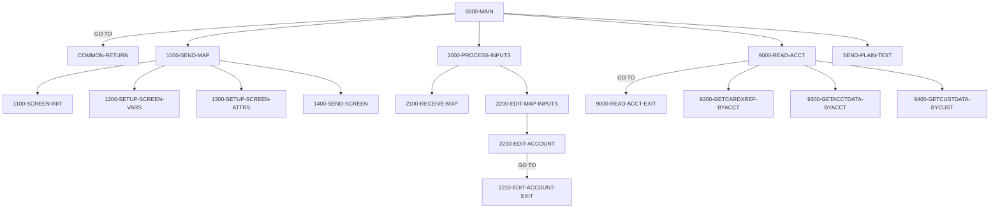

# Program COACTVWC

| Item | Value |
|---|---|
| Source | `app/cbl/COACTVWC.cbl` |
| Lines | 941 total, 703 code, 130 comment, 108 blank |
| PROGRAM-ID |  |
| Author |  |
| Runtime | cics-online |
| Module | base |
| CICS transactions | CAVW (`app/csd/CARDDEMO.CSD:317-326`) |
| JCL steps | None |
| Paragraphs | 35 |
| Semantic analysis | validated (batch B05) |
| Version banner | * Ver: CardDemo_v1.0-15-g27d6c6f-68 Date: 2022-07-19 23:12:32 CDT |

## Summary

COACTVWC is the CICS pseudo-conversational Account View program (transaction CAVW, map CACTVWA of mapset COACTVW). On first entry it displays an empty search screen; on re-entry it receives an 11-digit account number, validates it, then reads the card cross-reference through the account alternate index CXACAIX (to obtain customer id and card number), the account master ACCTDAT and the customer master CUSTDAT, and displays account balances, limits, dates and the customer's personal data (SSN formatted NNN-NN-NNNN). Read failures and NOTFND conditions are shown as error messages on the same screen. PF3 transfers (XCTL) back to the calling program or to the main menu COMEN01C; any other key is treated as ENTER. Each turn ends with CICS RETURN TRANSID(CAVW) with a 2000-byte commarea holding CARDDEMO-COMMAREA plus program context. An abend handler sends abend data and abends with code 9999. (Confirmed)

Evidence: `app/cbl/COACTVWC.cbl:142-202`, `app/cbl/COACTVWC.cbl:262-407`, `app/cbl/COACTVWC.cbl:460-535`, `app/cbl/COACTVWC.cbl:622-718`, `app/cbl/COACTVWC.cbl:723-869`, `app/cbl/COACTVWC.cbl:916-937`

Header comment (Unverified, `app/cbl/COACTVWC.cbl:1-8`): Program:     COACTVWC.CBL Layer:       Business logic Function:    Accept and process Account View request All Rights Reserved. http://www.apache.org/licenses/LICENSE-2.0 Unless required by applicable law or agreed to in writing,

## Divisions and sections

| Division / section | Lines | Notes |
|---|---|---|
| IDENTIFICATION DIVISION | `app/cbl/COACTVWC.cbl:21-28` |  |
| ENVIRONMENT DIVISION | `app/cbl/COACTVWC.cbl:29-31` |  |
| DATA DIVISION | `app/cbl/COACTVWC.cbl:32-260` |  |
| PROCEDURE DIVISION | `app/cbl/COACTVWC.cbl:261-941` |  |
| ENVIRONMENT / INPUT-OUTPUT SECTION | `app/cbl/COACTVWC.cbl:30-31` |  |
| DATA / WORKING-STORAGE SECTION | `app/cbl/COACTVWC.cbl:34-255` |  |
| DATA / LINKAGE SECTION | `app/cbl/COACTVWC.cbl:256-260` |  |

## Files and data stores

No SELECT entries (no COBOL file I/O).

CICS file commands (file name resolved from VALUE clauses and the CSD):

| Command | FILE option | Resolved name | CSD DSNAME | CSD evidence | Line |
|---|---|---|---|---|---|
| READ | LIT-CARDXREFNAME-ACCT-PATH | CXACAIX | AWS.M2.CARDDEMO.CARDXREF.VSAM.AIX.PATH | `app/csd/CARDDEMO.CSD:63-75` | `app/cbl/COACTVWC.cbl:727-735` |
| READ | LIT-ACCTFILENAME | ACCTDAT | AWS.M2.CARDDEMO.ACCTDATA.VSAM.KSDS | `app/csd/CARDDEMO.CSD:1-12` | `app/cbl/COACTVWC.cbl:776-784` |
| READ | LIT-CUSTFILENAME | CUSTDAT | AWS.M2.CARDDEMO.CUSTDATA.VSAM.KSDS | `app/csd/CARDDEMO.CSD:50-62` | `app/cbl/COACTVWC.cbl:826-834` |

## Embedded CICS, SQL and DL/I commands

| Paragraph | Kind | Verb | Resources | Response | Lines |
|---|---|---|---|---|---|
| 0000-MAIN | CICS | HANDLE ABEND |  |  | `app/cbl/COACTVWC.cbl:264-266` |
| 0000-MAIN | CICS | XCTL | PROGRAM(CDEMO-TO-PROGRAM) |  | `app/cbl/COACTVWC.cbl:349-352` |
| COMMON-RETURN | CICS | RETURN | TRANSID(LIT-THISTRANID) |  | `app/cbl/COACTVWC.cbl:402-406` |
| 1400-SEND-SCREEN | CICS | SEND MAP | MAP(CCARD-NEXT-MAP), MAPSET(CCARD-NEXT-MAPSET) | RESP | `app/cbl/COACTVWC.cbl:583-590` |
| 2100-RECEIVE-MAP | CICS | RECEIVE MAP | MAP(LIT-THISMAP), MAPSET(LIT-THISMAPSET) | RESP | `app/cbl/COACTVWC.cbl:611-616` |
| 9200-GETCARDXREF-BYACCT | CICS | READ | DATASET(LIT-CARDXREFNAME-ACCT-PATH) | RESP | `app/cbl/COACTVWC.cbl:727-735` |
| 9300-GETACCTDATA-BYACCT | CICS | READ | DATASET(LIT-ACCTFILENAME) | RESP | `app/cbl/COACTVWC.cbl:776-784` |
| 9400-GETCUSTDATA-BYCUST | CICS | READ | DATASET(LIT-CUSTFILENAME) | RESP | `app/cbl/COACTVWC.cbl:826-834` |
| SEND-PLAIN-TEXT | CICS | SEND TEXT |  |  | `app/cbl/COACTVWC.cbl:878-883` |
| SEND-PLAIN-TEXT | CICS | RETURN |  |  | `app/cbl/COACTVWC.cbl:885-886` |
| SEND-LONG-TEXT | CICS | SEND TEXT |  |  | `app/cbl/COACTVWC.cbl:897-902` |
| SEND-LONG-TEXT | CICS | RETURN |  |  | `app/cbl/COACTVWC.cbl:904-905` |
| ABEND-ROUTINE | CICS | SEND |  | NOHANDLE | `app/cbl/COACTVWC.cbl:924-928` |
| ABEND-ROUTINE | CICS | HANDLE ABEND |  |  | `app/cbl/COACTVWC.cbl:930-932` |
| ABEND-ROUTINE | CICS | ABEND |  |  | `app/cbl/COACTVWC.cbl:934-936` |

## Calls, transfers and callers

| Mechanism | Target | Parameters | Paragraph | Lines |
|---|---|---|---|---|
| EXEC CICS XCTL | CDEMO-TO-PROGRAM = COMEN01C | CARDDEMO-COMMAREA | 0000-MAIN | `app/cbl/COACTVWC.cbl:349-352` |
| EXEC CICS RETURN | LIT-THISTRANID = CAVW | WS-COMMAREA | COMMON-RETURN | `app/cbl/COACTVWC.cbl:402-406` |

Programs that transfer to or call this program (from `docs/_work/xref/call-graph.json`):

| Caller | Mechanism | Confidence | Evidence |
|---|---|---|---|
| COMEN01C | XCTL | Confirmed | `app/cbl/COMEN01C.cbl:185` |

## Copybooks

| Copybook | Statement | Resolution | Resolved path | REPLACING | Line |
|---|---|---|---|---|---|
| [CVCRD01Y](../08-data/layouts/CVCRD01Y.md) | COPY | inventory | app/cpy/CVCRD01Y.cpy |  | `app/cbl/COACTVWC.cbl:207` |
| [COCOM01Y](../08-data/layouts/COCOM01Y.md) | COPY | inventory | app/cpy/COCOM01Y.cpy |  | `app/cbl/COACTVWC.cbl:211` |
| DFHBMSCA | COPY | system |  |  | `app/cbl/COACTVWC.cbl:221` |
| DFHAID | COPY | system |  |  | `app/cbl/COACTVWC.cbl:222` |
| [COTTL01Y](../08-data/layouts/COTTL01Y.md) | COPY | inventory | app/cpy/COTTL01Y.cpy |  | `app/cbl/COACTVWC.cbl:226` |
| COACTVW | COPY | inventory | app/cpy-bms/COACTVW.CPY |  | `app/cbl/COACTVWC.cbl:229` |
| [CSDAT01Y](../08-data/layouts/CSDAT01Y.md) | COPY | inventory | app/cpy/CSDAT01Y.cpy |  | `app/cbl/COACTVWC.cbl:232` |
| [CSMSG01Y](../08-data/layouts/CSMSG01Y.md) | COPY | inventory | app/cpy/CSMSG01Y.cpy |  | `app/cbl/COACTVWC.cbl:235` |
| [CSMSG02Y](../08-data/layouts/CSMSG02Y.md) | COPY | inventory | app/cpy/CSMSG02Y.cpy |  | `app/cbl/COACTVWC.cbl:238` |
| [CSUSR01Y](../08-data/layouts/CSUSR01Y.md) | COPY | inventory | app/cpy/CSUSR01Y.cpy |  | `app/cbl/COACTVWC.cbl:241` |
| [CVACT01Y](../08-data/layouts/CVACT01Y.md) | COPY | inventory | app/cpy/CVACT01Y.cpy |  | `app/cbl/COACTVWC.cbl:244` |
| [CVACT02Y](../08-data/layouts/CVACT02Y.md) | COPY | inventory | app/cpy/CVACT02Y.cpy |  | `app/cbl/COACTVWC.cbl:248` |
| [CVACT03Y](../08-data/layouts/CVACT03Y.md) | COPY | inventory | app/cpy/CVACT03Y.cpy |  | `app/cbl/COACTVWC.cbl:251` |
| [CVCUS01Y](../08-data/layouts/CVCUS01Y.md) | COPY | inventory | app/cpy/CVCUS01Y.cpy |  | `app/cbl/COACTVWC.cbl:254` |
| [CSSTRPFY](../08-data/layouts/CSSTRPFY.md) | COPY | inventory | app/cpy/CSSTRPFY.cpy |  | `app/cbl/COACTVWC.cbl:913` |

## Data division items

Every data entry coded in this source (copybook contents are on the copybook pages). Lengths are computed from PIC and USAGE.

| Section | Lvl | Name | PIC | Usage | Len | OCCURS | REDEFINES | VALUE | 88-levels | Line |
|---|---|---|---|---|---|---|---|---|---|---|
| WORKING-STORAGE | 01 | WS-MISC-STORAGE |  |  |  |  |  |  |  | 35 |
| WORKING-STORAGE | 05 | WS-CICS-PROCESSNG-VARS |  |  |  |  |  |  |  | 39 |
| WORKING-STORAGE | 07 | WS-RESP-CD | S9(09) | COMP | 4 |  |  | ZEROS |  | 40 |
| WORKING-STORAGE | 07 | WS-REAS-CD | S9(09) | COMP | 4 |  |  | ZEROS |  | 42 |
| WORKING-STORAGE | 07 | WS-TRANID | X(4) |  | 4 |  |  | SPACES |  | 44 |
| WORKING-STORAGE | 05 | WS-INPUT-FLAG | X(1) |  | 1 |  |  |  | INPUT-OK = '0'; INPUT-ERROR = '1'; INPUT-PENDING = LOW-VALUES | 50 |
| WORKING-STORAGE | 05 | WS-PFK-FLAG | X(1) |  | 1 |  |  |  | PFK-VALID = '0'; PFK-INVALID = '1'; INPUT-PENDING = LOW-VALUES | 54 |
| WORKING-STORAGE | 05 | WS-EDIT-ACCT-FLAG | X(1) |  | 1 |  |  |  | FLG-ACCTFILTER-NOT-OK = '0'; FLG-ACCTFILTER-ISVALID = '1'; FLG-ACCTFILTER-BLANK = ' ' | 58 |
| WORKING-STORAGE | 05 | WS-EDIT-CUST-FLAG | X(1) |  | 1 |  |  |  | FLG-CUSTFILTER-NOT-OK = '0'; FLG-CUSTFILTER-ISVALID = '1'; FLG-CUSTFILTER-BLANK = ' ' | 62 |
| WORKING-STORAGE | 05 | WS-XREF-RID |  |  |  |  |  |  |  | 73 |
| WORKING-STORAGE | 10 | WS-CARD-RID-CARDNUM | X(16) |  | 16 |  |  |  |  | 74 |
| WORKING-STORAGE | 10 | WS-CARD-RID-CUST-ID | 9(09) |  | 9 |  |  |  |  | 75 |
| WORKING-STORAGE | 10 | WS-CARD-RID-CUST-ID-X | X(09) |  | 9 |  | WS-CARD-RID-CUST-ID |  |  | 76 |
| WORKING-STORAGE | 10 | WS-CARD-RID-ACCT-ID | 9(11) |  | 11 |  |  |  |  | 78 |
| WORKING-STORAGE | 10 | WS-CARD-RID-ACCT-ID-X | X(11) |  | 11 |  | WS-CARD-RID-ACCT-ID |  |  | 79 |
| WORKING-STORAGE | 05 | WS-FILE-READ-FLAGS |  |  |  |  |  |  |  | 81 |
| WORKING-STORAGE | 10 | WS-ACCOUNT-MASTER-READ-FLAG | X(1) |  | 1 |  |  |  | FOUND-ACCT-IN-MASTER = '1' | 82 |
| WORKING-STORAGE | 10 | WS-CUST-MASTER-READ-FLAG | X(1) |  | 1 |  |  |  | FOUND-CUST-IN-MASTER = '1' | 84 |
| WORKING-STORAGE | 05 | WS-FILE-ERROR-MESSAGE |  |  |  |  |  |  |  | 86 |
| WORKING-STORAGE | 10 | FILLER | X(12) |  | 12 |  |  | 'File Error: ' |  | 87 |
| WORKING-STORAGE | 10 | ERROR-OPNAME | X(8) |  | 8 |  |  | SPACES |  | 89 |
| WORKING-STORAGE | 10 | FILLER | X(4) |  | 4 |  |  | ' on ' |  | 91 |
| WORKING-STORAGE | 10 | ERROR-FILE | X(9) |  | 9 |  |  | SPACES |  | 93 |
| WORKING-STORAGE | 10 | FILLER | X(15) |  | 15 |  |  | ' returned RESP ' |  | 95 |
| WORKING-STORAGE | 10 | ERROR-RESP | X(10) |  | 10 |  |  | SPACES |  | 98 |
| WORKING-STORAGE | 10 | FILLER | X(7) |  | 7 |  |  | ',RESP2 ' |  | 100 |
| WORKING-STORAGE | 10 | ERROR-RESP2 | X(10) |  | 10 |  |  | SPACES |  | 102 |
| WORKING-STORAGE | 10 | FILLER | X(5) |  | 5 |  |  | SPACES |  | 104 |
| WORKING-STORAGE | 05 | WS-LONG-MSG | X(500) |  | 500 |  |  |  |  | 109 |
| WORKING-STORAGE | 05 | WS-INFO-MSG | X(40) |  | 40 |  |  |  | WS-NO-INFO-MESSAGE = SPACES LOW-VALUES; WS-PROMPT-FOR-INPUT = 'Enter or update id of account to display'; WS-INFORM-OUTPUT = 'Displaying details of given Account' | 110 |
| WORKING-STORAGE | 05 | WS-RETURN-MSG | X(75) |  | 75 |  |  |  | WS-RETURN-MSG-OFF = SPACES; WS-EXIT-MESSAGE = 'PF03 pressed.Exiting '; WS-PROMPT-FOR-ACCT = 'Account number not provided'; NO-SEARCH-CRITERIA-RECEIVED = 'No input received'; SEARCHED-ACCT-ZEROES = 'Ac | 117 |
| WORKING-STORAGE | 01 | WS-LITERALS |  |  |  |  |  |  |  | 142 |
| WORKING-STORAGE | 05 | LIT-THISPGM | X(8) |  | 8 |  |  | 'COACTVWC' |  | 143 |
| WORKING-STORAGE | 05 | LIT-THISTRANID | X(4) |  | 4 |  |  | 'CAVW' |  | 145 |
| WORKING-STORAGE | 05 | LIT-THISMAPSET | X(8) |  | 8 |  |  | 'COACTVW ' |  | 147 |
| WORKING-STORAGE | 05 | LIT-THISMAP | X(7) |  | 7 |  |  | 'CACTVWA' |  | 149 |
| WORKING-STORAGE | 05 | LIT-CCLISTPGM | X(8) |  | 8 |  |  | 'COCRDLIC' |  | 151 |
| WORKING-STORAGE | 05 | LIT-CCLISTTRANID | X(4) |  | 4 |  |  | 'CCLI' |  | 153 |
| WORKING-STORAGE | 05 | LIT-CCLISTMAPSET | X(7) |  | 7 |  |  | 'COCRDLI' |  | 155 |
| WORKING-STORAGE | 05 | LIT-CCLISTMAP | X(7) |  | 7 |  |  | 'CCRDSLA' |  | 157 |
| WORKING-STORAGE | 05 | LIT-CARDUPDATEPGM | X(8) |  | 8 |  |  | 'COCRDUPC' |  | 159 |
| WORKING-STORAGE | 05 | LIT-CARDUDPATETRANID | X(4) |  | 4 |  |  | 'CCUP' |  | 161 |
| WORKING-STORAGE | 05 | LIT-CARDUPDATEMAPSET | X(8) |  | 8 |  |  | 'COCRDUP ' |  | 163 |
| WORKING-STORAGE | 05 | LIT-CARDUPDATEMAP | X(7) |  | 7 |  |  | 'CCRDUPA' |  | 165 |
| WORKING-STORAGE | 05 | LIT-MENUPGM | X(8) |  | 8 |  |  | 'COMEN01C' |  | 168 |
| WORKING-STORAGE | 05 | LIT-MENUTRANID | X(4) |  | 4 |  |  | 'CM00' |  | 170 |
| WORKING-STORAGE | 05 | LIT-MENUMAPSET | X(7) |  | 7 |  |  | 'COMEN01' |  | 172 |
| WORKING-STORAGE | 05 | LIT-MENUMAP | X(7) |  | 7 |  |  | 'COMEN1A' |  | 174 |
| WORKING-STORAGE | 05 | LIT-CARDDTLPGM | X(8) |  | 8 |  |  | 'COCRDSLC' |  | 176 |
| WORKING-STORAGE | 05 | LIT-CARDDTLTRANID | X(4) |  | 4 |  |  | 'CCDL' |  | 178 |
| WORKING-STORAGE | 05 | LIT-CARDDTLMAPSET | X(7) |  | 7 |  |  | 'COCRDSL' |  | 180 |
| WORKING-STORAGE | 05 | LIT-CARDDTLMAP | X(7) |  | 7 |  |  | 'CCRDSLA' |  | 182 |
| WORKING-STORAGE | 05 | LIT-ACCTFILENAME | X(8) |  | 8 |  |  | 'ACCTDAT ' |  | 184 |
| WORKING-STORAGE | 05 | LIT-CARDFILENAME | X(8) |  | 8 |  |  | 'CARDDAT ' |  | 186 |
| WORKING-STORAGE | 05 | LIT-CUSTFILENAME | X(8) |  | 8 |  |  | 'CUSTDAT ' |  | 188 |
| WORKING-STORAGE | 05 | LIT-CARDFILENAME-ACCT-PATH | X(8) |  | 8 |  |  | 'CARDAIX ' |  | 190 |
| WORKING-STORAGE | 05 | LIT-CARDXREFNAME-ACCT-PATH | X(8) |  | 8 |  |  | 'CXACAIX ' |  | 192 |
| WORKING-STORAGE | 05 | LIT-ALL-ALPHA-FROM | X(52) |  | 52 |  |  | 'ABCDEFGHIJKLMNOPQRSTUVWXYZabcdefghijklmnopqrstuvwxyz' |  | 194 |
| WORKING-STORAGE | 05 | LIT-ALL-SPACES-TO | X(52) |  | 52 |  |  | SPACES |  | 197 |
| WORKING-STORAGE | 05 | LIT-UPPER | X(26) |  | 26 |  |  | 'ABCDEFGHIJKLMNOPQRSTUVWXYZ' |  | 199 |
| WORKING-STORAGE | 05 | LIT-LOWER | X(26) |  | 26 |  |  | 'abcdefghijklmnopqrstuvwxyz' |  | 201 |
| WORKING-STORAGE | 01 | WS-THIS-PROGCOMMAREA |  |  |  |  |  |  |  | 213 |
| WORKING-STORAGE | 05 | CA-CALL-CONTEXT |  |  |  |  |  |  |  | 214 |
| WORKING-STORAGE | 10 | CA-FROM-PROGRAM | X(08) |  | 8 |  |  |  |  | 215 |
| WORKING-STORAGE | 10 | CA-FROM-TRANID | X(04) |  | 4 |  |  |  |  | 216 |
| WORKING-STORAGE | 01 | WS-COMMAREA | X(2000) |  | 2000 |  |  |  |  | 218 |
| LINKAGE | 01 | DFHCOMMAREA |  |  |  |  |  |  |  | 257 |
| LINKAGE | 05 | FILLER | X(1) |  | 1 | 1 TO 32767 DEPENDING ON EIBCALEN |  |  |  | 258 |

## Statement inventory

Every procedure statement the parser recorded, by kind. Each one is listed with its line under Paragraph details.

| Kind | Count |
|---|---|
| Decisions (IF, EVALUATE, WHEN, loops, handlers) | 49 |
| Calculations | 0 |
| File I/O | 0 |
| EXEC CICS / SQL / DLI | 15 |
| CALL | 0 |
| PERFORM | 18 |
| GO TO | 9 |
| MOVE literal | 10 |
| MOVE field | 103 |
| SET | 34 |
| STRING, UNSTRING, INSPECT, INITIALIZE, COPY, ENTRY and others | 7 |
| DISPLAY | 0 |
| GOBACK, STOP RUN, RETURN, XCTL | 5 |
| Not classified by the parser | 0 |

## Control flow

| Paragraph | Lines | Logic | Performs | Performed by | Reachable |
|---|---|---|---|---|---|
| [0000-MAIN](#para-0000-main) | 262-393 | Sets HANDLE ABEND to ABEND-ROUTINE, initialises work areas and clears WS-RETURN-MSG. When EIBCALEN = 0 or the caller is COMEN01C without the re-enter flag it initialises CARDDEMO-COMMAREA and the program context, otherwise copies both from DFHCOMMAREA. Maps the AID via YYYY-STORE-PFKEY and forces any key other than ENTER/PF3 to ENTER. EVALUATE: PF3 XCTLs to CDEMO-FROM-PROGRAM (default COMEN01C); CDEMO-PGM-ENTER sends the empty map; CDEMO-PGM-REENTER processes inputs and, if valid, performs 9000-READ-ACCT before resending the map; OTHER sends plain text 'UNEXPECTED DATA SCENARIO'. A remaining INPUT-ERROR resends the map. (Confirmed) | 1000-SEND-MAP, 2000-PROCESS-INPUTS, 9000-READ-ACCT, SEND-PLAIN-TEXT, YYYY-STORE-PFKEY |  | yes |
| [COMMON-RETURN](#para-common-return) | 394-407 | Moves WS-RETURN-MSG to CCARD-ERROR-MSG, packs CARDDEMO-COMMAREA followed by WS-THIS-PROGCOMMAREA into WS-COMMAREA and issues CICS RETURN TRANSID(LIT-THISTRANID='CAVW') COMMAREA(WS-COMMAREA) LENGTH 2000. (Confirmed) |  | 0000-MAIN | yes |
| [0000-MAIN-EXIT](#para-0000-main-exit) | 408-410 | Exit paragraph (EXIT); the name is defined twice in the source (408-410 and 411-413), both containing only EXIT. (Confirmed) |  |  | no static path |
| [0000-MAIN-EXIT](#para-0000-main-exit) | 411-413 | Exit paragraph (EXIT); the name is defined twice in the source (408-410 and 411-413), both containing only EXIT. (Confirmed) |  |  | no static path |
| [1000-SEND-MAP](#para-1000-send-map) | 416-425 | Performs 1100-SCREEN-INIT, 1200-SETUP-SCREEN-VARS, 1300-SETUP-SCREEN-ATTRS and 1400-SEND-SCREEN in sequence to build and send the account view screen. (Confirmed) | 1100-SCREEN-INIT, 1200-SETUP-SCREEN-VARS, 1300-SETUP-SCREEN-ATTRS, 1400-SEND-SCREEN | 0000-MAIN | yes |
| [1000-SEND-MAP-EXIT](#para-1000-send-map-exit) | 427-429 | Exit paragraph for 1000-SEND-MAP (EXIT only). (Confirmed) |  | 0000-MAIN | yes |
| [1100-SCREEN-INIT](#para-1100-screen-init) | 431-455 | Clears CACTVWAO and fills titles CCDA-TITLE01/02, transaction CAVW, program name, current date MM/DD/YY and time HH:MM:SS from FUNCTION CURRENT-DATE (called twice). (Confirmed) |  | 1000-SEND-MAP | yes |
| [1100-SCREEN-INIT-EXIT](#para-1100-screen-init-exit) | 457-459 | Exit paragraph for 1100-SCREEN-INIT (EXIT only). (Confirmed) |  | 1000-SEND-MAP | yes |
| [1200-SETUP-SCREEN-VARS](#para-1200-setup-screen-vars) | 460-535 | With EIBCALEN = 0 sets the prompt info message. Otherwise shows the entered account id (low-values when blank); when the account or customer was found, moves ACCT-ACTIVE-STATUS, current balance, credit and cash limits, cycle credit/debit, open/expiry/reissue dates and group id to the screen; when the customer was found, moves customer id, SSN formatted as NNN-NN-NNNN, FICO score, DOB, names, address, phones, government id, EFT account and primary-holder flag. If no info message is set it sets 'Enter or update id of account to display'; then moves the return and info messages to the map. (Confirmed) |  | 1000-SEND-MAP | yes |
| [1200-SETUP-SCREEN-VARS-EXIT](#para-1200-setup-screen-vars-exit) | 537-539 | Exit paragraph for 1200-SETUP-SCREEN-VARS (EXIT only). (Confirmed) |  | 1000-SEND-MAP | yes |
| [1300-SETUP-SCREEN-ATTRS](#para-1300-setup-screen-attrs) | 541-572 | Unprotects the account field (DFHBMFSE), always places the cursor on ACCTSID (all EVALUATE branches move -1), colours it red when the filter is invalid, shows a red '*' when the filter was blank on re-entry, and darkens the info message when empty (neutral colour otherwise). (Confirmed) |  | 1000-SEND-MAP | yes |
| [1300-SETUP-SCREEN-ATTRS-EXIT](#para-1300-setup-screen-attrs-exit) | 574-576 | Exit paragraph for 1300-SETUP-SCREEN-ATTRS (EXIT only). (Confirmed) |  | 1000-SEND-MAP | yes |
| [1400-SEND-SCREEN](#para-1400-send-screen) | 577-591 | Sets CCARD-NEXT-MAPSET/MAP to COACTVW/CACTVWA, sets CDEMO-PGM-REENTER and sends the map with CURSOR ERASE FREEKB, capturing RESP (not tested). (Confirmed) |  | 1000-SEND-MAP | yes |
| [1400-SEND-SCREEN-EXIT](#para-1400-send-screen-exit) | 592-594 | Exit paragraph for 1400-SEND-SCREEN (EXIT only). (Confirmed) |  | 1000-SEND-MAP | yes |
| [2000-PROCESS-INPUTS](#para-2000-process-inputs) | 596-605 | Performs 2100-RECEIVE-MAP and 2200-EDIT-MAP-INPUTS, then copies WS-RETURN-MSG to CCARD-ERROR-MSG and records this program, mapset and map as the next screen. (Confirmed) | 2100-RECEIVE-MAP, 2200-EDIT-MAP-INPUTS | 0000-MAIN | yes |
| [2000-PROCESS-INPUTS-EXIT](#para-2000-process-inputs-exit) | 607-609 | Exit paragraph for 2000-PROCESS-INPUTS (EXIT only). (Confirmed) |  | 0000-MAIN | yes |
| [2100-RECEIVE-MAP](#para-2100-receive-map) | 610-617 | Receives map CACTVWA of mapset COACTVW into CACTVWAI with RESP/RESP2 (not tested). (Confirmed) |  | 2000-PROCESS-INPUTS | yes |
| [2100-RECEIVE-MAP-EXIT](#para-2100-receive-map-exit) | 619-621 | Exit paragraph for 2100-RECEIVE-MAP (EXIT only). (Confirmed) |  | 2000-PROCESS-INPUTS | yes |
| [2200-EDIT-MAP-INPUTS](#para-2200-edit-map-inputs) | 622-643 | Sets INPUT-OK and filter valid, maps an ACCTSIDI of '*' or spaces to low-values in CC-ACCT-ID (otherwise copies it), performs 2210-EDIT-ACCOUNT, and when the filter is blank sets the return message to 'No input received'. (Confirmed) | 2210-EDIT-ACCOUNT | 2000-PROCESS-INPUTS | yes |
| [2200-EDIT-MAP-INPUTS-EXIT](#para-2200-edit-map-inputs-exit) | 645-647 | Exit paragraph for 2200-EDIT-MAP-INPUTS (EXIT only). (Confirmed) |  | 2000-PROCESS-INPUTS | yes |
| [2210-EDIT-ACCOUNT](#para-2210-edit-account) | 649-681 | A low-values/spaces CC-ACCT-ID sets INPUT-ERROR and FLG-ACCTFILTER-BLANK, sets 'Account number not provided' if no message yet and zeroes CDEMO-ACCT-ID. A non-numeric or all-zero value sets INPUT-ERROR, flags the filter not OK, sets 'Account Filter must  be a non-zero 11 digit number' if no message yet and zeroes CDEMO-ACCT-ID. Otherwise CC-ACCT-ID is moved to CDEMO-ACCT-ID and the filter flagged valid. (Confirmed) |  | 2200-EDIT-MAP-INPUTS | yes |
| [2210-EDIT-ACCOUNT-EXIT](#para-2210-edit-account-exit) | 683-685 | Exit paragraph for 2210-EDIT-ACCOUNT, target of its GO TO statements (EXIT only). (Confirmed) |  | 2200-EDIT-MAP-INPUTS, 2210-EDIT-ACCOUNT | yes |
| [9000-READ-ACCT](#para-9000-read-acct) | 687-718 | Clears the info message, uses CDEMO-ACCT-ID as key and performs 9200-GETCARDXREF-BYACCT; stops if the filter became not OK. Then performs 9300-GETACCTDATA-BYACCT and, using CDEMO-CUST-ID from the xref, 9400-GETCUSTDATA-BYCUST; the intermediate stop tests use 88-levels on WS-RETURN-MSG that are never set by the read paragraphs. (Confirmed) | 9200-GETCARDXREF-BYACCT, 9300-GETACCTDATA-BYACCT, 9400-GETCUSTDATA-BYCUST | 0000-MAIN | yes |
| [9000-READ-ACCT-EXIT](#para-9000-read-acct-exit) | 720-722 | Exit paragraph for 9000-READ-ACCT, target of its GO TO statements (EXIT only). (Confirmed) |  | 0000-MAIN, 9000-READ-ACCT | yes |
| [9200-GETCARDXREF-BYACCT](#para-9200-getcardxref-byacct) | 723-770 | Reads CXACAIX (card xref by account alternate index) keyed by the 11-character account id into CARD-XREF-RECORD. NORMAL moves XREF-CUST-ID and XREF-CARD-NUM into the commarea; NOTFND sets input error and builds 'Account:<id> not found in Cross ref file.  Resp:... Reas:...'; other responses set input error and the generic 'File Error: READ on CXACAIX returned RESP ...' message. (Confirmed) |  | 9000-READ-ACCT | yes |
| [9200-GETCARDXREF-BYACCT-EXIT](#para-9200-getcardxref-byacct-exit) | 771-773 | Exit paragraph for 9200-GETCARDXREF-BYACCT (EXIT only). (Confirmed) |  | 9000-READ-ACCT | yes |
| [9300-GETACCTDATA-BYACCT](#para-9300-getacctdata-byacct) | 774-820 | Reads ACCTDAT keyed by account id into ACCOUNT-RECORD. NORMAL sets FOUND-ACCT-IN-MASTER; NOTFND sets input error and 'Account:<id> not found in Acct Master file.Resp:...' (if no message yet); other responses set the generic file error message. (Confirmed) |  | 9000-READ-ACCT | yes |
| [9300-GETACCTDATA-BYACCT-EXIT](#para-9300-getacctdata-byacct-exit) | 821-823 | Exit paragraph for 9300-GETACCTDATA-BYACCT (EXIT only). (Confirmed) |  | 9000-READ-ACCT | yes |
| [9400-GETCUSTDATA-BYCUST](#para-9400-getcustdata-bycust) | 825-869 | Reads CUSTDAT keyed by the 9-character customer id into CUSTOMER-RECORD. NORMAL sets FOUND-CUST-IN-MASTER; NOTFND sets input error and 'CustId:<id> not found in customer master.Resp: ...' (if no message yet); other responses set the generic file error message. (Confirmed) |  | 9000-READ-ACCT | yes |
| [9400-GETCUSTDATA-BYCUST-EXIT](#para-9400-getcustdata-bycust-exit) | 870-872 | Exit paragraph for 9400-GETCUSTDATA-BYCUST (EXIT only). (Confirmed) |  | 9000-READ-ACCT | yes |
| [SEND-PLAIN-TEXT](#para-send-plain-text) | 877-887 | Sends WS-RETURN-MSG as plain text (ERASE FREEKB) and issues CICS RETURN without transid, ending the conversation; commented as not for production. (Confirmed) |  | 0000-MAIN | yes |
| [SEND-PLAIN-TEXT-EXIT](#para-send-plain-text-exit) | 888-890 | Exit paragraph for SEND-PLAIN-TEXT (EXIT only). (Confirmed) |  | 0000-MAIN | yes |
| [SEND-LONG-TEXT](#para-send-long-text) | 896-906 | Debug helper: sends WS-LONG-MSG as plain text and returns; not performed anywhere (its callers are commented out). (Confirmed) |  |  | no static path |
| [SEND-LONG-TEXT-EXIT](#para-send-long-text-exit) | 907-914 | EXIT for SEND-LONG-TEXT followed by COPY 'CSSTRPFY', which supplies YYYY-STORE-PFKEY: it maps EIBAID to CCARD-AID values (ENTER, CLEAR, PA1, PA2, PF1-PF12, with PF13-PF24 folded onto PF1-PF12). (Confirmed) |  |  | no static path |
| [ABEND-ROUTINE](#para-abend-routine) | 916-937 | Defaults ABEND-MSG to 'UNEXPECTED ABEND OCCURRED.' when empty, sets ABEND-CULPRIT to COACTVWC, sends ABEND-DATA to the terminal (NOHANDLE), cancels the abend handler and abends with code '9999'. (Confirmed) |  |  | no static path |

## Paragraph details

### Para 0000-MAIN

Lines `app/cbl/COACTVWC.cbl:262-393`. 

Logic: Sets HANDLE ABEND to ABEND-ROUTINE, initialises work areas and clears WS-RETURN-MSG. When EIBCALEN = 0 or the caller is COMEN01C without the re-enter flag it initialises CARDDEMO-COMMAREA and the program context, otherwise copies both from DFHCOMMAREA. Maps the AID via YYYY-STORE-PFKEY and forces any key other than ENTER/PF3 to ENTER. EVALUATE: PF3 XCTLs to CDEMO-FROM-PROGRAM (default COMEN01C); CDEMO-PGM-ENTER sends the empty map; CDEMO-PGM-REENTER processes inputs and, if valid, performs 9000-READ-ACCT before resending the map; OTHER sends plain text 'UNEXPECTED DATA SCENARIO'. A remaining INPUT-ERROR resends the map. (Confirmed)

Rules: [BR-COACTVWC-001](../09-business-rules-catalog.md#br-coactvwc-001), [BR-COACTVWC-002](../09-business-rules-catalog.md#br-coactvwc-002), [BR-COACTVWC-003](../09-business-rules-catalog.md#br-coactvwc-003), [BR-COACTVWC-004](../09-business-rules-catalog.md#br-coactvwc-004)

Statements in source order:

- EXEC CICS HANDLE ABEND at `app/cbl/COACTVWC.cbl:264-266`
- `INITIALIZE CC-WORK-AREA WS-MISC-STORAGE WS-COMMAREA` at `app/cbl/COACTVWC.cbl:268-270`
- `MOVE LIT-THISTRANID TO WS-TRANID` at `app/cbl/COACTVWC.cbl:274`
- `SET WS-RETURN-MSG-OFF TO TRUE` at `app/cbl/COACTVWC.cbl:278`
- IF `EIBCALEN IS EQUAL TO 0 OR (CDEMO-FROM-PROGRAM = LIT-MENUPGM AND NOT CDEMO-PGM-REENTER)` at `app/cbl/COACTVWC.cbl:282-284` (pseudo-conversation)
- `INITIALIZE CARDDEMO-COMMAREA WS-THIS-PROGCOMMAREA` at `app/cbl/COACTVWC.cbl:285-286`
- `MOVE DFHCOMMAREA (1:LENGTH OF CARDDEMO-COMMAREA) TO CARDDEMO-COMMAREA` at `app/cbl/COACTVWC.cbl:288-289`
- `MOVE DFHCOMMAREA(LENGTH OF CARDDEMO-COMMAREA + 1: LENGTH OF WS-THIS-PROGCOMMAREA ) TO WS-THIS-PROGCOMMAREA` at `app/cbl/COACTVWC.cbl:290-292`
- PERFORM YYYY-STORE-PFKEY THRU YYYY-STORE-PFKEY-EXIT at `app/cbl/COACTVWC.cbl:299-300`
- `SET PFK-INVALID TO TRUE` at `app/cbl/COACTVWC.cbl:306`
- IF `CCARD-AID-ENTER OR CCARD-AID-PFK03` at `app/cbl/COACTVWC.cbl:307-308` (screen-key)
- `SET PFK-VALID TO TRUE` at `app/cbl/COACTVWC.cbl:309`
- IF `PFK-INVALID` at `app/cbl/COACTVWC.cbl:312` (screen-key)
- `SET CCARD-AID-ENTER TO TRUE` at `app/cbl/COACTVWC.cbl:313`
- EVALUATE `TRUE` at `app/cbl/COACTVWC.cbl:323` (business-candidate)
- WHEN `CCARD-AID-PFK03` at `app/cbl/COACTVWC.cbl:324` (screen-key)
- IF `CDEMO-FROM-TRANID EQUAL LOW-VALUES OR CDEMO-FROM-TRANID EQUAL SPACES` at `app/cbl/COACTVWC.cbl:328-329` (business-candidate)
- `MOVE LIT-MENUTRANID TO CDEMO-TO-TRANID` at `app/cbl/COACTVWC.cbl:330`
- `MOVE CDEMO-FROM-TRANID TO CDEMO-TO-TRANID` at `app/cbl/COACTVWC.cbl:332`
- IF `CDEMO-FROM-PROGRAM EQUAL LOW-VALUES OR CDEMO-FROM-PROGRAM EQUAL SPACES` at `app/cbl/COACTVWC.cbl:334-335` (pseudo-conversation)
- `MOVE LIT-MENUPGM TO CDEMO-TO-PROGRAM` at `app/cbl/COACTVWC.cbl:336`
- `MOVE CDEMO-FROM-PROGRAM TO CDEMO-TO-PROGRAM` at `app/cbl/COACTVWC.cbl:338`
- `MOVE LIT-THISTRANID TO CDEMO-FROM-TRANID` at `app/cbl/COACTVWC.cbl:341`
- `MOVE LIT-THISPGM TO CDEMO-FROM-PROGRAM` at `app/cbl/COACTVWC.cbl:342`
- `SET CDEMO-USRTYP-USER TO TRUE` at `app/cbl/COACTVWC.cbl:344`
- `SET CDEMO-PGM-ENTER TO TRUE` at `app/cbl/COACTVWC.cbl:345`
- `MOVE LIT-THISMAPSET TO CDEMO-LAST-MAPSET` at `app/cbl/COACTVWC.cbl:346`
- `MOVE LIT-THISMAP TO CDEMO-LAST-MAP` at `app/cbl/COACTVWC.cbl:347`
- EXEC CICS XCTL at `app/cbl/COACTVWC.cbl:349-352`
- Ends with EXEC CICS XCTL at `app/cbl/COACTVWC.cbl:349-352`
- WHEN `CDEMO-PGM-ENTER` at `app/cbl/COACTVWC.cbl:353` (pseudo-conversation)
- PERFORM 1000-SEND-MAP THRU 1000-SEND-MAP-EXIT at `app/cbl/COACTVWC.cbl:358-359`
- GO TO COMMON-RETURN at `app/cbl/COACTVWC.cbl:360`
- WHEN `CDEMO-PGM-REENTER` at `app/cbl/COACTVWC.cbl:361` (pseudo-conversation)
- PERFORM 2000-PROCESS-INPUTS THRU 2000-PROCESS-INPUTS-EXIT at `app/cbl/COACTVWC.cbl:362-363`
- IF `INPUT-ERROR` at `app/cbl/COACTVWC.cbl:364` (error-flag)
- PERFORM 1000-SEND-MAP THRU 1000-SEND-MAP-EXIT at `app/cbl/COACTVWC.cbl:365-366`
- GO TO COMMON-RETURN at `app/cbl/COACTVWC.cbl:367`
- PERFORM 9000-READ-ACCT THRU 9000-READ-ACCT-EXIT at `app/cbl/COACTVWC.cbl:369-370`
- PERFORM 1000-SEND-MAP THRU 1000-SEND-MAP-EXIT at `app/cbl/COACTVWC.cbl:371-372`
- GO TO COMMON-RETURN at `app/cbl/COACTVWC.cbl:373`
- WHEN `OTHER` at `app/cbl/COACTVWC.cbl:375` (business-candidate)
- `MOVE LIT-THISPGM TO ABEND-CULPRIT` at `app/cbl/COACTVWC.cbl:376`
- MOVE `'0001'` TO ABEND-CODE at `app/cbl/COACTVWC.cbl:377`
- `MOVE SPACES TO ABEND-REASON` at `app/cbl/COACTVWC.cbl:378`
- MOVE `'UNEXPECTED DATA SCENARIO'` TO WS-RETURN-MSG at `app/cbl/COACTVWC.cbl:379-380`
- PERFORM SEND-PLAIN-TEXT THRU SEND-PLAIN-TEXT-EXIT at `app/cbl/COACTVWC.cbl:381-382`
- IF `INPUT-ERROR` at `app/cbl/COACTVWC.cbl:387` (error-flag)
- `MOVE WS-RETURN-MSG TO CCARD-ERROR-MSG` at `app/cbl/COACTVWC.cbl:388`
- PERFORM 1000-SEND-MAP THRU 1000-SEND-MAP-EXIT at `app/cbl/COACTVWC.cbl:389-390`
- GO TO COMMON-RETURN at `app/cbl/COACTVWC.cbl:391`

### Para COMMON-RETURN

Lines `app/cbl/COACTVWC.cbl:394-407`. 

Logic: Moves WS-RETURN-MSG to CCARD-ERROR-MSG, packs CARDDEMO-COMMAREA followed by WS-THIS-PROGCOMMAREA into WS-COMMAREA and issues CICS RETURN TRANSID(LIT-THISTRANID='CAVW') COMMAREA(WS-COMMAREA) LENGTH 2000. (Confirmed)

Statements in source order:

- `MOVE WS-RETURN-MSG TO CCARD-ERROR-MSG` at `app/cbl/COACTVWC.cbl:395`
- `MOVE CARDDEMO-COMMAREA TO WS-COMMAREA` at `app/cbl/COACTVWC.cbl:397`
- `MOVE WS-THIS-PROGCOMMAREA TO WS-COMMAREA(LENGTH OF CARDDEMO-COMMAREA + 1: LENGTH OF WS-THIS-PROGCOMMAREA )` at `app/cbl/COACTVWC.cbl:398-400`
- EXEC CICS RETURN at `app/cbl/COACTVWC.cbl:402-406`
- Ends with EXEC CICS RETURN at `app/cbl/COACTVWC.cbl:402-406`

### Para 0000-MAIN-EXIT

Lines `app/cbl/COACTVWC.cbl:408-410`. 

Logic: Exit paragraph (EXIT); the name is defined twice in the source (408-410 and 411-413), both containing only EXIT. (Confirmed)

### Para 0000-MAIN-EXIT

Lines `app/cbl/COACTVWC.cbl:411-413`. 

Logic: Exit paragraph (EXIT); the name is defined twice in the source (408-410 and 411-413), both containing only EXIT. (Confirmed)

### Para 1000-SEND-MAP

Lines `app/cbl/COACTVWC.cbl:416-425`. 

Logic: Performs 1100-SCREEN-INIT, 1200-SETUP-SCREEN-VARS, 1300-SETUP-SCREEN-ATTRS and 1400-SEND-SCREEN in sequence to build and send the account view screen. (Confirmed)

Statements in source order:

- PERFORM 1100-SCREEN-INIT THRU 1100-SCREEN-INIT-EXIT at `app/cbl/COACTVWC.cbl:417-418`
- PERFORM 1200-SETUP-SCREEN-VARS THRU 1200-SETUP-SCREEN-VARS-EXIT at `app/cbl/COACTVWC.cbl:419-420`
- PERFORM 1300-SETUP-SCREEN-ATTRS THRU 1300-SETUP-SCREEN-ATTRS-EXIT at `app/cbl/COACTVWC.cbl:421-422`
- PERFORM 1400-SEND-SCREEN THRU 1400-SEND-SCREEN-EXIT at `app/cbl/COACTVWC.cbl:423-425`

### Para 1000-SEND-MAP-EXIT

Lines `app/cbl/COACTVWC.cbl:427-429`. 

Logic: Exit paragraph for 1000-SEND-MAP (EXIT only). (Confirmed)

### Para 1100-SCREEN-INIT

Lines `app/cbl/COACTVWC.cbl:431-455`. 

Logic: Clears CACTVWAO and fills titles CCDA-TITLE01/02, transaction CAVW, program name, current date MM/DD/YY and time HH:MM:SS from FUNCTION CURRENT-DATE (called twice). (Confirmed)

Statements in source order:

- `MOVE LOW-VALUES TO CACTVWAO` at `app/cbl/COACTVWC.cbl:432`
- `MOVE FUNCTION CURRENT-DATE TO WS-CURDATE-DATA` at `app/cbl/COACTVWC.cbl:434`
- `MOVE CCDA-TITLE01 TO TITLE01O OF CACTVWAO` at `app/cbl/COACTVWC.cbl:436`
- `MOVE CCDA-TITLE02 TO TITLE02O OF CACTVWAO` at `app/cbl/COACTVWC.cbl:437`
- `MOVE LIT-THISTRANID TO TRNNAMEO OF CACTVWAO` at `app/cbl/COACTVWC.cbl:438`
- `MOVE LIT-THISPGM TO PGMNAMEO OF CACTVWAO` at `app/cbl/COACTVWC.cbl:439`
- `MOVE FUNCTION CURRENT-DATE TO WS-CURDATE-DATA` at `app/cbl/COACTVWC.cbl:441`
- `MOVE WS-CURDATE-MONTH TO WS-CURDATE-MM` at `app/cbl/COACTVWC.cbl:443`
- `MOVE WS-CURDATE-DAY TO WS-CURDATE-DD` at `app/cbl/COACTVWC.cbl:444`
- `MOVE WS-CURDATE-YEAR(3:2) TO WS-CURDATE-YY` at `app/cbl/COACTVWC.cbl:445`
- `MOVE WS-CURDATE-MM-DD-YY TO CURDATEO OF CACTVWAO` at `app/cbl/COACTVWC.cbl:447`
- `MOVE WS-CURTIME-HOURS TO WS-CURTIME-HH` at `app/cbl/COACTVWC.cbl:449`
- `MOVE WS-CURTIME-MINUTE TO WS-CURTIME-MM` at `app/cbl/COACTVWC.cbl:450`
- `MOVE WS-CURTIME-SECOND TO WS-CURTIME-SS` at `app/cbl/COACTVWC.cbl:451`
- `MOVE WS-CURTIME-HH-MM-SS TO CURTIMEO OF CACTVWAO` at `app/cbl/COACTVWC.cbl:453-455`

### Para 1100-SCREEN-INIT-EXIT

Lines `app/cbl/COACTVWC.cbl:457-459`. 

Logic: Exit paragraph for 1100-SCREEN-INIT (EXIT only). (Confirmed)

### Para 1200-SETUP-SCREEN-VARS

Lines `app/cbl/COACTVWC.cbl:460-535`. 

Logic: With EIBCALEN = 0 sets the prompt info message. Otherwise shows the entered account id (low-values when blank); when the account or customer was found, moves ACCT-ACTIVE-STATUS, current balance, credit and cash limits, cycle credit/debit, open/expiry/reissue dates and group id to the screen; when the customer was found, moves customer id, SSN formatted as NNN-NN-NNNN, FICO score, DOB, names, address, phones, government id, EFT account and primary-holder flag. If no info message is set it sets 'Enter or update id of account to display'; then moves the return and info messages to the map. (Confirmed)

Rules: [BR-COACTVWC-008](../09-business-rules-catalog.md#br-coactvwc-008)

Statements in source order:

- IF `EIBCALEN = 0` at `app/cbl/COACTVWC.cbl:462` (pseudo-conversation)
- `SET WS-PROMPT-FOR-INPUT TO TRUE` at `app/cbl/COACTVWC.cbl:463`
- IF `FLG-ACCTFILTER-BLANK` at `app/cbl/COACTVWC.cbl:465` (business-candidate)
- `MOVE LOW-VALUES TO ACCTSIDO OF CACTVWAO` at `app/cbl/COACTVWC.cbl:466`
- `MOVE CC-ACCT-ID TO ACCTSIDO OF CACTVWAO` at `app/cbl/COACTVWC.cbl:468`
- IF `FOUND-ACCT-IN-MASTER OR FOUND-CUST-IN-MASTER` at `app/cbl/COACTVWC.cbl:471-472` (business-candidate)
- `MOVE ACCT-ACTIVE-STATUS TO ACSTTUSO OF CACTVWAO` at `app/cbl/COACTVWC.cbl:473`
- `MOVE ACCT-CURR-BAL TO ACURBALO OF CACTVWAO` at `app/cbl/COACTVWC.cbl:475`
- `MOVE ACCT-CREDIT-LIMIT TO ACRDLIMO OF CACTVWAO` at `app/cbl/COACTVWC.cbl:477`
- `MOVE ACCT-CASH-CREDIT-LIMIT TO ACSHLIMO OF CACTVWAO` at `app/cbl/COACTVWC.cbl:479-480`
- `MOVE ACCT-CURR-CYC-CREDIT TO ACRCYCRO OF CACTVWAO` at `app/cbl/COACTVWC.cbl:482-483`
- `MOVE ACCT-CURR-CYC-DEBIT TO ACRCYDBO OF CACTVWAO` at `app/cbl/COACTVWC.cbl:485`
- `MOVE ACCT-OPEN-DATE TO ADTOPENO OF CACTVWAO` at `app/cbl/COACTVWC.cbl:487`
- `MOVE ACCT-EXPIRAION-DATE TO AEXPDTO OF CACTVWAO` at `app/cbl/COACTVWC.cbl:488`
- `MOVE ACCT-REISSUE-DATE TO AREISDTO OF CACTVWAO` at `app/cbl/COACTVWC.cbl:489`
- `MOVE ACCT-GROUP-ID TO AADDGRPO OF CACTVWAO` at `app/cbl/COACTVWC.cbl:490`
- IF `FOUND-CUST-IN-MASTER` at `app/cbl/COACTVWC.cbl:493` (business-candidate)
- `MOVE CUST-ID TO ACSTNUMO OF CACTVWAO` at `app/cbl/COACTVWC.cbl:494`
- `STRING CUST-SSN(1:3) '-' CUST-SSN(4:2) '-' CUST-SSN(6:4) DELIMITED BY SIZE INTO ACSTSSNO OF CACTVWAO` at `app/cbl/COACTVWC.cbl:496-503`
- `MOVE CUST-FICO-CREDIT-SCORE TO ACSTFCOO OF CACTVWAO` at `app/cbl/COACTVWC.cbl:505-506`
- `MOVE CUST-DOB-YYYY-MM-DD TO ACSTDOBO OF CACTVWAO` at `app/cbl/COACTVWC.cbl:507`
- `MOVE CUST-FIRST-NAME TO ACSFNAMO OF CACTVWAO` at `app/cbl/COACTVWC.cbl:508`
- `MOVE CUST-MIDDLE-NAME TO ACSMNAMO OF CACTVWAO` at `app/cbl/COACTVWC.cbl:509`
- `MOVE CUST-LAST-NAME TO ACSLNAMO OF CACTVWAO` at `app/cbl/COACTVWC.cbl:510`
- `MOVE CUST-ADDR-LINE-1 TO ACSADL1O OF CACTVWAO` at `app/cbl/COACTVWC.cbl:511`
- `MOVE CUST-ADDR-LINE-2 TO ACSADL2O OF CACTVWAO` at `app/cbl/COACTVWC.cbl:512`
- `MOVE CUST-ADDR-LINE-3 TO ACSCITYO OF CACTVWAO` at `app/cbl/COACTVWC.cbl:513`
- `MOVE CUST-ADDR-STATE-CD TO ACSSTTEO OF CACTVWAO` at `app/cbl/COACTVWC.cbl:514`
- `MOVE CUST-ADDR-ZIP TO ACSZIPCO OF CACTVWAO` at `app/cbl/COACTVWC.cbl:515`
- `MOVE CUST-ADDR-COUNTRY-CD TO ACSCTRYO OF CACTVWAO` at `app/cbl/COACTVWC.cbl:516`
- `MOVE CUST-PHONE-NUM-1 TO ACSPHN1O OF CACTVWAO` at `app/cbl/COACTVWC.cbl:517`
- `MOVE CUST-PHONE-NUM-2 TO ACSPHN2O OF CACTVWAO` at `app/cbl/COACTVWC.cbl:518`
- `MOVE CUST-GOVT-ISSUED-ID TO ACSGOVTO OF CACTVWAO` at `app/cbl/COACTVWC.cbl:519`
- `MOVE CUST-EFT-ACCOUNT-ID TO ACSEFTCO OF CACTVWAO` at `app/cbl/COACTVWC.cbl:520`
- `MOVE CUST-PRI-CARD-HOLDER-IND TO ACSPFLGO OF CACTVWAO` at `app/cbl/COACTVWC.cbl:521-522`
- IF `WS-NO-INFO-MESSAGE` at `app/cbl/COACTVWC.cbl:528` (business-candidate)
- `SET WS-PROMPT-FOR-INPUT TO TRUE` at `app/cbl/COACTVWC.cbl:529`
- `MOVE WS-RETURN-MSG TO ERRMSGO OF CACTVWAO` at `app/cbl/COACTVWC.cbl:532`
- `MOVE WS-INFO-MSG TO INFOMSGO OF CACTVWAO` at `app/cbl/COACTVWC.cbl:534-535`

### Para 1200-SETUP-SCREEN-VARS-EXIT

Lines `app/cbl/COACTVWC.cbl:537-539`. 

Logic: Exit paragraph for 1200-SETUP-SCREEN-VARS (EXIT only). (Confirmed)

### Para 1300-SETUP-SCREEN-ATTRS

Lines `app/cbl/COACTVWC.cbl:541-572`. 

Logic: Unprotects the account field (DFHBMFSE), always places the cursor on ACCTSID (all EVALUATE branches move -1), colours it red when the filter is invalid, shows a red '*' when the filter was blank on re-entry, and darkens the info message when empty (neutral colour otherwise). (Confirmed)

Statements in source order:

- `MOVE DFHBMFSE TO ACCTSIDA OF CACTVWAI` at `app/cbl/COACTVWC.cbl:543`
- EVALUATE `TRUE` at `app/cbl/COACTVWC.cbl:546` (business-candidate)
- WHEN `FLG-ACCTFILTER-NOT-OK` at `app/cbl/COACTVWC.cbl:547` (business-candidate)
- WHEN `FLG-ACCTFILTER-BLANK` at `app/cbl/COACTVWC.cbl:548` (business-candidate)
- MOVE `-1` TO ACCTSIDL OF CACTVWAI at `app/cbl/COACTVWC.cbl:549`
- WHEN `OTHER` at `app/cbl/COACTVWC.cbl:550` (business-candidate)
- MOVE `-1` TO ACCTSIDL OF CACTVWAI at `app/cbl/COACTVWC.cbl:551`
- `MOVE DFHDFCOL TO ACCTSIDC OF CACTVWAO` at `app/cbl/COACTVWC.cbl:555`
- IF `FLG-ACCTFILTER-NOT-OK` at `app/cbl/COACTVWC.cbl:557` (business-candidate)
- `MOVE DFHRED TO ACCTSIDC OF CACTVWAO` at `app/cbl/COACTVWC.cbl:558`
- IF `FLG-ACCTFILTER-BLANK AND CDEMO-PGM-REENTER` at `app/cbl/COACTVWC.cbl:561-562` (pseudo-conversation)
- MOVE `'*'` TO ACCTSIDO OF CACTVWAO at `app/cbl/COACTVWC.cbl:563`
- `MOVE DFHRED TO ACCTSIDC OF CACTVWAO` at `app/cbl/COACTVWC.cbl:564`
- IF `WS-NO-INFO-MESSAGE` at `app/cbl/COACTVWC.cbl:567` (business-candidate)
- `MOVE DFHBMDAR TO INFOMSGC OF CACTVWAO` at `app/cbl/COACTVWC.cbl:568`
- `MOVE DFHNEUTR TO INFOMSGC OF CACTVWAO` at `app/cbl/COACTVWC.cbl:570`

### Para 1300-SETUP-SCREEN-ATTRS-EXIT

Lines `app/cbl/COACTVWC.cbl:574-576`. 

Logic: Exit paragraph for 1300-SETUP-SCREEN-ATTRS (EXIT only). (Confirmed)

### Para 1400-SEND-SCREEN

Lines `app/cbl/COACTVWC.cbl:577-591`. 

Logic: Sets CCARD-NEXT-MAPSET/MAP to COACTVW/CACTVWA, sets CDEMO-PGM-REENTER and sends the map with CURSOR ERASE FREEKB, capturing RESP (not tested). (Confirmed)

Statements in source order:

- `MOVE LIT-THISMAPSET TO CCARD-NEXT-MAPSET` at `app/cbl/COACTVWC.cbl:579`
- `MOVE LIT-THISMAP TO CCARD-NEXT-MAP` at `app/cbl/COACTVWC.cbl:580`
- `SET CDEMO-PGM-REENTER TO TRUE` at `app/cbl/COACTVWC.cbl:581`
- EXEC CICS SEND MAP at `app/cbl/COACTVWC.cbl:583-590`

### Para 1400-SEND-SCREEN-EXIT

Lines `app/cbl/COACTVWC.cbl:592-594`. 

Logic: Exit paragraph for 1400-SEND-SCREEN (EXIT only). (Confirmed)

### Para 2000-PROCESS-INPUTS

Lines `app/cbl/COACTVWC.cbl:596-605`. 

Logic: Performs 2100-RECEIVE-MAP and 2200-EDIT-MAP-INPUTS, then copies WS-RETURN-MSG to CCARD-ERROR-MSG and records this program, mapset and map as the next screen. (Confirmed)

Statements in source order:

- PERFORM 2100-RECEIVE-MAP THRU 2100-RECEIVE-MAP-EXIT at `app/cbl/COACTVWC.cbl:597-598`
- PERFORM 2200-EDIT-MAP-INPUTS THRU 2200-EDIT-MAP-INPUTS-EXIT at `app/cbl/COACTVWC.cbl:599-600`
- `MOVE WS-RETURN-MSG TO CCARD-ERROR-MSG` at `app/cbl/COACTVWC.cbl:601`
- `MOVE LIT-THISPGM TO CCARD-NEXT-PROG` at `app/cbl/COACTVWC.cbl:602`
- `MOVE LIT-THISMAPSET TO CCARD-NEXT-MAPSET` at `app/cbl/COACTVWC.cbl:603`
- `MOVE LIT-THISMAP TO CCARD-NEXT-MAP` at `app/cbl/COACTVWC.cbl:604-605`

### Para 2000-PROCESS-INPUTS-EXIT

Lines `app/cbl/COACTVWC.cbl:607-609`. 

Logic: Exit paragraph for 2000-PROCESS-INPUTS (EXIT only). (Confirmed)

### Para 2100-RECEIVE-MAP

Lines `app/cbl/COACTVWC.cbl:610-617`. 

Logic: Receives map CACTVWA of mapset COACTVW into CACTVWAI with RESP/RESP2 (not tested). (Confirmed)

Statements in source order:

- EXEC CICS RECEIVE MAP at `app/cbl/COACTVWC.cbl:611-616`

### Para 2100-RECEIVE-MAP-EXIT

Lines `app/cbl/COACTVWC.cbl:619-621`. 

Logic: Exit paragraph for 2100-RECEIVE-MAP (EXIT only). (Confirmed)

### Para 2200-EDIT-MAP-INPUTS

Lines `app/cbl/COACTVWC.cbl:622-643`. 

Logic: Sets INPUT-OK and filter valid, maps an ACCTSIDI of '*' or spaces to low-values in CC-ACCT-ID (otherwise copies it), performs 2210-EDIT-ACCOUNT, and when the filter is blank sets the return message to 'No input received'. (Confirmed)

Rules: [BR-BASE-COACTVWC-001](../09-business-rules-catalog.md#br-base-coactvwc-001)

Statements in source order:

- `SET INPUT-OK TO TRUE` at `app/cbl/COACTVWC.cbl:624`
- `SET FLG-ACCTFILTER-ISVALID TO TRUE` at `app/cbl/COACTVWC.cbl:625`
- IF `ACCTSIDI OF CACTVWAI = '*' OR ACCTSIDI OF CACTVWAI = SPACES` at `app/cbl/COACTVWC.cbl:628-629` (business-candidate)
- `MOVE LOW-VALUES TO CC-ACCT-ID` at `app/cbl/COACTVWC.cbl:630`
- `MOVE ACCTSIDI OF CACTVWAI TO CC-ACCT-ID` at `app/cbl/COACTVWC.cbl:632`
- PERFORM 2210-EDIT-ACCOUNT THRU 2210-EDIT-ACCOUNT-EXIT at `app/cbl/COACTVWC.cbl:636-637`
- IF `FLG-ACCTFILTER-BLANK` at `app/cbl/COACTVWC.cbl:640` (business-candidate)
- `SET NO-SEARCH-CRITERIA-RECEIVED TO TRUE` at `app/cbl/COACTVWC.cbl:641`

### Para 2200-EDIT-MAP-INPUTS-EXIT

Lines `app/cbl/COACTVWC.cbl:645-647`. 

Logic: Exit paragraph for 2200-EDIT-MAP-INPUTS (EXIT only). (Confirmed)

### Para 2210-EDIT-ACCOUNT

Lines `app/cbl/COACTVWC.cbl:649-681`. 

Logic: A low-values/spaces CC-ACCT-ID sets INPUT-ERROR and FLG-ACCTFILTER-BLANK, sets 'Account number not provided' if no message yet and zeroes CDEMO-ACCT-ID. A non-numeric or all-zero value sets INPUT-ERROR, flags the filter not OK, sets 'Account Filter must  be a non-zero 11 digit number' if no message yet and zeroes CDEMO-ACCT-ID. Otherwise CC-ACCT-ID is moved to CDEMO-ACCT-ID and the filter flagged valid. (Confirmed)

Rules: [BR-BASE-COACTVWC-001](../09-business-rules-catalog.md#br-base-coactvwc-001)

Statements in source order:

- `SET FLG-ACCTFILTER-NOT-OK TO TRUE` at `app/cbl/COACTVWC.cbl:650`
- IF `CC-ACCT-ID EQUAL LOW-VALUES OR CC-ACCT-ID EQUAL SPACES` at `app/cbl/COACTVWC.cbl:653-654` (business-candidate)
- `SET INPUT-ERROR TO TRUE` at `app/cbl/COACTVWC.cbl:655`
- `SET FLG-ACCTFILTER-BLANK TO TRUE` at `app/cbl/COACTVWC.cbl:656`
- IF `WS-RETURN-MSG-OFF` at `app/cbl/COACTVWC.cbl:657` (error-flag)
- `SET WS-PROMPT-FOR-ACCT TO TRUE` at `app/cbl/COACTVWC.cbl:658`
- `MOVE ZEROES TO CDEMO-ACCT-ID` at `app/cbl/COACTVWC.cbl:660`
- GO TO 2210-EDIT-ACCOUNT-EXIT at `app/cbl/COACTVWC.cbl:661`
- IF `CC-ACCT-ID IS NOT NUMERIC OR CC-ACCT-ID EQUAL ZEROES` at `app/cbl/COACTVWC.cbl:666-667` (business-candidate)
- `SET INPUT-ERROR TO TRUE` at `app/cbl/COACTVWC.cbl:668`
- `SET FLG-ACCTFILTER-NOT-OK TO TRUE` at `app/cbl/COACTVWC.cbl:669`
- IF `WS-RETURN-MSG-OFF` at `app/cbl/COACTVWC.cbl:670` (error-flag)
- MOVE `'Account Filter must  be a non-zero 11 digit number'` TO WS-RETURN-MSG at `app/cbl/COACTVWC.cbl:671-673`
- `MOVE ZERO TO CDEMO-ACCT-ID` at `app/cbl/COACTVWC.cbl:675`
- GO TO 2210-EDIT-ACCOUNT-EXIT at `app/cbl/COACTVWC.cbl:676`
- `MOVE CC-ACCT-ID TO CDEMO-ACCT-ID` at `app/cbl/COACTVWC.cbl:678`
- `SET FLG-ACCTFILTER-ISVALID TO TRUE` at `app/cbl/COACTVWC.cbl:679`

### Para 2210-EDIT-ACCOUNT-EXIT

Lines `app/cbl/COACTVWC.cbl:683-685`. 

Logic: Exit paragraph for 2210-EDIT-ACCOUNT, target of its GO TO statements (EXIT only). (Confirmed)

### Para 9000-READ-ACCT

Lines `app/cbl/COACTVWC.cbl:687-718`. 

Logic: Clears the info message, uses CDEMO-ACCT-ID as key and performs 9200-GETCARDXREF-BYACCT; stops if the filter became not OK. Then performs 9300-GETACCTDATA-BYACCT and, using CDEMO-CUST-ID from the xref, 9400-GETCUSTDATA-BYCUST; the intermediate stop tests use 88-levels on WS-RETURN-MSG that are never set by the read paragraphs. (Confirmed)

Rules: [BR-COACTVWC-005](../09-business-rules-catalog.md#br-coactvwc-005)

Statements in source order:

- `SET WS-NO-INFO-MESSAGE TO TRUE` at `app/cbl/COACTVWC.cbl:689`
- `MOVE CDEMO-ACCT-ID TO WS-CARD-RID-ACCT-ID` at `app/cbl/COACTVWC.cbl:691`
- PERFORM 9200-GETCARDXREF-BYACCT THRU 9200-GETCARDXREF-BYACCT-EXIT at `app/cbl/COACTVWC.cbl:693-694`
- IF `FLG-ACCTFILTER-NOT-OK` at `app/cbl/COACTVWC.cbl:697` (business-candidate)
- GO TO 9000-READ-ACCT-EXIT at `app/cbl/COACTVWC.cbl:698`
- PERFORM 9300-GETACCTDATA-BYACCT THRU 9300-GETACCTDATA-BYACCT-EXIT at `app/cbl/COACTVWC.cbl:701-702`
- IF `DID-NOT-FIND-ACCT-IN-ACCTDAT` at `app/cbl/COACTVWC.cbl:704` (business-candidate)
- GO TO 9000-READ-ACCT-EXIT at `app/cbl/COACTVWC.cbl:705`
- `MOVE CDEMO-CUST-ID TO WS-CARD-RID-CUST-ID` at `app/cbl/COACTVWC.cbl:708`
- PERFORM 9400-GETCUSTDATA-BYCUST THRU 9400-GETCUSTDATA-BYCUST-EXIT at `app/cbl/COACTVWC.cbl:710-711`
- IF `DID-NOT-FIND-CUST-IN-CUSTDAT` at `app/cbl/COACTVWC.cbl:713` (business-candidate)
- GO TO 9000-READ-ACCT-EXIT at `app/cbl/COACTVWC.cbl:714`

### Para 9000-READ-ACCT-EXIT

Lines `app/cbl/COACTVWC.cbl:720-722`. 

Logic: Exit paragraph for 9000-READ-ACCT, target of its GO TO statements (EXIT only). (Confirmed)

### Para 9200-GETCARDXREF-BYACCT

Lines `app/cbl/COACTVWC.cbl:723-770`. 

Logic: Reads CXACAIX (card xref by account alternate index) keyed by the 11-character account id into CARD-XREF-RECORD. NORMAL moves XREF-CUST-ID and XREF-CARD-NUM into the commarea; NOTFND sets input error and builds 'Account:<id> not found in Cross ref file.  Resp:... Reas:...'; other responses set input error and the generic 'File Error: READ on CXACAIX returned RESP ...' message. (Confirmed)

Rules: [BR-COACTVWC-006](../09-business-rules-catalog.md#br-coactvwc-006)

Statements in source order:

- EXEC CICS READ at `app/cbl/COACTVWC.cbl:727-735`
- EVALUATE `WS-RESP-CD` at `app/cbl/COACTVWC.cbl:737` (io-status)
- WHEN `DFHRESP(NORMAL)` at `app/cbl/COACTVWC.cbl:738` (io-status)
- `MOVE XREF-CUST-ID TO CDEMO-CUST-ID` at `app/cbl/COACTVWC.cbl:739`
- `MOVE XREF-CARD-NUM TO CDEMO-CARD-NUM` at `app/cbl/COACTVWC.cbl:740`
- WHEN `DFHRESP(NOTFND)` at `app/cbl/COACTVWC.cbl:741` (io-status)
- `SET INPUT-ERROR TO TRUE` at `app/cbl/COACTVWC.cbl:742`
- `SET FLG-ACCTFILTER-NOT-OK TO TRUE` at `app/cbl/COACTVWC.cbl:743`
- IF `WS-RETURN-MSG-OFF` at `app/cbl/COACTVWC.cbl:744` (error-flag)
- `MOVE WS-RESP-CD TO ERROR-RESP` at `app/cbl/COACTVWC.cbl:745`
- `MOVE WS-REAS-CD TO ERROR-RESP2` at `app/cbl/COACTVWC.cbl:746`
- `STRING 'Account:' WS-CARD-RID-ACCT-ID-X ' not found in' ' Cross ref file. Resp:' ERROR-RESP ' Reas:' ERROR-RESP2 DELIMITED BY SIZE INTO WS-RETURN-MSG` at `app/cbl/COACTVWC.cbl:747-756`
- WHEN `OTHER` at `app/cbl/COACTVWC.cbl:759` (io-status)
- `SET INPUT-ERROR TO TRUE` at `app/cbl/COACTVWC.cbl:760`
- `SET FLG-ACCTFILTER-NOT-OK TO TRUE` at `app/cbl/COACTVWC.cbl:761`
- MOVE `'READ'` TO ERROR-OPNAME at `app/cbl/COACTVWC.cbl:762`
- `MOVE LIT-CARDXREFNAME-ACCT-PATH TO ERROR-FILE` at `app/cbl/COACTVWC.cbl:763`
- `MOVE WS-RESP-CD TO ERROR-RESP` at `app/cbl/COACTVWC.cbl:764`
- `MOVE WS-REAS-CD TO ERROR-RESP2` at `app/cbl/COACTVWC.cbl:765`
- `MOVE WS-FILE-ERROR-MESSAGE TO WS-RETURN-MSG` at `app/cbl/COACTVWC.cbl:766`

### Para 9200-GETCARDXREF-BYACCT-EXIT

Lines `app/cbl/COACTVWC.cbl:771-773`. 

Logic: Exit paragraph for 9200-GETCARDXREF-BYACCT (EXIT only). (Confirmed)

### Para 9300-GETACCTDATA-BYACCT

Lines `app/cbl/COACTVWC.cbl:774-820`. 

Logic: Reads ACCTDAT keyed by account id into ACCOUNT-RECORD. NORMAL sets FOUND-ACCT-IN-MASTER; NOTFND sets input error and 'Account:<id> not found in Acct Master file.Resp:...' (if no message yet); other responses set the generic file error message. (Confirmed)

Rules: [BR-COACTVWC-007](../09-business-rules-catalog.md#br-coactvwc-007)

Statements in source order:

- EXEC CICS READ at `app/cbl/COACTVWC.cbl:776-784`
- EVALUATE `WS-RESP-CD` at `app/cbl/COACTVWC.cbl:786` (io-status)
- WHEN `DFHRESP(NORMAL)` at `app/cbl/COACTVWC.cbl:787` (io-status)
- `SET FOUND-ACCT-IN-MASTER TO TRUE` at `app/cbl/COACTVWC.cbl:788`
- WHEN `DFHRESP(NOTFND)` at `app/cbl/COACTVWC.cbl:789` (io-status)
- `SET INPUT-ERROR TO TRUE` at `app/cbl/COACTVWC.cbl:790`
- `SET FLG-ACCTFILTER-NOT-OK TO TRUE` at `app/cbl/COACTVWC.cbl:791`
- IF `WS-RETURN-MSG-OFF` at `app/cbl/COACTVWC.cbl:793` (error-flag)
- `MOVE WS-RESP-CD TO ERROR-RESP` at `app/cbl/COACTVWC.cbl:794`
- `MOVE WS-REAS-CD TO ERROR-RESP2` at `app/cbl/COACTVWC.cbl:795`
- `STRING 'Account:' WS-CARD-RID-ACCT-ID-X ' not found in' ' Acct Master file.Resp:' ERROR-RESP ' Reas:' ERROR-RESP2 DELIMITED BY SIZE INTO WS-RETURN-MSG` at `app/cbl/COACTVWC.cbl:796-805`
- WHEN `OTHER` at `app/cbl/COACTVWC.cbl:809` (io-status)
- `SET INPUT-ERROR TO TRUE` at `app/cbl/COACTVWC.cbl:810`
- `SET FLG-ACCTFILTER-NOT-OK TO TRUE` at `app/cbl/COACTVWC.cbl:811`
- MOVE `'READ'` TO ERROR-OPNAME at `app/cbl/COACTVWC.cbl:812`
- `MOVE LIT-ACCTFILENAME TO ERROR-FILE` at `app/cbl/COACTVWC.cbl:813`
- `MOVE WS-RESP-CD TO ERROR-RESP` at `app/cbl/COACTVWC.cbl:814`
- `MOVE WS-REAS-CD TO ERROR-RESP2` at `app/cbl/COACTVWC.cbl:815`
- `MOVE WS-FILE-ERROR-MESSAGE TO WS-RETURN-MSG` at `app/cbl/COACTVWC.cbl:816`

### Para 9300-GETACCTDATA-BYACCT-EXIT

Lines `app/cbl/COACTVWC.cbl:821-823`. 

Logic: Exit paragraph for 9300-GETACCTDATA-BYACCT (EXIT only). (Confirmed)

### Para 9400-GETCUSTDATA-BYCUST

Lines `app/cbl/COACTVWC.cbl:825-869`. 

Logic: Reads CUSTDAT keyed by the 9-character customer id into CUSTOMER-RECORD. NORMAL sets FOUND-CUST-IN-MASTER; NOTFND sets input error and 'CustId:<id> not found in customer master.Resp: ...' (if no message yet); other responses set the generic file error message. (Confirmed)

Statements in source order:

- EXEC CICS READ at `app/cbl/COACTVWC.cbl:826-834`
- EVALUATE `WS-RESP-CD` at `app/cbl/COACTVWC.cbl:836` (io-status)
- WHEN `DFHRESP(NORMAL)` at `app/cbl/COACTVWC.cbl:837` (io-status)
- `SET FOUND-CUST-IN-MASTER TO TRUE` at `app/cbl/COACTVWC.cbl:838`
- WHEN `DFHRESP(NOTFND)` at `app/cbl/COACTVWC.cbl:839` (io-status)
- `SET INPUT-ERROR TO TRUE` at `app/cbl/COACTVWC.cbl:840`
- `SET FLG-CUSTFILTER-NOT-OK TO TRUE` at `app/cbl/COACTVWC.cbl:841`
- `MOVE WS-RESP-CD TO ERROR-RESP` at `app/cbl/COACTVWC.cbl:843`
- `MOVE WS-REAS-CD TO ERROR-RESP2` at `app/cbl/COACTVWC.cbl:844`
- IF `WS-RETURN-MSG-OFF` at `app/cbl/COACTVWC.cbl:845` (error-flag)
- `STRING 'CustId:' WS-CARD-RID-CUST-ID-X ' not found' ' in customer master.Resp: ' ERROR-RESP ' REAS:' ERROR-RESP2 DELIMITED BY SIZE INTO WS-RETURN-MSG` at `app/cbl/COACTVWC.cbl:846-855`
- WHEN `OTHER` at `app/cbl/COACTVWC.cbl:858` (io-status)
- `SET INPUT-ERROR TO TRUE` at `app/cbl/COACTVWC.cbl:859`
- `SET FLG-CUSTFILTER-NOT-OK TO TRUE` at `app/cbl/COACTVWC.cbl:860`
- MOVE `'READ'` TO ERROR-OPNAME at `app/cbl/COACTVWC.cbl:861`
- `MOVE LIT-CUSTFILENAME TO ERROR-FILE` at `app/cbl/COACTVWC.cbl:862`
- `MOVE WS-RESP-CD TO ERROR-RESP` at `app/cbl/COACTVWC.cbl:863`
- `MOVE WS-REAS-CD TO ERROR-RESP2` at `app/cbl/COACTVWC.cbl:864`
- `MOVE WS-FILE-ERROR-MESSAGE TO WS-RETURN-MSG` at `app/cbl/COACTVWC.cbl:865`

### Para 9400-GETCUSTDATA-BYCUST-EXIT

Lines `app/cbl/COACTVWC.cbl:870-872`. 

Logic: Exit paragraph for 9400-GETCUSTDATA-BYCUST (EXIT only). (Confirmed)

### Para SEND-PLAIN-TEXT

Lines `app/cbl/COACTVWC.cbl:877-887`. 

Logic: Sends WS-RETURN-MSG as plain text (ERASE FREEKB) and issues CICS RETURN without transid, ending the conversation; commented as not for production. (Confirmed)

Statements in source order:

- EXEC CICS SEND TEXT at `app/cbl/COACTVWC.cbl:878-883`
- EXEC CICS RETURN at `app/cbl/COACTVWC.cbl:885-886`
- Ends with EXEC CICS RETURN at `app/cbl/COACTVWC.cbl:885-886`

### Para SEND-PLAIN-TEXT-EXIT

Lines `app/cbl/COACTVWC.cbl:888-890`. 

Logic: Exit paragraph for SEND-PLAIN-TEXT (EXIT only). (Confirmed)

### Para SEND-LONG-TEXT

Lines `app/cbl/COACTVWC.cbl:896-906`. 

Logic: Debug helper: sends WS-LONG-MSG as plain text and returns; not performed anywhere (its callers are commented out). (Confirmed)

Statements in source order:

- EXEC CICS SEND TEXT at `app/cbl/COACTVWC.cbl:897-902`
- EXEC CICS RETURN at `app/cbl/COACTVWC.cbl:904-905`
- Ends with EXEC CICS RETURN at `app/cbl/COACTVWC.cbl:904-905`

### Para SEND-LONG-TEXT-EXIT

Lines `app/cbl/COACTVWC.cbl:907-914`. 

Logic: EXIT for SEND-LONG-TEXT followed by COPY 'CSSTRPFY', which supplies YYYY-STORE-PFKEY: it maps EIBAID to CCARD-AID values (ENTER, CLEAR, PA1, PA2, PF1-PF12, with PF13-PF24 folded onto PF1-PF12). (Confirmed)

Statements in source order:

- `COPY 'CSSTRPFY'` at `app/cbl/COACTVWC.cbl:913-914`

### Para ABEND-ROUTINE

Lines `app/cbl/COACTVWC.cbl:916-937`. 

Logic: Defaults ABEND-MSG to 'UNEXPECTED ABEND OCCURRED.' when empty, sets ABEND-CULPRIT to COACTVWC, sends ABEND-DATA to the terminal (NOHANDLE), cancels the abend handler and abends with code '9999'. (Confirmed)

Statements in source order:

- IF `ABEND-MSG EQUAL LOW-VALUES` at `app/cbl/COACTVWC.cbl:918` (business-candidate)
- MOVE `'UNEXPECTED ABEND OCCURRED.'` TO ABEND-MSG at `app/cbl/COACTVWC.cbl:919`
- `MOVE LIT-THISPGM TO ABEND-CULPRIT` at `app/cbl/COACTVWC.cbl:922`
- EXEC CICS SEND at `app/cbl/COACTVWC.cbl:924-928`
- EXEC CICS HANDLE ABEND at `app/cbl/COACTVWC.cbl:930-932`
- EXEC CICS ABEND at `app/cbl/COACTVWC.cbl:934-936`
- Ends with EXEC CICS ABEND at `app/cbl/COACTVWC.cbl:934-936`

## Business rules

| Rule | Category | Statement | Paragraph | Source | Confidence |
|---|---|---|---|---|---|
| [BR-BASE-003](../09-business-rules-catalog.md#br-base-003) | validation | Each field edit writes its message only when no message is set yet, so the screen shows the first failing edit. |  | `app/cbl/COACTVWC.cbl:118` | Confirmed / review: corrected |
| [BR-BASE-COACTVWC-001](../09-business-rules-catalog.md#br-base-coactvwc-001) | validation | An account-view filter of low-values or spaces is reported as not provided, and the message becomes No input received. A supplied account number that is not numeric or is zeros is rejected. An asterisk or spaces on the screen field is treated as not supplied. | 2200-EDIT-MAP-INPUTS, 2210-EDIT-ACCOUNT | `app/cbl/COACTVWC.cbl:627-642`, `app/cbl/COACTVWC.cbl:649-680`, `app/cbl/COACTVWC.cbl:121-124` | Confirmed / review: confirmed |
| [BR-COACTVWC-001](../09-business-rules-catalog.md#br-coactvwc-001) | routing | PF3 on the account view returns to the program and transaction that invoked it (CDEMO-FROM-PROGRAM / CDEMO-FROM-TRANID); when these are blank or low-values the main menu COMEN01C / CM00 is used. Before the XCTL the commarea is stamped with from-transaction CAVW and from-program COACTVWC, user type is forced to 'U' (CDEMO-USRTYP-USER), program context to first-entry and last map/mapset to CACTVWA/COACTVW. | 0000-MAIN | `app/cbl/COACTVWC.cbl:324-352` | Confirmed |
| [BR-COACTVWC-002](../09-business-rules-catalog.md#br-coactvwc-002) | decision | Only ENTER and PF3 are meaningful on the account view; any other attention key (including PF keys, CLEAR, PA1/PA2) is silently treated as ENTER. PF13-PF24 are folded onto PF1-PF12, so PF15 also exits. | 0000-MAIN | `app/cbl/COACTVWC.cbl:306-314`, `app/cpy/CSSTRPFY.cpy:58-59` | Confirmed |
| [BR-COACTVWC-003](../09-business-rules-catalog.md#br-coactvwc-003) | decision | On first entry (CDEMO-PGM-ENTER) the account view only displays the empty search screen; on re-entry it edits the input and, only when the input is valid, reads the account data before redisplaying. When the program is entered from COMEN01C without the re-enter flag (or with no commarea) the shared commarea is re-initialised. | 0000-MAIN | `app/cbl/COACTVWC.cbl:353-374`, `app/cbl/COACTVWC.cbl:282-292` | Confirmed |
| [BR-COACTVWC-004](../09-business-rules-catalog.md#br-coactvwc-004) | error-policy | If the program context is neither first-entry nor re-entry (and PF3 not pressed), the account view ends the conversation by sending the plain-text message 'UNEXPECTED DATA SCENARIO' and returning to CICS without a next transaction (abend code '0001' is prepared but no abend is issued). | 0000-MAIN | `app/cbl/COACTVWC.cbl:375-382` | Confirmed |
| [BR-COACTVWC-005](../09-business-rules-catalog.md#br-coactvwc-005) | decision | An account is looked up in three steps: the card cross-reference via the account alternate index CXACAIX gives the customer id and a card number; then the account master ACCTDAT is read by account id; then the customer master CUSTDAT is read by the customer id obtained from the cross-reference. If the account is not in the cross-reference, the account and customer masters are not read. | 9000-READ-ACCT | `app/cbl/COACTVWC.cbl:691-715`, `app/cbl/COACTVWC.cbl:737-740` | Confirmed |
| [BR-COACTVWC-006](../09-business-rules-catalog.md#br-coactvwc-006) | error-policy | An account id not present in the card cross-reference file is rejected with 'Account:<id> not found in Cross ref file.  Resp:<resp> Reas:<resp2>'; any other xref read failure is reported as 'File Error: READ on CXACAIX returned RESP ...'. Both set INPUT-ERROR and mark the account filter invalid (red). | 9200-GETCARDXREF-BYACCT | `app/cbl/COACTVWC.cbl:741-768` | Confirmed |
| [BR-COACTVWC-007](../09-business-rules-catalog.md#br-coactvwc-007) | error-policy | When the account master has no record for the account the screen shows 'Account:<id> not found in Acct Master file.Resp:...'; when the customer master has no record for the cross-referenced customer it shows 'CustId:<id> not found in customer master.Resp: ...'. Other read failures show the generic 'File Error: READ on <file> returned RESP ...' text. All set INPUT-ERROR. | 9300-GETACCTDATA-BYACCT | `app/cbl/COACTVWC.cbl:785-819`, `app/cbl/COACTVWC.cbl:836-868` | Confirmed |
| [BR-COACTVWC-008](../09-business-rules-catalog.md#br-coactvwc-008) | transformation | Account financial and date fields are displayed when the account or customer record was found; customer fields are displayed only when the customer record was found, with the 9-digit SSN reformatted as NNN-NN-NNNN (full SSN, not masked). | 1200-SETUP-SCREEN-VARS | `app/cbl/COACTVWC.cbl:471-504` | Confirmed |

Decision points reviewed and classified as not business rules:

| Lines | Reason |
|---|---|
| `app/cbl/COACTVWC.cbl:323-323` | EVALUATE TRUE header; branches covered by BR-COACTVWC-001/003/004. |
| `app/cbl/COACTVWC.cbl:465-469` | Echo of the entered account id or low-values on the screen (presentation). |
| `app/cbl/COACTVWC.cbl:528-530` | Default info message 'Enter or update id of account to display' when no info message is set (message housekeeping). |
| `app/cbl/COACTVWC.cbl:546-571` | Cursor placement, field colours and '*' marker on the account field (screen attributes only). |
| `app/cbl/COACTVWC.cbl:697-699` | Technical short-circuit after the xref read failed; the business effect is part of BR-COACTVWC-005/006. |
| `app/cbl/COACTVWC.cbl:704-715` | Stop tests on 88-levels DID-NOT-FIND-ACCT-IN-ACCTDAT / DID-NOT-FIND-CUST-IN-CUSTDAT that are never set (their SETs are commented out at 791 and 842), so they never fire; recorded as an anomaly. |
| `app/cbl/COACTVWC.cbl:918-920` | Abend-handler default message (technical). |

Decision coverage: 21 of 21 business-candidate decision points are linked to a rule or a no-rule reason (11 inside rule ranges).

## Error handling

| Paragraph | Kind | Detail | Lines |
|---|---|---|---|
| 0000-MAIN | handle abend | `EXEC CICS HANDLE ABEND LABEL(ABEND-ROUTINE) END-EXEC` | `app/cbl/COACTVWC.cbl:264-266` |
| 9200-GETCARDXREF-BYACCT | check | `WS-RESP-CD` | `app/cbl/COACTVWC.cbl:737` |
| 9200-GETCARDXREF-BYACCT | check | `DFHRESP(NORMAL)` | `app/cbl/COACTVWC.cbl:738` |
| 9200-GETCARDXREF-BYACCT | check | `DFHRESP(NOTFND)` | `app/cbl/COACTVWC.cbl:741` |
| 9200-GETCARDXREF-BYACCT | check | `OTHER` | `app/cbl/COACTVWC.cbl:759` |
| 9300-GETACCTDATA-BYACCT | check | `WS-RESP-CD` | `app/cbl/COACTVWC.cbl:786` |
| 9300-GETACCTDATA-BYACCT | check | `DFHRESP(NORMAL)` | `app/cbl/COACTVWC.cbl:787` |
| 9300-GETACCTDATA-BYACCT | check | `DFHRESP(NOTFND)` | `app/cbl/COACTVWC.cbl:789` |
| 9300-GETACCTDATA-BYACCT | check | `OTHER` | `app/cbl/COACTVWC.cbl:809` |
| 9400-GETCUSTDATA-BYCUST | check | `WS-RESP-CD` | `app/cbl/COACTVWC.cbl:836` |
| 9400-GETCUSTDATA-BYCUST | check | `DFHRESP(NORMAL)` | `app/cbl/COACTVWC.cbl:837` |
| 9400-GETCUSTDATA-BYCUST | check | `DFHRESP(NOTFND)` | `app/cbl/COACTVWC.cbl:839` |
| 9400-GETCUSTDATA-BYCUST | check | `OTHER` | `app/cbl/COACTVWC.cbl:858` |
| ABEND-ROUTINE | handle abend | `EXEC CICS HANDLE ABEND CANCEL END-EXEC` | `app/cbl/COACTVWC.cbl:930-932` |
| ABEND-ROUTINE | abend | `EXEC CICS ABEND ABCODE('9999') END-EXEC` | `app/cbl/COACTVWC.cbl:934-936` |

## Observations and SME questions

- dead-code: IF DID-NOT-FIND-ACCT-IN-ACCTDAT / DID-NOT-FIND-CUST-IN-CUSTDAT test 88-level values of WS-RETURN-MSG that the read paragraphs never set (SET statements commented out); after an ACCTDAT NOTFND the customer read still runs. (`app/cbl/COACTVWC.cbl:704-715`)
- security: The full customer SSN, government-issued id and EFT account id are displayed unmasked. (`app/cbl/COACTVWC.cbl:494-520`)
- anomaly: PF3 forces CDEMO-USRTYP-USER in the commarea regardless of the signed-on user type, so an admin's role in the commarea would be lost on exit. (`app/cbl/COACTVWC.cbl:344`)
- anomaly: Entering from COMEN01C on first entry INITIALIZEs the whole CARDDEMO-COMMAREA, wiping CDEMO-USER-ID, user type and from-program set by sign-on/menu. (`app/cbl/COACTVWC.cbl:282-285`)
- anomaly: Paragraph name 0000-MAIN-EXIT is defined twice. (`app/cbl/COACTVWC.cbl:408-413`)
- anomaly: Literals for CARDDAT, CARDAIX and the transfer targets COCRDLIC, COCRDUPC and COCRDSLC are declared but never used; the program only reads CXACAIX, ACCTDAT and CUSTDAT. (`app/cbl/COACTVWC.cbl:151-192`)
- unchecked-io: RESP of SEND MAP and RESP/RESP2 of RECEIVE MAP are not tested. (`app/cbl/COACTVWC.cbl:582-617`)
- anomaly: The xref NOTFND message and the generic file-error message are built into WS-RETURN-MSG PIC X(75); the generic WS-FILE-ERROR-MESSAGE is 80 bytes, so the trailing filler is truncated (no data loss). (`app/cbl/COACTVWC.cbl:86-117`)
- earlier pass: Paragraph 0000-MAIN-EXIT has no PERFORM, GO TO, or fall-through path from the first paragraph (Inferred, `app/cbl/COACTVWC.cbl:408`)
- earlier pass: Paragraph 0000-MAIN-EXIT has no PERFORM, GO TO, or fall-through path from the first paragraph (Inferred, `app/cbl/COACTVWC.cbl:411`)
- earlier pass: Paragraph SEND-PLAIN-TEXT-EXIT has no PERFORM, GO TO, or fall-through path from the first paragraph (Inferred, `app/cbl/COACTVWC.cbl:888`)
- earlier pass: Paragraph SEND-LONG-TEXT has no PERFORM, GO TO, or fall-through path from the first paragraph (Inferred, `app/cbl/COACTVWC.cbl:896`)
- earlier pass: Paragraph SEND-LONG-TEXT-EXIT has no PERFORM, GO TO, or fall-through path from the first paragraph (Inferred, `app/cbl/COACTVWC.cbl:907`)
- earlier pass: Paragraph ABEND-ROUTINE has no PERFORM, GO TO, or fall-through path from the first paragraph (Inferred, `app/cbl/COACTVWC.cbl:916`)
- SME question: When an account has several cards, CXACAIX returns one xref record; which card number is expected in CDEMO-CARD-NUM, and is it relevant for the account view? (`app/cbl/COACTVWC.cbl:727-740`)
- SME question: Should PF3 really reset CDEMO-USER-TYPE to 'U' and should first entry wipe the signed-on user id from the commarea? (`app/cbl/COACTVWC.cbl:282-345`)

## Sources

- `app/cbl/COACTVWC.cbl`
- `docs/_work/structure/programs/COACTVWC.json`
- `docs/_work/semantic/programs/COACTVWC.json`
- `docs/_work/programs/COACTVWC.json`

## Confidence

Structure tables (divisions, items, paragraphs, statements, line numbers) are Confirmed: they are parsed from the source. Paragraph logic and rule statements carry their own Confirmed/Inferred tag from the batch analysis, and every rule anchor was checked against the cited lines. Decision-point classes are a keyword heuristic used only for coverage measurement. Header comments are Unverified.
