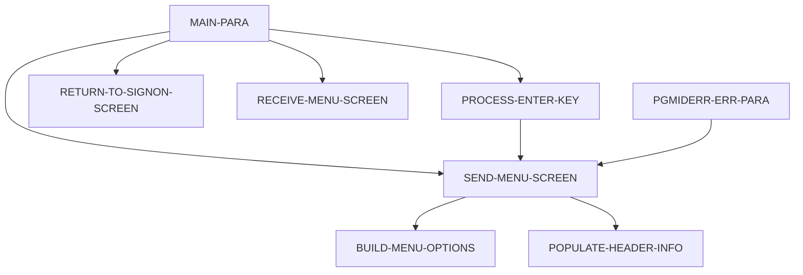

# Program COADM01C

| Item | Value |
|---|---|
| Source | `app/cbl/COADM01C.cbl` |
| Lines | 288 total, 189 code, 58 comment, 41 blank |
| PROGRAM-ID | COADM01C |
| Author | AWS |
| Runtime | cics-online |
| Module | base |
| CICS transactions | CA00 (`app/csd/CARDDEMO.CSD:327-336`) |
| JCL steps | None |
| Paragraphs | 8 |
| Semantic analysis | validated (batch B05) |
| Version banner | * Ver: CardDemo_v1.0-15-g27d6c6f-68 Date: 2022-07-19 23:12:32 CDT |

## Summary

COADM01C is the CICS pseudo-conversational administrator menu of CardDemo, transaction CA00, map COADM1A of mapset COADM01. It establishes a HANDLE CONDITION PGMIDERR so that a missing option program produces an 'is not installed' message. Without a commarea it transfers to COSGN00C; on first entry it sets the re-enter flag and displays the option list from COADM02Y (6 options: user list/add/update/delete and the two Db2 transaction-type programs). On ENTER it normalises and validates the option number against CDEMO-ADMIN-OPT-COUNT and XCTLs to the option's program with the CARDDEMO-COMMAREA unless the program name starts with DUMMY. PF3 returns to COSGN00C; other keys redisplay the menu with an invalid-key message. Each turn ends with CICS RETURN TRANSID(CA00) COMMAREA(CARDDEMO-COMMAREA). (Confirmed)

Evidence: `app/cbl/COADM01C.cbl:35-51`, `app/cbl/COADM01C.cbl:75-114`, `app/cbl/COADM01C.cbl:119-158`, `app/cbl/COADM01C.cbl:270-284`, `app/cpy/COADM02Y.cpy:19-59`

Header comment (Unverified, `app/cbl/COADM01C.cbl:1-8`): Program     : COADM01C.CBL Application : CardDemo Type        : CICS COBOL Program Function    : Admin Menu for Admin users All Rights Reserved. http://www.apache.org/licenses/LICENSE-2.0

## Divisions and sections

| Division / section | Lines | Notes |
|---|---|---|
| IDENTIFICATION DIVISION | `app/cbl/COADM01C.cbl:22-25` |  |
| ENVIRONMENT DIVISION | `app/cbl/COADM01C.cbl:26-28` |  |
| DATA DIVISION | `app/cbl/COADM01C.cbl:29-73` |  |
| PROCEDURE DIVISION | `app/cbl/COADM01C.cbl:74-288` |  |
| ENVIRONMENT / CONFIGURATION SECTION | `app/cbl/COADM01C.cbl:27-28` |  |
| DATA / WORKING-STORAGE SECTION | `app/cbl/COADM01C.cbl:33-65` |  |
| DATA / LINKAGE SECTION | `app/cbl/COADM01C.cbl:66-73` |  |

## Files and data stores

No SELECT entries (no COBOL file I/O).

## Embedded CICS, SQL and DL/I commands

| Paragraph | Kind | Verb | Resources | Response | Lines |
|---|---|---|---|---|---|
| MAIN-PARA | CICS | HANDLE CONDITION |  |  | `app/cbl/COADM01C.cbl:77-79` |
| MAIN-PARA | CICS | RETURN | TRANSID(WS-TRANID) |  | `app/cbl/COADM01C.cbl:111-114` |
| PROCESS-ENTER-KEY | CICS | XCTL | PROGRAM(CDEMO-ADMIN-OPT-PGMNAME(WS-OPTION)) |  | `app/cbl/COADM01C.cbl:145-148` |
| RETURN-TO-SIGNON-SCREEN | CICS | XCTL | PROGRAM(CDEMO-TO-PROGRAM) |  | `app/cbl/COADM01C.cbl:168-170` |
| SEND-MENU-SCREEN | CICS | SEND MAP | MAP('COADM1A'), MAPSET('COADM01') |  | `app/cbl/COADM01C.cbl:182-187` |
| RECEIVE-MENU-SCREEN | CICS | RECEIVE MAP | MAP('COADM1A'), MAPSET('COADM01') | RESP | `app/cbl/COADM01C.cbl:194-200` |
| PGMIDERR-ERR-PARA | CICS | RETURN | TRANSID(WS-TRANID) |  | `app/cbl/COADM01C.cbl:280-283` |

## Calls, transfers and callers

| Mechanism | Target | Parameters | Paragraph | Lines |
|---|---|---|---|---|
| EXEC CICS RETURN | WS-TRANID = CA00 | CARDDEMO-COMMAREA | MAIN-PARA | `app/cbl/COADM01C.cbl:111-114` |
| EXEC CICS XCTL | CDEMO-ADMIN-OPT-PGMNAME(WS-OPTION) | CARDDEMO-COMMAREA | PROCESS-ENTER-KEY | `app/cbl/COADM01C.cbl:145-148` |
| EXEC CICS XCTL | CDEMO-TO-PROGRAM = COSGN00C |  | RETURN-TO-SIGNON-SCREEN | `app/cbl/COADM01C.cbl:168-170` |
| EXEC CICS RETURN | WS-TRANID = CA00 | CARDDEMO-COMMAREA | PGMIDERR-ERR-PARA | `app/cbl/COADM01C.cbl:280-283` |

Programs that transfer to or call this program (from `docs/_work/xref/call-graph.json`):

| Caller | Mechanism | Confidence | Evidence |
|---|---|---|---|
| COSGN00C | XCTL | Confirmed | `app/cbl/COSGN00C.cbl:231` |
| COTRTLIC | XCTL | Inferred | `app/app-transaction-type-db2/cbl/COTRTLIC.cbl:620` |
| COTRTUPC | XCTL | Inferred | `app/app-transaction-type-db2/cbl/COTRTUPC.cbl:457` |
| COUSR00C | XCTL | Confirmed | `app/cbl/COUSR00C.cbl:514` |
| COUSR01C | XCTL | Confirmed | `app/cbl/COUSR01C.cbl:175` |
| COUSR02C | XCTL | Confirmed | `app/cbl/COUSR02C.cbl:258` |
| COUSR03C | XCTL | Confirmed | `app/cbl/COUSR03C.cbl:205` |

## Copybooks

| Copybook | Statement | Resolution | Resolved path | REPLACING | Line |
|---|---|---|---|---|---|
| [COCOM01Y](../08-data/layouts/COCOM01Y.md) | COPY | inventory | app/cpy/COCOM01Y.cpy |  | `app/cbl/COADM01C.cbl:50` |
| [COADM02Y](../08-data/layouts/COADM02Y.md) | COPY | inventory | app/cpy/COADM02Y.cpy |  | `app/cbl/COADM01C.cbl:51` |
| COADM01 | COPY | inventory | app/cpy-bms/COADM01.CPY |  | `app/cbl/COADM01C.cbl:53` |
| [COTTL01Y](../08-data/layouts/COTTL01Y.md) | COPY | inventory | app/cpy/COTTL01Y.cpy |  | `app/cbl/COADM01C.cbl:55` |
| [CSDAT01Y](../08-data/layouts/CSDAT01Y.md) | COPY | inventory | app/cpy/CSDAT01Y.cpy |  | `app/cbl/COADM01C.cbl:56` |
| [CSMSG01Y](../08-data/layouts/CSMSG01Y.md) | COPY | inventory | app/cpy/CSMSG01Y.cpy |  | `app/cbl/COADM01C.cbl:57` |
| [CSUSR01Y](../08-data/layouts/CSUSR01Y.md) | COPY | inventory | app/cpy/CSUSR01Y.cpy |  | `app/cbl/COADM01C.cbl:58` |
| DFHAID | COPY | system |  |  | `app/cbl/COADM01C.cbl:60` |
| DFHBMSCA | COPY | system |  |  | `app/cbl/COADM01C.cbl:61` |

## Data division items

Every data entry coded in this source (copybook contents are on the copybook pages). Lengths are computed from PIC and USAGE.

| Section | Lvl | Name | PIC | Usage | Len | OCCURS | REDEFINES | VALUE | 88-levels | Line |
|---|---|---|---|---|---|---|---|---|---|---|
| WORKING-STORAGE | 01 | WS-VARIABLES |  |  |  |  |  |  |  | 35 |
| WORKING-STORAGE | 05 | WS-PGMNAME | X(08) |  | 8 |  |  | 'COADM01C' |  | 36 |
| WORKING-STORAGE | 05 | WS-TRANID | X(04) |  | 4 |  |  | 'CA00' |  | 37 |
| WORKING-STORAGE | 05 | WS-MESSAGE | X(80) |  | 80 |  |  | SPACES |  | 38 |
| WORKING-STORAGE | 05 | WS-USRSEC-FILE | X(08) |  | 8 |  |  | 'USRSEC ' |  | 39 |
| WORKING-STORAGE | 05 | WS-ERR-FLG | X(01) |  | 1 |  |  | 'N' | ERR-FLG-ON = 'Y'; ERR-FLG-OFF = 'N' | 40 |
| WORKING-STORAGE | 05 | WS-RESP-CD | S9(09) | COMP | 4 |  |  | ZEROS |  | 43 |
| WORKING-STORAGE | 05 | WS-REAS-CD | S9(09) | COMP | 4 |  |  | ZEROS |  | 44 |
| WORKING-STORAGE | 05 | WS-OPTION-X | X(02) |  | 2 |  |  |  |  | 45 |
| WORKING-STORAGE | 05 | WS-OPTION | 9(02) |  | 2 |  |  | 0 |  | 46 |
| WORKING-STORAGE | 05 | WS-IDX | S9(04) | COMP | 2 |  |  | ZEROS |  | 47 |
| WORKING-STORAGE | 05 | WS-ADMIN-OPT-TXT | X(40) |  | 40 |  |  | SPACES |  | 48 |
| LINKAGE | 01 | DFHCOMMAREA |  |  |  |  |  |  |  | 67 |
| LINKAGE | 05 | LK-COMMAREA | X(01) |  | 1 | 1 TO 32767 DEPENDING ON EIBCALEN |  |  |  | 68 |

## Statement inventory

Every procedure statement the parser recorded, by kind. Each one is listed with its line under Paragraph details.

| Kind | Count |
|---|---|
| Decisions (IF, EVALUATE, WHEN, loops, handlers) | 24 |
| Calculations | 0 |
| File I/O | 0 |
| EXEC CICS / SQL / DLI | 7 |
| CALL | 0 |
| PERFORM | 13 |
| GO TO | 0 |
| MOVE literal | 6 |
| MOVE field | 39 |
| SET | 2 |
| STRING, UNSTRING, INSPECT, INITIALIZE, COPY, ENTRY and others | 4 |
| DISPLAY | 0 |
| GOBACK, STOP RUN, RETURN, XCTL | 4 |
| Not classified by the parser | 0 |

## Control flow

| Paragraph | Lines | Logic | Performs | Performed by | Reachable |
|---|---|---|---|---|---|
| [MAIN-PARA](#para-main-para) | 75-114 | Registers HANDLE CONDITION PGMIDERR(PGMIDERR-ERR-PARA), clears the error flag and message. If EIBCALEN = 0 it sets CDEMO-FROM-PROGRAM='COSGN00C' and returns to sign-on; otherwise it copies DFHCOMMAREA into CARDDEMO-COMMAREA, and on first entry (not CDEMO-PGM-REENTER) sets the re-enter flag and sends the menu. On re-entry it receives the map: ENTER performs PROCESS-ENTER-KEY, PF3 sets CDEMO-TO-PROGRAM='COSGN00C' and returns to sign-on, other keys redisplay with CCDA-MSG-INVALID-KEY. Ends with CICS RETURN TRANSID('CA00'). (Confirmed) | PROCESS-ENTER-KEY, RECEIVE-MENU-SCREEN, RETURN-TO-SIGNON-SCREEN, SEND-MENU-SCREEN |  | yes |
| [PROCESS-ENTER-KEY](#para-process-enter-key) | 119-158 | Trims trailing blanks from OPTIONI, right-justifies it into WS-OPTION-X, replaces blanks by '0' and moves it to WS-OPTION. Non-numeric, zero or > CDEMO-ADMIN-OPT-COUNT options redisplay the menu with 'Please enter a valid option number...'. Otherwise, if CDEMO-ADMIN-OPT-PGMNAME(WS-OPTION) does not start with 'DUMMY', it sets CDEMO-FROM-TRANID/PROGRAM and CDEMO-PGM-CONTEXT=0 and XCTLs to that program; if no transfer occurred it shows green 'This option is not installed ...' and redisplays the menu. (Confirmed) | SEND-MENU-SCREEN | MAIN-PARA | yes |
| [RETURN-TO-SIGNON-SCREEN](#para-return-to-signon-screen) | 163-170 | Defaults CDEMO-TO-PROGRAM to 'COSGN00C' when low-values or spaces, then XCTLs to CDEMO-TO-PROGRAM without a commarea. (Confirmed) |  | MAIN-PARA | yes |
| [SEND-MENU-SCREEN](#para-send-menu-screen) | 175-187 | Performs POPULATE-HEADER-INFO and BUILD-MENU-OPTIONS, moves WS-MESSAGE to ERRMSGO and sends map COADM1A (mapset COADM01) with ERASE. (Confirmed) | BUILD-MENU-OPTIONS, POPULATE-HEADER-INFO | MAIN-PARA, PGMIDERR-ERR-PARA, PROCESS-ENTER-KEY | yes |
| [RECEIVE-MENU-SCREEN](#para-receive-menu-screen) | 192-200 | Receives map COADM1A into COADM1AI capturing RESP/RESP2, which are not tested afterwards. (Confirmed) |  | MAIN-PARA | yes |
| [POPULATE-HEADER-INFO](#para-populate-header-info) | 205-224 | Moves FUNCTION CURRENT-DATE to WS-CURDATE-DATA, CCDA-TITLE01/CCDA-TITLE02 to TITLE01O/TITLE02O, WS-TRANID to TRNNAMEO and WS-PGMNAME to PGMNAMEO of COADM1AO; rebuilds the date as WS-CURDATE-MM-DD-YY (MM/DD/YY from WS-CURDATE-MONTH, WS-CURDATE-DAY, WS-CURDATE-YEAR(3:2)) into CURDATEO and the time as WS-CURTIME-HH-MM-SS into CURTIMEO. (Confirmed) |  | SEND-MENU-SCREEN | yes |
| [BUILD-MENU-OPTIONS](#para-build-menu-options) | 229-266 | Loops WS-IDX from 1 to CDEMO-ADMIN-OPT-COUNT building 'nn. option name' and moving it to OPTN001O..OPTN010O according to WS-IDX; higher indexes are ignored. (Confirmed) |  | SEND-MENU-SCREEN | yes |
| [PGMIDERR-ERR-PARA](#para-pgmiderr-err-para) | 270-284 | Entered by the PGMIDERR handler when an XCTL target is not defined: shows green 'This option is not installed ...', redisplays the menu and issues CICS RETURN TRANSID(CA00) with the commarea. (Confirmed) | SEND-MENU-SCREEN |  | no static path |

## Paragraph details

### Para MAIN-PARA

Lines `app/cbl/COADM01C.cbl:75-114`. 

Logic: Registers HANDLE CONDITION PGMIDERR(PGMIDERR-ERR-PARA), clears the error flag and message. If EIBCALEN = 0 it sets CDEMO-FROM-PROGRAM='COSGN00C' and returns to sign-on; otherwise it copies DFHCOMMAREA into CARDDEMO-COMMAREA, and on first entry (not CDEMO-PGM-REENTER) sets the re-enter flag and sends the menu. On re-entry it receives the map: ENTER performs PROCESS-ENTER-KEY, PF3 sets CDEMO-TO-PROGRAM='COSGN00C' and returns to sign-on, other keys redisplay with CCDA-MSG-INVALID-KEY. Ends with CICS RETURN TRANSID('CA00'). (Confirmed)

Rules: [BR-COADM01C-003](../09-business-rules-catalog.md#br-coadm01c-003)

Statements in source order:

- EXEC CICS HANDLE CONDITION at `app/cbl/COADM01C.cbl:77-79`
- `SET ERR-FLG-OFF TO TRUE` at `app/cbl/COADM01C.cbl:81`
- `MOVE SPACES TO WS-MESSAGE ERRMSGO OF COADM1AO` at `app/cbl/COADM01C.cbl:83-84`
- IF `EIBCALEN = 0` at `app/cbl/COADM01C.cbl:86` (pseudo-conversation)
- MOVE `'COSGN00C'` TO CDEMO-FROM-PROGRAM at `app/cbl/COADM01C.cbl:87`
- PERFORM RETURN-TO-SIGNON-SCREEN at `app/cbl/COADM01C.cbl:88`
- `MOVE DFHCOMMAREA(1:EIBCALEN) TO CARDDEMO-COMMAREA` at `app/cbl/COADM01C.cbl:90`
- IF `NOT CDEMO-PGM-REENTER` at `app/cbl/COADM01C.cbl:91` (pseudo-conversation)
- `SET CDEMO-PGM-REENTER TO TRUE` at `app/cbl/COADM01C.cbl:92`
- `MOVE LOW-VALUES TO COADM1AO` at `app/cbl/COADM01C.cbl:93`
- PERFORM SEND-MENU-SCREEN at `app/cbl/COADM01C.cbl:94`
- PERFORM RECEIVE-MENU-SCREEN at `app/cbl/COADM01C.cbl:96`
- EVALUATE `EIBAID` at `app/cbl/COADM01C.cbl:97` (screen-key)
- WHEN `DFHENTER` at `app/cbl/COADM01C.cbl:98` (screen-key)
- PERFORM PROCESS-ENTER-KEY at `app/cbl/COADM01C.cbl:99`
- WHEN `DFHPF3` at `app/cbl/COADM01C.cbl:100` (screen-key)
- MOVE `'COSGN00C'` TO CDEMO-TO-PROGRAM at `app/cbl/COADM01C.cbl:101`
- PERFORM RETURN-TO-SIGNON-SCREEN at `app/cbl/COADM01C.cbl:102`
- WHEN `OTHER` at `app/cbl/COADM01C.cbl:103` (screen-key)
- MOVE `'Y'` TO WS-ERR-FLG at `app/cbl/COADM01C.cbl:104`
- `MOVE CCDA-MSG-INVALID-KEY TO WS-MESSAGE` at `app/cbl/COADM01C.cbl:105`
- PERFORM SEND-MENU-SCREEN at `app/cbl/COADM01C.cbl:106`
- EXEC CICS RETURN at `app/cbl/COADM01C.cbl:111-114`
- Ends with EXEC CICS RETURN at `app/cbl/COADM01C.cbl:111-114`

### Para PROCESS-ENTER-KEY

Lines `app/cbl/COADM01C.cbl:119-158`. 

Logic: Trims trailing blanks from OPTIONI, right-justifies it into WS-OPTION-X, replaces blanks by '0' and moves it to WS-OPTION. Non-numeric, zero or > CDEMO-ADMIN-OPT-COUNT options redisplay the menu with 'Please enter a valid option number...'. Otherwise, if CDEMO-ADMIN-OPT-PGMNAME(WS-OPTION) does not start with 'DUMMY', it sets CDEMO-FROM-TRANID/PROGRAM and CDEMO-PGM-CONTEXT=0 and XCTLs to that program; if no transfer occurred it shows green 'This option is not installed ...' and redisplays the menu. (Confirmed)

Rules: [BR-COADM01C-001](../09-business-rules-catalog.md#br-coadm01c-001)

Statements in source order:

- LOOP `VARYING WS-IDX FROM LENGTH OF OPTIONI OF COADM1AI BY -1 UNTIL OPTIONI OF COADM1AI(WS-IDX:1) NOT = SPACES OR WS-IDX = 1` at `app/cbl/COADM01C.cbl:121-124` (pseudo-conversation)
- Inline PERFORM `VARYING WS-IDX FROM LENGTH OF OPTIONI OF COADM1AI BY -1 UNTIL OPTIONI OF COADM1AI(WS-IDX:1) NOT = SPACES OR WS-IDX = 1` at `app/cbl/COADM01C.cbl:121-124`
- `MOVE OPTIONI OF COADM1AI(1:WS-IDX) TO WS-OPTION-X` at `app/cbl/COADM01C.cbl:126`
- `INSPECT WS-OPTION-X REPLACING ALL ' ' BY '0'` at `app/cbl/COADM01C.cbl:127`
- `MOVE WS-OPTION-X TO WS-OPTION` at `app/cbl/COADM01C.cbl:128`
- `MOVE WS-OPTION TO OPTIONO OF COADM1AO` at `app/cbl/COADM01C.cbl:129`
- IF `WS-OPTION IS NOT NUMERIC OR WS-OPTION > CDEMO-ADMIN-OPT-COUNT OR WS-OPTION = ZEROS` at `app/cbl/COADM01C.cbl:131-133` (business-candidate)
- MOVE `'Y'` TO WS-ERR-FLG at `app/cbl/COADM01C.cbl:134`
- MOVE `'Please enter a valid option number...'` TO WS-MESSAGE at `app/cbl/COADM01C.cbl:135-136`
- PERFORM SEND-MENU-SCREEN at `app/cbl/COADM01C.cbl:137`
- IF `NOT ERR-FLG-ON` at `app/cbl/COADM01C.cbl:140` (error-flag)
- IF `CDEMO-ADMIN-OPT-PGMNAME(WS-OPTION)(1:5) NOT = 'DUMMY'` at `app/cbl/COADM01C.cbl:141` (business-candidate)
- `MOVE WS-TRANID TO CDEMO-FROM-TRANID` at `app/cbl/COADM01C.cbl:142`
- `MOVE WS-PGMNAME TO CDEMO-FROM-PROGRAM` at `app/cbl/COADM01C.cbl:143`
- `MOVE ZEROS TO CDEMO-PGM-CONTEXT` at `app/cbl/COADM01C.cbl:144`
- EXEC CICS XCTL at `app/cbl/COADM01C.cbl:145-148`
- Ends with EXEC CICS XCTL at `app/cbl/COADM01C.cbl:145-148`
- `MOVE SPACES TO WS-MESSAGE` at `app/cbl/COADM01C.cbl:150`
- `MOVE DFHGREEN TO ERRMSGC OF COADM1AO` at `app/cbl/COADM01C.cbl:151`
- `STRING 'This option ' DELIMITED BY SIZE 'is not installed ...' DELIMITED BY SIZE INTO WS-MESSAGE` at `app/cbl/COADM01C.cbl:152-156`
- PERFORM SEND-MENU-SCREEN at `app/cbl/COADM01C.cbl:157`

### Para RETURN-TO-SIGNON-SCREEN

Lines `app/cbl/COADM01C.cbl:163-170`. 

Logic: Defaults CDEMO-TO-PROGRAM to 'COSGN00C' when low-values or spaces, then XCTLs to CDEMO-TO-PROGRAM without a commarea. (Confirmed)

Rules: [BR-BASE-001](../09-business-rules-catalog.md#br-base-001)

Statements in source order:

- IF `CDEMO-TO-PROGRAM = LOW-VALUES OR SPACES` at `app/cbl/COADM01C.cbl:165` (business-candidate)
- MOVE `'COSGN00C'` TO CDEMO-TO-PROGRAM at `app/cbl/COADM01C.cbl:166`
- EXEC CICS XCTL at `app/cbl/COADM01C.cbl:168-170`
- Ends with EXEC CICS XCTL at `app/cbl/COADM01C.cbl:168-170`

### Para SEND-MENU-SCREEN

Lines `app/cbl/COADM01C.cbl:175-187`. 

Logic: Performs POPULATE-HEADER-INFO and BUILD-MENU-OPTIONS, moves WS-MESSAGE to ERRMSGO and sends map COADM1A (mapset COADM01) with ERASE. (Confirmed)

Statements in source order:

- PERFORM POPULATE-HEADER-INFO at `app/cbl/COADM01C.cbl:177`
- PERFORM BUILD-MENU-OPTIONS at `app/cbl/COADM01C.cbl:178`
- `MOVE WS-MESSAGE TO ERRMSGO OF COADM1AO` at `app/cbl/COADM01C.cbl:180`
- EXEC CICS SEND MAP at `app/cbl/COADM01C.cbl:182-187`

### Para RECEIVE-MENU-SCREEN

Lines `app/cbl/COADM01C.cbl:192-200`. 

Logic: Receives map COADM1A into COADM1AI capturing RESP/RESP2, which are not tested afterwards. (Confirmed)

Statements in source order:

- EXEC CICS RECEIVE MAP at `app/cbl/COADM01C.cbl:194-200`

### Para POPULATE-HEADER-INFO

Lines `app/cbl/COADM01C.cbl:205-224`. 

Logic: Moves FUNCTION CURRENT-DATE to WS-CURDATE-DATA, CCDA-TITLE01/CCDA-TITLE02 to TITLE01O/TITLE02O, WS-TRANID to TRNNAMEO and WS-PGMNAME to PGMNAMEO of COADM1AO; rebuilds the date as WS-CURDATE-MM-DD-YY (MM/DD/YY from WS-CURDATE-MONTH, WS-CURDATE-DAY, WS-CURDATE-YEAR(3:2)) into CURDATEO and the time as WS-CURTIME-HH-MM-SS into CURTIMEO. (Confirmed)

Statements in source order:

- `MOVE FUNCTION CURRENT-DATE TO WS-CURDATE-DATA` at `app/cbl/COADM01C.cbl:207`
- `MOVE CCDA-TITLE01 TO TITLE01O OF COADM1AO` at `app/cbl/COADM01C.cbl:209`
- `MOVE CCDA-TITLE02 TO TITLE02O OF COADM1AO` at `app/cbl/COADM01C.cbl:210`
- `MOVE WS-TRANID TO TRNNAMEO OF COADM1AO` at `app/cbl/COADM01C.cbl:211`
- `MOVE WS-PGMNAME TO PGMNAMEO OF COADM1AO` at `app/cbl/COADM01C.cbl:212`
- `MOVE WS-CURDATE-MONTH TO WS-CURDATE-MM` at `app/cbl/COADM01C.cbl:214`
- `MOVE WS-CURDATE-DAY TO WS-CURDATE-DD` at `app/cbl/COADM01C.cbl:215`
- `MOVE WS-CURDATE-YEAR(3:2) TO WS-CURDATE-YY` at `app/cbl/COADM01C.cbl:216`
- `MOVE WS-CURDATE-MM-DD-YY TO CURDATEO OF COADM1AO` at `app/cbl/COADM01C.cbl:218`
- `MOVE WS-CURTIME-HOURS TO WS-CURTIME-HH` at `app/cbl/COADM01C.cbl:220`
- `MOVE WS-CURTIME-MINUTE TO WS-CURTIME-MM` at `app/cbl/COADM01C.cbl:221`
- `MOVE WS-CURTIME-SECOND TO WS-CURTIME-SS` at `app/cbl/COADM01C.cbl:222`
- `MOVE WS-CURTIME-HH-MM-SS TO CURTIMEO OF COADM1AO` at `app/cbl/COADM01C.cbl:224`

### Para BUILD-MENU-OPTIONS

Lines `app/cbl/COADM01C.cbl:229-266`. 

Logic: Loops WS-IDX from 1 to CDEMO-ADMIN-OPT-COUNT building 'nn. option name' and moving it to OPTN001O..OPTN010O according to WS-IDX; higher indexes are ignored. (Confirmed)

Statements in source order:

- LOOP `VARYING WS-IDX FROM 1 BY 1 UNTIL WS-IDX > CDEMO-ADMIN-OPT-COUNT` at `app/cbl/COADM01C.cbl:231-232` (business-candidate)
- Inline PERFORM `VARYING WS-IDX FROM 1 BY 1 UNTIL WS-IDX > CDEMO-ADMIN-OPT-COUNT` at `app/cbl/COADM01C.cbl:231-232`
- `MOVE SPACES TO WS-ADMIN-OPT-TXT` at `app/cbl/COADM01C.cbl:234`
- `STRING CDEMO-ADMIN-OPT-NUM(WS-IDX) DELIMITED BY SIZE '. ' DELIMITED BY SIZE CDEMO-ADMIN-OPT-NAME(WS-IDX) DELIMITED BY SIZE INTO WS-ADMIN-OPT-TXT` at `app/cbl/COADM01C.cbl:236-239`
- EVALUATE `WS-IDX` at `app/cbl/COADM01C.cbl:241` (business-candidate)
- WHEN `1` at `app/cbl/COADM01C.cbl:242` (business-candidate)
- `MOVE WS-ADMIN-OPT-TXT TO OPTN001O` at `app/cbl/COADM01C.cbl:243`
- WHEN `2` at `app/cbl/COADM01C.cbl:244` (business-candidate)
- `MOVE WS-ADMIN-OPT-TXT TO OPTN002O` at `app/cbl/COADM01C.cbl:245`
- WHEN `3` at `app/cbl/COADM01C.cbl:246` (business-candidate)
- `MOVE WS-ADMIN-OPT-TXT TO OPTN003O` at `app/cbl/COADM01C.cbl:247`
- WHEN `4` at `app/cbl/COADM01C.cbl:248` (business-candidate)
- `MOVE WS-ADMIN-OPT-TXT TO OPTN004O` at `app/cbl/COADM01C.cbl:249`
- WHEN `5` at `app/cbl/COADM01C.cbl:250` (business-candidate)
- `MOVE WS-ADMIN-OPT-TXT TO OPTN005O` at `app/cbl/COADM01C.cbl:251`
- WHEN `6` at `app/cbl/COADM01C.cbl:252` (business-candidate)
- `MOVE WS-ADMIN-OPT-TXT TO OPTN006O` at `app/cbl/COADM01C.cbl:253`
- WHEN `7` at `app/cbl/COADM01C.cbl:254` (business-candidate)
- `MOVE WS-ADMIN-OPT-TXT TO OPTN007O` at `app/cbl/COADM01C.cbl:255`
- WHEN `8` at `app/cbl/COADM01C.cbl:256` (business-candidate)
- `MOVE WS-ADMIN-OPT-TXT TO OPTN008O` at `app/cbl/COADM01C.cbl:257`
- WHEN `9` at `app/cbl/COADM01C.cbl:258` (business-candidate)
- `MOVE WS-ADMIN-OPT-TXT TO OPTN009O` at `app/cbl/COADM01C.cbl:259`
- WHEN `10` at `app/cbl/COADM01C.cbl:260` (business-candidate)
- `MOVE WS-ADMIN-OPT-TXT TO OPTN010O` at `app/cbl/COADM01C.cbl:261`
- WHEN `OTHER` at `app/cbl/COADM01C.cbl:262` (business-candidate)

### Para PGMIDERR-ERR-PARA

Lines `app/cbl/COADM01C.cbl:270-284`. 

Logic: Entered by the PGMIDERR handler when an XCTL target is not defined: shows green 'This option is not installed ...', redisplays the menu and issues CICS RETURN TRANSID(CA00) with the commarea. (Confirmed)

Rules: [BR-COADM01C-002](../09-business-rules-catalog.md#br-coadm01c-002)

Statements in source order:

- `MOVE SPACES TO WS-MESSAGE` at `app/cbl/COADM01C.cbl:271`
- `MOVE DFHGREEN TO ERRMSGC OF COADM1AO` at `app/cbl/COADM01C.cbl:272`
- `STRING 'This option ' DELIMITED BY SIZE 'is not installed ...' DELIMITED BY SIZE INTO WS-MESSAGE` at `app/cbl/COADM01C.cbl:273-277`
- PERFORM SEND-MENU-SCREEN at `app/cbl/COADM01C.cbl:279`
- EXEC CICS RETURN at `app/cbl/COADM01C.cbl:280-283`
- Ends with EXEC CICS RETURN at `app/cbl/COADM01C.cbl:280-283`

## Business rules

| Rule | Category | Statement | Paragraph | Source | Confidence |
|---|---|---|---|---|---|
| [BR-BASE-001](../09-business-rules-catalog.md#br-base-001) | routing | When the return target is spaces or low-values, the user menu and the admin menu both set it to COSGN00C before the transfer. | RETURN-TO-SIGNON-SCREEN | `app/cbl/COADM01C.cbl:165-167` | Confirmed / review: confirmed |
| [BR-BASE-002](../09-business-rules-catalog.md#br-base-002) | routing | PF3 on the user menu and on the admin menu sets the return target to COSGN00C and returns to sign-on. |  | `app/cbl/COADM01C.cbl:100-102` | Confirmed / review: confirmed |
| [BR-BASE-COADM01C-001](../09-business-rules-catalog.md#br-base-coadm01c-001) | routing | An admin-menu option is started when its program name does not begin with DUMMY. |  | `app/cbl/COADM01C.cbl:141-146` | Confirmed / review: confirmed |
| [BR-COADM01C-001](../09-business-rules-catalog.md#br-coadm01c-001) | validation | The admin menu option must be numeric, non-zero and not greater than CDEMO-ADMIN-OPT-COUNT (6 in COADM02Y); otherwise the menu is redisplayed with 'Please enter a valid option number...'. Trailing blanks are trimmed and remaining blanks replaced by zeros before the check. | PROCESS-ENTER-KEY | `app/cbl/COADM01C.cbl:131-138`, `app/cbl/COADM01C.cbl:121-129`, `app/cpy/COADM02Y.cpy:22` | Confirmed |
| [BR-COADM01C-002](../09-business-rules-catalog.md#br-coadm01c-002) | error-policy | When the program of a selected admin option is not defined to CICS (PGMIDERR on XCTL), the admin menu does not abend: it shows 'This option is not installed ...' in green, redisplays the menu and continues the conversation with transaction CA00. | PGMIDERR-ERR-PARA | `app/cbl/COADM01C.cbl:270-283`, `app/cbl/COADM01C.cbl:77-79` | Confirmed |
| [BR-COADM01C-003](../09-business-rules-catalog.md#br-coadm01c-003) | decision | The admin menu distinguishes first entry from re-entry with CDEMO-PGM-CONTEXT: entered from another program it sets CDEMO-PGM-REENTER and only displays the menu; input is processed only on re-entry. A start without commarea is sent to sign-on COSGN00C. Any key other than ENTER or PF3 redisplays the menu with 'Invalid key pressed. Please see below...'. | MAIN-PARA | `app/cbl/COADM01C.cbl:85-107`, `app/cpy/CSMSG01Y.cpy:20-21` | Confirmed |

Decision points reviewed and classified as not business rules:

| Lines | Reason |
|---|---|
| `app/cbl/COADM01C.cbl:231-264` | BUILD-MENU-OPTIONS loop and EVALUATE WS-IDX only place option text on screen lines OPTN001O-OPTN010O (presentation). |

Decision coverage: 16 of 16 business-candidate decision points are linked to a rule or a no-rule reason (3 inside rule ranges).

## Error handling

| Paragraph | Kind | Detail | Lines |
|---|---|---|---|
| MAIN-PARA | handle condition | `EXEC CICS HANDLE CONDITION PGMIDERR(PGMIDERR-ERR-PARA) END-EXEC` | `app/cbl/COADM01C.cbl:77-79` |

## Observations and SME questions

- security: COADM01C never checks CDEMO-USRTYP-ADMIN; the admin role is enforced only by COSGN00C routing. Any program/transaction passing a commarea (or starting CA00 with one) reaches the admin functions. (`app/cbl/COADM01C.cbl:85-108`)
- anomaly: After an invalid option the message branch is skipped by IF NOT ERR-FLG-ON, but WS-OPTION may be 0 or > table size; no subscript is used in that case (unlike COMEN01C), so no out-of-range access. (`app/cbl/COADM01C.cbl:131-140`)
- dead-code: The option name is commented out of the 'not installed' message, so the message never names the option. (`app/cbl/COADM01C.cbl:152-156`)
- anomaly: PGMIDERR-ERR-PARA ends with END-EXEC. followed by a stray period line; and the PGMIDERR handler remains active for the whole task including the RETURN-TO-SIGNON XCTL. (`app/cbl/COADM01C.cbl:280-284`)
- unchecked-io: RECEIVE MAP RESP/RESP2 captured but never tested. (`app/cbl/COADM01C.cbl:194-200`)
- anomaly: WS-USRSEC-FILE and copybook CSUSR01Y are declared but not used. (`app/cbl/COADM01C.cbl:39`)
- SME question: Should the admin menu itself verify CDEMO-USER-TYPE = 'A' (defence in depth), or is sign-on routing considered sufficient? (`app/cbl/COADM01C.cbl:85-94`)

## Sources

- `app/cbl/COADM01C.cbl`
- `docs/_work/structure/programs/COADM01C.json`
- `docs/_work/semantic/programs/COADM01C.json`
- `docs/_work/programs/COADM01C.json`

## Confidence

Structure tables (divisions, items, paragraphs, statements, line numbers) are Confirmed: they are parsed from the source. Paragraph logic and rule statements carry their own Confirmed/Inferred tag from the batch analysis, and every rule anchor was checked against the cited lines. Decision-point classes are a keyword heuristic used only for coverage measurement. Header comments are Unverified.
