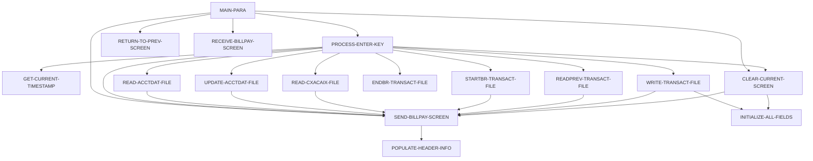

# Program COBIL00C

| Item | Value |
|---|---|
| Source | `app/cbl/COBIL00C.cbl` |
| Lines | 572 total, 420 code, 79 comment, 73 blank |
| PROGRAM-ID | COBIL00C |
| Author | AWS |
| Runtime | cics-online |
| Module | base |
| CICS transactions | CB00 (`app/csd/CARDDEMO.CSD:337-346`) |
| JCL steps | None |
| Paragraphs | 16 |
| Semantic analysis | validated (batch B05) |
| Version banner | * Ver: CardDemo_v1.0-15-g27d6c6f-68 Date: 2022-07-19 23:12:32 CDT |

## Summary

COBIL00C is the CICS pseudo-conversational online Bill Payment program (transaction CB00, map COBIL0A of mapset COBIL00). The user enters an account id; the program reads the account master ACCTDAT for update and shows the current balance, asking for confirmation. When the user confirms with Y, it reads the card cross-reference CXACAIX by account to get the card number, determines the next transaction id by browsing TRANSACT backwards from HIGH-VALUES and adding 1, writes a bill-payment transaction (type '02', category 2) for the full current balance, subtracts that amount from ACCT-CURR-BAL and rewrites the account. Success is reported with the new transaction id; NOTFND and other I/O errors are reported on the screen. PF3 returns to the calling program (default COMEN01C), PF4 clears the screen, and each turn ends with CICS RETURN TRANSID(CB00) and the commarea extended with CDEMO-CB00-INFO. (Confirmed)

Evidence: `app/cbl/COBIL00C.cbl:36-72`, `app/cbl/COBIL00C.cbl:99-149`, `app/cbl/COBIL00C.cbl:154-244`, `app/cbl/COBIL00C.cbl:343-547`

Header comment (Unverified, `app/cbl/COBIL00C.cbl:1-8`): Program     : COBIL00C.CBL Application : CardDemo Type        : CICS COBOL Program Function    : Bill Payment - Pay account balance in full and a tractionsaction for the online bill payment. All Rights Reserved.

## Divisions and sections

| Division / section | Lines | Notes |
|---|---|---|
| IDENTIFICATION DIVISION | `app/cbl/COBIL00C.cbl:23-26` |  |
| ENVIRONMENT DIVISION | `app/cbl/COBIL00C.cbl:27-29` |  |
| DATA DIVISION | `app/cbl/COBIL00C.cbl:30-97` |  |
| PROCEDURE DIVISION | `app/cbl/COBIL00C.cbl:98-572` |  |
| ENVIRONMENT / CONFIGURATION SECTION | `app/cbl/COBIL00C.cbl:28-29` |  |
| DATA / WORKING-STORAGE SECTION | `app/cbl/COBIL00C.cbl:34-89` |  |
| DATA / LINKAGE SECTION | `app/cbl/COBIL00C.cbl:90-97` |  |

## Files and data stores

No SELECT entries (no COBOL file I/O).

CICS file commands (file name resolved from VALUE clauses and the CSD):

| Command | FILE option | Resolved name | CSD DSNAME | CSD evidence | Line |
|---|---|---|---|---|---|
| READ | WS-ACCTDAT-FILE | ACCTDAT | AWS.M2.CARDDEMO.ACCTDATA.VSAM.KSDS | `app/csd/CARDDEMO.CSD:1-12` | `app/cbl/COBIL00C.cbl:345-354` |
| REWRITE | WS-ACCTDAT-FILE | ACCTDAT | AWS.M2.CARDDEMO.ACCTDATA.VSAM.KSDS | `app/csd/CARDDEMO.CSD:1-12` | `app/cbl/COBIL00C.cbl:379-385` |
| READ | WS-CXACAIX-FILE | CXACAIX | AWS.M2.CARDDEMO.CARDXREF.VSAM.AIX.PATH | `app/csd/CARDDEMO.CSD:63-75` | `app/cbl/COBIL00C.cbl:410-418` |
| STARTBR | WS-TRANSACT-FILE | TRANSACT | AWS.M2.CARDDEMO.TRANSACT.VSAM.KSDS | `app/csd/CARDDEMO.CSD:76-87` | `app/cbl/COBIL00C.cbl:443-449` |
| READPREV | WS-TRANSACT-FILE | TRANSACT | AWS.M2.CARDDEMO.TRANSACT.VSAM.KSDS | `app/csd/CARDDEMO.CSD:76-87` | `app/cbl/COBIL00C.cbl:474-482` |
| ENDBR | WS-TRANSACT-FILE | TRANSACT | AWS.M2.CARDDEMO.TRANSACT.VSAM.KSDS | `app/csd/CARDDEMO.CSD:76-87` | `app/cbl/COBIL00C.cbl:503-505` |
| WRITE | WS-TRANSACT-FILE | TRANSACT | AWS.M2.CARDDEMO.TRANSACT.VSAM.KSDS | `app/csd/CARDDEMO.CSD:76-87` | `app/cbl/COBIL00C.cbl:512-520` |

CRUD summary from the program facts:

| Store | Kind | Ops | Evidence |
|---|---|---|---|
| TRANSACT | cics-file | B, C | `app/cbl/COBIL00C.cbl:443-512` |
| ACCTDAT | cics-file | R, U | `app/cbl/COBIL00C.cbl:345-379` |
| CXACAIX | cics-file | R | `app/cbl/COBIL00C.cbl:410` |

## Embedded CICS, SQL and DL/I commands

| Paragraph | Kind | Verb | Resources | Response | Lines |
|---|---|---|---|---|---|
| MAIN-PARA | CICS | RETURN | TRANSID(WS-TRANID) |  | `app/cbl/COBIL00C.cbl:146-149` |
| GET-CURRENT-TIMESTAMP | CICS | ASKTIME |  |  | `app/cbl/COBIL00C.cbl:251-253` |
| GET-CURRENT-TIMESTAMP | CICS | FORMATTIME |  |  | `app/cbl/COBIL00C.cbl:255-261` |
| RETURN-TO-PREV-SCREEN | CICS | XCTL | PROGRAM(CDEMO-TO-PROGRAM) |  | `app/cbl/COBIL00C.cbl:281-284` |
| SEND-BILLPAY-SCREEN | CICS | SEND MAP | MAP('COBIL0A'), MAPSET('COBIL00') |  | `app/cbl/COBIL00C.cbl:295-301` |
| RECEIVE-BILLPAY-SCREEN | CICS | RECEIVE MAP | MAP('COBIL0A'), MAPSET('COBIL00') | RESP | `app/cbl/COBIL00C.cbl:308-314` |
| READ-ACCTDAT-FILE | CICS | READ | DATASET(WS-ACCTDAT-FILE) | RESP | `app/cbl/COBIL00C.cbl:345-354` |
| UPDATE-ACCTDAT-FILE | CICS | REWRITE | DATASET(WS-ACCTDAT-FILE) | RESP | `app/cbl/COBIL00C.cbl:379-385` |
| READ-CXACAIX-FILE | CICS | READ | DATASET(WS-CXACAIX-FILE) | RESP | `app/cbl/COBIL00C.cbl:410-418` |
| STARTBR-TRANSACT-FILE | CICS | STARTBR | DATASET(WS-TRANSACT-FILE) | RESP | `app/cbl/COBIL00C.cbl:443-449` |
| READPREV-TRANSACT-FILE | CICS | READPREV | DATASET(WS-TRANSACT-FILE) | RESP | `app/cbl/COBIL00C.cbl:474-482` |
| ENDBR-TRANSACT-FILE | CICS | ENDBR | DATASET(WS-TRANSACT-FILE) |  | `app/cbl/COBIL00C.cbl:503-505` |
| WRITE-TRANSACT-FILE | CICS | WRITE | DATASET(WS-TRANSACT-FILE) | RESP | `app/cbl/COBIL00C.cbl:512-520` |

## Calls, transfers and callers

| Mechanism | Target | Parameters | Paragraph | Lines |
|---|---|---|---|---|
| EXEC CICS RETURN | WS-TRANID = CB00 | CARDDEMO-COMMAREA | MAIN-PARA | `app/cbl/COBIL00C.cbl:146-149` |
| EXEC CICS XCTL | CDEMO-TO-PROGRAM = COMEN01C, COSGN00C | CARDDEMO-COMMAREA | RETURN-TO-PREV-SCREEN | `app/cbl/COBIL00C.cbl:281-284` |

Programs that transfer to or call this program (from `docs/_work/xref/call-graph.json`):

| Caller | Mechanism | Confidence | Evidence |
|---|---|---|---|
| COMEN01C | XCTL | Confirmed | `app/cbl/COMEN01C.cbl:185` |

## Copybooks

| Copybook | Statement | Resolution | Resolved path | REPLACING | Line |
|---|---|---|---|---|---|
| [COCOM01Y](../08-data/layouts/COCOM01Y.md) | COPY | inventory | app/cpy/COCOM01Y.cpy |  | `app/cbl/COBIL00C.cbl:63` |
| COBIL00 | COPY | inventory | app/cpy-bms/COBIL00.CPY |  | `app/cbl/COBIL00C.cbl:74` |
| [COTTL01Y](../08-data/layouts/COTTL01Y.md) | COPY | inventory | app/cpy/COTTL01Y.cpy |  | `app/cbl/COBIL00C.cbl:76` |
| [CSDAT01Y](../08-data/layouts/CSDAT01Y.md) | COPY | inventory | app/cpy/CSDAT01Y.cpy |  | `app/cbl/COBIL00C.cbl:77` |
| [CSMSG01Y](../08-data/layouts/CSMSG01Y.md) | COPY | inventory | app/cpy/CSMSG01Y.cpy |  | `app/cbl/COBIL00C.cbl:78` |
| [CVACT01Y](../08-data/layouts/CVACT01Y.md) | COPY | inventory | app/cpy/CVACT01Y.cpy |  | `app/cbl/COBIL00C.cbl:80` |
| [CVACT03Y](../08-data/layouts/CVACT03Y.md) | COPY | inventory | app/cpy/CVACT03Y.cpy |  | `app/cbl/COBIL00C.cbl:81` |
| [CVTRA05Y](../08-data/layouts/CVTRA05Y.md) | COPY | inventory | app/cpy/CVTRA05Y.cpy |  | `app/cbl/COBIL00C.cbl:82` |
| DFHAID | COPY | system |  |  | `app/cbl/COBIL00C.cbl:84` |
| DFHBMSCA | COPY | system |  |  | `app/cbl/COBIL00C.cbl:85` |

## Data division items

Every data entry coded in this source (copybook contents are on the copybook pages). Lengths are computed from PIC and USAGE.

| Section | Lvl | Name | PIC | Usage | Len | OCCURS | REDEFINES | VALUE | 88-levels | Line |
|---|---|---|---|---|---|---|---|---|---|---|
| WORKING-STORAGE | 01 | WS-VARIABLES |  |  |  |  |  |  |  | 36 |
| WORKING-STORAGE | 05 | WS-PGMNAME | X(08) |  | 8 |  |  | 'COBIL00C' |  | 37 |
| WORKING-STORAGE | 05 | WS-TRANID | X(04) |  | 4 |  |  | 'CB00' |  | 38 |
| WORKING-STORAGE | 05 | WS-MESSAGE | X(80) |  | 80 |  |  | SPACES |  | 39 |
| WORKING-STORAGE | 05 | WS-TRANSACT-FILE | X(08) |  | 8 |  |  | 'TRANSACT' |  | 40 |
| WORKING-STORAGE | 05 | WS-ACCTDAT-FILE | X(08) |  | 8 |  |  | 'ACCTDAT ' |  | 41 |
| WORKING-STORAGE | 05 | WS-CXACAIX-FILE | X(08) |  | 8 |  |  | 'CXACAIX ' |  | 42 |
| WORKING-STORAGE | 05 | WS-ERR-FLG | X(01) |  | 1 |  |  | 'N' | ERR-FLG-ON = 'Y'; ERR-FLG-OFF = 'N' | 43 |
| WORKING-STORAGE | 05 | WS-RESP-CD | S9(09) | COMP | 4 |  |  | ZEROS |  | 46 |
| WORKING-STORAGE | 05 | WS-REAS-CD | S9(09) | COMP | 4 |  |  | ZEROS |  | 47 |
| WORKING-STORAGE | 05 | WS-USR-MODIFIED | X(01) |  | 1 |  |  | 'N' | USR-MODIFIED-YES = 'Y'; USR-MODIFIED-NO = 'N' | 48 |
| WORKING-STORAGE | 05 | WS-CONF-PAY-FLG | X(01) |  | 1 |  |  | 'N' | CONF-PAY-YES = 'Y'; CONF-PAY-NO = 'N' | 51 |
| WORKING-STORAGE | 05 | WS-TRAN-AMT | +99999999.99 |  | 12 |  |  |  |  | 55 |
| WORKING-STORAGE | 05 | WS-CURR-BAL | +9999999999.99 |  | 14 |  |  |  |  | 56 |
| WORKING-STORAGE | 05 | WS-TRAN-ID-NUM | 9(16) |  | 16 |  |  | ZEROS |  | 57 |
| WORKING-STORAGE | 05 | WS-TRAN-DATE | X(08) |  | 8 |  |  | '00/00/00' |  | 58 |
| WORKING-STORAGE | 05 | WS-ABS-TIME | S9(15) | COMP-3 | 8 |  |  | 0 |  | 59 |
| WORKING-STORAGE | 05 | WS-CUR-DATE-X10 | X(10) |  | 10 |  |  | SPACES |  | 60 |
| WORKING-STORAGE | 05 | WS-CUR-TIME-X08 | X(08) |  | 8 |  |  | SPACES |  | 61 |
| WORKING-STORAGE | 05 | CDEMO-CB00-INFO |  |  |  |  |  |  |  | 64 |
| WORKING-STORAGE | 10 | CDEMO-CB00-TRNID-FIRST | X(16) |  | 16 |  |  |  |  | 65 |
| WORKING-STORAGE | 10 | CDEMO-CB00-TRNID-LAST | X(16) |  | 16 |  |  |  |  | 66 |
| WORKING-STORAGE | 10 | CDEMO-CB00-PAGE-NUM | 9(08) |  | 8 |  |  |  |  | 67 |
| WORKING-STORAGE | 10 | CDEMO-CB00-NEXT-PAGE-FLG | X(01) |  | 1 |  |  | 'N' | NEXT-PAGE-YES = 'Y'; NEXT-PAGE-NO = 'N' | 68 |
| WORKING-STORAGE | 10 | CDEMO-CB00-TRN-SEL-FLG | X(01) |  | 1 |  |  |  |  | 71 |
| WORKING-STORAGE | 10 | CDEMO-CB00-TRN-SELECTED | X(16) |  | 16 |  |  |  |  | 72 |
| LINKAGE | 01 | DFHCOMMAREA |  |  |  |  |  |  |  | 91 |
| LINKAGE | 05 | LK-COMMAREA | X(01) |  | 1 | 1 TO 32767 DEPENDING ON EIBCALEN |  |  |  | 92 |

## Statement inventory

Every procedure statement the parser recorded, by kind. Each one is listed with its line under Paragraph details.

| Kind | Count |
|---|---|
| Decisions (IF, EVALUATE, WHEN, loops, handlers) | 51 |
| Calculations | 2 |
| File I/O | 0 |
| EXEC CICS / SQL / DLI | 13 |
| CALL | 0 |
| PERFORM | 38 |
| GO TO | 0 |
| MOVE literal | 59 |
| MOVE field | 39 |
| SET | 5 |
| STRING, UNSTRING, INSPECT, INITIALIZE, COPY, ENTRY and others | 3 |
| DISPLAY | 6 |
| GOBACK, STOP RUN, RETURN, XCTL | 2 |
| Not classified by the parser | 0 |

## Control flow

| Paragraph | Lines | Logic | Performs | Performed by | Reachable |
|---|---|---|---|---|---|
| [MAIN-PARA](#para-main-para) | 99-149 | Resets error and modified flags and the message. With EIBCALEN = 0 it sets CDEMO-TO-PROGRAM='COSGN00C' and transfers there. Otherwise it copies DFHCOMMAREA into CARDDEMO-COMMAREA (which includes CDEMO-CB00-INFO); on first entry it sets the re-enter flag, clears the map, pre-fills ACTIDINI from CDEMO-CB00-TRN-SELECTED when present and processes it, then sends the screen. On re-entry it receives the map: ENTER performs PROCESS-ENTER-KEY, PF3 returns to CDEMO-FROM-PROGRAM (default COMEN01C), PF4 clears the screen, other keys show CCDA-MSG-INVALID-KEY. Ends with CICS RETURN TRANSID('CB00'). (Confirmed) | CLEAR-CURRENT-SCREEN, PROCESS-ENTER-KEY, RECEIVE-BILLPAY-SCREEN, RETURN-TO-PREV-SCREEN, SEND-BILLPAY-SCREEN |  | yes |
| [PROCESS-ENTER-KEY](#para-process-enter-key) | 154-244 | Requires a non-blank ACTIDINI ('Acct ID can NOT be empty...'). Moves it to ACCT-ID and XREF-ACCT-ID, then evaluates CONFIRMI: Y/y sets CONF-PAY-YES and reads the account; N/n clears the screen; blank reads the account; anything else gives 'Invalid value. Valid values are (Y/N)...'. Shows the balance in CURBALI; rejects a balance <= 0 with 'You have nothing to pay...'. If confirmed it reads CXACAIX, finds the highest TRAN-ID via STARTBR/READPREV/ENDBR, adds 1, builds and writes the payment TRAN-RECORD for the full ACCT-CURR-BAL, subtracts TRAN-AMT from ACCT-CURR-BAL and rewrites the account; if not confirmed it prompts 'Confirm to make a bill payment...'. Finally sends the screen. (Confirmed) | CLEAR-CURRENT-SCREEN, ENDBR-TRANSACT-FILE, GET-CURRENT-TIMESTAMP, READ-ACCTDAT-FILE, READ-CXACAIX-FILE, READPREV-TRANSACT-FILE, SEND-BILLPAY-SCREEN, STARTBR-TRANSACT-FILE, UPDATE-ACCTDAT-FILE, WRITE-TRANSACT-FILE | MAIN-PARA | yes |
| [GET-CURRENT-TIMESTAMP](#para-get-current-timestamp) | 249-267 | Gets ABSTIME via EXEC CICS ASKTIME, formats date YYYY-MM-DD and time HH:MM:SS with FORMATTIME, and assembles WS-TIMESTAMP 'YYYY-MM-DD HH:MM:SS.000000' with zero microseconds. (Confirmed) |  | PROCESS-ENTER-KEY | yes |
| [RETURN-TO-PREV-SCREEN](#para-return-to-prev-screen) | 273-284 | Defaults CDEMO-TO-PROGRAM to 'COSGN00C' when blank, stamps CDEMO-FROM-TRANID='CB00', CDEMO-FROM-PROGRAM='COBIL00C' and context 0, then XCTLs to CDEMO-TO-PROGRAM with the commarea. (Confirmed) |  | MAIN-PARA | yes |
| [SEND-BILLPAY-SCREEN](#para-send-billpay-screen) | 289-301 | Performs POPULATE-HEADER-INFO, moves WS-MESSAGE to ERRMSGO and sends map COBIL0A (mapset COBIL00) with ERASE and CURSOR. (Confirmed) | POPULATE-HEADER-INFO | CLEAR-CURRENT-SCREEN, MAIN-PARA, PROCESS-ENTER-KEY, READ-ACCTDAT-FILE, READ-CXACAIX-FILE, READPREV-TRANSACT-FILE, STARTBR-TRANSACT-FILE, UPDATE-ACCTDAT-FILE, WRITE-TRANSACT-FILE | yes |
| [RECEIVE-BILLPAY-SCREEN](#para-receive-billpay-screen) | 306-314 | Receives map COBIL0A into COBIL0AI with RESP/RESP2, which are not tested. (Confirmed) |  | MAIN-PARA | yes |
| [POPULATE-HEADER-INFO](#para-populate-header-info) | 319-338 | Moves FUNCTION CURRENT-DATE to WS-CURDATE-DATA, CCDA-TITLE01/CCDA-TITLE02 to TITLE01O/TITLE02O, WS-TRANID to TRNNAMEO and WS-PGMNAME to PGMNAMEO of COBIL0AO; rebuilds the date as WS-CURDATE-MM-DD-YY (MM/DD/YY from WS-CURDATE-MONTH, WS-CURDATE-DAY, WS-CURDATE-YEAR(3:2)) into CURDATEO and the time as WS-CURTIME-HH-MM-SS into CURTIMEO. (Confirmed) |  | SEND-BILLPAY-SCREEN | yes |
| [READ-ACCTDAT-FILE](#para-read-acctdat-file) | 343-372 | Reads ACCTDAT with UPDATE keyed by ACCT-ID into ACCOUNT-RECORD. NOTFND sets the error flag and shows 'Account ID NOT found...'; other errors DISPLAY RESP/REAS and show 'Unable to lookup Account...'. (Confirmed) | SEND-BILLPAY-SCREEN | PROCESS-ENTER-KEY | yes |
| [UPDATE-ACCTDAT-FILE](#para-update-acctdat-file) | 377-403 | Rewrites ACCOUNT-RECORD to ACCTDAT. NOTFND shows 'Account ID NOT found...'; other errors DISPLAY RESP/REAS and show 'Unable to Update Account...'. (Confirmed) | SEND-BILLPAY-SCREEN | PROCESS-ENTER-KEY | yes |
| [READ-CXACAIX-FILE](#para-read-cxacaix-file) | 408-436 | Reads CXACAIX (card xref by account alternate index) keyed by XREF-ACCT-ID into CARD-XREF-RECORD. NOTFND shows 'Account ID NOT found...'; other errors show 'Unable to lookup XREF AIX file...'. (Confirmed) | SEND-BILLPAY-SCREEN | PROCESS-ENTER-KEY | yes |
| [STARTBR-TRANSACT-FILE](#para-startbr-transact-file) | 441-467 | Starts a browse of TRANSACT at TRAN-ID (set to HIGH-VALUES by the caller). NOTFND shows 'Transaction ID NOT found...'; other errors show 'Unable to lookup Transaction...'. (Confirmed) | SEND-BILLPAY-SCREEN | PROCESS-ENTER-KEY | yes |
| [READPREV-TRANSACT-FILE](#para-readprev-transact-file) | 472-496 | Reads the previous (last) TRANSACT record into TRAN-RECORD. ENDFILE (empty file) sets TRAN-ID to zeros; other errors show 'Unable to lookup Transaction...'. (Confirmed) | SEND-BILLPAY-SCREEN | PROCESS-ENTER-KEY | yes |
| [ENDBR-TRANSACT-FILE](#para-endbr-transact-file) | 501-505 | Ends the TRANSACT browse (EXEC CICS ENDBR) without response checking. (Confirmed) |  | PROCESS-ENTER-KEY | yes |
| [WRITE-TRANSACT-FILE](#para-write-transact-file) | 510-547 | Writes TRAN-RECORD to TRANSACT keyed by TRAN-ID. NORMAL clears the input fields and shows green 'Payment successful.  Your Transaction ID is <id>.'; DUPKEY/DUPREC shows 'Tran ID already exist...'; other errors show 'Unable to Add Bill pay Transaction...'. (Confirmed) | INITIALIZE-ALL-FIELDS, SEND-BILLPAY-SCREEN | PROCESS-ENTER-KEY | yes |
| [CLEAR-CURRENT-SCREEN](#para-clear-current-screen) | 552-555 | Performs INITIALIZE-ALL-FIELDS and sends the bill-payment screen. (Confirmed) | INITIALIZE-ALL-FIELDS, SEND-BILLPAY-SCREEN | MAIN-PARA, PROCESS-ENTER-KEY | yes |
| [INITIALIZE-ALL-FIELDS](#para-initialize-all-fields) | 560-566 | Puts the cursor on ACTIDIN and blanks ACTIDINI, CURBALI, CONFIRMI and WS-MESSAGE. (Confirmed) |  | CLEAR-CURRENT-SCREEN, WRITE-TRANSACT-FILE | yes |

## Paragraph details

### Para MAIN-PARA

Lines `app/cbl/COBIL00C.cbl:99-149`. 

Logic: Resets error and modified flags and the message. With EIBCALEN = 0 it sets CDEMO-TO-PROGRAM='COSGN00C' and transfers there. Otherwise it copies DFHCOMMAREA into CARDDEMO-COMMAREA (which includes CDEMO-CB00-INFO); on first entry it sets the re-enter flag, clears the map, pre-fills ACTIDINI from CDEMO-CB00-TRN-SELECTED when present and processes it, then sends the screen. On re-entry it receives the map: ENTER performs PROCESS-ENTER-KEY, PF3 returns to CDEMO-FROM-PROGRAM (default COMEN01C), PF4 clears the screen, other keys show CCDA-MSG-INVALID-KEY. Ends with CICS RETURN TRANSID('CB00'). (Confirmed)

Rules: [BR-COBIL00C-001](../09-business-rules-catalog.md#br-cobil00c-001), [BR-COBIL00C-002](../09-business-rules-catalog.md#br-cobil00c-002)

Statements in source order:

- `SET ERR-FLG-OFF TO TRUE` at `app/cbl/COBIL00C.cbl:101`
- `SET USR-MODIFIED-NO TO TRUE` at `app/cbl/COBIL00C.cbl:102`
- `MOVE SPACES TO WS-MESSAGE ERRMSGO OF COBIL0AO` at `app/cbl/COBIL00C.cbl:104-105`
- IF `EIBCALEN = 0` at `app/cbl/COBIL00C.cbl:107` (pseudo-conversation)
- MOVE `'COSGN00C'` TO CDEMO-TO-PROGRAM at `app/cbl/COBIL00C.cbl:108`
- PERFORM RETURN-TO-PREV-SCREEN at `app/cbl/COBIL00C.cbl:109`
- `MOVE DFHCOMMAREA(1:EIBCALEN) TO CARDDEMO-COMMAREA` at `app/cbl/COBIL00C.cbl:111`
- IF `NOT CDEMO-PGM-REENTER` at `app/cbl/COBIL00C.cbl:112` (pseudo-conversation)
- `SET CDEMO-PGM-REENTER TO TRUE` at `app/cbl/COBIL00C.cbl:113`
- `MOVE LOW-VALUES TO COBIL0AO` at `app/cbl/COBIL00C.cbl:114`
- MOVE `-1` TO ACTIDINL OF COBIL0AI at `app/cbl/COBIL00C.cbl:115`
- IF `CDEMO-CB00-TRN-SELECTED NOT = SPACES AND LOW-VALUES` at `app/cbl/COBIL00C.cbl:116-117` (business-candidate)
- `MOVE CDEMO-CB00-TRN-SELECTED TO ACTIDINI OF COBIL0AI` at `app/cbl/COBIL00C.cbl:118-119`
- PERFORM PROCESS-ENTER-KEY at `app/cbl/COBIL00C.cbl:120`
- PERFORM SEND-BILLPAY-SCREEN at `app/cbl/COBIL00C.cbl:122`
- PERFORM RECEIVE-BILLPAY-SCREEN at `app/cbl/COBIL00C.cbl:124`
- EVALUATE `EIBAID` at `app/cbl/COBIL00C.cbl:125` (screen-key)
- WHEN `DFHENTER` at `app/cbl/COBIL00C.cbl:126` (screen-key)
- PERFORM PROCESS-ENTER-KEY at `app/cbl/COBIL00C.cbl:127`
- WHEN `DFHPF3` at `app/cbl/COBIL00C.cbl:128` (screen-key)
- IF `CDEMO-FROM-PROGRAM = SPACES OR LOW-VALUES` at `app/cbl/COBIL00C.cbl:129` (pseudo-conversation)
- MOVE `'COMEN01C'` TO CDEMO-TO-PROGRAM at `app/cbl/COBIL00C.cbl:130`
- `MOVE CDEMO-FROM-PROGRAM TO CDEMO-TO-PROGRAM` at `app/cbl/COBIL00C.cbl:132-133`
- PERFORM RETURN-TO-PREV-SCREEN at `app/cbl/COBIL00C.cbl:135`
- WHEN `DFHPF4` at `app/cbl/COBIL00C.cbl:136` (screen-key)
- PERFORM CLEAR-CURRENT-SCREEN at `app/cbl/COBIL00C.cbl:137`
- WHEN `OTHER` at `app/cbl/COBIL00C.cbl:138` (screen-key)
- MOVE `'Y'` TO WS-ERR-FLG at `app/cbl/COBIL00C.cbl:139`
- `MOVE CCDA-MSG-INVALID-KEY TO WS-MESSAGE` at `app/cbl/COBIL00C.cbl:140`
- PERFORM SEND-BILLPAY-SCREEN at `app/cbl/COBIL00C.cbl:141`
- EXEC CICS RETURN at `app/cbl/COBIL00C.cbl:146-149`
- Ends with EXEC CICS RETURN at `app/cbl/COBIL00C.cbl:146-149`

### Para PROCESS-ENTER-KEY

Lines `app/cbl/COBIL00C.cbl:154-244`. 

Logic: Requires a non-blank ACTIDINI ('Acct ID can NOT be empty...'). Moves it to ACCT-ID and XREF-ACCT-ID, then evaluates CONFIRMI: Y/y sets CONF-PAY-YES and reads the account; N/n clears the screen; blank reads the account; anything else gives 'Invalid value. Valid values are (Y/N)...'. Shows the balance in CURBALI; rejects a balance <= 0 with 'You have nothing to pay...'. If confirmed it reads CXACAIX, finds the highest TRAN-ID via STARTBR/READPREV/ENDBR, adds 1, builds and writes the payment TRAN-RECORD for the full ACCT-CURR-BAL, subtracts TRAN-AMT from ACCT-CURR-BAL and rewrites the account; if not confirmed it prompts 'Confirm to make a bill payment...'. Finally sends the screen. (Confirmed)

Rules: [BR-COBIL00C-003](../09-business-rules-catalog.md#br-cobil00c-003), [BR-COBIL00C-004](../09-business-rules-catalog.md#br-cobil00c-004), [BR-COBIL00C-005](../09-business-rules-catalog.md#br-cobil00c-005), [BR-COBIL00C-006](../09-business-rules-catalog.md#br-cobil00c-006), [BR-COBIL00C-007](../09-business-rules-catalog.md#br-cobil00c-007), [BR-COBIL00C-008](../09-business-rules-catalog.md#br-cobil00c-008), [BR-COBIL00C-009](../09-business-rules-catalog.md#br-cobil00c-009)

Statements in source order:

- `SET CONF-PAY-NO TO TRUE` at `app/cbl/COBIL00C.cbl:156`
- EVALUATE `TRUE` at `app/cbl/COBIL00C.cbl:158` (business-candidate)
- WHEN `ACTIDINI OF COBIL0AI = SPACES OR LOW-VALUES` at `app/cbl/COBIL00C.cbl:159` (business-candidate)
- MOVE `'Y'` TO WS-ERR-FLG at `app/cbl/COBIL00C.cbl:160`
- MOVE `'Acct ID can NOT be empty...'` TO WS-MESSAGE at `app/cbl/COBIL00C.cbl:161-162`
- MOVE `-1` TO ACTIDINL OF COBIL0AI at `app/cbl/COBIL00C.cbl:163`
- PERFORM SEND-BILLPAY-SCREEN at `app/cbl/COBIL00C.cbl:164`
- WHEN `OTHER` at `app/cbl/COBIL00C.cbl:165` (business-candidate)
- IF `NOT ERR-FLG-ON` at `app/cbl/COBIL00C.cbl:169` (error-flag)
- `MOVE ACTIDINI OF COBIL0AI TO ACCT-ID XREF-ACCT-ID` at `app/cbl/COBIL00C.cbl:170-171`
- EVALUATE `CONFIRMI OF COBIL0AI` at `app/cbl/COBIL00C.cbl:173` (business-candidate)
- WHEN `'Y'` at `app/cbl/COBIL00C.cbl:174` (business-candidate)
- WHEN `'y'` at `app/cbl/COBIL00C.cbl:175` (business-candidate)
- `SET CONF-PAY-YES TO TRUE` at `app/cbl/COBIL00C.cbl:176`
- PERFORM READ-ACCTDAT-FILE at `app/cbl/COBIL00C.cbl:177`
- WHEN `'N'` at `app/cbl/COBIL00C.cbl:178` (business-candidate)
- WHEN `'n'` at `app/cbl/COBIL00C.cbl:179` (business-candidate)
- PERFORM CLEAR-CURRENT-SCREEN at `app/cbl/COBIL00C.cbl:180`
- MOVE `'Y'` TO WS-ERR-FLG at `app/cbl/COBIL00C.cbl:181`
- WHEN `SPACES` at `app/cbl/COBIL00C.cbl:182` (business-candidate)
- WHEN `LOW-VALUES` at `app/cbl/COBIL00C.cbl:183` (business-candidate)
- PERFORM READ-ACCTDAT-FILE at `app/cbl/COBIL00C.cbl:184`
- WHEN `OTHER` at `app/cbl/COBIL00C.cbl:185` (business-candidate)
- MOVE `'Y'` TO WS-ERR-FLG at `app/cbl/COBIL00C.cbl:186`
- MOVE `'Invalid value. Valid values are (Y/N)...'` TO WS-MESSAGE at `app/cbl/COBIL00C.cbl:187-188`
- MOVE `-1` TO CONFIRML OF COBIL0AI at `app/cbl/COBIL00C.cbl:189`
- PERFORM SEND-BILLPAY-SCREEN at `app/cbl/COBIL00C.cbl:190`
- `MOVE ACCT-CURR-BAL TO WS-CURR-BAL` at `app/cbl/COBIL00C.cbl:193`
- `MOVE WS-CURR-BAL TO CURBALI OF COBIL0AI` at `app/cbl/COBIL00C.cbl:194`
- IF `NOT ERR-FLG-ON` at `app/cbl/COBIL00C.cbl:197` (error-flag)
- IF `ACCT-CURR-BAL <= ZEROS AND ACTIDINI OF COBIL0AI NOT = SPACES AND LOW-VALUES` at `app/cbl/COBIL00C.cbl:198-199` (business-candidate)
- MOVE `'Y'` TO WS-ERR-FLG at `app/cbl/COBIL00C.cbl:200`
- MOVE `'You have nothing to pay...'` TO WS-MESSAGE at `app/cbl/COBIL00C.cbl:201-202`
- MOVE `-1` TO ACTIDINL OF COBIL0AI at `app/cbl/COBIL00C.cbl:203`
- PERFORM SEND-BILLPAY-SCREEN at `app/cbl/COBIL00C.cbl:204`
- IF `NOT ERR-FLG-ON` at `app/cbl/COBIL00C.cbl:208` (error-flag)
- IF `CONF-PAY-YES` at `app/cbl/COBIL00C.cbl:210` (business-candidate)
- PERFORM READ-CXACAIX-FILE at `app/cbl/COBIL00C.cbl:211`
- `MOVE HIGH-VALUES TO TRAN-ID` at `app/cbl/COBIL00C.cbl:212`
- PERFORM STARTBR-TRANSACT-FILE at `app/cbl/COBIL00C.cbl:213`
- PERFORM READPREV-TRANSACT-FILE at `app/cbl/COBIL00C.cbl:214`
- PERFORM ENDBR-TRANSACT-FILE at `app/cbl/COBIL00C.cbl:215`
- `MOVE TRAN-ID TO WS-TRAN-ID-NUM` at `app/cbl/COBIL00C.cbl:216`
- Calculation `ADD 1 TO WS-TRAN-ID-NUM` at `app/cbl/COBIL00C.cbl:217`
- `INITIALIZE TRAN-RECORD` at `app/cbl/COBIL00C.cbl:218`
- `MOVE WS-TRAN-ID-NUM TO TRAN-ID` at `app/cbl/COBIL00C.cbl:219`
- MOVE `'02'` TO TRAN-TYPE-CD at `app/cbl/COBIL00C.cbl:220`
- MOVE `2` TO TRAN-CAT-CD at `app/cbl/COBIL00C.cbl:221`
- MOVE `'POS TERM'` TO TRAN-SOURCE at `app/cbl/COBIL00C.cbl:222`
- MOVE `'BILL PAYMENT - ONLINE'` TO TRAN-DESC at `app/cbl/COBIL00C.cbl:223`
- `MOVE ACCT-CURR-BAL TO TRAN-AMT` at `app/cbl/COBIL00C.cbl:224`
- `MOVE XREF-CARD-NUM TO TRAN-CARD-NUM` at `app/cbl/COBIL00C.cbl:225`
- MOVE `999999999` TO TRAN-MERCHANT-ID at `app/cbl/COBIL00C.cbl:226`
- MOVE `'BILL PAYMENT'` TO TRAN-MERCHANT-NAME at `app/cbl/COBIL00C.cbl:227`
- MOVE `'N/A'` TO TRAN-MERCHANT-CITY at `app/cbl/COBIL00C.cbl:228`
- MOVE `'N/A'` TO TRAN-MERCHANT-ZIP at `app/cbl/COBIL00C.cbl:229`
- PERFORM GET-CURRENT-TIMESTAMP at `app/cbl/COBIL00C.cbl:230`
- `MOVE WS-TIMESTAMP TO TRAN-ORIG-TS TRAN-PROC-TS` at `app/cbl/COBIL00C.cbl:231-232`
- PERFORM WRITE-TRANSACT-FILE at `app/cbl/COBIL00C.cbl:233`
- Calculation `COMPUTE ACCT-CURR-BAL = ACCT-CURR-BAL - TRAN-AMT` at `app/cbl/COBIL00C.cbl:234` (no ROUNDED)
- PERFORM UPDATE-ACCTDAT-FILE at `app/cbl/COBIL00C.cbl:235`
- MOVE `'Confirm to make a bill payment...'` TO WS-MESSAGE at `app/cbl/COBIL00C.cbl:237-238`
- MOVE `-1` TO CONFIRML OF COBIL0AI at `app/cbl/COBIL00C.cbl:239`
- PERFORM SEND-BILLPAY-SCREEN at `app/cbl/COBIL00C.cbl:242`

### Para GET-CURRENT-TIMESTAMP

Lines `app/cbl/COBIL00C.cbl:249-267`. 

Logic: Gets ABSTIME via EXEC CICS ASKTIME, formats date YYYY-MM-DD and time HH:MM:SS with FORMATTIME, and assembles WS-TIMESTAMP 'YYYY-MM-DD HH:MM:SS.000000' with zero microseconds. (Confirmed)

Statements in source order:

- EXEC CICS ASKTIME at `app/cbl/COBIL00C.cbl:251-253`
- EXEC CICS FORMATTIME at `app/cbl/COBIL00C.cbl:255-261`
- `INITIALIZE WS-TIMESTAMP` at `app/cbl/COBIL00C.cbl:263`
- `MOVE WS-CUR-DATE-X10 TO WS-TIMESTAMP(01:10)` at `app/cbl/COBIL00C.cbl:264`
- `MOVE WS-CUR-TIME-X08 TO WS-TIMESTAMP(12:08)` at `app/cbl/COBIL00C.cbl:265`
- `MOVE ZEROS TO WS-TIMESTAMP-TM-MS6` at `app/cbl/COBIL00C.cbl:266-267`

### Para RETURN-TO-PREV-SCREEN

Lines `app/cbl/COBIL00C.cbl:273-284`. 

Logic: Defaults CDEMO-TO-PROGRAM to 'COSGN00C' when blank, stamps CDEMO-FROM-TRANID='CB00', CDEMO-FROM-PROGRAM='COBIL00C' and context 0, then XCTLs to CDEMO-TO-PROGRAM with the commarea. (Confirmed)

Rules: [BR-COBIL00C-013](../09-business-rules-catalog.md#br-cobil00c-013)

Statements in source order:

- IF `CDEMO-TO-PROGRAM = LOW-VALUES OR SPACES` at `app/cbl/COBIL00C.cbl:275` (business-candidate)
- MOVE `'COSGN00C'` TO CDEMO-TO-PROGRAM at `app/cbl/COBIL00C.cbl:276`
- `MOVE WS-TRANID TO CDEMO-FROM-TRANID` at `app/cbl/COBIL00C.cbl:278`
- `MOVE WS-PGMNAME TO CDEMO-FROM-PROGRAM` at `app/cbl/COBIL00C.cbl:279`
- `MOVE ZEROS TO CDEMO-PGM-CONTEXT` at `app/cbl/COBIL00C.cbl:280`
- EXEC CICS XCTL at `app/cbl/COBIL00C.cbl:281-284`
- Ends with EXEC CICS XCTL at `app/cbl/COBIL00C.cbl:281-284`

### Para SEND-BILLPAY-SCREEN

Lines `app/cbl/COBIL00C.cbl:289-301`. 

Logic: Performs POPULATE-HEADER-INFO, moves WS-MESSAGE to ERRMSGO and sends map COBIL0A (mapset COBIL00) with ERASE and CURSOR. (Confirmed)

Statements in source order:

- PERFORM POPULATE-HEADER-INFO at `app/cbl/COBIL00C.cbl:291`
- `MOVE WS-MESSAGE TO ERRMSGO OF COBIL0AO` at `app/cbl/COBIL00C.cbl:293`
- EXEC CICS SEND MAP at `app/cbl/COBIL00C.cbl:295-301`

### Para RECEIVE-BILLPAY-SCREEN

Lines `app/cbl/COBIL00C.cbl:306-314`. 

Logic: Receives map COBIL0A into COBIL0AI with RESP/RESP2, which are not tested. (Confirmed)

Statements in source order:

- EXEC CICS RECEIVE MAP at `app/cbl/COBIL00C.cbl:308-314`

### Para POPULATE-HEADER-INFO

Lines `app/cbl/COBIL00C.cbl:319-338`. 

Logic: Moves FUNCTION CURRENT-DATE to WS-CURDATE-DATA, CCDA-TITLE01/CCDA-TITLE02 to TITLE01O/TITLE02O, WS-TRANID to TRNNAMEO and WS-PGMNAME to PGMNAMEO of COBIL0AO; rebuilds the date as WS-CURDATE-MM-DD-YY (MM/DD/YY from WS-CURDATE-MONTH, WS-CURDATE-DAY, WS-CURDATE-YEAR(3:2)) into CURDATEO and the time as WS-CURTIME-HH-MM-SS into CURTIMEO. (Confirmed)

Statements in source order:

- `MOVE FUNCTION CURRENT-DATE TO WS-CURDATE-DATA` at `app/cbl/COBIL00C.cbl:321`
- `MOVE CCDA-TITLE01 TO TITLE01O OF COBIL0AO` at `app/cbl/COBIL00C.cbl:323`
- `MOVE CCDA-TITLE02 TO TITLE02O OF COBIL0AO` at `app/cbl/COBIL00C.cbl:324`
- `MOVE WS-TRANID TO TRNNAMEO OF COBIL0AO` at `app/cbl/COBIL00C.cbl:325`
- `MOVE WS-PGMNAME TO PGMNAMEO OF COBIL0AO` at `app/cbl/COBIL00C.cbl:326`
- `MOVE WS-CURDATE-MONTH TO WS-CURDATE-MM` at `app/cbl/COBIL00C.cbl:328`
- `MOVE WS-CURDATE-DAY TO WS-CURDATE-DD` at `app/cbl/COBIL00C.cbl:329`
- `MOVE WS-CURDATE-YEAR(3:2) TO WS-CURDATE-YY` at `app/cbl/COBIL00C.cbl:330`
- `MOVE WS-CURDATE-MM-DD-YY TO CURDATEO OF COBIL0AO` at `app/cbl/COBIL00C.cbl:332`
- `MOVE WS-CURTIME-HOURS TO WS-CURTIME-HH` at `app/cbl/COBIL00C.cbl:334`
- `MOVE WS-CURTIME-MINUTE TO WS-CURTIME-MM` at `app/cbl/COBIL00C.cbl:335`
- `MOVE WS-CURTIME-SECOND TO WS-CURTIME-SS` at `app/cbl/COBIL00C.cbl:336`
- `MOVE WS-CURTIME-HH-MM-SS TO CURTIMEO OF COBIL0AO` at `app/cbl/COBIL00C.cbl:338`

### Para READ-ACCTDAT-FILE

Lines `app/cbl/COBIL00C.cbl:343-372`. 

Logic: Reads ACCTDAT with UPDATE keyed by ACCT-ID into ACCOUNT-RECORD. NOTFND sets the error flag and shows 'Account ID NOT found...'; other errors DISPLAY RESP/REAS and show 'Unable to lookup Account...'. (Confirmed)

Rules: [BR-COBIL00C-011](../09-business-rules-catalog.md#br-cobil00c-011)

Statements in source order:

- EXEC CICS READ at `app/cbl/COBIL00C.cbl:345-354`
- EVALUATE `WS-RESP-CD` at `app/cbl/COBIL00C.cbl:356` (io-status)
- WHEN `DFHRESP(NORMAL)` at `app/cbl/COBIL00C.cbl:357` (io-status)
- WHEN `DFHRESP(NOTFND)` at `app/cbl/COBIL00C.cbl:359` (io-status)
- MOVE `'Y'` TO WS-ERR-FLG at `app/cbl/COBIL00C.cbl:360`
- MOVE `'Account ID NOT found...'` TO WS-MESSAGE at `app/cbl/COBIL00C.cbl:361-362`
- MOVE `-1` TO ACTIDINL OF COBIL0AI at `app/cbl/COBIL00C.cbl:363`
- PERFORM SEND-BILLPAY-SCREEN at `app/cbl/COBIL00C.cbl:364`
- WHEN `OTHER` at `app/cbl/COBIL00C.cbl:365` (io-status)
- `DISPLAY 'RESP:' WS-RESP-CD 'REAS:' WS-REAS-CD` at `app/cbl/COBIL00C.cbl:366`
- MOVE `'Y'` TO WS-ERR-FLG at `app/cbl/COBIL00C.cbl:367`
- MOVE `'Unable to lookup Account...'` TO WS-MESSAGE at `app/cbl/COBIL00C.cbl:368-369`
- MOVE `-1` TO ACTIDINL OF COBIL0AI at `app/cbl/COBIL00C.cbl:370`
- PERFORM SEND-BILLPAY-SCREEN at `app/cbl/COBIL00C.cbl:371`

### Para UPDATE-ACCTDAT-FILE

Lines `app/cbl/COBIL00C.cbl:377-403`. 

Logic: Rewrites ACCOUNT-RECORD to ACCTDAT. NOTFND shows 'Account ID NOT found...'; other errors DISPLAY RESP/REAS and show 'Unable to Update Account...'. (Confirmed)

Statements in source order:

- EXEC CICS REWRITE at `app/cbl/COBIL00C.cbl:379-385`
- EVALUATE `WS-RESP-CD` at `app/cbl/COBIL00C.cbl:387` (io-status)
- WHEN `DFHRESP(NORMAL)` at `app/cbl/COBIL00C.cbl:388` (io-status)
- WHEN `DFHRESP(NOTFND)` at `app/cbl/COBIL00C.cbl:390` (io-status)
- MOVE `'Y'` TO WS-ERR-FLG at `app/cbl/COBIL00C.cbl:391`
- MOVE `'Account ID NOT found...'` TO WS-MESSAGE at `app/cbl/COBIL00C.cbl:392-393`
- MOVE `-1` TO ACTIDINL OF COBIL0AI at `app/cbl/COBIL00C.cbl:394`
- PERFORM SEND-BILLPAY-SCREEN at `app/cbl/COBIL00C.cbl:395`
- WHEN `OTHER` at `app/cbl/COBIL00C.cbl:396` (io-status)
- `DISPLAY 'RESP:' WS-RESP-CD 'REAS:' WS-REAS-CD` at `app/cbl/COBIL00C.cbl:397`
- MOVE `'Y'` TO WS-ERR-FLG at `app/cbl/COBIL00C.cbl:398`
- MOVE `'Unable to Update Account...'` TO WS-MESSAGE at `app/cbl/COBIL00C.cbl:399-400`
- MOVE `-1` TO ACTIDINL OF COBIL0AI at `app/cbl/COBIL00C.cbl:401`
- PERFORM SEND-BILLPAY-SCREEN at `app/cbl/COBIL00C.cbl:402`

### Para READ-CXACAIX-FILE

Lines `app/cbl/COBIL00C.cbl:408-436`. 

Logic: Reads CXACAIX (card xref by account alternate index) keyed by XREF-ACCT-ID into CARD-XREF-RECORD. NOTFND shows 'Account ID NOT found...'; other errors show 'Unable to lookup XREF AIX file...'. (Confirmed)

Rules: [BR-COBIL00C-012](../09-business-rules-catalog.md#br-cobil00c-012)

Statements in source order:

- EXEC CICS READ at `app/cbl/COBIL00C.cbl:410-418`
- EVALUATE `WS-RESP-CD` at `app/cbl/COBIL00C.cbl:420` (io-status)
- WHEN `DFHRESP(NORMAL)` at `app/cbl/COBIL00C.cbl:421` (io-status)
- WHEN `DFHRESP(NOTFND)` at `app/cbl/COBIL00C.cbl:423` (io-status)
- MOVE `'Y'` TO WS-ERR-FLG at `app/cbl/COBIL00C.cbl:424`
- MOVE `'Account ID NOT found...'` TO WS-MESSAGE at `app/cbl/COBIL00C.cbl:425-426`
- MOVE `-1` TO ACTIDINL OF COBIL0AI at `app/cbl/COBIL00C.cbl:427`
- PERFORM SEND-BILLPAY-SCREEN at `app/cbl/COBIL00C.cbl:428`
- WHEN `OTHER` at `app/cbl/COBIL00C.cbl:429` (io-status)
- `DISPLAY 'RESP:' WS-RESP-CD 'REAS:' WS-REAS-CD` at `app/cbl/COBIL00C.cbl:430`
- MOVE `'Y'` TO WS-ERR-FLG at `app/cbl/COBIL00C.cbl:431`
- MOVE `'Unable to lookup XREF AIX file...'` TO WS-MESSAGE at `app/cbl/COBIL00C.cbl:432-433`
- MOVE `-1` TO ACTIDINL OF COBIL0AI at `app/cbl/COBIL00C.cbl:434`
- PERFORM SEND-BILLPAY-SCREEN at `app/cbl/COBIL00C.cbl:435`

### Para STARTBR-TRANSACT-FILE

Lines `app/cbl/COBIL00C.cbl:441-467`. 

Logic: Starts a browse of TRANSACT at TRAN-ID (set to HIGH-VALUES by the caller). NOTFND shows 'Transaction ID NOT found...'; other errors show 'Unable to lookup Transaction...'. (Confirmed)

Statements in source order:

- EXEC CICS STARTBR at `app/cbl/COBIL00C.cbl:443-449`
- EVALUATE `WS-RESP-CD` at `app/cbl/COBIL00C.cbl:451` (io-status)
- WHEN `DFHRESP(NORMAL)` at `app/cbl/COBIL00C.cbl:452` (io-status)
- WHEN `DFHRESP(NOTFND)` at `app/cbl/COBIL00C.cbl:454` (io-status)
- MOVE `'Y'` TO WS-ERR-FLG at `app/cbl/COBIL00C.cbl:455`
- MOVE `'Transaction ID NOT found...'` TO WS-MESSAGE at `app/cbl/COBIL00C.cbl:456-457`
- MOVE `-1` TO ACTIDINL OF COBIL0AI at `app/cbl/COBIL00C.cbl:458`
- PERFORM SEND-BILLPAY-SCREEN at `app/cbl/COBIL00C.cbl:459`
- WHEN `OTHER` at `app/cbl/COBIL00C.cbl:460` (io-status)
- `DISPLAY 'RESP:' WS-RESP-CD 'REAS:' WS-REAS-CD` at `app/cbl/COBIL00C.cbl:461`
- MOVE `'Y'` TO WS-ERR-FLG at `app/cbl/COBIL00C.cbl:462`
- MOVE `'Unable to lookup Transaction...'` TO WS-MESSAGE at `app/cbl/COBIL00C.cbl:463-464`
- MOVE `-1` TO ACTIDINL OF COBIL0AI at `app/cbl/COBIL00C.cbl:465`
- PERFORM SEND-BILLPAY-SCREEN at `app/cbl/COBIL00C.cbl:466`

### Para READPREV-TRANSACT-FILE

Lines `app/cbl/COBIL00C.cbl:472-496`. 

Logic: Reads the previous (last) TRANSACT record into TRAN-RECORD. ENDFILE (empty file) sets TRAN-ID to zeros; other errors show 'Unable to lookup Transaction...'. (Confirmed)

Statements in source order:

- EXEC CICS READPREV at `app/cbl/COBIL00C.cbl:474-482`
- EVALUATE `WS-RESP-CD` at `app/cbl/COBIL00C.cbl:484` (io-status)
- WHEN `DFHRESP(NORMAL)` at `app/cbl/COBIL00C.cbl:485` (io-status)
- WHEN `DFHRESP(ENDFILE)` at `app/cbl/COBIL00C.cbl:487` (io-status)
- `MOVE ZEROS TO TRAN-ID` at `app/cbl/COBIL00C.cbl:488`
- WHEN `OTHER` at `app/cbl/COBIL00C.cbl:489` (io-status)
- `DISPLAY 'RESP:' WS-RESP-CD 'REAS:' WS-REAS-CD` at `app/cbl/COBIL00C.cbl:490`
- MOVE `'Y'` TO WS-ERR-FLG at `app/cbl/COBIL00C.cbl:491`
- MOVE `'Unable to lookup Transaction...'` TO WS-MESSAGE at `app/cbl/COBIL00C.cbl:492-493`
- MOVE `-1` TO ACTIDINL OF COBIL0AI at `app/cbl/COBIL00C.cbl:494`
- PERFORM SEND-BILLPAY-SCREEN at `app/cbl/COBIL00C.cbl:495`

### Para ENDBR-TRANSACT-FILE

Lines `app/cbl/COBIL00C.cbl:501-505`. 

Logic: Ends the TRANSACT browse (EXEC CICS ENDBR) without response checking. (Confirmed)

Statements in source order:

- EXEC CICS ENDBR at `app/cbl/COBIL00C.cbl:503-505`

### Para WRITE-TRANSACT-FILE

Lines `app/cbl/COBIL00C.cbl:510-547`. 

Logic: Writes TRAN-RECORD to TRANSACT keyed by TRAN-ID. NORMAL clears the input fields and shows green 'Payment successful.  Your Transaction ID is <id>.'; DUPKEY/DUPREC shows 'Tran ID already exist...'; other errors show 'Unable to Add Bill pay Transaction...'. (Confirmed)

Rules: [BR-COBIL00C-010](../09-business-rules-catalog.md#br-cobil00c-010)

Statements in source order:

- EXEC CICS WRITE at `app/cbl/COBIL00C.cbl:512-520`
- EVALUATE `WS-RESP-CD` at `app/cbl/COBIL00C.cbl:522` (io-status)
- WHEN `DFHRESP(NORMAL)` at `app/cbl/COBIL00C.cbl:523` (io-status)
- PERFORM INITIALIZE-ALL-FIELDS at `app/cbl/COBIL00C.cbl:524`
- `MOVE SPACES TO WS-MESSAGE` at `app/cbl/COBIL00C.cbl:525`
- `MOVE DFHGREEN TO ERRMSGC OF COBIL0AO` at `app/cbl/COBIL00C.cbl:526`
- `STRING 'Payment successful. ' DELIMITED BY SIZE ' Your Transaction ID is ' DELIMITED BY SIZE TRAN-ID DELIMITED BY SPACE '.' DELIMITED BY SIZE INTO WS-MESSAGE` at `app/cbl/COBIL00C.cbl:527-531`
- PERFORM SEND-BILLPAY-SCREEN at `app/cbl/COBIL00C.cbl:532`
- WHEN `DFHRESP(DUPKEY)` at `app/cbl/COBIL00C.cbl:533` (io-status)
- WHEN `DFHRESP(DUPREC)` at `app/cbl/COBIL00C.cbl:534` (io-status)
- MOVE `'Y'` TO WS-ERR-FLG at `app/cbl/COBIL00C.cbl:535`
- MOVE `'Tran ID already exist...'` TO WS-MESSAGE at `app/cbl/COBIL00C.cbl:536-537`
- MOVE `-1` TO ACTIDINL OF COBIL0AI at `app/cbl/COBIL00C.cbl:538`
- PERFORM SEND-BILLPAY-SCREEN at `app/cbl/COBIL00C.cbl:539`
- WHEN `OTHER` at `app/cbl/COBIL00C.cbl:540` (io-status)
- `DISPLAY 'RESP:' WS-RESP-CD 'REAS:' WS-REAS-CD` at `app/cbl/COBIL00C.cbl:541`
- MOVE `'Y'` TO WS-ERR-FLG at `app/cbl/COBIL00C.cbl:542`
- MOVE `'Unable to Add Bill pay Transaction...'` TO WS-MESSAGE at `app/cbl/COBIL00C.cbl:543-544`
- MOVE `-1` TO ACTIDINL OF COBIL0AI at `app/cbl/COBIL00C.cbl:545`
- PERFORM SEND-BILLPAY-SCREEN at `app/cbl/COBIL00C.cbl:546`

### Para CLEAR-CURRENT-SCREEN

Lines `app/cbl/COBIL00C.cbl:552-555`. 

Logic: Performs INITIALIZE-ALL-FIELDS and sends the bill-payment screen. (Confirmed)

Statements in source order:

- PERFORM INITIALIZE-ALL-FIELDS at `app/cbl/COBIL00C.cbl:554`
- PERFORM SEND-BILLPAY-SCREEN at `app/cbl/COBIL00C.cbl:555`

### Para INITIALIZE-ALL-FIELDS

Lines `app/cbl/COBIL00C.cbl:560-566`. 

Logic: Puts the cursor on ACTIDIN and blanks ACTIDINI, CURBALI, CONFIRMI and WS-MESSAGE. (Confirmed)

Statements in source order:

- MOVE `-1` TO ACTIDINL OF COBIL0AI at `app/cbl/COBIL00C.cbl:562`
- `MOVE SPACES TO ACTIDINI OF COBIL0AI CURBALI OF COBIL0AI CONFIRMI OF COBIL0AI WS-MESSAGE` at `app/cbl/COBIL00C.cbl:563-566`

## Business rules

| Rule | Category | Statement | Paragraph | Source | Confidence |
|---|---|---|---|---|---|
| [BR-COBIL00C-001](../09-business-rules-catalog.md#br-cobil00c-001) | decision | On first entry, if the commarea carries a pre-selected value in CDEMO-CB00-TRN-SELECTED (not spaces and not low-values), it is used as the account id and processed immediately as if ENTER had been pressed (account read and balance shown with confirmation prompt). | MAIN-PARA | `app/cbl/COBIL00C.cbl:116-121` | Confirmed |
| [BR-COBIL00C-002](../09-business-rules-catalog.md#br-cobil00c-002) | routing | On the bill-payment screen PF3 returns to the program recorded in CDEMO-FROM-PROGRAM, or to the main menu COMEN01C when it is blank; PF4 clears the account, balance and confirmation fields; any other key except ENTER redisplays the screen with 'Invalid key pressed. Please see below...'. | MAIN-PARA | `app/cbl/COBIL00C.cbl:128-141`, `app/cpy/CSMSG01Y.cpy:20-21` | Confirmed |
| [BR-COBIL00C-003](../09-business-rules-catalog.md#br-cobil00c-003) | validation | The account id is mandatory for a bill payment: when ACTIDINI is spaces or low-values the screen is redisplayed with 'Acct ID can NOT be empty...' and nothing is read. No numeric or length check is made on the account id before it is moved to the numeric key ACCT-ID. | PROCESS-ENTER-KEY | `app/cbl/COBIL00C.cbl:158-167` | Confirmed |
| [BR-COBIL00C-004](../09-business-rules-catalog.md#br-cobil00c-004) | decision | The confirmation field drives the payment: 'Y' or 'y' authorises the payment (account read for update and payment processed); 'N' or 'n' cancels and clears the screen; blank or low-values only looks up the account and shows its balance with the prompt 'Confirm to make a bill payment...'; any other value is rejected with 'Invalid value. Valid values are (Y/N)...'. | PROCESS-ENTER-KEY | `app/cbl/COBIL00C.cbl:173-191`, `app/cbl/COBIL00C.cbl:236-239` | Confirmed |
| [BR-COBIL00C-005](../09-business-rules-catalog.md#br-cobil00c-005) | validation | A bill payment is refused when the account's current balance is zero or negative: the screen shows 'You have nothing to pay...' and no transaction is written. | PROCESS-ENTER-KEY | `app/cbl/COBIL00C.cbl:197-205` | Confirmed |
| [BR-COBIL00C-006](../09-business-rules-catalog.md#br-cobil00c-006) | decision | The payment is executed only when the user confirmed with Y (CONF-PAY-YES) and no earlier error occurred; otherwise the balance is displayed with the prompt 'Confirm to make a bill payment...'. | PROCESS-ENTER-KEY | `app/cbl/COBIL00C.cbl:208-243` | Confirmed |
| [BR-COBIL00C-007](../09-business-rules-catalog.md#br-cobil00c-007) | calculation | The new transaction id is the highest existing TRAN-ID in TRANSACT plus 1: the program starts a browse at HIGH-VALUES, reads the previous (last) record, ends the browse and adds 1 to its id as a 16-digit number. If the file is empty (ENDFILE) the id starts from 0, giving 1. | PROCESS-ENTER-KEY | `app/cbl/COBIL00C.cbl:212-219`, `app/cbl/COBIL00C.cbl:483-488` | Confirmed |
| [BR-COBIL00C-008](../09-business-rules-catalog.md#br-cobil00c-008) | transformation | The bill-payment transaction record is built with type code '02', category code 2, source 'POS TERM', description 'BILL PAYMENT - ONLINE', amount equal to the full current account balance, the card number from the account's cross-reference record, merchant id 999999999, merchant name 'BILL PAYMENT', merchant city and zip 'N/A', and origination and processing timestamps both set to the current CICS time (YYYY-MM-DD HH:MM:SS.000000). | PROCESS-ENTER-KEY | `app/cbl/COBIL00C.cbl:218-233`, `app/cbl/COBIL00C.cbl:249-267` | Confirmed |
| [BR-COBIL00C-009](../09-business-rules-catalog.md#br-cobil00c-009) | calculation | A bill payment always pays the entire outstanding balance: TRAN-AMT is set to ACCT-CURR-BAL and the new balance is ACCT-CURR-BAL - TRAN-AMT (i.e. zero), which is rewritten to the account master. Partial payments are not supported. | PROCESS-ENTER-KEY | `app/cbl/COBIL00C.cbl:224-235` | Confirmed |
| [BR-COBIL00C-010](../09-business-rules-catalog.md#br-cobil00c-010) | error-policy | After writing the payment transaction the user sees 'Payment successful.  Your Transaction ID is <id>.' in green and the input fields are cleared; a duplicate transaction key gives 'Tran ID already exist...' and any other write failure 'Unable to Add Bill pay Transaction...'. | WRITE-TRANSACT-FILE | `app/cbl/COBIL00C.cbl:522-547` | Confirmed |
| [BR-COBIL00C-011](../09-business-rules-catalog.md#br-cobil00c-011) | error-policy | An account id not found in the account master is rejected with 'Account ID NOT found...'; any other read failure shows 'Unable to lookup Account...'. Both stop the payment. | READ-ACCTDAT-FILE | `app/cbl/COBIL00C.cbl:356-372` | Confirmed |
| [BR-COBIL00C-012](../09-business-rules-catalog.md#br-cobil00c-012) | error-policy | A missing card cross-reference for the account shows 'Account ID NOT found...' and other xref read errors 'Unable to lookup XREF AIX file...'; an account rewrite failure shows 'Account ID NOT found...' (NOTFND) or 'Unable to Update Account...'. These set the error flag but do not stop or undo the remaining payment steps (see observations). | READ-CXACAIX-FILE | `app/cbl/COBIL00C.cbl:420-436`, `app/cbl/COBIL00C.cbl:386-403` | Confirmed |
| [BR-COBIL00C-013](../09-business-rules-catalog.md#br-cobil00c-013) | routing | When returning to a previous screen and no target program is set, the bill-payment program goes to the sign-on program COSGN00C; the commarea is stamped with from-transaction CB00, from-program COBIL00C and context 0. A start without commarea (EIBCALEN = 0) is sent to COSGN00C. | RETURN-TO-PREV-SCREEN | `app/cbl/COBIL00C.cbl:275-283`, `app/cbl/COBIL00C.cbl:106-109` | Confirmed |

Decision coverage: 15 of 15 business-candidate decision points are linked to a rule or a no-rule reason (15 inside rule ranges).

## Error handling

| Paragraph | Kind | Detail | Lines |
|---|---|---|---|
| READ-ACCTDAT-FILE | check | `WS-RESP-CD` | `app/cbl/COBIL00C.cbl:356` |
| READ-ACCTDAT-FILE | check | `DFHRESP(NORMAL)` | `app/cbl/COBIL00C.cbl:357` |
| READ-ACCTDAT-FILE | check | `DFHRESP(NOTFND)` | `app/cbl/COBIL00C.cbl:359` |
| READ-ACCTDAT-FILE | check | `OTHER` | `app/cbl/COBIL00C.cbl:365` |
| UPDATE-ACCTDAT-FILE | check | `WS-RESP-CD` | `app/cbl/COBIL00C.cbl:387` |
| UPDATE-ACCTDAT-FILE | check | `DFHRESP(NORMAL)` | `app/cbl/COBIL00C.cbl:388` |
| UPDATE-ACCTDAT-FILE | check | `DFHRESP(NOTFND)` | `app/cbl/COBIL00C.cbl:390` |
| UPDATE-ACCTDAT-FILE | check | `OTHER` | `app/cbl/COBIL00C.cbl:396` |
| READ-CXACAIX-FILE | check | `WS-RESP-CD` | `app/cbl/COBIL00C.cbl:420` |
| READ-CXACAIX-FILE | check | `DFHRESP(NORMAL)` | `app/cbl/COBIL00C.cbl:421` |
| READ-CXACAIX-FILE | check | `DFHRESP(NOTFND)` | `app/cbl/COBIL00C.cbl:423` |
| READ-CXACAIX-FILE | check | `OTHER` | `app/cbl/COBIL00C.cbl:429` |
| STARTBR-TRANSACT-FILE | check | `WS-RESP-CD` | `app/cbl/COBIL00C.cbl:451` |
| STARTBR-TRANSACT-FILE | check | `DFHRESP(NORMAL)` | `app/cbl/COBIL00C.cbl:452` |
| STARTBR-TRANSACT-FILE | check | `DFHRESP(NOTFND)` | `app/cbl/COBIL00C.cbl:454` |
| STARTBR-TRANSACT-FILE | check | `OTHER` | `app/cbl/COBIL00C.cbl:460` |
| READPREV-TRANSACT-FILE | check | `WS-RESP-CD` | `app/cbl/COBIL00C.cbl:484` |
| READPREV-TRANSACT-FILE | check | `DFHRESP(NORMAL)` | `app/cbl/COBIL00C.cbl:485` |
| READPREV-TRANSACT-FILE | check | `DFHRESP(ENDFILE)` | `app/cbl/COBIL00C.cbl:487` |
| READPREV-TRANSACT-FILE | check | `OTHER` | `app/cbl/COBIL00C.cbl:489` |
| WRITE-TRANSACT-FILE | check | `WS-RESP-CD` | `app/cbl/COBIL00C.cbl:522` |
| WRITE-TRANSACT-FILE | check | `DFHRESP(NORMAL)` | `app/cbl/COBIL00C.cbl:523` |
| WRITE-TRANSACT-FILE | check | `DFHRESP(DUPKEY)` | `app/cbl/COBIL00C.cbl:533` |
| WRITE-TRANSACT-FILE | check | `DFHRESP(DUPREC)` | `app/cbl/COBIL00C.cbl:534` |
| WRITE-TRANSACT-FILE | check | `OTHER` | `app/cbl/COBIL00C.cbl:540` |

## Observations and SME questions

- anomaly: Inside the CONF-PAY-YES block the error flag is not re-tested between steps: if READ-CXACAIX-FILE, STARTBR or READPREV fails, the error screen is sent but the program still builds and writes the transaction (with a stale/unset XREF-CARD-NUM) and updates the account, sending the screen again. (`app/cbl/COBIL00C.cbl:210-235`)
- anomaly: The transaction is written before the account is rewritten and there is no SYNCPOINT ROLLBACK on failure: if the REWRITE fails the payment transaction remains but the balance is unchanged. The success message is also sent before the rewrite. (`app/cbl/COBIL00C.cbl:233-235`)
- anomaly: Transaction-id generation by 'read last + 1' is not serialised; two concurrent payments can compute the same id, the second getting 'Tran ID already exist...'. It also assumes all TRAN-IDs (PIC X(16)) are numeric. (`app/cbl/COBIL00C.cbl:212-218`)
- anomaly: ACTIDINI is moved to numeric ACCT-ID PIC 9(11) and XREF-ACCT-ID without a NUMERIC check. (`app/cbl/COBIL00C.cbl:170-171`)
- anomaly: On first entry with a pre-selected id, PROCESS-ENTER-KEY sends the screen and MAIN-PARA sends it again; the balance display at 192-193 runs even after the N/n branch already cleared and sent the screen. (`app/cbl/COBIL00C.cbl:116-122`)
- unchecked-io: ENDBR response is not checked and RECEIVE MAP RESP/RESP2 are not tested; I/O errors are DISPLAYed to the CICS log only. (`app/cbl/COBIL00C.cbl:501-505`)
- hardcoded-value: Payment transaction constants are hard-coded: type '02', category 2, source 'POS TERM', merchant id 999999999, merchant name 'BILL PAYMENT', city/zip 'N/A'. (`app/cbl/COBIL00C.cbl:220-229`)
- anomaly: CDEMO-CB00-INFO (first/last tran id, page number, next-page flag, selection) is appended to the shared commarea but only CDEMO-CB00-TRN-SELECTED is used, and no program in app/cbl sets it; WS-USR-MODIFIED and paging fields are unused. (`app/cbl/COBIL00C.cbl:63-72`)
- SME question: Which caller sets CDEMO-CB00-TRN-SELECTED (no program in app/cbl moves a value to it)? Is pre-selection of the account a planned feature? (`app/cbl/COBIL00C.cbl:116-121`)
- SME question: Is full-balance-only payment the intended business rule, or should partial payment amounts be supported? (`app/cbl/COBIL00C.cbl:224-234`)
- SME question: Should a failure after the transaction write (xref, browse, rewrite) roll back the unit of work? Currently partial updates can be committed at task end. (`app/cbl/COBIL00C.cbl:210-235`)
- SME question: Does transaction type '02' / category 2 match the TRANTYPE/TRANCATG reference data for payments used by the batch posting and reporting programs? (`app/cbl/COBIL00C.cbl:220-221`)

## Sources

- `app/cbl/COBIL00C.cbl`
- `docs/_work/structure/programs/COBIL00C.json`
- `docs/_work/semantic/programs/COBIL00C.json`
- `docs/_work/programs/COBIL00C.json`

## Confidence

Structure tables (divisions, items, paragraphs, statements, line numbers) are Confirmed: they are parsed from the source. Paragraph logic and rule statements carry their own Confirmed/Inferred tag from the batch analysis, and every rule anchor was checked against the cited lines. Decision-point classes are a keyword heuristic used only for coverage measurement. Header comments are Unverified.
