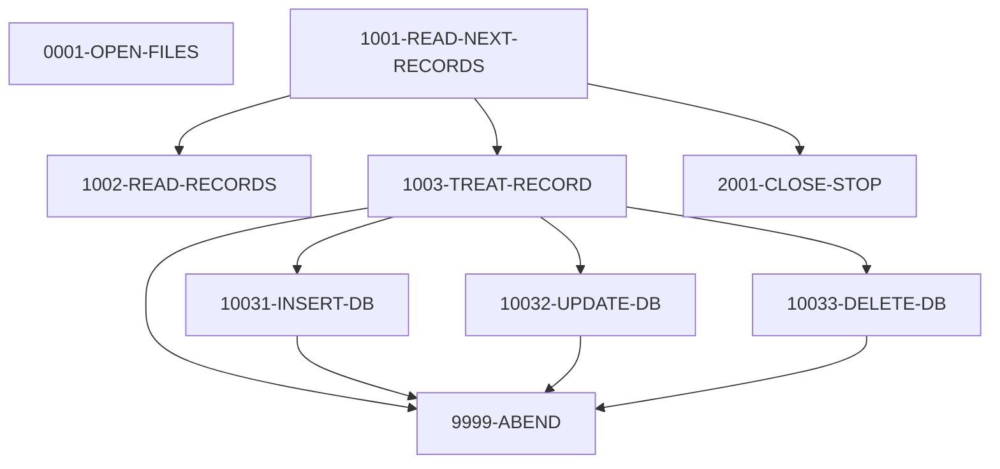

# Program COBTUPDT

| Item | Value |
|---|---|
| Source | `app/app-transaction-type-db2/cbl/COBTUPDT.cbl` |
| Lines | 237 total, 177 code, 32 comment, 28 blank |
| PROGRAM-ID | COBTUPDT |
| Author |  |
| Runtime | db2, batch-main |
| Module | trantype |
| CICS transactions | None in CSD |
| JCL steps | [MNTTRDB2](../06-batch/jobs/MNTTRDB2.md).STEP1 (`app/app-transaction-type-db2/jcl/MNTTRDB2.jcl:21`) |
| Paragraphs | 9 |
| Semantic analysis | validated (batch B08) |
| Version banner |  |

## Summary

COBTUPDT is a batch DB2 program that applies transaction type maintenance records from a sequential input file (DD INPFILE) to the CARDDEMO.TRANSACTION_TYPE table. Each 53-byte record carries an action code, a 2-character transaction type code and a 50-character description. Action 'A' inserts, 'U' updates the description, 'D' deletes, and '*' lines are skipped as comments. Any other action, a SQL error or a row-not-found on update/delete is displayed and sets RETURN-CODE 4, but processing continues with the next record. The input file is closed and the program ends with STOP RUN after end of file. (Confirmed)

Evidence: `app/app-transaction-type-db2/cbl/COBTUPDT.cbl:30-34`, `app/app-transaction-type-db2/cbl/COBTUPDT.cbl:82-130`, `app/app-transaction-type-db2/cbl/COBTUPDT.cbl:132-226`, `app/app-transaction-type-db2/cbl/COBTUPDT.cbl:230-233`

Header comment (Unverified, `app/app-transaction-type-db2/cbl/COBTUPDT.cbl:1`): See the comment block at the top of the source. Unverified until matched to code.

## Divisions and sections

| Division / section | Lines | Notes |
|---|---|---|
| IDENTIFICATION DIVISION | `app/app-transaction-type-db2/cbl/COBTUPDT.cbl:22-24` |  |
| ENVIRONMENT DIVISION | `app/app-transaction-type-db2/cbl/COBTUPDT.cbl:25-35` |  |
| DATA DIVISION | `app/app-transaction-type-db2/cbl/COBTUPDT.cbl:36-79` |  |
| PROCEDURE DIVISION | `app/app-transaction-type-db2/cbl/COBTUPDT.cbl:80-237` |  |
| ENVIRONMENT / CONFIGURATION SECTION | `app/app-transaction-type-db2/cbl/COBTUPDT.cbl:27-28` |  |
| ENVIRONMENT / INPUT-OUTPUT SECTION | `app/app-transaction-type-db2/cbl/COBTUPDT.cbl:29-35` |  |
| DATA / FILE SECTION | `app/app-transaction-type-db2/cbl/COBTUPDT.cbl:38-47` |  |
| DATA / WORKING-STORAGE SECTION | `app/app-transaction-type-db2/cbl/COBTUPDT.cbl:48-79` |  |

## Files and data stores

| File | ASSIGN | Org | Access | Record key | Alt key | Status field | OPEN modes | Physical dataset (JCL) | Evidence |
|---|---|---|---|---|---|---|---|---|---|
| TR-RECORD | INPFILE | SEQUENTIAL | SEQUENTIAL |  |  | WS-INF-STATUS | INPUT (line 83) | INPFILE (MNTTRDB2.STEP1 `app/app-transaction-type-db2/jcl/MNTTRDB2.jcl:27`) | `app/app-transaction-type-db2/cbl/COBTUPDT.cbl:31-34`, FD `app/app-transaction-type-db2/cbl/COBTUPDT.cbl:39` |

CRUD summary from the program facts:

| Store | Kind | Ops | Evidence |
|---|---|---|---|
| CARDDEMO.TRANSACTION_TYPE | logical | C, D, U | `app/app-transaction-type-db2/cbl/COBTUPDT.cbl:137` |

## Embedded CICS, SQL and DL/I commands

| Paragraph | Kind | Verb | Resources | Response | Lines |
|---|---|---|---|---|---|
| 10031-INSERT-DB | SQL | INSERT | CARDDEMO.TRANSACTION_TYPE |  | `app/app-transaction-type-db2/cbl/COBTUPDT.cbl:137-148` |
| 10032-UPDATE-DB | SQL | UPDATE | CARDDEMO.TRANSACTION_TYPE |  | `app/app-transaction-type-db2/cbl/COBTUPDT.cbl:171-175` |
| 10033-DELETE-DB | SQL | DELETE | CARDDEMO.TRANSACTION_TYPE |  | `app/app-transaction-type-db2/cbl/COBTUPDT.cbl:201-204` |

## Calls, transfers and callers

No CALL, XCTL, LINK or START.

## Copybooks

| Copybook | Statement | Resolution | Resolved path | REPLACING | Line |
|---|---|---|---|---|---|
| SQLCA | EXEC SQL INCLUDE | system |  |  | `app/app-transaction-type-db2/cbl/COBTUPDT.cbl:50-52` |
| [DCLTRTYP](../08-data/layouts/DCLTRTYP.md) | EXEC SQL INCLUDE | inventory | app/app-transaction-type-db2/dcl/DCLTRTYP.dcl |  | `app/app-transaction-type-db2/cbl/COBTUPDT.cbl:54` |

## Data division items

Every data entry coded in this source (copybook contents are on the copybook pages). Lengths are computed from PIC and USAGE.

| Section | Lvl | Name | PIC | Usage | Len | OCCURS | REDEFINES | VALUE | 88-levels | Line |
|---|---|---|---|---|---|---|---|---|---|---|
| FILE | 01 | WS-INPUT-VARS |  |  |  |  |  |  |  | 40 |
| FILE | 05 | INPUT-TYPE | X(1) |  | 1 |  |  | SPACES |  | 41 |
| FILE | 05 | INPUT-TR-NUMBER | X(2) |  | 2 |  |  | SPACES |  | 43 |
| FILE | 05 | INPUT-TR-DESC | X(50) |  | 50 |  |  | SPACES |  | 45 |
| WORKING-STORAGE | 01 | FLAGS |  |  |  |  |  |  |  | 57 |
| WORKING-STORAGE | 05 | LASTREC | X(1) |  | 1 |  |  | SPACES |  | 58 |
| WORKING-STORAGE | 01 | WORKING-VARIABLES |  |  |  |  |  |  |  | 60 |
| WORKING-STORAGE | 05 | WS-RETURN-MSG | X(80) |  | 80 |  |  | SPACES |  | 61 |
| WORKING-STORAGE | 01 | WS-MISC-VARS |  |  |  |  |  |  |  | 64 |
| WORKING-STORAGE | 05 | WS-VAR-SQLCODE | ----9 |  | 5 |  |  |  |  | 65 |
| WORKING-STORAGE | 01 | WS-INF-STATUS |  |  |  |  |  |  |  | 67 |
| WORKING-STORAGE | 05 | WS-INF-STAT1 | X |  | 1 |  |  |  |  | 68 |
| WORKING-STORAGE | 05 | WS-INF-STAT2 | X |  | 1 |  |  |  |  | 69 |
| WORKING-STORAGE | 01 | WS-INPUT-REC |  |  |  |  |  |  |  | 71 |
| WORKING-STORAGE | 05 | INPUT-REC-TYPE | X(1) |  | 1 |  |  | SPACES |  | 72 |
| WORKING-STORAGE | 05 | INPUT-REC-NUMBER | X(2) |  | 2 |  |  | SPACES |  | 74 |
| WORKING-STORAGE | 05 | INPUT-REC-DESC | X(50) |  | 50 |  |  | SPACES |  | 76 |

## Statement inventory

Every procedure statement the parser recorded, by kind. Each one is listed with its line under Paragraph details.

| Kind | Count |
|---|---|
| Decisions (IF, EVALUATE, WHEN, loops, handlers) | 21 |
| Calculations | 0 |
| File I/O | 3 |
| EXEC CICS / SQL / DLI | 3 |
| CALL | 0 |
| PERFORM | 14 |
| GO TO | 0 |
| MOVE literal | 2 |
| MOVE field | 3 |
| SET | 0 |
| STRING, UNSTRING, INSPECT, INITIALIZE, COPY, ENTRY and others | 6 |
| DISPLAY | 11 |
| GOBACK, STOP RUN, RETURN, XCTL | 1 |
| Not classified by the parser | 0 |

## Control flow

| Paragraph | Lines | Logic | Performs | Performed by | Reachable |
|---|---|---|---|---|---|
| [0001-OPEN-FILES](#para-0001-open-files) | 82-89 | Opens the sequential input file TR-RECORD (DD INPFILE) and displays 'OPEN FILE OK' when WS-INF-STATUS = '00', otherwise 'OPEN FILE NOT OK'. No stop on failure; control falls through to 1001-READ-NEXT-RECORDS. (Confirmed) |  |  | yes |
| [1001-READ-NEXT-RECORDS](#para-1001-read-next-records) | 91-99 | Primes the read with 1002-READ-RECORDS, then loops PERFORM 1003-TREAT-RECORD / 1002-READ-RECORDS until LASTREC = 'Y'. Then performs 2001-CLOSE-STOP and STOP RUN. (Confirmed) | 1002-READ-RECORDS, 1003-TREAT-RECORD, 2001-CLOSE-STOP |  | no static path |
| [1002-READ-RECORDS](#para-1002-read-records) | 100-107 | Reads the next TR-RECORD into WS-INPUT-REC (INPUT-REC-TYPE, INPUT-REC-NUMBER, INPUT-REC-DESC); at end sets LASTREC to 'Y'. When not at end, displays 'PROCESSING' and the record. (Confirmed) |  | 1001-READ-NEXT-RECORDS | no static path |
| [1003-TREAT-RECORD](#para-1003-treat-record) | 109-130 | Evaluates INPUT-REC-TYPE: 'A' performs 10031-INSERT-DB, 'U' performs 10032-UPDATE-DB, 'D' performs 10033-DELETE-DB, '*' displays 'IGNORING COMMENTED LINE'. Any other value builds 'ERROR: TYPE NOT VALID' into WS-RETURN-MSG and performs 9999-ABEND. (Confirmed) | 10031-INSERT-DB, 10032-UPDATE-DB, 10033-DELETE-DB, 9999-ABEND | 1001-READ-NEXT-RECORDS | no static path |
| [10031-INSERT-DB](#para-10031-insert-db) | 132-164 | INSERTs a row into CARDDEMO.TRANSACTION_TYPE with TR_TYPE = INPUT-REC-NUMBER and TR_DESCRIPTION = INPUT-REC-DESC. SQLCODE 0 displays 'RECORD INSERTED SUCCESSFULLY'; SQLCODE < 0 builds 'Error accessing: TRANSACTION_TYPE table. SQLCODE:' plus the code and performs 9999-ABEND. (Confirmed) | 9999-ABEND | 1003-TREAT-RECORD | no static path |
| [10032-UPDATE-DB](#para-10032-update-db) | 166-195 | UPDATEs CARDDEMO.TRANSACTION_TYPE setting TR_DESCRIPTION = INPUT-REC-DESC where TR_TYPE = INPUT-REC-NUMBER. SQLCODE 0 displays 'RECORD UPDATED SUCCESSFULLY'; +100 sets 'No records found.' and performs 9999-ABEND; < 0 sets the table error message and performs 9999-ABEND. (Confirmed) | 9999-ABEND | 1003-TREAT-RECORD | no static path |
| [10033-DELETE-DB](#para-10033-delete-db) | 196-226 | DELETEs from CARDDEMO.TRANSACTION_TYPE where TR_TYPE = INPUT-REC-NUMBER. SQLCODE 0 displays 'RECORD DELETED SUCCESSFULLY'; +100 sets 'No records found.' and performs 9999-ABEND; < 0 sets the table error message and performs 9999-ABEND. (Confirmed) | 9999-ABEND | 1003-TREAT-RECORD | no static path |
| [9999-ABEND](#para-9999-abend) | 230-233 | Displays WS-RETURN-MSG and moves 4 to RETURN-CODE. Despite its name it does not terminate the program; control returns to the performing paragraph. (Confirmed) |  | 1003-TREAT-RECORD, 10031-INSERT-DB, 10032-UPDATE-DB, 10033-DELETE-DB | no static path |
| [2001-CLOSE-STOP](#para-2001-close-stop) | 234-236 | Closes the input file TR-RECORD. (Confirmed) |  | 1001-READ-NEXT-RECORDS | no static path |

## Paragraph details

### Para 0001-OPEN-FILES

Lines `app/app-transaction-type-db2/cbl/COBTUPDT.cbl:82-89`. 

Logic: Opens the sequential input file TR-RECORD (DD INPFILE) and displays 'OPEN FILE OK' when WS-INF-STATUS = '00', otherwise 'OPEN FILE NOT OK'. No stop on failure; control falls through to 1001-READ-NEXT-RECORDS. (Confirmed)

Statements in source order:

- File I/O `OPEN INPUT TR-RECORD` at `app/app-transaction-type-db2/cbl/COBTUPDT.cbl:83`
- IF `WS-INF-STATUS = '00'` at `app/app-transaction-type-db2/cbl/COBTUPDT.cbl:84` (io-status)
- `DISPLAY 'OPEN FILE OK'` at `app/app-transaction-type-db2/cbl/COBTUPDT.cbl:85`
- `DISPLAY 'OPEN FILE NOT OK'` at `app/app-transaction-type-db2/cbl/COBTUPDT.cbl:87`

### Para 1001-READ-NEXT-RECORDS

Lines `app/app-transaction-type-db2/cbl/COBTUPDT.cbl:91-99`. 

Logic: Primes the read with 1002-READ-RECORDS, then loops PERFORM 1003-TREAT-RECORD / 1002-READ-RECORDS until LASTREC = 'Y'. Then performs 2001-CLOSE-STOP and STOP RUN. (Confirmed)

Statements in source order:

- PERFORM 1002-READ-RECORDS at `app/app-transaction-type-db2/cbl/COBTUPDT.cbl:92`
- LOOP `UNTIL LASTREC = 'Y'` at `app/app-transaction-type-db2/cbl/COBTUPDT.cbl:93` (business-candidate)
- Inline PERFORM `UNTIL LASTREC = 'Y'` at `app/app-transaction-type-db2/cbl/COBTUPDT.cbl:93`
- PERFORM 1003-TREAT-RECORD at `app/app-transaction-type-db2/cbl/COBTUPDT.cbl:94`
- PERFORM 1002-READ-RECORDS at `app/app-transaction-type-db2/cbl/COBTUPDT.cbl:95`
- PERFORM 2001-CLOSE-STOP at `app/app-transaction-type-db2/cbl/COBTUPDT.cbl:97`
- Ends with STOP RUN at `app/app-transaction-type-db2/cbl/COBTUPDT.cbl:99`

### Para 1002-READ-RECORDS

Lines `app/app-transaction-type-db2/cbl/COBTUPDT.cbl:100-107`. 

Logic: Reads the next TR-RECORD into WS-INPUT-REC (INPUT-REC-TYPE, INPUT-REC-NUMBER, INPUT-REC-DESC); at end sets LASTREC to 'Y'. When not at end, displays 'PROCESSING' and the record. (Confirmed)

Statements in source order:

- File I/O `READ TR-RECORD NEXT RECORD INTO WS-INPUT-REC` at `app/app-transaction-type-db2/cbl/COBTUPDT.cbl:101`
- HANDLER `AT END` at `app/app-transaction-type-db2/cbl/COBTUPDT.cbl:102` (io-status)
- MOVE `'Y'` TO LASTREC at `app/app-transaction-type-db2/cbl/COBTUPDT.cbl:102`
- IF `LASTREC NOT EQUAL TO 'Y'` at `app/app-transaction-type-db2/cbl/COBTUPDT.cbl:104` (business-candidate)
- `DISPLAY 'PROCESSING ' WS-INPUT-REC` at `app/app-transaction-type-db2/cbl/COBTUPDT.cbl:105`

### Para 1003-TREAT-RECORD

Lines `app/app-transaction-type-db2/cbl/COBTUPDT.cbl:109-130`. 

Logic: Evaluates INPUT-REC-TYPE: 'A' performs 10031-INSERT-DB, 'U' performs 10032-UPDATE-DB, 'D' performs 10033-DELETE-DB, '*' displays 'IGNORING COMMENTED LINE'. Any other value builds 'ERROR: TYPE NOT VALID' into WS-RETURN-MSG and performs 9999-ABEND. (Confirmed)

Rules: [BR-TRANTYPE-COBTUPDT-001](../09-business-rules-catalog.md#br-trantype-cobtupdt-001)

Statements in source order:

- EVALUATE `INPUT-REC-TYPE` at `app/app-transaction-type-db2/cbl/COBTUPDT.cbl:110` (business-candidate)
- WHEN `'A'` at `app/app-transaction-type-db2/cbl/COBTUPDT.cbl:111` (business-candidate)
- `DISPLAY 'ADDING RECORD'` at `app/app-transaction-type-db2/cbl/COBTUPDT.cbl:112`
- PERFORM 10031-INSERT-DB at `app/app-transaction-type-db2/cbl/COBTUPDT.cbl:113`
- WHEN `'U'` at `app/app-transaction-type-db2/cbl/COBTUPDT.cbl:114` (business-candidate)
- `DISPLAY 'UPDATING RECORD'` at `app/app-transaction-type-db2/cbl/COBTUPDT.cbl:115`
- PERFORM 10032-UPDATE-DB at `app/app-transaction-type-db2/cbl/COBTUPDT.cbl:116`
- WHEN `'D'` at `app/app-transaction-type-db2/cbl/COBTUPDT.cbl:117` (business-candidate)
- `DISPLAY 'DELETING RECORD'` at `app/app-transaction-type-db2/cbl/COBTUPDT.cbl:118`
- PERFORM 10033-DELETE-DB at `app/app-transaction-type-db2/cbl/COBTUPDT.cbl:119`
- WHEN `'*'` at `app/app-transaction-type-db2/cbl/COBTUPDT.cbl:120` (business-candidate)
- `DISPLAY 'IGNORING COMMENTED LINE'` at `app/app-transaction-type-db2/cbl/COBTUPDT.cbl:121`
- WHEN `OTHER` at `app/app-transaction-type-db2/cbl/COBTUPDT.cbl:122` (business-candidate)
- `STRING 'ERROR: TYPE NOT VALID' DELIMITED BY SIZE INTO WS-RETURN-MSG` at `app/app-transaction-type-db2/cbl/COBTUPDT.cbl:123-126`
- PERFORM 9999-ABEND at `app/app-transaction-type-db2/cbl/COBTUPDT.cbl:128`

### Para 10031-INSERT-DB

Lines `app/app-transaction-type-db2/cbl/COBTUPDT.cbl:132-164`. 

Logic: INSERTs a row into CARDDEMO.TRANSACTION_TYPE with TR_TYPE = INPUT-REC-NUMBER and TR_DESCRIPTION = INPUT-REC-DESC. SQLCODE 0 displays 'RECORD INSERTED SUCCESSFULLY'; SQLCODE < 0 builds 'Error accessing: TRANSACTION_TYPE table. SQLCODE:' plus the code and performs 9999-ABEND. (Confirmed)

Rules: [BR-COBTUPDT-002](../09-business-rules-catalog.md#br-cobtupdt-002)

Statements in source order:

- EXEC SQL INSERT at `app/app-transaction-type-db2/cbl/COBTUPDT.cbl:137-148`
- `MOVE SQLCODE TO WS-VAR-SQLCODE` at `app/app-transaction-type-db2/cbl/COBTUPDT.cbl:149`
- EVALUATE `TRUE` at `app/app-transaction-type-db2/cbl/COBTUPDT.cbl:151` (business-candidate)
- WHEN `SQLCODE = ZERO` at `app/app-transaction-type-db2/cbl/COBTUPDT.cbl:152` (io-status)
- `DISPLAY 'RECORD INSERTED SUCCESSFULLY'` at `app/app-transaction-type-db2/cbl/COBTUPDT.cbl:153`
- WHEN `SQLCODE < 0` at `app/app-transaction-type-db2/cbl/COBTUPDT.cbl:154` (io-status)
- `STRING 'Error accessing:' ' TRANSACTION_TYPE table. SQLCODE:' WS-VAR-SQLCODE DELIMITED BY SIZE INTO WS-RETURN-MSG` at `app/app-transaction-type-db2/cbl/COBTUPDT.cbl:155-160`
- PERFORM 9999-ABEND at `app/app-transaction-type-db2/cbl/COBTUPDT.cbl:162`

### Para 10032-UPDATE-DB

Lines `app/app-transaction-type-db2/cbl/COBTUPDT.cbl:166-195`. 

Logic: UPDATEs CARDDEMO.TRANSACTION_TYPE setting TR_DESCRIPTION = INPUT-REC-DESC where TR_TYPE = INPUT-REC-NUMBER. SQLCODE 0 displays 'RECORD UPDATED SUCCESSFULLY'; +100 sets 'No records found.' and performs 9999-ABEND; < 0 sets the table error message and performs 9999-ABEND. (Confirmed)

Rules: [BR-COBTUPDT-003](../09-business-rules-catalog.md#br-cobtupdt-003)

Statements in source order:

- EXEC SQL UPDATE at `app/app-transaction-type-db2/cbl/COBTUPDT.cbl:171-175`
- `MOVE SQLCODE TO WS-VAR-SQLCODE` at `app/app-transaction-type-db2/cbl/COBTUPDT.cbl:176`
- EVALUATE `TRUE` at `app/app-transaction-type-db2/cbl/COBTUPDT.cbl:177` (business-candidate)
- WHEN `SQLCODE = ZERO` at `app/app-transaction-type-db2/cbl/COBTUPDT.cbl:178` (io-status)
- `DISPLAY 'RECORD UPDATED SUCCESSFULLY'` at `app/app-transaction-type-db2/cbl/COBTUPDT.cbl:179`
- WHEN `SQLCODE = +100` at `app/app-transaction-type-db2/cbl/COBTUPDT.cbl:180` (io-status)
- `STRING 'No records found.' DELIMITED BY SIZE INTO WS-RETURN-MSG` at `app/app-transaction-type-db2/cbl/COBTUPDT.cbl:181-182`
- PERFORM 9999-ABEND at `app/app-transaction-type-db2/cbl/COBTUPDT.cbl:184`
- WHEN `SQLCODE < 0` at `app/app-transaction-type-db2/cbl/COBTUPDT.cbl:185` (io-status)
- `STRING 'Error accessing:' ' TRANSACTION_TYPE table. SQLCODE:' WS-VAR-SQLCODE DELIMITED BY SIZE INTO WS-RETURN-MSG` at `app/app-transaction-type-db2/cbl/COBTUPDT.cbl:186-191`
- PERFORM 9999-ABEND at `app/app-transaction-type-db2/cbl/COBTUPDT.cbl:193`

### Para 10033-DELETE-DB

Lines `app/app-transaction-type-db2/cbl/COBTUPDT.cbl:196-226`. 

Logic: DELETEs from CARDDEMO.TRANSACTION_TYPE where TR_TYPE = INPUT-REC-NUMBER. SQLCODE 0 displays 'RECORD DELETED SUCCESSFULLY'; +100 sets 'No records found.' and performs 9999-ABEND; < 0 sets the table error message and performs 9999-ABEND. (Confirmed)

Rules: [BR-COBTUPDT-004](../09-business-rules-catalog.md#br-cobtupdt-004)

Statements in source order:

- EXEC SQL DELETE at `app/app-transaction-type-db2/cbl/COBTUPDT.cbl:201-204`
- `MOVE SQLCODE TO WS-VAR-SQLCODE` at `app/app-transaction-type-db2/cbl/COBTUPDT.cbl:205`
- EVALUATE `TRUE` at `app/app-transaction-type-db2/cbl/COBTUPDT.cbl:207` (business-candidate)
- WHEN `SQLCODE = ZERO` at `app/app-transaction-type-db2/cbl/COBTUPDT.cbl:208` (io-status)
- `DISPLAY 'RECORD DELETED SUCCESSFULLY'` at `app/app-transaction-type-db2/cbl/COBTUPDT.cbl:209`
- WHEN `SQLCODE = +100` at `app/app-transaction-type-db2/cbl/COBTUPDT.cbl:210` (io-status)
- `STRING 'No records found.' DELIMITED BY SIZE INTO WS-RETURN-MSG` at `app/app-transaction-type-db2/cbl/COBTUPDT.cbl:211-212`
- PERFORM 9999-ABEND at `app/app-transaction-type-db2/cbl/COBTUPDT.cbl:214`
- WHEN `SQLCODE < 0` at `app/app-transaction-type-db2/cbl/COBTUPDT.cbl:216` (io-status)
- `STRING 'Error accessing:' ' TRANSACTION_TYPE table. SQLCODE:' WS-VAR-SQLCODE DELIMITED BY SIZE INTO WS-RETURN-MSG` at `app/app-transaction-type-db2/cbl/COBTUPDT.cbl:217-222`
- PERFORM 9999-ABEND at `app/app-transaction-type-db2/cbl/COBTUPDT.cbl:224`

### Para 9999-ABEND

Lines `app/app-transaction-type-db2/cbl/COBTUPDT.cbl:230-233`. 

Logic: Displays WS-RETURN-MSG and moves 4 to RETURN-CODE. Despite its name it does not terminate the program; control returns to the performing paragraph. (Confirmed)

Rules: [BR-COBTUPDT-001](../09-business-rules-catalog.md#br-cobtupdt-001)

Statements in source order:

- `DISPLAY WS-RETURN-MSG` at `app/app-transaction-type-db2/cbl/COBTUPDT.cbl:231`
- MOVE `4` TO RETURN-CODE at `app/app-transaction-type-db2/cbl/COBTUPDT.cbl:232`

### Para 2001-CLOSE-STOP

Lines `app/app-transaction-type-db2/cbl/COBTUPDT.cbl:234-236`. 

Logic: Closes the input file TR-RECORD. (Confirmed)

Statements in source order:

- File I/O `CLOSE TR-RECORD` at `app/app-transaction-type-db2/cbl/COBTUPDT.cbl:235`

## Business rules

| Rule | Category | Statement | Paragraph | Source | Confidence |
|---|---|---|---|---|---|
| [BR-TRANTYPE-COBTUPDT-001](../09-business-rules-catalog.md#br-trantype-cobtupdt-001) | decision | A transaction-type maintenance record inserts when the type is A, updates when the type is U, deletes when the type is D, and is ignored when the type is asterisk. Any other type abends with message ERROR: TYPE NOT VALID. | 1003-TREAT-RECORD | `app/app-transaction-type-db2/cbl/COBTUPDT.cbl:111-128` | Confirmed / review: corrected |
| [BR-COBTUPDT-001](../09-business-rules-catalog.md#br-cobtupdt-001) | error-policy | Any record-level failure (invalid record type, SQL error, or row not found) is reported by displaying the message and setting the job return code to 4, but processing continues with the next input record; successful records before and after are still applied. | 9999-ABEND | `app/app-transaction-type-db2/cbl/COBTUPDT.cbl:230-233`, `app/app-transaction-type-db2/cbl/COBTUPDT.cbl:93-96` | Confirmed |
| [BR-COBTUPDT-002](../09-business-rules-catalog.md#br-cobtupdt-002) | error-policy | Adding a transaction type succeeds only when the INSERT returns SQLCODE 0; any negative SQLCODE (for example a duplicate TR_TYPE) is reported as a TRANSACTION_TYPE table access error with the SQLCODE and sets RC 4. | 10031-INSERT-DB | `app/app-transaction-type-db2/cbl/COBTUPDT.cbl:151-163`, `app/app-transaction-type-db2/cbl/COBTUPDT.cbl:136-148` | Confirmed |
| [BR-COBTUPDT-003](../09-business-rules-catalog.md#br-cobtupdt-003) | validation | An update record for a transaction type code that does not exist in TRANSACTION_TYPE (SQLCODE +100) is rejected with 'No records found.' and RC 4; negative SQLCODEs are reported as table access errors. Only TR_DESCRIPTION is changed; TR_TYPE is the key. | 10032-UPDATE-DB | `app/app-transaction-type-db2/cbl/COBTUPDT.cbl:177-193`, `app/app-transaction-type-db2/cbl/COBTUPDT.cbl:171-175` | Confirmed |
| [BR-COBTUPDT-004](../09-business-rules-catalog.md#br-cobtupdt-004) | validation | A delete record for a transaction type code that does not exist (SQLCODE +100) is rejected with 'No records found.' and RC 4; negative SQLCODEs (for example a referential constraint from TRANSACTION_TYPE_CATEGORY) are reported as table access errors with RC 4. | 10033-DELETE-DB | `app/app-transaction-type-db2/cbl/COBTUPDT.cbl:207-225`, `app/app-transaction-type-db2/cbl/COBTUPDT.cbl:201-204` | Confirmed |

Decision points reviewed and classified as not business rules:

| Lines | Reason |
|---|---|
| `app/app-transaction-type-db2/cbl/COBTUPDT.cbl:93-96` | Technical read loop: processes records until the AT END flag LASTREC = 'Y'; no business selection. |
| `app/app-transaction-type-db2/cbl/COBTUPDT.cbl:104-106` | Diagnostic DISPLAY of the record being processed when not at end of file; logging only. |

Decision coverage: 11 of 11 business-candidate decision points are linked to a rule or a no-rule reason (10 inside rule ranges).

## Error handling

| Paragraph | Kind | Detail | Lines |
|---|---|---|---|
| 0001-OPEN-FILES | check | `WS-INF-STATUS = '00'` | `app/app-transaction-type-db2/cbl/COBTUPDT.cbl:84` |
| 1002-READ-RECORDS | check | `AT END` | `app/app-transaction-type-db2/cbl/COBTUPDT.cbl:102` |
| 10031-INSERT-DB | check | `SQLCODE = ZERO` | `app/app-transaction-type-db2/cbl/COBTUPDT.cbl:152` |
| 10031-INSERT-DB | check | `SQLCODE < 0` | `app/app-transaction-type-db2/cbl/COBTUPDT.cbl:154` |
| 10032-UPDATE-DB | check | `SQLCODE = ZERO` | `app/app-transaction-type-db2/cbl/COBTUPDT.cbl:178` |
| 10032-UPDATE-DB | check | `SQLCODE = +100` | `app/app-transaction-type-db2/cbl/COBTUPDT.cbl:180` |
| 10032-UPDATE-DB | check | `SQLCODE < 0` | `app/app-transaction-type-db2/cbl/COBTUPDT.cbl:185` |
| 10033-DELETE-DB | check | `SQLCODE = ZERO` | `app/app-transaction-type-db2/cbl/COBTUPDT.cbl:208` |
| 10033-DELETE-DB | check | `SQLCODE = +100` | `app/app-transaction-type-db2/cbl/COBTUPDT.cbl:210` |
| 10033-DELETE-DB | check | `SQLCODE < 0` | `app/app-transaction-type-db2/cbl/COBTUPDT.cbl:216` |
| 9999-ABEND | return code | MOVE 4 TO RETURN-CODE | `app/app-transaction-type-db2/cbl/COBTUPDT.cbl:232` |

## Observations and SME questions

- anomaly: 9999-ABEND does not abend or stop: it displays the message and sets RETURN-CODE to 4, then control returns to the caller and processing continues with the next input record. A later successful record does not reset RETURN-CODE, so the job ends RC=4 if any record failed, but all other records are still applied. (`app/app-transaction-type-db2/cbl/COBTUPDT.cbl:230-233`)
- anomaly: Paragraphs are not PERFORMed from a mainline: execution falls through from 0001-OPEN-FILES into 1001-READ-NEXT-RECORDS, which ends with STOP RUN. EXIT statements appear mid-paragraph (e.g. line 98 before STOP RUN at 99) and act as no-ops. (`app/app-transaction-type-db2/cbl/COBTUPDT.cbl:82-99`)
- unchecked-io: An OPEN failure (WS-INF-STATUS not '00') only displays 'OPEN FILE NOT OK'; the program then proceeds to READ the unopened file. READ status is not checked other than AT END. (`app/app-transaction-type-db2/cbl/COBTUPDT.cbl:83-88`)
- anomaly: No explicit COMMIT or ROLLBACK is issued; DB2 changes rely on implicit commit at normal program termination. Failed rows (RC=4) do not roll back earlier successful rows. (`app/app-transaction-type-db2/cbl/COBTUPDT.cbl:136-148`)
- anomaly: The INSERT EVALUATE has no branch for positive SQLCODEs (warnings); the UPDATE/DELETE EVALUATEs have no branch for positive SQLCODEs other than +100. Such warnings fall through silently. (`app/app-transaction-type-db2/cbl/COBTUPDT.cbl:151-163`)
- dead-code: The FD record WS-INPUT-VARS (INPUT-TYPE, INPUT-TR-NUMBER, INPUT-TR-DESC) is never referenced; the READ uses INTO WS-INPUT-REC. The DCLTRTYP host structure is included but not used; host variables are INPUT-REC-NUMBER and INPUT-REC-DESC. (`app/app-transaction-type-db2/cbl/COBTUPDT.cbl:40-46`)
- anomaly: INPUT-REC-DESC (PIC X(50)) is bound directly to the VARCHAR(50) column TR_DESCRIPTION, so trailing spaces are stored as part of the description rather than via the DCL-TR-DESCRIPTION-LEN/TEXT host structure. (`app/app-transaction-type-db2/cbl/COBTUPDT.cbl:136-148`)
- SME question: Is it intended that a failing maintenance record (RC 4) does not stop the run or roll back previously applied records? Should the job abend/rollback instead? (`app/app-transaction-type-db2/cbl/COBTUPDT.cbl:230-233`)
- SME question: Should INPUT-REC-DESC be stored with trailing spaces in the VARCHAR TR_DESCRIPTION column, or should the DCL-TR-DESCRIPTION-LEN/TEXT host structure be used to trim it? (`app/app-transaction-type-db2/cbl/COBTUPDT.cbl:136-148`)

## Sources

- `app/app-transaction-type-db2/cbl/COBTUPDT.cbl`
- `docs/_work/structure/programs/COBTUPDT.json`
- `docs/_work/semantic/programs/COBTUPDT.json`
- `docs/_work/programs/COBTUPDT.json`

## Confidence

Structure tables (divisions, items, paragraphs, statements, line numbers) are Confirmed: they are parsed from the source. Paragraph logic and rule statements carry their own Confirmed/Inferred tag from the batch analysis, and every rule anchor was checked against the cited lines. Decision-point classes are a keyword heuristic used only for coverage measurement. Header comments are Unverified.
