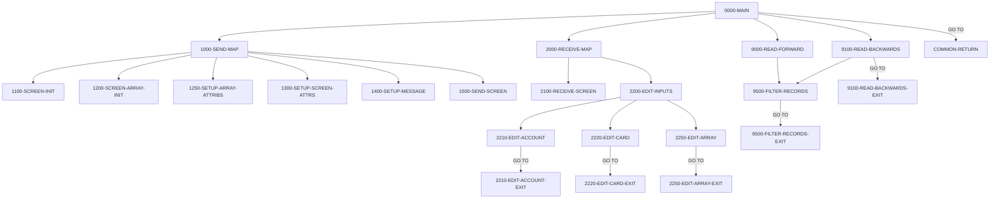

# Program COCRDLIC

| Item | Value |
|---|---|
| Source | `app/cbl/COCRDLIC.cbl` |
| Lines | 1459 total, 1093 code, 203 comment, 163 blank |
| PROGRAM-ID |  |
| Author |  |
| Runtime | cics-online |
| Module | base |
| CICS transactions | CCLI (`app/csd/CARDDEMO.CSD:357-366`) |
| JCL steps | None |
| Paragraphs | 39 |
| Semantic analysis | validated (batch B05) |
| Version banner | * Ver: CardDemo_v1.0-15-g27d6c6f-68 Date: 2022-07-19 23:12:33 CDT |

## Summary

COCRDLIC is the CICS pseudo-conversational Credit Card List program (transaction CCLI, map CCRDLIA of mapset COCRDLI). It browses the card master CARDDAT by card number and shows up to 7 cards per page (account number, card number, active status), optionally filtered by an 11-digit account number and/or a 16-digit card number typed on the screen. PF8 pages forward and PF7 backward using first/last card keys kept in a program-specific commarea extension; ENTER with 'S' or 'U' against exactly one row transfers (XCTL) to card detail COCRDSLC or card update COCRDUPC with the selected account and card in the commarea. Input errors (invalid filters, more than one selection, invalid action code) are shown in red on the same screen. PF3 transfers to the main menu COMEN01C. Each turn ends with CICS RETURN TRANSID(CCLI) and a 2000-byte commarea. (Confirmed)

Evidence: `app/cbl/COCRDLIC.cbl:1-7`, `app/cbl/COCRDLIC.cbl:176-260`, `app/cbl/COCRDLIC.cbl:298-620`, `app/cbl/COCRDLIC.cbl:985-1117`, `app/cbl/COCRDLIC.cbl:1123-1407`

Header comment (Unverified, `app/cbl/COCRDLIC.cbl:1-8`): Program:     COCRDLIC.CBL Layer:       Business logic Function:    List Credit Cards a) All cards if no context passed and admin user b) Only the ones associated with ACCT in COMMAREA if user is not admin

## Divisions and sections

| Division / section | Lines | Notes |
|---|---|---|
| IDENTIFICATION DIVISION | `app/cbl/COCRDLIC.cbl:25-32` |  |
| ENVIRONMENT DIVISION | `app/cbl/COCRDLIC.cbl:33-35` |  |
| DATA DIVISION | `app/cbl/COCRDLIC.cbl:36-296` |  |
| PROCEDURE DIVISION | `app/cbl/COCRDLIC.cbl:297-1459` |  |
| ENVIRONMENT / INPUT-OUTPUT SECTION | `app/cbl/COCRDLIC.cbl:34-35` |  |
| DATA / WORKING-STORAGE SECTION | `app/cbl/COCRDLIC.cbl:38-291` |  |
| DATA / LINKAGE SECTION | `app/cbl/COCRDLIC.cbl:292-296` |  |

## Files and data stores

No SELECT entries (no COBOL file I/O).

CICS file commands (file name resolved from VALUE clauses and the CSD):

| Command | FILE option | Resolved name | CSD DSNAME | CSD evidence | Line |
|---|---|---|---|---|---|
| STARTBR | LIT-CARD-FILE | CARDDAT | AWS.M2.CARDDEMO.CARDDATA.VSAM.KSDS | `app/csd/CARDDEMO.CSD:25-36` | `app/cbl/COCRDLIC.cbl:1129-1136` |
| READNEXT | LIT-CARD-FILE | CARDDAT | AWS.M2.CARDDEMO.CARDDATA.VSAM.KSDS | `app/csd/CARDDEMO.CSD:25-36` | `app/cbl/COCRDLIC.cbl:1146-1154` |
| READNEXT | LIT-CARD-FILE | CARDDAT | AWS.M2.CARDDEMO.CARDDATA.VSAM.KSDS | `app/csd/CARDDEMO.CSD:25-36` | `app/cbl/COCRDLIC.cbl:1197-1205` |
| ENDBR | LIT-CARD-FILE | CARDDAT | AWS.M2.CARDDEMO.CARDDATA.VSAM.KSDS | `app/csd/CARDDEMO.CSD:25-36` | `app/cbl/COCRDLIC.cbl:1258-1259` |
| STARTBR | LIT-CARD-FILE | CARDDAT | AWS.M2.CARDDEMO.CARDDATA.VSAM.KSDS | `app/csd/CARDDEMO.CSD:25-36` | `app/cbl/COCRDLIC.cbl:1273-1280` |
| READPREV | LIT-CARD-FILE | CARDDAT | AWS.M2.CARDDEMO.CARDDATA.VSAM.KSDS | `app/csd/CARDDEMO.CSD:25-36` | `app/cbl/COCRDLIC.cbl:1294-1302` |
| READPREV | LIT-CARD-FILE | CARDDAT | AWS.M2.CARDDEMO.CARDDATA.VSAM.KSDS | `app/csd/CARDDEMO.CSD:25-36` | `app/cbl/COCRDLIC.cbl:1322-1330` |
| ENDBR | LIT-CARD-FILE | CARDDAT | AWS.M2.CARDDEMO.CARDDATA.VSAM.KSDS | `app/csd/CARDDEMO.CSD:25-36` | `app/cbl/COCRDLIC.cbl:1375-1377` |

## Embedded CICS, SQL and DL/I commands

| Paragraph | Kind | Verb | Resources | Response | Lines |
|---|---|---|---|---|---|
| 0000-MAIN | CICS | XCTL | PROGRAM(LIT-MENUPGM) |  | `app/cbl/COCRDLIC.cbl:402-405` |
| 0000-MAIN | CICS | XCTL | PROGRAM(CCARD-NEXT-PROG) |  | `app/cbl/COCRDLIC.cbl:538-541` |
| 0000-MAIN | CICS | XCTL | PROGRAM(CCARD-NEXT-PROG) |  | `app/cbl/COCRDLIC.cbl:566-569` |
| COMMON-RETURN | CICS | RETURN | TRANSID(LIT-THISTRANID) |  | `app/cbl/COCRDLIC.cbl:615-619` |
| 1500-SEND-SCREEN | CICS | SEND MAP | MAP(LIT-THISMAP), MAPSET(LIT-THISMAPSET) | RESP | `app/cbl/COCRDLIC.cbl:939-946` |
| 2100-RECEIVE-SCREEN | CICS | RECEIVE MAP | MAP(LIT-THISMAP), MAPSET(LIT-THISMAPSET) | RESP | `app/cbl/COCRDLIC.cbl:963-967` |
| 9000-READ-FORWARD | CICS | STARTBR | DATASET(LIT-CARD-FILE) | RESP | `app/cbl/COCRDLIC.cbl:1129-1136` |
| 9000-READ-FORWARD | CICS | READNEXT | DATASET(LIT-CARD-FILE) | RESP | `app/cbl/COCRDLIC.cbl:1146-1154` |
| 9000-READ-FORWARD | CICS | READNEXT | DATASET(LIT-CARD-FILE) | RESP | `app/cbl/COCRDLIC.cbl:1197-1205` |
| 9000-READ-FORWARD | CICS | ENDBR | FILE(LIT-CARD-FILE) |  | `app/cbl/COCRDLIC.cbl:1258-1259` |
| 9100-READ-BACKWARDS | CICS | STARTBR | DATASET(LIT-CARD-FILE) | RESP | `app/cbl/COCRDLIC.cbl:1273-1280` |
| 9100-READ-BACKWARDS | CICS | READPREV | DATASET(LIT-CARD-FILE) | RESP | `app/cbl/COCRDLIC.cbl:1294-1302` |
| 9100-READ-BACKWARDS | CICS | READPREV | DATASET(LIT-CARD-FILE) | RESP | `app/cbl/COCRDLIC.cbl:1322-1330` |
| 9100-READ-BACKWARDS-EXIT | CICS | ENDBR | FILE(LIT-CARD-FILE) |  | `app/cbl/COCRDLIC.cbl:1375-1377` |
| SEND-PLAIN-TEXT | CICS | SEND TEXT |  |  | `app/cbl/COCRDLIC.cbl:1423-1428` |
| SEND-PLAIN-TEXT | CICS | RETURN |  |  | `app/cbl/COCRDLIC.cbl:1430-1431` |
| SEND-LONG-TEXT | CICS | SEND TEXT |  |  | `app/cbl/COCRDLIC.cbl:1442-1447` |
| SEND-LONG-TEXT | CICS | RETURN |  |  | `app/cbl/COCRDLIC.cbl:1449-1450` |

## Calls, transfers and callers

| Mechanism | Target | Parameters | Paragraph | Lines |
|---|---|---|---|---|
| EXEC CICS XCTL | LIT-MENUPGM = COMEN01C | CARDDEMO-COMMAREA | 0000-MAIN | `app/cbl/COCRDLIC.cbl:402-405` |
| EXEC CICS XCTL | CCARD-NEXT-PROG = COCRDSLC | CARDDEMO-COMMAREA | 0000-MAIN | `app/cbl/COCRDLIC.cbl:538-541` |
| EXEC CICS XCTL | CCARD-NEXT-PROG = COCRDUPC | CARDDEMO-COMMAREA | 0000-MAIN | `app/cbl/COCRDLIC.cbl:566-569` |
| EXEC CICS RETURN | LIT-THISTRANID = CCLI | WS-COMMAREA | COMMON-RETURN | `app/cbl/COCRDLIC.cbl:615-619` |

Programs that transfer to or call this program (from `docs/_work/xref/call-graph.json`):

| Caller | Mechanism | Confidence | Evidence |
|---|---|---|---|
| COCRDSLC | XCTL | Inferred | `app/cbl/COCRDSLC.cbl:331` |
| COCRDUPC | XCTL | Inferred | `app/cbl/COCRDUPC.cbl:473` |
| COMEN01C | XCTL | Confirmed | `app/cbl/COMEN01C.cbl:185` |

## Copybooks

| Copybook | Statement | Resolution | Resolved path | REPLACING | Line |
|---|---|---|---|---|---|
| [CVCRD01Y](../08-data/layouts/CVCRD01Y.md) | COPY | inventory | app/cpy/CVCRD01Y.cpy |  | `app/cbl/COCRDLIC.cbl:221` |
| [COCOM01Y](../08-data/layouts/COCOM01Y.md) | COPY | inventory | app/cpy/COCOM01Y.cpy |  | `app/cbl/COCRDLIC.cbl:227` |
| DFHBMSCA | COPY | system |  |  | `app/cbl/COCRDLIC.cbl:267` |
| DFHAID | COPY | system |  |  | `app/cbl/COCRDLIC.cbl:268` |
| [COTTL01Y](../08-data/layouts/COTTL01Y.md) | COPY | inventory | app/cpy/COTTL01Y.cpy |  | `app/cbl/COCRDLIC.cbl:272` |
| COCRDLI | COPY | inventory | app/cpy-bms/COCRDLI.CPY |  | `app/cbl/COCRDLIC.cbl:276` |
| [CSDAT01Y](../08-data/layouts/CSDAT01Y.md) | COPY | inventory | app/cpy/CSDAT01Y.cpy |  | `app/cbl/COCRDLIC.cbl:279` |
| [CSMSG01Y](../08-data/layouts/CSMSG01Y.md) | COPY | inventory | app/cpy/CSMSG01Y.cpy |  | `app/cbl/COCRDLIC.cbl:281` |
| [CSUSR01Y](../08-data/layouts/CSUSR01Y.md) | COPY | inventory | app/cpy/CSUSR01Y.cpy |  | `app/cbl/COCRDLIC.cbl:285` |
| [CVACT02Y](../08-data/layouts/CVACT02Y.md) | COPY | inventory | app/cpy/CVACT02Y.cpy |  | `app/cbl/COCRDLIC.cbl:290` |
| [CSSTRPFY](../08-data/layouts/CSSTRPFY.md) | COPY | inventory | app/cpy/CSSTRPFY.cpy |  | `app/cbl/COCRDLIC.cbl:1416` |
| COCRDSL | COPY | inventory (commented out) | app/cpy-bms/COCRDSL.CPY |  | `app/cbl/COCRDLIC.cbl:274` |
| [CSMSG02Y](../08-data/layouts/CSMSG02Y.md) | COPY | inventory (commented out) | app/cpy/CSMSG02Y.cpy |  | `app/cbl/COCRDLIC.cbl:283` |

## Data division items

Every data entry coded in this source (copybook contents are on the copybook pages). Lengths are computed from PIC and USAGE.

| Section | Lvl | Name | PIC | Usage | Len | OCCURS | REDEFINES | VALUE | 88-levels | Line |
|---|---|---|---|---|---|---|---|---|---|---|
| WORKING-STORAGE | 01 | WS-MISC-STORAGE |  |  |  |  |  |  |  | 41 |
| WORKING-STORAGE | 05 | WS-CICS-PROCESSNG-VARS |  |  |  |  |  |  |  | 46 |
| WORKING-STORAGE | 07 | WS-RESP-CD | S9(09) | COMP | 4 |  |  | ZEROS |  | 47 |
| WORKING-STORAGE | 07 | WS-REAS-CD | S9(09) | COMP | 4 |  |  | ZEROS |  | 49 |
| WORKING-STORAGE | 07 | WS-TRANID | X(4) |  | 4 |  |  | SPACES |  | 51 |
| WORKING-STORAGE | 05 | WS-INPUT-FLAG | X(1) |  | 1 |  |  |  | INPUT-OK = '0' ' ' LOW-VALUES; INPUT-ERROR = '1' | 56 |
| WORKING-STORAGE | 05 | WS-EDIT-ACCT-FLAG | X(1) |  | 1 |  |  |  | FLG-ACCTFILTER-NOT-OK = '0'; FLG-ACCTFILTER-ISVALID = '1'; FLG-ACCTFILTER-BLANK = ' ' | 61 |
| WORKING-STORAGE | 05 | WS-EDIT-CARD-FLAG | X(1) |  | 1 |  |  |  | FLG-CARDFILTER-NOT-OK = '0'; FLG-CARDFILTER-ISVALID = '1'; FLG-CARDFILTER-BLANK = ' ' | 65 |
| WORKING-STORAGE | 05 | WS-EDIT-SELECT-COUNTER | S9(04) | COMP-3 | 3 |  |  | 0 |  | 69 |
| WORKING-STORAGE | 05 | WS-EDIT-SELECT-FLAGS | X(7) |  | 7 |  |  | LOW-VALUES |  | 72 |
| WORKING-STORAGE | 05 | WS-EDIT-SELECT-ARRAY |  |  |  |  | WS-EDIT-SELECT-FLAGS |  |  | 74 |
| WORKING-STORAGE | 10 | WS-EDIT-SELECT | X(1) |  | 1 | 7 |  |  | SELECT-OK = 'S', 'U'; VIEW-REQUESTED-ON = 'S'; UPDATE-REQUESTED-ON = 'U'; SELECT-BLANK = ' ', LOW-VALUES | 75 |
| WORKING-STORAGE | 05 | WS-EDIT-SELECT-ERROR-FLAGS | X(7) |  | 7 |  |  |  |  | 83 |
| WORKING-STORAGE | 05 | WS-EDIT-SELECT-ERROR-FLAGX |  |  |  |  | WS-EDIT-SELECT-ERROR-FLAGS |  |  | 84 |
| WORKING-STORAGE | 10 | WS-EDIT-SELECT-ERRORS |  |  |  | 7 |  |  |  | 86 |
| WORKING-STORAGE | 20 | WS-ROW-CRDSELECT-ERROR | X(1) |  | 1 |  |  |  | WS-ROW-SELECT-ERROR = '1' | 87 |
| WORKING-STORAGE | 05 | WS-SUBSCRIPT-VARS |  |  |  |  |  |  |  | 89 |
| WORKING-STORAGE | 10 | I | S9(4) | COMP | 2 |  |  | 0 |  | 90 |
| WORKING-STORAGE | 10 | I-SELECTED | S9(4) | COMP | 2 |  |  | 0 | DETAIL-WAS-REQUESTED = 1 THRU 7 | 92 |
| WORKING-STORAGE | 05 | CICS-OUTPUT-EDIT-VARS |  |  |  |  |  |  |  | 98 |
| WORKING-STORAGE | 10 | CARD-ACCT-ID-X | X(11) |  | 11 |  |  |  |  | 99 |
| WORKING-STORAGE | 10 | CARD-ACCT-ID-N | 9(11) |  | 11 |  | CARD-ACCT-ID-X |  |  | 100 |
| WORKING-STORAGE | 10 | CARD-CVV-CD-X | X(03) |  | 3 |  |  |  |  | 102 |
| WORKING-STORAGE | 10 | CARD-CVV-CD-N | 9(03) |  | 3 |  | CARD-CVV-CD-X |  |  | 103 |
| WORKING-STORAGE | 10 | FLG-PROTECT-SELECT-ROWS | X(1) |  | 1 |  |  |  | FLG-PROTECT-SELECT-ROWS-NO = '0'; FLG-PROTECT-SELECT-ROWS-YES = '1' | 105 |
| WORKING-STORAGE | 05 | WS-LONG-MSG | X(500) |  | 500 |  |  |  |  | 111 |
| WORKING-STORAGE | 05 | WS-INFO-MSG | X(45) |  | 45 |  |  |  | WS-NO-INFO-MESSAGE = SPACES LOW-VALUES; WS-INFORM-REC-ACTIONS = 'TYPE S FOR DETAIL, U TO UPDATE ANY RECORD' | 112 |
| WORKING-STORAGE | 05 | WS-ERROR-MSG | X(75) |  | 75 |  |  |  | WS-ERROR-MSG-OFF = SPACES; WS-EXIT-MESSAGE = 'PF03 PRESSED.EXITING'; WS-NO-RECORDS-FOUND = 'NO RECORDS FOUND FOR THIS SEARCH CONDITION.'; WS-MORE-THAN-1-ACTION = 'PLEASE SELECT ONLY ONE RECORD TO VIEW | 117 |
| WORKING-STORAGE | 05 | WS-PFK-FLAG | X(1) |  | 1 |  |  |  | PFK-VALID = '0'; PFK-INVALID = '1' | 127 |
| WORKING-STORAGE | 05 | WS-CONTEXT-FLAG | X(1) |  | 1 |  |  |  | WS-CONTEXT-FRESH-START = '0'; WS-CONTEXT-FRESH-START-NO = '1' | 130 |
| WORKING-STORAGE | 05 | WS-FILE-HANDLING-VARS |  |  |  |  |  |  |  | 136 |
| WORKING-STORAGE | 10 | WS-CARD-RID |  |  |  |  |  |  |  | 137 |
| WORKING-STORAGE | 20 | WS-CARD-RID-CARDNUM | X(16) |  | 16 |  |  |  |  | 138 |
| WORKING-STORAGE | 20 | WS-CARD-RID-ACCT-ID | 9(11) |  | 11 |  |  |  |  | 139 |
| WORKING-STORAGE | 20 | WS-CARD-RID-ACCT-ID-X | X(11) |  | 11 |  | WS-CARD-RID-ACCT-ID |  |  | 140 |
| WORKING-STORAGE | 05 | WS-SCRN-COUNTER | S9(4) | COMP | 2 |  |  | 0 |  | 145 |
| WORKING-STORAGE | 05 | WS-FILTER-RECORD-FLAG | X(1) |  | 1 |  |  |  | WS-EXCLUDE-THIS-RECORD = '0'; WS-DONOT-EXCLUDE-THIS-RECORD = '1' | 147 |
| WORKING-STORAGE | 05 | WS-RECORDS-TO-PROCESS-FLAG | X(1) |  | 1 |  |  |  | READ-LOOP-EXIT = '0'; MORE-RECORDS-TO-READ = '1' | 150 |
| WORKING-STORAGE | 05 | WS-FILE-ERROR-MESSAGE |  |  |  |  |  |  |  | 153 |
| WORKING-STORAGE | 10 | FILLER | X(12) |  | 12 |  |  | 'File Error:' |  | 154 |
| WORKING-STORAGE | 10 | ERROR-OPNAME | X(8) |  | 8 |  |  | SPACES |  | 156 |
| WORKING-STORAGE | 10 | FILLER | X(4) |  | 4 |  |  | ' on ' |  | 158 |
| WORKING-STORAGE | 10 | ERROR-FILE | X(9) |  | 9 |  |  | SPACES |  | 160 |
| WORKING-STORAGE | 10 | FILLER | X(15) |  | 15 |  |  | ' returned RESP ' |  | 162 |
| WORKING-STORAGE | 10 | ERROR-RESP | X(10) |  | 10 |  |  | SPACES |  | 165 |
| WORKING-STORAGE | 10 | FILLER | X(7) |  | 7 |  |  | ',RESP2 ' |  | 167 |
| WORKING-STORAGE | 10 | ERROR-RESP2 | X(10) |  | 10 |  |  | SPACES |  | 169 |
| WORKING-STORAGE | 10 | FILLER | X(5) |  | 5 |  |  |  |  | 171 |
| WORKING-STORAGE | 01 | WS-CONSTANTS |  |  |  |  |  |  |  | 176 |
| WORKING-STORAGE | 05 | WS-MAX-SCREEN-LINES | S9(4) | COMP | 2 |  |  | 7 |  | 177 |
| WORKING-STORAGE | 05 | LIT-THISPGM | X(8) |  | 8 |  |  | 'COCRDLIC' |  | 179 |
| WORKING-STORAGE | 05 | LIT-THISTRANID | X(4) |  | 4 |  |  | 'CCLI' |  | 181 |
| WORKING-STORAGE | 05 | LIT-THISMAPSET | X(7) |  | 7 |  |  | 'COCRDLI' |  | 183 |
| WORKING-STORAGE | 05 | LIT-THISMAP | X(7) |  | 7 |  |  | 'CCRDLIA' |  | 185 |
| WORKING-STORAGE | 05 | LIT-MENUPGM | X(8) |  | 8 |  |  | 'COMEN01C' |  | 187 |
| WORKING-STORAGE | 05 | LIT-MENUTRANID | X(4) |  | 4 |  |  | 'CM00' |  | 189 |
| WORKING-STORAGE | 05 | LIT-MENUMAPSET | X(7) |  | 7 |  |  | 'COMEN01' |  | 191 |
| WORKING-STORAGE | 05 | LIT-MENUMAP | X(7) |  | 7 |  |  | 'COMEN1A' |  | 193 |
| WORKING-STORAGE | 05 | LIT-CARDDTLPGM | X(8) |  | 8 |  |  | 'COCRDSLC' |  | 195 |
| WORKING-STORAGE | 05 | LIT-CARDDTLTRANID | X(4) |  | 4 |  |  | 'CCDL' |  | 197 |
| WORKING-STORAGE | 05 | LIT-CARDDTLMAPSET | X(7) |  | 7 |  |  | 'COCRDSL' |  | 199 |
| WORKING-STORAGE | 05 | LIT-CARDDTLMAP | X(7) |  | 7 |  |  | 'CCRDSLA' |  | 201 |
| WORKING-STORAGE | 05 | LIT-CARDUPDPGM | X(8) |  | 8 |  |  | 'COCRDUPC' |  | 203 |
| WORKING-STORAGE | 05 | LIT-CARDUPDTRANID | X(4) |  | 4 |  |  | 'CCUP' |  | 205 |
| WORKING-STORAGE | 05 | LIT-CARDUPDMAPSET | X(7) |  | 7 |  |  | 'COCRDUP' |  | 207 |
| WORKING-STORAGE | 05 | LIT-CARDUPDMAP | X(7) |  | 7 |  |  | 'CCRDUPA' |  | 209 |
| WORKING-STORAGE | 05 | LIT-CARD-FILE | X(8) |  | 8 |  |  | 'CARDDAT ' |  | 213 |
| WORKING-STORAGE | 05 | LIT-CARD-FILE-ACCT-PATH | X(8) |  | 8 |  |  | 'CARDAIX ' |  | 215 |
| WORKING-STORAGE | 01 | WS-THIS-PROGCOMMAREA |  |  |  |  |  |  |  | 229 |
| WORKING-STORAGE | 10 | WS-CA-LAST-CARDKEY |  |  |  |  |  |  |  | 230 |
| WORKING-STORAGE | 15 | WS-CA-LAST-CARD-NUM | X(16) |  | 16 |  |  |  |  | 231 |
| WORKING-STORAGE | 15 | WS-CA-LAST-CARD-ACCT-ID | 9(11) |  | 11 |  |  |  |  | 232 |
| WORKING-STORAGE | 10 | WS-CA-FIRST-CARDKEY |  |  |  |  |  |  |  | 233 |
| WORKING-STORAGE | 15 | WS-CA-FIRST-CARD-NUM | X(16) |  | 16 |  |  |  |  | 234 |
| WORKING-STORAGE | 15 | WS-CA-FIRST-CARD-ACCT-ID | 9(11) |  | 11 |  |  |  |  | 235 |
| WORKING-STORAGE | 10 | WS-CA-SCREEN-NUM | 9(1) |  | 1 |  |  |  | CA-FIRST-PAGE = 1 | 237 |
| WORKING-STORAGE | 10 | WS-CA-LAST-PAGE-DISPLAYED | 9(1) |  | 1 |  |  |  | CA-LAST-PAGE-SHOWN = 0; CA-LAST-PAGE-NOT-SHOWN = 9 | 239 |
| WORKING-STORAGE | 10 | WS-CA-NEXT-PAGE-IND | X(1) |  | 1 |  |  |  | CA-NEXT-PAGE-NOT-EXISTS = LOW-VALUES; CA-NEXT-PAGE-EXISTS = 'Y' | 242 |
| WORKING-STORAGE | 10 | WS-RETURN-FLAG | X(1) |  | 1 |  |  |  | WS-RETURN-FLAG-OFF = LOW-VALUES; WS-RETURN-FLAG-ON = '1' | 246 |
| WORKING-STORAGE | 05 | WS-SCREEN-DATA |  |  |  |  |  |  |  | 252 |
| WORKING-STORAGE | 10 | WS-ALL-ROWS | X(196) |  | 196 |  |  |  |  | 253 |
| WORKING-STORAGE | 10 | FILLER |  |  |  |  | WS-ALL-ROWS |  |  | 254 |
| WORKING-STORAGE | 15 | WS-SCREEN-ROWS |  |  |  | 7 |  |  |  | 255 |
| WORKING-STORAGE | 20 | WS-EACH-ROW |  |  |  |  |  |  |  | 256 |
| WORKING-STORAGE | 25 | WS-EACH-CARD |  |  |  |  |  |  |  | 257 |
| WORKING-STORAGE | 30 | WS-ROW-ACCTNO | X(11) |  | 11 |  |  |  |  | 258 |
| WORKING-STORAGE | 30 | WS-ROW-CARD-NUM | X(16) |  | 16 |  |  |  |  | 259 |
| WORKING-STORAGE | 30 | WS-ROW-CARD-STATUS | X(1) |  | 1 |  |  |  |  | 260 |
| WORKING-STORAGE | 01 | WS-COMMAREA | X(2000) |  | 2000 |  |  |  |  | 262 |
| LINKAGE | 01 | DFHCOMMAREA |  |  |  |  |  |  |  | 293 |
| LINKAGE | 05 | FILLER | X(1) |  | 1 | 1 TO 32767 DEPENDING ON EIBCALEN |  |  |  | 294 |

## Statement inventory

Every procedure statement the parser recorded, by kind. Each one is listed with its line under Paragraph details.

| Kind | Count |
|---|---|
| Decisions (IF, EVALUATE, WHEN, loops, handlers) | 114 |
| Calculations | 7 |
| File I/O | 0 |
| EXEC CICS / SQL / DLI | 18 |
| CALL | 0 |
| PERFORM | 30 |
| GO TO | 16 |
| MOVE literal | 22 |
| MOVE field | 199 |
| SET | 65 |
| STRING, UNSTRING, INSPECT, INITIALIZE, COPY, ENTRY and others | 7 |
| DISPLAY | 0 |
| GOBACK, STOP RUN, RETURN, XCTL | 6 |
| Not classified by the parser | 0 |

## Control flow

| Paragraph | Lines | Logic | Performs | Performed by | Reachable |
|---|---|---|---|---|---|
| [0000-MAIN](#para-0000-main) | 298-602 | Initialises work areas; with no commarea builds a fresh CARDDEMO-COMMAREA (from CCLI/COCRDLIC, user type U, first page), else restores CARDDEMO-COMMAREA and WS-THIS-PROGCOMMAREA from DFHCOMMAREA; entry from another program resets the paging context. Maps the AID, receives and edits the screen when re-entered from itself, treats keys other than ENTER/PF3/PF7/PF8 as ENTER, and XCTLs to COMEN01C on PF3. The main EVALUATE then handles input errors, PF7 on first page, return from another program, PF8 page down, PF7 page up, S (view) and U (update) selections and the default redisplay, each ending at COMMON-RETURN. (Confirmed) | 1000-SEND-MAP, 2000-RECEIVE-MAP, 9000-READ-FORWARD, 9100-READ-BACKWARDS, YYYY-STORE-PFKEY |  | yes |
| [COMMON-RETURN](#para-common-return) | 604-620 | Stamps CDEMO-FROM-TRANID/PROGRAM with CCLI/COCRDLIC and last map/mapset, packs CARDDEMO-COMMAREA plus WS-THIS-PROGCOMMAREA into WS-COMMAREA and issues CICS RETURN TRANSID('CCLI') COMMAREA(WS-COMMAREA) LENGTH 2000. (Confirmed) |  | 0000-MAIN | yes |
| [0000-MAIN-EXIT](#para-0000-main-exit) | 621-623 | Exit paragraph for 0000-MAIN (EXIT only); not reached because 0000-MAIN always transfers to COMMON-RETURN. (Confirmed) |  |  | no static path |
| [1000-SEND-MAP](#para-1000-send-map) | 624-637 | Performs 1100-SCREEN-INIT, 1200-SCREEN-ARRAY-INIT, 1250-SETUP-ARRAY-ATTRIBS, 1300-SETUP-SCREEN-ATTRS, 1400-SETUP-MESSAGE and 1500-SEND-SCREEN to build and send the list screen. (Confirmed) | 1100-SCREEN-INIT, 1200-SCREEN-ARRAY-INIT, 1250-SETUP-ARRAY-ATTRIBS, 1300-SETUP-SCREEN-ATTRS, 1400-SETUP-MESSAGE, 1500-SEND-SCREEN | 0000-MAIN | yes |
| [1000-SEND-MAP-EXIT](#para-1000-send-map-exit) | 639-641 | Exit paragraph for 1000-SEND-MAP (EXIT only). (Confirmed) |  | 0000-MAIN | yes |
| [1100-SCREEN-INIT](#para-1100-screen-init) | 642-672 | Clears CCRDLIAO and fills titles, transaction CCLI, program name, current date MM/DD/YY, time HH:MM:SS and the page number WS-CA-SCREEN-NUM; blanks and darkens the info message. (Confirmed) |  | 1000-SEND-MAP | yes |
| [1100-SCREEN-INIT-EXIT](#para-1100-screen-init-exit) | 674-676 | Exit paragraph for 1100-SCREEN-INIT (EXIT only). (Confirmed) |  | 1000-SEND-MAP | yes |
| [1200-SCREEN-ARRAY-INIT](#para-1200-screen-array-init) | 678-743 | For each of the 7 rows whose WS-EACH-CARD is not low-values, moves the selection code, account number, card number and card status from WS-SCREEN-ROWS to the CRDSELnO/ACCTNOnO/CRDNUMnO/CRDSTSnO screen fields. (Confirmed) |  | 1000-SEND-MAP | yes |
| [1200-SCREEN-ARRAY-INIT-EXIT](#para-1200-screen-array-init-exit) | 745-747 | Exit paragraph for 1200-SCREEN-ARRAY-INIT (EXIT only). (Confirmed) |  | 1000-SEND-MAP | yes |
| [1250-SETUP-ARRAY-ATTRIBS](#para-1250-setup-array-attribs) | 748-832 | For each row: protects the selection field when the row is empty or FLG-PROTECT-SELECT-ROWS-YES (filter error); otherwise unprotects it and, when the row has a selection error, colours it red (row 1 also shows '*' when blank; rows 2-7 get the cursor). (Confirmed) |  | 1000-SEND-MAP | yes |
| [1250-SETUP-ARRAY-ATTRIBS-EXIT](#para-1250-setup-array-attribs-exit) | 834-836 | Exit paragraph for 1250-SETUP-ARRAY-ATTRIBS (EXIT only). (Confirmed) |  | 1000-SEND-MAP | yes |
| [1300-SETUP-SCREEN-ATTRS](#para-1300-setup-screen-attrs) | 837-889 | Unless this is a fresh start from the menu, echoes the account and card filters (from CC-ACCT-ID/CC-CARD-NUM when edited, low-values when the commarea value is 0, else from CDEMO-ACCT-ID/CDEMO-CARD-NUM). Colours an invalid filter red with the cursor on it; with no errors puts the cursor on the account filter. (Confirmed) |  | 1000-SEND-MAP | yes |
| [1300-SETUP-SCREEN-ATTRS-EXIT](#para-1300-setup-screen-attrs-exit) | 890-892 | Exit paragraph for 1300-SETUP-SCREEN-ATTRS (EXIT only). (Confirmed) |  | 1000-SEND-MAP | yes |
| [1400-SETUP-MESSAGE](#para-1400-setup-message) | 895-932 | Chooses the message: keeps filter errors; PF7 on the first page gives 'NO PREVIOUS PAGES TO DISPLAY'; PF8 with no next page gives 'NO MORE PAGES TO DISPLAY' once the last page was shown, otherwise the info 'TYPE S FOR DETAIL, U TO UPDATE ANY RECORD' and marks the last page shown; when a next page exists or no info is set the same info text is used. Moves the error message and (unless empty or 'no records') the info message to the map. (Confirmed) |  | 1000-SEND-MAP | yes |
| [1400-SETUP-MESSAGE-EXIT](#para-1400-setup-message-exit) | 933-935 | Exit paragraph for 1400-SETUP-MESSAGE (EXIT only). (Confirmed) |  | 1000-SEND-MAP | yes |
| [1500-SEND-SCREEN](#para-1500-send-screen) | 938-947 | Sends map CCRDLIA of mapset COCRDLI from CCRDLIAO with CURSOR ERASE FREEKB, capturing RESP (not tested). (Confirmed) |  | 1000-SEND-MAP | yes |
| [1500-SEND-SCREEN-EXIT](#para-1500-send-screen-exit) | 948-950 | Exit paragraph for 1500-SEND-SCREEN (EXIT only). (Confirmed) |  | 1000-SEND-MAP | yes |
| [2000-RECEIVE-MAP](#para-2000-receive-map) | 951-957 | Performs 2100-RECEIVE-SCREEN then 2200-EDIT-INPUTS. (Confirmed) | 2100-RECEIVE-SCREEN, 2200-EDIT-INPUTS | 0000-MAIN | yes |
| [2000-RECEIVE-MAP-EXIT](#para-2000-receive-map-exit) | 959-961 | Exit paragraph for 2000-RECEIVE-MAP (EXIT only). (Confirmed) |  | 0000-MAIN | yes |
| [2100-RECEIVE-SCREEN](#para-2100-receive-screen) | 962-979 | Receives map CCRDLIA into CCRDLIAI, moves ACCTSIDI to CC-ACCT-ID, CARDSIDI to CC-CARD-NUM and the 7 row selection fields CRDSEL1I..CRDSEL7I to WS-EDIT-SELECT(1..7). (Confirmed) |  | 2000-RECEIVE-MAP | yes |
| [2100-RECEIVE-SCREEN-EXIT](#para-2100-receive-screen-exit) | 981-983 | Exit paragraph for 2100-RECEIVE-SCREEN (EXIT only). (Confirmed) |  | 2000-RECEIVE-MAP | yes |
| [2200-EDIT-INPUTS](#para-2200-edit-inputs) | 985-997 | Sets INPUT-OK and unprotected rows, then performs 2210-EDIT-ACCOUNT, 2220-EDIT-CARD and 2250-EDIT-ARRAY. (Confirmed) | 2210-EDIT-ACCOUNT, 2220-EDIT-CARD, 2250-EDIT-ARRAY | 2000-RECEIVE-MAP | yes |
| [2200-EDIT-INPUTS-EXIT](#para-2200-edit-inputs-exit) | 999-1001 | Exit paragraph for 2200-EDIT-INPUTS (EXIT only). (Confirmed) |  | 2000-RECEIVE-MAP | yes |
| [2210-EDIT-ACCOUNT](#para-2210-edit-account) | 1003-1030 | Treats a low-values, spaces or all-zero account filter as blank (CDEMO-ACCT-ID = 0). A non-numeric value sets INPUT-ERROR, FLG-ACCTFILTER-NOT-OK, protects the selection rows and sets 'ACCOUNT FILTER,IF SUPPLIED MUST BE A 11 DIGIT NUMBER'. Otherwise moves it to CDEMO-ACCT-ID and flags the filter valid. (Confirmed) |  | 2200-EDIT-INPUTS | yes |
| [2210-EDIT-ACCOUNT-EXIT](#para-2210-edit-account-exit) | 1032-1034 | Exit paragraph for 2210-EDIT-ACCOUNT, target of its GO TO statements (EXIT only). (Confirmed) |  | 2200-EDIT-INPUTS, 2210-EDIT-ACCOUNT | yes |
| [2220-EDIT-CARD](#para-2220-edit-card) | 1036-1067 | Treats a low-values, spaces or all-zero card filter as blank (CDEMO-CARD-NUM = 0). A non-numeric value sets INPUT-ERROR, FLG-CARDFILTER-NOT-OK, protects the rows and, if no message yet, sets 'CARD ID FILTER,IF SUPPLIED MUST BE A 16 DIGIT NUMBER'. Otherwise moves CC-CARD-NUM-N to CDEMO-CARD-NUM and flags the filter valid. (Confirmed) |  | 2200-EDIT-INPUTS | yes |
| [2220-EDIT-CARD-EXIT](#para-2220-edit-card-exit) | 1069-1071 | Exit paragraph for 2220-EDIT-CARD, target of its GO TO statements (EXIT only). (Confirmed) |  | 2200-EDIT-INPUTS, 2220-EDIT-CARD | yes |
| [2250-EDIT-ARRAY](#para-2250-edit-array) | 1073-1117 | Skipped when a filter error exists. Counts 'S' and 'U' codes in the 7 selection fields; more than one sets INPUT-ERROR, 'PLEASE SELECT ONLY ONE RECORD TO VIEW OR UPDATE' and flags the selected rows in error. Then loops over the rows: S/U records the row in I-SELECTED, blank is ignored, any other code sets INPUT-ERROR, flags the row and (if no message yet) sets 'INVALID ACTION CODE'. (Confirmed) |  | 2200-EDIT-INPUTS | yes |
| [2250-EDIT-ARRAY-EXIT](#para-2250-edit-array-exit) | 1119-1121 | Exit paragraph for 2250-EDIT-ARRAY, target of its GO TO (EXIT only). (Confirmed) |  | 2200-EDIT-INPUTS, 2250-EDIT-ARRAY | yes |
| [9000-READ-FORWARD](#para-9000-read-forward) | 1123-1260 | Clears the row array, STARTBR CARDDAT GTEQ at WS-CARD-RID-CARDNUM and READNEXTs, keeping records that pass 9500-FILTER-RECORDS until 7 rows are filled; row 1's key is saved as the first card key (page number set to 1 if 0). On the 7th row it saves the last key and reads one more record to decide whether a next page exists. ENDFILE sets no-next-page and 'NO MORE RECORDS TO SHOW' (or 'NO RECORDS FOUND FOR THIS SEARCH CONDITION.' when page 1 is empty); other responses set the 'File Error: READ on CARDDAT ...' message. Ends the browse. (Confirmed) | 9500-FILTER-RECORDS | 0000-MAIN | yes |
| [9000-READ-FORWARD-EXIT](#para-9000-read-forward-exit) | 1261-1263 | Exit paragraph for 9000-READ-FORWARD (EXIT only). (Confirmed) |  | 0000-MAIN | yes |
| [9100-READ-BACKWARDS](#para-9100-read-backwards) | 1264-1372 | Clears the rows, copies the first card key to the last card key, STARTBR CARDDAT GTEQ at the current first card and READPREVs once (the current first card itself), then READPREVs further records that pass the filter, filling rows 7 down to 1; when row 1 is filled its key becomes the new first card key. Any non-NORMAL/DUPREC response (including start of file) stops the loop with the 'File Error: READ on CARDDAT ...' message. (Confirmed) | 9500-FILTER-RECORDS | 0000-MAIN | yes |
| [9100-READ-BACKWARDS-EXIT](#para-9100-read-backwards-exit) | 1374-1380 | Ends the CARDDAT browse (EXEC CICS ENDBR) and exits; also the GO TO target after an initial READPREV error. (Confirmed) |  | 0000-MAIN, 9100-READ-BACKWARDS | yes |
| [9500-FILTER-RECORDS](#para-9500-filter-records) | 1382-1407 | Marks the current CARD-RECORD as included, then excludes it when a valid account filter is set and CARD-ACCT-ID differs from CC-ACCT-ID, or when a valid card filter is set and CARD-NUM differs from CC-CARD-NUM-N. (Confirmed) |  | 9000-READ-FORWARD, 9100-READ-BACKWARDS | yes |
| [9500-FILTER-RECORDS-EXIT](#para-9500-filter-records-exit) | 1409-1417 | EXIT for 9500-FILTER-RECORDS followed by COPY 'CSSTRPFY', which supplies YYYY-STORE-PFKEY mapping EIBAID to CCARD-AID values (PF13-PF24 folded onto PF1-PF12). (Confirmed) |  | 9000-READ-FORWARD, 9100-READ-BACKWARDS, 9500-FILTER-RECORDS | yes |
| [SEND-PLAIN-TEXT](#para-send-plain-text) | 1422-1432 | Debug helper: sends WS-ERROR-MSG as plain text and returns without transid; not performed anywhere in the program. (Confirmed) |  |  | no static path |
| [SEND-PLAIN-TEXT-EXIT](#para-send-plain-text-exit) | 1433-1435 | Exit paragraph for SEND-PLAIN-TEXT (EXIT only). (Confirmed) |  |  | no static path |
| [SEND-LONG-TEXT](#para-send-long-text) | 1441-1451 | Debug helper: sends WS-LONG-MSG as plain text and returns; not performed anywhere in the program. (Confirmed) |  |  | no static path |
| [SEND-LONG-TEXT-EXIT](#para-send-long-text-exit) | 1452-1454 | Exit paragraph for SEND-LONG-TEXT (EXIT only). (Confirmed) |  |  | no static path |

## Paragraph details

### Para 0000-MAIN

Lines `app/cbl/COCRDLIC.cbl:298-602`. 

Logic: Initialises work areas; with no commarea builds a fresh CARDDEMO-COMMAREA (from CCLI/COCRDLIC, user type U, first page), else restores CARDDEMO-COMMAREA and WS-THIS-PROGCOMMAREA from DFHCOMMAREA; entry from another program resets the paging context. Maps the AID, receives and edits the screen when re-entered from itself, treats keys other than ENTER/PF3/PF7/PF8 as ENTER, and XCTLs to COMEN01C on PF3. The main EVALUATE then handles input errors, PF7 on first page, return from another program, PF8 page down, PF7 page up, S (view) and U (update) selections and the default redisplay, each ending at COMMON-RETURN. (Confirmed)

Rules: [BR-COCRDLIC-001](../09-business-rules-catalog.md#br-cocrdlic-001), [BR-COCRDLIC-002](../09-business-rules-catalog.md#br-cocrdlic-002), [BR-COCRDLIC-003](../09-business-rules-catalog.md#br-cocrdlic-003), [BR-COCRDLIC-004](../09-business-rules-catalog.md#br-cocrdlic-004), [BR-COCRDLIC-005](../09-business-rules-catalog.md#br-cocrdlic-005), [BR-COCRDLIC-006](../09-business-rules-catalog.md#br-cocrdlic-006), [BR-COCRDLIC-007](../09-business-rules-catalog.md#br-cocrdlic-007), [BR-COCRDLIC-008](../09-business-rules-catalog.md#br-cocrdlic-008), [BR-COCRDLIC-009](../09-business-rules-catalog.md#br-cocrdlic-009), [BR-COCRDLIC-010](../09-business-rules-catalog.md#br-cocrdlic-010), [BR-COCRDLIC-011](../09-business-rules-catalog.md#br-cocrdlic-011)

Statements in source order:

- `INITIALIZE CC-WORK-AREA WS-MISC-STORAGE WS-COMMAREA` at `app/cbl/COCRDLIC.cbl:300-302`
- `MOVE LIT-THISTRANID TO WS-TRANID` at `app/cbl/COCRDLIC.cbl:307`
- `SET WS-ERROR-MSG-OFF TO TRUE` at `app/cbl/COCRDLIC.cbl:311`
- IF `EIBCALEN = 0` at `app/cbl/COCRDLIC.cbl:315` (pseudo-conversation)
- `INITIALIZE CARDDEMO-COMMAREA WS-THIS-PROGCOMMAREA` at `app/cbl/COCRDLIC.cbl:316-317`
- `MOVE LIT-THISTRANID TO CDEMO-FROM-TRANID` at `app/cbl/COCRDLIC.cbl:318`
- `MOVE LIT-THISPGM TO CDEMO-FROM-PROGRAM` at `app/cbl/COCRDLIC.cbl:319`
- `SET CDEMO-USRTYP-USER TO TRUE` at `app/cbl/COCRDLIC.cbl:320`
- `SET CDEMO-PGM-ENTER TO TRUE` at `app/cbl/COCRDLIC.cbl:321`
- `MOVE LIT-THISMAP TO CDEMO-LAST-MAP` at `app/cbl/COCRDLIC.cbl:322`
- `MOVE LIT-THISMAPSET TO CDEMO-LAST-MAPSET` at `app/cbl/COCRDLIC.cbl:323`
- `SET CA-FIRST-PAGE TO TRUE` at `app/cbl/COCRDLIC.cbl:324`
- `SET CA-LAST-PAGE-NOT-SHOWN TO TRUE` at `app/cbl/COCRDLIC.cbl:325`
- `MOVE DFHCOMMAREA (1:LENGTH OF CARDDEMO-COMMAREA) TO CARDDEMO-COMMAREA` at `app/cbl/COCRDLIC.cbl:327-328`
- `MOVE DFHCOMMAREA(LENGTH OF CARDDEMO-COMMAREA + 1: LENGTH OF WS-THIS-PROGCOMMAREA )TO WS-THIS-PROGCOMMAREA` at `app/cbl/COCRDLIC.cbl:329-331`
- IF `(CDEMO-PGM-ENTER AND CDEMO-FROM-PROGRAM NOT EQUAL LIT-THISPGM)` at `app/cbl/COCRDLIC.cbl:336-337` (pseudo-conversation)
- `INITIALIZE WS-THIS-PROGCOMMAREA` at `app/cbl/COCRDLIC.cbl:338`
- `SET CDEMO-PGM-ENTER TO TRUE` at `app/cbl/COCRDLIC.cbl:339`
- `MOVE LIT-THISMAP TO CDEMO-LAST-MAP` at `app/cbl/COCRDLIC.cbl:340`
- `SET CA-FIRST-PAGE TO TRUE` at `app/cbl/COCRDLIC.cbl:341`
- `SET CA-LAST-PAGE-NOT-SHOWN TO TRUE` at `app/cbl/COCRDLIC.cbl:342`
- PERFORM YYYY-STORE-PFKEY THRU YYYY-STORE-PFKEY-EXIT at `app/cbl/COCRDLIC.cbl:349-350`
- IF `EIBCALEN > 0 AND CDEMO-FROM-PROGRAM EQUAL LIT-THISPGM` at `app/cbl/COCRDLIC.cbl:357-358` (pseudo-conversation)
- PERFORM 2000-RECEIVE-MAP THRU 2000-RECEIVE-MAP-EXIT at `app/cbl/COCRDLIC.cbl:359-360`
- `SET PFK-INVALID TO TRUE` at `app/cbl/COCRDLIC.cbl:370`
- IF `CCARD-AID-ENTER OR CCARD-AID-PFK03 OR CCARD-AID-PFK07 OR CCARD-AID-PFK08` at `app/cbl/COCRDLIC.cbl:371-374` (screen-key)
- `SET PFK-VALID TO TRUE` at `app/cbl/COCRDLIC.cbl:375`
- IF `PFK-INVALID` at `app/cbl/COCRDLIC.cbl:378` (screen-key)
- `SET CCARD-AID-ENTER TO TRUE` at `app/cbl/COCRDLIC.cbl:379`
- IF `(CCARD-AID-PFK03 AND CDEMO-FROM-PROGRAM EQUAL LIT-THISPGM)` at `app/cbl/COCRDLIC.cbl:384-385` (pseudo-conversation)
- `MOVE LIT-THISTRANID TO CDEMO-FROM-TRANID` at `app/cbl/COCRDLIC.cbl:386`
- `MOVE LIT-THISPGM TO CDEMO-FROM-PROGRAM` at `app/cbl/COCRDLIC.cbl:387`
- `SET CDEMO-USRTYP-USER TO TRUE` at `app/cbl/COCRDLIC.cbl:388`
- `SET CDEMO-PGM-ENTER TO TRUE` at `app/cbl/COCRDLIC.cbl:389`
- `MOVE LIT-THISMAPSET TO CDEMO-LAST-MAPSET` at `app/cbl/COCRDLIC.cbl:390`
- `MOVE LIT-THISMAP TO CDEMO-LAST-MAP` at `app/cbl/COCRDLIC.cbl:391`
- `MOVE LIT-MENUPGM TO CDEMO-TO-PROGRAM` at `app/cbl/COCRDLIC.cbl:392`
- `MOVE LIT-MENUMAPSET TO CCARD-NEXT-MAPSET` at `app/cbl/COCRDLIC.cbl:394`
- `MOVE LIT-THISMAP TO CCARD-NEXT-MAP` at `app/cbl/COCRDLIC.cbl:395`
- `SET WS-EXIT-MESSAGE TO TRUE` at `app/cbl/COCRDLIC.cbl:396`
- `SET CDEMO-PGM-ENTER TO TRUE` at `app/cbl/COCRDLIC.cbl:400`
- EXEC CICS XCTL at `app/cbl/COCRDLIC.cbl:402-405`
- Ends with EXEC CICS XCTL at `app/cbl/COCRDLIC.cbl:402-405`
- IF `CCARD-AID-PFK08` at `app/cbl/COCRDLIC.cbl:410` (screen-key)
- `SET CA-LAST-PAGE-NOT-SHOWN TO TRUE` at `app/cbl/COCRDLIC.cbl:413`
- EVALUATE `TRUE` at `app/cbl/COCRDLIC.cbl:418` (business-candidate)
- WHEN `INPUT-ERROR` at `app/cbl/COCRDLIC.cbl:419` (error-flag)
- `MOVE WS-ERROR-MSG TO CCARD-ERROR-MSG` at `app/cbl/COCRDLIC.cbl:423`
- `MOVE LIT-THISPGM TO CDEMO-FROM-PROGRAM` at `app/cbl/COCRDLIC.cbl:424`
- `MOVE LIT-THISMAPSET TO CDEMO-LAST-MAPSET` at `app/cbl/COCRDLIC.cbl:425`
- `MOVE LIT-THISMAP TO CDEMO-LAST-MAP` at `app/cbl/COCRDLIC.cbl:426`
- `MOVE LIT-THISPGM TO CCARD-NEXT-PROG` at `app/cbl/COCRDLIC.cbl:428`
- `MOVE LIT-THISMAPSET TO CCARD-NEXT-MAPSET` at `app/cbl/COCRDLIC.cbl:429`
- `MOVE LIT-THISMAP TO CCARD-NEXT-MAP` at `app/cbl/COCRDLIC.cbl:430`
- IF `NOT FLG-ACCTFILTER-NOT-OK AND NOT FLG-CARDFILTER-NOT-OK` at `app/cbl/COCRDLIC.cbl:431-432` (business-candidate)
- PERFORM 9000-READ-FORWARD THRU 9000-READ-FORWARD-EXIT at `app/cbl/COCRDLIC.cbl:433-434`
- PERFORM 1000-SEND-MAP THRU 1000-SEND-MAP at `app/cbl/COCRDLIC.cbl:436-437`
- GO TO COMMON-RETURN at `app/cbl/COCRDLIC.cbl:438`
- WHEN `CCARD-AID-PFK07 AND CA-FIRST-PAGE` at `app/cbl/COCRDLIC.cbl:439-440` (screen-key)
- WHEN `CCARD-AID-PFK07 AND CA-FIRST-PAGE` at `app/cbl/COCRDLIC.cbl:444-445` (screen-key)
- `MOVE WS-CA-FIRST-CARD-NUM TO WS-CARD-RID-CARDNUM` at `app/cbl/COCRDLIC.cbl:446-447`
- PERFORM 9000-READ-FORWARD THRU 9000-READ-FORWARD-EXIT at `app/cbl/COCRDLIC.cbl:450-451`
- PERFORM 1000-SEND-MAP THRU 1000-SEND-MAP at `app/cbl/COCRDLIC.cbl:452-453`
- GO TO COMMON-RETURN at `app/cbl/COCRDLIC.cbl:454`
- WHEN `CCARD-AID-PFK03` at `app/cbl/COCRDLIC.cbl:458` (screen-key)
- WHEN `CDEMO-PGM-REENTER AND CDEMO-FROM-PROGRAM NOT EQUAL LIT-THISPGM` at `app/cbl/COCRDLIC.cbl:459-460` (pseudo-conversation)
- `INITIALIZE CARDDEMO-COMMAREA WS-THIS-PROGCOMMAREA` at `app/cbl/COCRDLIC.cbl:462-463`
- `MOVE LIT-THISTRANID TO CDEMO-FROM-TRANID` at `app/cbl/COCRDLIC.cbl:464`
- `MOVE LIT-THISPGM TO CDEMO-FROM-PROGRAM` at `app/cbl/COCRDLIC.cbl:465`
- `SET CDEMO-USRTYP-USER TO TRUE` at `app/cbl/COCRDLIC.cbl:466`
- `SET CDEMO-PGM-ENTER TO TRUE` at `app/cbl/COCRDLIC.cbl:467`
- `MOVE LIT-THISMAP TO CDEMO-LAST-MAP` at `app/cbl/COCRDLIC.cbl:468`
- `MOVE LIT-THISMAPSET TO CDEMO-LAST-MAPSET` at `app/cbl/COCRDLIC.cbl:469`
- `SET CA-FIRST-PAGE TO TRUE` at `app/cbl/COCRDLIC.cbl:470`
- `SET CA-LAST-PAGE-NOT-SHOWN TO TRUE` at `app/cbl/COCRDLIC.cbl:471`
- `MOVE WS-CA-FIRST-CARD-NUM TO WS-CARD-RID-CARDNUM` at `app/cbl/COCRDLIC.cbl:473-474`
- PERFORM 9000-READ-FORWARD THRU 9000-READ-FORWARD-EXIT at `app/cbl/COCRDLIC.cbl:478-479`
- PERFORM 1000-SEND-MAP THRU 1000-SEND-MAP at `app/cbl/COCRDLIC.cbl:480-481`
- GO TO COMMON-RETURN at `app/cbl/COCRDLIC.cbl:482`
- WHEN `CCARD-AID-PFK08 AND CA-NEXT-PAGE-EXISTS` at `app/cbl/COCRDLIC.cbl:486-487` (screen-key)
- `MOVE WS-CA-LAST-CARD-NUM TO WS-CARD-RID-CARDNUM` at `app/cbl/COCRDLIC.cbl:488-489`
- Calculation `ADD +1 TO WS-CA-SCREEN-NUM` at `app/cbl/COCRDLIC.cbl:492`
- PERFORM 9000-READ-FORWARD THRU 9000-READ-FORWARD-EXIT at `app/cbl/COCRDLIC.cbl:493-494`
- PERFORM 1000-SEND-MAP THRU 1000-SEND-MAP-EXIT at `app/cbl/COCRDLIC.cbl:495-496`
- GO TO COMMON-RETURN at `app/cbl/COCRDLIC.cbl:497`
- WHEN `CCARD-AID-PFK07 AND NOT CA-FIRST-PAGE` at `app/cbl/COCRDLIC.cbl:501-502` (screen-key)
- `MOVE WS-CA-FIRST-CARD-NUM TO WS-CARD-RID-CARDNUM` at `app/cbl/COCRDLIC.cbl:504-505`
- Calculation `SUBTRACT 1 FROM WS-CA-SCREEN-NUM` at `app/cbl/COCRDLIC.cbl:508`
- PERFORM 9100-READ-BACKWARDS THRU 9100-READ-BACKWARDS-EXIT at `app/cbl/COCRDLIC.cbl:509-510`
- PERFORM 1000-SEND-MAP THRU 1000-SEND-MAP-EXIT at `app/cbl/COCRDLIC.cbl:511-512`
- GO TO COMMON-RETURN at `app/cbl/COCRDLIC.cbl:513`
- WHEN `CCARD-AID-ENTER AND VIEW-REQUESTED-ON(I-SELECTED) AND CDEMO-FROM-PROGRAM EQUAL LIT-THISPGM` at `app/cbl/COCRDLIC.cbl:517-519` (pseudo-conversation)
- `MOVE LIT-THISTRANID TO CDEMO-FROM-TRANID` at `app/cbl/COCRDLIC.cbl:520`
- `MOVE LIT-THISPGM TO CDEMO-FROM-PROGRAM` at `app/cbl/COCRDLIC.cbl:521`
- `SET CDEMO-USRTYP-USER TO TRUE` at `app/cbl/COCRDLIC.cbl:522`
- `SET CDEMO-PGM-ENTER TO TRUE` at `app/cbl/COCRDLIC.cbl:523`
- `MOVE LIT-THISMAPSET TO CDEMO-LAST-MAPSET` at `app/cbl/COCRDLIC.cbl:524`
- `MOVE LIT-THISMAP TO CDEMO-LAST-MAP` at `app/cbl/COCRDLIC.cbl:525`
- `MOVE LIT-CARDDTLPGM TO CCARD-NEXT-PROG` at `app/cbl/COCRDLIC.cbl:526`
- `MOVE LIT-CARDDTLMAPSET TO CCARD-NEXT-MAPSET` at `app/cbl/COCRDLIC.cbl:528`
- `MOVE LIT-CARDDTLMAP TO CCARD-NEXT-MAP` at `app/cbl/COCRDLIC.cbl:529`
- `MOVE WS-ROW-ACCTNO (I-SELECTED) TO CDEMO-ACCT-ID` at `app/cbl/COCRDLIC.cbl:531-532`
- `MOVE WS-ROW-CARD-NUM (I-SELECTED) TO CDEMO-CARD-NUM` at `app/cbl/COCRDLIC.cbl:533-534`
- EXEC CICS XCTL at `app/cbl/COCRDLIC.cbl:538-541`
- Ends with EXEC CICS XCTL at `app/cbl/COCRDLIC.cbl:538-541`
- WHEN `CCARD-AID-ENTER AND UPDATE-REQUESTED-ON(I-SELECTED) AND CDEMO-FROM-PROGRAM EQUAL LIT-THISPGM` at `app/cbl/COCRDLIC.cbl:545-547` (pseudo-conversation)
- `MOVE LIT-THISTRANID TO CDEMO-FROM-TRANID` at `app/cbl/COCRDLIC.cbl:548`
- `MOVE LIT-THISPGM TO CDEMO-FROM-PROGRAM` at `app/cbl/COCRDLIC.cbl:549`
- `SET CDEMO-USRTYP-USER TO TRUE` at `app/cbl/COCRDLIC.cbl:550`
- `SET CDEMO-PGM-ENTER TO TRUE` at `app/cbl/COCRDLIC.cbl:551`
- `MOVE LIT-THISMAPSET TO CDEMO-LAST-MAPSET` at `app/cbl/COCRDLIC.cbl:552`
- `MOVE LIT-THISMAP TO CDEMO-LAST-MAP` at `app/cbl/COCRDLIC.cbl:553`
- `MOVE LIT-CARDUPDPGM TO CCARD-NEXT-PROG` at `app/cbl/COCRDLIC.cbl:554`
- `MOVE LIT-CARDUPDMAPSET TO CCARD-NEXT-MAPSET` at `app/cbl/COCRDLIC.cbl:556`
- `MOVE LIT-CARDUPDMAP TO CCARD-NEXT-MAP` at `app/cbl/COCRDLIC.cbl:557`
- `MOVE WS-ROW-ACCTNO (I-SELECTED) TO CDEMO-ACCT-ID` at `app/cbl/COCRDLIC.cbl:559-560`
- `MOVE WS-ROW-CARD-NUM (I-SELECTED) TO CDEMO-CARD-NUM` at `app/cbl/COCRDLIC.cbl:561-562`
- EXEC CICS XCTL at `app/cbl/COCRDLIC.cbl:566-569`
- Ends with EXEC CICS XCTL at `app/cbl/COCRDLIC.cbl:566-569`
- WHEN `OTHER` at `app/cbl/COCRDLIC.cbl:572` (business-candidate)
- `MOVE WS-CA-FIRST-CARD-NUM TO WS-CARD-RID-CARDNUM` at `app/cbl/COCRDLIC.cbl:574-575`
- PERFORM 9000-READ-FORWARD THRU 9000-READ-FORWARD-EXIT at `app/cbl/COCRDLIC.cbl:578-579`
- PERFORM 1000-SEND-MAP THRU 1000-SEND-MAP at `app/cbl/COCRDLIC.cbl:580-581`
- GO TO COMMON-RETURN at `app/cbl/COCRDLIC.cbl:582`
- IF `INPUT-ERROR` at `app/cbl/COCRDLIC.cbl:586` (error-flag)
- `MOVE WS-ERROR-MSG TO CCARD-ERROR-MSG` at `app/cbl/COCRDLIC.cbl:587`
- `MOVE LIT-THISPGM TO CDEMO-FROM-PROGRAM` at `app/cbl/COCRDLIC.cbl:588`
- `MOVE LIT-THISMAPSET TO CDEMO-LAST-MAPSET` at `app/cbl/COCRDLIC.cbl:589`
- `MOVE LIT-THISMAP TO CDEMO-LAST-MAP` at `app/cbl/COCRDLIC.cbl:590`
- `MOVE LIT-THISPGM TO CCARD-NEXT-PROG` at `app/cbl/COCRDLIC.cbl:592`
- `MOVE LIT-THISMAPSET TO CCARD-NEXT-MAPSET` at `app/cbl/COCRDLIC.cbl:593`
- `MOVE LIT-THISMAP TO CCARD-NEXT-MAP` at `app/cbl/COCRDLIC.cbl:594`
- GO TO COMMON-RETURN at `app/cbl/COCRDLIC.cbl:597`
- `MOVE LIT-THISPGM TO CCARD-NEXT-PROG` at `app/cbl/COCRDLIC.cbl:600`
- GO TO COMMON-RETURN at `app/cbl/COCRDLIC.cbl:601-602`

### Para COMMON-RETURN

Lines `app/cbl/COCRDLIC.cbl:604-620`. 

Logic: Stamps CDEMO-FROM-TRANID/PROGRAM with CCLI/COCRDLIC and last map/mapset, packs CARDDEMO-COMMAREA plus WS-THIS-PROGCOMMAREA into WS-COMMAREA and issues CICS RETURN TRANSID('CCLI') COMMAREA(WS-COMMAREA) LENGTH 2000. (Confirmed)

Statements in source order:

- `MOVE LIT-THISTRANID TO CDEMO-FROM-TRANID` at `app/cbl/COCRDLIC.cbl:605`
- `MOVE LIT-THISPGM TO CDEMO-FROM-PROGRAM` at `app/cbl/COCRDLIC.cbl:606`
- `MOVE LIT-THISMAPSET TO CDEMO-LAST-MAPSET` at `app/cbl/COCRDLIC.cbl:607`
- `MOVE LIT-THISMAP TO CDEMO-LAST-MAP` at `app/cbl/COCRDLIC.cbl:608`
- `MOVE CARDDEMO-COMMAREA TO WS-COMMAREA` at `app/cbl/COCRDLIC.cbl:609`
- `MOVE WS-THIS-PROGCOMMAREA TO WS-COMMAREA(LENGTH OF CARDDEMO-COMMAREA + 1: LENGTH OF WS-THIS-PROGCOMMAREA )` at `app/cbl/COCRDLIC.cbl:610-612`
- EXEC CICS RETURN at `app/cbl/COCRDLIC.cbl:615-619`
- Ends with EXEC CICS RETURN at `app/cbl/COCRDLIC.cbl:615-619`

### Para 0000-MAIN-EXIT

Lines `app/cbl/COCRDLIC.cbl:621-623`. 

Logic: Exit paragraph for 0000-MAIN (EXIT only); not reached because 0000-MAIN always transfers to COMMON-RETURN. (Confirmed)

### Para 1000-SEND-MAP

Lines `app/cbl/COCRDLIC.cbl:624-637`. 

Logic: Performs 1100-SCREEN-INIT, 1200-SCREEN-ARRAY-INIT, 1250-SETUP-ARRAY-ATTRIBS, 1300-SETUP-SCREEN-ATTRS, 1400-SETUP-MESSAGE and 1500-SEND-SCREEN to build and send the list screen. (Confirmed)

Statements in source order:

- PERFORM 1100-SCREEN-INIT THRU 1100-SCREEN-INIT-EXIT at `app/cbl/COCRDLIC.cbl:625-626`
- PERFORM 1200-SCREEN-ARRAY-INIT THRU 1200-SCREEN-ARRAY-INIT-EXIT at `app/cbl/COCRDLIC.cbl:627-628`
- PERFORM 1250-SETUP-ARRAY-ATTRIBS THRU 1250-SETUP-ARRAY-ATTRIBS-EXIT at `app/cbl/COCRDLIC.cbl:629-630`
- PERFORM 1300-SETUP-SCREEN-ATTRS THRU 1300-SETUP-SCREEN-ATTRS-EXIT at `app/cbl/COCRDLIC.cbl:631-632`
- PERFORM 1400-SETUP-MESSAGE THRU 1400-SETUP-MESSAGE-EXIT at `app/cbl/COCRDLIC.cbl:633-634`
- PERFORM 1500-SEND-SCREEN THRU 1500-SEND-SCREEN-EXIT at `app/cbl/COCRDLIC.cbl:635-637`

### Para 1000-SEND-MAP-EXIT

Lines `app/cbl/COCRDLIC.cbl:639-641`. 

Logic: Exit paragraph for 1000-SEND-MAP (EXIT only). (Confirmed)

### Para 1100-SCREEN-INIT

Lines `app/cbl/COCRDLIC.cbl:642-672`. 

Logic: Clears CCRDLIAO and fills titles, transaction CCLI, program name, current date MM/DD/YY, time HH:MM:SS and the page number WS-CA-SCREEN-NUM; blanks and darkens the info message. (Confirmed)

Statements in source order:

- `MOVE LOW-VALUES TO CCRDLIAO` at `app/cbl/COCRDLIC.cbl:643`
- `MOVE FUNCTION CURRENT-DATE TO WS-CURDATE-DATA` at `app/cbl/COCRDLIC.cbl:645`
- `MOVE CCDA-TITLE01 TO TITLE01O OF CCRDLIAO` at `app/cbl/COCRDLIC.cbl:647`
- `MOVE CCDA-TITLE02 TO TITLE02O OF CCRDLIAO` at `app/cbl/COCRDLIC.cbl:648`
- `MOVE LIT-THISTRANID TO TRNNAMEO OF CCRDLIAO` at `app/cbl/COCRDLIC.cbl:649`
- `MOVE LIT-THISPGM TO PGMNAMEO OF CCRDLIAO` at `app/cbl/COCRDLIC.cbl:650`
- `MOVE FUNCTION CURRENT-DATE TO WS-CURDATE-DATA` at `app/cbl/COCRDLIC.cbl:652`
- `MOVE WS-CURDATE-MONTH TO WS-CURDATE-MM` at `app/cbl/COCRDLIC.cbl:654`
- `MOVE WS-CURDATE-DAY TO WS-CURDATE-DD` at `app/cbl/COCRDLIC.cbl:655`
- `MOVE WS-CURDATE-YEAR(3:2) TO WS-CURDATE-YY` at `app/cbl/COCRDLIC.cbl:656`
- `MOVE WS-CURDATE-MM-DD-YY TO CURDATEO OF CCRDLIAO` at `app/cbl/COCRDLIC.cbl:658`
- `MOVE WS-CURTIME-HOURS TO WS-CURTIME-HH` at `app/cbl/COCRDLIC.cbl:660`
- `MOVE WS-CURTIME-MINUTE TO WS-CURTIME-MM` at `app/cbl/COCRDLIC.cbl:661`
- `MOVE WS-CURTIME-SECOND TO WS-CURTIME-SS` at `app/cbl/COCRDLIC.cbl:662`
- `MOVE WS-CURTIME-HH-MM-SS TO CURTIMEO OF CCRDLIAO` at `app/cbl/COCRDLIC.cbl:664`
- `MOVE WS-CA-SCREEN-NUM TO PAGENOO OF CCRDLIAO` at `app/cbl/COCRDLIC.cbl:667`
- `SET WS-NO-INFO-MESSAGE TO TRUE` at `app/cbl/COCRDLIC.cbl:669`
- `MOVE WS-INFO-MSG TO INFOMSGO OF CCRDLIAO` at `app/cbl/COCRDLIC.cbl:670`
- `MOVE DFHBMDAR TO INFOMSGC OF CCRDLIAO` at `app/cbl/COCRDLIC.cbl:671-672`

### Para 1100-SCREEN-INIT-EXIT

Lines `app/cbl/COCRDLIC.cbl:674-676`. 

Logic: Exit paragraph for 1100-SCREEN-INIT (EXIT only). (Confirmed)

### Para 1200-SCREEN-ARRAY-INIT

Lines `app/cbl/COCRDLIC.cbl:678-743`. 

Logic: For each of the 7 rows whose WS-EACH-CARD is not low-values, moves the selection code, account number, card number and card status from WS-SCREEN-ROWS to the CRDSELnO/ACCTNOnO/CRDNUMnO/CRDSTSnO screen fields. (Confirmed)

Statements in source order:

- IF `WS-EACH-CARD(1) EQUAL LOW-VALUES` at `app/cbl/COCRDLIC.cbl:680` (business-candidate)
- `MOVE WS-EDIT-SELECT(1) TO CRDSEL1O OF CCRDLIAO` at `app/cbl/COCRDLIC.cbl:683`
- `MOVE WS-ROW-ACCTNO(1) TO ACCTNO1O OF CCRDLIAO` at `app/cbl/COCRDLIC.cbl:684`
- `MOVE WS-ROW-CARD-NUM(1) TO CRDNUM1O OF CCRDLIAO` at `app/cbl/COCRDLIC.cbl:685`
- `MOVE WS-ROW-CARD-STATUS(1) TO CRDSTS1O OF CCRDLIAO` at `app/cbl/COCRDLIC.cbl:686`
- IF `WS-EACH-CARD(2) EQUAL LOW-VALUES` at `app/cbl/COCRDLIC.cbl:689` (business-candidate)
- `MOVE WS-EDIT-SELECT(2) TO CRDSEL2O OF CCRDLIAO` at `app/cbl/COCRDLIC.cbl:692`
- `MOVE WS-ROW-ACCTNO(2) TO ACCTNO2O OF CCRDLIAO` at `app/cbl/COCRDLIC.cbl:693`
- `MOVE WS-ROW-CARD-NUM(2) TO CRDNUM2O OF CCRDLIAO` at `app/cbl/COCRDLIC.cbl:694`
- `MOVE WS-ROW-CARD-STATUS(2) TO CRDSTS2O OF CCRDLIAO` at `app/cbl/COCRDLIC.cbl:695`
- IF `WS-EACH-CARD(3) EQUAL LOW-VALUES` at `app/cbl/COCRDLIC.cbl:698` (business-candidate)
- `MOVE WS-EDIT-SELECT(3) TO CRDSEL3O OF CCRDLIAO` at `app/cbl/COCRDLIC.cbl:701`
- `MOVE WS-ROW-ACCTNO(3) TO ACCTNO3O OF CCRDLIAO` at `app/cbl/COCRDLIC.cbl:702`
- `MOVE WS-ROW-CARD-NUM(3) TO CRDNUM3O OF CCRDLIAO` at `app/cbl/COCRDLIC.cbl:703`
- `MOVE WS-ROW-CARD-STATUS(3) TO CRDSTS3O OF CCRDLIAO` at `app/cbl/COCRDLIC.cbl:704`
- IF `WS-EACH-CARD(4) EQUAL LOW-VALUES` at `app/cbl/COCRDLIC.cbl:707` (business-candidate)
- `MOVE WS-EDIT-SELECT(4) TO CRDSEL4O OF CCRDLIAO` at `app/cbl/COCRDLIC.cbl:710`
- `MOVE WS-ROW-ACCTNO(4) TO ACCTNO4O OF CCRDLIAO` at `app/cbl/COCRDLIC.cbl:711`
- `MOVE WS-ROW-CARD-NUM(4) TO CRDNUM4O OF CCRDLIAO` at `app/cbl/COCRDLIC.cbl:712`
- `MOVE WS-ROW-CARD-STATUS(4) TO CRDSTS4O OF CCRDLIAO` at `app/cbl/COCRDLIC.cbl:713`
- IF `WS-EACH-CARD(5) EQUAL LOW-VALUES` at `app/cbl/COCRDLIC.cbl:716` (business-candidate)
- `MOVE WS-EDIT-SELECT(5) TO CRDSEL5O OF CCRDLIAO` at `app/cbl/COCRDLIC.cbl:719`
- `MOVE WS-ROW-ACCTNO(5) TO ACCTNO5O OF CCRDLIAO` at `app/cbl/COCRDLIC.cbl:720`
- `MOVE WS-ROW-CARD-NUM(5) TO CRDNUM5O OF CCRDLIAO` at `app/cbl/COCRDLIC.cbl:721`
- `MOVE WS-ROW-CARD-STATUS(5) TO CRDSTS5O OF CCRDLIAO` at `app/cbl/COCRDLIC.cbl:722`
- IF `WS-EACH-CARD(6) EQUAL LOW-VALUES` at `app/cbl/COCRDLIC.cbl:726` (business-candidate)
- `MOVE WS-EDIT-SELECT(6) TO CRDSEL6O OF CCRDLIAO` at `app/cbl/COCRDLIC.cbl:729`
- `MOVE WS-ROW-ACCTNO(6) TO ACCTNO6O OF CCRDLIAO` at `app/cbl/COCRDLIC.cbl:730`
- `MOVE WS-ROW-CARD-NUM(6) TO CRDNUM6O OF CCRDLIAO` at `app/cbl/COCRDLIC.cbl:731`
- `MOVE WS-ROW-CARD-STATUS(6) TO CRDSTS6O OF CCRDLIAO` at `app/cbl/COCRDLIC.cbl:732`
- IF `WS-EACH-CARD(7) EQUAL LOW-VALUES` at `app/cbl/COCRDLIC.cbl:735` (business-candidate)
- `MOVE WS-EDIT-SELECT(7) TO CRDSEL7O OF CCRDLIAO` at `app/cbl/COCRDLIC.cbl:738`
- `MOVE WS-ROW-ACCTNO(7) TO ACCTNO7O OF CCRDLIAO` at `app/cbl/COCRDLIC.cbl:739`
- `MOVE WS-ROW-CARD-NUM(7) TO CRDNUM7O OF CCRDLIAO` at `app/cbl/COCRDLIC.cbl:740`
- `MOVE WS-ROW-CARD-STATUS(7) TO CRDSTS7O OF CCRDLIAO` at `app/cbl/COCRDLIC.cbl:741`

### Para 1200-SCREEN-ARRAY-INIT-EXIT

Lines `app/cbl/COCRDLIC.cbl:745-747`. 

Logic: Exit paragraph for 1200-SCREEN-ARRAY-INIT (EXIT only). (Confirmed)

### Para 1250-SETUP-ARRAY-ATTRIBS

Lines `app/cbl/COCRDLIC.cbl:748-832`. 

Logic: For each row: protects the selection field when the row is empty or FLG-PROTECT-SELECT-ROWS-YES (filter error); otherwise unprotects it and, when the row has a selection error, colours it red (row 1 also shows '*' when blank; rows 2-7 get the cursor). (Confirmed)

Statements in source order:

- IF `WS-EACH-CARD(1) EQUAL LOW-VALUES OR FLG-PROTECT-SELECT-ROWS-YES` at `app/cbl/COCRDLIC.cbl:751-752` (business-candidate)
- `MOVE DFHBMPRF TO CRDSEL1A OF CCRDLIAI` at `app/cbl/COCRDLIC.cbl:753`
- IF `WS-ROW-CRDSELECT-ERROR(1) = '1'` at `app/cbl/COCRDLIC.cbl:755` (business-candidate)
- `MOVE DFHRED TO CRDSEL1C OF CCRDLIAO` at `app/cbl/COCRDLIC.cbl:756`
- IF `WS-EDIT-SELECT(1) = SPACE OR LOW-VALUES` at `app/cbl/COCRDLIC.cbl:757` (business-candidate)
- MOVE `'*'` TO CRDSEL1O OF CCRDLIAO at `app/cbl/COCRDLIC.cbl:758`
- `MOVE DFHBMFSE TO CRDSEL1A OF CCRDLIAI` at `app/cbl/COCRDLIC.cbl:761`
- IF `WS-EACH-CARD(2) EQUAL LOW-VALUES OR FLG-PROTECT-SELECT-ROWS-YES` at `app/cbl/COCRDLIC.cbl:764-765` (business-candidate)
- `MOVE DFHBMPRO TO CRDSEL2A OF CCRDLIAI` at `app/cbl/COCRDLIC.cbl:766`
- IF `WS-ROW-CRDSELECT-ERROR(2) = '1'` at `app/cbl/COCRDLIC.cbl:768` (business-candidate)
- `MOVE DFHRED TO CRDSEL2C OF CCRDLIAO` at `app/cbl/COCRDLIC.cbl:769`
- MOVE `-1` TO CRDSEL2L OF CCRDLIAI at `app/cbl/COCRDLIC.cbl:770`
- `MOVE DFHBMFSE TO CRDSEL2A OF CCRDLIAI` at `app/cbl/COCRDLIC.cbl:772`
- IF `WS-EACH-CARD(3) EQUAL LOW-VALUES OR FLG-PROTECT-SELECT-ROWS-YES` at `app/cbl/COCRDLIC.cbl:775-776` (business-candidate)
- `MOVE DFHBMPRO TO CRDSEL3A OF CCRDLIAI` at `app/cbl/COCRDLIC.cbl:777`
- IF `WS-ROW-CRDSELECT-ERROR(3) = '1'` at `app/cbl/COCRDLIC.cbl:780` (business-candidate)
- `MOVE DFHRED TO CRDSEL3C OF CCRDLIAO` at `app/cbl/COCRDLIC.cbl:781`
- MOVE `-1` TO CRDSEL3L OF CCRDLIAI at `app/cbl/COCRDLIC.cbl:782`
- `MOVE DFHBMFSE TO CRDSEL3A OF CCRDLIAI` at `app/cbl/COCRDLIC.cbl:784`
- IF `WS-EACH-CARD(4) EQUAL LOW-VALUES OR FLG-PROTECT-SELECT-ROWS-YES` at `app/cbl/COCRDLIC.cbl:787-788` (business-candidate)
- `MOVE DFHBMPRO TO CRDSEL4A OF CCRDLIAI I` at `app/cbl/COCRDLIC.cbl:789-790`
- IF `WS-ROW-CRDSELECT-ERROR(4) = '1'` at `app/cbl/COCRDLIC.cbl:792` (business-candidate)
- `MOVE DFHRED TO CRDSEL4C OF CCRDLIAO` at `app/cbl/COCRDLIC.cbl:793`
- MOVE `-1` TO CRDSEL4L OF CCRDLIAI at `app/cbl/COCRDLIC.cbl:794`
- `MOVE DFHBMFSE TO CRDSEL4A OF CCRDLIAI` at `app/cbl/COCRDLIC.cbl:796`
- IF `WS-EACH-CARD(5) EQUAL LOW-VALUES OR FLG-PROTECT-SELECT-ROWS-YES` at `app/cbl/COCRDLIC.cbl:799-800` (business-candidate)
- `MOVE DFHBMPRO TO CRDSEL5A OF CCRDLIAI` at `app/cbl/COCRDLIC.cbl:801`
- IF `WS-ROW-CRDSELECT-ERROR(5) = '1'` at `app/cbl/COCRDLIC.cbl:803` (business-candidate)
- `MOVE DFHRED TO CRDSEL5C OF CCRDLIAO` at `app/cbl/COCRDLIC.cbl:804`
- MOVE `-1` TO CRDSEL5L OF CCRDLIAI at `app/cbl/COCRDLIC.cbl:805`
- `MOVE DFHBMFSE TO CRDSEL5A OF CCRDLIAI` at `app/cbl/COCRDLIC.cbl:807`
- IF `WS-EACH-CARD(6) EQUAL LOW-VALUES OR FLG-PROTECT-SELECT-ROWS-YES` at `app/cbl/COCRDLIC.cbl:810-811` (business-candidate)
- `MOVE DFHBMPRO TO CRDSEL6A OF CCRDLIAI` at `app/cbl/COCRDLIC.cbl:812`
- IF `WS-ROW-CRDSELECT-ERROR(6) = '1'` at `app/cbl/COCRDLIC.cbl:815` (business-candidate)
- `MOVE DFHRED TO CRDSEL6C OF CCRDLIAO` at `app/cbl/COCRDLIC.cbl:816`
- MOVE `-1` TO CRDSEL6L OF CCRDLIAI at `app/cbl/COCRDLIC.cbl:817`
- `MOVE DFHBMFSE TO CRDSEL6A OF CCRDLIAI` at `app/cbl/COCRDLIC.cbl:819`
- IF `WS-EACH-CARD(7) EQUAL LOW-VALUES OR FLG-PROTECT-SELECT-ROWS-YES` at `app/cbl/COCRDLIC.cbl:822-823` (business-candidate)
- `MOVE DFHBMPRO TO CRDSEL7A OF CCRDLIAI` at `app/cbl/COCRDLIC.cbl:824`
- IF `WS-ROW-CRDSELECT-ERROR(7) = '1'` at `app/cbl/COCRDLIC.cbl:826` (business-candidate)
- `MOVE DFHRED TO CRDSEL7C OF CCRDLIAO` at `app/cbl/COCRDLIC.cbl:827`
- MOVE `-1` TO CRDSEL7L OF CCRDLIAI at `app/cbl/COCRDLIC.cbl:828`
- `MOVE DFHBMFSE TO CRDSEL7A OF CCRDLIAI` at `app/cbl/COCRDLIC.cbl:830`

### Para 1250-SETUP-ARRAY-ATTRIBS-EXIT

Lines `app/cbl/COCRDLIC.cbl:834-836`. 

Logic: Exit paragraph for 1250-SETUP-ARRAY-ATTRIBS (EXIT only). (Confirmed)

### Para 1300-SETUP-SCREEN-ATTRS

Lines `app/cbl/COCRDLIC.cbl:837-889`. 

Logic: Unless this is a fresh start from the menu, echoes the account and card filters (from CC-ACCT-ID/CC-CARD-NUM when edited, low-values when the commarea value is 0, else from CDEMO-ACCT-ID/CDEMO-CARD-NUM). Colours an invalid filter red with the cursor on it; with no errors puts the cursor on the account filter. (Confirmed)

Statements in source order:

- IF `EIBCALEN = 0 OR (CDEMO-PGM-ENTER AND CDEMO-FROM-PROGRAM = LIT-MENUPGM)` at `app/cbl/COCRDLIC.cbl:839-841` (pseudo-conversation)
- EVALUATE `TRUE` at `app/cbl/COCRDLIC.cbl:844` (business-candidate)
- WHEN `FLG-ACCTFILTER-ISVALID` at `app/cbl/COCRDLIC.cbl:845` (business-candidate)
- WHEN `FLG-ACCTFILTER-NOT-OK` at `app/cbl/COCRDLIC.cbl:846` (business-candidate)
- `MOVE CC-ACCT-ID TO ACCTSIDO OF CCRDLIAO` at `app/cbl/COCRDLIC.cbl:847`
- `MOVE DFHBMFSE TO ACCTSIDA OF CCRDLIAI` at `app/cbl/COCRDLIC.cbl:848`
- WHEN `CDEMO-ACCT-ID = 0` at `app/cbl/COCRDLIC.cbl:849` (business-candidate)
- `MOVE LOW-VALUES TO ACCTSIDO OF CCRDLIAO` at `app/cbl/COCRDLIC.cbl:850`
- WHEN `OTHER` at `app/cbl/COCRDLIC.cbl:851` (business-candidate)
- `MOVE CDEMO-ACCT-ID TO ACCTSIDO OF CCRDLIAO` at `app/cbl/COCRDLIC.cbl:852`
- `MOVE DFHBMFSE TO ACCTSIDA OF CCRDLIAI` at `app/cbl/COCRDLIC.cbl:853`
- EVALUATE `TRUE` at `app/cbl/COCRDLIC.cbl:856` (business-candidate)
- WHEN `FLG-CARDFILTER-ISVALID` at `app/cbl/COCRDLIC.cbl:857` (business-candidate)
- WHEN `FLG-CARDFILTER-NOT-OK` at `app/cbl/COCRDLIC.cbl:858` (business-candidate)
- `MOVE CC-CARD-NUM TO CARDSIDO OF CCRDLIAO` at `app/cbl/COCRDLIC.cbl:859`
- `MOVE DFHBMFSE TO CARDSIDA OF CCRDLIAI` at `app/cbl/COCRDLIC.cbl:860`
- WHEN `CDEMO-CARD-NUM = 0` at `app/cbl/COCRDLIC.cbl:861` (business-candidate)
- `MOVE LOW-VALUES TO CARDSIDO OF CCRDLIAO` at `app/cbl/COCRDLIC.cbl:862`
- WHEN `OTHER` at `app/cbl/COCRDLIC.cbl:863` (business-candidate)
- `MOVE CDEMO-CARD-NUM TO CARDSIDO OF CCRDLIAO` at `app/cbl/COCRDLIC.cbl:864-865`
- `MOVE DFHBMFSE TO CARDSIDA OF CCRDLIAI` at `app/cbl/COCRDLIC.cbl:866`
- IF `FLG-ACCTFILTER-NOT-OK` at `app/cbl/COCRDLIC.cbl:872` (business-candidate)
- `MOVE DFHRED TO ACCTSIDC OF CCRDLIAO` at `app/cbl/COCRDLIC.cbl:873`
- MOVE `-1` TO ACCTSIDL OF CCRDLIAI at `app/cbl/COCRDLIC.cbl:874`
- IF `FLG-CARDFILTER-NOT-OK` at `app/cbl/COCRDLIC.cbl:877` (business-candidate)
- `MOVE DFHRED TO CARDSIDC OF CCRDLIAO` at `app/cbl/COCRDLIC.cbl:878`
- MOVE `-1` TO CARDSIDL OF CCRDLIAI at `app/cbl/COCRDLIC.cbl:879`
- IF `INPUT-OK` at `app/cbl/COCRDLIC.cbl:884` (error-flag)
- MOVE `-1` TO ACCTSIDL OF CCRDLIAI at `app/cbl/COCRDLIC.cbl:885`

### Para 1300-SETUP-SCREEN-ATTRS-EXIT

Lines `app/cbl/COCRDLIC.cbl:890-892`. 

Logic: Exit paragraph for 1300-SETUP-SCREEN-ATTRS (EXIT only). (Confirmed)

### Para 1400-SETUP-MESSAGE

Lines `app/cbl/COCRDLIC.cbl:895-932`. 

Logic: Chooses the message: keeps filter errors; PF7 on the first page gives 'NO PREVIOUS PAGES TO DISPLAY'; PF8 with no next page gives 'NO MORE PAGES TO DISPLAY' once the last page was shown, otherwise the info 'TYPE S FOR DETAIL, U TO UPDATE ANY RECORD' and marks the last page shown; when a next page exists or no info is set the same info text is used. Moves the error message and (unless empty or 'no records') the info message to the map. (Confirmed)

Rules: [BR-COCRDLIC-012](../09-business-rules-catalog.md#br-cocrdlic-012)

Statements in source order:

- EVALUATE `TRUE` at `app/cbl/COCRDLIC.cbl:897` (business-candidate)
- WHEN `FLG-ACCTFILTER-NOT-OK` at `app/cbl/COCRDLIC.cbl:898` (business-candidate)
- WHEN `FLG-CARDFILTER-NOT-OK` at `app/cbl/COCRDLIC.cbl:899` (business-candidate)
- WHEN `CCARD-AID-PFK07 AND CA-FIRST-PAGE` at `app/cbl/COCRDLIC.cbl:901-902` (screen-key)
- MOVE `'NO PREVIOUS PAGES TO DISPLAY'` TO WS-ERROR-MSG at `app/cbl/COCRDLIC.cbl:903-904`
- WHEN `CCARD-AID-PFK08 AND CA-NEXT-PAGE-NOT-EXISTS AND CA-LAST-PAGE-SHOWN` at `app/cbl/COCRDLIC.cbl:905-907` (screen-key)
- MOVE `'NO MORE PAGES TO DISPLAY'` TO WS-ERROR-MSG at `app/cbl/COCRDLIC.cbl:908-909`
- WHEN `CCARD-AID-PFK08 AND CA-NEXT-PAGE-NOT-EXISTS` at `app/cbl/COCRDLIC.cbl:910-911` (screen-key)
- `SET WS-INFORM-REC-ACTIONS TO TRUE` at `app/cbl/COCRDLIC.cbl:912`
- IF `CA-LAST-PAGE-NOT-SHOWN AND CA-NEXT-PAGE-NOT-EXISTS` at `app/cbl/COCRDLIC.cbl:913-914` (business-candidate)
- `SET CA-LAST-PAGE-SHOWN TO TRUE` at `app/cbl/COCRDLIC.cbl:915`
- WHEN `WS-NO-INFO-MESSAGE` at `app/cbl/COCRDLIC.cbl:917` (business-candidate)
- WHEN `CA-NEXT-PAGE-EXISTS` at `app/cbl/COCRDLIC.cbl:918` (business-candidate)
- `SET WS-INFORM-REC-ACTIONS TO TRUE` at `app/cbl/COCRDLIC.cbl:919`
- WHEN `OTHER` at `app/cbl/COCRDLIC.cbl:920` (business-candidate)
- `SET WS-NO-INFO-MESSAGE TO TRUE` at `app/cbl/COCRDLIC.cbl:921`
- `MOVE WS-ERROR-MSG TO ERRMSGO OF CCRDLIAO` at `app/cbl/COCRDLIC.cbl:924`
- IF `NOT WS-NO-INFO-MESSAGE AND NOT WS-NO-RECORDS-FOUND` at `app/cbl/COCRDLIC.cbl:926-927` (business-candidate)
- `MOVE WS-INFO-MSG TO INFOMSGO OF CCRDLIAO` at `app/cbl/COCRDLIC.cbl:928`
- `MOVE DFHNEUTR TO INFOMSGC OF CCRDLIAO` at `app/cbl/COCRDLIC.cbl:929`

### Para 1400-SETUP-MESSAGE-EXIT

Lines `app/cbl/COCRDLIC.cbl:933-935`. 

Logic: Exit paragraph for 1400-SETUP-MESSAGE (EXIT only). (Confirmed)

### Para 1500-SEND-SCREEN

Lines `app/cbl/COCRDLIC.cbl:938-947`. 

Logic: Sends map CCRDLIA of mapset COCRDLI from CCRDLIAO with CURSOR ERASE FREEKB, capturing RESP (not tested). (Confirmed)

Statements in source order:

- EXEC CICS SEND MAP at `app/cbl/COCRDLIC.cbl:939-946`

### Para 1500-SEND-SCREEN-EXIT

Lines `app/cbl/COCRDLIC.cbl:948-950`. 

Logic: Exit paragraph for 1500-SEND-SCREEN (EXIT only). (Confirmed)

### Para 2000-RECEIVE-MAP

Lines `app/cbl/COCRDLIC.cbl:951-957`. 

Logic: Performs 2100-RECEIVE-SCREEN then 2200-EDIT-INPUTS. (Confirmed)

Statements in source order:

- PERFORM 2100-RECEIVE-SCREEN THRU 2100-RECEIVE-SCREEN-EXIT at `app/cbl/COCRDLIC.cbl:952-953`
- PERFORM 2200-EDIT-INPUTS THRU 2200-EDIT-INPUTS-EXIT at `app/cbl/COCRDLIC.cbl:955-957`

### Para 2000-RECEIVE-MAP-EXIT

Lines `app/cbl/COCRDLIC.cbl:959-961`. 

Logic: Exit paragraph for 2000-RECEIVE-MAP (EXIT only). (Confirmed)

### Para 2100-RECEIVE-SCREEN

Lines `app/cbl/COCRDLIC.cbl:962-979`. 

Logic: Receives map CCRDLIA into CCRDLIAI, moves ACCTSIDI to CC-ACCT-ID, CARDSIDI to CC-CARD-NUM and the 7 row selection fields CRDSEL1I..CRDSEL7I to WS-EDIT-SELECT(1..7). (Confirmed)

Statements in source order:

- EXEC CICS RECEIVE MAP at `app/cbl/COCRDLIC.cbl:963-967`
- `MOVE ACCTSIDI OF CCRDLIAI TO CC-ACCT-ID` at `app/cbl/COCRDLIC.cbl:969`
- `MOVE CARDSIDI OF CCRDLIAI TO CC-CARD-NUM` at `app/cbl/COCRDLIC.cbl:970`
- `MOVE CRDSEL1I OF CCRDLIAI TO WS-EDIT-SELECT(1)` at `app/cbl/COCRDLIC.cbl:972`
- `MOVE CRDSEL2I OF CCRDLIAI TO WS-EDIT-SELECT(2)` at `app/cbl/COCRDLIC.cbl:973`
- `MOVE CRDSEL3I OF CCRDLIAI TO WS-EDIT-SELECT(3)` at `app/cbl/COCRDLIC.cbl:974`
- `MOVE CRDSEL4I OF CCRDLIAI TO WS-EDIT-SELECT(4)` at `app/cbl/COCRDLIC.cbl:975`
- `MOVE CRDSEL5I OF CCRDLIAI TO WS-EDIT-SELECT(5)` at `app/cbl/COCRDLIC.cbl:976`
- `MOVE CRDSEL6I OF CCRDLIAI TO WS-EDIT-SELECT(6)` at `app/cbl/COCRDLIC.cbl:977`
- `MOVE CRDSEL7I OF CCRDLIAI TO WS-EDIT-SELECT(7)` at `app/cbl/COCRDLIC.cbl:978-979`

### Para 2100-RECEIVE-SCREEN-EXIT

Lines `app/cbl/COCRDLIC.cbl:981-983`. 

Logic: Exit paragraph for 2100-RECEIVE-SCREEN (EXIT only). (Confirmed)

### Para 2200-EDIT-INPUTS

Lines `app/cbl/COCRDLIC.cbl:985-997`. 

Logic: Sets INPUT-OK and unprotected rows, then performs 2210-EDIT-ACCOUNT, 2220-EDIT-CARD and 2250-EDIT-ARRAY. (Confirmed)

Statements in source order:

- `SET INPUT-OK TO TRUE` at `app/cbl/COCRDLIC.cbl:986`
- `SET FLG-PROTECT-SELECT-ROWS-NO TO TRUE` at `app/cbl/COCRDLIC.cbl:987`
- PERFORM 2210-EDIT-ACCOUNT THRU 2210-EDIT-ACCOUNT-EXIT at `app/cbl/COCRDLIC.cbl:989-990`
- PERFORM 2220-EDIT-CARD THRU 2220-EDIT-CARD-EXIT at `app/cbl/COCRDLIC.cbl:992-993`
- PERFORM 2250-EDIT-ARRAY THRU 2250-EDIT-ARRAY-EXIT at `app/cbl/COCRDLIC.cbl:995-997`

### Para 2200-EDIT-INPUTS-EXIT

Lines `app/cbl/COCRDLIC.cbl:999-1001`. 

Logic: Exit paragraph for 2200-EDIT-INPUTS (EXIT only). (Confirmed)

### Para 2210-EDIT-ACCOUNT

Lines `app/cbl/COCRDLIC.cbl:1003-1030`. 

Logic: Treats a low-values, spaces or all-zero account filter as blank (CDEMO-ACCT-ID = 0). A non-numeric value sets INPUT-ERROR, FLG-ACCTFILTER-NOT-OK, protects the selection rows and sets 'ACCOUNT FILTER,IF SUPPLIED MUST BE A 11 DIGIT NUMBER'. Otherwise moves it to CDEMO-ACCT-ID and flags the filter valid. (Confirmed)

Rules: [BR-COCRDLIC-013](../09-business-rules-catalog.md#br-cocrdlic-013)

Statements in source order:

- `SET FLG-ACCTFILTER-BLANK TO TRUE` at `app/cbl/COCRDLIC.cbl:1004`
- IF `CC-ACCT-ID EQUAL LOW-VALUES OR CC-ACCT-ID EQUAL SPACES OR CC-ACCT-ID-N EQUAL ZEROS` at `app/cbl/COCRDLIC.cbl:1007-1009` (business-candidate)
- `SET FLG-ACCTFILTER-BLANK TO TRUE` at `app/cbl/COCRDLIC.cbl:1010`
- `MOVE ZEROES TO CDEMO-ACCT-ID` at `app/cbl/COCRDLIC.cbl:1011`
- GO TO 2210-EDIT-ACCOUNT-EXIT at `app/cbl/COCRDLIC.cbl:1012`
- IF `CC-ACCT-ID IS NOT NUMERIC` at `app/cbl/COCRDLIC.cbl:1017` (business-candidate)
- `SET INPUT-ERROR TO TRUE` at `app/cbl/COCRDLIC.cbl:1018`
- `SET FLG-ACCTFILTER-NOT-OK TO TRUE` at `app/cbl/COCRDLIC.cbl:1019`
- `SET FLG-PROTECT-SELECT-ROWS-YES TO TRUE` at `app/cbl/COCRDLIC.cbl:1020`
- MOVE `'ACCOUNT FILTER,IF SUPPLIED MUST BE A 11 DIGIT NUMBER'` TO WS-ERROR-MSG at `app/cbl/COCRDLIC.cbl:1021-1023`
- `MOVE ZERO TO CDEMO-ACCT-ID` at `app/cbl/COCRDLIC.cbl:1024`
- GO TO 2210-EDIT-ACCOUNT-EXIT at `app/cbl/COCRDLIC.cbl:1025`
- `MOVE CC-ACCT-ID TO CDEMO-ACCT-ID` at `app/cbl/COCRDLIC.cbl:1027`
- `SET FLG-ACCTFILTER-ISVALID TO TRUE` at `app/cbl/COCRDLIC.cbl:1028`

### Para 2210-EDIT-ACCOUNT-EXIT

Lines `app/cbl/COCRDLIC.cbl:1032-1034`. 

Logic: Exit paragraph for 2210-EDIT-ACCOUNT, target of its GO TO statements (EXIT only). (Confirmed)

### Para 2220-EDIT-CARD

Lines `app/cbl/COCRDLIC.cbl:1036-1067`. 

Logic: Treats a low-values, spaces or all-zero card filter as blank (CDEMO-CARD-NUM = 0). A non-numeric value sets INPUT-ERROR, FLG-CARDFILTER-NOT-OK, protects the rows and, if no message yet, sets 'CARD ID FILTER,IF SUPPLIED MUST BE A 16 DIGIT NUMBER'. Otherwise moves CC-CARD-NUM-N to CDEMO-CARD-NUM and flags the filter valid. (Confirmed)

Rules: [BR-COCRDLIC-014](../09-business-rules-catalog.md#br-cocrdlic-014)

Statements in source order:

- `SET FLG-CARDFILTER-BLANK TO TRUE` at `app/cbl/COCRDLIC.cbl:1039`
- IF `CC-CARD-NUM EQUAL LOW-VALUES OR CC-CARD-NUM EQUAL SPACES OR CC-CARD-NUM-N EQUAL ZEROS` at `app/cbl/COCRDLIC.cbl:1042-1044` (business-candidate)
- `SET FLG-CARDFILTER-BLANK TO TRUE` at `app/cbl/COCRDLIC.cbl:1045`
- `MOVE ZEROES TO CDEMO-CARD-NUM` at `app/cbl/COCRDLIC.cbl:1046`
- GO TO 2220-EDIT-CARD-EXIT at `app/cbl/COCRDLIC.cbl:1047`
- IF `CC-CARD-NUM IS NOT NUMERIC` at `app/cbl/COCRDLIC.cbl:1052` (business-candidate)
- `SET INPUT-ERROR TO TRUE` at `app/cbl/COCRDLIC.cbl:1053`
- `SET FLG-CARDFILTER-NOT-OK TO TRUE` at `app/cbl/COCRDLIC.cbl:1054`
- `SET FLG-PROTECT-SELECT-ROWS-YES TO TRUE` at `app/cbl/COCRDLIC.cbl:1055`
- IF `WS-ERROR-MSG-OFF` at `app/cbl/COCRDLIC.cbl:1056` (error-flag)
- MOVE `'CARD ID FILTER,IF SUPPLIED MUST BE A 16 DIGIT NUMBER'` TO WS-ERROR-MSG at `app/cbl/COCRDLIC.cbl:1057-1059`
- `MOVE ZERO TO CDEMO-CARD-NUM` at `app/cbl/COCRDLIC.cbl:1061`
- GO TO 2220-EDIT-CARD-EXIT at `app/cbl/COCRDLIC.cbl:1062`
- `MOVE CC-CARD-NUM-N TO CDEMO-CARD-NUM` at `app/cbl/COCRDLIC.cbl:1064`
- `SET FLG-CARDFILTER-ISVALID TO TRUE` at `app/cbl/COCRDLIC.cbl:1065`

### Para 2220-EDIT-CARD-EXIT

Lines `app/cbl/COCRDLIC.cbl:1069-1071`. 

Logic: Exit paragraph for 2220-EDIT-CARD, target of its GO TO statements (EXIT only). (Confirmed)

### Para 2250-EDIT-ARRAY

Lines `app/cbl/COCRDLIC.cbl:1073-1117`. 

Logic: Skipped when a filter error exists. Counts 'S' and 'U' codes in the 7 selection fields; more than one sets INPUT-ERROR, 'PLEASE SELECT ONLY ONE RECORD TO VIEW OR UPDATE' and flags the selected rows in error. Then loops over the rows: S/U records the row in I-SELECTED, blank is ignored, any other code sets INPUT-ERROR, flags the row and (if no message yet) sets 'INVALID ACTION CODE'. (Confirmed)

Rules: [BR-COCRDLIC-015](../09-business-rules-catalog.md#br-cocrdlic-015), [BR-COCRDLIC-016](../09-business-rules-catalog.md#br-cocrdlic-016)

Statements in source order:

- IF `INPUT-ERROR` at `app/cbl/COCRDLIC.cbl:1075` (error-flag)
- GO TO 2250-EDIT-ARRAY-EXIT at `app/cbl/COCRDLIC.cbl:1076`
- `INSPECT WS-EDIT-SELECT-FLAGS TALLYING I FOR ALL 'S' ALL 'U'` at `app/cbl/COCRDLIC.cbl:1079-1082`
- IF `I > +1` at `app/cbl/COCRDLIC.cbl:1084` (business-candidate)
- `SET INPUT-ERROR TO TRUE` at `app/cbl/COCRDLIC.cbl:1085`
- `SET WS-MORE-THAN-1-ACTION TO TRUE` at `app/cbl/COCRDLIC.cbl:1086`
- `MOVE WS-EDIT-SELECT-FLAGS TO WS-EDIT-SELECT-ERROR-FLAGS` at `app/cbl/COCRDLIC.cbl:1088-1089`
- `INSPECT WS-EDIT-SELECT-ERROR-FLAGS REPLACING ALL 'S' BY '1' ALL 'U' BY '1' CHARACTERS BY '0'` at `app/cbl/COCRDLIC.cbl:1090-1093`
- `MOVE ZERO TO I-SELECTED` at `app/cbl/COCRDLIC.cbl:1097`
- LOOP `VARYING I FROM 1 BY 1 UNTIL I > 7` at `app/cbl/COCRDLIC.cbl:1099` (business-candidate)
- Inline PERFORM `VARYING I FROM 1 BY 1 UNTIL I > 7` at `app/cbl/COCRDLIC.cbl:1099`
- EVALUATE `TRUE` at `app/cbl/COCRDLIC.cbl:1100` (business-candidate)
- WHEN `SELECT-OK(I)` at `app/cbl/COCRDLIC.cbl:1101` (business-candidate)
- `MOVE I TO I-SELECTED` at `app/cbl/COCRDLIC.cbl:1102`
- IF `WS-MORE-THAN-1-ACTION` at `app/cbl/COCRDLIC.cbl:1103` (business-candidate)
- MOVE `'1'` TO WS-ROW-CRDSELECT-ERROR(I) at `app/cbl/COCRDLIC.cbl:1104`
- WHEN `SELECT-BLANK(I)` at `app/cbl/COCRDLIC.cbl:1106` (business-candidate)
- WHEN `OTHER` at `app/cbl/COCRDLIC.cbl:1108` (business-candidate)
- `SET INPUT-ERROR TO TRUE` at `app/cbl/COCRDLIC.cbl:1109`
- MOVE `'1'` TO WS-ROW-CRDSELECT-ERROR(I) at `app/cbl/COCRDLIC.cbl:1110`
- IF `WS-ERROR-MSG-OFF` at `app/cbl/COCRDLIC.cbl:1111` (error-flag)
- `SET WS-INVALID-ACTION-CODE TO TRUE` at `app/cbl/COCRDLIC.cbl:1112`

### Para 2250-EDIT-ARRAY-EXIT

Lines `app/cbl/COCRDLIC.cbl:1119-1121`. 

Logic: Exit paragraph for 2250-EDIT-ARRAY, target of its GO TO (EXIT only). (Confirmed)

### Para 9000-READ-FORWARD

Lines `app/cbl/COCRDLIC.cbl:1123-1260`. 

Logic: Clears the row array, STARTBR CARDDAT GTEQ at WS-CARD-RID-CARDNUM and READNEXTs, keeping records that pass 9500-FILTER-RECORDS until 7 rows are filled; row 1's key is saved as the first card key (page number set to 1 if 0). On the 7th row it saves the last key and reads one more record to decide whether a next page exists. ENDFILE sets no-next-page and 'NO MORE RECORDS TO SHOW' (or 'NO RECORDS FOUND FOR THIS SEARCH CONDITION.' when page 1 is empty); other responses set the 'File Error: READ on CARDDAT ...' message. Ends the browse. (Confirmed)

Rules: [BR-COCRDLIC-017](../09-business-rules-catalog.md#br-cocrdlic-017), [BR-COCRDLIC-018](../09-business-rules-catalog.md#br-cocrdlic-018), [BR-COCRDLIC-019](../09-business-rules-catalog.md#br-cocrdlic-019)

Statements in source order:

- `MOVE LOW-VALUES TO WS-ALL-ROWS` at `app/cbl/COCRDLIC.cbl:1124`
- EXEC CICS STARTBR at `app/cbl/COCRDLIC.cbl:1129-1136`
- `MOVE ZEROES TO WS-SCRN-COUNTER` at `app/cbl/COCRDLIC.cbl:1140`
- `SET CA-NEXT-PAGE-EXISTS TO TRUE` at `app/cbl/COCRDLIC.cbl:1141`
- `SET MORE-RECORDS-TO-READ TO TRUE` at `app/cbl/COCRDLIC.cbl:1142`
- LOOP `UNTIL READ-LOOP-EXIT` at `app/cbl/COCRDLIC.cbl:1144` (business-candidate)
- Inline PERFORM `UNTIL READ-LOOP-EXIT` at `app/cbl/COCRDLIC.cbl:1144`
- EXEC CICS READNEXT at `app/cbl/COCRDLIC.cbl:1146-1154`
- EVALUATE `WS-RESP-CD` at `app/cbl/COCRDLIC.cbl:1156` (io-status)
- WHEN `DFHRESP(NORMAL)` at `app/cbl/COCRDLIC.cbl:1157` (io-status)
- WHEN `DFHRESP(DUPREC)` at `app/cbl/COCRDLIC.cbl:1158` (io-status)
- PERFORM 9500-FILTER-RECORDS THRU 9500-FILTER-RECORDS-EXIT at `app/cbl/COCRDLIC.cbl:1159-1160`
- IF `WS-DONOT-EXCLUDE-THIS-RECORD` at `app/cbl/COCRDLIC.cbl:1162` (business-candidate)
- Calculation `ADD 1 TO WS-SCRN-COUNTER` at `app/cbl/COCRDLIC.cbl:1163`
- `MOVE CARD-NUM TO WS-ROW-CARD-NUM( WS-SCRN-COUNTER)` at `app/cbl/COCRDLIC.cbl:1165-1166`
- `MOVE CARD-ACCT-ID TO WS-ROW-ACCTNO(WS-SCRN-COUNTER)` at `app/cbl/COCRDLIC.cbl:1167-1168`
- `MOVE CARD-ACTIVE-STATUS TO WS-ROW-CARD-STATUS( WS-SCRN-COUNTER)` at `app/cbl/COCRDLIC.cbl:1169-1171`
- IF `WS-SCRN-COUNTER = 1` at `app/cbl/COCRDLIC.cbl:1173` (business-candidate)
- `MOVE CARD-ACCT-ID TO WS-CA-FIRST-CARD-ACCT-ID` at `app/cbl/COCRDLIC.cbl:1174-1175`
- `MOVE CARD-NUM TO WS-CA-FIRST-CARD-NUM` at `app/cbl/COCRDLIC.cbl:1176`
- IF `WS-CA-SCREEN-NUM = 0` at `app/cbl/COCRDLIC.cbl:1177` (business-candidate)
- Calculation `ADD +1 TO WS-CA-SCREEN-NUM` at `app/cbl/COCRDLIC.cbl:1178`
- IF `WS-SCRN-COUNTER = WS-MAX-SCREEN-LINES` at `app/cbl/COCRDLIC.cbl:1191` (business-candidate)
- `SET READ-LOOP-EXIT TO TRUE` at `app/cbl/COCRDLIC.cbl:1192`
- `MOVE CARD-ACCT-ID TO WS-CA-LAST-CARD-ACCT-ID` at `app/cbl/COCRDLIC.cbl:1194`
- `MOVE CARD-NUM TO WS-CA-LAST-CARD-NUM` at `app/cbl/COCRDLIC.cbl:1195`
- EXEC CICS READNEXT at `app/cbl/COCRDLIC.cbl:1197-1205`
- EVALUATE `WS-RESP-CD` at `app/cbl/COCRDLIC.cbl:1207` (io-status)
- WHEN `DFHRESP(NORMAL)` at `app/cbl/COCRDLIC.cbl:1208` (io-status)
- WHEN `DFHRESP(DUPREC)` at `app/cbl/COCRDLIC.cbl:1209` (io-status)
- `SET CA-NEXT-PAGE-EXISTS TO TRUE` at `app/cbl/COCRDLIC.cbl:1210-1211`
- `MOVE CARD-ACCT-ID TO WS-CA-LAST-CARD-ACCT-ID` at `app/cbl/COCRDLIC.cbl:1212-1213`
- `MOVE CARD-NUM TO WS-CA-LAST-CARD-NUM` at `app/cbl/COCRDLIC.cbl:1214`
- WHEN `DFHRESP(ENDFILE)` at `app/cbl/COCRDLIC.cbl:1215` (io-status)
- `SET CA-NEXT-PAGE-NOT-EXISTS TO TRUE` at `app/cbl/COCRDLIC.cbl:1216`
- IF `WS-ERROR-MSG-OFF` at `app/cbl/COCRDLIC.cbl:1218` (error-flag)
- MOVE `'NO MORE RECORDS TO SHOW'` TO WS-ERROR-MSG at `app/cbl/COCRDLIC.cbl:1219-1220`
- WHEN `OTHER` at `app/cbl/COCRDLIC.cbl:1222` (io-status)
- `SET READ-LOOP-EXIT TO TRUE` at `app/cbl/COCRDLIC.cbl:1225`
- MOVE `'READ'` TO ERROR-OPNAME at `app/cbl/COCRDLIC.cbl:1226`
- `MOVE LIT-CARD-FILE TO ERROR-FILE` at `app/cbl/COCRDLIC.cbl:1227`
- `MOVE WS-RESP-CD TO ERROR-RESP` at `app/cbl/COCRDLIC.cbl:1228`
- `MOVE WS-REAS-CD TO ERROR-RESP2` at `app/cbl/COCRDLIC.cbl:1229`
- `MOVE WS-FILE-ERROR-MESSAGE TO WS-ERROR-MSG` at `app/cbl/COCRDLIC.cbl:1230`
- WHEN `DFHRESP(ENDFILE)` at `app/cbl/COCRDLIC.cbl:1233` (io-status)
- `SET READ-LOOP-EXIT TO TRUE` at `app/cbl/COCRDLIC.cbl:1234`
- `SET CA-NEXT-PAGE-NOT-EXISTS TO TRUE` at `app/cbl/COCRDLIC.cbl:1235`
- `MOVE CARD-ACCT-ID TO WS-CA-LAST-CARD-ACCT-ID` at `app/cbl/COCRDLIC.cbl:1236`
- `MOVE CARD-NUM TO WS-CA-LAST-CARD-NUM` at `app/cbl/COCRDLIC.cbl:1237`
- IF `WS-ERROR-MSG-OFF` at `app/cbl/COCRDLIC.cbl:1238` (error-flag)
- MOVE `'NO MORE RECORDS TO SHOW'` TO WS-ERROR-MSG at `app/cbl/COCRDLIC.cbl:1239`
- IF `WS-CA-SCREEN-NUM = 1 AND WS-SCRN-COUNTER = 0` at `app/cbl/COCRDLIC.cbl:1241-1242` (business-candidate)
- `SET WS-NO-RECORDS-FOUND TO TRUE` at `app/cbl/COCRDLIC.cbl:1244`
- WHEN `OTHER` at `app/cbl/COCRDLIC.cbl:1246` (io-status)
- `SET READ-LOOP-EXIT TO TRUE` at `app/cbl/COCRDLIC.cbl:1249`
- MOVE `'READ'` TO ERROR-OPNAME at `app/cbl/COCRDLIC.cbl:1250`
- `MOVE LIT-CARD-FILE TO ERROR-FILE` at `app/cbl/COCRDLIC.cbl:1251`
- `MOVE WS-RESP-CD TO ERROR-RESP` at `app/cbl/COCRDLIC.cbl:1252`
- `MOVE WS-REAS-CD TO ERROR-RESP2` at `app/cbl/COCRDLIC.cbl:1253`
- `MOVE WS-FILE-ERROR-MESSAGE TO WS-ERROR-MSG` at `app/cbl/COCRDLIC.cbl:1254`
- EXEC CICS ENDBR at `app/cbl/COCRDLIC.cbl:1258-1259`

### Para 9000-READ-FORWARD-EXIT

Lines `app/cbl/COCRDLIC.cbl:1261-1263`. 

Logic: Exit paragraph for 9000-READ-FORWARD (EXIT only). (Confirmed)

### Para 9100-READ-BACKWARDS

Lines `app/cbl/COCRDLIC.cbl:1264-1372`. 

Logic: Clears the rows, copies the first card key to the last card key, STARTBR CARDDAT GTEQ at the current first card and READPREVs once (the current first card itself), then READPREVs further records that pass the filter, filling rows 7 down to 1; when row 1 is filled its key becomes the new first card key. Any non-NORMAL/DUPREC response (including start of file) stops the loop with the 'File Error: READ on CARDDAT ...' message. (Confirmed)

Rules: [BR-COCRDLIC-020](../09-business-rules-catalog.md#br-cocrdlic-020)

Statements in source order:

- `MOVE LOW-VALUES TO WS-ALL-ROWS` at `app/cbl/COCRDLIC.cbl:1266`
- `MOVE WS-CA-FIRST-CARDKEY TO WS-CA-LAST-CARDKEY` at `app/cbl/COCRDLIC.cbl:1268`
- EXEC CICS STARTBR at `app/cbl/COCRDLIC.cbl:1273-1280`
- Calculation `COMPUTE WS-SCRN-COUNTER = WS-MAX-SCREEN-LINES + 1` at `app/cbl/COCRDLIC.cbl:1284-1285` (no ROUNDED)
- `SET CA-NEXT-PAGE-EXISTS TO TRUE` at `app/cbl/COCRDLIC.cbl:1287`
- `SET MORE-RECORDS-TO-READ TO TRUE` at `app/cbl/COCRDLIC.cbl:1288`
- EXEC CICS READPREV at `app/cbl/COCRDLIC.cbl:1294-1302`
- EVALUATE `WS-RESP-CD` at `app/cbl/COCRDLIC.cbl:1304` (io-status)
- WHEN `DFHRESP(NORMAL)` at `app/cbl/COCRDLIC.cbl:1305` (io-status)
- WHEN `DFHRESP(DUPREC)` at `app/cbl/COCRDLIC.cbl:1306` (io-status)
- Calculation `SUBTRACT 1 FROM WS-SCRN-COUNTER` at `app/cbl/COCRDLIC.cbl:1307`
- WHEN `OTHER` at `app/cbl/COCRDLIC.cbl:1308` (io-status)
- `SET READ-LOOP-EXIT TO TRUE` at `app/cbl/COCRDLIC.cbl:1311`
- MOVE `'READ'` TO ERROR-OPNAME at `app/cbl/COCRDLIC.cbl:1312`
- `MOVE LIT-CARD-FILE TO ERROR-FILE` at `app/cbl/COCRDLIC.cbl:1313`
- `MOVE WS-RESP-CD TO ERROR-RESP` at `app/cbl/COCRDLIC.cbl:1314`
- `MOVE WS-REAS-CD TO ERROR-RESP2` at `app/cbl/COCRDLIC.cbl:1315`
- `MOVE WS-FILE-ERROR-MESSAGE TO WS-ERROR-MSG` at `app/cbl/COCRDLIC.cbl:1316`
- GO TO 9100-READ-BACKWARDS-EXIT at `app/cbl/COCRDLIC.cbl:1317`
- LOOP `UNTIL READ-LOOP-EXIT` at `app/cbl/COCRDLIC.cbl:1320` (business-candidate)
- Inline PERFORM `UNTIL READ-LOOP-EXIT` at `app/cbl/COCRDLIC.cbl:1320`
- EXEC CICS READPREV at `app/cbl/COCRDLIC.cbl:1322-1330`
- EVALUATE `WS-RESP-CD` at `app/cbl/COCRDLIC.cbl:1332` (io-status)
- WHEN `DFHRESP(NORMAL)` at `app/cbl/COCRDLIC.cbl:1333` (io-status)
- WHEN `DFHRESP(DUPREC)` at `app/cbl/COCRDLIC.cbl:1334` (io-status)
- PERFORM 9500-FILTER-RECORDS THRU 9500-FILTER-RECORDS-EXIT at `app/cbl/COCRDLIC.cbl:1335-1336`
- IF `WS-DONOT-EXCLUDE-THIS-RECORD` at `app/cbl/COCRDLIC.cbl:1337` (business-candidate)
- `MOVE CARD-NUM TO WS-ROW-CARD-NUM(WS-SCRN-COUNTER)` at `app/cbl/COCRDLIC.cbl:1338-1339`
- `MOVE CARD-ACCT-ID TO WS-ROW-ACCTNO(WS-SCRN-COUNTER)` at `app/cbl/COCRDLIC.cbl:1340-1341`
- `MOVE CARD-ACTIVE-STATUS TO WS-ROW-CARD-STATUS(WS-SCRN-COUNTER)` at `app/cbl/COCRDLIC.cbl:1342-1344`
- Calculation `SUBTRACT 1 FROM WS-SCRN-COUNTER` at `app/cbl/COCRDLIC.cbl:1346`
- IF `WS-SCRN-COUNTER = 0` at `app/cbl/COCRDLIC.cbl:1347` (business-candidate)
- `SET READ-LOOP-EXIT TO TRUE` at `app/cbl/COCRDLIC.cbl:1348`
- `MOVE CARD-ACCT-ID TO WS-CA-FIRST-CARD-ACCT-ID` at `app/cbl/COCRDLIC.cbl:1350-1351`
- `MOVE CARD-NUM TO WS-CA-FIRST-CARD-NUM` at `app/cbl/COCRDLIC.cbl:1352-1353`
- WHEN `OTHER` at `app/cbl/COCRDLIC.cbl:1361` (io-status)
- `SET READ-LOOP-EXIT TO TRUE` at `app/cbl/COCRDLIC.cbl:1364`
- MOVE `'READ'` TO ERROR-OPNAME at `app/cbl/COCRDLIC.cbl:1365`
- `MOVE LIT-CARD-FILE TO ERROR-FILE` at `app/cbl/COCRDLIC.cbl:1366`
- `MOVE WS-RESP-CD TO ERROR-RESP` at `app/cbl/COCRDLIC.cbl:1367`
- `MOVE WS-REAS-CD TO ERROR-RESP2` at `app/cbl/COCRDLIC.cbl:1368`
- `MOVE WS-FILE-ERROR-MESSAGE TO WS-ERROR-MSG` at `app/cbl/COCRDLIC.cbl:1369`

### Para 9100-READ-BACKWARDS-EXIT

Lines `app/cbl/COCRDLIC.cbl:1374-1380`. 

Logic: Ends the CARDDAT browse (EXEC CICS ENDBR) and exits; also the GO TO target after an initial READPREV error. (Confirmed)

Statements in source order:

- EXEC CICS ENDBR at `app/cbl/COCRDLIC.cbl:1375-1377`

### Para 9500-FILTER-RECORDS

Lines `app/cbl/COCRDLIC.cbl:1382-1407`. 

Logic: Marks the current CARD-RECORD as included, then excludes it when a valid account filter is set and CARD-ACCT-ID differs from CC-ACCT-ID, or when a valid card filter is set and CARD-NUM differs from CC-CARD-NUM-N. (Confirmed)

Rules: [BR-COCRDLIC-021](../09-business-rules-catalog.md#br-cocrdlic-021)

Statements in source order:

- `SET WS-DONOT-EXCLUDE-THIS-RECORD TO TRUE` at `app/cbl/COCRDLIC.cbl:1383`
- IF `FLG-ACCTFILTER-ISVALID` at `app/cbl/COCRDLIC.cbl:1385` (business-candidate)
- IF `CARD-ACCT-ID = CC-ACCT-ID` at `app/cbl/COCRDLIC.cbl:1386` (business-candidate)
- `SET WS-EXCLUDE-THIS-RECORD TO TRUE` at `app/cbl/COCRDLIC.cbl:1389`
- GO TO 9500-FILTER-RECORDS-EXIT at `app/cbl/COCRDLIC.cbl:1390`
- IF `FLG-CARDFILTER-ISVALID` at `app/cbl/COCRDLIC.cbl:1396` (business-candidate)
- IF `CARD-NUM = CC-CARD-NUM-N` at `app/cbl/COCRDLIC.cbl:1397` (business-candidate)
- `SET WS-EXCLUDE-THIS-RECORD TO TRUE` at `app/cbl/COCRDLIC.cbl:1400`
- GO TO 9500-FILTER-RECORDS-EXIT at `app/cbl/COCRDLIC.cbl:1401`

### Para 9500-FILTER-RECORDS-EXIT

Lines `app/cbl/COCRDLIC.cbl:1409-1417`. 

Logic: EXIT for 9500-FILTER-RECORDS followed by COPY 'CSSTRPFY', which supplies YYYY-STORE-PFKEY mapping EIBAID to CCARD-AID values (PF13-PF24 folded onto PF1-PF12). (Confirmed)

Statements in source order:

- `COPY 'CSSTRPFY'` at `app/cbl/COCRDLIC.cbl:1416-1417`

### Para SEND-PLAIN-TEXT

Lines `app/cbl/COCRDLIC.cbl:1422-1432`. 

Logic: Debug helper: sends WS-ERROR-MSG as plain text and returns without transid; not performed anywhere in the program. (Confirmed)

Statements in source order:

- EXEC CICS SEND TEXT at `app/cbl/COCRDLIC.cbl:1423-1428`
- EXEC CICS RETURN at `app/cbl/COCRDLIC.cbl:1430-1431`
- Ends with EXEC CICS RETURN at `app/cbl/COCRDLIC.cbl:1430-1431`

### Para SEND-PLAIN-TEXT-EXIT

Lines `app/cbl/COCRDLIC.cbl:1433-1435`. 

Logic: Exit paragraph for SEND-PLAIN-TEXT (EXIT only). (Confirmed)

### Para SEND-LONG-TEXT

Lines `app/cbl/COCRDLIC.cbl:1441-1451`. 

Logic: Debug helper: sends WS-LONG-MSG as plain text and returns; not performed anywhere in the program. (Confirmed)

Statements in source order:

- EXEC CICS SEND TEXT at `app/cbl/COCRDLIC.cbl:1442-1447`
- EXEC CICS RETURN at `app/cbl/COCRDLIC.cbl:1449-1450`
- Ends with EXEC CICS RETURN at `app/cbl/COCRDLIC.cbl:1449-1450`

### Para SEND-LONG-TEXT-EXIT

Lines `app/cbl/COCRDLIC.cbl:1452-1454`. 

Logic: Exit paragraph for SEND-LONG-TEXT (EXIT only). (Confirmed)

## Business rules

| Rule | Category | Statement | Paragraph | Source | Confidence |
|---|---|---|---|---|---|
| [BR-COCRDLIC-001](../09-business-rules-catalog.md#br-cocrdlic-001) | decision | The card list starts afresh (first page, paging keys cleared, last page not shown) whenever it is entered in first-entry mode from a different program, e.g. from the main menu; with no commarea at all it also creates a new commarea with from-transaction CCLI, from-program COCRDLIC and user type 'U'. | 0000-MAIN | `app/cbl/COCRDLIC.cbl:315-343` | Confirmed |
| [BR-COCRDLIC-002](../09-business-rules-catalog.md#br-cocrdlic-002) | decision | On the card list only ENTER, PF3, PF7 and PF8 are recognised; any other attention key is processed as ENTER. Screen input is received and edited only when the list re-enters itself (commarea present and CDEMO-FROM-PROGRAM = COCRDLIC). | 0000-MAIN | `app/cbl/COCRDLIC.cbl:357-380` | Confirmed |
| [BR-COCRDLIC-003](../09-business-rules-catalog.md#br-cocrdlic-003) | routing | PF3 pressed on the card list always returns to the main menu COMEN01C (not to the caller): the commarea is stamped with from CCLI/COCRDLIC, user type 'U', first-entry context and last map, then XCTL to COMEN01C. | 0000-MAIN | `app/cbl/COCRDLIC.cbl:383-406` | Confirmed |
| [BR-COCRDLIC-004](../09-business-rules-catalog.md#br-cocrdlic-004) | error-policy | When the input has errors the list is redisplayed with the error; the card file is re-read only when both filters are valid (i.e. the error is in the row selections). With an invalid account or card filter no records are read and the selection column is protected. | 0000-MAIN | `app/cbl/COCRDLIC.cbl:418-438` | Confirmed |
| [BR-COCRDLIC-005](../09-business-rules-catalog.md#br-cocrdlic-005) | decision | PF7 on the first page does not page: the current page is re-read from its first card and the message 'NO PREVIOUS PAGES TO DISPLAY' is shown. | 0000-MAIN | `app/cbl/COCRDLIC.cbl:439-454`, `app/cbl/COCRDLIC.cbl:901-904` | Confirmed |
| [BR-COCRDLIC-006](../09-business-rules-catalog.md#br-cocrdlic-006) | decision | When control comes back to the card list from another program (re-entry flag set but from-program not COCRDLIC, or PF3 still set as AID), the commarea is re-initialised and the list restarts at page 1, discarding filters and the previously selected account/card. | 0000-MAIN | `app/cbl/COCRDLIC.cbl:458-482` | Confirmed |
| [BR-COCRDLIC-007](../09-business-rules-catalog.md#br-cocrdlic-007) | decision | PF8 pages forward only when a next page exists: the page number is increased by 1 and the browse restarts at the saved last-card key (the first record after the current page). Without a next page, PF8 falls to the default branch and redisplays the current page. | 0000-MAIN | `app/cbl/COCRDLIC.cbl:485-497`, `app/cbl/COCRDLIC.cbl:410-414` | Confirmed |
| [BR-COCRDLIC-008](../09-business-rules-catalog.md#br-cocrdlic-008) | decision | PF7 when not on the first page pages backward: the page number is decreased by 1 and the 7 matching cards preceding the current page's first card are read backwards. | 0000-MAIN | `app/cbl/COCRDLIC.cbl:501-513` | Confirmed |
| [BR-COCRDLIC-009](../09-business-rules-catalog.md#br-cocrdlic-009) | routing | ENTER with 'S' against one listed card transfers to the card detail program COCRDSLC, passing that row's account number in CDEMO-ACCT-ID and card number in CDEMO-CARD-NUM, with from CCLI/COCRDLIC, user type 'U' and first-entry context. | 0000-MAIN | `app/cbl/COCRDLIC.cbl:517-541` | Confirmed |
| [BR-COCRDLIC-010](../09-business-rules-catalog.md#br-cocrdlic-010) | routing | ENTER with 'U' against one listed card transfers to the card update program COCRDUPC, passing that row's account number and card number in the commarea, with from CCLI/COCRDLIC, user type 'U' and first-entry context. | 0000-MAIN | `app/cbl/COCRDLIC.cbl:545-569` | Confirmed |
| [BR-COCRDLIC-011](../09-business-rules-catalog.md#br-cocrdlic-011) | decision | In all other cases (ENTER without a selection, first display, PF8 with no next page) the list is (re)displayed starting from the first card key of the current page; on a fresh start this key is empty, so the list starts at the beginning of the card file. | 0000-MAIN | `app/cbl/COCRDLIC.cbl:572-582` | Confirmed |
| [BR-COCRDLIC-012](../09-business-rules-catalog.md#br-cocrdlic-012) | decision | Paging messages: PF8 when no next page exists first shows the action hint 'TYPE S FOR DETAIL, U TO UPDATE ANY RECORD' and marks the last page as shown; a further PF8 shows 'NO MORE PAGES TO DISPLAY'. The hint is also shown whenever a next page exists or no other info is set. Filter errors suppress these messages. | 1400-SETUP-MESSAGE | `app/cbl/COCRDLIC.cbl:897-930`, `app/cbl/COCRDLIC.cbl:113-116` | Confirmed |
| [BR-COCRDLIC-013](../09-business-rules-catalog.md#br-cocrdlic-013) | validation | The account filter is optional: spaces, low-values or all zeros mean no account filter. If supplied it must be numeric over all 11 positions; otherwise the input is rejected with 'ACCOUNT FILTER,IF SUPPLIED MUST BE A 11 DIGIT NUMBER', the account filter is shown in red and row selection is protected. | 2210-EDIT-ACCOUNT | `app/cbl/COCRDLIC.cbl:1007-1029` | Confirmed |
| [BR-COCRDLIC-014](../09-business-rules-catalog.md#br-cocrdlic-014) | validation | The card number filter is optional: spaces, low-values or all zeros mean no card filter. If supplied it must be numeric over all 16 positions; otherwise the input is rejected with 'CARD ID FILTER,IF SUPPLIED MUST BE A 16 DIGIT NUMBER' (only if no account-filter message is already set) and row selection is protected. | 2220-EDIT-CARD | `app/cbl/COCRDLIC.cbl:1042-1066` | Confirmed |
| [BR-COCRDLIC-015](../09-business-rules-catalog.md#br-cocrdlic-015) | validation | Only one card may be selected per request: if more than one row carries 'S' or 'U', the input is rejected with 'PLEASE SELECT ONLY ONE RECORD TO VIEW OR UPDATE' and every selected row is highlighted as an error. Selection editing is skipped when a filter is invalid. | 2250-EDIT-ARRAY | `app/cbl/COCRDLIC.cbl:1075-1094`, `app/cbl/COCRDLIC.cbl:123-124` | Confirmed |
| [BR-COCRDLIC-016](../09-business-rules-catalog.md#br-cocrdlic-016) | validation | Valid row action codes are 'S' (view detail), 'U' (update) or blank. Any other code marks the row in error and rejects the input with 'INVALID ACTION CODE' (unless another message is already set). The row with S/U becomes the selected row (I-SELECTED). | 2250-EDIT-ARRAY | `app/cbl/COCRDLIC.cbl:1099-1115`, `app/cbl/COCRDLIC.cbl:74-82`, `app/cbl/COCRDLIC.cbl:125-126` | Confirmed |
| [BR-COCRDLIC-017](../09-business-rules-catalog.md#br-cocrdlic-017) | decision | A page holds at most 7 cards (WS-MAX-SCREEN-LINES). Reading forward from the start key in card-number order, only records passing the filters are placed on the page; the first placed card's key becomes the page's first-card key, and the page number is set to 1 if it was 0. | 9000-READ-FORWARD | `app/cbl/COCRDLIC.cbl:1144-1194`, `app/cbl/COCRDLIC.cbl:177-178` | Confirmed |
| [BR-COCRDLIC-018](../09-business-rules-catalog.md#br-cocrdlic-018) | decision | After the 7th card is placed, one more record is read (without filtering) to decide whether a next page exists; its key becomes the start key for PF8. Reaching end of file sets 'no next page' and the message 'NO MORE RECORDS TO SHOW'; if page 1 has no matching card at all, the message is 'NO RECORDS FOUND FOR THIS SEARCH CONDITION.'. | 9000-READ-FORWARD | `app/cbl/COCRDLIC.cbl:1196-1246`, `app/cbl/COCRDLIC.cbl:121-122` | Confirmed |
| [BR-COCRDLIC-019](../09-business-rules-catalog.md#br-cocrdlic-019) | error-policy | Any card-file read failure other than end of file stops the list fill and shows 'File Error: READ on CARDDAT returned RESP <resp>,RESP2 <resp2>' on the screen; the rows read so far are still displayed. | 9000-READ-FORWARD | `app/cbl/COCRDLIC.cbl:1247-1254`, `app/cbl/COCRDLIC.cbl:153-171` | Confirmed |
| [BR-COCRDLIC-020](../09-business-rules-catalog.md#br-cocrdlic-020) | decision | Paging backward reads the card file in descending card-number order from the current page's first card, skips that card itself, and fills rows 7 down to 1 with the preceding cards that pass the filters; the card placed in row 1 becomes the new first-card key. A read error (including reaching the start of the file) ends the fill with the file-error message. | 9100-READ-BACKWARDS | `app/cbl/COCRDLIC.cbl:1283-1371` | Confirmed |
| [BR-COCRDLIC-021](../09-business-rules-catalog.md#br-cocrdlic-021) | decision | Record selection filter: a card is listed only if it matches every supplied filter - its CARD-ACCT-ID equals the account filter when a valid account filter was entered, and its CARD-NUM equals the card filter when a valid card filter was entered. With no filters all cards are listed. | 9500-FILTER-RECORDS | `app/cbl/COCRDLIC.cbl:1382-1407` | Confirmed |

Decision points reviewed and classified as not business rules:

| Lines | Reason |
|---|---|
| `app/cbl/COCRDLIC.cbl:680-742` | 1200-SCREEN-ARRAY-INIT only copies non-empty rows to the screen fields (presentation). |
| `app/cbl/COCRDLIC.cbl:751-831` | 1250-SETUP-ARRAY-ATTRIBS sets protection, colour, '*' marker and cursor on the selection fields (screen attributes). |
| `app/cbl/COCRDLIC.cbl:838-886` | 1300-SETUP-SCREEN-ATTRS echoes filter values and sets filter field colour and cursor (presentation). |

Decision coverage: 69 of 69 business-candidate decision points are linked to a rule or a no-rule reason (35 inside rule ranges).

## Error handling

| Paragraph | Kind | Detail | Lines |
|---|---|---|---|
| 9000-READ-FORWARD | check | `WS-RESP-CD` | `app/cbl/COCRDLIC.cbl:1156` |
| 9000-READ-FORWARD | check | `DFHRESP(NORMAL)` | `app/cbl/COCRDLIC.cbl:1157` |
| 9000-READ-FORWARD | check | `DFHRESP(DUPREC)` | `app/cbl/COCRDLIC.cbl:1158` |
| 9000-READ-FORWARD | check | `WS-RESP-CD` | `app/cbl/COCRDLIC.cbl:1207` |
| 9000-READ-FORWARD | check | `DFHRESP(NORMAL)` | `app/cbl/COCRDLIC.cbl:1208` |
| 9000-READ-FORWARD | check | `DFHRESP(DUPREC)` | `app/cbl/COCRDLIC.cbl:1209` |
| 9000-READ-FORWARD | check | `DFHRESP(ENDFILE)` | `app/cbl/COCRDLIC.cbl:1215` |
| 9000-READ-FORWARD | check | `OTHER` | `app/cbl/COCRDLIC.cbl:1222` |
| 9000-READ-FORWARD | check | `DFHRESP(ENDFILE)` | `app/cbl/COCRDLIC.cbl:1233` |
| 9000-READ-FORWARD | check | `OTHER` | `app/cbl/COCRDLIC.cbl:1246` |
| 9100-READ-BACKWARDS | check | `WS-RESP-CD` | `app/cbl/COCRDLIC.cbl:1304` |
| 9100-READ-BACKWARDS | check | `DFHRESP(NORMAL)` | `app/cbl/COCRDLIC.cbl:1305` |
| 9100-READ-BACKWARDS | check | `DFHRESP(DUPREC)` | `app/cbl/COCRDLIC.cbl:1306` |
| 9100-READ-BACKWARDS | check | `OTHER` | `app/cbl/COCRDLIC.cbl:1308` |
| 9100-READ-BACKWARDS | check | `WS-RESP-CD` | `app/cbl/COCRDLIC.cbl:1332` |
| 9100-READ-BACKWARDS | check | `DFHRESP(NORMAL)` | `app/cbl/COCRDLIC.cbl:1333` |
| 9100-READ-BACKWARDS | check | `DFHRESP(DUPREC)` | `app/cbl/COCRDLIC.cbl:1334` |
| 9100-READ-BACKWARDS | check | `OTHER` | `app/cbl/COCRDLIC.cbl:1361` |

## Observations and SME questions

- conflict: The header says admins see all cards and non-admin users only the cards of the account in the commarea, but the code never tests CDEMO-USER-TYPE or uses CDEMO-ACCT-ID as an implicit filter; any user can list every card in CARDDAT. It even forces CDEMO-USRTYP-USER on every transfer. (`app/cbl/COCRDLIC.cbl:4-7`)
- anomaly: WS-CA-SCREEN-NUM is PIC 9(1): paging forward past page 9 truncates the page number to 0, which breaks the first-page test (CA-FIRST-PAGE) and the page display. (`app/cbl/COCRDLIC.cbl:237-238`)
- anomaly: The next-page lookahead read is not filtered, so with a filter active 'next page exists' can be set although no further matching card exists; PF8 then shows an empty page with 'NO MORE RECORDS TO SHOW'. (`app/cbl/COCRDLIC.cbl:1196-1214`)
- anomaly: Backward paging treats start-of-file (ENDFILE on READPREV) as a generic file error and shows 'File Error: READ on CARDDAT ...' instead of a paging message. (`app/cbl/COCRDLIC.cbl:1361-1369`)
- anomaly: On selection errors with valid filters the list is re-read with WS-CARD-RID-CARDNUM still initialised (not set from the first-card key), so the list restarts at the beginning of the file while the page number and selection codes are kept. (`app/cbl/COCRDLIC.cbl:431-435`)
- anomaly: A stray 'I' on its own line makes the MOVE DFHBMPRO also target subscript I (MOVE DFHBMPRO TO CRDSEL4A OF CCRDLIAI I). (`app/cbl/COCRDLIC.cbl:787-790`)
- anomaly: Row 1 uses DFHBMPRF and a '*' marker whereas rows 2-7 use DFHBMPRO and cursor positioning - inconsistent attribute handling across rows. (`app/cbl/COCRDLIC.cbl:751-772`)
- anomaly: Duplicate WHEN 'CCARD-AID-PFK07 AND CA-FIRST-PAGE' (first one empty) and several PERFORM 1000-SEND-MAP THRU 1000-SEND-MAP (not the -EXIT paragraph). (`app/cbl/COCRDLIC.cbl:436-445`)
- anomaly: Filtering is done by sequentially browsing CARDDAT by card number; with an account filter the whole file may be scanned. The alternate path CARDAIX (LIT-CARD-FILE-ACCT-PATH) is declared but unused. (`app/cbl/COCRDLIC.cbl:213-217`)
- unchecked-io: STARTBR responses are not tested (both browses), nor SEND/RECEIVE MAP RESP. (`app/cbl/COCRDLIC.cbl:1129-1136`)
- dead-code: SEND-PLAIN-TEXT and SEND-LONG-TEXT are never performed; 0000-MAIN-EXIT is unreachable. (`app/cbl/COCRDLIC.cbl:1422-1454`)
- earlier pass: Paragraph 0000-MAIN-EXIT has no PERFORM, GO TO, or fall-through path from the first paragraph (Inferred, `app/cbl/COCRDLIC.cbl:621`)
- earlier pass: Paragraph SEND-PLAIN-TEXT-EXIT has no PERFORM, GO TO, or fall-through path from the first paragraph (Inferred, `app/cbl/COCRDLIC.cbl:1433`)
- earlier pass: Paragraph SEND-LONG-TEXT has no PERFORM, GO TO, or fall-through path from the first paragraph (Inferred, `app/cbl/COCRDLIC.cbl:1441`)
- earlier pass: Paragraph SEND-LONG-TEXT-EXIT has no PERFORM, GO TO, or fall-through path from the first paragraph (Inferred, `app/cbl/COCRDLIC.cbl:1452`)
- earlier pass: Commented COPY is not expanded: COPY COCRDSL. (Confirmed, `app/cbl/COCRDLIC.cbl:274`)
- earlier pass: Commented COPY is not expanded: COPY CSMSG02Y. (Confirmed, `app/cbl/COCRDLIC.cbl:283`)
- SME question: Should non-admin users be restricted to the cards of their own account as the program header states? If yes, where should the user's account come from (commarea CDEMO-ACCT-ID is not set by sign-on)? (`app/cbl/COCRDLIC.cbl:4-7`)
- SME question: Is a maximum of 9 pages acceptable (WS-CA-SCREEN-NUM PIC 9), or must the target system page through the whole card file? (`app/cbl/COCRDLIC.cbl:237`)
- SME question: After returning from card detail/update, should the list restore the previous filters and page instead of restarting at page 1? (`app/cbl/COCRDLIC.cbl:458-482`)

## Sources

- `app/cbl/COCRDLIC.cbl`
- `docs/_work/structure/programs/COCRDLIC.json`
- `docs/_work/semantic/programs/COCRDLIC.json`
- `docs/_work/programs/COCRDLIC.json`

## Confidence

Structure tables (divisions, items, paragraphs, statements, line numbers) are Confirmed: they are parsed from the source. Paragraph logic and rule statements carry their own Confirmed/Inferred tag from the batch analysis, and every rule anchor was checked against the cited lines. Decision-point classes are a keyword heuristic used only for coverage measurement. Header comments are Unverified.
