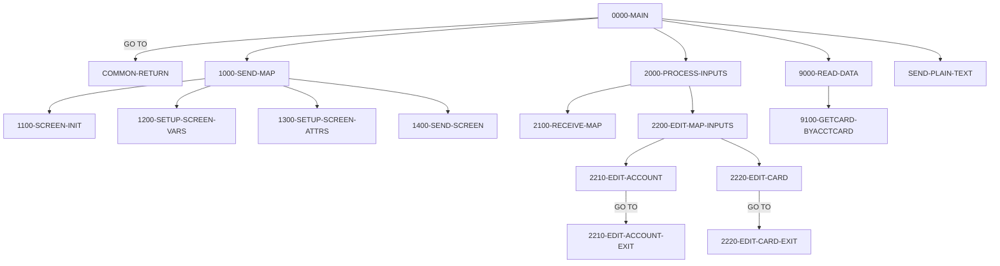

# Program COCRDSLC

| Item | Value |
|---|---|
| Source | `app/cbl/COCRDSLC.cbl` |
| Lines | 887 total, 642 code, 130 comment, 115 blank |
| PROGRAM-ID |  |
| Author |  |
| Runtime | cics-online |
| Module | base |
| CICS transactions | CCDL (`app/csd/CARDDEMO.CSD:347-356`) |
| JCL steps | None |
| Paragraphs | 34 |
| Semantic analysis | validated (batch B06) |
| Version banner | * Ver: CardDemo_v1.0-15-g27d6c6f-68 Date: 2022-07-19 23:12:33 CDT |

## Summary

COCRDSLC is a pseudo-conversational CICS program (transaction CCDL, mapset COCRDSL, map CCRDSLA) that displays the details of one credit card. When entered from the card list program COCRDLIC it takes the account and card number from the CARDDEMO-COMMAREA and reads the card immediately; from any other context it shows an empty search screen and, on re-entry, receives the account number and card number typed by the user and edits them (both are mandatory and must be numeric). The card is read from the CARDDAT VSAM file by card number only, and on success the embossed name, expiry month/year and active status are shown. PF3 returns control (XCTL) to the calling program/transaction or to the main menu COMEN01C/CM00; any other AID key is treated as ENTER. Unexpected program states end with a plain-text 'UNEXPECTED DATA SCENARIO' message, and CICS abends are trapped by ABEND-ROUTINE which sends ABEND-DATA and abends with code 9999. (Confirmed)

Evidence: `app/cbl/COCRDSLC.cbl:162-190`, `app/cbl/COCRDSLC.cbl:248-392`, `app/cbl/COCRDSLC.cbl:394-407`, `app/cbl/COCRDSLC.cbl:608-720`, `app/cbl/COCRDSLC.cbl:736-773`, `app/cbl/COCRDSLC.cbl:857-878`

Header comment (Unverified, `app/cbl/COCRDSLC.cbl:1-8`): Program:     COCRDSLC.CBL Layer:       Business logic Function:    Accept and process credit card detail request All Rights Reserved. http://www.apache.org/licenses/LICENSE-2.0 Unless required by applicable law or agreed to in writing,

## Divisions and sections

| Division / section | Lines | Notes |
|---|---|---|
| IDENTIFICATION DIVISION | `app/cbl/COCRDSLC.cbl:22-29` |  |
| ENVIRONMENT DIVISION | `app/cbl/COCRDSLC.cbl:30-32` |  |
| DATA DIVISION | `app/cbl/COCRDSLC.cbl:33-246` |  |
| PROCEDURE DIVISION | `app/cbl/COCRDSLC.cbl:247-887` |  |
| ENVIRONMENT / INPUT-OUTPUT SECTION | `app/cbl/COCRDSLC.cbl:31-32` |  |
| DATA / WORKING-STORAGE SECTION | `app/cbl/COCRDSLC.cbl:35-241` |  |
| DATA / LINKAGE SECTION | `app/cbl/COCRDSLC.cbl:242-246` |  |

## Files and data stores

No SELECT entries (no COBOL file I/O).

CICS file commands (file name resolved from VALUE clauses and the CSD):

| Command | FILE option | Resolved name | CSD DSNAME | CSD evidence | Line |
|---|---|---|---|---|---|
| READ | LIT-CARDFILENAME | CARDDAT | AWS.M2.CARDDEMO.CARDDATA.VSAM.KSDS | `app/csd/CARDDEMO.CSD:25-36` | `app/cbl/COCRDSLC.cbl:742-750` |
| READ | LIT-CARDFILENAME-ACCT-PATH | CARDAIX | AWS.M2.CARDDEMO.CARDDATA.VSAM.AIX.PATH | `app/csd/CARDDEMO.CSD:13-24` | `app/cbl/COCRDSLC.cbl:783-791` |

## Embedded CICS, SQL and DL/I commands

| Paragraph | Kind | Verb | Resources | Response | Lines |
|---|---|---|---|---|---|
| 0000-MAIN | CICS | HANDLE ABEND |  |  | `app/cbl/COCRDSLC.cbl:250-252` |
| 0000-MAIN | CICS | XCTL | PROGRAM(CDEMO-TO-PROGRAM) |  | `app/cbl/COCRDSLC.cbl:331-334` |
| COMMON-RETURN | CICS | RETURN | TRANSID(LIT-THISTRANID) |  | `app/cbl/COCRDSLC.cbl:402-406` |
| 1400-SEND-SCREEN | CICS | SEND MAP | MAP(CCARD-NEXT-MAP), MAPSET(CCARD-NEXT-MAPSET) | RESP | `app/cbl/COCRDSLC.cbl:569-576` |
| 2100-RECEIVE-MAP | CICS | RECEIVE MAP | MAP(LIT-THISMAP), MAPSET(LIT-THISMAPSET) | RESP | `app/cbl/COCRDSLC.cbl:597-602` |
| 9100-GETCARD-BYACCTCARD | CICS | READ | FILE(LIT-CARDFILENAME) | RESP | `app/cbl/COCRDSLC.cbl:742-750` |
| 9150-GETCARD-BYACCT | CICS | READ | FILE(LIT-CARDFILENAME-ACCT-PATH) | RESP | `app/cbl/COCRDSLC.cbl:783-791` |
| SEND-LONG-TEXT | CICS | SEND TEXT |  |  | `app/cbl/COCRDSLC.cbl:821-826` |
| SEND-LONG-TEXT | CICS | RETURN |  |  | `app/cbl/COCRDSLC.cbl:828-829` |
| SEND-PLAIN-TEXT | CICS | SEND TEXT |  |  | `app/cbl/COCRDSLC.cbl:839-844` |
| SEND-PLAIN-TEXT | CICS | RETURN |  |  | `app/cbl/COCRDSLC.cbl:846-847` |
| ABEND-ROUTINE | CICS | SEND |  | NOHANDLE | `app/cbl/COCRDSLC.cbl:865-869` |
| ABEND-ROUTINE | CICS | HANDLE ABEND |  |  | `app/cbl/COCRDSLC.cbl:871-873` |
| ABEND-ROUTINE | CICS | ABEND |  |  | `app/cbl/COCRDSLC.cbl:875-877` |

## Calls, transfers and callers

| Mechanism | Target | Parameters | Paragraph | Lines |
|---|---|---|---|---|
| EXEC CICS XCTL | CDEMO-TO-PROGRAM = COCRDLIC, COMEN01C | CARDDEMO-COMMAREA | 0000-MAIN | `app/cbl/COCRDSLC.cbl:331-334` |
| EXEC CICS RETURN | LIT-THISTRANID = CCDL | WS-COMMAREA | COMMON-RETURN | `app/cbl/COCRDSLC.cbl:402-406` |

Programs that transfer to or call this program (from `docs/_work/xref/call-graph.json`):

| Caller | Mechanism | Confidence | Evidence |
|---|---|---|---|
| COCRDLIC | XCTL | Confirmed | `app/cbl/COCRDLIC.cbl:538` |
| COMEN01C | XCTL | Confirmed | `app/cbl/COMEN01C.cbl:185` |

## Copybooks

| Copybook | Statement | Resolution | Resolved path | REPLACING | Line |
|---|---|---|---|---|---|
| [CVCRD01Y](../08-data/layouts/CVCRD01Y.md) | COPY | inventory | app/cpy/CVCRD01Y.cpy |  | `app/cbl/COCRDSLC.cbl:194` |
| [COCOM01Y](../08-data/layouts/COCOM01Y.md) | COPY | inventory | app/cpy/COCOM01Y.cpy |  | `app/cbl/COCRDSLC.cbl:198` |
| DFHBMSCA | COPY | system |  |  | `app/cbl/COCRDSLC.cbl:208` |
| DFHAID | COPY | system |  |  | `app/cbl/COCRDSLC.cbl:209` |
| [COTTL01Y](../08-data/layouts/COTTL01Y.md) | COPY | inventory | app/cpy/COTTL01Y.cpy |  | `app/cbl/COCRDSLC.cbl:213` |
| COCRDSL | COPY | inventory | app/cpy-bms/COCRDSL.CPY |  | `app/cbl/COCRDSLC.cbl:215` |
| [CSDAT01Y](../08-data/layouts/CSDAT01Y.md) | COPY | inventory | app/cpy/CSDAT01Y.cpy |  | `app/cbl/COCRDSLC.cbl:218` |
| [CSMSG01Y](../08-data/layouts/CSMSG01Y.md) | COPY | inventory | app/cpy/CSMSG01Y.cpy |  | `app/cbl/COCRDSLC.cbl:221` |
| [CSMSG02Y](../08-data/layouts/CSMSG02Y.md) | COPY | inventory | app/cpy/CSMSG02Y.cpy |  | `app/cbl/COCRDSLC.cbl:224` |
| [CSUSR01Y](../08-data/layouts/CSUSR01Y.md) | COPY | inventory | app/cpy/CSUSR01Y.cpy |  | `app/cbl/COCRDSLC.cbl:227` |
| [CVACT02Y](../08-data/layouts/CVACT02Y.md) | COPY | inventory | app/cpy/CVACT02Y.cpy |  | `app/cbl/COCRDSLC.cbl:234` |
| [CVCUS01Y](../08-data/layouts/CVCUS01Y.md) | COPY | inventory | app/cpy/CVCUS01Y.cpy |  | `app/cbl/COCRDSLC.cbl:240` |
| [CSSTRPFY](../08-data/layouts/CSSTRPFY.md) | COPY | inventory | app/cpy/CSSTRPFY.cpy |  | `app/cbl/COCRDSLC.cbl:855` |
| [CVACT01Y](../08-data/layouts/CVACT01Y.md) | COPY | inventory (commented out) | app/cpy/CVACT01Y.cpy |  | `app/cbl/COCRDSLC.cbl:231` |
| [CVACT03Y](../08-data/layouts/CVACT03Y.md) | COPY | inventory (commented out) | app/cpy/CVACT03Y.cpy |  | `app/cbl/COCRDSLC.cbl:237` |

## Data division items

Every data entry coded in this source (copybook contents are on the copybook pages). Lengths are computed from PIC and USAGE.

| Section | Lvl | Name | PIC | Usage | Len | OCCURS | REDEFINES | VALUE | 88-levels | Line |
|---|---|---|---|---|---|---|---|---|---|---|
| WORKING-STORAGE | 01 | WS-MISC-STORAGE |  |  |  |  |  |  |  | 36 |
| WORKING-STORAGE | 05 | WS-CICS-PROCESSNG-VARS |  |  |  |  |  |  |  | 40 |
| WORKING-STORAGE | 07 | WS-RESP-CD | S9(09) | COMP | 4 |  |  | ZEROS |  | 41 |
| WORKING-STORAGE | 07 | WS-REAS-CD | S9(09) | COMP | 4 |  |  | ZEROS |  | 43 |
| WORKING-STORAGE | 07 | WS-TRANID | X(4) |  | 4 |  |  | SPACES |  | 45 |
| WORKING-STORAGE | 05 | WS-INPUT-FLAG | X(1) |  | 1 |  |  |  | INPUT-OK = '0'; INPUT-ERROR = '1'; INPUT-PENDING = LOW-VALUES | 51 |
| WORKING-STORAGE | 05 | WS-EDIT-ACCT-FLAG | X(1) |  | 1 |  |  |  | FLG-ACCTFILTER-NOT-OK = '0'; FLG-ACCTFILTER-ISVALID = '1'; FLG-ACCTFILTER-BLANK = ' ' | 55 |
| WORKING-STORAGE | 05 | WS-EDIT-CARD-FLAG | X(1) |  | 1 |  |  |  | FLG-CARDFILTER-NOT-OK = '0'; FLG-CARDFILTER-ISVALID = '1'; FLG-CARDFILTER-BLANK = ' ' | 59 |
| WORKING-STORAGE | 05 | WS-RETURN-FLAG | X(1) |  | 1 |  |  |  | WS-RETURN-FLAG-OFF = LOW-VALUES; WS-RETURN-FLAG-ON = '1' | 63 |
| WORKING-STORAGE | 05 | WS-PFK-FLAG | X(1) |  | 1 |  |  |  | PFK-VALID = '0'; PFK-INVALID = '1' | 66 |
| WORKING-STORAGE | 05 | CICS-OUTPUT-EDIT-VARS |  |  |  |  |  |  |  | 72 |
| WORKING-STORAGE | 10 | CARD-ACCT-ID-X | X(11) |  | 11 |  |  |  |  | 73 |
| WORKING-STORAGE | 10 | CARD-ACCT-ID-N | 9(11) |  | 11 |  | CARD-ACCT-ID-X |  |  | 74 |
| WORKING-STORAGE | 10 | CARD-CVV-CD-X | X(03) |  | 3 |  |  |  |  | 76 |
| WORKING-STORAGE | 10 | CARD-CVV-CD-N | 9(03) |  | 3 |  | CARD-CVV-CD-X |  |  | 77 |
| WORKING-STORAGE | 10 | CARD-CARD-NUM-X | X(16) |  | 16 |  |  |  |  | 79 |
| WORKING-STORAGE | 10 | CARD-CARD-NUM-N | 9(16) |  | 16 |  | CARD-CARD-NUM-X |  |  | 80 |
| WORKING-STORAGE | 10 | CARD-NAME-EMBOSSED-X | X(50) |  | 50 |  |  |  |  | 82 |
| WORKING-STORAGE | 10 | CARD-STATUS-X | X |  | 1 |  |  |  |  | 83 |
| WORKING-STORAGE | 10 | CARD-EXPIRAION-DATE-X | X(10) |  | 10 |  |  |  |  | 84 |
| WORKING-STORAGE | 10 | FILLER |  |  |  |  | CARD-EXPIRAION-DATE-X |  |  | 85 |
| WORKING-STORAGE | 20 | CARD-EXPIRY-YEAR | X(4) |  | 4 |  |  |  |  | 86 |
| WORKING-STORAGE | 20 | FILLER | X(1) |  | 1 |  |  |  |  | 87 |
| WORKING-STORAGE | 20 | CARD-EXPIRY-MONTH | X(2) |  | 2 |  |  |  |  | 88 |
| WORKING-STORAGE | 20 | FILLER | X(1) |  | 1 |  |  |  |  | 89 |
| WORKING-STORAGE | 20 | CARD-EXPIRY-DAY | X(2) |  | 2 |  |  |  |  | 90 |
| WORKING-STORAGE | 10 | CARD-EXPIRAION-DATE-N | 9(10) |  | 10 |  | CARD-EXPIRAION-DATE-X |  |  | 91 |
| WORKING-STORAGE | 05 | WS-CARD-RID |  |  |  |  |  |  |  | 97 |
| WORKING-STORAGE | 10 | WS-CARD-RID-CARDNUM | X(16) |  | 16 |  |  |  |  | 98 |
| WORKING-STORAGE | 10 | WS-CARD-RID-ACCT-ID | 9(11) |  | 11 |  |  |  |  | 99 |
| WORKING-STORAGE | 10 | WS-CARD-RID-ACCT-ID-X | X(11) |  | 11 |  | WS-CARD-RID-ACCT-ID |  |  | 100 |
| WORKING-STORAGE | 05 | WS-FILE-ERROR-MESSAGE |  |  |  |  |  |  |  | 102 |
| WORKING-STORAGE | 10 | FILLER | X(12) |  | 12 |  |  | 'File Error: ' |  | 103 |
| WORKING-STORAGE | 10 | ERROR-OPNAME | X(8) |  | 8 |  |  | SPACES |  | 105 |
| WORKING-STORAGE | 10 | FILLER | X(4) |  | 4 |  |  | ' on ' |  | 107 |
| WORKING-STORAGE | 10 | ERROR-FILE | X(9) |  | 9 |  |  | SPACES |  | 109 |
| WORKING-STORAGE | 10 | FILLER | X(15) |  | 15 |  |  | ' returned RESP ' |  | 111 |
| WORKING-STORAGE | 10 | ERROR-RESP | X(10) |  | 10 |  |  | SPACES |  | 114 |
| WORKING-STORAGE | 10 | FILLER | X(7) |  | 7 |  |  | ',RESP2 ' |  | 116 |
| WORKING-STORAGE | 10 | ERROR-RESP2 | X(10) |  | 10 |  |  | SPACES |  | 118 |
| WORKING-STORAGE | 10 | FILLER | X(5) |  | 5 |  |  | SPACES |  | 120 |
| WORKING-STORAGE | 05 | WS-LONG-MSG | X(500) |  | 500 |  |  |  |  | 125 |
| WORKING-STORAGE | 05 | WS-INFO-MSG | X(40) |  | 40 |  |  |  | WS-NO-INFO-MESSAGE = SPACES LOW-VALUES; FOUND-CARDS-FOR-ACCOUNT = ' Displaying requested details'; WS-PROMPT-FOR-INPUT = 'Please enter Account and Card Number' | 126 |
| WORKING-STORAGE | 05 | WS-RETURN-MSG | X(75) |  | 75 |  |  |  | WS-RETURN-MSG-OFF = SPACES; WS-EXIT-MESSAGE = 'PF03 pressed.Exiting '; WS-PROMPT-FOR-ACCT = 'Account number not provided'; WS-PROMPT-FOR-CARD = 'Card number not provided'; NO-SEARCH-CRITERIA-RECEIVED | 134 |
| WORKING-STORAGE | 01 | WS-LITERALS |  |  |  |  |  |  |  | 162 |
| WORKING-STORAGE | 05 | LIT-THISPGM | X(8) |  | 8 |  |  | 'COCRDSLC' |  | 163 |
| WORKING-STORAGE | 05 | LIT-THISTRANID | X(4) |  | 4 |  |  | 'CCDL' |  | 165 |
| WORKING-STORAGE | 05 | LIT-THISMAPSET | X(8) |  | 8 |  |  | 'COCRDSL ' |  | 167 |
| WORKING-STORAGE | 05 | LIT-THISMAP | X(7) |  | 7 |  |  | 'CCRDSLA' |  | 169 |
| WORKING-STORAGE | 05 | LIT-CCLISTPGM | X(8) |  | 8 |  |  | 'COCRDLIC' |  | 171 |
| WORKING-STORAGE | 05 | LIT-CCLISTTRANID | X(4) |  | 4 |  |  | 'CCLI' |  | 173 |
| WORKING-STORAGE | 05 | LIT-CCLISTMAPSET | X(7) |  | 7 |  |  | 'COCRDLI' |  | 175 |
| WORKING-STORAGE | 05 | LIT-CCLISTMAP | X(7) |  | 7 |  |  | 'CCRDSLA' |  | 177 |
| WORKING-STORAGE | 05 | LIT-MENUPGM | X(8) |  | 8 |  |  | 'COMEN01C' |  | 179 |
| WORKING-STORAGE | 05 | LIT-MENUTRANID | X(4) |  | 4 |  |  | 'CM00' |  | 181 |
| WORKING-STORAGE | 05 | LIT-MENUMAPSET | X(7) |  | 7 |  |  | 'COMEN01' |  | 183 |
| WORKING-STORAGE | 05 | LIT-MENUMAP | X(7) |  | 7 |  |  | 'COMEN1A' |  | 185 |
| WORKING-STORAGE | 05 | LIT-CARDFILENAME | X(8) |  | 8 |  |  | 'CARDDAT ' |  | 187 |
| WORKING-STORAGE | 05 | LIT-CARDFILENAME-ACCT-PATH | X(8) |  | 8 |  |  | 'CARDAIX ' |  | 189 |
| WORKING-STORAGE | 01 | WS-THIS-PROGCOMMAREA |  |  |  |  |  |  |  | 200 |
| WORKING-STORAGE | 05 | CA-CALL-CONTEXT |  |  |  |  |  |  |  | 201 |
| WORKING-STORAGE | 10 | CA-FROM-PROGRAM | X(08) |  | 8 |  |  |  |  | 202 |
| WORKING-STORAGE | 10 | CA-FROM-TRANID | X(04) |  | 4 |  |  |  |  | 203 |
| WORKING-STORAGE | 01 | WS-COMMAREA | X(2000) |  | 2000 |  |  |  |  | 205 |
| LINKAGE | 01 | DFHCOMMAREA |  |  |  |  |  |  |  | 243 |
| LINKAGE | 05 | FILLER | X(1) |  | 1 | 1 TO 32767 DEPENDING ON EIBCALEN |  |  |  | 244 |

## Statement inventory

Every procedure statement the parser recorded, by kind. Each one is listed with its line under Paragraph details.

| Kind | Count |
|---|---|
| Decisions (IF, EVALUATE, WHEN, loops, handlers) | 53 |
| Calculations | 0 |
| File I/O | 0 |
| EXEC CICS / SQL / DLI | 14 |
| CALL | 0 |
| PERFORM | 19 |
| GO TO | 9 |
| MOVE literal | 12 |
| MOVE field | 83 |
| SET | 41 |
| STRING, UNSTRING, INSPECT, INITIALIZE, COPY, ENTRY and others | 3 |
| DISPLAY | 0 |
| GOBACK, STOP RUN, RETURN, XCTL | 5 |
| Not classified by the parser | 0 |

## Control flow

| Paragraph | Lines | Logic | Performs | Performed by | Reachable |
|---|---|---|---|---|---|
| [0000-MAIN](#para-0000-main) | 248-392 | Registers ABEND-ROUTINE as abend handler, initializes CC-WORK-AREA, WS-MISC-STORAGE and WS-COMMAREA, and clears WS-RETURN-MSG. If EIBCALEN is 0 or the caller is COMEN01C without re-enter it initializes the commarea, else it copies CARDDEMO-COMMAREA and WS-THIS-PROGCOMMAREA from DFHCOMMAREA. It maps the AID (YYYY-STORE-PFKEY), forces any key other than ENTER/PF3 to ENTER, then EVALUATEs: PF3 XCTLs to the caller or menu; first entry from COCRDLIC reads and shows the card; other first entry shows the empty screen; re-entry edits input and either redisplays errors or reads and shows the card; anything else sends 'UNEXPECTED DATA SCENARIO' as plain text. (Confirmed) | 1000-SEND-MAP, 2000-PROCESS-INPUTS, 9000-READ-DATA, SEND-PLAIN-TEXT, YYYY-STORE-PFKEY |  | yes |
| [COMMON-RETURN](#para-common-return) | 394-407 | Moves WS-RETURN-MSG to CCARD-ERROR-MSG, packs CARDDEMO-COMMAREA followed by WS-THIS-PROGCOMMAREA into the 2000-byte WS-COMMAREA and issues EXEC CICS RETURN TRANSID(CCDL) with that commarea to continue the pseudo-conversation. (Confirmed) |  | 0000-MAIN | yes |
| [0000-MAIN-EXIT](#para-0000-main-exit) | 408-410 | Exit paragraph for 0000-MAIN; contains only EXIT. (Confirmed) |  |  | no static path |
| [1000-SEND-MAP](#para-1000-send-map) | 412-421 | Builds and sends the card detail screen by performing 1100-SCREEN-INIT, 1200-SETUP-SCREEN-VARS, 1300-SETUP-SCREEN-ATTRS and 1400-SEND-SCREEN in sequence. (Confirmed) | 1100-SCREEN-INIT, 1200-SETUP-SCREEN-VARS, 1300-SETUP-SCREEN-ATTRS, 1400-SEND-SCREEN | 0000-MAIN | yes |
| [1000-SEND-MAP-EXIT](#para-1000-send-map-exit) | 423-425 | Exit paragraph for 1000-SEND-MAP; contains only EXIT. (Confirmed) |  | 0000-MAIN | yes |
| [1100-SCREEN-INIT](#para-1100-screen-init) | 427-451 | Clears CCRDSLAO to LOW-VALUES and fills the header: titles CCDA-TITLE01/02, transaction CCDL, program COCRDSLC, current date as MM/DD/YY and current time as HH:MM:SS from FUNCTION CURRENT-DATE. (Confirmed) |  | 1000-SEND-MAP | yes |
| [1100-SCREEN-INIT-EXIT](#para-1100-screen-init-exit) | 453-455 | Exit paragraph for 1100-SCREEN-INIT; contains only EXIT. (Confirmed) |  | 1000-SEND-MAP | yes |
| [1200-SETUP-SCREEN-VARS](#para-1200-setup-screen-vars) | 457-497 | On first invocation (EIBCALEN 0) sets the 'Please enter Account and Card Number' prompt; otherwise shows CC-ACCT-ID and CC-CARD-NUM (or LOW-VALUES when the commarea value is zero) and, when FOUND-CARDS-FOR-ACCOUNT, moves CARD-EMBOSSED-NAME, the expiry month and year split from CARD-EXPIRAION-DATE, and CARD-ACTIVE-STATUS to the map. If no info message is set it sets the input prompt, then moves WS-RETURN-MSG to ERRMSGO and WS-INFO-MSG to INFOMSGO. (Confirmed) |  | 1000-SEND-MAP | yes |
| [1200-SETUP-SCREEN-VARS-EXIT](#para-1200-setup-screen-vars-exit) | 499-501 | Exit paragraph for 1200-SETUP-SCREEN-VARS; contains only EXIT. (Confirmed) |  | 1000-SEND-MAP | yes |
| [1300-SETUP-SCREEN-ATTRS](#para-1300-setup-screen-attrs) | 502-558 | Protects the account and card input fields (DFHBMPRF) when the last mapset is COCRDLI and the caller is COCRDLIC, otherwise makes them enterable (DFHBMFSE). Positions the cursor on the account field unless only the card filter is in error/blank, colours fields in error red, shows '*' in red for blank filters on re-entry, and dims the info message when none is set. (Confirmed) |  | 1000-SEND-MAP | yes |
| [1300-SETUP-SCREEN-ATTRS-EXIT](#para-1300-setup-screen-attrs-exit) | 559-560 | Exit paragraph for 1300-SETUP-SCREEN-ATTRS; contains only EXIT. (Confirmed) |  | 1000-SEND-MAP | yes |
| [1400-SEND-SCREEN](#para-1400-send-screen) | 563-577 | Sets the next mapset/map to COCRDSL/CCRDSLA, sets CDEMO-PGM-REENTER so the next input is processed as a re-entry, and sends map CCRDSLAO with CURSOR, ERASE and FREEKB; the RESP code is captured but not tested. (Confirmed) |  | 1000-SEND-MAP | yes |
| [1400-SEND-SCREEN-EXIT](#para-1400-send-screen-exit) | 578-580 | Exit paragraph for 1400-SEND-SCREEN; contains only EXIT. (Confirmed) |  | 1000-SEND-MAP | yes |
| [2000-PROCESS-INPUTS](#para-2000-process-inputs) | 582-591 | Receives the map (2100-RECEIVE-MAP), edits the inputs (2200-EDIT-MAP-INPUTS), then copies WS-RETURN-MSG to CCARD-ERROR-MSG and sets the next program/mapset/map to this program's own values. (Confirmed) | 2100-RECEIVE-MAP, 2200-EDIT-MAP-INPUTS | 0000-MAIN | yes |
| [2000-PROCESS-INPUTS-EXIT](#para-2000-process-inputs-exit) | 593-595 | Exit paragraph for 2000-PROCESS-INPUTS; contains only EXIT. (Confirmed) |  | 0000-MAIN | yes |
| [2100-RECEIVE-MAP](#para-2100-receive-map) | 596-603 | Issues EXEC CICS RECEIVE MAP(CCRDSLA) MAPSET(COCRDSL) INTO CCRDSLAI capturing RESP/RESP2; the response is not checked. (Confirmed) |  | 2000-PROCESS-INPUTS | yes |
| [2100-RECEIVE-MAP-EXIT](#para-2100-receive-map-exit) | 605-607 | Exit paragraph for 2100-RECEIVE-MAP; contains only EXIT. (Confirmed) |  | 2000-PROCESS-INPUTS | yes |
| [2200-EDIT-MAP-INPUTS](#para-2200-edit-map-inputs) | 608-641 | Starts with INPUT-OK and both filter flags valid, converts an account or card input of '*' or SPACES to LOW-VALUES (otherwise copies ACCTSIDI/CARDSIDI to CC-ACCT-ID/CC-CARD-NUM), performs 2210-EDIT-ACCOUNT and 2220-EDIT-CARD, and when both filters are blank sets the 'No input received' message. (Confirmed) | 2210-EDIT-ACCOUNT, 2220-EDIT-CARD | 2000-PROCESS-INPUTS | yes |
| [2200-EDIT-MAP-INPUTS-EXIT](#para-2200-edit-map-inputs-exit) | 643-645 | Exit paragraph for 2200-EDIT-MAP-INPUTS; contains only EXIT. (Confirmed) |  | 2000-PROCESS-INPUTS | yes |
| [2210-EDIT-ACCOUNT](#para-2210-edit-account) | 647-679 | If CC-ACCT-ID is LOW-VALUES, SPACES or zero it flags INPUT-ERROR and FLG-ACCTFILTER-BLANK, sets 'Account number not provided' if no message yet and zeroes CDEMO-ACCT-ID. If it is not numeric it flags INPUT-ERROR/FLG-ACCTFILTER-NOT-OK with message 'ACCOUNT FILTER,IF SUPPLIED MUST BE A 11 DIGIT NUMBER' and zeroes CDEMO-ACCT-ID; otherwise moves it to CDEMO-ACCT-ID and sets FLG-ACCTFILTER-ISVALID. (Confirmed) |  | 2200-EDIT-MAP-INPUTS | yes |
| [2210-EDIT-ACCOUNT-EXIT](#para-2210-edit-account-exit) | 681-683 | Exit paragraph for 2210-EDIT-ACCOUNT; target of its GO TO statements. (Confirmed) |  | 2200-EDIT-MAP-INPUTS, 2210-EDIT-ACCOUNT | yes |
| [2220-EDIT-CARD](#para-2220-edit-card) | 685-720 | If CC-CARD-NUM is LOW-VALUES, SPACES or zero it flags INPUT-ERROR and FLG-CARDFILTER-BLANK, sets 'Card number not provided' if no message yet and zeroes CDEMO-CARD-NUM. If it is not numeric it flags INPUT-ERROR/FLG-CARDFILTER-NOT-OK with message 'CARD ID FILTER,IF SUPPLIED MUST BE A 16 DIGIT NUMBER'; otherwise moves CC-CARD-NUM-N to CDEMO-CARD-NUM and sets FLG-CARDFILTER-ISVALID. (Confirmed) |  | 2200-EDIT-MAP-INPUTS | yes |
| [2220-EDIT-CARD-EXIT](#para-2220-edit-card-exit) | 722-724 | Exit paragraph for 2220-EDIT-CARD; target of its GO TO statements. (Confirmed) |  | 2200-EDIT-MAP-INPUTS, 2220-EDIT-CARD | yes |
| [9000-READ-DATA](#para-9000-read-data) | 726-730 | Performs 9100-GETCARD-BYACCTCARD to read the requested card. (Confirmed) | 9100-GETCARD-BYACCTCARD | 0000-MAIN | yes |
| [9000-READ-DATA-EXIT](#para-9000-read-data-exit) | 732-734 | Exit paragraph for 9000-READ-DATA; contains only EXIT. (Confirmed) |  | 0000-MAIN | yes |
| [9100-GETCARD-BYACCTCARD](#para-9100-getcard-byacctcard) | 736-773 | Reads CARDDAT into CARD-RECORD keyed by the 16-byte card number CC-CARD-NUM (the account part of the key is commented out). NORMAL sets FOUND-CARDS-FOR-ACCOUNT; NOTFND sets INPUT-ERROR, both filters NOT-OK and 'Did not find cards for this search condition'; any other response sets INPUT-ERROR and builds 'File Error: READ on CARDDAT ...' with RESP/RESP2 into WS-RETURN-MSG. (Confirmed) |  | 9000-READ-DATA | yes |
| [9100-GETCARD-BYACCTCARD-EXIT](#para-9100-getcard-byacctcard-exit) | 775-777 | Exit paragraph for 9100-GETCARD-BYACCTCARD; contains only EXIT. (Confirmed) |  | 9000-READ-DATA | yes |
| [9150-GETCARD-BYACCT](#para-9150-getcard-byacct) | 779-809 | Would read the card through alternate index path CARDAIX keyed by WS-CARD-RID-ACCT-ID, setting FOUND-CARDS-FOR-ACCOUNT, 'Did not find this account in cards database' on NOTFND, or a file error message. It is never performed in this program (dead code). (Confirmed) |  |  | no static path |
| [9150-GETCARD-BYACCT-EXIT](#para-9150-getcard-byacct-exit) | 810-812 | Exit paragraph for 9150-GETCARD-BYACCT; contains only EXIT and is unreferenced. (Confirmed) |  |  | no static path |
| [SEND-LONG-TEXT](#para-send-long-text) | 820-830 | Debug helper that sends WS-LONG-MSG as plain text with ERASE and ends the task with CICS RETURN; it is not performed anywhere in the program. (Confirmed) |  |  | no static path |
| [SEND-LONG-TEXT-EXIT](#para-send-long-text-exit) | 831-833 | Exit paragraph for SEND-LONG-TEXT; contains only EXIT. (Confirmed) |  |  | no static path |
| [SEND-PLAIN-TEXT](#para-send-plain-text) | 838-848 | Sends WS-RETURN-MSG as plain text with ERASE and FREEKB and ends the task with a CICS RETURN without TRANSID, terminating the conversation; used for the unexpected-scenario branch. (Confirmed) |  | 0000-MAIN | yes |
| [SEND-PLAIN-TEXT-EXIT](#para-send-plain-text-exit) | 849-856 | Exit paragraph for SEND-PLAIN-TEXT; the range also contains COPY 'CSSTRPFY', which inserts YYYY-STORE-PFKEY mapping EIBAID (PF13-24 folded onto PF1-12) to CCARD-AID. (Confirmed) |  | 0000-MAIN | yes |
| [ABEND-ROUTINE](#para-abend-routine) | 857-878 | Defaults ABEND-MSG to 'UNEXPECTED ABEND OCCURRED.' when empty, sets ABEND-CULPRIT to COCRDSLC, sends ABEND-DATA (NOHANDLE), cancels the abend handler and issues EXEC CICS ABEND ABCODE('9999'). (Confirmed) |  |  | no static path |

## Paragraph details

### Para 0000-MAIN

Lines `app/cbl/COCRDSLC.cbl:248-392`. 

Logic: Registers ABEND-ROUTINE as abend handler, initializes CC-WORK-AREA, WS-MISC-STORAGE and WS-COMMAREA, and clears WS-RETURN-MSG. If EIBCALEN is 0 or the caller is COMEN01C without re-enter it initializes the commarea, else it copies CARDDEMO-COMMAREA and WS-THIS-PROGCOMMAREA from DFHCOMMAREA. It maps the AID (YYYY-STORE-PFKEY), forces any key other than ENTER/PF3 to ENTER, then EVALUATEs: PF3 XCTLs to the caller or menu; first entry from COCRDLIC reads and shows the card; other first entry shows the empty screen; re-entry edits input and either redisplays errors or reads and shows the card; anything else sends 'UNEXPECTED DATA SCENARIO' as plain text. (Confirmed)

Rules: [BR-COCRDSLC-001](../09-business-rules-catalog.md#br-cocrdslc-001), [BR-COCRDSLC-002](../09-business-rules-catalog.md#br-cocrdslc-002), [BR-COCRDSLC-003](../09-business-rules-catalog.md#br-cocrdslc-003), [BR-COCRDSLC-004](../09-business-rules-catalog.md#br-cocrdslc-004), [BR-COCRDSLC-005](../09-business-rules-catalog.md#br-cocrdslc-005)

Statements in source order:

- EXEC CICS HANDLE ABEND at `app/cbl/COCRDSLC.cbl:250-252`
- `INITIALIZE CC-WORK-AREA WS-MISC-STORAGE WS-COMMAREA` at `app/cbl/COCRDSLC.cbl:254-256`
- `MOVE LIT-THISTRANID TO WS-TRANID` at `app/cbl/COCRDSLC.cbl:260`
- `SET WS-RETURN-MSG-OFF TO TRUE` at `app/cbl/COCRDSLC.cbl:264`
- IF `EIBCALEN IS EQUAL TO 0 OR (CDEMO-FROM-PROGRAM = LIT-MENUPGM AND NOT CDEMO-PGM-REENTER)` at `app/cbl/COCRDSLC.cbl:268-270` (pseudo-conversation)
- `INITIALIZE CARDDEMO-COMMAREA WS-THIS-PROGCOMMAREA` at `app/cbl/COCRDSLC.cbl:271-272`
- `MOVE DFHCOMMAREA (1:LENGTH OF CARDDEMO-COMMAREA) TO CARDDEMO-COMMAREA` at `app/cbl/COCRDSLC.cbl:274-275`
- `MOVE DFHCOMMAREA(LENGTH OF CARDDEMO-COMMAREA + 1: LENGTH OF WS-THIS-PROGCOMMAREA ) TO WS-THIS-PROGCOMMAREA` at `app/cbl/COCRDSLC.cbl:276-278`
- PERFORM YYYY-STORE-PFKEY THRU YYYY-STORE-PFKEY-EXIT at `app/cbl/COCRDSLC.cbl:284-285`
- `SET PFK-INVALID TO TRUE` at `app/cbl/COCRDSLC.cbl:291`
- IF `CCARD-AID-ENTER OR CCARD-AID-PFK03` at `app/cbl/COCRDSLC.cbl:292-293` (screen-key)
- `SET PFK-VALID TO TRUE` at `app/cbl/COCRDSLC.cbl:294`
- IF `PFK-INVALID` at `app/cbl/COCRDSLC.cbl:297` (screen-key)
- `SET CCARD-AID-ENTER TO TRUE` at `app/cbl/COCRDSLC.cbl:298`
- EVALUATE `TRUE` at `app/cbl/COCRDSLC.cbl:304` (business-candidate)
- WHEN `CCARD-AID-PFK03` at `app/cbl/COCRDSLC.cbl:305` (screen-key)
- IF `CDEMO-FROM-TRANID EQUAL LOW-VALUES OR CDEMO-FROM-TRANID EQUAL SPACES` at `app/cbl/COCRDSLC.cbl:309-310` (business-candidate)
- `MOVE LIT-MENUTRANID TO CDEMO-TO-TRANID` at `app/cbl/COCRDSLC.cbl:311`
- `MOVE CDEMO-FROM-TRANID TO CDEMO-TO-TRANID` at `app/cbl/COCRDSLC.cbl:313`
- IF `CDEMO-FROM-PROGRAM EQUAL LOW-VALUES OR CDEMO-FROM-PROGRAM EQUAL SPACES` at `app/cbl/COCRDSLC.cbl:316-317` (pseudo-conversation)
- `MOVE LIT-MENUPGM TO CDEMO-TO-PROGRAM` at `app/cbl/COCRDSLC.cbl:318`
- `MOVE CDEMO-FROM-PROGRAM TO CDEMO-TO-PROGRAM` at `app/cbl/COCRDSLC.cbl:320`
- `MOVE LIT-THISTRANID TO CDEMO-FROM-TRANID` at `app/cbl/COCRDSLC.cbl:323`
- `MOVE LIT-THISPGM TO CDEMO-FROM-PROGRAM` at `app/cbl/COCRDSLC.cbl:324`
- `SET CDEMO-USRTYP-USER TO TRUE` at `app/cbl/COCRDSLC.cbl:326`
- `SET CDEMO-PGM-ENTER TO TRUE` at `app/cbl/COCRDSLC.cbl:327`
- `MOVE LIT-THISMAPSET TO CDEMO-LAST-MAPSET` at `app/cbl/COCRDSLC.cbl:328`
- `MOVE LIT-THISMAP TO CDEMO-LAST-MAP` at `app/cbl/COCRDSLC.cbl:329`
- EXEC CICS XCTL at `app/cbl/COCRDSLC.cbl:331-334`
- Ends with EXEC CICS XCTL at `app/cbl/COCRDSLC.cbl:331-334`
- WHEN `CDEMO-PGM-ENTER AND CDEMO-FROM-PROGRAM EQUAL LIT-CCLISTPGM` at `app/cbl/COCRDSLC.cbl:339-340` (pseudo-conversation)
- `SET INPUT-OK TO TRUE` at `app/cbl/COCRDSLC.cbl:341`
- `MOVE CDEMO-ACCT-ID TO CC-ACCT-ID-N` at `app/cbl/COCRDSLC.cbl:342`
- `MOVE CDEMO-CARD-NUM TO CC-CARD-NUM-N` at `app/cbl/COCRDSLC.cbl:343`
- PERFORM 9000-READ-DATA THRU 9000-READ-DATA-EXIT at `app/cbl/COCRDSLC.cbl:344-345`
- PERFORM 1000-SEND-MAP THRU 1000-SEND-MAP-EXIT at `app/cbl/COCRDSLC.cbl:346-347`
- GO TO COMMON-RETURN at `app/cbl/COCRDSLC.cbl:348`
- WHEN `CDEMO-PGM-ENTER` at `app/cbl/COCRDSLC.cbl:349` (pseudo-conversation)
- PERFORM 1000-SEND-MAP THRU 1000-SEND-MAP-EXIT at `app/cbl/COCRDSLC.cbl:354-355`
- GO TO COMMON-RETURN at `app/cbl/COCRDSLC.cbl:356`
- WHEN `CDEMO-PGM-REENTER` at `app/cbl/COCRDSLC.cbl:357` (pseudo-conversation)
- PERFORM 2000-PROCESS-INPUTS THRU 2000-PROCESS-INPUTS-EXIT at `app/cbl/COCRDSLC.cbl:358-359`
- IF `INPUT-ERROR` at `app/cbl/COCRDSLC.cbl:360` (error-flag)
- PERFORM 1000-SEND-MAP THRU 1000-SEND-MAP-EXIT at `app/cbl/COCRDSLC.cbl:361-362`
- GO TO COMMON-RETURN at `app/cbl/COCRDSLC.cbl:363`
- PERFORM 9000-READ-DATA THRU 9000-READ-DATA-EXIT at `app/cbl/COCRDSLC.cbl:365-366`
- PERFORM 1000-SEND-MAP THRU 1000-SEND-MAP-EXIT at `app/cbl/COCRDSLC.cbl:367-368`
- GO TO COMMON-RETURN at `app/cbl/COCRDSLC.cbl:369`
- WHEN `OTHER` at `app/cbl/COCRDSLC.cbl:373` (business-candidate)
- `MOVE LIT-THISPGM TO ABEND-CULPRIT` at `app/cbl/COCRDSLC.cbl:374`
- MOVE `'0001'` TO ABEND-CODE at `app/cbl/COCRDSLC.cbl:375`
- `MOVE SPACES TO ABEND-REASON` at `app/cbl/COCRDSLC.cbl:376`
- MOVE `'UNEXPECTED DATA SCENARIO'` TO WS-RETURN-MSG at `app/cbl/COCRDSLC.cbl:377-378`
- PERFORM SEND-PLAIN-TEXT THRU SEND-PLAIN-TEXT-EXIT at `app/cbl/COCRDSLC.cbl:379-380`
- IF `INPUT-ERROR` at `app/cbl/COCRDSLC.cbl:386` (error-flag)
- `MOVE WS-RETURN-MSG TO CCARD-ERROR-MSG` at `app/cbl/COCRDSLC.cbl:387`
- PERFORM 1000-SEND-MAP THRU 1000-SEND-MAP-EXIT at `app/cbl/COCRDSLC.cbl:388-389`
- GO TO COMMON-RETURN at `app/cbl/COCRDSLC.cbl:390`

### Para COMMON-RETURN

Lines `app/cbl/COCRDSLC.cbl:394-407`. 

Logic: Moves WS-RETURN-MSG to CCARD-ERROR-MSG, packs CARDDEMO-COMMAREA followed by WS-THIS-PROGCOMMAREA into the 2000-byte WS-COMMAREA and issues EXEC CICS RETURN TRANSID(CCDL) with that commarea to continue the pseudo-conversation. (Confirmed)

Statements in source order:

- `MOVE WS-RETURN-MSG TO CCARD-ERROR-MSG` at `app/cbl/COCRDSLC.cbl:395`
- `MOVE CARDDEMO-COMMAREA TO WS-COMMAREA` at `app/cbl/COCRDSLC.cbl:397`
- `MOVE WS-THIS-PROGCOMMAREA TO WS-COMMAREA(LENGTH OF CARDDEMO-COMMAREA + 1: LENGTH OF WS-THIS-PROGCOMMAREA )` at `app/cbl/COCRDSLC.cbl:398-400`
- EXEC CICS RETURN at `app/cbl/COCRDSLC.cbl:402-406`
- Ends with EXEC CICS RETURN at `app/cbl/COCRDSLC.cbl:402-406`

### Para 0000-MAIN-EXIT

Lines `app/cbl/COCRDSLC.cbl:408-410`. 

Logic: Exit paragraph for 0000-MAIN; contains only EXIT. (Confirmed)

### Para 1000-SEND-MAP

Lines `app/cbl/COCRDSLC.cbl:412-421`. 

Logic: Builds and sends the card detail screen by performing 1100-SCREEN-INIT, 1200-SETUP-SCREEN-VARS, 1300-SETUP-SCREEN-ATTRS and 1400-SEND-SCREEN in sequence. (Confirmed)

Statements in source order:

- PERFORM 1100-SCREEN-INIT THRU 1100-SCREEN-INIT-EXIT at `app/cbl/COCRDSLC.cbl:413-414`
- PERFORM 1200-SETUP-SCREEN-VARS THRU 1200-SETUP-SCREEN-VARS-EXIT at `app/cbl/COCRDSLC.cbl:415-416`
- PERFORM 1300-SETUP-SCREEN-ATTRS THRU 1300-SETUP-SCREEN-ATTRS-EXIT at `app/cbl/COCRDSLC.cbl:417-418`
- PERFORM 1400-SEND-SCREEN THRU 1400-SEND-SCREEN-EXIT at `app/cbl/COCRDSLC.cbl:419-421`

### Para 1000-SEND-MAP-EXIT

Lines `app/cbl/COCRDSLC.cbl:423-425`. 

Logic: Exit paragraph for 1000-SEND-MAP; contains only EXIT. (Confirmed)

### Para 1100-SCREEN-INIT

Lines `app/cbl/COCRDSLC.cbl:427-451`. 

Logic: Clears CCRDSLAO to LOW-VALUES and fills the header: titles CCDA-TITLE01/02, transaction CCDL, program COCRDSLC, current date as MM/DD/YY and current time as HH:MM:SS from FUNCTION CURRENT-DATE. (Confirmed)

Statements in source order:

- `MOVE LOW-VALUES TO CCRDSLAO` at `app/cbl/COCRDSLC.cbl:428`
- `MOVE FUNCTION CURRENT-DATE TO WS-CURDATE-DATA` at `app/cbl/COCRDSLC.cbl:430`
- `MOVE CCDA-TITLE01 TO TITLE01O OF CCRDSLAO` at `app/cbl/COCRDSLC.cbl:432`
- `MOVE CCDA-TITLE02 TO TITLE02O OF CCRDSLAO` at `app/cbl/COCRDSLC.cbl:433`
- `MOVE LIT-THISTRANID TO TRNNAMEO OF CCRDSLAO` at `app/cbl/COCRDSLC.cbl:434`
- `MOVE LIT-THISPGM TO PGMNAMEO OF CCRDSLAO` at `app/cbl/COCRDSLC.cbl:435`
- `MOVE FUNCTION CURRENT-DATE TO WS-CURDATE-DATA` at `app/cbl/COCRDSLC.cbl:437`
- `MOVE WS-CURDATE-MONTH TO WS-CURDATE-MM` at `app/cbl/COCRDSLC.cbl:439`
- `MOVE WS-CURDATE-DAY TO WS-CURDATE-DD` at `app/cbl/COCRDSLC.cbl:440`
- `MOVE WS-CURDATE-YEAR(3:2) TO WS-CURDATE-YY` at `app/cbl/COCRDSLC.cbl:441`
- `MOVE WS-CURDATE-MM-DD-YY TO CURDATEO OF CCRDSLAO` at `app/cbl/COCRDSLC.cbl:443`
- `MOVE WS-CURTIME-HOURS TO WS-CURTIME-HH` at `app/cbl/COCRDSLC.cbl:445`
- `MOVE WS-CURTIME-MINUTE TO WS-CURTIME-MM` at `app/cbl/COCRDSLC.cbl:446`
- `MOVE WS-CURTIME-SECOND TO WS-CURTIME-SS` at `app/cbl/COCRDSLC.cbl:447`
- `MOVE WS-CURTIME-HH-MM-SS TO CURTIMEO OF CCRDSLAO` at `app/cbl/COCRDSLC.cbl:449-451`

### Para 1100-SCREEN-INIT-EXIT

Lines `app/cbl/COCRDSLC.cbl:453-455`. 

Logic: Exit paragraph for 1100-SCREEN-INIT; contains only EXIT. (Confirmed)

### Para 1200-SETUP-SCREEN-VARS

Lines `app/cbl/COCRDSLC.cbl:457-497`. 

Logic: On first invocation (EIBCALEN 0) sets the 'Please enter Account and Card Number' prompt; otherwise shows CC-ACCT-ID and CC-CARD-NUM (or LOW-VALUES when the commarea value is zero) and, when FOUND-CARDS-FOR-ACCOUNT, moves CARD-EMBOSSED-NAME, the expiry month and year split from CARD-EXPIRAION-DATE, and CARD-ACTIVE-STATUS to the map. If no info message is set it sets the input prompt, then moves WS-RETURN-MSG to ERRMSGO and WS-INFO-MSG to INFOMSGO. (Confirmed)

Statements in source order:

- IF `EIBCALEN = 0` at `app/cbl/COCRDSLC.cbl:459` (pseudo-conversation)
- `SET WS-PROMPT-FOR-INPUT TO TRUE` at `app/cbl/COCRDSLC.cbl:460`
- IF `CDEMO-ACCT-ID = 0` at `app/cbl/COCRDSLC.cbl:462` (business-candidate)
- `MOVE LOW-VALUES TO ACCTSIDO OF CCRDSLAO` at `app/cbl/COCRDSLC.cbl:463`
- `MOVE CC-ACCT-ID TO ACCTSIDO OF CCRDSLAO` at `app/cbl/COCRDSLC.cbl:465`
- IF `CDEMO-CARD-NUM = 0` at `app/cbl/COCRDSLC.cbl:468` (business-candidate)
- `MOVE LOW-VALUES TO CARDSIDO OF CCRDSLAO` at `app/cbl/COCRDSLC.cbl:469`
- `MOVE CC-CARD-NUM TO CARDSIDO OF CCRDSLAO` at `app/cbl/COCRDSLC.cbl:471`
- IF `FOUND-CARDS-FOR-ACCOUNT` at `app/cbl/COCRDSLC.cbl:474` (business-candidate)
- `MOVE CARD-EMBOSSED-NAME TO CRDNAMEO OF CCRDSLAO` at `app/cbl/COCRDSLC.cbl:475-476`
- `MOVE CARD-EXPIRAION-DATE TO CARD-EXPIRAION-DATE-X` at `app/cbl/COCRDSLC.cbl:477-478`
- `MOVE CARD-EXPIRY-MONTH TO EXPMONO OF CCRDSLAO` at `app/cbl/COCRDSLC.cbl:480`
- `MOVE CARD-EXPIRY-YEAR TO EXPYEARO OF CCRDSLAO` at `app/cbl/COCRDSLC.cbl:482`
- `MOVE CARD-ACTIVE-STATUS TO CRDSTCDO OF CCRDSLAO` at `app/cbl/COCRDSLC.cbl:484`
- IF `WS-NO-INFO-MESSAGE` at `app/cbl/COCRDSLC.cbl:490` (business-candidate)
- `SET WS-PROMPT-FOR-INPUT TO TRUE` at `app/cbl/COCRDSLC.cbl:491`
- `MOVE WS-RETURN-MSG TO ERRMSGO OF CCRDSLAO` at `app/cbl/COCRDSLC.cbl:494`
- `MOVE WS-INFO-MSG TO INFOMSGO OF CCRDSLAO` at `app/cbl/COCRDSLC.cbl:496-497`

### Para 1200-SETUP-SCREEN-VARS-EXIT

Lines `app/cbl/COCRDSLC.cbl:499-501`. 

Logic: Exit paragraph for 1200-SETUP-SCREEN-VARS; contains only EXIT. (Confirmed)

### Para 1300-SETUP-SCREEN-ATTRS

Lines `app/cbl/COCRDSLC.cbl:502-558`. 

Logic: Protects the account and card input fields (DFHBMPRF) when the last mapset is COCRDLI and the caller is COCRDLIC, otherwise makes them enterable (DFHBMFSE). Positions the cursor on the account field unless only the card filter is in error/blank, colours fields in error red, shows '*' in red for blank filters on re-entry, and dims the info message when none is set. (Confirmed)

Rules: [BR-COCRDSLC-007](../09-business-rules-catalog.md#br-cocrdslc-007)

Statements in source order:

- IF `CDEMO-LAST-MAPSET EQUAL LIT-CCLISTMAPSET AND CDEMO-FROM-PROGRAM EQUAL LIT-CCLISTPGM` at `app/cbl/COCRDSLC.cbl:505-506` (pseudo-conversation)
- `MOVE DFHBMPRF TO ACCTSIDA OF CCRDSLAI` at `app/cbl/COCRDSLC.cbl:507`
- `MOVE DFHBMPRF TO CARDSIDA OF CCRDSLAI` at `app/cbl/COCRDSLC.cbl:508`
- `MOVE DFHBMFSE TO ACCTSIDA OF CCRDSLAI` at `app/cbl/COCRDSLC.cbl:510`
- `MOVE DFHBMFSE TO CARDSIDA OF CCRDSLAI` at `app/cbl/COCRDSLC.cbl:511`
- EVALUATE `TRUE` at `app/cbl/COCRDSLC.cbl:515` (business-candidate)
- WHEN `FLG-ACCTFILTER-NOT-OK` at `app/cbl/COCRDSLC.cbl:516` (business-candidate)
- WHEN `FLG-ACCTFILTER-BLANK` at `app/cbl/COCRDSLC.cbl:517` (business-candidate)
- MOVE `-1` TO ACCTSIDL OF CCRDSLAI at `app/cbl/COCRDSLC.cbl:518`
- WHEN `FLG-CARDFILTER-NOT-OK` at `app/cbl/COCRDSLC.cbl:519` (business-candidate)
- WHEN `FLG-CARDFILTER-BLANK` at `app/cbl/COCRDSLC.cbl:520` (business-candidate)
- MOVE `-1` TO CARDSIDL OF CCRDSLAI at `app/cbl/COCRDSLC.cbl:521`
- WHEN `OTHER` at `app/cbl/COCRDSLC.cbl:522` (business-candidate)
- MOVE `-1` TO ACCTSIDL OF CCRDSLAI at `app/cbl/COCRDSLC.cbl:523`
- IF `CDEMO-LAST-MAPSET EQUAL LIT-CCLISTMAPSET AND CDEMO-FROM-PROGRAM EQUAL LIT-CCLISTPGM` at `app/cbl/COCRDSLC.cbl:527-528` (pseudo-conversation)
- `MOVE DFHDFCOL TO ACCTSIDC OF CCRDSLAO` at `app/cbl/COCRDSLC.cbl:529`
- `MOVE DFHDFCOL TO CARDSIDC OF CCRDSLAO` at `app/cbl/COCRDSLC.cbl:530`
- IF `FLG-ACCTFILTER-NOT-OK` at `app/cbl/COCRDSLC.cbl:533` (business-candidate)
- `MOVE DFHRED TO ACCTSIDC OF CCRDSLAO` at `app/cbl/COCRDSLC.cbl:534`
- IF `FLG-CARDFILTER-NOT-OK` at `app/cbl/COCRDSLC.cbl:537` (business-candidate)
- `MOVE DFHRED TO CARDSIDC OF CCRDSLAO` at `app/cbl/COCRDSLC.cbl:538`
- IF `FLG-ACCTFILTER-BLANK AND CDEMO-PGM-REENTER` at `app/cbl/COCRDSLC.cbl:541-542` (pseudo-conversation)
- MOVE `'*'` TO ACCTSIDO OF CCRDSLAO at `app/cbl/COCRDSLC.cbl:543`
- `MOVE DFHRED TO ACCTSIDC OF CCRDSLAO` at `app/cbl/COCRDSLC.cbl:544`
- IF `FLG-CARDFILTER-BLANK AND CDEMO-PGM-REENTER` at `app/cbl/COCRDSLC.cbl:547-548` (pseudo-conversation)
- MOVE `'*'` TO CARDSIDO OF CCRDSLAO at `app/cbl/COCRDSLC.cbl:549`
- `MOVE DFHRED TO CARDSIDC OF CCRDSLAO` at `app/cbl/COCRDSLC.cbl:550`
- IF `WS-NO-INFO-MESSAGE` at `app/cbl/COCRDSLC.cbl:553` (business-candidate)
- `MOVE DFHBMDAR TO INFOMSGC OF CCRDSLAO` at `app/cbl/COCRDSLC.cbl:554`
- `MOVE DFHNEUTR TO INFOMSGC OF CCRDSLAO` at `app/cbl/COCRDSLC.cbl:556`

### Para 1300-SETUP-SCREEN-ATTRS-EXIT

Lines `app/cbl/COCRDSLC.cbl:559-560`. 

Logic: Exit paragraph for 1300-SETUP-SCREEN-ATTRS; contains only EXIT. (Confirmed)

### Para 1400-SEND-SCREEN

Lines `app/cbl/COCRDSLC.cbl:563-577`. 

Logic: Sets the next mapset/map to COCRDSL/CCRDSLA, sets CDEMO-PGM-REENTER so the next input is processed as a re-entry, and sends map CCRDSLAO with CURSOR, ERASE and FREEKB; the RESP code is captured but not tested. (Confirmed)

Statements in source order:

- `MOVE LIT-THISMAPSET TO CCARD-NEXT-MAPSET` at `app/cbl/COCRDSLC.cbl:565`
- `MOVE LIT-THISMAP TO CCARD-NEXT-MAP` at `app/cbl/COCRDSLC.cbl:566`
- `SET CDEMO-PGM-REENTER TO TRUE` at `app/cbl/COCRDSLC.cbl:567`
- EXEC CICS SEND MAP at `app/cbl/COCRDSLC.cbl:569-576`

### Para 1400-SEND-SCREEN-EXIT

Lines `app/cbl/COCRDSLC.cbl:578-580`. 

Logic: Exit paragraph for 1400-SEND-SCREEN; contains only EXIT. (Confirmed)

### Para 2000-PROCESS-INPUTS

Lines `app/cbl/COCRDSLC.cbl:582-591`. 

Logic: Receives the map (2100-RECEIVE-MAP), edits the inputs (2200-EDIT-MAP-INPUTS), then copies WS-RETURN-MSG to CCARD-ERROR-MSG and sets the next program/mapset/map to this program's own values. (Confirmed)

Statements in source order:

- PERFORM 2100-RECEIVE-MAP THRU 2100-RECEIVE-MAP-EXIT at `app/cbl/COCRDSLC.cbl:583-584`
- PERFORM 2200-EDIT-MAP-INPUTS THRU 2200-EDIT-MAP-INPUTS-EXIT at `app/cbl/COCRDSLC.cbl:585-586`
- `MOVE WS-RETURN-MSG TO CCARD-ERROR-MSG` at `app/cbl/COCRDSLC.cbl:587`
- `MOVE LIT-THISPGM TO CCARD-NEXT-PROG` at `app/cbl/COCRDSLC.cbl:588`
- `MOVE LIT-THISMAPSET TO CCARD-NEXT-MAPSET` at `app/cbl/COCRDSLC.cbl:589`
- `MOVE LIT-THISMAP TO CCARD-NEXT-MAP` at `app/cbl/COCRDSLC.cbl:590-591`

### Para 2000-PROCESS-INPUTS-EXIT

Lines `app/cbl/COCRDSLC.cbl:593-595`. 

Logic: Exit paragraph for 2000-PROCESS-INPUTS; contains only EXIT. (Confirmed)

### Para 2100-RECEIVE-MAP

Lines `app/cbl/COCRDSLC.cbl:596-603`. 

Logic: Issues EXEC CICS RECEIVE MAP(CCRDSLA) MAPSET(COCRDSL) INTO CCRDSLAI capturing RESP/RESP2; the response is not checked. (Confirmed)

Statements in source order:

- EXEC CICS RECEIVE MAP at `app/cbl/COCRDSLC.cbl:597-602`

### Para 2100-RECEIVE-MAP-EXIT

Lines `app/cbl/COCRDSLC.cbl:605-607`. 

Logic: Exit paragraph for 2100-RECEIVE-MAP; contains only EXIT. (Confirmed)

### Para 2200-EDIT-MAP-INPUTS

Lines `app/cbl/COCRDSLC.cbl:608-641`. 

Logic: Starts with INPUT-OK and both filter flags valid, converts an account or card input of '*' or SPACES to LOW-VALUES (otherwise copies ACCTSIDI/CARDSIDI to CC-ACCT-ID/CC-CARD-NUM), performs 2210-EDIT-ACCOUNT and 2220-EDIT-CARD, and when both filters are blank sets the 'No input received' message. (Confirmed)

Rules: [BR-BASE-COCRDSLC-001](../09-business-rules-catalog.md#br-base-cocrdslc-001), [BR-BASE-COCRDSLC-002](../09-business-rules-catalog.md#br-base-cocrdslc-002), [BR-BASE-COCRDSLC-003](../09-business-rules-catalog.md#br-base-cocrdslc-003)

Statements in source order:

- `SET INPUT-OK TO TRUE` at `app/cbl/COCRDSLC.cbl:610`
- `SET FLG-CARDFILTER-ISVALID TO TRUE` at `app/cbl/COCRDSLC.cbl:611`
- `SET FLG-ACCTFILTER-ISVALID TO TRUE` at `app/cbl/COCRDSLC.cbl:612`
- IF `ACCTSIDI OF CCRDSLAI = '*' OR ACCTSIDI OF CCRDSLAI = SPACES` at `app/cbl/COCRDSLC.cbl:615-616` (business-candidate)
- `MOVE LOW-VALUES TO CC-ACCT-ID` at `app/cbl/COCRDSLC.cbl:617`
- `MOVE ACCTSIDI OF CCRDSLAI TO CC-ACCT-ID` at `app/cbl/COCRDSLC.cbl:619`
- IF `CARDSIDI OF CCRDSLAI = '*' OR CARDSIDI OF CCRDSLAI = SPACES` at `app/cbl/COCRDSLC.cbl:622-623` (business-candidate)
- `MOVE LOW-VALUES TO CC-CARD-NUM` at `app/cbl/COCRDSLC.cbl:624`
- `MOVE CARDSIDI OF CCRDSLAI TO CC-CARD-NUM` at `app/cbl/COCRDSLC.cbl:626`
- PERFORM 2210-EDIT-ACCOUNT THRU 2210-EDIT-ACCOUNT-EXIT at `app/cbl/COCRDSLC.cbl:630-631`
- PERFORM 2220-EDIT-CARD THRU 2220-EDIT-CARD-EXIT at `app/cbl/COCRDSLC.cbl:633-634`
- IF `FLG-ACCTFILTER-BLANK AND FLG-CARDFILTER-BLANK` at `app/cbl/COCRDSLC.cbl:637-638` (business-candidate)
- `SET NO-SEARCH-CRITERIA-RECEIVED TO TRUE` at `app/cbl/COCRDSLC.cbl:639`

### Para 2200-EDIT-MAP-INPUTS-EXIT

Lines `app/cbl/COCRDSLC.cbl:643-645`. 

Logic: Exit paragraph for 2200-EDIT-MAP-INPUTS; contains only EXIT. (Confirmed)

### Para 2210-EDIT-ACCOUNT

Lines `app/cbl/COCRDSLC.cbl:647-679`. 

Logic: If CC-ACCT-ID is LOW-VALUES, SPACES or zero it flags INPUT-ERROR and FLG-ACCTFILTER-BLANK, sets 'Account number not provided' if no message yet and zeroes CDEMO-ACCT-ID. If it is not numeric it flags INPUT-ERROR/FLG-ACCTFILTER-NOT-OK with message 'ACCOUNT FILTER,IF SUPPLIED MUST BE A 11 DIGIT NUMBER' and zeroes CDEMO-ACCT-ID; otherwise moves it to CDEMO-ACCT-ID and sets FLG-ACCTFILTER-ISVALID. (Confirmed)

Rules: [BR-BASE-COCRDSLC-001](../09-business-rules-catalog.md#br-base-cocrdslc-001)

Statements in source order:

- `SET FLG-ACCTFILTER-NOT-OK TO TRUE` at `app/cbl/COCRDSLC.cbl:648`
- IF `CC-ACCT-ID EQUAL LOW-VALUES OR CC-ACCT-ID EQUAL SPACES OR CC-ACCT-ID-N EQUAL ZEROS` at `app/cbl/COCRDSLC.cbl:651-653` (business-candidate)
- `SET INPUT-ERROR TO TRUE` at `app/cbl/COCRDSLC.cbl:654`
- `SET FLG-ACCTFILTER-BLANK TO TRUE` at `app/cbl/COCRDSLC.cbl:655`
- IF `WS-RETURN-MSG-OFF` at `app/cbl/COCRDSLC.cbl:656` (error-flag)
- `SET WS-PROMPT-FOR-ACCT TO TRUE` at `app/cbl/COCRDSLC.cbl:657`
- `MOVE ZEROES TO CDEMO-ACCT-ID` at `app/cbl/COCRDSLC.cbl:659`
- GO TO 2210-EDIT-ACCOUNT-EXIT at `app/cbl/COCRDSLC.cbl:660`
- IF `CC-ACCT-ID IS NOT NUMERIC` at `app/cbl/COCRDSLC.cbl:665` (business-candidate)
- `SET INPUT-ERROR TO TRUE` at `app/cbl/COCRDSLC.cbl:666`
- `SET FLG-ACCTFILTER-NOT-OK TO TRUE` at `app/cbl/COCRDSLC.cbl:667`
- IF `WS-RETURN-MSG-OFF` at `app/cbl/COCRDSLC.cbl:668` (error-flag)
- MOVE `'ACCOUNT FILTER,IF SUPPLIED MUST BE A 11 DIGIT NUMBER'` TO WS-RETURN-MSG at `app/cbl/COCRDSLC.cbl:669-671`
- `MOVE ZERO TO CDEMO-ACCT-ID` at `app/cbl/COCRDSLC.cbl:673`
- GO TO 2210-EDIT-ACCOUNT-EXIT at `app/cbl/COCRDSLC.cbl:674`
- `MOVE CC-ACCT-ID TO CDEMO-ACCT-ID` at `app/cbl/COCRDSLC.cbl:676`
- `SET FLG-ACCTFILTER-ISVALID TO TRUE` at `app/cbl/COCRDSLC.cbl:677`

### Para 2210-EDIT-ACCOUNT-EXIT

Lines `app/cbl/COCRDSLC.cbl:681-683`. 

Logic: Exit paragraph for 2210-EDIT-ACCOUNT; target of its GO TO statements. (Confirmed)

### Para 2220-EDIT-CARD

Lines `app/cbl/COCRDSLC.cbl:685-720`. 

Logic: If CC-CARD-NUM is LOW-VALUES, SPACES or zero it flags INPUT-ERROR and FLG-CARDFILTER-BLANK, sets 'Card number not provided' if no message yet and zeroes CDEMO-CARD-NUM. If it is not numeric it flags INPUT-ERROR/FLG-CARDFILTER-NOT-OK with message 'CARD ID FILTER,IF SUPPLIED MUST BE A 16 DIGIT NUMBER'; otherwise moves CC-CARD-NUM-N to CDEMO-CARD-NUM and sets FLG-CARDFILTER-ISVALID. (Confirmed)

Rules: [BR-BASE-COCRDSLC-002](../09-business-rules-catalog.md#br-base-cocrdslc-002)

Statements in source order:

- `SET FLG-CARDFILTER-NOT-OK TO TRUE` at `app/cbl/COCRDSLC.cbl:688`
- IF `CC-CARD-NUM EQUAL LOW-VALUES OR CC-CARD-NUM EQUAL SPACES OR CC-CARD-NUM-N EQUAL ZEROS` at `app/cbl/COCRDSLC.cbl:691-693` (business-candidate)
- `SET INPUT-ERROR TO TRUE` at `app/cbl/COCRDSLC.cbl:694`
- `SET FLG-CARDFILTER-BLANK TO TRUE` at `app/cbl/COCRDSLC.cbl:695`
- IF `WS-RETURN-MSG-OFF` at `app/cbl/COCRDSLC.cbl:696` (error-flag)
- `SET WS-PROMPT-FOR-CARD TO TRUE` at `app/cbl/COCRDSLC.cbl:697`
- `MOVE ZEROES TO CDEMO-CARD-NUM` at `app/cbl/COCRDSLC.cbl:700`
- GO TO 2220-EDIT-CARD-EXIT at `app/cbl/COCRDSLC.cbl:701`
- IF `CC-CARD-NUM IS NOT NUMERIC` at `app/cbl/COCRDSLC.cbl:706` (business-candidate)
- `SET INPUT-ERROR TO TRUE` at `app/cbl/COCRDSLC.cbl:707`
- `SET FLG-CARDFILTER-NOT-OK TO TRUE` at `app/cbl/COCRDSLC.cbl:708`
- IF `WS-RETURN-MSG-OFF` at `app/cbl/COCRDSLC.cbl:709` (error-flag)
- MOVE `'CARD ID FILTER,IF SUPPLIED MUST BE A 16 DIGIT NUMBER'` TO WS-RETURN-MSG at `app/cbl/COCRDSLC.cbl:710-712`
- `MOVE ZERO TO CDEMO-CARD-NUM` at `app/cbl/COCRDSLC.cbl:714`
- GO TO 2220-EDIT-CARD-EXIT at `app/cbl/COCRDSLC.cbl:715`
- `MOVE CC-CARD-NUM-N TO CDEMO-CARD-NUM` at `app/cbl/COCRDSLC.cbl:717`
- `SET FLG-CARDFILTER-ISVALID TO TRUE` at `app/cbl/COCRDSLC.cbl:718`

### Para 2220-EDIT-CARD-EXIT

Lines `app/cbl/COCRDSLC.cbl:722-724`. 

Logic: Exit paragraph for 2220-EDIT-CARD; target of its GO TO statements. (Confirmed)

### Para 9000-READ-DATA

Lines `app/cbl/COCRDSLC.cbl:726-730`. 

Logic: Performs 9100-GETCARD-BYACCTCARD to read the requested card. (Confirmed)

Statements in source order:

- PERFORM 9100-GETCARD-BYACCTCARD THRU 9100-GETCARD-BYACCTCARD-EXIT at `app/cbl/COCRDSLC.cbl:728-730`

### Para 9000-READ-DATA-EXIT

Lines `app/cbl/COCRDSLC.cbl:732-734`. 

Logic: Exit paragraph for 9000-READ-DATA; contains only EXIT. (Confirmed)

### Para 9100-GETCARD-BYACCTCARD

Lines `app/cbl/COCRDSLC.cbl:736-773`. 

Logic: Reads CARDDAT into CARD-RECORD keyed by the 16-byte card number CC-CARD-NUM (the account part of the key is commented out). NORMAL sets FOUND-CARDS-FOR-ACCOUNT; NOTFND sets INPUT-ERROR, both filters NOT-OK and 'Did not find cards for this search condition'; any other response sets INPUT-ERROR and builds 'File Error: READ on CARDDAT ...' with RESP/RESP2 into WS-RETURN-MSG. (Confirmed)

Rules: [BR-COCRDSLC-006](../09-business-rules-catalog.md#br-cocrdslc-006)

Statements in source order:

- `MOVE CC-CARD-NUM TO WS-CARD-RID-CARDNUM` at `app/cbl/COCRDSLC.cbl:740`
- EXEC CICS READ at `app/cbl/COCRDSLC.cbl:742-750`
- EVALUATE `WS-RESP-CD` at `app/cbl/COCRDSLC.cbl:752` (io-status)
- WHEN `DFHRESP(NORMAL)` at `app/cbl/COCRDSLC.cbl:753` (io-status)
- `SET FOUND-CARDS-FOR-ACCOUNT TO TRUE` at `app/cbl/COCRDSLC.cbl:754`
- WHEN `DFHRESP(NOTFND)` at `app/cbl/COCRDSLC.cbl:755` (io-status)
- `SET INPUT-ERROR TO TRUE` at `app/cbl/COCRDSLC.cbl:756`
- `SET FLG-ACCTFILTER-NOT-OK TO TRUE` at `app/cbl/COCRDSLC.cbl:757`
- `SET FLG-CARDFILTER-NOT-OK TO TRUE` at `app/cbl/COCRDSLC.cbl:758`
- IF `WS-RETURN-MSG-OFF` at `app/cbl/COCRDSLC.cbl:759` (error-flag)
- `SET DID-NOT-FIND-ACCTCARD-COMBO TO TRUE` at `app/cbl/COCRDSLC.cbl:760`
- WHEN `OTHER` at `app/cbl/COCRDSLC.cbl:762` (io-status)
- `SET INPUT-ERROR TO TRUE` at `app/cbl/COCRDSLC.cbl:763`
- IF `WS-RETURN-MSG-OFF` at `app/cbl/COCRDSLC.cbl:764` (error-flag)
- `SET FLG-ACCTFILTER-NOT-OK TO TRUE` at `app/cbl/COCRDSLC.cbl:765`
- MOVE `'READ'` TO ERROR-OPNAME at `app/cbl/COCRDSLC.cbl:767`
- `MOVE LIT-CARDFILENAME TO ERROR-FILE` at `app/cbl/COCRDSLC.cbl:768`
- `MOVE WS-RESP-CD TO ERROR-RESP` at `app/cbl/COCRDSLC.cbl:769`
- `MOVE WS-REAS-CD TO ERROR-RESP2` at `app/cbl/COCRDSLC.cbl:770`
- `MOVE WS-FILE-ERROR-MESSAGE TO WS-RETURN-MSG` at `app/cbl/COCRDSLC.cbl:771`

### Para 9100-GETCARD-BYACCTCARD-EXIT

Lines `app/cbl/COCRDSLC.cbl:775-777`. 

Logic: Exit paragraph for 9100-GETCARD-BYACCTCARD; contains only EXIT. (Confirmed)

### Para 9150-GETCARD-BYACCT

Lines `app/cbl/COCRDSLC.cbl:779-809`. 

Logic: Would read the card through alternate index path CARDAIX keyed by WS-CARD-RID-ACCT-ID, setting FOUND-CARDS-FOR-ACCOUNT, 'Did not find this account in cards database' on NOTFND, or a file error message. It is never performed in this program (dead code). (Confirmed)

Statements in source order:

- EXEC CICS READ at `app/cbl/COCRDSLC.cbl:783-791`
- EVALUATE `WS-RESP-CD` at `app/cbl/COCRDSLC.cbl:793` (io-status)
- WHEN `DFHRESP(NORMAL)` at `app/cbl/COCRDSLC.cbl:794` (io-status)
- `SET FOUND-CARDS-FOR-ACCOUNT TO TRUE` at `app/cbl/COCRDSLC.cbl:795`
- WHEN `DFHRESP(NOTFND)` at `app/cbl/COCRDSLC.cbl:796` (io-status)
- `SET INPUT-ERROR TO TRUE` at `app/cbl/COCRDSLC.cbl:797`
- `SET FLG-ACCTFILTER-NOT-OK TO TRUE` at `app/cbl/COCRDSLC.cbl:798`
- `SET DID-NOT-FIND-ACCT-IN-CARDXREF TO TRUE` at `app/cbl/COCRDSLC.cbl:799`
- WHEN `OTHER` at `app/cbl/COCRDSLC.cbl:800` (io-status)
- `SET INPUT-ERROR TO TRUE` at `app/cbl/COCRDSLC.cbl:801`
- `SET FLG-ACCTFILTER-NOT-OK TO TRUE` at `app/cbl/COCRDSLC.cbl:802`
- MOVE `'READ'` TO ERROR-OPNAME at `app/cbl/COCRDSLC.cbl:803`
- `MOVE LIT-CARDFILENAME-ACCT-PATH TO ERROR-FILE` at `app/cbl/COCRDSLC.cbl:804`
- `MOVE WS-RESP-CD TO ERROR-RESP` at `app/cbl/COCRDSLC.cbl:805`
- `MOVE WS-REAS-CD TO ERROR-RESP2` at `app/cbl/COCRDSLC.cbl:806`
- `MOVE WS-FILE-ERROR-MESSAGE TO WS-RETURN-MSG` at `app/cbl/COCRDSLC.cbl:807`

### Para 9150-GETCARD-BYACCT-EXIT

Lines `app/cbl/COCRDSLC.cbl:810-812`. 

Logic: Exit paragraph for 9150-GETCARD-BYACCT; contains only EXIT and is unreferenced. (Confirmed)

### Para SEND-LONG-TEXT

Lines `app/cbl/COCRDSLC.cbl:820-830`. 

Logic: Debug helper that sends WS-LONG-MSG as plain text with ERASE and ends the task with CICS RETURN; it is not performed anywhere in the program. (Confirmed)

Statements in source order:

- EXEC CICS SEND TEXT at `app/cbl/COCRDSLC.cbl:821-826`
- EXEC CICS RETURN at `app/cbl/COCRDSLC.cbl:828-829`
- Ends with EXEC CICS RETURN at `app/cbl/COCRDSLC.cbl:828-829`

### Para SEND-LONG-TEXT-EXIT

Lines `app/cbl/COCRDSLC.cbl:831-833`. 

Logic: Exit paragraph for SEND-LONG-TEXT; contains only EXIT. (Confirmed)

### Para SEND-PLAIN-TEXT

Lines `app/cbl/COCRDSLC.cbl:838-848`. 

Logic: Sends WS-RETURN-MSG as plain text with ERASE and FREEKB and ends the task with a CICS RETURN without TRANSID, terminating the conversation; used for the unexpected-scenario branch. (Confirmed)

Statements in source order:

- EXEC CICS SEND TEXT at `app/cbl/COCRDSLC.cbl:839-844`
- EXEC CICS RETURN at `app/cbl/COCRDSLC.cbl:846-847`
- Ends with EXEC CICS RETURN at `app/cbl/COCRDSLC.cbl:846-847`

### Para SEND-PLAIN-TEXT-EXIT

Lines `app/cbl/COCRDSLC.cbl:849-856`. 

Logic: Exit paragraph for SEND-PLAIN-TEXT; the range also contains COPY 'CSSTRPFY', which inserts YYYY-STORE-PFKEY mapping EIBAID (PF13-24 folded onto PF1-12) to CCARD-AID. (Confirmed)

Statements in source order:

- `COPY 'CSSTRPFY'` at `app/cbl/COCRDSLC.cbl:855-856`

### Para ABEND-ROUTINE

Lines `app/cbl/COCRDSLC.cbl:857-878`. 

Logic: Defaults ABEND-MSG to 'UNEXPECTED ABEND OCCURRED.' when empty, sets ABEND-CULPRIT to COCRDSLC, sends ABEND-DATA (NOHANDLE), cancels the abend handler and issues EXEC CICS ABEND ABCODE('9999'). (Confirmed)

Statements in source order:

- IF `ABEND-MSG EQUAL LOW-VALUES` at `app/cbl/COCRDSLC.cbl:859` (business-candidate)
- MOVE `'UNEXPECTED ABEND OCCURRED.'` TO ABEND-MSG at `app/cbl/COCRDSLC.cbl:860`
- `MOVE LIT-THISPGM TO ABEND-CULPRIT` at `app/cbl/COCRDSLC.cbl:863`
- EXEC CICS SEND at `app/cbl/COCRDSLC.cbl:865-869`
- EXEC CICS HANDLE ABEND at `app/cbl/COCRDSLC.cbl:871-873`
- EXEC CICS ABEND at `app/cbl/COCRDSLC.cbl:875-877`
- Ends with EXEC CICS ABEND at `app/cbl/COCRDSLC.cbl:875-877`

## Business rules

| Rule | Category | Statement | Paragraph | Source | Confidence |
|---|---|---|---|---|---|
| [BR-BASE-003](../09-business-rules-catalog.md#br-base-003) | validation | Each field edit writes its message only when no message is set yet, so the screen shows the first failing edit. |  | `app/cbl/COCRDSLC.cbl:135` | Confirmed / review: corrected |
| [BR-BASE-COCRDSLC-001](../09-business-rules-catalog.md#br-base-cocrdslc-001) | validation | A card-list account filter of low-values, spaces or zero is reported as not provided. A supplied account number that is not numeric is rejected. An asterisk or spaces on the screen field is treated as not supplied. | 2200-EDIT-MAP-INPUTS, 2210-EDIT-ACCOUNT | `app/cbl/COCRDSLC.cbl:608-620`, `app/cbl/COCRDSLC.cbl:647-679`, `app/cbl/COCRDSLC.cbl:138-139` | Confirmed / review: corrected |
| [BR-BASE-COCRDSLC-002](../09-business-rules-catalog.md#br-base-cocrdslc-002) | validation | A card-list card filter of low-values, spaces or zero is reported as not provided. A supplied card number that is not numeric is rejected. An asterisk or spaces on the screen field is treated as not supplied. | 2200-EDIT-MAP-INPUTS, 2220-EDIT-CARD | `app/cbl/COCRDSLC.cbl:622-634`, `app/cbl/COCRDSLC.cbl:685-719`, `app/cbl/COCRDSLC.cbl:140-141` | Confirmed / review: corrected |
| [BR-BASE-COCRDSLC-003](../09-business-rules-catalog.md#br-base-cocrdslc-003) | validation | When both the account filter and the card filter are blank, the card list screen reports that no input was received. | 2200-EDIT-MAP-INPUTS | `app/cbl/COCRDSLC.cbl:636-640`, `app/cbl/COCRDSLC.cbl:142-143` | Confirmed / review: confirmed |
| [BR-COCRDSLC-001](../09-business-rules-catalog.md#br-cocrdslc-001) | routing | When PF3 is pressed the program transfers control (XCTL) back to the program and transaction recorded in CDEMO-FROM-PROGRAM / CDEMO-FROM-TRANID; when either is LOW-VALUES or SPACES the main menu COMEN01C / transaction CM00 is used instead. Before leaving it records itself as the from-program, sets the user type to regular user and the context to first entry. | 0000-MAIN | `app/cbl/COCRDSLC.cbl:304-334`, `app/cbl/COCRDSLC.cbl:179-182` | Confirmed |
| [BR-COCRDSLC-002](../09-business-rules-catalog.md#br-cocrdslc-002) | validation | Only ENTER and PF3 are accepted on the card detail screen; any other attention key is silently treated as ENTER. | 0000-MAIN | `app/cbl/COCRDSLC.cbl:291-299` | Confirmed |
| [BR-COCRDSLC-003](../09-business-rules-catalog.md#br-cocrdslc-003) | routing | When the program is first entered from the card list program COCRDLIC, the account and card number passed in the commarea are treated as already validated: the card is read and its details displayed without editing the inputs. | 0000-MAIN | `app/cbl/COCRDSLC.cbl:339-348` | Confirmed |
| [BR-COCRDSLC-004](../09-business-rules-catalog.md#br-cocrdslc-004) | decision | On first entry from any program other than COCRDLIC the search screen is shown without reading data; on re-entry the typed criteria are edited and, if any edit fails, the screen is redisplayed with the error, otherwise the card is read and displayed. | 0000-MAIN | `app/cbl/COCRDSLC.cbl:349-371` | Confirmed |
| [BR-COCRDSLC-005](../09-business-rules-catalog.md#br-cocrdslc-005) | error-policy | If the program context matches none of the expected scenarios, the program sends the plain-text message 'UNEXPECTED DATA SCENARIO' and ends the conversation (no abend is issued even though ABEND-CODE '0001' is prepared). | 0000-MAIN | `app/cbl/COCRDSLC.cbl:373-380` | Confirmed |
| [BR-COCRDSLC-006](../09-business-rules-catalog.md#br-cocrdslc-006) | decision | The card is looked up in CARDDAT by card number only; the entered account number is not part of the key and is not compared with CARD-ACCT-ID. Not found produces 'Did not find cards for this search condition' and marks both filters in error; any other response produces a 'File Error: READ on CARDDAT returned RESP ... ,RESP2 ...' message. | 9100-GETCARD-BYACCTCARD | `app/cbl/COCRDSLC.cbl:740-772`, `app/cbl/COCRDSLC.cbl:153-154` | Confirmed |
| [BR-COCRDSLC-007](../09-business-rules-catalog.md#br-cocrdslc-007) | decision | When the card detail screen was reached from the card list (last mapset COCRDLI and caller COCRDLIC), the account and card number fields are protected so the user cannot change the selection; otherwise they are enterable. | 1300-SETUP-SCREEN-ATTRS | `app/cbl/COCRDSLC.cbl:505-512` | Confirmed |

Decision points reviewed and classified as not business rules:

| Lines | Reason |
|---|---|
| `app/cbl/COCRDSLC.cbl:615-627` | Input normalisation ('*' or SPACES treated as not supplied) is part of the reviewed existing rules BR-BASE-COCRDSLC-001/002; no separate rule. |
| `app/cbl/COCRDSLC.cbl:462-472` | Presentation: a zero account/card number in the commarea is displayed as blank (LOW-VALUES). |
| `app/cbl/COCRDSLC.cbl:474-484` | Presentation: card fields (embossed name, expiry month/year, status) are moved to the map only after a successful read. |
| `app/cbl/COCRDSLC.cbl:490-492` | Message housekeeping: default the info line to the input prompt when empty. |
| `app/cbl/COCRDSLC.cbl:515-524` | Cursor positioning on the first field in error. |
| `app/cbl/COCRDSLC.cbl:533-557` | Screen colour / attribute settings for fields in error and the info message. |
| `app/cbl/COCRDSLC.cbl:859-861` | Technical abend handling: default abend message text. |

Decision coverage: 24 of 24 business-candidate decision points are linked to a rule or a no-rule reason (8 inside rule ranges).

## Error handling

| Paragraph | Kind | Detail | Lines |
|---|---|---|---|
| 0000-MAIN | handle abend | `EXEC CICS HANDLE ABEND LABEL(ABEND-ROUTINE) END-EXEC` | `app/cbl/COCRDSLC.cbl:250-252` |
| 9100-GETCARD-BYACCTCARD | check | `WS-RESP-CD` | `app/cbl/COCRDSLC.cbl:752` |
| 9100-GETCARD-BYACCTCARD | check | `DFHRESP(NORMAL)` | `app/cbl/COCRDSLC.cbl:753` |
| 9100-GETCARD-BYACCTCARD | check | `DFHRESP(NOTFND)` | `app/cbl/COCRDSLC.cbl:755` |
| 9100-GETCARD-BYACCTCARD | check | `OTHER` | `app/cbl/COCRDSLC.cbl:762` |
| 9150-GETCARD-BYACCT | check | `WS-RESP-CD` | `app/cbl/COCRDSLC.cbl:793` |
| 9150-GETCARD-BYACCT | check | `DFHRESP(NORMAL)` | `app/cbl/COCRDSLC.cbl:794` |
| 9150-GETCARD-BYACCT | check | `DFHRESP(NOTFND)` | `app/cbl/COCRDSLC.cbl:796` |
| 9150-GETCARD-BYACCT | check | `OTHER` | `app/cbl/COCRDSLC.cbl:800` |
| ABEND-ROUTINE | handle abend | `EXEC CICS HANDLE ABEND CANCEL END-EXEC` | `app/cbl/COCRDSLC.cbl:871-873` |
| ABEND-ROUTINE | abend | `EXEC CICS ABEND ABCODE('9999') END-EXEC` | `app/cbl/COCRDSLC.cbl:875-877` |

## Observations and SME questions

- anomaly: The card is read by card number only (account key move commented out at 739); the entered account number is never compared with CARD-ACCT-ID, so any existing card is displayed regardless of the account entered. (`app/cbl/COCRDSLC.cbl:736-750`)
- dead-code: 9150-GETCARD-BYACCT (alternate-index read via CARDAIX) is never performed. (`app/cbl/COCRDSLC.cbl:779-812`)
- dead-code: SEND-LONG-TEXT is never performed (comment says debugging only). (`app/cbl/COCRDSLC.cbl:820-833`)
- dead-code: The IF INPUT-ERROR block after the main EVALUATE is unreachable: every WHEN branch ends with GO TO COMMON-RETURN, XCTL or SEND-PLAIN-TEXT (CICS RETURN). (`app/cbl/COCRDSLC.cbl:385-391`)
- anomaly: On PF3 the program unconditionally sets CDEMO-USRTYP-USER, overwriting an admin user type carried in the commarea. (`app/cbl/COCRDSLC.cbl:325`)
- anomaly: 88-level messages SEARCHED-ACCT-ZEROES, SEARCHED-ACCT-NOT-NUMERIC, SEARCHED-CARD-NOT-NUMERIC, XREF-READ-ERROR and CODING-TO-BE-DONE are defined but not used; the edits use hardcoded literals instead. (`app/cbl/COCRDSLC.cbl:143-158`)
- unchecked-io: RESP of SEND MAP and RECEIVE MAP is captured but never tested. (`app/cbl/COCRDSLC.cbl:569-575`)
- unchecked-io: RECEIVE MAP response (e.g. MAPFAIL) is not checked before editing input. (`app/cbl/COCRDSLC.cbl:597-602`)
- anomaly: WHEN OTHER prepares ABEND-CODE '0001' but performs SEND-PLAIN-TEXT, which ends with CICS RETURN rather than an abend; the abend fields are unused. (`app/cbl/COCRDSLC.cbl:373-380`)
- anomaly: CVV and expiry day are present in the card record but not displayed; only expiry month/year are moved to the screen. (`app/cbl/COCRDSLC.cbl:474-484`)
- hardcoded-value: Abend code '9999' is hardcoded in ABEND-ROUTINE. (`app/cbl/COCRDSLC.cbl:874-876`)
- earlier pass: Paragraph 0000-MAIN-EXIT has no PERFORM, GO TO, or fall-through path from the first paragraph (Inferred, `app/cbl/COCRDSLC.cbl:408`)
- earlier pass: Paragraph SEND-LONG-TEXT-EXIT has no PERFORM, GO TO, or fall-through path from the first paragraph (Inferred, `app/cbl/COCRDSLC.cbl:831`)
- earlier pass: Paragraph SEND-PLAIN-TEXT-EXIT has no PERFORM, GO TO, or fall-through path from the first paragraph (Inferred, `app/cbl/COCRDSLC.cbl:849`)
- earlier pass: Paragraph ABEND-ROUTINE has no PERFORM, GO TO, or fall-through path from the first paragraph (Inferred, `app/cbl/COCRDSLC.cbl:857`)
- earlier pass: Commented COPY is not expanded: COPY CVACT01Y. (Confirmed, `app/cbl/COCRDSLC.cbl:231`)
- earlier pass: Commented COPY is not expanded: COPY CVACT03Y. (Confirmed, `app/cbl/COCRDSLC.cbl:237`)
- SME question: Should the card detail lookup verify that the card belongs to the entered account (CARD-ACCT-ID = CC-ACCT-ID), or use the CARDAIX path in the unused 9150-GETCARD-BYACCT? Today only the card number is used. (`app/cbl/COCRDSLC.cbl:736-750`)
- SME question: Must the account number be exactly 11 digits and the card exactly 16? The NOT NUMERIC test on the full PIC X field rejects shorter input padded with spaces/low-values, unless the BMS field definition right-justifies or zero-fills it. (`app/cbl/COCRDSLC.cbl:665-678`)
- SME question: Is forcing CDEMO-USRTYP-USER on PF3 intended, given that admin users may reach this screen? (`app/cbl/COCRDSLC.cbl:325`)

## Sources

- `app/cbl/COCRDSLC.cbl`
- `docs/_work/structure/programs/COCRDSLC.json`
- `docs/_work/semantic/programs/COCRDSLC.json`
- `docs/_work/programs/COCRDSLC.json`

## Confidence

Structure tables (divisions, items, paragraphs, statements, line numbers) are Confirmed: they are parsed from the source. Paragraph logic and rule statements carry their own Confirmed/Inferred tag from the batch analysis, and every rule anchor was checked against the cited lines. Decision-point classes are a keyword heuristic used only for coverage measurement. Header comments are Unverified.
