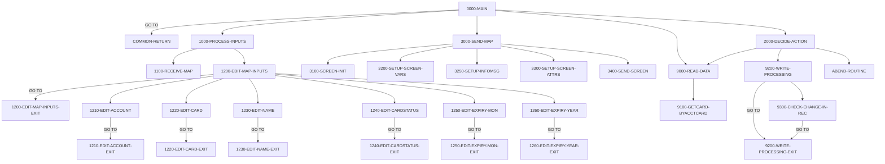

# Program COCRDUPC

| Item | Value |
|---|---|
| Source | `app/cbl/COCRDUPC.cbl` |
| Lines | 1560 total, 1194 code, 195 comment, 171 blank |
| PROGRAM-ID |  |
| Author |  |
| Runtime | cics-online |
| Module | base |
| CICS transactions | CCUP (`app/csd/CARDDEMO.CSD:367-377`) |
| JCL steps | None |
| Paragraphs | 45 |
| Semantic analysis | validated (batch B06) |
| Version banner | * Ver: CardDemo_v1.0-15-g27d6c6f-68 Date: 2022-07-19 23:12:33 CDT |

## Summary

COCRDUPC is a pseudo-conversational CICS program (transaction CCUP, mapset COCRDUP, map CCRDUPA) that updates one credit card record in the CARDDAT VSAM file. The user first supplies (or receives from the card list COCRDLIC) an account number and card number; the card is read by card number and its embossed name, active status and expiry month/year are shown for editing. Edited values are validated (name alphabetic, status Y/N, month 1-12, year 1950-2099); when valid the user is asked to press PF5, after which the record is read for UPDATE, compared with the values originally fetched (optimistic concurrency) and rewritten. A state machine in CCUP-CHANGE-ACTION (not fetched, show details, changes not OK, validated not confirmed, done, lock error, failed) carried in the commarea drives screen content, field protection and messages. PF3 (or completion when entered from the card list) issues SYNCPOINT and XCTLs back to the caller or main menu COMEN01C; PF12 cancels changes by re-reading the card. (Confirmed)

Evidence: `app/cbl/COCRDUPC.cbl:218-254`, `app/cbl/COCRDUPC.cbl:274-321`, `app/cbl/COCRDUPC.cbl:367-544`, `app/cbl/COCRDUPC.cbl:641-715`, `app/cbl/COCRDUPC.cbl:948-1028`, `app/cbl/COCRDUPC.cbl:1420-1520`

Header comment (Unverified, `app/cbl/COCRDUPC.cbl:1-8`): Program:     COCRDUPC.CBL Layer:       Business logic Function:    Accept and process credit card detail request All Rights Reserved. http://www.apache.org/licenses/LICENSE-2.0 Unless required by applicable law or agreed to in writing,

## Divisions and sections

| Division / section | Lines | Notes |
|---|---|---|
| IDENTIFICATION DIVISION | `app/cbl/COCRDUPC.cbl:22-29` |  |
| ENVIRONMENT DIVISION | `app/cbl/COCRDUPC.cbl:30-32` |  |
| DATA DIVISION | `app/cbl/COCRDUPC.cbl:33-365` |  |
| PROCEDURE DIVISION | `app/cbl/COCRDUPC.cbl:366-1560` |  |
| ENVIRONMENT / INPUT-OUTPUT SECTION | `app/cbl/COCRDUPC.cbl:31-32` |  |
| DATA / WORKING-STORAGE SECTION | `app/cbl/COCRDUPC.cbl:35-360` |  |
| DATA / LINKAGE SECTION | `app/cbl/COCRDUPC.cbl:361-365` |  |

## Files and data stores

No SELECT entries (no COBOL file I/O).

CICS file commands (file name resolved from VALUE clauses and the CSD):

| Command | FILE option | Resolved name | CSD DSNAME | CSD evidence | Line |
|---|---|---|---|---|---|
| READ | LIT-CARDFILENAME | CARDDAT | AWS.M2.CARDDEMO.CARDDATA.VSAM.KSDS | `app/csd/CARDDEMO.CSD:25-36` | `app/cbl/COCRDUPC.cbl:1382-1390` |
| READ | LIT-CARDFILENAME | CARDDAT | AWS.M2.CARDDEMO.CARDDATA.VSAM.KSDS | `app/csd/CARDDEMO.CSD:25-36` | `app/cbl/COCRDUPC.cbl:1427-1436` |
| REWRITE | LIT-CARDFILENAME | CARDDAT | AWS.M2.CARDDEMO.CARDDATA.VSAM.KSDS | `app/csd/CARDDEMO.CSD:25-36` | `app/cbl/COCRDUPC.cbl:1477-1483` |

## Embedded CICS, SQL and DL/I commands

| Paragraph | Kind | Verb | Resources | Response | Lines |
|---|---|---|---|---|---|
| 0000-MAIN | CICS | HANDLE ABEND |  |  | `app/cbl/COCRDUPC.cbl:370-372` |
| 0000-MAIN | CICS | SYNCPOINT |  |  | `app/cbl/COCRDUPC.cbl:469-471` |
| 0000-MAIN | CICS | XCTL | PROGRAM(CDEMO-TO-PROGRAM) |  | `app/cbl/COCRDUPC.cbl:473-476` |
| COMMON-RETURN | CICS | RETURN | TRANSID(LIT-THISTRANID) |  | `app/cbl/COCRDUPC.cbl:554-558` |
| 1100-RECEIVE-MAP | CICS | RECEIVE MAP | MAP(LIT-THISMAP), MAPSET(LIT-THISMAPSET) | RESP | `app/cbl/COCRDUPC.cbl:579-584` |
| 3400-SEND-SCREEN | CICS | SEND MAP | MAP(CCARD-NEXT-MAP), MAPSET(CCARD-NEXT-MAPSET) | RESP | `app/cbl/COCRDUPC.cbl:1329-1336` |
| 9100-GETCARD-BYACCTCARD | CICS | READ | FILE(LIT-CARDFILENAME) | RESP | `app/cbl/COCRDUPC.cbl:1382-1390` |
| 9200-WRITE-PROCESSING | CICS | READ | FILE(LIT-CARDFILENAME) | RESP | `app/cbl/COCRDUPC.cbl:1427-1436` |
| 9200-WRITE-PROCESSING | CICS | REWRITE | FILE(LIT-CARDFILENAME) | RESP | `app/cbl/COCRDUPC.cbl:1477-1483` |
| ABEND-ROUTINE | CICS | SEND |  | NOHANDLE | `app/cbl/COCRDUPC.cbl:1539-1544` |
| ABEND-ROUTINE | CICS | HANDLE ABEND |  |  | `app/cbl/COCRDUPC.cbl:1546-1548` |
| ABEND-ROUTINE | CICS | ABEND |  |  | `app/cbl/COCRDUPC.cbl:1550-1552` |

## Calls, transfers and callers

| Mechanism | Target | Parameters | Paragraph | Lines |
|---|---|---|---|---|
| EXEC CICS XCTL | CDEMO-TO-PROGRAM = COCRDLIC, COMEN01C | CARDDEMO-COMMAREA | 0000-MAIN | `app/cbl/COCRDUPC.cbl:473-476` |
| EXEC CICS RETURN | LIT-THISTRANID = CCUP | WS-COMMAREA | COMMON-RETURN | `app/cbl/COCRDUPC.cbl:554-558` |

Programs that transfer to or call this program (from `docs/_work/xref/call-graph.json`):

| Caller | Mechanism | Confidence | Evidence |
|---|---|---|---|
| COCRDLIC | XCTL | Confirmed | `app/cbl/COCRDLIC.cbl:566` |
| COMEN01C | XCTL | Confirmed | `app/cbl/COMEN01C.cbl:185` |

## Copybooks

| Copybook | Statement | Resolution | Resolved path | REPLACING | Line |
|---|---|---|---|---|---|
| [CVCRD01Y](../08-data/layouts/CVCRD01Y.md) | COPY | inventory | app/cpy/CVCRD01Y.cpy |  | `app/cbl/COCRDUPC.cbl:268` |
| [COCOM01Y](../08-data/layouts/COCOM01Y.md) | COPY | inventory | app/cpy/COCOM01Y.cpy |  | `app/cbl/COCRDUPC.cbl:272` |
| DFHBMSCA | COPY | system |  |  | `app/cbl/COCRDUPC.cbl:327` |
| DFHAID | COPY | system |  |  | `app/cbl/COCRDUPC.cbl:328` |
| [COTTL01Y](../08-data/layouts/COTTL01Y.md) | COPY | inventory | app/cpy/COTTL01Y.cpy |  | `app/cbl/COCRDUPC.cbl:332` |
| COCRDUP | COPY | inventory | app/cpy-bms/COCRDUP.CPY |  | `app/cbl/COCRDUPC.cbl:334` |
| [CSDAT01Y](../08-data/layouts/CSDAT01Y.md) | COPY | inventory | app/cpy/CSDAT01Y.cpy |  | `app/cbl/COCRDUPC.cbl:337` |
| [CSMSG01Y](../08-data/layouts/CSMSG01Y.md) | COPY | inventory | app/cpy/CSMSG01Y.cpy |  | `app/cbl/COCRDUPC.cbl:340` |
| [CSMSG02Y](../08-data/layouts/CSMSG02Y.md) | COPY | inventory | app/cpy/CSMSG02Y.cpy |  | `app/cbl/COCRDUPC.cbl:343` |
| [CSUSR01Y](../08-data/layouts/CSUSR01Y.md) | COPY | inventory | app/cpy/CSUSR01Y.cpy |  | `app/cbl/COCRDUPC.cbl:346` |
| [CVACT02Y](../08-data/layouts/CVACT02Y.md) | COPY | inventory | app/cpy/CVACT02Y.cpy |  | `app/cbl/COCRDUPC.cbl:353` |
| [CVCUS01Y](../08-data/layouts/CVCUS01Y.md) | COPY | inventory | app/cpy/CVCUS01Y.cpy |  | `app/cbl/COCRDUPC.cbl:359` |
| [CSSTRPFY](../08-data/layouts/CSSTRPFY.md) | COPY | inventory | app/cpy/CSSTRPFY.cpy |  | `app/cbl/COCRDUPC.cbl:1528` |
| [CVACT01Y](../08-data/layouts/CVACT01Y.md) | COPY | inventory (commented out) | app/cpy/CVACT01Y.cpy |  | `app/cbl/COCRDUPC.cbl:350` |
| [CVACT03Y](../08-data/layouts/CVACT03Y.md) | COPY | inventory (commented out) | app/cpy/CVACT03Y.cpy |  | `app/cbl/COCRDUPC.cbl:356` |

## Data division items

Every data entry coded in this source (copybook contents are on the copybook pages). Lengths are computed from PIC and USAGE.

| Section | Lvl | Name | PIC | Usage | Len | OCCURS | REDEFINES | VALUE | 88-levels | Line |
|---|---|---|---|---|---|---|---|---|---|---|
| WORKING-STORAGE | 01 | WS-MISC-STORAGE |  |  |  |  |  |  |  | 36 |
| WORKING-STORAGE | 05 | WS-CICS-PROCESSNG-VARS |  |  |  |  |  |  |  | 40 |
| WORKING-STORAGE | 07 | WS-RESP-CD | S9(09) | COMP | 4 |  |  | ZEROS |  | 41 |
| WORKING-STORAGE | 07 | WS-REAS-CD | S9(09) | COMP | 4 |  |  | ZEROS |  | 43 |
| WORKING-STORAGE | 07 | WS-TRANID | X(4) |  | 4 |  |  | SPACES |  | 45 |
| WORKING-STORAGE | 07 | WS-UCTRANS | X(4) |  | 4 |  |  | SPACES |  | 47 |
| WORKING-STORAGE | 05 | WS-INPUT-FLAG | X(1) |  | 1 |  |  |  | INPUT-OK = '0'; INPUT-ERROR = '1'; INPUT-PENDING = LOW-VALUES | 53 |
| WORKING-STORAGE | 05 | WS-EDIT-ACCT-FLAG | X(1) |  | 1 |  |  |  | FLG-ACCTFILTER-NOT-OK = '0'; FLG-ACCTFILTER-ISVALID = '1'; FLG-ACCTFILTER-BLANK = ' ' | 57 |
| WORKING-STORAGE | 05 | WS-EDIT-CARD-FLAG | X(1) |  | 1 |  |  |  | FLG-CARDFILTER-NOT-OK = '0'; FLG-CARDFILTER-ISVALID = '1'; FLG-CARDFILTER-BLANK = ' ' | 61 |
| WORKING-STORAGE | 05 | WS-EDIT-CARDNAME-FLAG | X(1) |  | 1 |  |  |  | FLG-CARDNAME-NOT-OK = '0'; FLG-CARDNAME-ISVALID = '1'; FLG-CARDNAME-BLANK = ' ' | 65 |
| WORKING-STORAGE | 05 | WS-EDIT-CARDSTATUS-FLAG | X(1) |  | 1 |  |  |  | FLG-CARDSTATUS-NOT-OK = '0'; FLG-CARDSTATUS-ISVALID = '1'; FLG-CARDSTATUS-BLANK = ' ' | 69 |
| WORKING-STORAGE | 05 | WS-EDIT-CARDEXPMON-FLAG | X(1) |  | 1 |  |  |  | FLG-CARDEXPMON-NOT-OK = '0'; FLG-CARDEXPMON-ISVALID = '1'; FLG-CARDEXPMON-BLANK = ' ' | 73 |
| WORKING-STORAGE | 05 | WS-EDIT-CARDEXPYEAR-FLAG | X(1) |  | 1 |  |  |  | FLG-CARDEXPYEAR-NOT-OK = '0'; FLG-CARDEXPYEAR-ISVALID = '1'; FLG-CARDEXPYEAR-BLANK = ' ' | 77 |
| WORKING-STORAGE | 05 | WS-RETURN-FLAG | X(1) |  | 1 |  |  |  | WS-RETURN-FLAG-OFF = LOW-VALUES; WS-RETURN-FLAG-ON = '1' | 81 |
| WORKING-STORAGE | 05 | WS-PFK-FLAG | X(1) |  | 1 |  |  |  | PFK-VALID = '0'; PFK-INVALID = '1' | 84 |
| WORKING-STORAGE | 05 | CARD-NAME-CHECK | X(50) |  | 50 |  |  | LOW-VALUES |  | 87 |
| WORKING-STORAGE | 05 | FLG-YES-NO-CHECK | X(1) |  | 1 |  |  | 'N' | FLG-YES-NO-VALID = 'Y', 'N' | 89 |
| WORKING-STORAGE | 05 | CARD-MONTH-CHECK | X(2) |  | 2 |  |  |  |  | 92 |
| WORKING-STORAGE | 05 | CARD-MONTH-CHECK-N | 9(2) |  | 2 |  | CARD-MONTH-CHECK |  | VALID-MONTH = 1 THRU 12 | 93 |
| WORKING-STORAGE | 05 | CARD-YEAR-CHECK | X(4) |  | 4 |  |  |  |  | 96 |
| WORKING-STORAGE | 05 | CARD-YEAR-CHECK-N | 9(4) |  | 4 |  | CARD-YEAR-CHECK |  | VALID-YEAR = 1950 THRU 2099 | 97 |
| WORKING-STORAGE | 05 | CICS-OUTPUT-EDIT-VARS |  |  |  |  |  |  |  | 103 |
| WORKING-STORAGE | 10 | CARD-ACCT-ID-X | X(11) |  | 11 |  |  |  |  | 104 |
| WORKING-STORAGE | 10 | CARD-ACCT-ID-N | 9(11) |  | 11 |  | CARD-ACCT-ID-X |  |  | 105 |
| WORKING-STORAGE | 10 | CARD-CVV-CD-X | X(03) |  | 3 |  |  |  |  | 107 |
| WORKING-STORAGE | 10 | CARD-CVV-CD-N | 9(03) |  | 3 |  | CARD-CVV-CD-X |  |  | 108 |
| WORKING-STORAGE | 10 | CARD-CARD-NUM-X | X(16) |  | 16 |  |  |  |  | 110 |
| WORKING-STORAGE | 10 | CARD-CARD-NUM-N | 9(16) |  | 16 |  | CARD-CARD-NUM-X |  |  | 111 |
| WORKING-STORAGE | 10 | CARD-NAME-EMBOSSED-X | X(50) |  | 50 |  |  |  |  | 113 |
| WORKING-STORAGE | 10 | CARD-STATUS-X | X |  | 1 |  |  |  |  | 114 |
| WORKING-STORAGE | 10 | CARD-EXPIRAION-DATE-X | X(10) |  | 10 |  |  |  |  | 115 |
| WORKING-STORAGE | 10 | FILLER |  |  |  |  | CARD-EXPIRAION-DATE-X |  |  | 116 |
| WORKING-STORAGE | 20 | CARD-EXPIRY-YEAR | X(4) |  | 4 |  |  |  |  | 117 |
| WORKING-STORAGE | 20 | FILLER | X(1) |  | 1 |  |  |  |  | 118 |
| WORKING-STORAGE | 20 | CARD-EXPIRY-MONTH | X(2) |  | 2 |  |  |  |  | 119 |
| WORKING-STORAGE | 20 | FILLER | X(1) |  | 1 |  |  |  |  | 120 |
| WORKING-STORAGE | 20 | CARD-EXPIRY-DAY | X(2) |  | 2 |  |  |  |  | 121 |
| WORKING-STORAGE | 10 | CARD-EXPIRAION-DATE-N | 9(10) |  | 10 |  | CARD-EXPIRAION-DATE-X |  |  | 122 |
| WORKING-STORAGE | 05 | WS-CARD-RID |  |  |  |  |  |  |  | 128 |
| WORKING-STORAGE | 10 | WS-CARD-RID-CARDNUM | X(16) |  | 16 |  |  |  |  | 129 |
| WORKING-STORAGE | 10 | WS-CARD-RID-ACCT-ID | 9(11) |  | 11 |  |  |  |  | 130 |
| WORKING-STORAGE | 10 | WS-CARD-RID-ACCT-ID-X | X(11) |  | 11 |  | WS-CARD-RID-ACCT-ID |  |  | 131 |
| WORKING-STORAGE | 05 | WS-FILE-ERROR-MESSAGE |  |  |  |  |  |  |  | 133 |
| WORKING-STORAGE | 10 | FILLER | X(12) |  | 12 |  |  | 'File Error: ' |  | 134 |
| WORKING-STORAGE | 10 | ERROR-OPNAME | X(8) |  | 8 |  |  | SPACES |  | 136 |
| WORKING-STORAGE | 10 | FILLER | X(4) |  | 4 |  |  | ' on ' |  | 138 |
| WORKING-STORAGE | 10 | ERROR-FILE | X(9) |  | 9 |  |  | SPACES |  | 140 |
| WORKING-STORAGE | 10 | FILLER | X(15) |  | 15 |  |  | ' returned RESP ' |  | 142 |
| WORKING-STORAGE | 10 | ERROR-RESP | X(10) |  | 10 |  |  | SPACES |  | 145 |
| WORKING-STORAGE | 10 | FILLER | X(7) |  | 7 |  |  | ',RESP2 ' |  | 147 |
| WORKING-STORAGE | 10 | ERROR-RESP2 | X(10) |  | 10 |  |  | SPACES |  | 149 |
| WORKING-STORAGE | 10 | FILLER | X(5) |  | 5 |  |  | SPACES |  | 151 |
| WORKING-STORAGE | 05 | WS-LONG-MSG | X(500) |  | 500 |  |  |  |  | 156 |
| WORKING-STORAGE | 05 | WS-INFO-MSG | X(40) |  | 40 |  |  |  | WS-NO-INFO-MESSAGE = SPACES LOW-VALUES; FOUND-CARDS-FOR-ACCOUNT = 'Details of selected card shown above'; PROMPT-FOR-SEARCH-KEYS = 'Please enter Account and Card Number'; PROMPT-FOR-CHANGES = 'Update | 157 |
| WORKING-STORAGE | 05 | WS-RETURN-MSG | X(75) |  | 75 |  |  |  | WS-RETURN-MSG-OFF = SPACES; WS-EXIT-MESSAGE = 'PF03 pressed.Exiting '; WS-PROMPT-FOR-ACCT = 'Account number not provided'; WS-PROMPT-FOR-CARD = 'Card number not provided'; WS-PROMPT-FOR-NAME = 'Card n | 173 |
| WORKING-STORAGE | 01 | WS-LITERALS |  |  |  |  |  |  |  | 218 |
| WORKING-STORAGE | 05 | LIT-THISPGM | X(8) |  | 8 |  |  | 'COCRDUPC' |  | 219 |
| WORKING-STORAGE | 05 | LIT-THISTRANID | X(4) |  | 4 |  |  | 'CCUP' |  | 221 |
| WORKING-STORAGE | 05 | LIT-THISMAPSET | X(8) |  | 8 |  |  | 'COCRDUP ' |  | 223 |
| WORKING-STORAGE | 05 | LIT-THISMAP | X(7) |  | 7 |  |  | 'CCRDUPA' |  | 225 |
| WORKING-STORAGE | 05 | LIT-CCLISTPGM | X(8) |  | 8 |  |  | 'COCRDLIC' |  | 227 |
| WORKING-STORAGE | 05 | LIT-CCLISTTRANID | X(4) |  | 4 |  |  | 'CCLI' |  | 229 |
| WORKING-STORAGE | 05 | LIT-CCLISTMAPSET | X(7) |  | 7 |  |  | 'COCRDLI' |  | 231 |
| WORKING-STORAGE | 05 | LIT-CCLISTMAP | X(7) |  | 7 |  |  | 'CCRDSLA' |  | 233 |
| WORKING-STORAGE | 05 | LIT-MENUPGM | X(8) |  | 8 |  |  | 'COMEN01C' |  | 235 |
| WORKING-STORAGE | 05 | LIT-MENUTRANID | X(4) |  | 4 |  |  | 'CM00' |  | 237 |
| WORKING-STORAGE | 05 | LIT-MENUMAPSET | X(7) |  | 7 |  |  | 'COMEN01' |  | 239 |
| WORKING-STORAGE | 05 | LIT-MENUMAP | X(7) |  | 7 |  |  | 'COMEN1A' |  | 241 |
| WORKING-STORAGE | 05 | LIT-CARDDTLPGM | X(8) |  | 8 |  |  | 'COCRDSLC' |  | 243 |
| WORKING-STORAGE | 05 | LIT-CARDDTLTRANID | X(4) |  | 4 |  |  | 'CCDL' |  | 245 |
| WORKING-STORAGE | 05 | LIT-CARDDTLMAPSET | X(7) |  | 7 |  |  | 'COCRDSL' |  | 247 |
| WORKING-STORAGE | 05 | LIT-CARDDTLMAP | X(7) |  | 7 |  |  | 'CCRDSLA' |  | 249 |
| WORKING-STORAGE | 05 | LIT-CARDFILENAME | X(8) |  | 8 |  |  | 'CARDDAT ' |  | 251 |
| WORKING-STORAGE | 05 | LIT-CARDFILENAME-ACCT-PATH | X(8) |  | 8 |  |  | 'CARDAIX ' |  | 253 |
| WORKING-STORAGE | 05 | LIT-ALL-ALPHA-FROM | X(52) |  | 52 |  |  | 'ABCDEFGHIJKLMNOPQRSTUVWXYZabcdefghijklmnopqrstuvwxyz' |  | 255 |
| WORKING-STORAGE | 05 | LIT-ALL-SPACES-TO | X(52) |  | 52 |  |  | SPACES |  | 258 |
| WORKING-STORAGE | 05 | LIT-UPPER | X(26) |  | 26 |  |  | 'ABCDEFGHIJKLMNOPQRSTUVWXYZ' |  | 260 |
| WORKING-STORAGE | 05 | LIT-LOWER | X(26) |  | 26 |  |  | 'abcdefghijklmnopqrstuvwxyz' |  | 262 |
| WORKING-STORAGE | 01 | WS-THIS-PROGCOMMAREA |  |  |  |  |  |  |  | 274 |
| WORKING-STORAGE | 05 | CARD-UPDATE-SCREEN-DATA |  |  |  |  |  |  |  | 275 |
| WORKING-STORAGE | 10 | CCUP-CHANGE-ACTION | X(1) |  | 1 |  |  | LOW-VALUES | CCUP-DETAILS-NOT-FETCHED = LOW-VALUES, SPACES; CCUP-SHOW-DETAILS = 'S'; CCUP-CHANGES-MADE = 'E', 'N' , 'C', 'L' , 'F'; CCUP-CHANGES-NOT-OK = 'E'; CCUP-CHANGES-OK-NOT-CONFIRMED = 'N'; CCUP-CHANGES-OKAY | 276 |
| WORKING-STORAGE | 05 | CCUP-OLD-DETAILS |  |  |  |  |  |  |  | 291 |
| WORKING-STORAGE | 10 | CCUP-OLD-ACCTID | X(11) |  | 11 |  |  |  |  | 292 |
| WORKING-STORAGE | 10 | CCUP-OLD-CARDID | X(16) |  | 16 |  |  |  |  | 293 |
| WORKING-STORAGE | 10 | CCUP-OLD-CVV-CD | X(3) |  | 3 |  |  |  |  | 294 |
| WORKING-STORAGE | 10 | CCUP-OLD-CARDDATA |  |  |  |  |  |  |  | 295 |
| WORKING-STORAGE | 20 | CCUP-OLD-CRDNAME | X(50) |  | 50 |  |  |  |  | 296 |
| WORKING-STORAGE | 20 | CCUP-OLD-EXPIRAION-DATE |  |  |  |  |  |  |  | 297 |
| WORKING-STORAGE | 25 | CCUP-OLD-EXPYEAR | X(4) |  | 4 |  |  |  |  | 298 |
| WORKING-STORAGE | 25 | CCUP-OLD-EXPMON | X(2) |  | 2 |  |  |  |  | 299 |
| WORKING-STORAGE | 25 | CCUP-OLD-EXPDAY | X(2) |  | 2 |  |  |  |  | 300 |
| WORKING-STORAGE | 20 | CCUP-OLD-CRDSTCD | X(1) |  | 1 |  |  |  |  | 301 |
| WORKING-STORAGE | 05 | CCUP-NEW-DETAILS |  |  |  |  |  |  |  | 303 |
| WORKING-STORAGE | 10 | CCUP-NEW-ACCTID | X(11) |  | 11 |  |  |  |  | 304 |
| WORKING-STORAGE | 10 | CCUP-NEW-CARDID | X(16) |  | 16 |  |  |  |  | 305 |
| WORKING-STORAGE | 10 | CCUP-NEW-CVV-CD | X(3) |  | 3 |  |  |  |  | 306 |
| WORKING-STORAGE | 10 | CCUP-NEW-CARDDATA |  |  |  |  |  |  |  | 307 |
| WORKING-STORAGE | 20 | CCUP-NEW-CRDNAME | X(50) |  | 50 |  |  |  |  | 308 |
| WORKING-STORAGE | 20 | CCUP-NEW-EXPIRAION-DATE |  |  |  |  |  |  |  | 309 |
| WORKING-STORAGE | 25 | CCUP-NEW-EXPYEAR | X(4) |  | 4 |  |  |  |  | 310 |
| WORKING-STORAGE | 25 | CCUP-NEW-EXPMON | X(2) |  | 2 |  |  |  |  | 311 |
| WORKING-STORAGE | 25 | CCUP-NEW-EXPDAY | X(2) |  | 2 |  |  |  |  | 312 |
| WORKING-STORAGE | 20 | CCUP-NEW-CRDSTCD | X(1) |  | 1 |  |  |  |  | 313 |
| WORKING-STORAGE | 05 | CARD-UPDATE-RECORD |  |  |  |  |  |  |  | 314 |
| WORKING-STORAGE | 10 | CARD-UPDATE-NUM | X(16) |  | 16 |  |  |  |  | 315 |
| WORKING-STORAGE | 10 | CARD-UPDATE-ACCT-ID | 9(11) |  | 11 |  |  |  |  | 316 |
| WORKING-STORAGE | 10 | CARD-UPDATE-CVV-CD | 9(03) |  | 3 |  |  |  |  | 317 |
| WORKING-STORAGE | 10 | CARD-UPDATE-EMBOSSED-NAME | X(50) |  | 50 |  |  |  |  | 318 |
| WORKING-STORAGE | 10 | CARD-UPDATE-EXPIRAION-DATE | X(10) |  | 10 |  |  |  |  | 319 |
| WORKING-STORAGE | 10 | CARD-UPDATE-ACTIVE-STATUS | X(01) |  | 1 |  |  |  |  | 320 |
| WORKING-STORAGE | 10 | FILLER | X(59) |  | 59 |  |  |  |  | 321 |
| WORKING-STORAGE | 01 | WS-COMMAREA | X(2000) |  | 2000 |  |  |  |  | 324 |
| LINKAGE | 01 | DFHCOMMAREA |  |  |  |  |  |  |  | 362 |
| LINKAGE | 05 | FILLER | X(1) |  | 1 | 1 TO 32767 DEPENDING ON EIBCALEN |  |  |  | 363 |

## Statement inventory

Every procedure statement the parser recorded, by kind. Each one is listed with its line under Paragraph details.

| Kind | Count |
|---|---|
| Decisions (IF, EVALUATE, WHEN, loops, handlers) | 139 |
| Calculations | 0 |
| File I/O | 0 |
| EXEC CICS / SQL / DLI | 12 |
| CALL | 0 |
| PERFORM | 26 |
| GO TO | 21 |
| MOVE literal | 20 |
| MOVE field | 151 |
| SET | 104 |
| STRING, UNSTRING, INSPECT, INITIALIZE, COPY, ENTRY and others | 12 |
| DISPLAY | 0 |
| GOBACK, STOP RUN, RETURN, XCTL | 3 |
| Not classified by the parser | 0 |

## Control flow

| Paragraph | Lines | Logic | Performs | Performed by | Reachable |
|---|---|---|---|---|---|
| [0000-MAIN](#para-0000-main) | 367-544 | Sets ABEND-ROUTINE as abend handler, initializes work areas and clears WS-RETURN-MSG. On EIBCALEN 0 or first entry from COMEN01C it initializes the commarea and sets CDEMO-PGM-ENTER / CCUP-DETAILS-NOT-FETCHED, else restores CARDDEMO-COMMAREA and WS-THIS-PROGCOMMAREA. After mapping the AID and validating it, an EVALUATE routes: PF3 or finished/failed update from the card list -> SYNCPOINT and XCTL to caller/menu; entry or PF12 from COCRDLIC -> read card and show details; fresh entry -> blank search screen; after done/failed -> reset and prompt for new keys; otherwise process inputs, decide action and send the map. (Confirmed) | 1000-PROCESS-INPUTS, 2000-DECIDE-ACTION, 3000-SEND-MAP, 9000-READ-DATA, YYYY-STORE-PFKEY |  | yes |
| [COMMON-RETURN](#para-common-return) | 546-559 | Moves WS-RETURN-MSG to CCARD-ERROR-MSG, concatenates CARDDEMO-COMMAREA and WS-THIS-PROGCOMMAREA into WS-COMMAREA and issues CICS RETURN TRANSID(CCUP) with the 2000-byte commarea. (Confirmed) |  | 0000-MAIN | yes |
| [0000-MAIN-EXIT](#para-0000-main-exit) | 560-562 | Exit paragraph for 0000-MAIN; contains only EXIT. (Confirmed) |  |  | no static path |
| [1000-PROCESS-INPUTS](#para-1000-process-inputs) | 564-573 | Performs 1100-RECEIVE-MAP and 1200-EDIT-MAP-INPUTS, then copies WS-RETURN-MSG to CCARD-ERROR-MSG and sets the next program/mapset/map to COCRDUPC/COCRDUP/CCRDUPA. (Confirmed) | 1100-RECEIVE-MAP, 1200-EDIT-MAP-INPUTS | 0000-MAIN | yes |
| [1000-PROCESS-INPUTS-EXIT](#para-1000-process-inputs-exit) | 575-577 | Exit paragraph for 1000-PROCESS-INPUTS; contains only EXIT. (Confirmed) |  | 0000-MAIN | yes |
| [1100-RECEIVE-MAP](#para-1100-receive-map) | 578-636 | Receives map CCRDUPA into CCRDUPAI (RESP not checked) and initializes CCUP-NEW-DETAILS. For account, card, name, status, expiry month and expiry year an input of '*' or SPACES becomes LOW-VALUES, otherwise the input is copied to CC-ACCT-ID/CC-CARD-NUM and the CCUP-NEW-* fields; the expiry day EXPDAYI is copied to CCUP-NEW-EXPDAY without normalisation. (Confirmed) |  | 1000-PROCESS-INPUTS | yes |
| [1100-RECEIVE-MAP-EXIT](#para-1100-receive-map-exit) | 638-640 | Exit paragraph for 1100-RECEIVE-MAP; contains only EXIT. (Confirmed) |  | 1000-PROCESS-INPUTS | yes |
| [1200-EDIT-MAP-INPUTS](#para-1200-edit-map-inputs) | 641-715 | If details are not yet fetched, edits only the account and card keys (1210/1220), sets 'No input received' when both are blank and exits. Otherwise restores the fetched values from CCUP-OLD-*, sets NO-CHANGES-DETECTED when the upper-cased new card data equals the old, and skips the detail edits when there is no change or the state is already validated/done. Else it sets CCUP-CHANGES-NOT-OK, performs the name, status, month and year edits, and sets CCUP-CHANGES-OK-NOT-CONFIRMED when no INPUT-ERROR resulted. (Confirmed) | 1210-EDIT-ACCOUNT, 1220-EDIT-CARD, 1230-EDIT-NAME, 1240-EDIT-CARDSTATUS, 1250-EDIT-EXPIRY-MON, 1260-EDIT-EXPIRY-YEAR | 1000-PROCESS-INPUTS | yes |
| [1200-EDIT-MAP-INPUTS-EXIT](#para-1200-edit-map-inputs-exit) | 717-719 | Exit paragraph for 1200-EDIT-MAP-INPUTS; target of its GO TO statements. (Confirmed) |  | 1000-PROCESS-INPUTS, 1200-EDIT-MAP-INPUTS | yes |
| [1210-EDIT-ACCOUNT](#para-1210-edit-account) | 721-756 | Blank/LOW-VALUES/zero CC-ACCT-ID sets INPUT-ERROR, FLG-ACCTFILTER-BLANK and (if no message yet) 'Account number not provided'; a non-numeric value sets INPUT-ERROR, FLG-ACCTFILTER-NOT-OK and 'ACCOUNT FILTER,IF SUPPLIED MUST BE A 11 DIGIT NUMBER'. A valid value is moved to CDEMO-ACCT-ID and CCUP-NEW-ACCTID and FLG-ACCTFILTER-ISVALID is set. (Confirmed) |  | 1200-EDIT-MAP-INPUTS | yes |
| [1210-EDIT-ACCOUNT-EXIT](#para-1210-edit-account-exit) | 758-760 | Exit paragraph for 1210-EDIT-ACCOUNT; target of its GO TO statements. (Confirmed) |  | 1200-EDIT-MAP-INPUTS, 1210-EDIT-ACCOUNT | yes |
| [1220-EDIT-CARD](#para-1220-edit-card) | 762-800 | Blank/LOW-VALUES/zero CC-CARD-NUM sets INPUT-ERROR, FLG-CARDFILTER-BLANK and 'Card number not provided'; a non-numeric value sets INPUT-ERROR, FLG-CARDFILTER-NOT-OK and 'CARD ID FILTER,IF SUPPLIED MUST BE A 16 DIGIT NUMBER'. A valid value is moved to CDEMO-CARD-NUM and CCUP-NEW-CARDID and FLG-CARDFILTER-ISVALID is set. (Confirmed) |  | 1200-EDIT-MAP-INPUTS | yes |
| [1220-EDIT-CARD-EXIT](#para-1220-edit-card-exit) | 802-804 | Exit paragraph for 1220-EDIT-CARD; target of its GO TO statements. (Confirmed) |  | 1200-EDIT-MAP-INPUTS, 1220-EDIT-CARD | yes |
| [1230-EDIT-NAME](#para-1230-edit-name) | 806-840 | A blank/LOW-VALUES/zeros CCUP-NEW-CRDNAME sets INPUT-ERROR, FLG-CARDNAME-BLANK and 'Card name not provided'. Otherwise letters A-Z/a-z are converted to spaces in CARD-NAME-CHECK; any remaining non-space character sets INPUT-ERROR, FLG-CARDNAME-NOT-OK and 'Card name can only contain alphabets and spaces', else FLG-CARDNAME-ISVALID. (Confirmed) |  | 1200-EDIT-MAP-INPUTS | yes |
| [1230-EDIT-NAME-EXIT](#para-1230-edit-name-exit) | 841-843 | Exit paragraph for 1230-EDIT-NAME; target of its GO TO statements. (Confirmed) |  | 1200-EDIT-MAP-INPUTS, 1230-EDIT-NAME | yes |
| [1240-EDIT-CARDSTATUS](#para-1240-edit-cardstatus) | 845-873 | A blank/LOW-VALUES/zero CCUP-NEW-CRDSTCD sets INPUT-ERROR, FLG-CARDSTATUS-BLANK and 'Card Active Status must be Y or N'. Otherwise the value is moved to FLG-YES-NO-CHECK; 'Y' or 'N' sets FLG-CARDSTATUS-ISVALID, anything else sets INPUT-ERROR, FLG-CARDSTATUS-NOT-OK and the same message. (Confirmed) |  | 1200-EDIT-MAP-INPUTS | yes |
| [1240-EDIT-CARDSTATUS-EXIT](#para-1240-edit-cardstatus-exit) | 874-876 | Exit paragraph for 1240-EDIT-CARDSTATUS; target of its GO TO statements. (Confirmed) |  | 1200-EDIT-MAP-INPUTS, 1240-EDIT-CARDSTATUS | yes |
| [1250-EDIT-EXPIRY-MON](#para-1250-edit-expiry-mon) | 877-908 | A blank/LOW-VALUES/zero CCUP-NEW-EXPMON sets INPUT-ERROR, FLG-CARDEXPMON-BLANK and 'Card expiry month must be between 1 and 12'. Otherwise the value is moved to CARD-MONTH-CHECK and VALID-MONTH (1 thru 12) sets FLG-CARDEXPMON-ISVALID, else INPUT-ERROR, FLG-CARDEXPMON-NOT-OK and the same message. (Confirmed) |  | 1200-EDIT-MAP-INPUTS | yes |
| [1250-EDIT-EXPIRY-MON-EXIT](#para-1250-edit-expiry-mon-exit) | 910-912 | Exit paragraph for 1250-EDIT-EXPIRY-MON; target of its GO TO statements. (Confirmed) |  | 1200-EDIT-MAP-INPUTS, 1250-EDIT-EXPIRY-MON | yes |
| [1260-EDIT-EXPIRY-YEAR](#para-1260-edit-expiry-year) | 913-944 | A blank/LOW-VALUES/zero CCUP-NEW-EXPYEAR sets INPUT-ERROR, FLG-CARDEXPYEAR-BLANK and 'Invalid card expiry year'. Otherwise the value is moved to CARD-YEAR-CHECK and VALID-YEAR (1950 thru 2099) sets FLG-CARDEXPYEAR-ISVALID, else INPUT-ERROR, FLG-CARDEXPYEAR-NOT-OK and the same message. (Confirmed) |  | 1200-EDIT-MAP-INPUTS | yes |
| [1260-EDIT-EXPIRY-YEAR-EXIT](#para-1260-edit-expiry-year-exit) | 945-947 | Exit paragraph for 1260-EDIT-EXPIRY-YEAR; target of its GO TO statements. (Confirmed) |  | 1200-EDIT-MAP-INPUTS, 1260-EDIT-EXPIRY-YEAR | yes |
| [2000-DECIDE-ACTION](#para-2000-decide-action) | 948-1028 | EVALUATEs the update state: not fetched or PF12 -> read the card when both keys are valid and set CCUP-SHOW-DETAILS if found; show details -> mark validated-not-confirmed unless input error or no change; changes not OK -> no action; validated and PF5 -> 9200-WRITE-PROCESSING then set lock-error (L), failed (F), back to show details when changed by someone else, or done (C); validated without PF5 -> no action; done -> show details and clear the account/card in the commarea when there is no calling transaction; any other state -> ABEND-ROUTINE with 'UNEXPECTED DATA SCENARIO'. (Confirmed) | 9000-READ-DATA, 9200-WRITE-PROCESSING, ABEND-ROUTINE | 0000-MAIN | yes |
| [2000-DECIDE-ACTION-EXIT](#para-2000-decide-action-exit) | 1029-1031 | Exit paragraph for 2000-DECIDE-ACTION; contains only EXIT. (Confirmed) |  | 0000-MAIN | yes |
| [3000-SEND-MAP](#para-3000-send-map) | 1035-1046 | Builds and sends the update screen by performing 3100-SCREEN-INIT, 3200-SETUP-SCREEN-VARS, 3250-SETUP-INFOMSG, 3300-SETUP-SCREEN-ATTRS and 3400-SEND-SCREEN. (Confirmed) | 3100-SCREEN-INIT, 3200-SETUP-SCREEN-VARS, 3250-SETUP-INFOMSG, 3300-SETUP-SCREEN-ATTRS, 3400-SEND-SCREEN | 0000-MAIN | yes |
| [3000-SEND-MAP-EXIT](#para-3000-send-map-exit) | 1048-1050 | Exit paragraph for 3000-SEND-MAP; contains only EXIT. (Confirmed) |  | 0000-MAIN | yes |
| [3100-SCREEN-INIT](#para-3100-screen-init) | 1052-1076 | Clears CCRDUPAO and fills titles, transaction CCUP, program COCRDUPC, the current date MM/DD/YY and time HH:MM:SS. (Confirmed) |  | 3000-SEND-MAP | yes |
| [3100-SCREEN-INIT-EXIT](#para-3100-screen-init-exit) | 1078-1080 | Exit paragraph for 3100-SCREEN-INIT; contains only EXIT. (Confirmed) |  | 3000-SEND-MAP | yes |
| [3200-SETUP-SCREEN-VARS](#para-3200-setup-screen-vars) | 1082-1134 | Does nothing when CDEMO-PGM-ENTER. Otherwise moves CC-ACCT-ID and CC-CARD-NUM to ACCTSIDO and CARDSIDO (LOW-VALUES when the numeric value is 0) and, by state: CCUP-DETAILS-NOT-FETCHED clears CRDNAMEO, CRDSTCDO and the expiry fields; CCUP-SHOW-DETAILS and WHEN OTHER show the CCUP-OLD-* values; CCUP-CHANGES-MADE shows CCUP-NEW-CRDNAME, CCUP-NEW-CRDSTCD, CCUP-NEW-EXPMON and CCUP-NEW-EXPYEAR but keeps CCUP-OLD-EXPDAY in EXPDAYO. (Confirmed) |  | 3000-SEND-MAP | yes |
| [3200-SETUP-SCREEN-VARS-EXIT](#para-3200-setup-screen-vars-exit) | 1135-1137 | Exit paragraph for 3200-SETUP-SCREEN-VARS; contains only EXIT. (Confirmed) |  | 3000-SEND-MAP | yes |
| [3250-SETUP-INFOMSG](#para-3250-setup-infomsg) | 1138-1164 | Chooses the info line by state: 'Please enter Account and Card Number', 'Details of selected card shown above', 'Update card details presented above.', 'Changes validated.Press F5 to save', 'Changes committed to database' or 'Changes unsuccessful. Please try again'; then moves WS-INFO-MSG and WS-RETURN-MSG to the map. (Confirmed) |  | 3000-SEND-MAP | yes |
| [3250-SETUP-INFOMSG-EXIT](#para-3250-setup-infomsg-exit) | 1165-1167 | Exit paragraph for 3250-SETUP-INFOMSG; contains only EXIT. (Confirmed) |  | 3000-SEND-MAP | yes |
| [3300-SETUP-SCREEN-ATTRS](#para-3300-setup-screen-attrs) | 1168-1318 | Sets attributes by state: CCUP-DETAILS-NOT-FETCHED and WHEN OTHER make ACCTSIDA/CARDSIDA enterable (DFHBMFSE) and card fields protected (DFHBMPRF); CCUP-SHOW-DETAILS and CCUP-CHANGES-NOT-OK protect the keys and open CRDNAMEA, CRDSTCDA, EXPMONA, EXPYEARA; confirmed or done states protect everything. It places the cursor (-1 length) on CRDNAMEL when FOUND-CARDS-FOR-ACCOUNT or NO-CHANGES-DETECTED, otherwise on the first field whose FLG-*-NOT-OK or FLG-*-BLANK flag is set (account, card, name, status, expiry month, expiry year), defaulting to ACCTSIDL. It uses DFHDFCOL for the keys when CDEMO-LAST-MAPSET is LIT-CCLISTMAPSET, colours fields in error DFHRED and shows '*' in blank required fields, darkens EXPDAYC, sets INFOMSGA dark when WS-NO-INFO-MESSAGE else bright, and brightens FKEYSCA when PROMPT-FOR-CONFIRMATION. (Confirmed) |  | 3000-SEND-MAP | yes |
| [3300-SETUP-SCREEN-ATTRS-EXIT](#para-3300-setup-screen-attrs-exit) | 1319-1321 | Exit paragraph for 3300-SETUP-SCREEN-ATTRS; contains only EXIT. (Confirmed) |  | 3000-SEND-MAP | yes |
| [3400-SEND-SCREEN](#para-3400-send-screen) | 1324-1337 | Sends map CCRDUPA of mapset COCRDUP from CCRDUPAO with CURSOR, ERASE and FREEKB; RESP is captured but not tested. (Confirmed) |  | 3000-SEND-MAP | yes |
| [3400-SEND-SCREEN-EXIT](#para-3400-send-screen-exit) | 1338-1340 | Exit paragraph for 3400-SEND-SCREEN; contains only EXIT. (Confirmed) |  | 3000-SEND-MAP | yes |
| [9000-READ-DATA](#para-9000-read-data) | 1343-1370 | Initializes CCUP-OLD-DETAILS with the requested account/card, performs 9100-GETCARD-BYACCTCARD and, when found, saves CVV, the embossed name converted to upper case, expiry year/month/day (positions 1-4, 6-7, 9-10 of CARD-EXPIRAION-DATE) and active status into CCUP-OLD-*. (Confirmed) | 9100-GETCARD-BYACCTCARD | 0000-MAIN, 2000-DECIDE-ACTION | yes |
| [9000-READ-DATA-EXIT](#para-9000-read-data-exit) | 1372-1374 | Exit paragraph for 9000-READ-DATA; contains only EXIT. (Confirmed) |  | 0000-MAIN, 2000-DECIDE-ACTION | yes |
| [9100-GETCARD-BYACCTCARD](#para-9100-getcard-byacctcard) | 1376-1413 | Reads CARDDAT by the 16-byte card number (account key move commented out). NORMAL sets FOUND-CARDS-FOR-ACCOUNT; NOTFND sets INPUT-ERROR, both key flags NOT-OK and 'Did not find cards for this search condition'; other responses set INPUT-ERROR and a 'File Error: READ on CARDDAT ...' message. (Confirmed) |  | 9000-READ-DATA | yes |
| [9100-GETCARD-BYACCTCARD-EXIT](#para-9100-getcard-byacctcard-exit) | 1415-1417 | Exit paragraph for 9100-GETCARD-BYACCTCARD; contains only EXIT. (Confirmed) |  | 9000-READ-DATA | yes |
| [9200-WRITE-PROCESSING](#para-9200-write-processing) | 1420-1493 | Reads CARDDAT for UPDATE by card number; a non-NORMAL response sets INPUT-ERROR and 'Could not lock record for update'. It then performs 9300-CHECK-CHANGE-IN-REC and stops if the record changed. Otherwise it builds CARD-UPDATE-RECORD from CCUP-NEW-CARDID, CC-ACCT-ID-N, CCUP-NEW-CVV-CD, CCUP-NEW-CRDNAME, expiry 'YYYY-MM-DD' and CCUP-NEW-CRDSTCD and REWRITEs it; a non-NORMAL REWRITE sets 'Update of record failed'. (Confirmed) | 9300-CHECK-CHANGE-IN-REC | 2000-DECIDE-ACTION | yes |
| [9200-WRITE-PROCESSING-EXIT](#para-9200-write-processing-exit) | 1494-1496 | Exit paragraph for 9200-WRITE-PROCESSING; also the GO TO target from 9300-CHECK-CHANGE-IN-REC. (Confirmed) |  | 2000-DECIDE-ACTION, 9200-WRITE-PROCESSING, 9300-CHECK-CHANGE-IN-REC | yes |
| [9300-CHECK-CHANGE-IN-REC](#para-9300-check-change-in-rec) | 1498-1520 | Upper-cases the embossed name of the locked record and compares CVV, name, expiry year/month/day and active status with CCUP-OLD-*. On any difference it sets 'Record changed by some one else. Please review', refreshes CCUP-OLD-* with the current record values and jumps to 9200-WRITE-PROCESSING-EXIT. (Confirmed) |  | 9200-WRITE-PROCESSING | yes |
| [9300-CHECK-CHANGE-IN-REC-EXIT](#para-9300-check-change-in-rec-exit) | 1521-1529 | Exit paragraph for 9300-CHECK-CHANGE-IN-REC; the range also holds COPY 'CSSTRPFY', which inserts YYYY-STORE-PFKEY mapping EIBAID to CCARD-AID (PF13-24 folded to PF1-12). (Confirmed) |  | 9200-WRITE-PROCESSING | yes |
| [ABEND-ROUTINE](#para-abend-routine) | 1531-1553 | Defaults ABEND-MSG to 'UNEXPECTED ABEND OCCURRED.', sets ABEND-CULPRIT to COCRDUPC, sends ABEND-DATA with ERASE (NOHANDLE), cancels the abend handler and abends with code 9999. (Confirmed) |  | 2000-DECIDE-ACTION | yes |
| [ABEND-ROUTINE-EXIT](#para-abend-routine-exit) | 1554-1556 | Exit paragraph for ABEND-ROUTINE; never reached in practice because the routine ends with CICS ABEND. (Confirmed) |  | 2000-DECIDE-ACTION | yes |

## Paragraph details

### Para 0000-MAIN

Lines `app/cbl/COCRDUPC.cbl:367-544`. 

Logic: Sets ABEND-ROUTINE as abend handler, initializes work areas and clears WS-RETURN-MSG. On EIBCALEN 0 or first entry from COMEN01C it initializes the commarea and sets CDEMO-PGM-ENTER / CCUP-DETAILS-NOT-FETCHED, else restores CARDDEMO-COMMAREA and WS-THIS-PROGCOMMAREA. After mapping the AID and validating it, an EVALUATE routes: PF3 or finished/failed update from the card list -> SYNCPOINT and XCTL to caller/menu; entry or PF12 from COCRDLIC -> read card and show details; fresh entry -> blank search screen; after done/failed -> reset and prompt for new keys; otherwise process inputs, decide action and send the map. (Confirmed)

Rules: [BR-COCRDUPC-001](../09-business-rules-catalog.md#br-cocrdupc-001), [BR-COCRDUPC-002](../09-business-rules-catalog.md#br-cocrdupc-002), [BR-COCRDUPC-003](../09-business-rules-catalog.md#br-cocrdupc-003), [BR-COCRDUPC-004](../09-business-rules-catalog.md#br-cocrdupc-004), [BR-COCRDUPC-005](../09-business-rules-catalog.md#br-cocrdupc-005), [BR-COCRDUPC-006](../09-business-rules-catalog.md#br-cocrdupc-006)

Statements in source order:

- EXEC CICS HANDLE ABEND at `app/cbl/COCRDUPC.cbl:370-372`
- `INITIALIZE CC-WORK-AREA WS-MISC-STORAGE WS-COMMAREA` at `app/cbl/COCRDUPC.cbl:374-376`
- `MOVE LIT-THISTRANID TO WS-TRANID` at `app/cbl/COCRDUPC.cbl:380`
- `SET WS-RETURN-MSG-OFF TO TRUE` at `app/cbl/COCRDUPC.cbl:384`
- IF `EIBCALEN IS EQUAL TO 0 OR (CDEMO-FROM-PROGRAM = LIT-MENUPGM AND NOT CDEMO-PGM-REENTER)` at `app/cbl/COCRDUPC.cbl:388-390` (pseudo-conversation)
- `INITIALIZE CARDDEMO-COMMAREA WS-THIS-PROGCOMMAREA` at `app/cbl/COCRDUPC.cbl:391-392`
- `SET CDEMO-PGM-ENTER TO TRUE` at `app/cbl/COCRDUPC.cbl:393`
- `SET CCUP-DETAILS-NOT-FETCHED TO TRUE` at `app/cbl/COCRDUPC.cbl:394`
- `MOVE DFHCOMMAREA (1:LENGTH OF CARDDEMO-COMMAREA) TO CARDDEMO-COMMAREA` at `app/cbl/COCRDUPC.cbl:396-397`
- `MOVE DFHCOMMAREA(LENGTH OF CARDDEMO-COMMAREA + 1: LENGTH OF WS-THIS-PROGCOMMAREA ) TO WS-THIS-PROGCOMMAREA` at `app/cbl/COCRDUPC.cbl:398-400`
- PERFORM YYYY-STORE-PFKEY THRU YYYY-STORE-PFKEY-EXIT at `app/cbl/COCRDUPC.cbl:406-407`
- `SET PFK-INVALID TO TRUE` at `app/cbl/COCRDUPC.cbl:413`
- IF `CCARD-AID-ENTER OR CCARD-AID-PFK03 OR (CCARD-AID-PFK05 AND CCUP-CHANGES-OK-NOT-CONFIRMED) OR (CCARD-AID-PFK12 AND NOT CCUP-DETAILS-NOT-FETCHED)` at `app/cbl/COCRDUPC.cbl:414-418` (screen-key)
- `SET PFK-VALID TO TRUE` at `app/cbl/COCRDUPC.cbl:419`
- IF `PFK-INVALID` at `app/cbl/COCRDUPC.cbl:422` (screen-key)
- `SET CCARD-AID-ENTER TO TRUE` at `app/cbl/COCRDUPC.cbl:423`
- EVALUATE `TRUE` at `app/cbl/COCRDUPC.cbl:429` (business-candidate)
- WHEN `CCARD-AID-PFK03` at `app/cbl/COCRDUPC.cbl:435` (screen-key)
- WHEN `(CCUP-CHANGES-OKAYED-AND-DONE AND CDEMO-LAST-MAPSET EQUAL LIT-CCLISTMAPSET)` at `app/cbl/COCRDUPC.cbl:436-437` (business-candidate)
- WHEN `(CCUP-CHANGES-FAILED AND CDEMO-LAST-MAPSET EQUAL LIT-CCLISTMAPSET)` at `app/cbl/COCRDUPC.cbl:438-439` (business-candidate)
- `SET CCARD-AID-PFK03 TO TRUE` at `app/cbl/COCRDUPC.cbl:440`
- IF `CDEMO-FROM-TRANID EQUAL LOW-VALUES OR CDEMO-FROM-TRANID EQUAL SPACES` at `app/cbl/COCRDUPC.cbl:442-443` (business-candidate)
- `MOVE LIT-MENUTRANID TO CDEMO-TO-TRANID` at `app/cbl/COCRDUPC.cbl:444`
- `MOVE CDEMO-FROM-TRANID TO CDEMO-TO-TRANID` at `app/cbl/COCRDUPC.cbl:446`
- IF `CDEMO-FROM-PROGRAM EQUAL LOW-VALUES OR CDEMO-FROM-PROGRAM EQUAL SPACES` at `app/cbl/COCRDUPC.cbl:449-450` (pseudo-conversation)
- `MOVE LIT-MENUPGM TO CDEMO-TO-PROGRAM` at `app/cbl/COCRDUPC.cbl:451`
- `MOVE CDEMO-FROM-PROGRAM TO CDEMO-TO-PROGRAM` at `app/cbl/COCRDUPC.cbl:453`
- `MOVE LIT-THISTRANID TO CDEMO-FROM-TRANID` at `app/cbl/COCRDUPC.cbl:456`
- `MOVE LIT-THISPGM TO CDEMO-FROM-PROGRAM` at `app/cbl/COCRDUPC.cbl:457`
- IF `CDEMO-LAST-MAPSET EQUAL LIT-CCLISTMAPSET` at `app/cbl/COCRDUPC.cbl:459` (business-candidate)
- `MOVE ZEROS TO CDEMO-ACCT-ID CDEMO-CARD-NUM` at `app/cbl/COCRDUPC.cbl:460-461`
- `SET CDEMO-USRTYP-USER TO TRUE` at `app/cbl/COCRDUPC.cbl:464`
- `SET CDEMO-PGM-ENTER TO TRUE` at `app/cbl/COCRDUPC.cbl:465`
- `MOVE LIT-THISMAPSET TO CDEMO-LAST-MAPSET` at `app/cbl/COCRDUPC.cbl:466`
- `MOVE LIT-THISMAP TO CDEMO-LAST-MAP` at `app/cbl/COCRDUPC.cbl:467`
- EXEC CICS SYNCPOINT at `app/cbl/COCRDUPC.cbl:469-471`
- EXEC CICS XCTL at `app/cbl/COCRDUPC.cbl:473-476`
- Ends with EXEC CICS XCTL at `app/cbl/COCRDUPC.cbl:473-476`
- WHEN `CDEMO-PGM-ENTER AND CDEMO-FROM-PROGRAM EQUAL LIT-CCLISTPGM` at `app/cbl/COCRDUPC.cbl:482-483` (pseudo-conversation)
- WHEN `CCARD-AID-PFK12 AND CDEMO-FROM-PROGRAM EQUAL LIT-CCLISTPGM` at `app/cbl/COCRDUPC.cbl:484-485` (pseudo-conversation)
- `SET CDEMO-PGM-REENTER TO TRUE` at `app/cbl/COCRDUPC.cbl:486`
- `SET INPUT-OK TO TRUE` at `app/cbl/COCRDUPC.cbl:487`
- `SET FLG-ACCTFILTER-ISVALID TO TRUE` at `app/cbl/COCRDUPC.cbl:488`
- `SET FLG-CARDFILTER-ISVALID TO TRUE` at `app/cbl/COCRDUPC.cbl:489`
- `MOVE CDEMO-ACCT-ID TO CC-ACCT-ID-N` at `app/cbl/COCRDUPC.cbl:490`
- `MOVE CDEMO-CARD-NUM TO CC-CARD-NUM-N` at `app/cbl/COCRDUPC.cbl:491`
- PERFORM 9000-READ-DATA THRU 9000-READ-DATA-EXIT at `app/cbl/COCRDUPC.cbl:492-493`
- `SET CCUP-SHOW-DETAILS TO TRUE` at `app/cbl/COCRDUPC.cbl:494`
- PERFORM 3000-SEND-MAP THRU 3000-SEND-MAP-EXIT at `app/cbl/COCRDUPC.cbl:495-496`
- GO TO COMMON-RETURN at `app/cbl/COCRDUPC.cbl:497`
- WHEN `CCUP-DETAILS-NOT-FETCHED AND CDEMO-PGM-ENTER` at `app/cbl/COCRDUPC.cbl:502-503` (pseudo-conversation)
- WHEN `CDEMO-FROM-PROGRAM EQUAL LIT-MENUPGM AND NOT CDEMO-PGM-REENTER` at `app/cbl/COCRDUPC.cbl:504-505` (pseudo-conversation)
- `INITIALIZE WS-THIS-PROGCOMMAREA` at `app/cbl/COCRDUPC.cbl:506`
- PERFORM 3000-SEND-MAP THRU 3000-SEND-MAP-EXIT at `app/cbl/COCRDUPC.cbl:507-508`
- `SET CDEMO-PGM-REENTER TO TRUE` at `app/cbl/COCRDUPC.cbl:509`
- `SET CCUP-DETAILS-NOT-FETCHED TO TRUE` at `app/cbl/COCRDUPC.cbl:510`
- GO TO COMMON-RETURN at `app/cbl/COCRDUPC.cbl:511`
- WHEN `CCUP-CHANGES-OKAYED-AND-DONE` at `app/cbl/COCRDUPC.cbl:517` (business-candidate)
- WHEN `CCUP-CHANGES-FAILED` at `app/cbl/COCRDUPC.cbl:518` (business-candidate)
- `INITIALIZE WS-THIS-PROGCOMMAREA WS-MISC-STORAGE CDEMO-ACCT-ID CDEMO-CARD-NUM` at `app/cbl/COCRDUPC.cbl:519-522`
- `SET CDEMO-PGM-ENTER TO TRUE` at `app/cbl/COCRDUPC.cbl:523`
- PERFORM 3000-SEND-MAP THRU 3000-SEND-MAP-EXIT at `app/cbl/COCRDUPC.cbl:524-525`
- `SET CDEMO-PGM-REENTER TO TRUE` at `app/cbl/COCRDUPC.cbl:526`
- `SET CCUP-DETAILS-NOT-FETCHED TO TRUE` at `app/cbl/COCRDUPC.cbl:527`
- GO TO COMMON-RETURN at `app/cbl/COCRDUPC.cbl:528`
- WHEN `OTHER` at `app/cbl/COCRDUPC.cbl:535` (business-candidate)
- PERFORM 1000-PROCESS-INPUTS THRU 1000-PROCESS-INPUTS-EXIT at `app/cbl/COCRDUPC.cbl:536-537`
- PERFORM 2000-DECIDE-ACTION THRU 2000-DECIDE-ACTION-EXIT at `app/cbl/COCRDUPC.cbl:538-539`
- PERFORM 3000-SEND-MAP THRU 3000-SEND-MAP-EXIT at `app/cbl/COCRDUPC.cbl:540-541`
- GO TO COMMON-RETURN at `app/cbl/COCRDUPC.cbl:542`

### Para COMMON-RETURN

Lines `app/cbl/COCRDUPC.cbl:546-559`. 

Logic: Moves WS-RETURN-MSG to CCARD-ERROR-MSG, concatenates CARDDEMO-COMMAREA and WS-THIS-PROGCOMMAREA into WS-COMMAREA and issues CICS RETURN TRANSID(CCUP) with the 2000-byte commarea. (Confirmed)

Statements in source order:

- `MOVE WS-RETURN-MSG TO CCARD-ERROR-MSG` at `app/cbl/COCRDUPC.cbl:547`
- `MOVE CARDDEMO-COMMAREA TO WS-COMMAREA` at `app/cbl/COCRDUPC.cbl:549`
- `MOVE WS-THIS-PROGCOMMAREA TO WS-COMMAREA(LENGTH OF CARDDEMO-COMMAREA + 1: LENGTH OF WS-THIS-PROGCOMMAREA )` at `app/cbl/COCRDUPC.cbl:550-552`
- EXEC CICS RETURN at `app/cbl/COCRDUPC.cbl:554-558`
- Ends with EXEC CICS RETURN at `app/cbl/COCRDUPC.cbl:554-558`

### Para 0000-MAIN-EXIT

Lines `app/cbl/COCRDUPC.cbl:560-562`. 

Logic: Exit paragraph for 0000-MAIN; contains only EXIT. (Confirmed)

### Para 1000-PROCESS-INPUTS

Lines `app/cbl/COCRDUPC.cbl:564-573`. 

Logic: Performs 1100-RECEIVE-MAP and 1200-EDIT-MAP-INPUTS, then copies WS-RETURN-MSG to CCARD-ERROR-MSG and sets the next program/mapset/map to COCRDUPC/COCRDUP/CCRDUPA. (Confirmed)

Statements in source order:

- PERFORM 1100-RECEIVE-MAP THRU 1100-RECEIVE-MAP-EXIT at `app/cbl/COCRDUPC.cbl:565-566`
- PERFORM 1200-EDIT-MAP-INPUTS THRU 1200-EDIT-MAP-INPUTS-EXIT at `app/cbl/COCRDUPC.cbl:567-568`
- `MOVE WS-RETURN-MSG TO CCARD-ERROR-MSG` at `app/cbl/COCRDUPC.cbl:569`
- `MOVE LIT-THISPGM TO CCARD-NEXT-PROG` at `app/cbl/COCRDUPC.cbl:570`
- `MOVE LIT-THISMAPSET TO CCARD-NEXT-MAPSET` at `app/cbl/COCRDUPC.cbl:571`
- `MOVE LIT-THISMAP TO CCARD-NEXT-MAP` at `app/cbl/COCRDUPC.cbl:572-573`

### Para 1000-PROCESS-INPUTS-EXIT

Lines `app/cbl/COCRDUPC.cbl:575-577`. 

Logic: Exit paragraph for 1000-PROCESS-INPUTS; contains only EXIT. (Confirmed)

### Para 1100-RECEIVE-MAP

Lines `app/cbl/COCRDUPC.cbl:578-636`. 

Logic: Receives map CCRDUPA into CCRDUPAI (RESP not checked) and initializes CCUP-NEW-DETAILS. For account, card, name, status, expiry month and expiry year an input of '*' or SPACES becomes LOW-VALUES, otherwise the input is copied to CC-ACCT-ID/CC-CARD-NUM and the CCUP-NEW-* fields; the expiry day EXPDAYI is copied to CCUP-NEW-EXPDAY without normalisation. (Confirmed)

Rules: [BR-COCRDUPC-007](../09-business-rules-catalog.md#br-cocrdupc-007)

Statements in source order:

- EXEC CICS RECEIVE MAP at `app/cbl/COCRDUPC.cbl:579-584`
- `INITIALIZE CCUP-NEW-DETAILS` at `app/cbl/COCRDUPC.cbl:586`
- IF `ACCTSIDI OF CCRDUPAI = '*' OR ACCTSIDI OF CCRDUPAI = SPACES` at `app/cbl/COCRDUPC.cbl:589-590` (business-candidate)
- `MOVE LOW-VALUES TO CC-ACCT-ID CCUP-NEW-ACCTID` at `app/cbl/COCRDUPC.cbl:591-592`
- `MOVE ACCTSIDI OF CCRDUPAI TO CC-ACCT-ID CCUP-NEW-ACCTID` at `app/cbl/COCRDUPC.cbl:594-595`
- IF `CARDSIDI OF CCRDUPAI = '*' OR CARDSIDI OF CCRDUPAI = SPACES` at `app/cbl/COCRDUPC.cbl:598-599` (business-candidate)
- `MOVE LOW-VALUES TO CC-CARD-NUM CCUP-NEW-CARDID` at `app/cbl/COCRDUPC.cbl:600-601`
- `MOVE CARDSIDI OF CCRDUPAI TO CC-CARD-NUM CCUP-NEW-CARDID` at `app/cbl/COCRDUPC.cbl:603-604`
- IF `CRDNAMEI OF CCRDUPAI = '*' OR CRDNAMEI OF CCRDUPAI = SPACES` at `app/cbl/COCRDUPC.cbl:607-608` (business-candidate)
- `MOVE LOW-VALUES TO CCUP-NEW-CRDNAME` at `app/cbl/COCRDUPC.cbl:609`
- `MOVE CRDNAMEI OF CCRDUPAI TO CCUP-NEW-CRDNAME` at `app/cbl/COCRDUPC.cbl:611`
- IF `CRDSTCDI OF CCRDUPAI = '*' OR CRDSTCDI OF CCRDUPAI = SPACES` at `app/cbl/COCRDUPC.cbl:614-615` (business-candidate)
- `MOVE LOW-VALUES TO CCUP-NEW-CRDSTCD` at `app/cbl/COCRDUPC.cbl:616`
- `MOVE CRDSTCDI OF CCRDUPAI TO CCUP-NEW-CRDSTCD` at `app/cbl/COCRDUPC.cbl:618`
- `MOVE EXPDAYI OF CCRDUPAI TO CCUP-NEW-EXPDAY` at `app/cbl/COCRDUPC.cbl:621`
- IF `EXPMONI OF CCRDUPAI = '*' OR EXPMONI OF CCRDUPAI = SPACES` at `app/cbl/COCRDUPC.cbl:623-624` (business-candidate)
- `MOVE LOW-VALUES TO CCUP-NEW-EXPMON` at `app/cbl/COCRDUPC.cbl:625`
- `MOVE EXPMONI OF CCRDUPAI TO CCUP-NEW-EXPMON` at `app/cbl/COCRDUPC.cbl:627`
- IF `EXPYEARI OF CCRDUPAI = '*' OR EXPYEARI OF CCRDUPAI = SPACES` at `app/cbl/COCRDUPC.cbl:630-631` (business-candidate)
- `MOVE LOW-VALUES TO CCUP-NEW-EXPYEAR` at `app/cbl/COCRDUPC.cbl:632`
- `MOVE EXPYEARI OF CCRDUPAI TO CCUP-NEW-EXPYEAR` at `app/cbl/COCRDUPC.cbl:634`

### Para 1100-RECEIVE-MAP-EXIT

Lines `app/cbl/COCRDUPC.cbl:638-640`. 

Logic: Exit paragraph for 1100-RECEIVE-MAP; contains only EXIT. (Confirmed)

### Para 1200-EDIT-MAP-INPUTS

Lines `app/cbl/COCRDUPC.cbl:641-715`. 

Logic: If details are not yet fetched, edits only the account and card keys (1210/1220), sets 'No input received' when both are blank and exits. Otherwise restores the fetched values from CCUP-OLD-*, sets NO-CHANGES-DETECTED when the upper-cased new card data equals the old, and skips the detail edits when there is no change or the state is already validated/done. Else it sets CCUP-CHANGES-NOT-OK, performs the name, status, month and year edits, and sets CCUP-CHANGES-OK-NOT-CONFIRMED when no INPUT-ERROR resulted. (Confirmed)

Rules: [BR-BASE-004](../09-business-rules-catalog.md#br-base-004), [BR-BASE-COCRDUPC-003](../09-business-rules-catalog.md#br-base-cocrdupc-003), [BR-BASE-COCRDUPC-004](../09-business-rules-catalog.md#br-base-cocrdupc-004)

Statements in source order:

- `SET INPUT-OK TO TRUE` at `app/cbl/COCRDUPC.cbl:643`
- IF `CCUP-DETAILS-NOT-FETCHED` at `app/cbl/COCRDUPC.cbl:645` (business-candidate)
- PERFORM 1210-EDIT-ACCOUNT THRU 1210-EDIT-ACCOUNT-EXIT at `app/cbl/COCRDUPC.cbl:647-648`
- PERFORM 1220-EDIT-CARD THRU 1220-EDIT-CARD-EXIT at `app/cbl/COCRDUPC.cbl:650-651`
- `MOVE LOW-VALUES TO CCUP-NEW-CARDDATA` at `app/cbl/COCRDUPC.cbl:653`
- IF `FLG-ACCTFILTER-BLANK AND FLG-CARDFILTER-BLANK` at `app/cbl/COCRDUPC.cbl:656-657` (business-candidate)
- `SET NO-SEARCH-CRITERIA-RECEIVED TO TRUE` at `app/cbl/COCRDUPC.cbl:658`
- GO TO 1200-EDIT-MAP-INPUTS-EXIT at `app/cbl/COCRDUPC.cbl:661`
- `SET FOUND-CARDS-FOR-ACCOUNT TO TRUE` at `app/cbl/COCRDUPC.cbl:668`
- `SET FLG-ACCTFILTER-ISVALID TO TRUE` at `app/cbl/COCRDUPC.cbl:669`
- `SET FLG-CARDFILTER-ISVALID TO TRUE` at `app/cbl/COCRDUPC.cbl:670`
- `MOVE CCUP-OLD-ACCTID TO CDEMO-ACCT-ID` at `app/cbl/COCRDUPC.cbl:671`
- `MOVE CCUP-OLD-CARDID TO CDEMO-CARD-NUM` at `app/cbl/COCRDUPC.cbl:672`
- `MOVE CCUP-OLD-CRDNAME TO CARD-EMBOSSED-NAME` at `app/cbl/COCRDUPC.cbl:673`
- `MOVE CCUP-OLD-CRDSTCD TO CARD-ACTIVE-STATUS` at `app/cbl/COCRDUPC.cbl:674`
- `MOVE CCUP-OLD-EXPDAY TO CARD-EXPIRY-DAY` at `app/cbl/COCRDUPC.cbl:675`
- `MOVE CCUP-OLD-EXPMON TO CARD-EXPIRY-MONTH` at `app/cbl/COCRDUPC.cbl:676`
- `MOVE CCUP-OLD-EXPYEAR TO CARD-EXPIRY-YEAR` at `app/cbl/COCRDUPC.cbl:677`
- IF `(FUNCTION UPPER-CASE(CCUP-NEW-CARDDATA) EQUAL FUNCTION UPPER-CASE(CCUP-OLD-CARDDATA))` at `app/cbl/COCRDUPC.cbl:680-681` (business-candidate)
- `SET NO-CHANGES-DETECTED TO TRUE` at `app/cbl/COCRDUPC.cbl:682`
- IF `NO-CHANGES-DETECTED OR CCUP-CHANGES-OK-NOT-CONFIRMED OR CCUP-CHANGES-OKAYED-AND-DONE` at `app/cbl/COCRDUPC.cbl:685-687` (business-candidate)
- `SET FLG-CARDNAME-ISVALID TO TRUE` at `app/cbl/COCRDUPC.cbl:688`
- `SET FLG-CARDSTATUS-ISVALID TO TRUE` at `app/cbl/COCRDUPC.cbl:689`
- `SET FLG-CARDEXPMON-ISVALID TO TRUE` at `app/cbl/COCRDUPC.cbl:690`
- `SET FLG-CARDEXPYEAR-ISVALID TO TRUE` at `app/cbl/COCRDUPC.cbl:691`
- GO TO 1200-EDIT-MAP-INPUTS-EXIT at `app/cbl/COCRDUPC.cbl:692`
- `SET CCUP-CHANGES-NOT-OK TO TRUE` at `app/cbl/COCRDUPC.cbl:696`
- PERFORM 1230-EDIT-NAME THRU 1230-EDIT-NAME-EXIT at `app/cbl/COCRDUPC.cbl:698-699`
- PERFORM 1240-EDIT-CARDSTATUS THRU 1240-EDIT-CARDSTATUS-EXIT at `app/cbl/COCRDUPC.cbl:701-702`
- PERFORM 1250-EDIT-EXPIRY-MON THRU 1250-EDIT-EXPIRY-MON-EXIT at `app/cbl/COCRDUPC.cbl:704-705`
- PERFORM 1260-EDIT-EXPIRY-YEAR THRU 1260-EDIT-EXPIRY-YEAR-EXIT at `app/cbl/COCRDUPC.cbl:707-708`
- IF `INPUT-ERROR` at `app/cbl/COCRDUPC.cbl:710` (error-flag)
- `SET CCUP-CHANGES-OK-NOT-CONFIRMED TO TRUE` at `app/cbl/COCRDUPC.cbl:713`

### Para 1200-EDIT-MAP-INPUTS-EXIT

Lines `app/cbl/COCRDUPC.cbl:717-719`. 

Logic: Exit paragraph for 1200-EDIT-MAP-INPUTS; target of its GO TO statements. (Confirmed)

### Para 1210-EDIT-ACCOUNT

Lines `app/cbl/COCRDUPC.cbl:721-756`. 

Logic: Blank/LOW-VALUES/zero CC-ACCT-ID sets INPUT-ERROR, FLG-ACCTFILTER-BLANK and (if no message yet) 'Account number not provided'; a non-numeric value sets INPUT-ERROR, FLG-ACCTFILTER-NOT-OK and 'ACCOUNT FILTER,IF SUPPLIED MUST BE A 11 DIGIT NUMBER'. A valid value is moved to CDEMO-ACCT-ID and CCUP-NEW-ACCTID and FLG-ACCTFILTER-ISVALID is set. (Confirmed)

Rules: [BR-BASE-003](../09-business-rules-catalog.md#br-base-003), [BR-BASE-COCRDUPC-001](../09-business-rules-catalog.md#br-base-cocrdupc-001)

Statements in source order:

- `SET FLG-ACCTFILTER-NOT-OK TO TRUE` at `app/cbl/COCRDUPC.cbl:722`
- IF `CC-ACCT-ID EQUAL LOW-VALUES OR CC-ACCT-ID EQUAL SPACES OR CC-ACCT-ID-N EQUAL ZEROS` at `app/cbl/COCRDUPC.cbl:725-727` (business-candidate)
- `SET INPUT-ERROR TO TRUE` at `app/cbl/COCRDUPC.cbl:728`
- `SET FLG-ACCTFILTER-BLANK TO TRUE` at `app/cbl/COCRDUPC.cbl:729`
- IF `WS-RETURN-MSG-OFF` at `app/cbl/COCRDUPC.cbl:730` (error-flag)
- `SET WS-PROMPT-FOR-ACCT TO TRUE` at `app/cbl/COCRDUPC.cbl:731`
- `MOVE ZEROES TO CDEMO-ACCT-ID` at `app/cbl/COCRDUPC.cbl:733`
- `MOVE LOW-VALUES TO CCUP-NEW-ACCTID` at `app/cbl/COCRDUPC.cbl:734`
- GO TO 1210-EDIT-ACCOUNT-EXIT at `app/cbl/COCRDUPC.cbl:735`
- IF `CC-ACCT-ID IS NOT NUMERIC` at `app/cbl/COCRDUPC.cbl:740` (business-candidate)
- `SET INPUT-ERROR TO TRUE` at `app/cbl/COCRDUPC.cbl:741`
- `SET FLG-ACCTFILTER-NOT-OK TO TRUE` at `app/cbl/COCRDUPC.cbl:742`
- IF `WS-RETURN-MSG-OFF` at `app/cbl/COCRDUPC.cbl:743` (error-flag)
- MOVE `'ACCOUNT FILTER,IF SUPPLIED MUST BE A 11 DIGIT NUMBER'` TO WS-RETURN-MSG at `app/cbl/COCRDUPC.cbl:744-746`
- `MOVE ZERO TO CDEMO-ACCT-ID` at `app/cbl/COCRDUPC.cbl:748`
- `MOVE LOW-VALUES TO CCUP-NEW-ACCTID` at `app/cbl/COCRDUPC.cbl:749`
- GO TO 1210-EDIT-ACCOUNT-EXIT at `app/cbl/COCRDUPC.cbl:750`
- `MOVE CC-ACCT-ID TO CDEMO-ACCT-ID CCUP-NEW-ACCTID` at `app/cbl/COCRDUPC.cbl:752-753`
- `SET FLG-ACCTFILTER-ISVALID TO TRUE` at `app/cbl/COCRDUPC.cbl:754`

### Para 1210-EDIT-ACCOUNT-EXIT

Lines `app/cbl/COCRDUPC.cbl:758-760`. 

Logic: Exit paragraph for 1210-EDIT-ACCOUNT; target of its GO TO statements. (Confirmed)

### Para 1220-EDIT-CARD

Lines `app/cbl/COCRDUPC.cbl:762-800`. 

Logic: Blank/LOW-VALUES/zero CC-CARD-NUM sets INPUT-ERROR, FLG-CARDFILTER-BLANK and 'Card number not provided'; a non-numeric value sets INPUT-ERROR, FLG-CARDFILTER-NOT-OK and 'CARD ID FILTER,IF SUPPLIED MUST BE A 16 DIGIT NUMBER'. A valid value is moved to CDEMO-CARD-NUM and CCUP-NEW-CARDID and FLG-CARDFILTER-ISVALID is set. (Confirmed)

Rules: [BR-BASE-COCRDUPC-002](../09-business-rules-catalog.md#br-base-cocrdupc-002)

Statements in source order:

- `SET FLG-CARDFILTER-NOT-OK TO TRUE` at `app/cbl/COCRDUPC.cbl:765`
- IF `CC-CARD-NUM EQUAL LOW-VALUES OR CC-CARD-NUM EQUAL SPACES OR CC-CARD-NUM-N EQUAL ZEROS` at `app/cbl/COCRDUPC.cbl:768-770` (business-candidate)
- `SET INPUT-ERROR TO TRUE` at `app/cbl/COCRDUPC.cbl:771`
- `SET FLG-CARDFILTER-BLANK TO TRUE` at `app/cbl/COCRDUPC.cbl:772`
- IF `WS-RETURN-MSG-OFF` at `app/cbl/COCRDUPC.cbl:773` (error-flag)
- `SET WS-PROMPT-FOR-CARD TO TRUE` at `app/cbl/COCRDUPC.cbl:774`
- `MOVE ZEROES TO CDEMO-CARD-NUM CCUP-NEW-CARDID` at `app/cbl/COCRDUPC.cbl:777-778`
- GO TO 1220-EDIT-CARD-EXIT at `app/cbl/COCRDUPC.cbl:779`
- IF `CC-CARD-NUM IS NOT NUMERIC` at `app/cbl/COCRDUPC.cbl:784` (business-candidate)
- `SET INPUT-ERROR TO TRUE` at `app/cbl/COCRDUPC.cbl:785`
- `SET FLG-CARDFILTER-NOT-OK TO TRUE` at `app/cbl/COCRDUPC.cbl:786`
- IF `WS-RETURN-MSG-OFF` at `app/cbl/COCRDUPC.cbl:787` (error-flag)
- MOVE `'CARD ID FILTER,IF SUPPLIED MUST BE A 16 DIGIT NUMBER'` TO WS-RETURN-MSG at `app/cbl/COCRDUPC.cbl:788-790`
- `MOVE ZERO TO CDEMO-CARD-NUM` at `app/cbl/COCRDUPC.cbl:792`
- `MOVE LOW-VALUES TO CCUP-NEW-CARDID` at `app/cbl/COCRDUPC.cbl:793`
- GO TO 1220-EDIT-CARD-EXIT at `app/cbl/COCRDUPC.cbl:794`
- `MOVE CC-CARD-NUM-N TO CDEMO-CARD-NUM` at `app/cbl/COCRDUPC.cbl:796`
- `MOVE CC-CARD-NUM TO CCUP-NEW-CARDID` at `app/cbl/COCRDUPC.cbl:797`
- `SET FLG-CARDFILTER-ISVALID TO TRUE` at `app/cbl/COCRDUPC.cbl:798`

### Para 1220-EDIT-CARD-EXIT

Lines `app/cbl/COCRDUPC.cbl:802-804`. 

Logic: Exit paragraph for 1220-EDIT-CARD; target of its GO TO statements. (Confirmed)

### Para 1230-EDIT-NAME

Lines `app/cbl/COCRDUPC.cbl:806-840`. 

Logic: A blank/LOW-VALUES/zeros CCUP-NEW-CRDNAME sets INPUT-ERROR, FLG-CARDNAME-BLANK and 'Card name not provided'. Otherwise letters A-Z/a-z are converted to spaces in CARD-NAME-CHECK; any remaining non-space character sets INPUT-ERROR, FLG-CARDNAME-NOT-OK and 'Card name can only contain alphabets and spaces', else FLG-CARDNAME-ISVALID. (Confirmed)

Rules: [BR-BASE-COCRDUPC-005](../09-business-rules-catalog.md#br-base-cocrdupc-005)

Statements in source order:

- `SET FLG-CARDNAME-NOT-OK TO TRUE` at `app/cbl/COCRDUPC.cbl:808`
- IF `CCUP-NEW-CRDNAME EQUAL LOW-VALUES OR CCUP-NEW-CRDNAME EQUAL SPACES OR CCUP-NEW-CRDNAME EQUAL ZEROS` at `app/cbl/COCRDUPC.cbl:811-813` (business-candidate)
- `SET INPUT-ERROR TO TRUE` at `app/cbl/COCRDUPC.cbl:814`
- `SET FLG-CARDNAME-BLANK TO TRUE` at `app/cbl/COCRDUPC.cbl:815`
- IF `WS-RETURN-MSG-OFF` at `app/cbl/COCRDUPC.cbl:816` (error-flag)
- `SET WS-PROMPT-FOR-NAME TO TRUE` at `app/cbl/COCRDUPC.cbl:817`
- GO TO 1230-EDIT-NAME-EXIT at `app/cbl/COCRDUPC.cbl:819`
- `MOVE CCUP-NEW-CRDNAME TO CARD-NAME-CHECK` at `app/cbl/COCRDUPC.cbl:823`
- `INSPECT CARD-NAME-CHECK CONVERTING LIT-ALL-ALPHA-FROM TO LIT-ALL-SPACES-TO` at `app/cbl/COCRDUPC.cbl:824-826`
- IF `FUNCTION LENGTH(FUNCTION TRIM(CARD-NAME-CHECK)) = 0` at `app/cbl/COCRDUPC.cbl:828` (business-candidate)
- `SET INPUT-ERROR TO TRUE` at `app/cbl/COCRDUPC.cbl:831`
- `SET FLG-CARDNAME-NOT-OK TO TRUE` at `app/cbl/COCRDUPC.cbl:832`
- IF `WS-RETURN-MSG-OFF` at `app/cbl/COCRDUPC.cbl:833` (error-flag)
- `SET WS-NAME-MUST-BE-ALPHA TO TRUE` at `app/cbl/COCRDUPC.cbl:834`
- GO TO 1230-EDIT-NAME-EXIT at `app/cbl/COCRDUPC.cbl:836`
- `SET FLG-CARDNAME-ISVALID TO TRUE` at `app/cbl/COCRDUPC.cbl:839-840`

### Para 1230-EDIT-NAME-EXIT

Lines `app/cbl/COCRDUPC.cbl:841-843`. 

Logic: Exit paragraph for 1230-EDIT-NAME; target of its GO TO statements. (Confirmed)

### Para 1240-EDIT-CARDSTATUS

Lines `app/cbl/COCRDUPC.cbl:845-873`. 

Logic: A blank/LOW-VALUES/zero CCUP-NEW-CRDSTCD sets INPUT-ERROR, FLG-CARDSTATUS-BLANK and 'Card Active Status must be Y or N'. Otherwise the value is moved to FLG-YES-NO-CHECK; 'Y' or 'N' sets FLG-CARDSTATUS-ISVALID, anything else sets INPUT-ERROR, FLG-CARDSTATUS-NOT-OK and the same message. (Confirmed)

Rules: [BR-BASE-COCRDUPC-006](../09-business-rules-catalog.md#br-base-cocrdupc-006)

Statements in source order:

- `SET FLG-CARDSTATUS-NOT-OK TO TRUE` at `app/cbl/COCRDUPC.cbl:847`
- IF `CCUP-NEW-CRDSTCD EQUAL LOW-VALUES OR CCUP-NEW-CRDSTCD EQUAL SPACES OR CCUP-NEW-CRDSTCD EQUAL ZEROS` at `app/cbl/COCRDUPC.cbl:850-852` (business-candidate)
- `SET INPUT-ERROR TO TRUE` at `app/cbl/COCRDUPC.cbl:853`
- `SET FLG-CARDSTATUS-BLANK TO TRUE` at `app/cbl/COCRDUPC.cbl:854`
- IF `WS-RETURN-MSG-OFF` at `app/cbl/COCRDUPC.cbl:855` (error-flag)
- `SET CARD-STATUS-MUST-BE-YES-NO TO TRUE` at `app/cbl/COCRDUPC.cbl:856`
- GO TO 1240-EDIT-CARDSTATUS-EXIT at `app/cbl/COCRDUPC.cbl:858`
- `MOVE CCUP-NEW-CRDSTCD TO FLG-YES-NO-CHECK` at `app/cbl/COCRDUPC.cbl:861`
- IF `FLG-YES-NO-VALID` at `app/cbl/COCRDUPC.cbl:863` (business-candidate)
- `SET FLG-CARDSTATUS-ISVALID TO TRUE` at `app/cbl/COCRDUPC.cbl:864`
- `SET INPUT-ERROR TO TRUE` at `app/cbl/COCRDUPC.cbl:866`
- `SET FLG-CARDSTATUS-NOT-OK TO TRUE` at `app/cbl/COCRDUPC.cbl:867`
- IF `WS-RETURN-MSG-OFF` at `app/cbl/COCRDUPC.cbl:868` (error-flag)
- `SET CARD-STATUS-MUST-BE-YES-NO TO TRUE` at `app/cbl/COCRDUPC.cbl:869`
- GO TO 1240-EDIT-CARDSTATUS-EXIT at `app/cbl/COCRDUPC.cbl:871`

### Para 1240-EDIT-CARDSTATUS-EXIT

Lines `app/cbl/COCRDUPC.cbl:874-876`. 

Logic: Exit paragraph for 1240-EDIT-CARDSTATUS; target of its GO TO statements. (Confirmed)

### Para 1250-EDIT-EXPIRY-MON

Lines `app/cbl/COCRDUPC.cbl:877-908`. 

Logic: A blank/LOW-VALUES/zero CCUP-NEW-EXPMON sets INPUT-ERROR, FLG-CARDEXPMON-BLANK and 'Card expiry month must be between 1 and 12'. Otherwise the value is moved to CARD-MONTH-CHECK and VALID-MONTH (1 thru 12) sets FLG-CARDEXPMON-ISVALID, else INPUT-ERROR, FLG-CARDEXPMON-NOT-OK and the same message. (Confirmed)

Rules: [BR-BASE-COCRDUPC-007](../09-business-rules-catalog.md#br-base-cocrdupc-007)

Statements in source order:

- `SET FLG-CARDEXPMON-NOT-OK TO TRUE` at `app/cbl/COCRDUPC.cbl:880`
- IF `CCUP-NEW-EXPMON EQUAL LOW-VALUES OR CCUP-NEW-EXPMON EQUAL SPACES OR CCUP-NEW-EXPMON EQUAL ZEROS` at `app/cbl/COCRDUPC.cbl:883-885` (business-candidate)
- `SET INPUT-ERROR TO TRUE` at `app/cbl/COCRDUPC.cbl:886`
- `SET FLG-CARDEXPMON-BLANK TO TRUE` at `app/cbl/COCRDUPC.cbl:887`
- IF `WS-RETURN-MSG-OFF` at `app/cbl/COCRDUPC.cbl:888` (error-flag)
- `SET CARD-EXPIRY-MONTH-NOT-VALID TO TRUE` at `app/cbl/COCRDUPC.cbl:889`
- GO TO 1250-EDIT-EXPIRY-MON-EXIT at `app/cbl/COCRDUPC.cbl:891`
- `MOVE CCUP-NEW-EXPMON TO CARD-MONTH-CHECK` at `app/cbl/COCRDUPC.cbl:896`
- IF `VALID-MONTH` at `app/cbl/COCRDUPC.cbl:898` (business-candidate)
- `SET FLG-CARDEXPMON-ISVALID TO TRUE` at `app/cbl/COCRDUPC.cbl:899`
- `SET INPUT-ERROR TO TRUE` at `app/cbl/COCRDUPC.cbl:901`
- `SET FLG-CARDEXPMON-NOT-OK TO TRUE` at `app/cbl/COCRDUPC.cbl:902`
- IF `WS-RETURN-MSG-OFF` at `app/cbl/COCRDUPC.cbl:903` (error-flag)
- `SET CARD-EXPIRY-MONTH-NOT-VALID TO TRUE` at `app/cbl/COCRDUPC.cbl:904`
- GO TO 1250-EDIT-EXPIRY-MON-EXIT at `app/cbl/COCRDUPC.cbl:906`

### Para 1250-EDIT-EXPIRY-MON-EXIT

Lines `app/cbl/COCRDUPC.cbl:910-912`. 

Logic: Exit paragraph for 1250-EDIT-EXPIRY-MON; target of its GO TO statements. (Confirmed)

### Para 1260-EDIT-EXPIRY-YEAR

Lines `app/cbl/COCRDUPC.cbl:913-944`. 

Logic: A blank/LOW-VALUES/zero CCUP-NEW-EXPYEAR sets INPUT-ERROR, FLG-CARDEXPYEAR-BLANK and 'Invalid card expiry year'. Otherwise the value is moved to CARD-YEAR-CHECK and VALID-YEAR (1950 thru 2099) sets FLG-CARDEXPYEAR-ISVALID, else INPUT-ERROR, FLG-CARDEXPYEAR-NOT-OK and the same message. (Confirmed)

Rules: [BR-BASE-COCRDUPC-008](../09-business-rules-catalog.md#br-base-cocrdupc-008)

Statements in source order:

- IF `CCUP-NEW-EXPYEAR EQUAL LOW-VALUES OR CCUP-NEW-EXPYEAR EQUAL SPACES OR CCUP-NEW-EXPYEAR EQUAL ZEROS` at `app/cbl/COCRDUPC.cbl:916-918` (business-candidate)
- `SET INPUT-ERROR TO TRUE` at `app/cbl/COCRDUPC.cbl:919`
- `SET FLG-CARDEXPYEAR-BLANK TO TRUE` at `app/cbl/COCRDUPC.cbl:920`
- IF `WS-RETURN-MSG-OFF` at `app/cbl/COCRDUPC.cbl:921` (error-flag)
- `SET CARD-EXPIRY-YEAR-NOT-VALID TO TRUE` at `app/cbl/COCRDUPC.cbl:922`
- GO TO 1260-EDIT-EXPIRY-YEAR-EXIT at `app/cbl/COCRDUPC.cbl:924`
- `SET FLG-CARDEXPYEAR-NOT-OK TO TRUE` at `app/cbl/COCRDUPC.cbl:930`
- `MOVE CCUP-NEW-EXPYEAR TO CARD-YEAR-CHECK` at `app/cbl/COCRDUPC.cbl:932`
- IF `VALID-YEAR` at `app/cbl/COCRDUPC.cbl:934` (business-candidate)
- `SET FLG-CARDEXPYEAR-ISVALID TO TRUE` at `app/cbl/COCRDUPC.cbl:935`
- `SET INPUT-ERROR TO TRUE` at `app/cbl/COCRDUPC.cbl:937`
- `SET FLG-CARDEXPYEAR-NOT-OK TO TRUE` at `app/cbl/COCRDUPC.cbl:938`
- IF `WS-RETURN-MSG-OFF` at `app/cbl/COCRDUPC.cbl:939` (error-flag)
- `SET CARD-EXPIRY-YEAR-NOT-VALID TO TRUE` at `app/cbl/COCRDUPC.cbl:940`
- GO TO 1260-EDIT-EXPIRY-YEAR-EXIT at `app/cbl/COCRDUPC.cbl:942`

### Para 1260-EDIT-EXPIRY-YEAR-EXIT

Lines `app/cbl/COCRDUPC.cbl:945-947`. 

Logic: Exit paragraph for 1260-EDIT-EXPIRY-YEAR; target of its GO TO statements. (Confirmed)

### Para 2000-DECIDE-ACTION

Lines `app/cbl/COCRDUPC.cbl:948-1028`. 

Logic: EVALUATEs the update state: not fetched or PF12 -> read the card when both keys are valid and set CCUP-SHOW-DETAILS if found; show details -> mark validated-not-confirmed unless input error or no change; changes not OK -> no action; validated and PF5 -> 9200-WRITE-PROCESSING then set lock-error (L), failed (F), back to show details when changed by someone else, or done (C); validated without PF5 -> no action; done -> show details and clear the account/card in the commarea when there is no calling transaction; any other state -> ABEND-ROUTINE with 'UNEXPECTED DATA SCENARIO'. (Confirmed)

Rules: [BR-COCRDUPC-008](../09-business-rules-catalog.md#br-cocrdupc-008), [BR-COCRDUPC-009](../09-business-rules-catalog.md#br-cocrdupc-009), [BR-COCRDUPC-010](../09-business-rules-catalog.md#br-cocrdupc-010), [BR-COCRDUPC-011](../09-business-rules-catalog.md#br-cocrdupc-011), [BR-COCRDUPC-012](../09-business-rules-catalog.md#br-cocrdupc-012)

Statements in source order:

- EVALUATE `TRUE` at `app/cbl/COCRDUPC.cbl:949` (business-candidate)
- WHEN `CCUP-DETAILS-NOT-FETCHED` at `app/cbl/COCRDUPC.cbl:954` (business-candidate)
- WHEN `CCARD-AID-PFK12` at `app/cbl/COCRDUPC.cbl:958` (screen-key)
- IF `FLG-ACCTFILTER-ISVALID AND FLG-CARDFILTER-ISVALID` at `app/cbl/COCRDUPC.cbl:959-960` (business-candidate)
- PERFORM 9000-READ-DATA THRU 9000-READ-DATA-EXIT at `app/cbl/COCRDUPC.cbl:961-962`
- IF `FOUND-CARDS-FOR-ACCOUNT` at `app/cbl/COCRDUPC.cbl:963` (business-candidate)
- `SET CCUP-SHOW-DETAILS TO TRUE` at `app/cbl/COCRDUPC.cbl:964`
- WHEN `CCUP-SHOW-DETAILS` at `app/cbl/COCRDUPC.cbl:971` (business-candidate)
- IF `INPUT-ERROR OR NO-CHANGES-DETECTED` at `app/cbl/COCRDUPC.cbl:972-973` (error-flag)
- `SET CCUP-CHANGES-OK-NOT-CONFIRMED TO TRUE` at `app/cbl/COCRDUPC.cbl:976`
- WHEN `CCUP-CHANGES-NOT-OK` at `app/cbl/COCRDUPC.cbl:982` (business-candidate)
- WHEN `CCUP-CHANGES-OK-NOT-CONFIRMED AND CCARD-AID-PFK05` at `app/cbl/COCRDUPC.cbl:988-989` (screen-key)
- PERFORM 9200-WRITE-PROCESSING THRU 9200-WRITE-PROCESSING-EXIT at `app/cbl/COCRDUPC.cbl:990-991`
- EVALUATE `TRUE` at `app/cbl/COCRDUPC.cbl:992` (business-candidate)
- WHEN `COULD-NOT-LOCK-FOR-UPDATE` at `app/cbl/COCRDUPC.cbl:993` (business-candidate)
- `SET CCUP-CHANGES-OKAYED-LOCK-ERROR TO TRUE` at `app/cbl/COCRDUPC.cbl:994`
- WHEN `LOCKED-BUT-UPDATE-FAILED` at `app/cbl/COCRDUPC.cbl:995` (business-candidate)
- `SET CCUP-CHANGES-OKAYED-BUT-FAILED TO TRUE` at `app/cbl/COCRDUPC.cbl:996`
- WHEN `DATA-WAS-CHANGED-BEFORE-UPDATE` at `app/cbl/COCRDUPC.cbl:997` (business-candidate)
- `SET CCUP-SHOW-DETAILS TO TRUE` at `app/cbl/COCRDUPC.cbl:998`
- WHEN `OTHER` at `app/cbl/COCRDUPC.cbl:999` (business-candidate)
- `SET CCUP-CHANGES-OKAYED-AND-DONE TO TRUE` at `app/cbl/COCRDUPC.cbl:1000`
- WHEN `CCUP-CHANGES-OK-NOT-CONFIRMED` at `app/cbl/COCRDUPC.cbl:1006` (business-candidate)
- WHEN `CCUP-CHANGES-OKAYED-AND-DONE` at `app/cbl/COCRDUPC.cbl:1011` (business-candidate)
- `SET CCUP-SHOW-DETAILS TO TRUE` at `app/cbl/COCRDUPC.cbl:1012`
- IF `CDEMO-FROM-TRANID EQUAL LOW-VALUES OR CDEMO-FROM-TRANID EQUAL SPACES` at `app/cbl/COCRDUPC.cbl:1013-1014` (business-candidate)
- `MOVE ZEROES TO CDEMO-ACCT-ID CDEMO-CARD-NUM` at `app/cbl/COCRDUPC.cbl:1015-1016`
- `MOVE LOW-VALUES TO CDEMO-ACCT-STATUS` at `app/cbl/COCRDUPC.cbl:1017`
- WHEN `OTHER` at `app/cbl/COCRDUPC.cbl:1019` (business-candidate)
- `MOVE LIT-THISPGM TO ABEND-CULPRIT` at `app/cbl/COCRDUPC.cbl:1020`
- MOVE `'0001'` TO ABEND-CODE at `app/cbl/COCRDUPC.cbl:1021`
- `MOVE SPACES TO ABEND-REASON` at `app/cbl/COCRDUPC.cbl:1022`
- MOVE `'UNEXPECTED DATA SCENARIO'` TO ABEND-MSG at `app/cbl/COCRDUPC.cbl:1023-1024`
- PERFORM ABEND-ROUTINE THRU ABEND-ROUTINE-EXIT at `app/cbl/COCRDUPC.cbl:1025-1026`

### Para 2000-DECIDE-ACTION-EXIT

Lines `app/cbl/COCRDUPC.cbl:1029-1031`. 

Logic: Exit paragraph for 2000-DECIDE-ACTION; contains only EXIT. (Confirmed)

### Para 3000-SEND-MAP

Lines `app/cbl/COCRDUPC.cbl:1035-1046`. 

Logic: Builds and sends the update screen by performing 3100-SCREEN-INIT, 3200-SETUP-SCREEN-VARS, 3250-SETUP-INFOMSG, 3300-SETUP-SCREEN-ATTRS and 3400-SEND-SCREEN. (Confirmed)

Statements in source order:

- PERFORM 3100-SCREEN-INIT THRU 3100-SCREEN-INIT-EXIT at `app/cbl/COCRDUPC.cbl:1036-1037`
- PERFORM 3200-SETUP-SCREEN-VARS THRU 3200-SETUP-SCREEN-VARS-EXIT at `app/cbl/COCRDUPC.cbl:1038-1039`
- PERFORM 3250-SETUP-INFOMSG THRU 3250-SETUP-INFOMSG-EXIT at `app/cbl/COCRDUPC.cbl:1040-1041`
- PERFORM 3300-SETUP-SCREEN-ATTRS THRU 3300-SETUP-SCREEN-ATTRS-EXIT at `app/cbl/COCRDUPC.cbl:1042-1043`
- PERFORM 3400-SEND-SCREEN THRU 3400-SEND-SCREEN-EXIT at `app/cbl/COCRDUPC.cbl:1044-1046`

### Para 3000-SEND-MAP-EXIT

Lines `app/cbl/COCRDUPC.cbl:1048-1050`. 

Logic: Exit paragraph for 3000-SEND-MAP; contains only EXIT. (Confirmed)

### Para 3100-SCREEN-INIT

Lines `app/cbl/COCRDUPC.cbl:1052-1076`. 

Logic: Clears CCRDUPAO and fills titles, transaction CCUP, program COCRDUPC, the current date MM/DD/YY and time HH:MM:SS. (Confirmed)

Statements in source order:

- `MOVE LOW-VALUES TO CCRDUPAO` at `app/cbl/COCRDUPC.cbl:1053`
- `MOVE FUNCTION CURRENT-DATE TO WS-CURDATE-DATA` at `app/cbl/COCRDUPC.cbl:1055`
- `MOVE CCDA-TITLE01 TO TITLE01O OF CCRDUPAO` at `app/cbl/COCRDUPC.cbl:1057`
- `MOVE CCDA-TITLE02 TO TITLE02O OF CCRDUPAO` at `app/cbl/COCRDUPC.cbl:1058`
- `MOVE LIT-THISTRANID TO TRNNAMEO OF CCRDUPAO` at `app/cbl/COCRDUPC.cbl:1059`
- `MOVE LIT-THISPGM TO PGMNAMEO OF CCRDUPAO` at `app/cbl/COCRDUPC.cbl:1060`
- `MOVE FUNCTION CURRENT-DATE TO WS-CURDATE-DATA` at `app/cbl/COCRDUPC.cbl:1062`
- `MOVE WS-CURDATE-MONTH TO WS-CURDATE-MM` at `app/cbl/COCRDUPC.cbl:1064`
- `MOVE WS-CURDATE-DAY TO WS-CURDATE-DD` at `app/cbl/COCRDUPC.cbl:1065`
- `MOVE WS-CURDATE-YEAR(3:2) TO WS-CURDATE-YY` at `app/cbl/COCRDUPC.cbl:1066`
- `MOVE WS-CURDATE-MM-DD-YY TO CURDATEO OF CCRDUPAO` at `app/cbl/COCRDUPC.cbl:1068`
- `MOVE WS-CURTIME-HOURS TO WS-CURTIME-HH` at `app/cbl/COCRDUPC.cbl:1070`
- `MOVE WS-CURTIME-MINUTE TO WS-CURTIME-MM` at `app/cbl/COCRDUPC.cbl:1071`
- `MOVE WS-CURTIME-SECOND TO WS-CURTIME-SS` at `app/cbl/COCRDUPC.cbl:1072`
- `MOVE WS-CURTIME-HH-MM-SS TO CURTIMEO OF CCRDUPAO` at `app/cbl/COCRDUPC.cbl:1074-1076`

### Para 3100-SCREEN-INIT-EXIT

Lines `app/cbl/COCRDUPC.cbl:1078-1080`. 

Logic: Exit paragraph for 3100-SCREEN-INIT; contains only EXIT. (Confirmed)

### Para 3200-SETUP-SCREEN-VARS

Lines `app/cbl/COCRDUPC.cbl:1082-1134`. 

Logic: Does nothing when CDEMO-PGM-ENTER. Otherwise moves CC-ACCT-ID and CC-CARD-NUM to ACCTSIDO and CARDSIDO (LOW-VALUES when the numeric value is 0) and, by state: CCUP-DETAILS-NOT-FETCHED clears CRDNAMEO, CRDSTCDO and the expiry fields; CCUP-SHOW-DETAILS and WHEN OTHER show the CCUP-OLD-* values; CCUP-CHANGES-MADE shows CCUP-NEW-CRDNAME, CCUP-NEW-CRDSTCD, CCUP-NEW-EXPMON and CCUP-NEW-EXPYEAR but keeps CCUP-OLD-EXPDAY in EXPDAYO. (Confirmed)

Statements in source order:

- IF `CDEMO-PGM-ENTER` at `app/cbl/COCRDUPC.cbl:1084` (pseudo-conversation)
- IF `CC-ACCT-ID-N = 0` at `app/cbl/COCRDUPC.cbl:1087` (business-candidate)
- `MOVE LOW-VALUES TO ACCTSIDO OF CCRDUPAO` at `app/cbl/COCRDUPC.cbl:1088`
- `MOVE CC-ACCT-ID TO ACCTSIDO OF CCRDUPAO` at `app/cbl/COCRDUPC.cbl:1090`
- IF `CC-CARD-NUM-N = 0` at `app/cbl/COCRDUPC.cbl:1093` (business-candidate)
- `MOVE LOW-VALUES TO CARDSIDO OF CCRDUPAO` at `app/cbl/COCRDUPC.cbl:1094`
- `MOVE CC-CARD-NUM TO CARDSIDO OF CCRDUPAO` at `app/cbl/COCRDUPC.cbl:1096`
- EVALUATE `TRUE` at `app/cbl/COCRDUPC.cbl:1099` (business-candidate)
- WHEN `CCUP-DETAILS-NOT-FETCHED` at `app/cbl/COCRDUPC.cbl:1100` (business-candidate)
- `MOVE LOW-VALUES TO CRDNAMEO OF CCRDUPAO CRDNAMEO OF CCRDUPAO CRDSTCDO OF CCRDUPAO EXPDAYO OF CCRDUPAO EXPMONO OF CCRDUPAO EXPYEARO OF CCRDUPAO` at `app/cbl/COCRDUPC.cbl:1101-1106`
- WHEN `CCUP-SHOW-DETAILS` at `app/cbl/COCRDUPC.cbl:1107` (business-candidate)
- `MOVE CCUP-OLD-CRDNAME TO CRDNAMEO OF CCRDUPAO` at `app/cbl/COCRDUPC.cbl:1108`
- `MOVE CCUP-OLD-CRDSTCD TO CRDSTCDO OF CCRDUPAO` at `app/cbl/COCRDUPC.cbl:1109`
- `MOVE CCUP-OLD-EXPDAY TO EXPDAYO OF CCRDUPAO` at `app/cbl/COCRDUPC.cbl:1110`
- `MOVE CCUP-OLD-EXPMON TO EXPMONO OF CCRDUPAO` at `app/cbl/COCRDUPC.cbl:1111`
- `MOVE CCUP-OLD-EXPYEAR TO EXPYEARO OF CCRDUPAO` at `app/cbl/COCRDUPC.cbl:1112`
- WHEN `CCUP-CHANGES-MADE` at `app/cbl/COCRDUPC.cbl:1113` (business-candidate)
- `MOVE CCUP-NEW-CRDNAME TO CRDNAMEO OF CCRDUPAO` at `app/cbl/COCRDUPC.cbl:1114`
- `MOVE CCUP-NEW-CRDSTCD TO CRDSTCDO OF CCRDUPAO` at `app/cbl/COCRDUPC.cbl:1115`
- `MOVE CCUP-NEW-EXPMON TO EXPMONO OF CCRDUPAO` at `app/cbl/COCRDUPC.cbl:1116`
- `MOVE CCUP-NEW-EXPYEAR TO EXPYEARO OF CCRDUPAO` at `app/cbl/COCRDUPC.cbl:1117`
- `MOVE CCUP-OLD-EXPDAY TO EXPDAYO OF CCRDUPAO` at `app/cbl/COCRDUPC.cbl:1123`
- WHEN `OTHER` at `app/cbl/COCRDUPC.cbl:1124` (business-candidate)
- `MOVE CCUP-OLD-CRDNAME TO CRDNAMEO OF CCRDUPAO` at `app/cbl/COCRDUPC.cbl:1125`
- `MOVE CCUP-OLD-CRDSTCD TO CRDSTCDO OF CCRDUPAO` at `app/cbl/COCRDUPC.cbl:1126`
- `MOVE CCUP-OLD-EXPDAY TO EXPDAYO OF CCRDUPAO` at `app/cbl/COCRDUPC.cbl:1127`
- `MOVE CCUP-OLD-EXPMON TO EXPMONO OF CCRDUPAO` at `app/cbl/COCRDUPC.cbl:1128`
- `MOVE CCUP-OLD-EXPYEAR TO EXPYEARO OF CCRDUPAO` at `app/cbl/COCRDUPC.cbl:1129`

### Para 3200-SETUP-SCREEN-VARS-EXIT

Lines `app/cbl/COCRDUPC.cbl:1135-1137`. 

Logic: Exit paragraph for 3200-SETUP-SCREEN-VARS; contains only EXIT. (Confirmed)

### Para 3250-SETUP-INFOMSG

Lines `app/cbl/COCRDUPC.cbl:1138-1164`. 

Logic: Chooses the info line by state: 'Please enter Account and Card Number', 'Details of selected card shown above', 'Update card details presented above.', 'Changes validated.Press F5 to save', 'Changes committed to database' or 'Changes unsuccessful. Please try again'; then moves WS-INFO-MSG and WS-RETURN-MSG to the map. (Confirmed)

Statements in source order:

- EVALUATE `TRUE` at `app/cbl/COCRDUPC.cbl:1140` (business-candidate)
- WHEN `CDEMO-PGM-ENTER` at `app/cbl/COCRDUPC.cbl:1141` (pseudo-conversation)
- `SET PROMPT-FOR-SEARCH-KEYS TO TRUE` at `app/cbl/COCRDUPC.cbl:1142`
- WHEN `CCUP-DETAILS-NOT-FETCHED` at `app/cbl/COCRDUPC.cbl:1143` (business-candidate)
- `SET PROMPT-FOR-SEARCH-KEYS TO TRUE` at `app/cbl/COCRDUPC.cbl:1144`
- WHEN `CCUP-SHOW-DETAILS` at `app/cbl/COCRDUPC.cbl:1145` (business-candidate)
- `SET FOUND-CARDS-FOR-ACCOUNT TO TRUE` at `app/cbl/COCRDUPC.cbl:1146`
- WHEN `CCUP-CHANGES-NOT-OK` at `app/cbl/COCRDUPC.cbl:1147` (business-candidate)
- `SET PROMPT-FOR-CHANGES TO TRUE` at `app/cbl/COCRDUPC.cbl:1148`
- WHEN `CCUP-CHANGES-OK-NOT-CONFIRMED` at `app/cbl/COCRDUPC.cbl:1149` (business-candidate)
- `SET PROMPT-FOR-CONFIRMATION TO TRUE` at `app/cbl/COCRDUPC.cbl:1150`
- WHEN `CCUP-CHANGES-OKAYED-AND-DONE` at `app/cbl/COCRDUPC.cbl:1151` (business-candidate)
- `SET CONFIRM-UPDATE-SUCCESS TO TRUE` at `app/cbl/COCRDUPC.cbl:1152`
- WHEN `CCUP-CHANGES-OKAYED-LOCK-ERROR` at `app/cbl/COCRDUPC.cbl:1153` (business-candidate)
- `SET INFORM-FAILURE TO TRUE` at `app/cbl/COCRDUPC.cbl:1154`
- WHEN `CCUP-CHANGES-OKAYED-BUT-FAILED` at `app/cbl/COCRDUPC.cbl:1155` (business-candidate)
- `SET INFORM-FAILURE TO TRUE` at `app/cbl/COCRDUPC.cbl:1156`
- WHEN `WS-NO-INFO-MESSAGE` at `app/cbl/COCRDUPC.cbl:1157` (business-candidate)
- `SET PROMPT-FOR-SEARCH-KEYS TO TRUE` at `app/cbl/COCRDUPC.cbl:1158`
- `MOVE WS-INFO-MSG TO INFOMSGO OF CCRDUPAO` at `app/cbl/COCRDUPC.cbl:1161`
- `MOVE WS-RETURN-MSG TO ERRMSGO OF CCRDUPAO` at `app/cbl/COCRDUPC.cbl:1163-1164`

### Para 3250-SETUP-INFOMSG-EXIT

Lines `app/cbl/COCRDUPC.cbl:1165-1167`. 

Logic: Exit paragraph for 3250-SETUP-INFOMSG; contains only EXIT. (Confirmed)

### Para 3300-SETUP-SCREEN-ATTRS

Lines `app/cbl/COCRDUPC.cbl:1168-1318`. 

Logic: Sets attributes by state: CCUP-DETAILS-NOT-FETCHED and WHEN OTHER make ACCTSIDA/CARDSIDA enterable (DFHBMFSE) and card fields protected (DFHBMPRF); CCUP-SHOW-DETAILS and CCUP-CHANGES-NOT-OK protect the keys and open CRDNAMEA, CRDSTCDA, EXPMONA, EXPYEARA; confirmed or done states protect everything. It places the cursor (-1 length) on CRDNAMEL when FOUND-CARDS-FOR-ACCOUNT or NO-CHANGES-DETECTED, otherwise on the first field whose FLG-*-NOT-OK or FLG-*-BLANK flag is set (account, card, name, status, expiry month, expiry year), defaulting to ACCTSIDL. It uses DFHDFCOL for the keys when CDEMO-LAST-MAPSET is LIT-CCLISTMAPSET, colours fields in error DFHRED and shows '*' in blank required fields, darkens EXPDAYC, sets INFOMSGA dark when WS-NO-INFO-MESSAGE else bright, and brightens FKEYSCA when PROMPT-FOR-CONFIRMATION. (Confirmed)

Rules: [BR-COCRDUPC-018](../09-business-rules-catalog.md#br-cocrdupc-018)

Statements in source order:

- EVALUATE `TRUE` at `app/cbl/COCRDUPC.cbl:1172` (business-candidate)
- WHEN `CCUP-DETAILS-NOT-FETCHED` at `app/cbl/COCRDUPC.cbl:1173` (business-candidate)
- `MOVE DFHBMFSE TO ACCTSIDA OF CCRDUPAI CARDSIDA OF CCRDUPAI` at `app/cbl/COCRDUPC.cbl:1174-1175`
- `MOVE DFHBMPRF TO CRDNAMEA OF CCRDUPAI CRDSTCDA OF CCRDUPAI EXPMONA OF CCRDUPAI EXPYEARA OF CCRDUPAI` at `app/cbl/COCRDUPC.cbl:1176-1180`
- WHEN `CCUP-SHOW-DETAILS` at `app/cbl/COCRDUPC.cbl:1181` (business-candidate)
- WHEN `CCUP-CHANGES-NOT-OK` at `app/cbl/COCRDUPC.cbl:1182` (business-candidate)
- `MOVE DFHBMPRF TO ACCTSIDA OF CCRDUPAI CARDSIDA OF CCRDUPAI` at `app/cbl/COCRDUPC.cbl:1183-1184`
- `MOVE DFHBMFSE TO CRDNAMEA OF CCRDUPAI CRDSTCDA OF CCRDUPAI EXPMONA OF CCRDUPAI EXPYEARA OF CCRDUPAI` at `app/cbl/COCRDUPC.cbl:1186-1190`
- WHEN `CCUP-CHANGES-OK-NOT-CONFIRMED` at `app/cbl/COCRDUPC.cbl:1191` (business-candidate)
- WHEN `CCUP-CHANGES-OKAYED-AND-DONE` at `app/cbl/COCRDUPC.cbl:1192` (business-candidate)
- `MOVE DFHBMPRF TO ACCTSIDA OF CCRDUPAI CARDSIDA OF CCRDUPAI CRDNAMEA OF CCRDUPAI CRDSTCDA OF CCRDUPAI EXPMONA OF CCRDUPAI EXPYEARA OF CCRDUPAI` at `app/cbl/COCRDUPC.cbl:1193-1199`
- WHEN `OTHER` at `app/cbl/COCRDUPC.cbl:1200` (business-candidate)
- `MOVE DFHBMFSE TO ACCTSIDA OF CCRDUPAI CARDSIDA OF CCRDUPAI` at `app/cbl/COCRDUPC.cbl:1201-1202`
- `MOVE DFHBMPRF TO CRDNAMEA OF CCRDUPAI CRDSTCDA OF CCRDUPAI EXPMONA OF CCRDUPAI EXPYEARA OF CCRDUPAI` at `app/cbl/COCRDUPC.cbl:1203-1207`
- EVALUATE `TRUE` at `app/cbl/COCRDUPC.cbl:1211` (business-candidate)
- WHEN `FOUND-CARDS-FOR-ACCOUNT` at `app/cbl/COCRDUPC.cbl:1212` (business-candidate)
- WHEN `NO-CHANGES-DETECTED` at `app/cbl/COCRDUPC.cbl:1213` (business-candidate)
- MOVE `-1` TO CRDNAMEL OF CCRDUPAI at `app/cbl/COCRDUPC.cbl:1214`
- WHEN `FLG-ACCTFILTER-NOT-OK` at `app/cbl/COCRDUPC.cbl:1215` (business-candidate)
- WHEN `FLG-ACCTFILTER-BLANK` at `app/cbl/COCRDUPC.cbl:1216` (business-candidate)
- MOVE `-1` TO ACCTSIDL OF CCRDUPAI at `app/cbl/COCRDUPC.cbl:1217`
- WHEN `FLG-CARDFILTER-NOT-OK` at `app/cbl/COCRDUPC.cbl:1218` (business-candidate)
- WHEN `FLG-CARDFILTER-BLANK` at `app/cbl/COCRDUPC.cbl:1219` (business-candidate)
- MOVE `-1` TO CARDSIDL OF CCRDUPAI at `app/cbl/COCRDUPC.cbl:1220`
- WHEN `FLG-CARDNAME-NOT-OK` at `app/cbl/COCRDUPC.cbl:1221` (business-candidate)
- WHEN `FLG-CARDNAME-BLANK` at `app/cbl/COCRDUPC.cbl:1222` (business-candidate)
- MOVE `-1` TO CRDNAMEL OF CCRDUPAI at `app/cbl/COCRDUPC.cbl:1223`
- WHEN `FLG-CARDSTATUS-NOT-OK` at `app/cbl/COCRDUPC.cbl:1224` (io-status)
- WHEN `FLG-CARDSTATUS-BLANK` at `app/cbl/COCRDUPC.cbl:1225` (io-status)
- MOVE `-1` TO CRDSTCDL OF CCRDUPAI at `app/cbl/COCRDUPC.cbl:1226`
- WHEN `FLG-CARDEXPMON-NOT-OK` at `app/cbl/COCRDUPC.cbl:1227` (business-candidate)
- WHEN `FLG-CARDEXPMON-BLANK` at `app/cbl/COCRDUPC.cbl:1228` (business-candidate)
- MOVE `-1` TO EXPMONL OF CCRDUPAI at `app/cbl/COCRDUPC.cbl:1229`
- WHEN `FLG-CARDEXPYEAR-NOT-OK` at `app/cbl/COCRDUPC.cbl:1230` (business-candidate)
- WHEN `FLG-CARDEXPYEAR-BLANK` at `app/cbl/COCRDUPC.cbl:1231` (business-candidate)
- MOVE `-1` TO EXPYEARL OF CCRDUPAI at `app/cbl/COCRDUPC.cbl:1232`
- WHEN `OTHER` at `app/cbl/COCRDUPC.cbl:1233` (business-candidate)
- MOVE `-1` TO ACCTSIDL OF CCRDUPAI at `app/cbl/COCRDUPC.cbl:1234`
- IF `CDEMO-LAST-MAPSET EQUAL LIT-CCLISTMAPSET` at `app/cbl/COCRDUPC.cbl:1238` (business-candidate)
- `MOVE DFHDFCOL TO ACCTSIDC OF CCRDUPAO` at `app/cbl/COCRDUPC.cbl:1239`
- `MOVE DFHDFCOL TO CARDSIDC OF CCRDUPAO` at `app/cbl/COCRDUPC.cbl:1240`
- IF `FLG-ACCTFILTER-NOT-OK` at `app/cbl/COCRDUPC.cbl:1243` (business-candidate)
- `MOVE DFHRED TO ACCTSIDC OF CCRDUPAO` at `app/cbl/COCRDUPC.cbl:1244`
- IF `FLG-ACCTFILTER-BLANK AND CDEMO-PGM-REENTER` at `app/cbl/COCRDUPC.cbl:1247-1248` (pseudo-conversation)
- MOVE `'*'` TO ACCTSIDO OF CCRDUPAO at `app/cbl/COCRDUPC.cbl:1249`
- `MOVE DFHRED TO ACCTSIDC OF CCRDUPAO` at `app/cbl/COCRDUPC.cbl:1250`
- IF `FLG-CARDFILTER-NOT-OK` at `app/cbl/COCRDUPC.cbl:1253` (business-candidate)
- `MOVE DFHRED TO CARDSIDC OF CCRDUPAO` at `app/cbl/COCRDUPC.cbl:1254`
- IF `FLG-CARDFILTER-BLANK AND CDEMO-PGM-REENTER` at `app/cbl/COCRDUPC.cbl:1257-1258` (pseudo-conversation)
- MOVE `'*'` TO CARDSIDO OF CCRDUPAO at `app/cbl/COCRDUPC.cbl:1259`
- `MOVE DFHRED TO CARDSIDC OF CCRDUPAO` at `app/cbl/COCRDUPC.cbl:1260`
- IF `FLG-CARDNAME-NOT-OK AND CCUP-CHANGES-NOT-OK` at `app/cbl/COCRDUPC.cbl:1263-1264` (business-candidate)
- `MOVE DFHRED TO CRDNAMEC OF CCRDUPAO` at `app/cbl/COCRDUPC.cbl:1265`
- IF `FLG-CARDNAME-BLANK AND CCUP-CHANGES-NOT-OK` at `app/cbl/COCRDUPC.cbl:1268-1269` (business-candidate)
- MOVE `'*'` TO CRDNAMEO OF CCRDUPAO at `app/cbl/COCRDUPC.cbl:1270`
- `MOVE DFHRED TO CRDNAMEC OF CCRDUPAO` at `app/cbl/COCRDUPC.cbl:1271`
- IF `FLG-CARDSTATUS-NOT-OK AND CCUP-CHANGES-NOT-OK` at `app/cbl/COCRDUPC.cbl:1274-1275` (io-status)
- `MOVE DFHRED TO CRDSTCDC OF CCRDUPAO` at `app/cbl/COCRDUPC.cbl:1276`
- IF `FLG-CARDSTATUS-BLANK AND CCUP-CHANGES-NOT-OK` at `app/cbl/COCRDUPC.cbl:1279-1280` (io-status)
- MOVE `'*'` TO CRDSTCDO OF CCRDUPAO at `app/cbl/COCRDUPC.cbl:1281`
- `MOVE DFHRED TO CRDSTCDC OF CCRDUPAO` at `app/cbl/COCRDUPC.cbl:1282`
- `MOVE DFHBMDAR TO EXPDAYC OF CCRDUPAO` at `app/cbl/COCRDUPC.cbl:1285`
- IF `FLG-CARDEXPMON-NOT-OK AND CCUP-CHANGES-NOT-OK` at `app/cbl/COCRDUPC.cbl:1287-1288` (business-candidate)
- `MOVE DFHRED TO EXPMONC OF CCRDUPAO` at `app/cbl/COCRDUPC.cbl:1289`
- IF `FLG-CARDEXPMON-BLANK AND CCUP-CHANGES-NOT-OK` at `app/cbl/COCRDUPC.cbl:1292-1293` (business-candidate)
- MOVE `'*'` TO EXPMONO OF CCRDUPAO at `app/cbl/COCRDUPC.cbl:1294`
- `MOVE DFHRED TO EXPMONC OF CCRDUPAO` at `app/cbl/COCRDUPC.cbl:1295`
- IF `FLG-CARDEXPYEAR-NOT-OK AND CCUP-CHANGES-NOT-OK` at `app/cbl/COCRDUPC.cbl:1298-1299` (business-candidate)
- `MOVE DFHRED TO EXPYEARC OF CCRDUPAO` at `app/cbl/COCRDUPC.cbl:1300`
- IF `FLG-CARDEXPYEAR-BLANK AND CCUP-CHANGES-NOT-OK` at `app/cbl/COCRDUPC.cbl:1303-1304` (business-candidate)
- MOVE `'*'` TO EXPYEARO OF CCRDUPAO at `app/cbl/COCRDUPC.cbl:1305`
- `MOVE DFHRED TO EXPYEARC OF CCRDUPAO` at `app/cbl/COCRDUPC.cbl:1306`
- IF `WS-NO-INFO-MESSAGE` at `app/cbl/COCRDUPC.cbl:1309` (business-candidate)
- `MOVE DFHBMDAR TO INFOMSGA OF CCRDUPAI` at `app/cbl/COCRDUPC.cbl:1310`
- `MOVE DFHBMBRY TO INFOMSGA OF CCRDUPAI` at `app/cbl/COCRDUPC.cbl:1312`
- IF `PROMPT-FOR-CONFIRMATION` at `app/cbl/COCRDUPC.cbl:1315` (business-candidate)
- `MOVE DFHBMBRY TO FKEYSCA OF CCRDUPAI` at `app/cbl/COCRDUPC.cbl:1316`

### Para 3300-SETUP-SCREEN-ATTRS-EXIT

Lines `app/cbl/COCRDUPC.cbl:1319-1321`. 

Logic: Exit paragraph for 3300-SETUP-SCREEN-ATTRS; contains only EXIT. (Confirmed)

### Para 3400-SEND-SCREEN

Lines `app/cbl/COCRDUPC.cbl:1324-1337`. 

Logic: Sends map CCRDUPA of mapset COCRDUP from CCRDUPAO with CURSOR, ERASE and FREEKB; RESP is captured but not tested. (Confirmed)

Statements in source order:

- `MOVE LIT-THISMAPSET TO CCARD-NEXT-MAPSET` at `app/cbl/COCRDUPC.cbl:1326`
- `MOVE LIT-THISMAP TO CCARD-NEXT-MAP` at `app/cbl/COCRDUPC.cbl:1327`
- EXEC CICS SEND MAP at `app/cbl/COCRDUPC.cbl:1329-1336`

### Para 3400-SEND-SCREEN-EXIT

Lines `app/cbl/COCRDUPC.cbl:1338-1340`. 

Logic: Exit paragraph for 3400-SEND-SCREEN; contains only EXIT. (Confirmed)

### Para 9000-READ-DATA

Lines `app/cbl/COCRDUPC.cbl:1343-1370`. 

Logic: Initializes CCUP-OLD-DETAILS with the requested account/card, performs 9100-GETCARD-BYACCTCARD and, when found, saves CVV, the embossed name converted to upper case, expiry year/month/day (positions 1-4, 6-7, 9-10 of CARD-EXPIRAION-DATE) and active status into CCUP-OLD-*. (Confirmed)

Rules: [BR-COCRDUPC-013](../09-business-rules-catalog.md#br-cocrdupc-013)

Statements in source order:

- `INITIALIZE CCUP-OLD-DETAILS` at `app/cbl/COCRDUPC.cbl:1345`
- `MOVE CC-ACCT-ID TO CCUP-OLD-ACCTID` at `app/cbl/COCRDUPC.cbl:1346`
- `MOVE CC-CARD-NUM TO CCUP-OLD-CARDID` at `app/cbl/COCRDUPC.cbl:1347`
- PERFORM 9100-GETCARD-BYACCTCARD THRU 9100-GETCARD-BYACCTCARD-EXIT at `app/cbl/COCRDUPC.cbl:1349-1350`
- IF `FOUND-CARDS-FOR-ACCOUNT` at `app/cbl/COCRDUPC.cbl:1352` (business-candidate)
- `MOVE CARD-CVV-CD TO CCUP-OLD-CVV-CD` at `app/cbl/COCRDUPC.cbl:1354`
- `INSPECT CARD-EMBOSSED-NAME CONVERTING LIT-LOWER TO LIT-UPPER` at `app/cbl/COCRDUPC.cbl:1356-1358`
- `MOVE CARD-EMBOSSED-NAME TO CCUP-OLD-CRDNAME` at `app/cbl/COCRDUPC.cbl:1360`
- `MOVE CARD-EXPIRAION-DATE(1:4) TO CCUP-OLD-EXPYEAR` at `app/cbl/COCRDUPC.cbl:1361-1362`
- `MOVE CARD-EXPIRAION-DATE(6:2) TO CCUP-OLD-EXPMON` at `app/cbl/COCRDUPC.cbl:1363-1364`
- `MOVE CARD-EXPIRAION-DATE(9:2) TO CCUP-OLD-EXPDAY` at `app/cbl/COCRDUPC.cbl:1365-1366`
- `MOVE CARD-ACTIVE-STATUS TO CCUP-OLD-CRDSTCD` at `app/cbl/COCRDUPC.cbl:1367`

### Para 9000-READ-DATA-EXIT

Lines `app/cbl/COCRDUPC.cbl:1372-1374`. 

Logic: Exit paragraph for 9000-READ-DATA; contains only EXIT. (Confirmed)

### Para 9100-GETCARD-BYACCTCARD

Lines `app/cbl/COCRDUPC.cbl:1376-1413`. 

Logic: Reads CARDDAT by the 16-byte card number (account key move commented out). NORMAL sets FOUND-CARDS-FOR-ACCOUNT; NOTFND sets INPUT-ERROR, both key flags NOT-OK and 'Did not find cards for this search condition'; other responses set INPUT-ERROR and a 'File Error: READ on CARDDAT ...' message. (Confirmed)

Rules: [BR-COCRDUPC-014](../09-business-rules-catalog.md#br-cocrdupc-014)

Statements in source order:

- `MOVE CC-CARD-NUM TO WS-CARD-RID-CARDNUM` at `app/cbl/COCRDUPC.cbl:1380`
- EXEC CICS READ at `app/cbl/COCRDUPC.cbl:1382-1390`
- EVALUATE `WS-RESP-CD` at `app/cbl/COCRDUPC.cbl:1392` (io-status)
- WHEN `DFHRESP(NORMAL)` at `app/cbl/COCRDUPC.cbl:1393` (io-status)
- `SET FOUND-CARDS-FOR-ACCOUNT TO TRUE` at `app/cbl/COCRDUPC.cbl:1394`
- WHEN `DFHRESP(NOTFND)` at `app/cbl/COCRDUPC.cbl:1395` (io-status)
- `SET INPUT-ERROR TO TRUE` at `app/cbl/COCRDUPC.cbl:1396`
- `SET FLG-ACCTFILTER-NOT-OK TO TRUE` at `app/cbl/COCRDUPC.cbl:1397`
- `SET FLG-CARDFILTER-NOT-OK TO TRUE` at `app/cbl/COCRDUPC.cbl:1398`
- IF `WS-RETURN-MSG-OFF` at `app/cbl/COCRDUPC.cbl:1399` (error-flag)
- `SET DID-NOT-FIND-ACCTCARD-COMBO TO TRUE` at `app/cbl/COCRDUPC.cbl:1400`
- WHEN `OTHER` at `app/cbl/COCRDUPC.cbl:1402` (io-status)
- `SET INPUT-ERROR TO TRUE` at `app/cbl/COCRDUPC.cbl:1403`
- IF `WS-RETURN-MSG-OFF` at `app/cbl/COCRDUPC.cbl:1404` (error-flag)
- `SET FLG-ACCTFILTER-NOT-OK TO TRUE` at `app/cbl/COCRDUPC.cbl:1405`
- MOVE `'READ'` TO ERROR-OPNAME at `app/cbl/COCRDUPC.cbl:1407`
- `MOVE LIT-CARDFILENAME TO ERROR-FILE` at `app/cbl/COCRDUPC.cbl:1408`
- `MOVE WS-RESP-CD TO ERROR-RESP` at `app/cbl/COCRDUPC.cbl:1409`
- `MOVE WS-REAS-CD TO ERROR-RESP2` at `app/cbl/COCRDUPC.cbl:1410`
- `MOVE WS-FILE-ERROR-MESSAGE TO WS-RETURN-MSG` at `app/cbl/COCRDUPC.cbl:1411`

### Para 9100-GETCARD-BYACCTCARD-EXIT

Lines `app/cbl/COCRDUPC.cbl:1415-1417`. 

Logic: Exit paragraph for 9100-GETCARD-BYACCTCARD; contains only EXIT. (Confirmed)

### Para 9200-WRITE-PROCESSING

Lines `app/cbl/COCRDUPC.cbl:1420-1493`. 

Logic: Reads CARDDAT for UPDATE by card number; a non-NORMAL response sets INPUT-ERROR and 'Could not lock record for update'. It then performs 9300-CHECK-CHANGE-IN-REC and stops if the record changed. Otherwise it builds CARD-UPDATE-RECORD from CCUP-NEW-CARDID, CC-ACCT-ID-N, CCUP-NEW-CVV-CD, CCUP-NEW-CRDNAME, expiry 'YYYY-MM-DD' and CCUP-NEW-CRDSTCD and REWRITEs it; a non-NORMAL REWRITE sets 'Update of record failed'. (Confirmed)

Rules: [BR-COCRDUPC-015](../09-business-rules-catalog.md#br-cocrdupc-015), [BR-COCRDUPC-017](../09-business-rules-catalog.md#br-cocrdupc-017)

Statements in source order:

- `MOVE CC-CARD-NUM TO WS-CARD-RID-CARDNUM` at `app/cbl/COCRDUPC.cbl:1425`
- EXEC CICS READ at `app/cbl/COCRDUPC.cbl:1427-1436`
- IF `WS-RESP-CD EQUAL TO DFHRESP(NORMAL)` at `app/cbl/COCRDUPC.cbl:1441` (io-status)
- `SET INPUT-ERROR TO TRUE` at `app/cbl/COCRDUPC.cbl:1444`
- IF `WS-RETURN-MSG-OFF` at `app/cbl/COCRDUPC.cbl:1445` (error-flag)
- `SET COULD-NOT-LOCK-FOR-UPDATE TO TRUE` at `app/cbl/COCRDUPC.cbl:1446`
- GO TO 9200-WRITE-PROCESSING-EXIT at `app/cbl/COCRDUPC.cbl:1448`
- PERFORM 9300-CHECK-CHANGE-IN-REC THRU 9300-CHECK-CHANGE-IN-REC-EXIT at `app/cbl/COCRDUPC.cbl:1453-1454`
- IF `DATA-WAS-CHANGED-BEFORE-UPDATE` at `app/cbl/COCRDUPC.cbl:1455` (business-candidate)
- GO TO 9200-WRITE-PROCESSING-EXIT at `app/cbl/COCRDUPC.cbl:1456`
- `INITIALIZE CARD-UPDATE-RECORD` at `app/cbl/COCRDUPC.cbl:1461`
- `MOVE CCUP-NEW-CARDID TO CARD-UPDATE-NUM` at `app/cbl/COCRDUPC.cbl:1462`
- `MOVE CC-ACCT-ID-N TO CARD-UPDATE-ACCT-ID` at `app/cbl/COCRDUPC.cbl:1463`
- `MOVE CCUP-NEW-CVV-CD TO CARD-CVV-CD-X` at `app/cbl/COCRDUPC.cbl:1464`
- `MOVE CARD-CVV-CD-N TO CARD-UPDATE-CVV-CD` at `app/cbl/COCRDUPC.cbl:1465`
- `MOVE CCUP-NEW-CRDNAME TO CARD-UPDATE-EMBOSSED-NAME` at `app/cbl/COCRDUPC.cbl:1466`
- `STRING CCUP-NEW-EXPYEAR '-' CCUP-NEW-EXPMON '-' CCUP-NEW-EXPDAY DELIMITED BY SIZE INTO CARD-UPDATE-EXPIRAION-DATE` at `app/cbl/COCRDUPC.cbl:1467-1473`
- `MOVE CCUP-NEW-CRDSTCD TO CARD-UPDATE-ACTIVE-STATUS` at `app/cbl/COCRDUPC.cbl:1475`
- EXEC CICS REWRITE at `app/cbl/COCRDUPC.cbl:1477-1483`
- IF `WS-RESP-CD EQUAL TO DFHRESP(NORMAL)` at `app/cbl/COCRDUPC.cbl:1488` (io-status)
- `SET LOCKED-BUT-UPDATE-FAILED TO TRUE` at `app/cbl/COCRDUPC.cbl:1491`

### Para 9200-WRITE-PROCESSING-EXIT

Lines `app/cbl/COCRDUPC.cbl:1494-1496`. 

Logic: Exit paragraph for 9200-WRITE-PROCESSING; also the GO TO target from 9300-CHECK-CHANGE-IN-REC. (Confirmed)

### Para 9300-CHECK-CHANGE-IN-REC

Lines `app/cbl/COCRDUPC.cbl:1498-1520`. 

Logic: Upper-cases the embossed name of the locked record and compares CVV, name, expiry year/month/day and active status with CCUP-OLD-*. On any difference it sets 'Record changed by some one else. Please review', refreshes CCUP-OLD-* with the current record values and jumps to 9200-WRITE-PROCESSING-EXIT. (Confirmed)

Rules: [BR-COCRDUPC-016](../09-business-rules-catalog.md#br-cocrdupc-016)

Statements in source order:

- `INSPECT CARD-EMBOSSED-NAME CONVERTING LIT-LOWER TO LIT-UPPER` at `app/cbl/COCRDUPC.cbl:1499-1501`
- IF `CARD-CVV-CD EQUAL TO CCUP-OLD-CVV-CD AND CARD-EMBOSSED-NAME EQUAL TO CCUP-OLD-CRDNAME AND CARD-EXPIRAION-DATE(1:4) EQUAL TO CCUP-OLD-EXPYEAR AND CARD-EXPIRAION-DATE(6:2) EQUAL TO CCUP-OLD-EXPMON AND C` at `app/cbl/COCRDUPC.cbl:1503-1508` (io-status)
- `SET DATA-WAS-CHANGED-BEFORE-UPDATE TO TRUE` at `app/cbl/COCRDUPC.cbl:1511`
- `MOVE CARD-CVV-CD TO CCUP-OLD-CVV-CD` at `app/cbl/COCRDUPC.cbl:1512`
- `MOVE CARD-EMBOSSED-NAME TO CCUP-OLD-CRDNAME` at `app/cbl/COCRDUPC.cbl:1513`
- `MOVE CARD-EXPIRAION-DATE(1:4) TO CCUP-OLD-EXPYEAR` at `app/cbl/COCRDUPC.cbl:1514`
- `MOVE CARD-EXPIRAION-DATE(6:2) TO CCUP-OLD-EXPMON` at `app/cbl/COCRDUPC.cbl:1515`
- `MOVE CARD-EXPIRAION-DATE(9:2) TO CCUP-OLD-EXPDAY` at `app/cbl/COCRDUPC.cbl:1516`
- `MOVE CARD-ACTIVE-STATUS TO CCUP-OLD-CRDSTCD` at `app/cbl/COCRDUPC.cbl:1517`
- GO TO 9200-WRITE-PROCESSING-EXIT at `app/cbl/COCRDUPC.cbl:1518`

### Para 9300-CHECK-CHANGE-IN-REC-EXIT

Lines `app/cbl/COCRDUPC.cbl:1521-1529`. 

Logic: Exit paragraph for 9300-CHECK-CHANGE-IN-REC; the range also holds COPY 'CSSTRPFY', which inserts YYYY-STORE-PFKEY mapping EIBAID to CCARD-AID (PF13-24 folded to PF1-12). (Confirmed)

Statements in source order:

- `COPY 'CSSTRPFY'` at `app/cbl/COCRDUPC.cbl:1528-1529`

### Para ABEND-ROUTINE

Lines `app/cbl/COCRDUPC.cbl:1531-1553`. 

Logic: Defaults ABEND-MSG to 'UNEXPECTED ABEND OCCURRED.', sets ABEND-CULPRIT to COCRDUPC, sends ABEND-DATA with ERASE (NOHANDLE), cancels the abend handler and abends with code 9999. (Confirmed)

Statements in source order:

- IF `ABEND-MSG EQUAL LOW-VALUES` at `app/cbl/COCRDUPC.cbl:1533` (business-candidate)
- MOVE `'UNEXPECTED ABEND OCCURRED.'` TO ABEND-MSG at `app/cbl/COCRDUPC.cbl:1534`
- `MOVE LIT-THISPGM TO ABEND-CULPRIT` at `app/cbl/COCRDUPC.cbl:1537`
- EXEC CICS SEND at `app/cbl/COCRDUPC.cbl:1539-1544`
- EXEC CICS HANDLE ABEND at `app/cbl/COCRDUPC.cbl:1546-1548`
- EXEC CICS ABEND at `app/cbl/COCRDUPC.cbl:1550-1552`
- Ends with EXEC CICS ABEND at `app/cbl/COCRDUPC.cbl:1550-1552`

### Para ABEND-ROUTINE-EXIT

Lines `app/cbl/COCRDUPC.cbl:1554-1556`. 

Logic: Exit paragraph for ABEND-ROUTINE; never reached in practice because the routine ends with CICS ABEND. (Confirmed)

## Business rules

| Rule | Category | Statement | Paragraph | Source | Confidence |
|---|---|---|---|---|---|
| [BR-BASE-003](../09-business-rules-catalog.md#br-base-003) | validation | Each field edit writes its message only when no message is set yet, so the screen shows the first failing edit. | 1210-EDIT-ACCOUNT | `app/cbl/COCRDUPC.cbl:173-174`, `app/cbl/COCRDUPC.cbl:730-732` | Confirmed / review: corrected |
| [BR-BASE-004](../09-business-rules-catalog.md#br-base-004) | validation | When no field edit sets INPUT-ERROR, the card update, account update and transaction-type update programs mark the changes as validated but not yet confirmed. | 1200-EDIT-MAP-INPUTS | `app/cbl/COCRDUPC.cbl:710-714` | Confirmed / review: confirmed |
| [BR-BASE-COCRDUPC-001](../09-business-rules-catalog.md#br-base-cocrdupc-001) | validation | Before card details are fetched, an account number that is low-values, spaces or zero is reported as not provided. A supplied account number that is not numeric is rejected. | 1210-EDIT-ACCOUNT | `app/cbl/COCRDUPC.cbl:721-756`, `app/cbl/COCRDUPC.cbl:176-177` | Confirmed / review: confirmed |
| [BR-BASE-COCRDUPC-002](../09-business-rules-catalog.md#br-base-cocrdupc-002) | validation | Before card details are fetched, a card number that is low-values, spaces or zero is reported as not provided. A supplied card number that is not numeric is rejected. | 1220-EDIT-CARD | `app/cbl/COCRDUPC.cbl:762-800`, `app/cbl/COCRDUPC.cbl:178-180` | Confirmed / review: confirmed |
| [BR-BASE-COCRDUPC-003](../09-business-rules-catalog.md#br-base-cocrdupc-003) | validation | Before card details are fetched, only the account and card search keys are edited. When both are blank the message is No input received. | 1200-EDIT-MAP-INPUTS | `app/cbl/COCRDUPC.cbl:644-662`, `app/cbl/COCRDUPC.cbl:184-185` | Confirmed / review: confirmed |
| [BR-BASE-COCRDUPC-004](../09-business-rules-catalog.md#br-base-cocrdupc-004) | validation | When the new card data equals the fetched card data after both are converted to upper case, no change is reported and the card detail edits are skipped. | 1200-EDIT-MAP-INPUTS | `app/cbl/COCRDUPC.cbl:680-693`, `app/cbl/COCRDUPC.cbl:186-187` | Confirmed / review: confirmed |
| [BR-BASE-COCRDUPC-005](../09-business-rules-catalog.md#br-base-cocrdupc-005) | validation | The embossed card name is required and may contain only letters A-Z, a-z and spaces. A name of low-values, spaces or zeros counts as not provided. | 1230-EDIT-NAME | `app/cbl/COCRDUPC.cbl:806-840`, `app/cbl/COCRDUPC.cbl:255-260`, `app/cbl/COCRDUPC.cbl:181-184` | Confirmed / review: confirmed |
| [BR-BASE-COCRDUPC-006](../09-business-rules-catalog.md#br-base-cocrdupc-006) | validation | The card active status must be Y or N. A blank status gets the same message. | 1240-EDIT-CARDSTATUS | `app/cbl/COCRDUPC.cbl:845-873`, `app/cbl/COCRDUPC.cbl:89-91`, `app/cbl/COCRDUPC.cbl:194-195` | Confirmed / review: confirmed |
| [BR-BASE-COCRDUPC-007](../09-business-rules-catalog.md#br-base-cocrdupc-007) | validation | The card expiry month is required and must be 1 through 12. | 1250-EDIT-EXPIRY-MON | `app/cbl/COCRDUPC.cbl:877-908`, `app/cbl/COCRDUPC.cbl:92-95`, `app/cbl/COCRDUPC.cbl:196-197` | Confirmed / review: confirmed |
| [BR-BASE-COCRDUPC-008](../09-business-rules-catalog.md#br-base-cocrdupc-008) | validation | The card expiry year is required and must be 1950 through 2099. | 1260-EDIT-EXPIRY-YEAR | `app/cbl/COCRDUPC.cbl:913-944`, `app/cbl/COCRDUPC.cbl:96-99`, `app/cbl/COCRDUPC.cbl:198-200` | Confirmed / review: confirmed |
| [BR-COCRDUPC-001](../09-business-rules-catalog.md#br-cocrdupc-001) | routing | The program exits when PF3 is pressed, or automatically when an update has completed or failed and the user originally came from the card list (last mapset COCRDLI). It commits (SYNCPOINT) and XCTLs to CDEMO-FROM-PROGRAM/TRANID, or to COMEN01C/CM00 when those are blank; when returning to the card list the account and card numbers in the commarea are zeroed. | 0000-MAIN | `app/cbl/COCRDUPC.cbl:429-476` | Confirmed |
| [BR-COCRDUPC-002](../09-business-rules-catalog.md#br-cocrdupc-002) | validation | Accepted keys are ENTER, PF3, PF5 only when changes have been validated but not yet confirmed, and PF12 only after card details have been fetched; any other key is treated as ENTER. | 0000-MAIN | `app/cbl/COCRDUPC.cbl:413-424` | Confirmed |
| [BR-COCRDUPC-003](../09-business-rules-catalog.md#br-cocrdupc-003) | routing | On first entry from the card list COCRDLIC (or PF12 when the caller is COCRDLIC), the account and card from the commarea are trusted as valid keys: the card is read and its details shown for editing without key edits. | 0000-MAIN | `app/cbl/COCRDUPC.cbl:482-496` | Confirmed |
| [BR-COCRDUPC-004](../09-business-rules-catalog.md#br-cocrdupc-004) | decision | On a fresh entry (details not fetched and first entry, or first entry from the main menu) the program shows an empty search screen asking for account and card number. | 0000-MAIN | `app/cbl/COCRDUPC.cbl:502-511` | Confirmed |
| [BR-COCRDUPC-005](../09-business-rules-catalog.md#br-cocrdupc-005) | decision | After an update has completed or failed (and the user did not come from the card list), the next interaction resets the update state, working storage and the commarea account/card numbers and prompts for new search keys. | 0000-MAIN | `app/cbl/COCRDUPC.cbl:517-528` | Confirmed |
| [BR-COCRDUPC-006](../09-business-rules-catalog.md#br-cocrdupc-006) | decision | In every other situation the screen input is received and edited, the next action is decided from the update state, and the screen is redisplayed. | 0000-MAIN | `app/cbl/COCRDUPC.cbl:535-542` | Confirmed |
| [BR-COCRDUPC-007](../09-business-rules-catalog.md#br-cocrdupc-007) | transformation | An input of '*' or spaces in the account, card, name, status, expiry month or expiry year field is treated as not supplied (LOW-VALUES); the expiry day is taken from the screen as is. | 1100-RECEIVE-MAP | `app/cbl/COCRDUPC.cbl:588-635` | Confirmed |
| [BR-COCRDUPC-008](../09-business-rules-catalog.md#br-cocrdupc-008) | decision | When details are not yet fetched, or the user presses PF12 to cancel changes, the card is (re)read only if both the account and card keys are valid; if found, the state becomes show details, discarding any edits. | 2000-DECIDE-ACTION | `app/cbl/COCRDUPC.cbl:949-966` | Confirmed |
| [BR-COCRDUPC-009](../09-business-rules-catalog.md#br-cocrdupc-009) | decision | While details are shown, changes become 'validated, awaiting confirmation' only when there is no input error and a change was detected; when edits failed the state stays 'changes not OK' and the user must correct the fields. | 2000-DECIDE-ACTION | `app/cbl/COCRDUPC.cbl:971-983` | Confirmed |
| [BR-COCRDUPC-010](../09-business-rules-catalog.md#br-cocrdupc-010) | decision | Validated changes are saved only when the user confirms with PF5. The outcome sets the state: lock failure -> 'L' (Changes unsuccessful), rewrite failure -> 'F' (Changes unsuccessful), record changed by another user -> back to show details with the refreshed values, otherwise 'C' (Changes committed to database). | 2000-DECIDE-ACTION | `app/cbl/COCRDUPC.cbl:988-1001`, `app/cbl/COCRDUPC.cbl:1149-1156` | Confirmed |
| [BR-COCRDUPC-011](../09-business-rules-catalog.md#br-cocrdupc-011) | decision | Without PF5 a validated change is simply redisplayed awaiting confirmation. After a successful save the details are shown again; when there is no calling transaction the commarea account, card and account status are cleared. | 2000-DECIDE-ACTION | `app/cbl/COCRDUPC.cbl:1006-1018` | Confirmed |
| [BR-COCRDUPC-012](../09-business-rules-catalog.md#br-cocrdupc-012) | error-policy | An update state not handled by the decision logic is treated as a program error: ABEND-ROUTINE sends 'UNEXPECTED DATA SCENARIO' and the task abends with code 9999. | 2000-DECIDE-ACTION | `app/cbl/COCRDUPC.cbl:1019-1026`, `app/cbl/COCRDUPC.cbl:1531-1553` | Confirmed |
| [BR-COCRDUPC-013](../09-business-rules-catalog.md#br-cocrdupc-013) | transformation | When the card is found, the values fetched for later comparison are saved with the embossed name converted to upper case and the expiry date split into year (1-4), month (6-7) and day (9-10). | 9000-READ-DATA | `app/cbl/COCRDUPC.cbl:1352-1369` | Confirmed |
| [BR-COCRDUPC-014](../09-business-rules-catalog.md#br-cocrdupc-014) | decision | The card to update is located in CARDDAT by card number only; the account number is not part of the key and is not compared with CARD-ACCT-ID. Not found gives 'Did not find cards for this search condition'; other responses give a 'File Error: READ on CARDDAT' message. | 9100-GETCARD-BYACCTCARD | `app/cbl/COCRDUPC.cbl:1380-1412` | Confirmed |
| [BR-COCRDUPC-015](../09-business-rules-catalog.md#br-cocrdupc-015) | error-policy | If the card record cannot be read for update (lock), the update is abandoned with 'Could not lock record for update'. | 9200-WRITE-PROCESSING | `app/cbl/COCRDUPC.cbl:1427-1449` | Confirmed |
| [BR-COCRDUPC-016](../09-business-rules-catalog.md#br-cocrdupc-016) | data-integrity | Optimistic concurrency: before rewriting, the locked record's CVV, upper-cased embossed name, expiry year/month/day and active status must equal the values fetched when the details were shown; otherwise the update is not applied, the message 'Record changed by some one else. Please review' is set and the stored old values are refreshed from the current record. | 9300-CHECK-CHANGE-IN-REC | `app/cbl/COCRDUPC.cbl:1499-1519`, `app/cbl/COCRDUPC.cbl:1453-1457` | Confirmed |
| [BR-COCRDUPC-017](../09-business-rules-catalog.md#br-cocrdupc-017) | transformation | The rewritten card record is built from the screen values: card number, account number from the (protected) account field, CVV from CCUP-NEW-CVV-CD, embossed name as typed, expiry date formatted 'YYYY-MM-DD' from new year, month and day, and the new active status. A REWRITE failure sets 'Update of record failed'. | 9200-WRITE-PROCESSING | `app/cbl/COCRDUPC.cbl:1461-1491` | Confirmed |
| [BR-COCRDUPC-018](../09-business-rules-catalog.md#br-cocrdupc-018) | decision | Which fields may be edited depends on the update state: before fetch only the account and card keys are enterable; while showing details or correcting errors only name, status, expiry month and year are enterable; once validated or saved all fields are protected. The expiry day is never enterable. | 3300-SETUP-SCREEN-ATTRS | `app/cbl/COCRDUPC.cbl:1172-1208` | Confirmed |

Decision points reviewed and classified as not business rules:

| Lines | Reason |
|---|---|
| `app/cbl/COCRDUPC.cbl:1085-1130` | Presentation: chooses which values (blank, fetched or edited) are displayed for each state. |
| `app/cbl/COCRDUPC.cbl:1140-1159` | Message housekeeping: info line text chosen from the update state (state transitions are covered by BR-COCRDUPC-008..011). |
| `app/cbl/COCRDUPC.cbl:1211-1235` | Cursor positioning on the first field in error. |
| `app/cbl/COCRDUPC.cbl:1238-1317` | Screen colour/highlight attributes for fields in error, info message and function-key line. |
| `app/cbl/COCRDUPC.cbl:1533-1535` | Technical abend handling: default abend message text. |

Decision coverage: 96 of 96 business-candidate decision points are linked to a rule or a no-rule reason (59 inside rule ranges).

## Error handling

| Paragraph | Kind | Detail | Lines |
|---|---|---|---|
| 0000-MAIN | handle abend | `EXEC CICS HANDLE ABEND LABEL(ABEND-ROUTINE) END-EXEC` | `app/cbl/COCRDUPC.cbl:370-372` |
| 3300-SETUP-SCREEN-ATTRS | check | `FLG-CARDSTATUS-NOT-OK` | `app/cbl/COCRDUPC.cbl:1224` |
| 3300-SETUP-SCREEN-ATTRS | check | `FLG-CARDSTATUS-BLANK` | `app/cbl/COCRDUPC.cbl:1225` |
| 3300-SETUP-SCREEN-ATTRS | check | `FLG-CARDSTATUS-NOT-OK AND CCUP-CHANGES-NOT-OK` | `app/cbl/COCRDUPC.cbl:1274-1275` |
| 3300-SETUP-SCREEN-ATTRS | check | `FLG-CARDSTATUS-BLANK AND CCUP-CHANGES-NOT-OK` | `app/cbl/COCRDUPC.cbl:1279-1280` |
| 9100-GETCARD-BYACCTCARD | check | `WS-RESP-CD` | `app/cbl/COCRDUPC.cbl:1392` |
| 9100-GETCARD-BYACCTCARD | check | `DFHRESP(NORMAL)` | `app/cbl/COCRDUPC.cbl:1393` |
| 9100-GETCARD-BYACCTCARD | check | `DFHRESP(NOTFND)` | `app/cbl/COCRDUPC.cbl:1395` |
| 9100-GETCARD-BYACCTCARD | check | `OTHER` | `app/cbl/COCRDUPC.cbl:1402` |
| 9200-WRITE-PROCESSING | check | `WS-RESP-CD EQUAL TO DFHRESP(NORMAL)` | `app/cbl/COCRDUPC.cbl:1441` |
| 9200-WRITE-PROCESSING | check | `WS-RESP-CD EQUAL TO DFHRESP(NORMAL)` | `app/cbl/COCRDUPC.cbl:1488` |
| 9300-CHECK-CHANGE-IN-REC | check | `CARD-CVV-CD EQUAL TO CCUP-OLD-CVV-CD AND CARD-EMBOSSED-NAME EQUAL TO CCUP-OLD-CRDNAME AND CARD-EXPIRAION-DATE(1:4) EQUAL TO CCUP-OLD-EXPYEAR` | `app/cbl/COCRDUPC.cbl:1503-1508` |
| ABEND-ROUTINE | handle abend | `EXEC CICS HANDLE ABEND CANCEL END-EXEC` | `app/cbl/COCRDUPC.cbl:1546-1548` |
| ABEND-ROUTINE | abend | `EXEC CICS ABEND ABCODE('9999') END-EXEC` | `app/cbl/COCRDUPC.cbl:1550-1552` |

## Observations and SME questions

- anomaly: CCUP-NEW-CVV-CD is never populated from the screen or the fetched record (only cleared by INITIALIZE CCUP-NEW-DETAILS at 585), yet it is moved via CARD-CVV-CD-X/CARD-CVV-CD-N into CARD-UPDATE-CVV-CD, so the REWRITE stores a CVV derived from spaces instead of the existing CVV (Inferred from 306, 585, 1464-1465). (`app/cbl/COCRDUPC.cbl:1461-1466`)
- anomaly: The card is read by card number only and the account typed by the user is never compared with CARD-ACCT-ID; the REWRITE then stores CC-ACCT-ID-N as the card's account, so a card can be re-assigned to whatever account was entered on the search screen (Inferred from 1379-1383 and 1463). (`app/cbl/COCRDUPC.cbl:1376-1390`)
- anomaly: The expiry day comes from the screen (EXPDAYI at 621), is never validated, and is written into the expiry date; the field is not enterable and is darkened via DFHBMDAR moved to the colour attribute EXPDAYC. (`app/cbl/COCRDUPC.cbl:1285`)
- dead-code: The ELSE branch setting CCUP-CHANGES-OK-NOT-CONFIRMED under WHEN CCUP-SHOW-DETAILS appears unreachable: 1200-EDIT-MAP-INPUTS leaves the state 'S' only when NO-CHANGES-DETECTED, otherwise it changes it to 'E' or 'N' (Inferred from 684-696, 710-714). (`app/cbl/COCRDUPC.cbl:971-977`)
- anomaly: On exit the program unconditionally sets CDEMO-USRTYP-USER, overwriting an admin user type in the commarea. (`app/cbl/COCRDUPC.cbl:464`)
- unchecked-io: RESP of RECEIVE MAP and SEND MAP is captured but never tested. (`app/cbl/COCRDUPC.cbl:578-583`)
- anomaly: CRDNAMEO is listed twice in the same MOVE (harmless duplication). (`app/cbl/COCRDUPC.cbl:1101-1102`)
- anomaly: 'END-IF EXIT' places an EXIT statement inside the IF sentence of 9300-CHECK-CHANGE-IN-REC; it has no effect. (`app/cbl/COCRDUPC.cbl:1519`)
- anomaly: Several 88-level messages are defined but unused (SEARCHED-ACCT-ZEROES, SEARCHED-ACCT-NOT-NUMERIC, SEARCHED-CARD-NOT-NUMERIC, DID-NOT-FIND-ACCT-IN-CARDXREF, XREF-READ-ERROR, CODING-TO-BE-DONE); edits use hardcoded literals. (`app/cbl/COCRDUPC.cbl:188-214`)
- hardcoded-value: Valid expiry year range 1950-2099 is hardcoded in an 88-level. (`app/cbl/COCRDUPC.cbl:96-99`)
- hardcoded-value: Abend code '9999' hardcoded. (`app/cbl/COCRDUPC.cbl:1550-1552`)
- earlier pass: Paragraph 0000-MAIN-EXIT has no PERFORM, GO TO, or fall-through path from the first paragraph (Inferred, `app/cbl/COCRDUPC.cbl:560`)
- earlier pass: Paragraph 9300-CHECK-CHANGE-IN-REC-EXIT has no PERFORM, GO TO, or fall-through path from the first paragraph (Inferred, `app/cbl/COCRDUPC.cbl:1521`)
- earlier pass: Commented COPY is not expanded: COPY CVACT01Y. (Confirmed, `app/cbl/COCRDUPC.cbl:350`)
- earlier pass: Commented COPY is not expanded: COPY CVACT03Y. (Confirmed, `app/cbl/COCRDUPC.cbl:356`)
- SME question: Is the CVV supposed to be preserved on update? The rewrite takes it from CCUP-NEW-CVV-CD, which is never filled. (`app/cbl/COCRDUPC.cbl:1464-1465`)
- SME question: Should the update verify that the card belongs to the entered account (and keep CARD-ACCT-ID unchanged), rather than writing the screen account number into the record? (`app/cbl/COCRDUPC.cbl:1461-1463`)
- SME question: Should an expiry date in the past be rejected, and should the expiry day be editable/validated? Today only month 1-12 and year 1950-2099 are checked. (`app/cbl/COCRDUPC.cbl:913-944`)
- SME question: Should lower-case 'y'/'n' be accepted for the active status (the change detection compares upper-cased data but the status edit is case-sensitive)? (`app/cbl/COCRDUPC.cbl:861-872`)

## Sources

- `app/cbl/COCRDUPC.cbl`
- `docs/_work/structure/programs/COCRDUPC.json`
- `docs/_work/semantic/programs/COCRDUPC.json`
- `docs/_work/programs/COCRDUPC.json`

## Confidence

Structure tables (divisions, items, paragraphs, statements, line numbers) are Confirmed: they are parsed from the source. Paragraph logic and rule statements carry their own Confirmed/Inferred tag from the batch analysis, and every rule anchor was checked against the cited lines. Decision-point classes are a keyword heuristic used only for coverage measurement. Header comments are Unverified.
