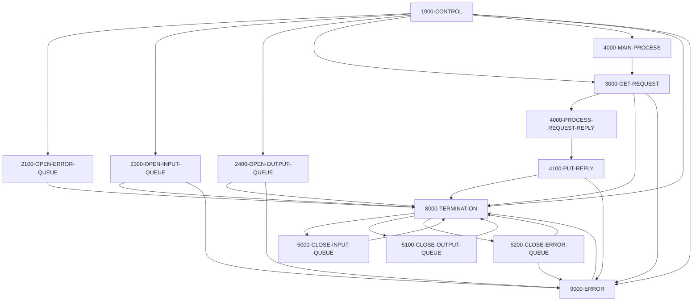

# Program CODATE01

| Item | Value |
|---|---|
| Source | `app/app-vsam-mq/cbl/CODATE01.cbl` |
| Lines | 524 total, 409 code, 16 comment, 99 blank |
| PROGRAM-ID | CODATE01 IS INITIAL |
| Author | AWS |
| Runtime | cics-mq-triggered, mq |
| Module | vsammq |
| CICS transactions | CDRD (`app/app-vsam-mq/csd/CRDDEMOM.csd:27-36`) |
| JCL steps | None |
| Paragraphs | 13 |
| Semantic analysis | validated (batch B09) |
| Version banner |  |

## Summary

CODATE01 is a CICS program started by an IBM MQ trigger; it retrieves the trigger message (MQTM) to learn the input queue name. It opens the error queue CARD.DEMO.ERROR, the triggered input queue and the fixed reply queue CARD.DEMO.REPLY.DATE. It reads request messages one at a time (5-second wait, under syncpoint) until the queue is empty, committing after each message. For every request, regardless of content, it obtains the current time via CICS ASKTIME/FORMATTIME and replies with 'SYSTEM DATE : MM-DD-YYYY' and 'SYSTEM TIME : ' text. It performs no file or database access; MQ and CICS errors are written to the error queue and end the transaction. (Confirmed)

Evidence: `app/app-vsam-mq/cbl/CODATE01.cbl:127-169`, `app/app-vsam-mq/cbl/CODATE01.cbl:283-337`, `app/app-vsam-mq/cbl/CODATE01.cbl:339-364`, `app/app-vsam-mq/cbl/CODATE01.cbl:366-403`

Header comment (Unverified, `app/app-vsam-mq/cbl/CODATE01.cbl:1`): See the comment block at the top of the source. Unverified until matched to code.

## Divisions and sections

| Division / section | Lines | Notes |
|---|---|---|
| IDENTIFICATION DIVISION | `app/app-vsam-mq/cbl/CODATE01.cbl:1-6` |  |
| ENVIRONMENT DIVISION | `app/app-vsam-mq/cbl/CODATE01.cbl:7-8` |  |
| DATA DIVISION | `app/app-vsam-mq/cbl/CODATE01.cbl:9-124` |  |
| PROCEDURE DIVISION | `app/app-vsam-mq/cbl/CODATE01.cbl:125-524` |  |
| DATA / WORKING-STORAGE SECTION | `app/app-vsam-mq/cbl/CODATE01.cbl:11-122` |  |
| DATA / LINKAGE SECTION | `app/app-vsam-mq/cbl/CODATE01.cbl:123-124` |  |

## Files and data stores

No SELECT entries (no COBOL file I/O).

CRUD summary from the program facts:

| Store | Kind | Ops | Evidence |
|---|---|---|---|
| MQ-GET | logical | R | `app/app-vsam-mq/cbl/CODATE01.cbl:301` |
| MQ-PUT | logical | C | `app/app-vsam-mq/cbl/CODATE01.cbl:383` |

## Embedded CICS, SQL and DL/I commands

| Paragraph | Kind | Verb | Resources | Response | Lines |
|---|---|---|---|---|---|
| 1000-CONTROL | CICS | RETRIEVE |  | RESP | `app/app-vsam-mq/cbl/CODATE01.cbl:140-144` |
| 4000-MAIN-PROCESS | CICS | SYNCPOINT |  |  | `app/app-vsam-mq/cbl/CODATE01.cbl:275-277` |
| 4000-PROCESS-REQUEST-REPLY | CICS | ASKTIME |  |  | `app/app-vsam-mq/cbl/CODATE01.cbl:343-345` |
| 4000-PROCESS-REQUEST-REPLY | CICS | FORMATTIME |  |  | `app/app-vsam-mq/cbl/CODATE01.cbl:347-353` |
| 8000-TERMINATION | CICS | RETURN |  |  | `app/app-vsam-mq/cbl/CODATE01.cbl:453` |

## Calls, transfers and callers

| Mechanism | Target | Parameters | Paragraph | Lines |
|---|---|---|---|---|
| CALL system/LE | MQOPEN | QMGR-HANDLE-CONN, MQ-OBJECT-DESCRIPTOR, MQ-OPTIONS, MQ-HOBJ, MQ-CONDITION-CODE, MQ-REASON-CODE | 2300-OPEN-INPUT-QUEUE | `app/app-vsam-mq/cbl/CODATE01.cbl:182-187` |
| CALL system/LE | MQOPEN | QMGR-HANDLE-CONN, MQ-OBJECT-DESCRIPTOR, MQ-OPTIONS, MQ-HOBJ, MQ-CONDITION-CODE, MQ-REASON-CODE | 2400-OPEN-OUTPUT-QUEUE | `app/app-vsam-mq/cbl/CODATE01.cbl:216-221` |
| CALL system/LE | MQOPEN | QMGR-HANDLE-CONN, MQ-OBJECT-DESCRIPTOR, MQ-OPTIONS, MQ-HOBJ, MQ-CONDITION-CODE, MQ-REASON-CODE | 2100-OPEN-ERROR-QUEUE | `app/app-vsam-mq/cbl/CODATE01.cbl:251-256` |
| CALL system/LE | MQGET | MQ-HCONN, MQ-HOBJ, MQ-MESSAGE-DESCRIPTOR, MQ-GET-MESSAGE-OPTIONS, MQ-BUFFER-LENGTH, MQ-BUFFER, MQ-DATA-LENGTH, MQ-CONDITION-CODE, MQ-REASON-CODE | 3000-GET-REQUEST | `app/app-vsam-mq/cbl/CODATE01.cbl:301-309` |
| CALL system/LE | MQPUT | MQ-HCONN, OUTPUT-QUEUE-HANDLE, MQ-MESSAGE-DESCRIPTOR, MQ-PUT-MESSAGE-OPTIONS, MQ-BUFFER-LENGTH, MQ-BUFFER, MQ-CONDITION-CODE, MQ-REASON-CODE | 4100-PUT-REPLY | `app/app-vsam-mq/cbl/CODATE01.cbl:383-390` |
| CALL system/LE | MQPUT | MQ-HCONN, ERROR-QUEUE-HANDLE, MQ-MESSAGE-DESCRIPTOR, MQ-PUT-MESSAGE-OPTIONS, MQ-BUFFER-LENGTH, MQ-BUFFER, MQ-CONDITION-CODE, MQ-REASON-CODE | 9000-ERROR | `app/app-vsam-mq/cbl/CODATE01.cbl:420-427` |
| CALL system/LE | MQCLOSE | MQ-HCONN, MQ-HOBJ, MQ-OPTIONS, MQ-CONDITION-CODE, MQ-REASON-CODE | 5000-CLOSE-INPUT-QUEUE | `app/app-vsam-mq/cbl/CODATE01.cbl:461-465` |
| CALL system/LE | MQCLOSE | MQ-HCONN, MQ-HOBJ, MQ-OPTIONS, MQ-CONDITION-CODE, MQ-REASON-CODE | 5100-CLOSE-OUTPUT-QUEUE | `app/app-vsam-mq/cbl/CODATE01.cbl:483-487` |
| CALL system/LE | MQCLOSE | MQ-HCONN, MQ-HOBJ, MQ-OPTIONS, MQ-CONDITION-CODE, MQ-REASON-CODE | 5200-CLOSE-ERROR-QUEUE | `app/app-vsam-mq/cbl/CODATE01.cbl:506-510` |

## Copybooks

| Copybook | Statement | Resolution | Resolved path | REPLACING | Line |
|---|---|---|---|---|---|
| CMQGMOV | COPY | system |  |  | `app/app-vsam-mq/cbl/CODATE01.cbl:71` |
| CMQPMOV | COPY | system |  |  | `app/app-vsam-mq/cbl/CODATE01.cbl:75` |
| CMQMDV | COPY | system |  |  | `app/app-vsam-mq/cbl/CODATE01.cbl:79` |
| CMQODV | COPY | system |  |  | `app/app-vsam-mq/cbl/CODATE01.cbl:83` |
| CMQV | COPY | system |  |  | `app/app-vsam-mq/cbl/CODATE01.cbl:87` |
| CMQTML | COPY | system |  |  | `app/app-vsam-mq/cbl/CODATE01.cbl:90` |

## Data division items

Every data entry coded in this source (copybook contents are on the copybook pages). Lengths are computed from PIC and USAGE.

| Section | Lvl | Name | PIC | Usage | Len | OCCURS | REDEFINES | VALUE | 88-levels | Line |
|---|---|---|---|---|---|---|---|---|---|---|
| WORKING-STORAGE | 01 | WS-MQ-MSG-FLAG | X(01) |  | 1 |  |  | 'N' | NO-MORE-MSGS = 'Y' | 13 |
| WORKING-STORAGE | 01 | WS-RESP-QUEUE-STS | X(01) |  | 1 |  |  | 'N' | RESP-QUEUE-OPEN = 'Y' | 16 |
| WORKING-STORAGE | 01 | WS-ERR-QUEUE-STS | X(01) |  | 1 |  |  | 'N' | ERR-QUEUE-OPEN = 'Y' | 19 |
| WORKING-STORAGE | 01 | WS-REPLY-QUEUE-STS | X(01) |  | 1 |  |  | 'N' | REPLY-QUEUE-OPEN = 'Y' | 22 |
| WORKING-STORAGE | 01 | WS-CICS-RESP-CDS |  |  |  |  |  |  |  | 26 |
| WORKING-STORAGE | 05 | WS-CICS-RESP1-CD | S9(08) | COMP | 4 |  |  | ZERO |  | 27 |
| WORKING-STORAGE | 05 | WS-CICS-RESP2-CD | S9(08) | COMP | 4 |  |  | ZERO |  | 28 |
| WORKING-STORAGE | 05 | WS-CICS-RESP1-CD-D | 9(08) |  | 8 |  |  | ZERO |  | 29 |
| WORKING-STORAGE | 05 | WS-CICS-RESP2-CD-D | 9(08) |  | 8 |  |  | ZERO |  | 30 |
| WORKING-STORAGE | 01 | WS-DATE-TIME |  |  |  |  |  |  |  | 35 |
| WORKING-STORAGE | 10 | WS-ABS-TIME | S9(15) | COMP-3 | 8 |  |  | ZERO |  | 36 |
| WORKING-STORAGE | 10 | WS-MMDDYYYY | X(10) |  | 10 |  |  | SPACES |  | 37 |
| WORKING-STORAGE | 10 | WS-TIME | X(8) |  | 8 |  |  | SPACES |  | 38 |
| WORKING-STORAGE | 01 | MQ-QUEUE | X(48) |  | 48 |  |  |  |  | 42 |
| WORKING-STORAGE | 01 | MQ-QUEUE-REPLY | X(48) |  | 48 |  |  |  |  | 43 |
| WORKING-STORAGE | 01 | MQ-HCONN | S9(09) | BINARY | 4 |  |  | 0 |  | 44 |
| WORKING-STORAGE | 01 | MQ-CONDITION-CODE | S9(09) | BINARY | 4 |  |  | 0 |  | 45 |
| WORKING-STORAGE | 01 | MQ-REASON-CODE | S9(09) | BINARY | 4 |  |  | 0 |  | 46 |
| WORKING-STORAGE | 01 | MQ-HOBJ | S9(09) | BINARY | 4 |  |  | 0 |  | 47 |
| WORKING-STORAGE | 01 | MQ-OPTIONS | S9(09) | BINARY | 4 |  |  | 0 |  | 48 |
| WORKING-STORAGE | 01 | MQ-BUFFER-LENGTH | S9(09) | BINARY | 4 |  |  |  |  | 49 |
| WORKING-STORAGE | 01 | MQ-BUFFER | X(1000) |  | 1000 |  |  |  |  | 50 |
| WORKING-STORAGE | 01 | MQ-DATA-LENGTH | S9(09) | BINARY | 4 |  |  |  |  | 51 |
| WORKING-STORAGE | 01 | MQ-CORRELID | X(24) |  | 24 |  |  |  |  | 52 |
| WORKING-STORAGE | 01 | MQ-MSG-ID | X(24) |  | 24 |  |  |  |  | 53 |
| WORKING-STORAGE | 01 | MQ-MSG-COUNT | 9(09) |  | 9 |  |  |  |  | 54 |
| WORKING-STORAGE | 01 | SAVE-CORELID | X(24) |  | 24 |  |  |  |  | 55 |
| WORKING-STORAGE | 01 | SAVE-MSGID | X(24) |  | 24 |  |  |  |  | 56 |
| WORKING-STORAGE | 01 | SAVE-REPLY2Q | X(48) |  | 48 |  |  |  |  | 57 |
| WORKING-STORAGE | 01 | MQ-ERR-DISPLAY |  |  |  |  |  |  |  | 58 |
| WORKING-STORAGE | 05 | MQ-ERROR-PARA | X(25) |  | 25 |  |  |  |  | 59 |
| WORKING-STORAGE | 05 | FILLER | X(02) |  | 2 |  |  | SPACES |  | 60 |
| WORKING-STORAGE | 05 | MQ-APPL-RETURN-MESSAGE | X(25) |  | 25 |  |  |  |  | 61 |
| WORKING-STORAGE | 05 | FILLER | X(02) |  | 2 |  |  | SPACES |  | 62 |
| WORKING-STORAGE | 05 | MQ-APPL-CONDITION-CODE | 9(02) |  | 2 |  |  |  |  | 63 |
| WORKING-STORAGE | 05 | FILLER | X(02) |  | 2 |  |  | SPACES |  | 64 |
| WORKING-STORAGE | 05 | MQ-APPL-REASON-CODE | 9(05) |  | 5 |  |  |  |  | 65 |
| WORKING-STORAGE | 05 | FILLER | X(02) |  | 2 |  |  | SPACES |  | 66 |
| WORKING-STORAGE | 05 | MQ-APPL-QUEUE-NAME | X(48) |  | 48 |  |  |  |  | 67 |
| WORKING-STORAGE | 01 | MQ-GET-MESSAGE-OPTIONS |  |  |  |  |  |  |  | 70 |
| WORKING-STORAGE | 01 | MQ-PUT-MESSAGE-OPTIONS |  |  |  |  |  |  |  | 74 |
| WORKING-STORAGE | 01 | MQ-MESSAGE-DESCRIPTOR |  |  |  |  |  |  |  | 78 |
| WORKING-STORAGE | 01 | MQ-OBJECT-DESCRIPTOR |  |  |  |  |  |  |  | 82 |
| WORKING-STORAGE | 01 | MQ-CONSTANTS |  |  |  |  |  |  |  | 86 |
| WORKING-STORAGE | 01 | MQ-GET-QUEUE-MESSAGE |  |  |  |  |  |  |  | 89 |
| WORKING-STORAGE | 01 | QUEUE-INFO |  |  |  |  |  |  |  | 92 |
| WORKING-STORAGE | 05 | QMGR-NAME | X(48) |  | 48 |  |  | SPACES |  | 93 |
| WORKING-STORAGE | 05 | INPUT-QUEUE-NAME | X(48) |  | 48 |  |  | SPACES |  | 94 |
| WORKING-STORAGE | 05 | REPLY-QUEUE-NAME | X(48) |  | 48 |  |  | SPACES |  | 95 |
| WORKING-STORAGE | 05 | ERROR-QUEUE-NAME | X(48) |  | 48 |  |  | SPACES |  | 96 |
| WORKING-STORAGE | 01 | INPUT-QUEUE-HANDLE | S9(09) | BINARY | 4 |  |  | 0 |  | 98 |
| WORKING-STORAGE | 01 | OUTPUT-QUEUE-HANDLE | S9(09) | BINARY | 4 |  |  | 0 |  | 100 |
| WORKING-STORAGE | 01 | ERROR-QUEUE-HANDLE | S9(09) | BINARY | 4 |  |  | 0 |  | 102 |
| WORKING-STORAGE | 01 | QMGR-HANDLE-CONN | S9(09) | BINARY | 4 |  |  | 0 |  | 104 |
| WORKING-STORAGE | 01 | QUEUE-MESSAGE | X(1000) |  | 1000 |  |  |  |  | 105 |
| WORKING-STORAGE | 01 | REQUEST-MESSAGE | X(1000) |  | 1000 |  |  |  |  | 106 |
| WORKING-STORAGE | 01 | REPLY-MESSAGE | X(1000) |  | 1000 |  |  |  |  | 107 |
| WORKING-STORAGE | 01 | ERROR-MESSAGE | X(1000) |  | 1000 |  |  |  |  | 108 |
| WORKING-STORAGE | 01 | REQUEST-MSG-COPY |  |  |  |  |  |  |  | 109 |
| WORKING-STORAGE | 10 | WS-FUNC | X(04) |  | 4 |  |  | SPACES |  | 110 |
| WORKING-STORAGE | 10 | WS-KEY | 9(11) |  | 11 |  |  | ZEROES |  | 111 |
| WORKING-STORAGE | 10 | WS-FILLER | X(985) |  | 985 |  |  | SPACES |  | 112 |
| WORKING-STORAGE | 01 | WS-VARIABLES |  |  |  |  |  |  |  | 114 |
| WORKING-STORAGE | 05 | LIT-ACCTFILENAME | X(8) |  | 8 |  |  | 'ACCTDAT ' |  | 115 |
| WORKING-STORAGE | 05 | WS-RESP-CD | S9(09) | COMP | 4 |  |  | ZEROS |  | 117 |
| WORKING-STORAGE | 05 | WS-REAS-CD | S9(09) | COMP | 4 |  |  | ZEROS |  | 119 |

## Statement inventory

Every procedure statement the parser recorded, by kind. Each one is listed with its line under Paragraph details.

| Kind | Count |
|---|---|
| Decisions (IF, EVALUATE, WHEN, loops, handlers) | 30 |
| Calculations | 12 |
| File I/O | 0 |
| EXEC CICS / SQL / DLI | 5 |
| CALL | 9 |
| PERFORM | 28 |
| GO TO | 0 |
| MOVE literal | 16 |
| MOVE field | 86 |
| SET | 4 |
| STRING, UNSTRING, INSPECT, INITIALIZE, COPY, ENTRY and others | 5 |
| DISPLAY | 2 |
| GOBACK, STOP RUN, RETURN, XCTL | 2 |
| Not classified by the parser | 0 |

## Control flow

| Paragraph | Lines | Logic | Performs | Performed by | Reachable |
|---|---|---|---|---|---|
| [1000-CONTROL](#para-1000-control) | 127-169 | Clears INPUT-QUEUE-NAME, QMGR-NAME, QUEUE-MESSAGE and MQ-ERR-DISPLAY, opens the error queue, then issues EXEC CICS RETRIEVE into MQTM. On NORMAL takes the input queue from MQTM-QNAME and sets REPLY-QUEUE-NAME to 'CARD.DEMO.REPLY.DATE'; otherwise builds a 'CICS RETRIEVE' / 'RESP:' error, performs 9000-ERROR and 8000-TERMINATION. It then opens the input and reply queues, gets the first request, performs 4000-MAIN-PROCESS until NO-MORE-MSGS and finishes with 8000-TERMINATION. (Confirmed) | 2100-OPEN-ERROR-QUEUE, 2300-OPEN-INPUT-QUEUE, 2400-OPEN-OUTPUT-QUEUE, 3000-GET-REQUEST, 4000-MAIN-PROCESS, 8000-TERMINATION, 9000-ERROR |  | yes |
| [2300-OPEN-INPUT-QUEUE](#para-2300-open-input-queue) | 171-202 | MQOPENs INPUT-QUEUE-NAME with MQOO-INPUT-SHARED + MQOO-SAVE-ALL-CONTEXT + MQOO-FAIL-IF-QUIESCING. On MQCC-OK saves INPUT-QUEUE-HANDLE and sets REPLY-QUEUE-OPEN; otherwise records 'INP MQOPEN ERR', performs 9000-ERROR and 8000-TERMINATION. (Confirmed) | 8000-TERMINATION, 9000-ERROR | 1000-CONTROL | yes |
| [2400-OPEN-OUTPUT-QUEUE](#para-2400-open-output-queue) | 204-236 | MQOPENs REPLY-QUEUE-NAME with MQOO-OUTPUT + MQOO-PASS-ALL-CONTEXT + MQOO-FAIL-IF-QUIESCING. On MQCC-OK saves OUTPUT-QUEUE-HANDLE and sets RESP-QUEUE-OPEN; otherwise records 'OUT MQOPEN ERR', performs 9000-ERROR and 8000-TERMINATION. (Confirmed) | 8000-TERMINATION, 9000-ERROR | 1000-CONTROL | yes |
| [2100-OPEN-ERROR-QUEUE](#para-2100-open-error-queue) | 238-271 | Sets ERROR-QUEUE-NAME to 'CARD.DEMO.ERROR' and MQOPENs it for output. On MQCC-OK saves ERROR-QUEUE-HANDLE and sets ERR-QUEUE-OPEN; otherwise records 'ERR MQOPEN ERR', DISPLAYs MQ-ERR-DISPLAY and performs 8000-TERMINATION. (Confirmed) | 8000-TERMINATION | 1000-CONTROL | yes |
| [4000-MAIN-PROCESS](#para-4000-main-process) | 274-280 | Issues EXEC CICS SYNCPOINT to commit the previous message, then performs 3000-GET-REQUEST. (Confirmed) | 3000-GET-REQUEST | 1000-CONTROL | yes |
| [3000-GET-REQUEST](#para-3000-get-request) | 283-337 | MQGETs from INPUT-QUEUE-HANDLE with a 5000 ms wait, 1000-byte buffer and options SYNCPOINT + FAIL-IF-QUIESCING + CONVERT + WAIT. On MQCC-OK saves MsgId, CorrelId and ReplyToQ, copies the buffer to REQUEST-MSG-COPY, performs 4000-PROCESS-REQUEST-REPLY and adds 1 to MQ-MSG-COUNT. MQRC-NO-MSG-AVAILABLE sets NO-MORE-MSGS; any other failure records 'INP MQGET ERR:', performs 9000-ERROR and 8000-TERMINATION. (Confirmed) | 4000-PROCESS-REQUEST-REPLY, 8000-TERMINATION, 9000-ERROR | 1000-CONTROL, 4000-MAIN-PROCESS | yes |
| [4000-PROCESS-REQUEST-REPLY](#para-4000-process-request-reply) | 339-364 | Clears REPLY-MESSAGE, gets the current time with EXEC CICS ASKTIME and formats it with FORMATTIME as MMDDYYYY with '-' separators and TIME with the default time separator. Builds 'SYSTEM DATE : ' + WS-MMDDYYYY + 'SYSTEM TIME : ' + WS-TIME and performs 4100-PUT-REPLY. (Confirmed) | 4100-PUT-REPLY | 3000-GET-REQUEST | yes |
| [4100-PUT-REPLY](#para-4100-put-reply) | 366-403 | Moves REPLY-MESSAGE to MQ-BUFFER (length 1000), sets MQMD-MSGID/MQMD-CORRELID from the saved request ids, format MQFMT-STRING and CCSID MQCCSI-Q-MGR, and MQPUTs to OUTPUT-QUEUE-HANDLE under syncpoint. On failure records 'MQPUT ERR', performs 9000-ERROR and 8000-TERMINATION. (Confirmed) | 8000-TERMINATION, 9000-ERROR | 4000-PROCESS-REQUEST-REPLY | yes |
| [9000-ERROR](#para-9000-error) | 405-441 | Copies MQ-ERR-DISPLAY into a 1000-byte string message and MQPUTs it to ERROR-QUEUE-HANDLE under syncpoint. If that put fails it records 'MQPUT ERR', DISPLAYs MQ-ERR-DISPLAY and performs 8000-TERMINATION. (Confirmed) | 8000-TERMINATION | 1000-CONTROL, 2300-OPEN-INPUT-QUEUE, 2400-OPEN-OUTPUT-QUEUE, 3000-GET-REQUEST, 4100-PUT-REPLY, 5200-CLOSE-ERROR-QUEUE | yes |
| [8000-TERMINATION](#para-8000-termination) | 442-454 | Closes the input queue if REPLY-QUEUE-OPEN, the reply queue if RESP-QUEUE-OPEN and the error queue if ERR-QUEUE-OPEN, then issues EXEC CICS RETURN and GOBACK. (Confirmed) | 5000-CLOSE-INPUT-QUEUE, 5100-CLOSE-OUTPUT-QUEUE, 5200-CLOSE-ERROR-QUEUE | 1000-CONTROL, 2100-OPEN-ERROR-QUEUE, 2300-OPEN-INPUT-QUEUE, 2400-OPEN-OUTPUT-QUEUE, 3000-GET-REQUEST, 4100-PUT-REPLY, 5000-CLOSE-INPUT-QUEUE, 5100-CLOSE-OUTPUT-QUEUE, 5200-CLOSE-ERROR-QUEUE, 9000-ERROR | yes |
| [5000-CLOSE-INPUT-QUEUE](#para-5000-close-input-queue) | 456-477 | MQCLOSEs INPUT-QUEUE-HANDLE with MQCO-NONE; on failure records 'MQCLOSE ERR' and performs 8000-TERMINATION. (Confirmed) | 8000-TERMINATION | 8000-TERMINATION | yes |
| [5100-CLOSE-OUTPUT-QUEUE](#para-5100-close-output-queue) | 478-499 | MQCLOSEs OUTPUT-QUEUE-HANDLE with MQCO-NONE; on failure records 'MQCLOSE ERR' (naming INPUT-QUEUE-NAME) and performs 8000-TERMINATION. (Confirmed) | 8000-TERMINATION | 8000-TERMINATION | yes |
| [5200-CLOSE-ERROR-QUEUE](#para-5200-close-error-queue) | 501-523 | MQCLOSEs ERROR-QUEUE-HANDLE with MQCO-NONE; on failure records 'MQCLOSE ERR', performs 9000-ERROR and 8000-TERMINATION. (Confirmed) | 8000-TERMINATION, 9000-ERROR | 8000-TERMINATION | yes |

## Paragraph details

### Para 1000-CONTROL

Lines `app/app-vsam-mq/cbl/CODATE01.cbl:127-169`. 

Logic: Clears INPUT-QUEUE-NAME, QMGR-NAME, QUEUE-MESSAGE and MQ-ERR-DISPLAY, opens the error queue, then issues EXEC CICS RETRIEVE into MQTM. On NORMAL takes the input queue from MQTM-QNAME and sets REPLY-QUEUE-NAME to 'CARD.DEMO.REPLY.DATE'; otherwise builds a 'CICS RETRIEVE' / 'RESP:' error, performs 9000-ERROR and 8000-TERMINATION. It then opens the input and reply queues, gets the first request, performs 4000-MAIN-PROCESS until NO-MORE-MSGS and finishes with 8000-TERMINATION. (Confirmed)

Rules: [BR-CODATE01-005](../09-business-rules-catalog.md#br-codate01-005)

Statements in source order:

- `MOVE SPACES TO INPUT-QUEUE-NAME QMGR-NAME QUEUE-MESSAGE` at `app/app-vsam-mq/cbl/CODATE01.cbl:129-132`
- `INITIALIZE MQ-ERR-DISPLAY` at `app/app-vsam-mq/cbl/CODATE01.cbl:134`
- PERFORM 2100-OPEN-ERROR-QUEUE at `app/app-vsam-mq/cbl/CODATE01.cbl:136`
- EXEC CICS RETRIEVE at `app/app-vsam-mq/cbl/CODATE01.cbl:140-144`
- IF `WS-CICS-RESP1-CD = DFHRESP(NORMAL)` at `app/app-vsam-mq/cbl/CODATE01.cbl:145` (io-status)
- `MOVE MQTM-QNAME TO INPUT-QUEUE-NAME` at `app/app-vsam-mq/cbl/CODATE01.cbl:146`
- MOVE `'CARD.DEMO.REPLY.DATE'` TO REPLY-QUEUE-NAME at `app/app-vsam-mq/cbl/CODATE01.cbl:147`
- MOVE `'CICS RETRIEVE'` TO MQ-ERROR-PARA at `app/app-vsam-mq/cbl/CODATE01.cbl:149`
- `MOVE WS-CICS-RESP1-CD TO WS-CICS-RESP1-CD-D` at `app/app-vsam-mq/cbl/CODATE01.cbl:150`
- `MOVE WS-CICS-RESP2-CD TO WS-CICS-RESP2-CD` at `app/app-vsam-mq/cbl/CODATE01.cbl:151`
- `STRING 'RESP: ', WS-CICS-RESP1-CD-D , WS-CICS-RESP2-CD-D, 'END' DELIMITED BY SIZE INTO MQ-APPL-RETURN-MESSAGE` at `app/app-vsam-mq/cbl/CODATE01.cbl:152-154`
- PERFORM 9000-ERROR at `app/app-vsam-mq/cbl/CODATE01.cbl:157`
- PERFORM 8000-TERMINATION at `app/app-vsam-mq/cbl/CODATE01.cbl:158`
- PERFORM 2300-OPEN-INPUT-QUEUE at `app/app-vsam-mq/cbl/CODATE01.cbl:161`
- PERFORM 2400-OPEN-OUTPUT-QUEUE at `app/app-vsam-mq/cbl/CODATE01.cbl:162`
- PERFORM 3000-GET-REQUEST at `app/app-vsam-mq/cbl/CODATE01.cbl:163`
- PERFORM 4000-MAIN-PROCESS `UNTIL NO-MORE-MSGS` at `app/app-vsam-mq/cbl/CODATE01.cbl:164-165`
- PERFORM 8000-TERMINATION at `app/app-vsam-mq/cbl/CODATE01.cbl:167`

### Para 2300-OPEN-INPUT-QUEUE

Lines `app/app-vsam-mq/cbl/CODATE01.cbl:171-202`. 

Logic: MQOPENs INPUT-QUEUE-NAME with MQOO-INPUT-SHARED + MQOO-SAVE-ALL-CONTEXT + MQOO-FAIL-IF-QUIESCING. On MQCC-OK saves INPUT-QUEUE-HANDLE and sets REPLY-QUEUE-OPEN; otherwise records 'INP MQOPEN ERR', performs 9000-ERROR and 8000-TERMINATION. (Confirmed)

Rules: [BR-CODATE01-004](../09-business-rules-catalog.md#br-codate01-004)

Statements in source order:

- `MOVE SPACES TO MQOD-OBJECTQMGRNAME` at `app/app-vsam-mq/cbl/CODATE01.cbl:175`
- `MOVE INPUT-QUEUE-NAME TO MQOD-OBJECTNAME` at `app/app-vsam-mq/cbl/CODATE01.cbl:176`
- Calculation `COMPUTE MQ-OPTIONS = MQOO-INPUT-SHARED + MQOO-SAVE-ALL-CONTEXT + MQOO-FAIL-IF-QUIESCING` at `app/app-vsam-mq/cbl/CODATE01.cbl:178-180` (no ROUNDED)
- CALL MQOPEN at `app/app-vsam-mq/cbl/CODATE01.cbl:182-187`
- EVALUATE `MQ-CONDITION-CODE` at `app/app-vsam-mq/cbl/CODATE01.cbl:189` (business-candidate)
- WHEN `MQCC-OK` at `app/app-vsam-mq/cbl/CODATE01.cbl:190` (io-status)
- `MOVE MQ-CONDITION-CODE TO MQ-APPL-CONDITION-CODE` at `app/app-vsam-mq/cbl/CODATE01.cbl:191`
- `MOVE MQ-REASON-CODE TO MQ-APPL-REASON-CODE` at `app/app-vsam-mq/cbl/CODATE01.cbl:192`
- `MOVE MQ-HOBJ TO INPUT-QUEUE-HANDLE` at `app/app-vsam-mq/cbl/CODATE01.cbl:193`
- `SET REPLY-QUEUE-OPEN TO TRUE` at `app/app-vsam-mq/cbl/CODATE01.cbl:194`
- WHEN `OTHER` at `app/app-vsam-mq/cbl/CODATE01.cbl:195` (business-candidate)
- `MOVE MQ-CONDITION-CODE TO MQ-APPL-CONDITION-CODE` at `app/app-vsam-mq/cbl/CODATE01.cbl:196`
- `MOVE MQ-REASON-CODE TO MQ-APPL-REASON-CODE` at `app/app-vsam-mq/cbl/CODATE01.cbl:197`
- `MOVE INPUT-QUEUE-NAME TO MQ-APPL-QUEUE-NAME` at `app/app-vsam-mq/cbl/CODATE01.cbl:198`
- MOVE `'INP MQOPEN ERR'` TO MQ-APPL-RETURN-MESSAGE at `app/app-vsam-mq/cbl/CODATE01.cbl:199`
- PERFORM 9000-ERROR at `app/app-vsam-mq/cbl/CODATE01.cbl:200`
- PERFORM 8000-TERMINATION at `app/app-vsam-mq/cbl/CODATE01.cbl:201`

### Para 2400-OPEN-OUTPUT-QUEUE

Lines `app/app-vsam-mq/cbl/CODATE01.cbl:204-236`. 

Logic: MQOPENs REPLY-QUEUE-NAME with MQOO-OUTPUT + MQOO-PASS-ALL-CONTEXT + MQOO-FAIL-IF-QUIESCING. On MQCC-OK saves OUTPUT-QUEUE-HANDLE and sets RESP-QUEUE-OPEN; otherwise records 'OUT MQOPEN ERR', performs 9000-ERROR and 8000-TERMINATION. (Confirmed)

Statements in source order:

- `MOVE SPACES TO MQOD-OBJECTQMGRNAME` at `app/app-vsam-mq/cbl/CODATE01.cbl:209`
- `MOVE REPLY-QUEUE-NAME TO MQOD-OBJECTNAME` at `app/app-vsam-mq/cbl/CODATE01.cbl:210`
- Calculation `COMPUTE MQ-OPTIONS = MQOO-OUTPUT + MQOO-PASS-ALL-CONTEXT + MQOO-FAIL-IF-QUIESCING` at `app/app-vsam-mq/cbl/CODATE01.cbl:212-214` (no ROUNDED)
- CALL MQOPEN at `app/app-vsam-mq/cbl/CODATE01.cbl:216-221`
- EVALUATE `MQ-CONDITION-CODE` at `app/app-vsam-mq/cbl/CODATE01.cbl:223` (business-candidate)
- WHEN `MQCC-OK` at `app/app-vsam-mq/cbl/CODATE01.cbl:224` (io-status)
- `MOVE MQ-CONDITION-CODE TO MQ-APPL-CONDITION-CODE` at `app/app-vsam-mq/cbl/CODATE01.cbl:225`
- `MOVE MQ-REASON-CODE TO MQ-APPL-REASON-CODE` at `app/app-vsam-mq/cbl/CODATE01.cbl:226`
- `MOVE MQ-HOBJ TO OUTPUT-QUEUE-HANDLE` at `app/app-vsam-mq/cbl/CODATE01.cbl:227`
- `SET RESP-QUEUE-OPEN TO TRUE` at `app/app-vsam-mq/cbl/CODATE01.cbl:228`
- WHEN `OTHER` at `app/app-vsam-mq/cbl/CODATE01.cbl:229` (business-candidate)
- `MOVE MQ-CONDITION-CODE TO MQ-APPL-CONDITION-CODE` at `app/app-vsam-mq/cbl/CODATE01.cbl:230`
- `MOVE MQ-REASON-CODE TO MQ-APPL-REASON-CODE` at `app/app-vsam-mq/cbl/CODATE01.cbl:231`
- `MOVE REPLY-QUEUE-NAME TO MQ-APPL-QUEUE-NAME` at `app/app-vsam-mq/cbl/CODATE01.cbl:232`
- MOVE `'OUT MQOPEN ERR'` TO MQ-APPL-RETURN-MESSAGE at `app/app-vsam-mq/cbl/CODATE01.cbl:233`
- PERFORM 9000-ERROR at `app/app-vsam-mq/cbl/CODATE01.cbl:234`
- PERFORM 8000-TERMINATION at `app/app-vsam-mq/cbl/CODATE01.cbl:235`

### Para 2100-OPEN-ERROR-QUEUE

Lines `app/app-vsam-mq/cbl/CODATE01.cbl:238-271`. 

Logic: Sets ERROR-QUEUE-NAME to 'CARD.DEMO.ERROR' and MQOPENs it for output. On MQCC-OK saves ERROR-QUEUE-HANDLE and sets ERR-QUEUE-OPEN; otherwise records 'ERR MQOPEN ERR', DISPLAYs MQ-ERR-DISPLAY and performs 8000-TERMINATION. (Confirmed)

Statements in source order:

- MOVE `'CARD.DEMO.ERROR'` TO ERROR-QUEUE-NAME at `app/app-vsam-mq/cbl/CODATE01.cbl:243`
- `MOVE SPACES TO MQOD-OBJECTQMGRNAME` at `app/app-vsam-mq/cbl/CODATE01.cbl:244`
- `MOVE ERROR-QUEUE-NAME TO MQOD-OBJECTNAME` at `app/app-vsam-mq/cbl/CODATE01.cbl:245`
- Calculation `COMPUTE MQ-OPTIONS = MQOO-OUTPUT + MQOO-PASS-ALL-CONTEXT + MQOO-FAIL-IF-QUIESCING` at `app/app-vsam-mq/cbl/CODATE01.cbl:247-249` (no ROUNDED)
- CALL MQOPEN at `app/app-vsam-mq/cbl/CODATE01.cbl:251-256`
- EVALUATE `MQ-CONDITION-CODE` at `app/app-vsam-mq/cbl/CODATE01.cbl:258` (business-candidate)
- WHEN `MQCC-OK` at `app/app-vsam-mq/cbl/CODATE01.cbl:259` (io-status)
- `MOVE MQ-CONDITION-CODE TO MQ-APPL-CONDITION-CODE` at `app/app-vsam-mq/cbl/CODATE01.cbl:260`
- `MOVE MQ-REASON-CODE TO MQ-APPL-REASON-CODE` at `app/app-vsam-mq/cbl/CODATE01.cbl:261`
- `MOVE MQ-HOBJ TO ERROR-QUEUE-HANDLE` at `app/app-vsam-mq/cbl/CODATE01.cbl:262`
- `SET ERR-QUEUE-OPEN TO TRUE` at `app/app-vsam-mq/cbl/CODATE01.cbl:263`
- WHEN `OTHER` at `app/app-vsam-mq/cbl/CODATE01.cbl:264` (business-candidate)
- `MOVE MQ-CONDITION-CODE TO MQ-APPL-CONDITION-CODE` at `app/app-vsam-mq/cbl/CODATE01.cbl:265`
- `MOVE MQ-REASON-CODE TO MQ-APPL-REASON-CODE` at `app/app-vsam-mq/cbl/CODATE01.cbl:266`
- `MOVE ERROR-QUEUE-NAME TO MQ-APPL-QUEUE-NAME` at `app/app-vsam-mq/cbl/CODATE01.cbl:267`
- MOVE `'ERR MQOPEN ERR'` TO MQ-APPL-RETURN-MESSAGE at `app/app-vsam-mq/cbl/CODATE01.cbl:268`
- `DISPLAY MQ-ERR-DISPLAY` at `app/app-vsam-mq/cbl/CODATE01.cbl:269`
- PERFORM 8000-TERMINATION at `app/app-vsam-mq/cbl/CODATE01.cbl:270`

### Para 4000-MAIN-PROCESS

Lines `app/app-vsam-mq/cbl/CODATE01.cbl:274-280`. 

Logic: Issues EXEC CICS SYNCPOINT to commit the previous message, then performs 3000-GET-REQUEST. (Confirmed)

Statements in source order:

- EXEC CICS SYNCPOINT at `app/app-vsam-mq/cbl/CODATE01.cbl:275-277`
- PERFORM 3000-GET-REQUEST at `app/app-vsam-mq/cbl/CODATE01.cbl:279-280`

### Para 3000-GET-REQUEST

Lines `app/app-vsam-mq/cbl/CODATE01.cbl:283-337`. 

Logic: MQGETs from INPUT-QUEUE-HANDLE with a 5000 ms wait, 1000-byte buffer and options SYNCPOINT + FAIL-IF-QUIESCING + CONVERT + WAIT. On MQCC-OK saves MsgId, CorrelId and ReplyToQ, copies the buffer to REQUEST-MSG-COPY, performs 4000-PROCESS-REQUEST-REPLY and adds 1 to MQ-MSG-COUNT. MQRC-NO-MSG-AVAILABLE sets NO-MORE-MSGS; any other failure records 'INP MQGET ERR:', performs 9000-ERROR and 8000-TERMINATION. (Confirmed)

Rules: [BR-CODATE01-003](../09-business-rules-catalog.md#br-codate01-003)

Statements in source order:

- MOVE `5000` TO MQGMO-WAITINTERVAL at `app/app-vsam-mq/cbl/CODATE01.cbl:286`
- `MOVE SPACES TO MQ-CORRELID` at `app/app-vsam-mq/cbl/CODATE01.cbl:287`
- `MOVE SPACES TO MQ-MSG-ID` at `app/app-vsam-mq/cbl/CODATE01.cbl:288`
- `MOVE INPUT-QUEUE-NAME TO MQ-QUEUE` at `app/app-vsam-mq/cbl/CODATE01.cbl:289`
- `MOVE INPUT-QUEUE-HANDLE TO MQ-HOBJ` at `app/app-vsam-mq/cbl/CODATE01.cbl:290`
- MOVE `1000` TO MQ-BUFFER-LENGTH at `app/app-vsam-mq/cbl/CODATE01.cbl:291`
- `MOVE MQMI-NONE TO MQMD-MSGID` at `app/app-vsam-mq/cbl/CODATE01.cbl:292`
- `MOVE MQCI-NONE TO MQMD-CORRELID` at `app/app-vsam-mq/cbl/CODATE01.cbl:293`
- `INITIALIZE REQUEST-MSG-COPY REPLACING NUMERIC BY ZEROES` at `app/app-vsam-mq/cbl/CODATE01.cbl:294`
- Calculation `COMPUTE MQGMO-OPTIONS = MQGMO-SYNCPOINT + MQGMO-FAIL-IF-QUIESCING + MQGMO-CONVERT + MQGMO-WAIT` at `app/app-vsam-mq/cbl/CODATE01.cbl:296-299` (no ROUNDED)
- CALL MQGET at `app/app-vsam-mq/cbl/CODATE01.cbl:301-309`
- IF `MQ-CONDITION-CODE = MQCC-OK` at `app/app-vsam-mq/cbl/CODATE01.cbl:312` (io-status)
- `MOVE MQMD-MSGID TO MQ-MSG-ID` at `app/app-vsam-mq/cbl/CODATE01.cbl:313`
- `MOVE MQMD-CORRELID TO MQ-CORRELID` at `app/app-vsam-mq/cbl/CODATE01.cbl:314`
- `MOVE MQMD-REPLYTOQ TO MQ-QUEUE-REPLY` at `app/app-vsam-mq/cbl/CODATE01.cbl:315`
- `MOVE MQ-CONDITION-CODE TO MQ-APPL-CONDITION-CODE` at `app/app-vsam-mq/cbl/CODATE01.cbl:316`
- `MOVE MQ-REASON-CODE TO MQ-APPL-REASON-CODE` at `app/app-vsam-mq/cbl/CODATE01.cbl:317`
- `MOVE MQ-BUFFER TO REQUEST-MESSAGE` at `app/app-vsam-mq/cbl/CODATE01.cbl:318`
- `MOVE MQ-CORRELID TO SAVE-CORELID` at `app/app-vsam-mq/cbl/CODATE01.cbl:319`
- `MOVE MQ-QUEUE-REPLY TO SAVE-REPLY2Q` at `app/app-vsam-mq/cbl/CODATE01.cbl:320`
- `MOVE MQ-MSG-ID TO SAVE-MSGID` at `app/app-vsam-mq/cbl/CODATE01.cbl:321`
- `MOVE REQUEST-MESSAGE TO REQUEST-MSG-COPY` at `app/app-vsam-mq/cbl/CODATE01.cbl:322`
- PERFORM 4000-PROCESS-REQUEST-REPLY at `app/app-vsam-mq/cbl/CODATE01.cbl:323`
- Calculation `ADD 1 TO MQ-MSG-COUNT` at `app/app-vsam-mq/cbl/CODATE01.cbl:324`
- IF `MQ-REASON-CODE = MQRC-NO-MSG-AVAILABLE` at `app/app-vsam-mq/cbl/CODATE01.cbl:326` (io-status)
- `SET NO-MORE-MSGS TO TRUE` at `app/app-vsam-mq/cbl/CODATE01.cbl:327`
- `MOVE MQ-CONDITION-CODE TO MQ-APPL-CONDITION-CODE` at `app/app-vsam-mq/cbl/CODATE01.cbl:330`
- `MOVE MQ-REASON-CODE TO MQ-APPL-REASON-CODE` at `app/app-vsam-mq/cbl/CODATE01.cbl:331`
- `MOVE INPUT-QUEUE-NAME TO MQ-APPL-QUEUE-NAME` at `app/app-vsam-mq/cbl/CODATE01.cbl:332`
- MOVE `'INP MQGET ERR:'` TO MQ-APPL-RETURN-MESSAGE at `app/app-vsam-mq/cbl/CODATE01.cbl:333`
- PERFORM 9000-ERROR at `app/app-vsam-mq/cbl/CODATE01.cbl:334`
- PERFORM 8000-TERMINATION at `app/app-vsam-mq/cbl/CODATE01.cbl:335`

### Para 4000-PROCESS-REQUEST-REPLY

Lines `app/app-vsam-mq/cbl/CODATE01.cbl:339-364`. 

Logic: Clears REPLY-MESSAGE, gets the current time with EXEC CICS ASKTIME and formats it with FORMATTIME as MMDDYYYY with '-' separators and TIME with the default time separator. Builds 'SYSTEM DATE : ' + WS-MMDDYYYY + 'SYSTEM TIME : ' + WS-TIME and performs 4100-PUT-REPLY. (Confirmed)

Rules: [BR-CODATE01-001](../09-business-rules-catalog.md#br-codate01-001)

Statements in source order:

- `MOVE SPACES TO REPLY-MESSAGE` at `app/app-vsam-mq/cbl/CODATE01.cbl:340`
- `INITIALIZE WS-DATE-TIME REPLACING NUMERIC BY ZEROES` at `app/app-vsam-mq/cbl/CODATE01.cbl:341`
- EXEC CICS ASKTIME at `app/app-vsam-mq/cbl/CODATE01.cbl:343-345`
- EXEC CICS FORMATTIME at `app/app-vsam-mq/cbl/CODATE01.cbl:347-353`
- `STRING 'SYSTEM DATE : ' WS-MMDDYYYY 'SYSTEM TIME : ' WS-TIME DELIMITED BY SIZE INTO REPLY-MESSAGE` at `app/app-vsam-mq/cbl/CODATE01.cbl:355-359`
- PERFORM 4100-PUT-REPLY at `app/app-vsam-mq/cbl/CODATE01.cbl:361-364`

### Para 4100-PUT-REPLY

Lines `app/app-vsam-mq/cbl/CODATE01.cbl:366-403`. 

Logic: Moves REPLY-MESSAGE to MQ-BUFFER (length 1000), sets MQMD-MSGID/MQMD-CORRELID from the saved request ids, format MQFMT-STRING and CCSID MQCCSI-Q-MGR, and MQPUTs to OUTPUT-QUEUE-HANDLE under syncpoint. On failure records 'MQPUT ERR', performs 9000-ERROR and 8000-TERMINATION. (Confirmed)

Rules: [BR-CODATE01-002](../09-business-rules-catalog.md#br-codate01-002)

Statements in source order:

- `MOVE REPLY-MESSAGE TO MQ-BUFFER` at `app/app-vsam-mq/cbl/CODATE01.cbl:371`
- MOVE `1000` TO MQ-BUFFER-LENGTH at `app/app-vsam-mq/cbl/CODATE01.cbl:372`
- `MOVE SAVE-MSGID TO MQMD-MSGID` at `app/app-vsam-mq/cbl/CODATE01.cbl:373`
- `MOVE SAVE-CORELID TO MQMD-CORRELID` at `app/app-vsam-mq/cbl/CODATE01.cbl:374`
- `MOVE MQFMT-STRING TO MQMD-FORMAT` at `app/app-vsam-mq/cbl/CODATE01.cbl:375`
- Calculation `COMPUTE MQMD-CODEDCHARSETID = MQCCSI-Q-MGR` at `app/app-vsam-mq/cbl/CODATE01.cbl:377` (no ROUNDED)
- Calculation `COMPUTE MQPMO-OPTIONS = MQPMO-SYNCPOINT + MQPMO-DEFAULT-CONTEXT + MQPMO-FAIL-IF-QUIESCING` at `app/app-vsam-mq/cbl/CODATE01.cbl:379-381` (no ROUNDED)
- CALL MQPUT at `app/app-vsam-mq/cbl/CODATE01.cbl:383-390`
- EVALUATE `MQ-CONDITION-CODE` at `app/app-vsam-mq/cbl/CODATE01.cbl:392` (business-candidate)
- WHEN `MQCC-OK` at `app/app-vsam-mq/cbl/CODATE01.cbl:393` (io-status)
- `MOVE MQ-CONDITION-CODE TO MQ-APPL-CONDITION-CODE` at `app/app-vsam-mq/cbl/CODATE01.cbl:394`
- `MOVE MQ-REASON-CODE TO MQ-APPL-REASON-CODE` at `app/app-vsam-mq/cbl/CODATE01.cbl:395`
- WHEN `OTHER` at `app/app-vsam-mq/cbl/CODATE01.cbl:396` (business-candidate)
- `MOVE MQ-CONDITION-CODE TO MQ-APPL-CONDITION-CODE` at `app/app-vsam-mq/cbl/CODATE01.cbl:397`
- `MOVE MQ-REASON-CODE TO MQ-APPL-REASON-CODE` at `app/app-vsam-mq/cbl/CODATE01.cbl:398`
- `MOVE REPLY-QUEUE-NAME TO MQ-APPL-QUEUE-NAME` at `app/app-vsam-mq/cbl/CODATE01.cbl:399`
- MOVE `'MQPUT ERR'` TO MQ-APPL-RETURN-MESSAGE at `app/app-vsam-mq/cbl/CODATE01.cbl:400`
- PERFORM 9000-ERROR at `app/app-vsam-mq/cbl/CODATE01.cbl:401`
- PERFORM 8000-TERMINATION at `app/app-vsam-mq/cbl/CODATE01.cbl:402`

### Para 9000-ERROR

Lines `app/app-vsam-mq/cbl/CODATE01.cbl:405-441`. 

Logic: Copies MQ-ERR-DISPLAY into a 1000-byte string message and MQPUTs it to ERROR-QUEUE-HANDLE under syncpoint. If that put fails it records 'MQPUT ERR', DISPLAYs MQ-ERR-DISPLAY and performs 8000-TERMINATION. (Confirmed)

Statements in source order:

- `MOVE MQ-ERR-DISPLAY TO ERROR-MESSAGE,` at `app/app-vsam-mq/cbl/CODATE01.cbl:409`
- `MOVE ERROR-MESSAGE TO MQ-BUFFER` at `app/app-vsam-mq/cbl/CODATE01.cbl:410`
- MOVE `1000` TO MQ-BUFFER-LENGTH at `app/app-vsam-mq/cbl/CODATE01.cbl:411`
- `MOVE MQFMT-STRING TO MQMD-FORMAT` at `app/app-vsam-mq/cbl/CODATE01.cbl:412`
- Calculation `COMPUTE MQMD-CODEDCHARSETID = MQCCSI-Q-MGR` at `app/app-vsam-mq/cbl/CODATE01.cbl:414` (no ROUNDED)
- Calculation `COMPUTE MQPMO-OPTIONS = MQPMO-SYNCPOINT + MQPMO-DEFAULT-CONTEXT + MQPMO-FAIL-IF-QUIESCING` at `app/app-vsam-mq/cbl/CODATE01.cbl:416-418` (no ROUNDED)
- CALL MQPUT at `app/app-vsam-mq/cbl/CODATE01.cbl:420-427`
- EVALUATE `MQ-CONDITION-CODE` at `app/app-vsam-mq/cbl/CODATE01.cbl:429` (business-candidate)
- WHEN `MQCC-OK` at `app/app-vsam-mq/cbl/CODATE01.cbl:430` (io-status)
- `MOVE MQ-CONDITION-CODE TO MQ-APPL-CONDITION-CODE` at `app/app-vsam-mq/cbl/CODATE01.cbl:431`
- `MOVE MQ-REASON-CODE TO MQ-APPL-REASON-CODE` at `app/app-vsam-mq/cbl/CODATE01.cbl:432`
- WHEN `OTHER` at `app/app-vsam-mq/cbl/CODATE01.cbl:433` (business-candidate)
- `MOVE MQ-CONDITION-CODE TO MQ-APPL-CONDITION-CODE` at `app/app-vsam-mq/cbl/CODATE01.cbl:434`
- `MOVE MQ-REASON-CODE TO MQ-APPL-REASON-CODE` at `app/app-vsam-mq/cbl/CODATE01.cbl:435`
- `MOVE ERROR-QUEUE-NAME TO MQ-APPL-QUEUE-NAME` at `app/app-vsam-mq/cbl/CODATE01.cbl:436`
- MOVE `'MQPUT ERR'` TO MQ-APPL-RETURN-MESSAGE at `app/app-vsam-mq/cbl/CODATE01.cbl:437`
- `DISPLAY MQ-ERR-DISPLAY` at `app/app-vsam-mq/cbl/CODATE01.cbl:438`
- PERFORM 8000-TERMINATION at `app/app-vsam-mq/cbl/CODATE01.cbl:439`

### Para 8000-TERMINATION

Lines `app/app-vsam-mq/cbl/CODATE01.cbl:442-454`. 

Logic: Closes the input queue if REPLY-QUEUE-OPEN, the reply queue if RESP-QUEUE-OPEN and the error queue if ERR-QUEUE-OPEN, then issues EXEC CICS RETURN and GOBACK. (Confirmed)

Statements in source order:

- IF `REPLY-QUEUE-OPEN` at `app/app-vsam-mq/cbl/CODATE01.cbl:444` (business-candidate)
- PERFORM 5000-CLOSE-INPUT-QUEUE at `app/app-vsam-mq/cbl/CODATE01.cbl:445`
- IF `RESP-QUEUE-OPEN` at `app/app-vsam-mq/cbl/CODATE01.cbl:447` (io-status)
- PERFORM 5100-CLOSE-OUTPUT-QUEUE at `app/app-vsam-mq/cbl/CODATE01.cbl:448`
- IF `ERR-QUEUE-OPEN` at `app/app-vsam-mq/cbl/CODATE01.cbl:450` (business-candidate)
- PERFORM 5200-CLOSE-ERROR-QUEUE at `app/app-vsam-mq/cbl/CODATE01.cbl:451`
- EXEC CICS RETURN at `app/app-vsam-mq/cbl/CODATE01.cbl:453`
- Ends with EXEC CICS RETURN at `app/app-vsam-mq/cbl/CODATE01.cbl:453`
- Ends with GOBACK at `app/app-vsam-mq/cbl/CODATE01.cbl:454`

### Para 5000-CLOSE-INPUT-QUEUE

Lines `app/app-vsam-mq/cbl/CODATE01.cbl:456-477`. 

Logic: MQCLOSEs INPUT-QUEUE-HANDLE with MQCO-NONE; on failure records 'MQCLOSE ERR' and performs 8000-TERMINATION. (Confirmed)

Statements in source order:

- `MOVE INPUT-QUEUE-NAME TO MQ-QUEUE` at `app/app-vsam-mq/cbl/CODATE01.cbl:457`
- `MOVE INPUT-QUEUE-HANDLE TO MQ-HOBJ` at `app/app-vsam-mq/cbl/CODATE01.cbl:458`
- Calculation `COMPUTE MQ-OPTIONS = MQCO-NONE` at `app/app-vsam-mq/cbl/CODATE01.cbl:459` (no ROUNDED)
- CALL MQCLOSE at `app/app-vsam-mq/cbl/CODATE01.cbl:461-465`
- EVALUATE `MQ-CONDITION-CODE` at `app/app-vsam-mq/cbl/CODATE01.cbl:467` (business-candidate)
- WHEN `MQCC-OK` at `app/app-vsam-mq/cbl/CODATE01.cbl:468` (io-status)
- `MOVE MQ-CONDITION-CODE TO MQ-APPL-CONDITION-CODE` at `app/app-vsam-mq/cbl/CODATE01.cbl:469`
- `MOVE MQ-REASON-CODE TO MQ-APPL-REASON-CODE` at `app/app-vsam-mq/cbl/CODATE01.cbl:470`
- WHEN `OTHER` at `app/app-vsam-mq/cbl/CODATE01.cbl:471` (business-candidate)
- `MOVE MQ-CONDITION-CODE TO MQ-APPL-CONDITION-CODE` at `app/app-vsam-mq/cbl/CODATE01.cbl:472`
- `MOVE MQ-REASON-CODE TO MQ-APPL-REASON-CODE` at `app/app-vsam-mq/cbl/CODATE01.cbl:473`
- `MOVE INPUT-QUEUE-NAME TO MQ-APPL-QUEUE-NAME` at `app/app-vsam-mq/cbl/CODATE01.cbl:474`
- MOVE `'MQCLOSE ERR'` TO MQ-APPL-RETURN-MESSAGE at `app/app-vsam-mq/cbl/CODATE01.cbl:475`
- PERFORM 8000-TERMINATION at `app/app-vsam-mq/cbl/CODATE01.cbl:476`

### Para 5100-CLOSE-OUTPUT-QUEUE

Lines `app/app-vsam-mq/cbl/CODATE01.cbl:478-499`. 

Logic: MQCLOSEs OUTPUT-QUEUE-HANDLE with MQCO-NONE; on failure records 'MQCLOSE ERR' (naming INPUT-QUEUE-NAME) and performs 8000-TERMINATION. (Confirmed)

Statements in source order:

- `MOVE REPLY-QUEUE-NAME TO MQ-QUEUE` at `app/app-vsam-mq/cbl/CODATE01.cbl:479`
- `MOVE OUTPUT-QUEUE-HANDLE TO MQ-HOBJ` at `app/app-vsam-mq/cbl/CODATE01.cbl:480`
- Calculation `COMPUTE MQ-OPTIONS = MQCO-NONE` at `app/app-vsam-mq/cbl/CODATE01.cbl:481` (no ROUNDED)
- CALL MQCLOSE at `app/app-vsam-mq/cbl/CODATE01.cbl:483-487`
- EVALUATE `MQ-CONDITION-CODE` at `app/app-vsam-mq/cbl/CODATE01.cbl:489` (business-candidate)
- WHEN `MQCC-OK` at `app/app-vsam-mq/cbl/CODATE01.cbl:490` (io-status)
- `MOVE MQ-CONDITION-CODE TO MQ-APPL-CONDITION-CODE` at `app/app-vsam-mq/cbl/CODATE01.cbl:491`
- `MOVE MQ-REASON-CODE TO MQ-APPL-REASON-CODE` at `app/app-vsam-mq/cbl/CODATE01.cbl:492`
- WHEN `OTHER` at `app/app-vsam-mq/cbl/CODATE01.cbl:493` (business-candidate)
- `MOVE MQ-CONDITION-CODE TO MQ-APPL-CONDITION-CODE` at `app/app-vsam-mq/cbl/CODATE01.cbl:494`
- `MOVE MQ-REASON-CODE TO MQ-APPL-REASON-CODE` at `app/app-vsam-mq/cbl/CODATE01.cbl:495`
- `MOVE INPUT-QUEUE-NAME TO MQ-APPL-QUEUE-NAME` at `app/app-vsam-mq/cbl/CODATE01.cbl:496`
- MOVE `'MQCLOSE ERR'` TO MQ-APPL-RETURN-MESSAGE at `app/app-vsam-mq/cbl/CODATE01.cbl:497`
- PERFORM 8000-TERMINATION at `app/app-vsam-mq/cbl/CODATE01.cbl:498`

### Para 5200-CLOSE-ERROR-QUEUE

Lines `app/app-vsam-mq/cbl/CODATE01.cbl:501-523`. 

Logic: MQCLOSEs ERROR-QUEUE-HANDLE with MQCO-NONE; on failure records 'MQCLOSE ERR', performs 9000-ERROR and 8000-TERMINATION. (Confirmed)

Statements in source order:

- `MOVE ERROR-QUEUE-NAME TO MQ-QUEUE` at `app/app-vsam-mq/cbl/CODATE01.cbl:502`
- `MOVE ERROR-QUEUE-HANDLE TO MQ-HOBJ` at `app/app-vsam-mq/cbl/CODATE01.cbl:503`
- Calculation `COMPUTE MQ-OPTIONS = MQCO-NONE` at `app/app-vsam-mq/cbl/CODATE01.cbl:504` (no ROUNDED)
- CALL MQCLOSE at `app/app-vsam-mq/cbl/CODATE01.cbl:506-510`
- EVALUATE `MQ-CONDITION-CODE` at `app/app-vsam-mq/cbl/CODATE01.cbl:512` (business-candidate)
- WHEN `MQCC-OK` at `app/app-vsam-mq/cbl/CODATE01.cbl:513` (io-status)
- `MOVE MQ-CONDITION-CODE TO MQ-APPL-CONDITION-CODE` at `app/app-vsam-mq/cbl/CODATE01.cbl:514`
- `MOVE MQ-REASON-CODE TO MQ-APPL-REASON-CODE` at `app/app-vsam-mq/cbl/CODATE01.cbl:515`
- WHEN `OTHER` at `app/app-vsam-mq/cbl/CODATE01.cbl:516` (business-candidate)
- `MOVE MQ-CONDITION-CODE TO MQ-APPL-CONDITION-CODE` at `app/app-vsam-mq/cbl/CODATE01.cbl:517`
- `MOVE MQ-REASON-CODE TO MQ-APPL-REASON-CODE` at `app/app-vsam-mq/cbl/CODATE01.cbl:518`
- `MOVE ERROR-QUEUE-NAME TO MQ-APPL-QUEUE-NAME` at `app/app-vsam-mq/cbl/CODATE01.cbl:519`
- MOVE `'MQCLOSE ERR'` TO MQ-APPL-RETURN-MESSAGE at `app/app-vsam-mq/cbl/CODATE01.cbl:520`
- PERFORM 9000-ERROR at `app/app-vsam-mq/cbl/CODATE01.cbl:521`
- PERFORM 8000-TERMINATION at `app/app-vsam-mq/cbl/CODATE01.cbl:522`

## Business rules

| Rule | Category | Statement | Paragraph | Source | Confidence |
|---|---|---|---|---|---|
| [BR-CODATE01-001](../09-business-rules-catalog.md#br-codate01-001) | transformation | Every request message, whatever its content, is answered with the current CICS system date and time as text: 'SYSTEM DATE : ' followed by the date in MM-DD-YYYY form and 'SYSTEM TIME : ' followed by the time formatted by FORMATTIME with a time separator. | 4000-PROCESS-REQUEST-REPLY | `app/app-vsam-mq/cbl/CODATE01.cbl:343-361` | Confirmed |
| [BR-CODATE01-002](../09-business-rules-catalog.md#br-codate01-002) | routing | Replies are always put on the fixed queue CARD.DEMO.REPLY.DATE (not the request's ReplyToQ) with MsgId and CorrelId copied from the request, as an MQFMT-STRING message in the queue manager CCSID. | 4100-PUT-REPLY | `app/app-vsam-mq/cbl/CODATE01.cbl:370-381`, `app/app-vsam-mq/cbl/CODATE01.cbl:145-147` | Confirmed |
| [BR-CODATE01-003](../09-business-rules-catalog.md#br-codate01-003) | decision | The transaction drains the triggered input queue: it keeps getting messages (waiting up to 5 seconds each) and commits with CICS SYNCPOINT after each one, stopping normally when MQGET returns MQRC-NO-MSG-AVAILABLE. Any other MQGET failure is reported as 'INP MQGET ERR:' on the error queue and ends the transaction. | 3000-GET-REQUEST | `app/app-vsam-mq/cbl/CODATE01.cbl:312-336`, `app/app-vsam-mq/cbl/CODATE01.cbl:286-287`, `app/app-vsam-mq/cbl/CODATE01.cbl:274-280`, `app/app-vsam-mq/cbl/CODATE01.cbl:163-165` | Confirmed |
| [BR-CODATE01-004](../09-business-rules-catalog.md#br-codate01-004) | error-policy | If the input queue or reply queue cannot be opened, or a reply cannot be put, the program writes an error record (condition code, reason code, queue name and 'INP MQOPEN ERR' / 'OUT MQOPEN ERR' / 'MQPUT ERR') to CARD.DEMO.ERROR and ends the transaction. | 2300-OPEN-INPUT-QUEUE | `app/app-vsam-mq/cbl/CODATE01.cbl:189-201`, `app/app-vsam-mq/cbl/CODATE01.cbl:223-235`, `app/app-vsam-mq/cbl/CODATE01.cbl:392-402` | Confirmed |
| [BR-CODATE01-005](../09-business-rules-catalog.md#br-codate01-005) | error-policy | If the CICS trigger data cannot be retrieved (RETRIEVE response not NORMAL), the program reports 'CICS RETRIEVE' with the RESP code to the error queue and ends without processing any request. | 1000-CONTROL | `app/app-vsam-mq/cbl/CODATE01.cbl:145-159` | Confirmed |

Decision points reviewed and classified as not business rules:

| Lines | Reason |
|---|---|
| `app/app-vsam-mq/cbl/CODATE01.cbl:258-270` | Technical MQOPEN check for the error queue CARD.DEMO.ERROR: on success the handle is saved and ERR-QUEUE-OPEN set; on failure the error is only DISPLAYed and 8000-TERMINATION is performed. Infrastructure error handling. |
| `app/app-vsam-mq/cbl/CODATE01.cbl:429-439` | Technical check of the MQPUT to the error queue inside 9000-ERROR: failure is DISPLAYed and the transaction terminates. Error-reporting housekeeping. |
| `app/app-vsam-mq/cbl/CODATE01.cbl:444-452` | Termination closes only the queues whose open flag is set (REPLY-QUEUE-OPEN for the input queue, RESP-QUEUE-OPEN for the reply queue, ERR-QUEUE-OPEN for the error queue) and then issues EXEC CICS RETURN. Resource cleanup. |
| `app/app-vsam-mq/cbl/CODATE01.cbl:467-476` | MQCLOSE completion-code check for the input queue; failure only records codes and re-performs 8000-TERMINATION. Technical cleanup. |
| `app/app-vsam-mq/cbl/CODATE01.cbl:489-498` | MQCLOSE completion-code check for the reply queue; failure only records codes and re-performs 8000-TERMINATION. Technical cleanup. |
| `app/app-vsam-mq/cbl/CODATE01.cbl:512-522` | MQCLOSE completion-code check for the error queue; failure performs 9000-ERROR and 8000-TERMINATION. Technical cleanup. |

Decision coverage: 18 of 18 business-candidate decision points are linked to a rule or a no-rule reason (6 inside rule ranges).

## Error handling

| Paragraph | Kind | Detail | Lines |
|---|---|---|---|
| 1000-CONTROL | check | `WS-CICS-RESP1-CD = DFHRESP(NORMAL)` | `app/app-vsam-mq/cbl/CODATE01.cbl:145` |
| 2300-OPEN-INPUT-QUEUE | check | `MQCC-OK` | `app/app-vsam-mq/cbl/CODATE01.cbl:190` |
| 2400-OPEN-OUTPUT-QUEUE | check | `MQCC-OK` | `app/app-vsam-mq/cbl/CODATE01.cbl:224` |
| 2100-OPEN-ERROR-QUEUE | check | `MQCC-OK` | `app/app-vsam-mq/cbl/CODATE01.cbl:259` |
| 3000-GET-REQUEST | check | `MQ-CONDITION-CODE = MQCC-OK` | `app/app-vsam-mq/cbl/CODATE01.cbl:312` |
| 3000-GET-REQUEST | check | `MQ-REASON-CODE = MQRC-NO-MSG-AVAILABLE` | `app/app-vsam-mq/cbl/CODATE01.cbl:326` |
| 4100-PUT-REPLY | check | `MQCC-OK` | `app/app-vsam-mq/cbl/CODATE01.cbl:393` |
| 9000-ERROR | check | `MQCC-OK` | `app/app-vsam-mq/cbl/CODATE01.cbl:430` |
| 8000-TERMINATION | check | `RESP-QUEUE-OPEN` | `app/app-vsam-mq/cbl/CODATE01.cbl:447` |
| 5000-CLOSE-INPUT-QUEUE | check | `MQCC-OK` | `app/app-vsam-mq/cbl/CODATE01.cbl:468` |
| 5100-CLOSE-OUTPUT-QUEUE | check | `MQCC-OK` | `app/app-vsam-mq/cbl/CODATE01.cbl:490` |
| 5200-CLOSE-ERROR-QUEUE | check | `MQCC-OK` | `app/app-vsam-mq/cbl/CODATE01.cbl:513` |

## Observations and SME questions

- anomaly: In the CICS RETRIEVE failure branch the RESP2 value is moved to itself (WS-CICS-RESP2-CD TO WS-CICS-RESP2-CD) instead of to WS-CICS-RESP2-CD-D, so the error text always shows RESP2 as zeros. (`app/app-vsam-mq/cbl/CODATE01.cbl:149-155`)
- anomaly: A successful MQOPEN of the INPUT queue sets REPLY-QUEUE-OPEN and the reply queue open sets RESP-QUEUE-OPEN; termination is consistent with this but the flag names are swapped relative to their meaning. (`app/app-vsam-mq/cbl/CODATE01.cbl:189-194`)
- anomaly: The request content is never examined: REQUEST-MSG-COPY (WS-FUNC, WS-KEY) is populated but not tested, so any message on the input queue gets a date/time reply. MQMD-REPLYTOQ is saved in SAVE-REPLY2Q but unused; replies always go to CARD.DEMO.REPLY.DATE. (`app/app-vsam-mq/cbl/CODATE01.cbl:315-323`)
- dead-code: WS-VARIABLES (LIT-ACCTFILENAME 'ACCTDAT ', WS-RESP-CD, WS-REAS-CD) is declared but never referenced; the program performs no file I/O. Inferred to be copied from COACCT01, which has the same declarations. MQ-MSG-COUNT is incremented but has no VALUE clause and is never read. (`app/app-vsam-mq/cbl/CODATE01.cbl:114-120`)
- hardcoded-value: Queue names are hardcoded: reply queue 'CARD.DEMO.REPLY.DATE' and error queue 'CARD.DEMO.ERROR'. The input queue name comes from the CICS trigger message (MQTM-QNAME). (`app/app-vsam-mq/cbl/CODATE01.cbl:145-147`)
- anomaly: Possible endless recursion: a failing MQCLOSE in 5000/5100 performs 8000-TERMINATION again while the open flags are never reset, and 5200 failure performs 9000-ERROR and 8000-TERMINATION which retries the same close. Inferred from the PERFORM chain. (`app/app-vsam-mq/cbl/CODATE01.cbl:467-476`)
- anomaly: 5100-CLOSE-OUTPUT-QUEUE reports INPUT-QUEUE-NAME as the failing queue although it closes the reply queue. 5000 and 5100 never perform 9000-ERROR, so close failures are not reported. (`app/app-vsam-mq/cbl/CODATE01.cbl:493-498`)
- anomaly: MQOPEN calls pass QMGR-HANDLE-CONN while MQGET/MQPUT/MQCLOSE pass MQ-HCONN; both are initialised to 0 (CICS default connection). (`app/app-vsam-mq/cbl/CODATE01.cbl:181-186`)
- anomaly: The reply copies both the request MsgId and CorrelId into MQMD-MSGID/MQMD-CORRELID rather than setting CorrelId to the request MsgId. (`app/app-vsam-mq/cbl/CODATE01.cbl:370-375`)
- anomaly: MQGET and the MQPUTs run under syncpoint and no SYNCPOINT ROLLBACK is issued; on error 8000-TERMINATION issues EXEC CICS RETURN, which commits the unit of work (Inferred), so a failing request is consumed rather than backed out. (`app/app-vsam-mq/cbl/CODATE01.cbl:442-454`)
- unchecked-io: EXEC CICS ASKTIME and FORMATTIME have no RESP option, so any failure is handled by CICS default condition handling rather than the program. (`app/app-vsam-mq/cbl/CODATE01.cbl:343-353`)
- SME question: CODATE01 replies to any message without checking a function code. Should requests be validated (as COACCT01 does with 'INQA'), and what request layout do clients send? (`app/app-vsam-mq/cbl/CODATE01.cbl:315-323`)
- SME question: Should replies go to the requester's MQMD-REPLYTOQ instead of the fixed CARD.DEMO.REPLY.DATE, and should the reply CorrelId be the request MsgId? (`app/app-vsam-mq/cbl/CODATE01.cbl:370-375`)
- SME question: Which CICS transaction and MQ process definition trigger CODATE01, and what input queue name is supplied in MQTM-QNAME? (`app/app-vsam-mq/cbl/CODATE01.cbl:140-147`)

## Sources

- `app/app-vsam-mq/cbl/CODATE01.cbl`
- `docs/_work/structure/programs/CODATE01.json`
- `docs/_work/semantic/programs/CODATE01.json`
- `docs/_work/programs/CODATE01.json`

## Confidence

Structure tables (divisions, items, paragraphs, statements, line numbers) are Confirmed: they are parsed from the source. Paragraph logic and rule statements carry their own Confirmed/Inferred tag from the batch analysis, and every rule anchor was checked against the cited lines. Decision-point classes are a keyword heuristic used only for coverage measurement. Header comments are Unverified.
