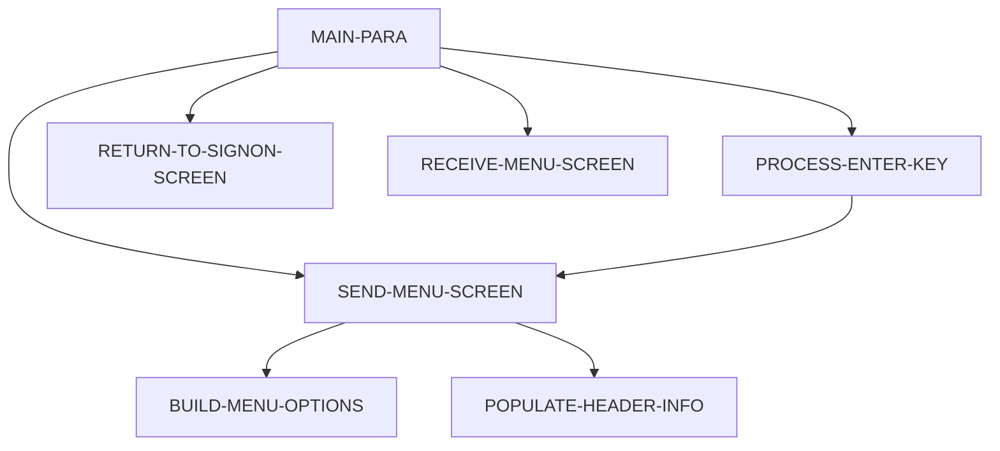

# Program COMEN01C

| Item | Value |
|---|---|
| Source | `app/cbl/COMEN01C.cbl` |
| Lines | 308 total, 213 code, 53 comment, 42 blank |
| PROGRAM-ID | COMEN01C |
| Author | AWS |
| Runtime | cics-online |
| Module | base |
| CICS transactions | CM00 (`app/csd/CARDDEMO.CSD:399-408`) |
| JCL steps | None |
| Paragraphs | 7 |
| Semantic analysis | validated (batch B05) |
| Version banner | * Ver: CardDemo_v1.0-15-g27d6c6f-68 Date: 2022-07-19 23:12:33 CDT |

## Summary

COMEN01C is the CICS pseudo-conversational main (regular user) menu of CardDemo, transaction CM00, map COMEN1A of mapset COMEN01. Without a commarea it transfers to the sign-on program COSGN00C; on first entry from another program it sets the re-enter flag and displays the option list built from the COMEN02Y table (11 options). On ENTER it normalises the typed option number, validates it against CDEMO-MENU-OPT-COUNT, blocks admin-only options for regular users, and XCTLs to the program of the chosen option with the CARDDEMO-COMMAREA; COPAUS0C is first checked with INQUIRE PROGRAM and DUMMY placeholders are shown as 'coming soon'. PF3 returns to COSGN00C; other keys redisplay the menu with an invalid-key message. Each turn ends with CICS RETURN TRANSID(CM00) COMMAREA(CARDDEMO-COMMAREA). (Confirmed)

Evidence: `app/cbl/COMEN01C.cbl:35-51`, `app/cbl/COMEN01C.cbl:75-110`, `app/cbl/COMEN01C.cbl:115-191`, `app/cpy/COMEN02Y.cpy:19-98`

Header comment (Unverified, `app/cbl/COMEN01C.cbl:1-8`): Program     : COMEN01C.CBL Application : CardDemo Type        : CICS COBOL Program Function    : Main Menu for the Regular users All Rights Reserved. http://www.apache.org/licenses/LICENSE-2.0

## Divisions and sections

| Division / section | Lines | Notes |
|---|---|---|
| IDENTIFICATION DIVISION | `app/cbl/COMEN01C.cbl:22-25` |  |
| ENVIRONMENT DIVISION | `app/cbl/COMEN01C.cbl:26-28` |  |
| DATA DIVISION | `app/cbl/COMEN01C.cbl:29-73` |  |
| PROCEDURE DIVISION | `app/cbl/COMEN01C.cbl:74-308` |  |
| ENVIRONMENT / CONFIGURATION SECTION | `app/cbl/COMEN01C.cbl:27-28` |  |
| DATA / WORKING-STORAGE SECTION | `app/cbl/COMEN01C.cbl:33-65` |  |
| DATA / LINKAGE SECTION | `app/cbl/COMEN01C.cbl:66-73` |  |

## Files and data stores

No SELECT entries (no COBOL file I/O).

## Embedded CICS, SQL and DL/I commands

| Paragraph | Kind | Verb | Resources | Response | Lines |
|---|---|---|---|---|---|
| MAIN-PARA | CICS | RETURN | TRANSID(WS-TRANID) |  | `app/cbl/COMEN01C.cbl:107-110` |
| PROCESS-ENTER-KEY | CICS | INQUIRE PROGRAM | PROGRAM(CDEMO-MENU-OPT-PGMNAME(WS-OPTION)) | NOHANDLE | `app/cbl/COMEN01C.cbl:148-151` |
| PROCESS-ENTER-KEY | CICS | XCTL | PROGRAM(CDEMO-MENU-OPT-PGMNAME(WS-OPTION)) |  | `app/cbl/COMEN01C.cbl:156-159` |
| PROCESS-ENTER-KEY | CICS | XCTL | PROGRAM(CDEMO-MENU-OPT-PGMNAME(WS-OPTION)) |  | `app/cbl/COMEN01C.cbl:184-187` |
| RETURN-TO-SIGNON-SCREEN | CICS | XCTL | PROGRAM(CDEMO-TO-PROGRAM) |  | `app/cbl/COMEN01C.cbl:201-203` |
| SEND-MENU-SCREEN | CICS | SEND MAP | MAP('COMEN1A'), MAPSET('COMEN01') |  | `app/cbl/COMEN01C.cbl:215-220` |
| RECEIVE-MENU-SCREEN | CICS | RECEIVE MAP | MAP('COMEN1A'), MAPSET('COMEN01') | RESP | `app/cbl/COMEN01C.cbl:227-233` |

## Calls, transfers and callers

| Mechanism | Target | Parameters | Paragraph | Lines |
|---|---|---|---|---|
| EXEC CICS RETURN | WS-TRANID = CM00 | CARDDEMO-COMMAREA | MAIN-PARA | `app/cbl/COMEN01C.cbl:107-110` |
| EXEC CICS XCTL | CDEMO-MENU-OPT-PGMNAME(WS-OPTION) | CARDDEMO-COMMAREA | PROCESS-ENTER-KEY | `app/cbl/COMEN01C.cbl:156-159` |
| EXEC CICS XCTL | CDEMO-MENU-OPT-PGMNAME(WS-OPTION) | CARDDEMO-COMMAREA | PROCESS-ENTER-KEY | `app/cbl/COMEN01C.cbl:184-187` |
| EXEC CICS XCTL | CDEMO-TO-PROGRAM = COSGN00C |  | RETURN-TO-SIGNON-SCREEN | `app/cbl/COMEN01C.cbl:201-203` |

Programs that transfer to or call this program (from `docs/_work/xref/call-graph.json`):

| Caller | Mechanism | Confidence | Evidence |
|---|---|---|---|
| COACTUPC | XCTL | Inferred | `app/cbl/COACTUPC.cbl:956` |
| COACTVWC | XCTL | Inferred | `app/cbl/COACTVWC.cbl:349` |
| COBIL00C | XCTL | Confirmed | `app/cbl/COBIL00C.cbl:281` |
| COCRDLIC | XCTL | Confirmed | `app/cbl/COCRDLIC.cbl:402` |
| COCRDSLC | XCTL | Inferred | `app/cbl/COCRDSLC.cbl:331` |
| COCRDUPC | XCTL | Inferred | `app/cbl/COCRDUPC.cbl:473` |
| COPAUS0C | XCTL | Confirmed | `app/app-authorization-ims-db2-mq/cbl/COPAUS0C.cbl:674` |
| CORPT00C | XCTL | Confirmed | `app/cbl/CORPT00C.cbl:548` |
| COSGN00C | XCTL | Confirmed | `app/cbl/COSGN00C.cbl:236` |
| COTRN00C | XCTL | Confirmed | `app/cbl/COTRN00C.cbl:518` |
| COTRN01C | XCTL | Confirmed | `app/cbl/COTRN01C.cbl:205` |
| COTRN02C | XCTL | Confirmed | `app/cbl/COTRN02C.cbl:508` |

## Copybooks

| Copybook | Statement | Resolution | Resolved path | REPLACING | Line |
|---|---|---|---|---|---|
| [COCOM01Y](../08-data/layouts/COCOM01Y.md) | COPY | inventory | app/cpy/COCOM01Y.cpy |  | `app/cbl/COMEN01C.cbl:50` |
| [COMEN02Y](../08-data/layouts/COMEN02Y.md) | COPY | inventory | app/cpy/COMEN02Y.cpy |  | `app/cbl/COMEN01C.cbl:51` |
| COMEN01 | COPY | inventory | app/cpy-bms/COMEN01.CPY |  | `app/cbl/COMEN01C.cbl:53` |
| [COTTL01Y](../08-data/layouts/COTTL01Y.md) | COPY | inventory | app/cpy/COTTL01Y.cpy |  | `app/cbl/COMEN01C.cbl:55` |
| [CSDAT01Y](../08-data/layouts/CSDAT01Y.md) | COPY | inventory | app/cpy/CSDAT01Y.cpy |  | `app/cbl/COMEN01C.cbl:56` |
| [CSMSG01Y](../08-data/layouts/CSMSG01Y.md) | COPY | inventory | app/cpy/CSMSG01Y.cpy |  | `app/cbl/COMEN01C.cbl:57` |
| [CSUSR01Y](../08-data/layouts/CSUSR01Y.md) | COPY | inventory | app/cpy/CSUSR01Y.cpy |  | `app/cbl/COMEN01C.cbl:58` |
| DFHAID | COPY | system |  |  | `app/cbl/COMEN01C.cbl:60` |
| DFHBMSCA | COPY | system |  |  | `app/cbl/COMEN01C.cbl:61` |

## Data division items

Every data entry coded in this source (copybook contents are on the copybook pages). Lengths are computed from PIC and USAGE.

| Section | Lvl | Name | PIC | Usage | Len | OCCURS | REDEFINES | VALUE | 88-levels | Line |
|---|---|---|---|---|---|---|---|---|---|---|
| WORKING-STORAGE | 01 | WS-VARIABLES |  |  |  |  |  |  |  | 35 |
| WORKING-STORAGE | 05 | WS-PGMNAME | X(08) |  | 8 |  |  | 'COMEN01C' |  | 36 |
| WORKING-STORAGE | 05 | WS-TRANID | X(04) |  | 4 |  |  | 'CM00' |  | 37 |
| WORKING-STORAGE | 05 | WS-MESSAGE | X(80) |  | 80 |  |  | SPACES |  | 38 |
| WORKING-STORAGE | 05 | WS-USRSEC-FILE | X(08) |  | 8 |  |  | 'USRSEC ' |  | 39 |
| WORKING-STORAGE | 05 | WS-ERR-FLG | X(01) |  | 1 |  |  | 'N' | ERR-FLG-ON = 'Y'; ERR-FLG-OFF = 'N' | 40 |
| WORKING-STORAGE | 05 | WS-RESP-CD | S9(09) | COMP | 4 |  |  | ZEROS |  | 43 |
| WORKING-STORAGE | 05 | WS-REAS-CD | S9(09) | COMP | 4 |  |  | ZEROS |  | 44 |
| WORKING-STORAGE | 05 | WS-OPTION-X | X(02) |  | 2 |  |  |  |  | 45 |
| WORKING-STORAGE | 05 | WS-OPTION | 9(02) |  | 2 |  |  | 0 |  | 46 |
| WORKING-STORAGE | 05 | WS-IDX | S9(04) | COMP | 2 |  |  | ZEROS |  | 47 |
| WORKING-STORAGE | 05 | WS-MENU-OPT-TXT | X(40) |  | 40 |  |  | SPACES |  | 48 |
| LINKAGE | 01 | DFHCOMMAREA |  |  |  |  |  |  |  | 67 |
| LINKAGE | 05 | LK-COMMAREA | X(01) |  | 1 | 1 TO 32767 DEPENDING ON EIBCALEN |  |  |  | 68 |

## Statement inventory

Every procedure statement the parser recorded, by kind. Each one is listed with its line under Paragraph details.

| Kind | Count |
|---|---|
| Decisions (IF, EVALUATE, WHEN, loops, handlers) | 31 |
| Calculations | 0 |
| File I/O | 0 |
| EXEC CICS / SQL / DLI | 7 |
| CALL | 0 |
| PERFORM | 13 |
| GO TO | 0 |
| MOVE literal | 7 |
| MOVE field | 46 |
| SET | 3 |
| STRING, UNSTRING, INSPECT, INITIALIZE, COPY, ENTRY and others | 4 |
| DISPLAY | 0 |
| GOBACK, STOP RUN, RETURN, XCTL | 4 |
| Not classified by the parser | 0 |

## Control flow

| Paragraph | Lines | Logic | Performs | Performed by | Reachable |
|---|---|---|---|---|---|
| [MAIN-PARA](#para-main-para) | 75-110 | Clears the error flag and message. If EIBCALEN = 0 it moves 'COSGN00C' to CDEMO-FROM-PROGRAM and performs RETURN-TO-SIGNON-SCREEN. Otherwise it copies DFHCOMMAREA into CARDDEMO-COMMAREA; if CDEMO-PGM-REENTER is not set it sets it, clears COMEN1AO and sends the menu; else it receives the map and evaluates EIBAID: ENTER performs PROCESS-ENTER-KEY, PF3 sets CDEMO-TO-PROGRAM='COSGN00C' and returns to sign-on, other keys redisplay with CCDA-MSG-INVALID-KEY. Ends with CICS RETURN TRANSID('CM00') and the commarea. (Confirmed) | PROCESS-ENTER-KEY, RECEIVE-MENU-SCREEN, RETURN-TO-SIGNON-SCREEN, SEND-MENU-SCREEN |  | yes |
| [PROCESS-ENTER-KEY](#para-process-enter-key) | 115-191 | Finds the last non-space character of OPTIONI, moves the significant part into right-justified WS-OPTION-X, replaces spaces with '0' and moves it to numeric WS-OPTION. Rejects non-numeric, zero or > CDEMO-MENU-OPT-COUNT options with 'Please enter a valid option number...', and rejects options with user type 'A' for CDEMO-USRTYP-USER users with 'No access - Admin Only option... '. When no error: COPAUS0C is XCTLed only if EXEC CICS INQUIRE PROGRAM returns NORMAL (else red 'This option ... is not installed...'); programs starting 'DUMMY' produce a green 'coming soon' message; any other option sets CDEMO-FROM-TRANID/PROGRAM, CDEMO-PGM-CONTEXT=0 and XCTLs to CDEMO-MENU-OPT-PGMNAME(WS-OPTION). If no XCTL occurred, the menu is redisplayed. (Confirmed) | SEND-MENU-SCREEN | MAIN-PARA | yes |
| [RETURN-TO-SIGNON-SCREEN](#para-return-to-signon-screen) | 196-203 | Defaults CDEMO-TO-PROGRAM to 'COSGN00C' when it is low-values or spaces, then XCTLs to CDEMO-TO-PROGRAM without a commarea. (Confirmed) |  | MAIN-PARA | yes |
| [SEND-MENU-SCREEN](#para-send-menu-screen) | 208-220 | Performs POPULATE-HEADER-INFO and BUILD-MENU-OPTIONS, moves WS-MESSAGE to ERRMSGO and sends map COMEN1A (mapset COMEN01) with ERASE. (Confirmed) | BUILD-MENU-OPTIONS, POPULATE-HEADER-INFO | MAIN-PARA, PROCESS-ENTER-KEY | yes |
| [RECEIVE-MENU-SCREEN](#para-receive-menu-screen) | 225-233 | Receives map COMEN1A of mapset COMEN01 into COMEN1AI capturing RESP/RESP2 (not tested afterwards). (Confirmed) |  | MAIN-PARA | yes |
| [POPULATE-HEADER-INFO](#para-populate-header-info) | 238-257 | Moves titles, transaction id CM00, program name, current date (MM/DD/YY) and time (HH:MM:SS) from FUNCTION CURRENT-DATE to the map header fields. (Confirmed) |  | SEND-MENU-SCREEN | yes |
| [BUILD-MENU-OPTIONS](#para-build-menu-options) | 262-303 | Loops WS-IDX from 1 to CDEMO-MENU-OPT-COUNT, builds 'nn. option name' from CDEMO-MENU-OPT-NUM and CDEMO-MENU-OPT-NAME and moves it to screen line OPTN001O..OPTN012O according to WS-IDX; indexes beyond 12 are ignored. (Confirmed) |  | SEND-MENU-SCREEN | yes |

## Paragraph details

### Para MAIN-PARA

Lines `app/cbl/COMEN01C.cbl:75-110`. 

Logic: Clears the error flag and message. If EIBCALEN = 0 it moves 'COSGN00C' to CDEMO-FROM-PROGRAM and performs RETURN-TO-SIGNON-SCREEN. Otherwise it copies DFHCOMMAREA into CARDDEMO-COMMAREA; if CDEMO-PGM-REENTER is not set it sets it, clears COMEN1AO and sends the menu; else it receives the map and evaluates EIBAID: ENTER performs PROCESS-ENTER-KEY, PF3 sets CDEMO-TO-PROGRAM='COSGN00C' and returns to sign-on, other keys redisplay with CCDA-MSG-INVALID-KEY. Ends with CICS RETURN TRANSID('CM00') and the commarea. (Confirmed)

Rules: [BR-COMEN01C-004](../09-business-rules-catalog.md#br-comen01c-004), [BR-COMEN01C-005](../09-business-rules-catalog.md#br-comen01c-005)

Statements in source order:

- `SET ERR-FLG-OFF TO TRUE` at `app/cbl/COMEN01C.cbl:77`
- `MOVE SPACES TO WS-MESSAGE ERRMSGO OF COMEN1AO` at `app/cbl/COMEN01C.cbl:79-80`
- IF `EIBCALEN = 0` at `app/cbl/COMEN01C.cbl:82` (pseudo-conversation)
- MOVE `'COSGN00C'` TO CDEMO-FROM-PROGRAM at `app/cbl/COMEN01C.cbl:83`
- PERFORM RETURN-TO-SIGNON-SCREEN at `app/cbl/COMEN01C.cbl:84`
- `MOVE DFHCOMMAREA(1:EIBCALEN) TO CARDDEMO-COMMAREA` at `app/cbl/COMEN01C.cbl:86`
- IF `NOT CDEMO-PGM-REENTER` at `app/cbl/COMEN01C.cbl:87` (pseudo-conversation)
- `SET CDEMO-PGM-REENTER TO TRUE` at `app/cbl/COMEN01C.cbl:88`
- `MOVE LOW-VALUES TO COMEN1AO` at `app/cbl/COMEN01C.cbl:89`
- PERFORM SEND-MENU-SCREEN at `app/cbl/COMEN01C.cbl:90`
- PERFORM RECEIVE-MENU-SCREEN at `app/cbl/COMEN01C.cbl:92`
- EVALUATE `EIBAID` at `app/cbl/COMEN01C.cbl:93` (screen-key)
- WHEN `DFHENTER` at `app/cbl/COMEN01C.cbl:94` (screen-key)
- PERFORM PROCESS-ENTER-KEY at `app/cbl/COMEN01C.cbl:95`
- WHEN `DFHPF3` at `app/cbl/COMEN01C.cbl:96` (screen-key)
- MOVE `'COSGN00C'` TO CDEMO-TO-PROGRAM at `app/cbl/COMEN01C.cbl:97`
- PERFORM RETURN-TO-SIGNON-SCREEN at `app/cbl/COMEN01C.cbl:98`
- WHEN `OTHER` at `app/cbl/COMEN01C.cbl:99` (screen-key)
- MOVE `'Y'` TO WS-ERR-FLG at `app/cbl/COMEN01C.cbl:100`
- `MOVE CCDA-MSG-INVALID-KEY TO WS-MESSAGE` at `app/cbl/COMEN01C.cbl:101`
- PERFORM SEND-MENU-SCREEN at `app/cbl/COMEN01C.cbl:102`
- EXEC CICS RETURN at `app/cbl/COMEN01C.cbl:107-110`
- Ends with EXEC CICS RETURN at `app/cbl/COMEN01C.cbl:107-110`

### Para PROCESS-ENTER-KEY

Lines `app/cbl/COMEN01C.cbl:115-191`. 

Logic: Finds the last non-space character of OPTIONI, moves the significant part into right-justified WS-OPTION-X, replaces spaces with '0' and moves it to numeric WS-OPTION. Rejects non-numeric, zero or > CDEMO-MENU-OPT-COUNT options with 'Please enter a valid option number...', and rejects options with user type 'A' for CDEMO-USRTYP-USER users with 'No access - Admin Only option... '. When no error: COPAUS0C is XCTLed only if EXEC CICS INQUIRE PROGRAM returns NORMAL (else red 'This option ... is not installed...'); programs starting 'DUMMY' produce a green 'coming soon' message; any other option sets CDEMO-FROM-TRANID/PROGRAM, CDEMO-PGM-CONTEXT=0 and XCTLs to CDEMO-MENU-OPT-PGMNAME(WS-OPTION). If no XCTL occurred, the menu is redisplayed. (Confirmed)

Rules: [BR-COMEN01C-001](../09-business-rules-catalog.md#br-comen01c-001), [BR-COMEN01C-002](../09-business-rules-catalog.md#br-comen01c-002), [BR-COMEN01C-003](../09-business-rules-catalog.md#br-comen01c-003)

Statements in source order:

- LOOP `VARYING WS-IDX FROM LENGTH OF OPTIONI OF COMEN1AI BY -1 UNTIL OPTIONI OF COMEN1AI(WS-IDX:1) NOT = SPACES OR WS-IDX = 1` at `app/cbl/COMEN01C.cbl:117-120` (pseudo-conversation)
- Inline PERFORM `VARYING WS-IDX FROM LENGTH OF OPTIONI OF COMEN1AI BY -1 UNTIL OPTIONI OF COMEN1AI(WS-IDX:1) NOT = SPACES OR WS-IDX = 1` at `app/cbl/COMEN01C.cbl:117-120`
- `MOVE OPTIONI OF COMEN1AI(1:WS-IDX) TO WS-OPTION-X` at `app/cbl/COMEN01C.cbl:122`
- `INSPECT WS-OPTION-X REPLACING ALL ' ' BY '0'` at `app/cbl/COMEN01C.cbl:123`
- `MOVE WS-OPTION-X TO WS-OPTION` at `app/cbl/COMEN01C.cbl:124`
- `MOVE WS-OPTION TO OPTIONO OF COMEN1AO` at `app/cbl/COMEN01C.cbl:125`
- IF `WS-OPTION IS NOT NUMERIC OR WS-OPTION > CDEMO-MENU-OPT-COUNT OR WS-OPTION = ZEROS` at `app/cbl/COMEN01C.cbl:127-129` (business-candidate)
- MOVE `'Y'` TO WS-ERR-FLG at `app/cbl/COMEN01C.cbl:130`
- MOVE `'Please enter a valid option number...'` TO WS-MESSAGE at `app/cbl/COMEN01C.cbl:131-132`
- PERFORM SEND-MENU-SCREEN at `app/cbl/COMEN01C.cbl:133`
- IF `CDEMO-USRTYP-USER AND CDEMO-MENU-OPT-USRTYPE(WS-OPTION) = 'A'` at `app/cbl/COMEN01C.cbl:136-137` (business-candidate)
- `SET ERR-FLG-ON TO TRUE` at `app/cbl/COMEN01C.cbl:138`
- `MOVE SPACES TO WS-MESSAGE` at `app/cbl/COMEN01C.cbl:139`
- MOVE `'No access - Admin Only option... '` TO WS-MESSAGE at `app/cbl/COMEN01C.cbl:140-141`
- PERFORM SEND-MENU-SCREEN at `app/cbl/COMEN01C.cbl:142`
- IF `NOT ERR-FLG-ON` at `app/cbl/COMEN01C.cbl:145` (error-flag)
- EVALUATE `TRUE` at `app/cbl/COMEN01C.cbl:146` (business-candidate)
- WHEN `CDEMO-MENU-OPT-PGMNAME(WS-OPTION) = 'COPAUS0C'` at `app/cbl/COMEN01C.cbl:147` (business-candidate)
- EXEC CICS INQUIRE PROGRAM at `app/cbl/COMEN01C.cbl:148-151`
- IF `EIBRESP = DFHRESP(NORMAL)` at `app/cbl/COMEN01C.cbl:152` (io-status)
- `MOVE WS-TRANID TO CDEMO-FROM-TRANID` at `app/cbl/COMEN01C.cbl:153`
- `MOVE WS-PGMNAME TO CDEMO-FROM-PROGRAM` at `app/cbl/COMEN01C.cbl:154`
- `MOVE ZEROS TO CDEMO-PGM-CONTEXT` at `app/cbl/COMEN01C.cbl:155`
- EXEC CICS XCTL at `app/cbl/COMEN01C.cbl:156-159`
- Ends with EXEC CICS XCTL at `app/cbl/COMEN01C.cbl:156-159`
- `MOVE SPACES TO WS-MESSAGE` at `app/cbl/COMEN01C.cbl:161`
- `MOVE DFHRED TO ERRMSGC OF COMEN1AO` at `app/cbl/COMEN01C.cbl:162`
- `STRING 'This option ' DELIMITED BY SIZE CDEMO-MENU-OPT-NAME(WS-OPTION) DELIMITED BY ' ' ' is not installed...' DELIMITED BY SIZE INTO WS-MESSAGE` at `app/cbl/COMEN01C.cbl:163-167`
- WHEN `CDEMO-MENU-OPT-PGMNAME(WS-OPTION)(1:5) = 'DUMMY'` at `app/cbl/COMEN01C.cbl:169` (business-candidate)
- `MOVE SPACES TO WS-MESSAGE` at `app/cbl/COMEN01C.cbl:170`
- `MOVE DFHGREEN TO ERRMSGC OF COMEN1AO` at `app/cbl/COMEN01C.cbl:171`
- `STRING 'This option ' DELIMITED BY SIZE CDEMO-MENU-OPT-NAME(WS-OPTION) DELIMITED BY SPACE 'is coming soon ...' DELIMITED BY SIZE INTO WS-MESSAGE` at `app/cbl/COMEN01C.cbl:172-176`
- WHEN `OTHER` at `app/cbl/COMEN01C.cbl:177` (business-candidate)
- `MOVE WS-TRANID TO CDEMO-FROM-TRANID` at `app/cbl/COMEN01C.cbl:178`
- `MOVE WS-PGMNAME TO CDEMO-FROM-PROGRAM` at `app/cbl/COMEN01C.cbl:179`
- `MOVE WS-PGMNAME TO CDEMO-FROM-PROGRAM` at `app/cbl/COMEN01C.cbl:180`
- `MOVE ZEROS TO CDEMO-PGM-CONTEXT` at `app/cbl/COMEN01C.cbl:183`
- EXEC CICS XCTL at `app/cbl/COMEN01C.cbl:184-187`
- Ends with EXEC CICS XCTL at `app/cbl/COMEN01C.cbl:184-187`
- PERFORM SEND-MENU-SCREEN at `app/cbl/COMEN01C.cbl:190`

### Para RETURN-TO-SIGNON-SCREEN

Lines `app/cbl/COMEN01C.cbl:196-203`. 

Logic: Defaults CDEMO-TO-PROGRAM to 'COSGN00C' when it is low-values or spaces, then XCTLs to CDEMO-TO-PROGRAM without a commarea. (Confirmed)

Rules: [BR-BASE-001](../09-business-rules-catalog.md#br-base-001)

Statements in source order:

- IF `CDEMO-TO-PROGRAM = LOW-VALUES OR SPACES` at `app/cbl/COMEN01C.cbl:198` (business-candidate)
- MOVE `'COSGN00C'` TO CDEMO-TO-PROGRAM at `app/cbl/COMEN01C.cbl:199`
- EXEC CICS XCTL at `app/cbl/COMEN01C.cbl:201-203`
- Ends with EXEC CICS XCTL at `app/cbl/COMEN01C.cbl:201-203`

### Para SEND-MENU-SCREEN

Lines `app/cbl/COMEN01C.cbl:208-220`. 

Logic: Performs POPULATE-HEADER-INFO and BUILD-MENU-OPTIONS, moves WS-MESSAGE to ERRMSGO and sends map COMEN1A (mapset COMEN01) with ERASE. (Confirmed)

Statements in source order:

- PERFORM POPULATE-HEADER-INFO at `app/cbl/COMEN01C.cbl:210`
- PERFORM BUILD-MENU-OPTIONS at `app/cbl/COMEN01C.cbl:211`
- `MOVE WS-MESSAGE TO ERRMSGO OF COMEN1AO` at `app/cbl/COMEN01C.cbl:213`
- EXEC CICS SEND MAP at `app/cbl/COMEN01C.cbl:215-220`

### Para RECEIVE-MENU-SCREEN

Lines `app/cbl/COMEN01C.cbl:225-233`. 

Logic: Receives map COMEN1A of mapset COMEN01 into COMEN1AI capturing RESP/RESP2 (not tested afterwards). (Confirmed)

Statements in source order:

- EXEC CICS RECEIVE MAP at `app/cbl/COMEN01C.cbl:227-233`

### Para POPULATE-HEADER-INFO

Lines `app/cbl/COMEN01C.cbl:238-257`. 

Logic: Moves titles, transaction id CM00, program name, current date (MM/DD/YY) and time (HH:MM:SS) from FUNCTION CURRENT-DATE to the map header fields. (Confirmed)

Statements in source order:

- `MOVE FUNCTION CURRENT-DATE TO WS-CURDATE-DATA` at `app/cbl/COMEN01C.cbl:240`
- `MOVE CCDA-TITLE01 TO TITLE01O OF COMEN1AO` at `app/cbl/COMEN01C.cbl:242`
- `MOVE CCDA-TITLE02 TO TITLE02O OF COMEN1AO` at `app/cbl/COMEN01C.cbl:243`
- `MOVE WS-TRANID TO TRNNAMEO OF COMEN1AO` at `app/cbl/COMEN01C.cbl:244`
- `MOVE WS-PGMNAME TO PGMNAMEO OF COMEN1AO` at `app/cbl/COMEN01C.cbl:245`
- `MOVE WS-CURDATE-MONTH TO WS-CURDATE-MM` at `app/cbl/COMEN01C.cbl:247`
- `MOVE WS-CURDATE-DAY TO WS-CURDATE-DD` at `app/cbl/COMEN01C.cbl:248`
- `MOVE WS-CURDATE-YEAR(3:2) TO WS-CURDATE-YY` at `app/cbl/COMEN01C.cbl:249`
- `MOVE WS-CURDATE-MM-DD-YY TO CURDATEO OF COMEN1AO` at `app/cbl/COMEN01C.cbl:251`
- `MOVE WS-CURTIME-HOURS TO WS-CURTIME-HH` at `app/cbl/COMEN01C.cbl:253`
- `MOVE WS-CURTIME-MINUTE TO WS-CURTIME-MM` at `app/cbl/COMEN01C.cbl:254`
- `MOVE WS-CURTIME-SECOND TO WS-CURTIME-SS` at `app/cbl/COMEN01C.cbl:255`
- `MOVE WS-CURTIME-HH-MM-SS TO CURTIMEO OF COMEN1AO` at `app/cbl/COMEN01C.cbl:257`

### Para BUILD-MENU-OPTIONS

Lines `app/cbl/COMEN01C.cbl:262-303`. 

Logic: Loops WS-IDX from 1 to CDEMO-MENU-OPT-COUNT, builds 'nn. option name' from CDEMO-MENU-OPT-NUM and CDEMO-MENU-OPT-NAME and moves it to screen line OPTN001O..OPTN012O according to WS-IDX; indexes beyond 12 are ignored. (Confirmed)

Statements in source order:

- LOOP `VARYING WS-IDX FROM 1 BY 1 UNTIL WS-IDX > CDEMO-MENU-OPT-COUNT` at `app/cbl/COMEN01C.cbl:264-265` (business-candidate)
- Inline PERFORM `VARYING WS-IDX FROM 1 BY 1 UNTIL WS-IDX > CDEMO-MENU-OPT-COUNT` at `app/cbl/COMEN01C.cbl:264-265`
- `MOVE SPACES TO WS-MENU-OPT-TXT` at `app/cbl/COMEN01C.cbl:267`
- `STRING CDEMO-MENU-OPT-NUM(WS-IDX) DELIMITED BY SIZE '. ' DELIMITED BY SIZE CDEMO-MENU-OPT-NAME(WS-IDX) DELIMITED BY SIZE INTO WS-MENU-OPT-TXT` at `app/cbl/COMEN01C.cbl:269-272`
- EVALUATE `WS-IDX` at `app/cbl/COMEN01C.cbl:274` (business-candidate)
- WHEN `1` at `app/cbl/COMEN01C.cbl:275` (business-candidate)
- `MOVE WS-MENU-OPT-TXT TO OPTN001O` at `app/cbl/COMEN01C.cbl:276`
- WHEN `2` at `app/cbl/COMEN01C.cbl:277` (business-candidate)
- `MOVE WS-MENU-OPT-TXT TO OPTN002O` at `app/cbl/COMEN01C.cbl:278`
- WHEN `3` at `app/cbl/COMEN01C.cbl:279` (business-candidate)
- `MOVE WS-MENU-OPT-TXT TO OPTN003O` at `app/cbl/COMEN01C.cbl:280`
- WHEN `4` at `app/cbl/COMEN01C.cbl:281` (business-candidate)
- `MOVE WS-MENU-OPT-TXT TO OPTN004O` at `app/cbl/COMEN01C.cbl:282`
- WHEN `5` at `app/cbl/COMEN01C.cbl:283` (business-candidate)
- `MOVE WS-MENU-OPT-TXT TO OPTN005O` at `app/cbl/COMEN01C.cbl:284`
- WHEN `6` at `app/cbl/COMEN01C.cbl:285` (business-candidate)
- `MOVE WS-MENU-OPT-TXT TO OPTN006O` at `app/cbl/COMEN01C.cbl:286`
- WHEN `7` at `app/cbl/COMEN01C.cbl:287` (business-candidate)
- `MOVE WS-MENU-OPT-TXT TO OPTN007O` at `app/cbl/COMEN01C.cbl:288`
- WHEN `8` at `app/cbl/COMEN01C.cbl:289` (business-candidate)
- `MOVE WS-MENU-OPT-TXT TO OPTN008O` at `app/cbl/COMEN01C.cbl:290`
- WHEN `9` at `app/cbl/COMEN01C.cbl:291` (business-candidate)
- `MOVE WS-MENU-OPT-TXT TO OPTN009O` at `app/cbl/COMEN01C.cbl:292`
- WHEN `10` at `app/cbl/COMEN01C.cbl:293` (business-candidate)
- `MOVE WS-MENU-OPT-TXT TO OPTN010O` at `app/cbl/COMEN01C.cbl:294`
- WHEN `11` at `app/cbl/COMEN01C.cbl:295` (business-candidate)
- `MOVE WS-MENU-OPT-TXT TO OPTN011O` at `app/cbl/COMEN01C.cbl:296`
- WHEN `12` at `app/cbl/COMEN01C.cbl:297` (business-candidate)
- `MOVE WS-MENU-OPT-TXT TO OPTN012O` at `app/cbl/COMEN01C.cbl:298`
- WHEN `OTHER` at `app/cbl/COMEN01C.cbl:299` (business-candidate)

## Business rules

| Rule | Category | Statement | Paragraph | Source | Confidence |
|---|---|---|---|---|---|
| [BR-BASE-001](../09-business-rules-catalog.md#br-base-001) | routing | When the return target is spaces or low-values, the user menu and the admin menu both set it to COSGN00C before the transfer. | RETURN-TO-SIGNON-SCREEN | `app/cbl/COMEN01C.cbl:198-200` | Confirmed / review: confirmed |
| [BR-BASE-002](../09-business-rules-catalog.md#br-base-002) | routing | PF3 on the user menu and on the admin menu sets the return target to COSGN00C and returns to sign-on. |  | `app/cbl/COMEN01C.cbl:96-98` | Confirmed / review: confirmed |
| [BR-BASE-COMEN01C-001](../09-business-rules-catalog.md#br-base-comen01c-001) | routing | Menu option COPAUS0C is started only when INQUIRE PROGRAM returns a normal response. Otherwise the menu shows that the option is not installed. |  | `app/cbl/COMEN01C.cbl:147-168` | Confirmed / review: confirmed |
| [BR-BASE-COMEN01C-002](../09-business-rules-catalog.md#br-base-comen01c-002) | routing | A user-menu option whose program name begins with DUMMY is not started. The menu shows that the option is coming soon. |  | `app/cbl/COMEN01C.cbl:169-176` | Confirmed / review: confirmed |
| [BR-COMEN01C-001](../09-business-rules-catalog.md#br-comen01c-001) | validation | The menu option entered must be numeric, not zero and not greater than the number of configured options (CDEMO-MENU-OPT-COUNT, 11 in COMEN02Y); otherwise the menu is redisplayed with 'Please enter a valid option number...'. Before the test, trailing blanks are dropped and embedded/leading blanks are replaced by zeros, so ' 5' and '5 ' both mean option 5. | PROCESS-ENTER-KEY | `app/cbl/COMEN01C.cbl:127-134`, `app/cbl/COMEN01C.cbl:117-125`, `app/cpy/COMEN02Y.cpy:21` | Confirmed |
| [BR-COMEN01C-002](../09-business-rules-catalog.md#br-comen01c-002) | security | A regular user (CDEMO-USER-TYPE 'U') may not select a menu option flagged admin-only (CDEMO-MENU-OPT-USRTYPE = 'A'); the menu is redisplayed with 'No access - Admin Only option... ' and no transfer happens. In the current COMEN02Y table every option is flagged 'U', so the check never fires with the shipped configuration. | PROCESS-ENTER-KEY | `app/cbl/COMEN01C.cbl:136-143`, `app/cpy/COMEN02Y.cpy:25-90` | Confirmed |
| [BR-COMEN01C-003](../09-business-rules-catalog.md#br-comen01c-003) | routing | A valid, permitted option whose program is neither COPAUS0C nor a DUMMY placeholder transfers control (XCTL) to the program named in CDEMO-MENU-OPT-PGMNAME for that option, passing the commarea with from-transaction CM00, from-program COMEN01C and program context 0 (first entry). Options 1-10 map to COACTVWC, COACTUPC, COCRDLIC, COCRDSLC, COCRDUPC, COTRN00C, COTRN01C, COTRN02C, CORPT00C, COBIL00C. | PROCESS-ENTER-KEY | `app/cbl/COMEN01C.cbl:177-187`, `app/cbl/COMEN01C.cbl:144-146`, `app/cpy/COMEN02Y.cpy:25-84` | Confirmed |
| [BR-COMEN01C-004](../09-business-rules-catalog.md#br-comen01c-004) | decision | The menu distinguishes first entry from re-entry with CDEMO-PGM-CONTEXT: when entered from another program (context not 1) it sets CDEMO-PGM-REENTER and only displays the menu; screen input is received and acted on only on re-entry. A call without any commarea is sent back to sign-on (COSGN00C). | MAIN-PARA | `app/cbl/COMEN01C.cbl:82-92` | Confirmed |
| [BR-COMEN01C-005](../09-business-rules-catalog.md#br-comen01c-005) | error-policy | On the main menu any key other than ENTER or PF3 is rejected: the menu is redisplayed with 'Invalid key pressed. Please see below...' and no option is processed. | MAIN-PARA | `app/cbl/COMEN01C.cbl:99-102`, `app/cpy/CSMSG01Y.cpy:20-21` | Confirmed |

Decision points reviewed and classified as not business rules:

| Lines | Reason |
|---|---|
| `app/cbl/COMEN01C.cbl:264-301` | BUILD-MENU-OPTIONS loop and EVALUATE WS-IDX only place option text on screen lines OPTN001O-OPTN012O (presentation). |

Decision coverage: 22 of 22 business-candidate decision points are linked to a rule or a no-rule reason (7 inside rule ranges).

## Error handling

| Paragraph | Kind | Detail | Lines |
|---|---|---|---|
| PROCESS-ENTER-KEY | check | `EIBRESP = DFHRESP(NORMAL)` | `app/cbl/COMEN01C.cbl:152` |

## Observations and SME questions

- anomaly: After an invalid option (zero, non-numeric or > count) the error flag is set but the next IF still subscripts CDEMO-MENU-OPT-USRTYPE(WS-OPTION); with WS-OPTION = 0 or > 12 this is an out-of-range subscript, and if the condition evaluated true the map would be sent twice. (`app/cbl/COMEN01C.cbl:127-143`)
- dead-code: Every COMEN02Y option has user type 'U' and none starts with 'DUMMY', so the admin-only check and the coming-soon branch never fire with the shipped table. (`app/cbl/COMEN01C.cbl:136-176`)
- anomaly: Coming-soon message truncates the option name at the first space and the literal 'is coming soon ...' has no leading space (e.g. 'This option Accountis coming soon ...'). The not-installed message uses DELIMITED BY '  ' instead. (`app/cbl/COMEN01C.cbl:172-176`)
- anomaly: MOVE WS-PGMNAME TO CDEMO-FROM-PROGRAM is duplicated; commented-out moves of WS-USER-ID/SEC-USR-TYPE remain. (`app/cbl/COMEN01C.cbl:179-182`)
- unchecked-io: RECEIVE MAP RESP/RESP2 are never tested, and the XCTL to option programs has no RESP/HANDLE, so a missing program would abend (only COPAUS0C is pre-checked). (`app/cbl/COMEN01C.cbl:227-233`)
- anomaly: COMEN01C copies CSUSR01Y and defines WS-USRSEC-FILE 'USRSEC' but never reads the file. (`app/cbl/COMEN01C.cbl:39`)
- SME question: Is the admin-only flag in COMEN02Y intended to be used (e.g. 'Transaction Add (Admin Only)' was commented out)? If not, can the access check be dropped in the target design? (`app/cpy/COMEN02Y.cpy:67-72`)
- SME question: Why is only COPAUS0C pre-checked with INQUIRE PROGRAM? Is the pending-authorization module an optional install? (`app/cbl/COMEN01C.cbl:147-151`)

## Sources

- `app/cbl/COMEN01C.cbl`
- `docs/_work/structure/programs/COMEN01C.json`
- `docs/_work/semantic/programs/COMEN01C.json`
- `docs/_work/programs/COMEN01C.json`

## Confidence

Structure tables (divisions, items, paragraphs, statements, line numbers) are Confirmed: they are parsed from the source. Paragraph logic and rule statements carry their own Confirmed/Inferred tag from the batch analysis, and every rule anchor was checked against the cited lines. Decision-point classes are a keyword heuristic used only for coverage measurement. Header comments are Unverified.
