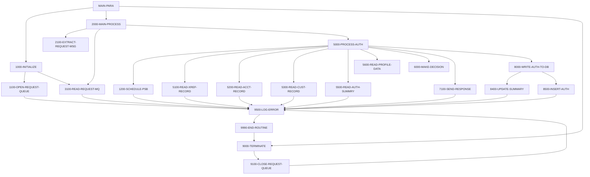

# Program COPAUA0C

| Item | Value |
|---|---|
| Source | `app/app-authorization-ims-db2-mq/cbl/COPAUA0C.cbl` |
| Lines | 1026 total, 771 code, 152 comment, 103 blank |
| PROGRAM-ID | COPAUA0C |
| Author | SOUMA GHOSH |
| Runtime | cics-mq-triggered, mq |
| Module | auth |
| CICS transactions | CP00 (`app/app-authorization-ims-db2-mq/csd/CRDDEMO2.csd:59-68`) |
| JCL steps | None |
| Paragraphs | 43 |
| Semantic analysis | validated (batch B01) |
| Version banner |  |

## Summary

COPAUA0C is the CICS card-authorization decision program (transaction id literal 'CP00') started by an MQ trigger: it RETRIEVEs the trigger message (MQTM) to get the request queue name, opens it and loops MQGET (5-second wait) until no message is available or more than 500 requests have been processed. Each request is a comma-delimited string unstrung into PENDING-AUTH-REQUEST (CCPAURQY). For each request it schedules IMS PSB PSBPAUTB, reads the card cross-reference (CCXREF), account (ACCTDAT) and customer (CUSTDAT) VSAM files and the IMS pending authorization summary (PAUTSUM0) for the account. It approves the request when the transaction amount does not exceed the available credit (credit limit minus balance, taken from the IMS summary when it exists, otherwise from the account master) and declines otherwise with response '05' and a reason code. The comma-delimited response (CCPAURLY) is sent with MQPUT1 to the request's reply-to queue with the saved correlation id. When the card was found, the summary segment is updated or inserted and a PAUTDTL1 detail segment is inserted; a CICS SYNCPOINT follows each message. Errors are written to TD queue CSSL using the CCPAUERY layout and critical errors terminate the task. (Confirmed)

Evidence: `app/app-authorization-ims-db2-mq/cbl/COPAUA0C.cbl:1-5`, `app/app-authorization-ims-db2-mq/cbl/COPAUA0C.cbl:220-247`, `app/app-authorization-ims-db2-mq/cbl/COPAUA0C.cbl:323-380`, `app/app-authorization-ims-db2-mq/cbl/COPAUA0C.cbl:438-466`, `app/app-authorization-ims-db2-mq/cbl/COPAUA0C.cbl:657-732`, `app/app-authorization-ims-db2-mq/cbl/COPAUA0C.cbl:738-780`, `app/app-authorization-ims-db2-mq/cbl/COPAUA0C.cbl:798-933`, `app/app-authorization-ims-db2-mq/cbl/COPAUA0C.cbl:983-1023`

Header comment (Unverified, `app/app-authorization-ims-db2-mq/cbl/COPAUA0C.cbl:1`): See the comment block at the top of the source. Unverified until matched to code.

## Divisions and sections

| Division / section | Lines | Notes |
|---|---|---|
| IDENTIFICATION DIVISION | `app/app-authorization-ims-db2-mq/cbl/COPAUA0C.cbl:22-25` |  |
| ENVIRONMENT DIVISION | `app/app-authorization-ims-db2-mq/cbl/COPAUA0C.cbl:26-28` |  |
| DATA DIVISION | `app/app-authorization-ims-db2-mq/cbl/COPAUA0C.cbl:29-217` |  |
| PROCEDURE DIVISION | `app/app-authorization-ims-db2-mq/cbl/COPAUA0C.cbl:218-1026` |  |
| ENVIRONMENT / CONFIGURATION SECTION | `app/app-authorization-ims-db2-mq/cbl/COPAUA0C.cbl:27-28` |  |
| DATA / WORKING-STORAGE SECTION | `app/app-authorization-ims-db2-mq/cbl/COPAUA0C.cbl:30-211` |  |
| DATA / LINKAGE SECTION | `app/app-authorization-ims-db2-mq/cbl/COPAUA0C.cbl:212-217` |  |

## Files and data stores

No SELECT entries (no COBOL file I/O).

CICS file commands (file name resolved from VALUE clauses and the CSD):

| Command | FILE option | Resolved name | CSD DSNAME | CSD evidence | Line |
|---|---|---|---|---|---|
| READ | WS-CCXREF-FILE | CCXREF | AWS.M2.CARDDEMO.CARDXREF.VSAM.KSDS | `app/csd/CARDDEMO.CSD:37-49` | `app/app-authorization-ims-db2-mq/cbl/COPAUA0C.cbl:477-485` |
| READ | WS-ACCTFILENAME | ACCTDAT | AWS.M2.CARDDEMO.ACCTDATA.VSAM.KSDS | `app/csd/CARDDEMO.CSD:1-12` | `app/app-authorization-ims-db2-mq/cbl/COPAUA0C.cbl:525-533` |
| READ | WS-CUSTFILENAME | CUSTDAT | AWS.M2.CARDDEMO.CUSTDATA.VSAM.KSDS | `app/csd/CARDDEMO.CSD:50-62` | `app/app-authorization-ims-db2-mq/cbl/COPAUA0C.cbl:573-581` |

CRUD summary from the program facts:

| Store | Kind | Ops | Evidence |
|---|---|---|---|
| MQ-GET | logical | R | `app/app-authorization-ims-db2-mq/cbl/COPAUA0C.cbl:400` |
| CCXREF | logical | R | `app/app-authorization-ims-db2-mq/cbl/COPAUA0C.cbl:477` |
| DLI-REPL | logical | U | `app/app-authorization-ims-db2-mq/cbl/COPAUA0C.cbl:825` |
| CUSTDAT | logical | R | `app/app-authorization-ims-db2-mq/cbl/COPAUA0C.cbl:573` |
| DLI-ISRT | logical | C | `app/app-authorization-ims-db2-mq/cbl/COPAUA0C.cbl:830` |
| MQ-PUT | logical | C | `app/app-authorization-ims-db2-mq/cbl/COPAUA0C.cbl:758` |
| ACCTDAT | logical | R | `app/app-authorization-ims-db2-mq/cbl/COPAUA0C.cbl:525` |
| DLI-GU | logical | R | `app/app-authorization-ims-db2-mq/cbl/COPAUA0C.cbl:620` |
| CSSL | logical | C | `app/app-authorization-ims-db2-mq/cbl/COPAUA0C.cbl:1001` |

## Embedded CICS, SQL and DL/I commands

| Paragraph | Kind | Verb | Resources | Response | Lines |
|---|---|---|---|---|---|
| MAIN-PARA | CICS | RETURN |  |  | `app/app-authorization-ims-db2-mq/cbl/COPAUA0C.cbl:226-227` |
| 1000-INITIALIZE | CICS | RETRIEVE |  | NOHANDLE | `app/app-authorization-ims-db2-mq/cbl/COPAUA0C.cbl:233-236` |
| 1200-SCHEDULE-PSB | DLI | SCHD |  |  | `app/app-authorization-ims-db2-mq/cbl/COPAUA0C.cbl:293-296` |
| 1200-SCHEDULE-PSB | DLI | TERM |  |  | `app/app-authorization-ims-db2-mq/cbl/COPAUA0C.cbl:299-300` |
| 1200-SCHEDULE-PSB | DLI | SCHD |  |  | `app/app-authorization-ims-db2-mq/cbl/COPAUA0C.cbl:302-305` |
| 2000-MAIN-PROCESS | CICS | SYNCPOINT |  |  | `app/app-authorization-ims-db2-mq/cbl/COPAUA0C.cbl:334-336` |
| 5100-READ-XREF-RECORD | CICS | READ | DATASET(WS-CCXREF-FILE) | RESP | `app/app-authorization-ims-db2-mq/cbl/COPAUA0C.cbl:477-485` |
| 5200-READ-ACCT-RECORD | CICS | READ | DATASET(WS-ACCTFILENAME) | RESP | `app/app-authorization-ims-db2-mq/cbl/COPAUA0C.cbl:525-533` |
| 5300-READ-CUST-RECORD | CICS | READ | DATASET(WS-CUSTFILENAME) | RESP | `app/app-authorization-ims-db2-mq/cbl/COPAUA0C.cbl:573-581` |
| 5500-READ-AUTH-SUMMRY | DLI | GU | PAUTSUM0 PCB PAUT-PCB-NUM |  | `app/app-authorization-ims-db2-mq/cbl/COPAUA0C.cbl:620-624` |
| 8400-UPDATE-SUMMARY | DLI | REPL | PAUTSUM0 PCB PAUT-PCB-NUM |  | `app/app-authorization-ims-db2-mq/cbl/COPAUA0C.cbl:825-828` |
| 8400-UPDATE-SUMMARY | DLI | ISRT | PAUTSUM0 PCB PAUT-PCB-NUM |  | `app/app-authorization-ims-db2-mq/cbl/COPAUA0C.cbl:830-833` |
| 8500-INSERT-AUTH | CICS | ASKTIME |  | NOHANDLE | `app/app-authorization-ims-db2-mq/cbl/COPAUA0C.cbl:857-859` |
| 8500-INSERT-AUTH | CICS | FORMATTIME |  |  | `app/app-authorization-ims-db2-mq/cbl/COPAUA0C.cbl:861-866` |
| 8500-INSERT-AUTH | DLI | ISRT | PAUTSUM0, PAUTDTL1 PCB PAUT-PCB-NUM |  | `app/app-authorization-ims-db2-mq/cbl/COPAUA0C.cbl:913-919` |
| 9000-TERMINATE | DLI | TERM |  |  | `app/app-authorization-ims-db2-mq/cbl/COPAUA0C.cbl:944` |
| 9500-LOG-ERROR | CICS | ASKTIME |  | NOHANDLE | `app/app-authorization-ims-db2-mq/cbl/COPAUA0C.cbl:986-988` |
| 9500-LOG-ERROR | CICS | FORMATTIME |  |  | `app/app-authorization-ims-db2-mq/cbl/COPAUA0C.cbl:990-994` |
| 9500-LOG-ERROR | CICS | WRITEQ TD | QUEUE('CSSL') | NOHANDLE | `app/app-authorization-ims-db2-mq/cbl/COPAUA0C.cbl:1001-1006` |
| 9990-END-ROUTINE | CICS | RETURN |  |  | `app/app-authorization-ims-db2-mq/cbl/COPAUA0C.cbl:1021-1022` |

## Calls, transfers and callers

| Mechanism | Target | Parameters | Paragraph | Lines |
|---|---|---|---|---|
| CALL system/LE | MQOPEN | W01-HCONN-REQUEST, MQM-OD-REQUEST, WS-OPTIONS, W01-HOBJ-REQUEST, WS-COMPCODE, WS-REASON | 1100-OPEN-REQUEST-QUEUE | `app/app-authorization-ims-db2-mq/cbl/COPAUA0C.cbl:262-267` |
| CALL system/LE | MQGET | W01-HCONN-REQUEST, W01-HOBJ-REQUEST, MQM-MD-REQUEST, MQM-GET-MESSAGE-OPTIONS, W01-BUFFLEN, W01-GET-BUFFER, W01-DATALEN, WS-COMPCODE, WS-REASON | 3100-READ-REQUEST-MQ | `app/app-authorization-ims-db2-mq/cbl/COPAUA0C.cbl:400-408` |
| CALL system/LE | MQPUT1 | W02-HCONN-REPLY, MQM-OD-REPLY, MQM-MD-REPLY, MQM-PUT-MESSAGE-OPTIONS, W02-BUFFLEN, W02-PUT-BUFFER, WS-COMPCODE, WS-REASON | 7100-SEND-RESPONSE | `app/app-authorization-ims-db2-mq/cbl/COPAUA0C.cbl:758-765` |
| CALL system/LE | MQCLOSE | W01-HCONN-REQUEST, W01-HOBJ-REQUEST, MQCO-NONE, WS-COMPCODE, WS-REASON | 9100-CLOSE-REQUEST-QUEUE | `app/app-authorization-ims-db2-mq/cbl/COPAUA0C.cbl:956-960` |

## Copybooks

| Copybook | Statement | Resolution | Resolved path | REPLACING | Line |
|---|---|---|---|---|---|
| CMQODV | COPY | system |  |  | `app/app-authorization-ims-db2-mq/cbl/COPAUA0C.cbl:149` |
| CMQMDV | COPY | system |  |  | `app/app-authorization-ims-db2-mq/cbl/COPAUA0C.cbl:152` |
| CMQODV | COPY | system |  |  | `app/app-authorization-ims-db2-mq/cbl/COPAUA0C.cbl:155` |
| CMQMDV | COPY | system |  |  | `app/app-authorization-ims-db2-mq/cbl/COPAUA0C.cbl:158` |
| CMQV | COPY | system |  |  | `app/app-authorization-ims-db2-mq/cbl/COPAUA0C.cbl:161` |
| CMQTML | COPY | system |  |  | `app/app-authorization-ims-db2-mq/cbl/COPAUA0C.cbl:164` |
| CMQPMOV | COPY | system |  |  | `app/app-authorization-ims-db2-mq/cbl/COPAUA0C.cbl:167` |
| CMQGMOV | COPY | system |  |  | `app/app-authorization-ims-db2-mq/cbl/COPAUA0C.cbl:170` |
| [CCPAURQY](../08-data/layouts/CCPAURQY.md) | COPY | inventory | app/app-authorization-ims-db2-mq/cpy/CCPAURQY.cpy |  | `app/app-authorization-ims-db2-mq/cbl/COPAUA0C.cbl:178` |
| [CCPAURLY](../08-data/layouts/CCPAURLY.md) | COPY | inventory | app/app-authorization-ims-db2-mq/cpy/CCPAURLY.cpy |  | `app/app-authorization-ims-db2-mq/cbl/COPAUA0C.cbl:182` |
| [CCPAUERY](../08-data/layouts/CCPAUERY.md) | COPY | inventory | app/app-authorization-ims-db2-mq/cpy/CCPAUERY.cpy |  | `app/app-authorization-ims-db2-mq/cbl/COPAUA0C.cbl:185` |
| [CIPAUSMY](../08-data/layouts/CIPAUSMY.md) | COPY | inventory | app/app-authorization-ims-db2-mq/cpy/CIPAUSMY.cpy |  | `app/app-authorization-ims-db2-mq/cbl/COPAUA0C.cbl:193` |
| [CIPAUDTY](../08-data/layouts/CIPAUDTY.md) | COPY | inventory | app/app-authorization-ims-db2-mq/cpy/CIPAUDTY.cpy |  | `app/app-authorization-ims-db2-mq/cbl/COPAUA0C.cbl:197` |
| [CVACT03Y](../08-data/layouts/CVACT03Y.md) | COPY | inventory | app/cpy/CVACT03Y.cpy |  | `app/app-authorization-ims-db2-mq/cbl/COPAUA0C.cbl:203` |
| [CVACT01Y](../08-data/layouts/CVACT01Y.md) | COPY | inventory | app/cpy/CVACT01Y.cpy |  | `app/app-authorization-ims-db2-mq/cbl/COPAUA0C.cbl:206` |
| [CVCUS01Y](../08-data/layouts/CVCUS01Y.md) | COPY | inventory | app/cpy/CVCUS01Y.cpy |  | `app/app-authorization-ims-db2-mq/cbl/COPAUA0C.cbl:209` |

## Data division items

Every data entry coded in this source (copybook contents are on the copybook pages). Lengths are computed from PIC and USAGE.

| Section | Lvl | Name | PIC | Usage | Len | OCCURS | REDEFINES | VALUE | 88-levels | Line |
|---|---|---|---|---|---|---|---|---|---|---|
| WORKING-STORAGE | 01 | WS-VARIABLES |  |  |  |  |  |  |  | 32 |
| WORKING-STORAGE | 05 | WS-PGM-AUTH | X(08) |  | 8 |  |  | 'COPAUA0C' |  | 33 |
| WORKING-STORAGE | 05 | WS-CICS-TRANID | X(04) |  | 4 |  |  | 'CP00' |  | 34 |
| WORKING-STORAGE | 05 | WS-ACCTFILENAME | X(8) |  | 8 |  |  | 'ACCTDAT ' |  | 35 |
| WORKING-STORAGE | 05 | WS-CUSTFILENAME | X(8) |  | 8 |  |  | 'CUSTDAT ' |  | 36 |
| WORKING-STORAGE | 05 | WS-CARDFILENAME | X(8) |  | 8 |  |  | 'CARDDAT ' |  | 37 |
| WORKING-STORAGE | 05 | WS-CARDFILENAME-ACCT-PATH | X(8) |  | 8 |  |  | 'CARDAIX ' |  | 38 |
| WORKING-STORAGE | 05 | WS-CCXREF-FILE | X(08) |  | 8 |  |  | 'CCXREF ' |  | 39 |
| WORKING-STORAGE | 05 | WS-REQSTS-PROCESS-LIMIT | S9(4) | COMP | 2 |  |  | 500 |  | 40 |
| WORKING-STORAGE | 05 | WS-MSG-PROCESSED | S9(4) | COMP | 2 |  |  | ZERO |  | 42 |
| WORKING-STORAGE | 05 | WS-REQUEST-QNAME | X(48) |  | 48 |  |  |  |  | 43 |
| WORKING-STORAGE | 05 | WS-REPLY-QNAME | X(48) |  | 48 |  |  |  |  | 44 |
| WORKING-STORAGE | 05 | WS-SAVE-CORRELID | X(24) |  | 24 |  |  |  |  | 45 |
| WORKING-STORAGE | 05 | WS-RESP-LENGTH | S9(4) |  | 4 |  |  | 1 |  | 46 |
| WORKING-STORAGE | 05 | WS-RESP-CD | S9(09) | COMP | 4 |  |  | ZEROS |  | 47 |
| WORKING-STORAGE | 05 | WS-REAS-CD | S9(09) | COMP | 4 |  |  | ZEROS |  | 48 |
| WORKING-STORAGE | 05 | WS-ABS-TIME | S9(15) | COMP-3 | 8 |  |  | 0 |  | 50 |
| WORKING-STORAGE | 05 | WS-CUR-DATE-X6 | X(06) |  | 6 |  |  | SPACES |  | 51 |
| WORKING-STORAGE | 05 | WS-CUR-TIME-X6 | X(06) |  | 6 |  |  | SPACES |  | 52 |
| WORKING-STORAGE | 05 | WS-CUR-TIME-N6 | 9(06) |  | 6 |  |  | ZERO |  | 53 |
| WORKING-STORAGE | 05 | WS-CUR-TIME-MS | S9(08) | COMP | 4 |  |  |  |  | 54 |
| WORKING-STORAGE | 05 | WS-YYDDD | 9(05) |  | 5 |  |  |  |  | 55 |
| WORKING-STORAGE | 05 | WS-TIME-WITH-MS | S9(09) | COMP-3 | 5 |  |  |  |  | 56 |
| WORKING-STORAGE | 05 | WS-OPTIONS | S9(9) | BINARY | 4 |  |  |  |  | 57 |
| WORKING-STORAGE | 05 | WS-COMPCODE | S9(9) | BINARY | 4 |  |  |  |  | 58 |
| WORKING-STORAGE | 05 | WS-REASON | S9(9) | BINARY | 4 |  |  |  |  | 59 |
| WORKING-STORAGE | 05 | WS-WAIT-INTERVAL | S9(9) | BINARY | 4 |  |  |  |  | 60 |
| WORKING-STORAGE | 05 | WS-CODE-DISPLAY | 9(9) |  | 9 |  |  |  |  | 61 |
| WORKING-STORAGE | 05 | WS-AVAILABLE-AMT | S9(09)V99 | COMP-3 | 6 |  |  |  |  | 62 |
| WORKING-STORAGE | 05 | WS-TRANSACTION-AMT-AN | X(13) |  | 13 |  |  |  |  | 63 |
| WORKING-STORAGE | 05 | WS-TRANSACTION-AMT | S9(10)V99 |  | 12 |  |  |  |  | 64 |
| WORKING-STORAGE | 05 | WS-APPROVED-AMT | S9(10)V99 |  | 12 |  |  |  |  | 65 |
| WORKING-STORAGE | 05 | WS-APPROVED-AMT-DIS | -ZZZZZZZZZ9.99 |  | 14 |  |  |  |  | 66 |
| WORKING-STORAGE | 05 | WS-TRIGGER-DATA | X(64) |  | 64 |  |  |  |  | 67 |
| WORKING-STORAGE | 05 | WS-XREF-RID |  |  |  |  |  |  |  | 72 |
| WORKING-STORAGE | 10 | WS-CARD-RID-CARDNUM | X(16) |  | 16 |  |  |  |  | 73 |
| WORKING-STORAGE | 10 | WS-CARD-RID-CUST-ID | 9(09) |  | 9 |  |  |  |  | 74 |
| WORKING-STORAGE | 10 | WS-CARD-RID-CUST-ID-X | X(09) |  | 9 |  | WS-CARD-RID-CUST-ID |  |  | 75 |
| WORKING-STORAGE | 10 | WS-CARD-RID-ACCT-ID | 9(11) |  | 11 |  |  |  |  | 77 |
| WORKING-STORAGE | 10 | WS-CARD-RID-ACCT-ID-X | X(11) |  | 11 |  | WS-CARD-RID-ACCT-ID |  |  | 78 |
| WORKING-STORAGE | 01 | WS-IMS-VARIABLES |  |  |  |  |  |  |  | 81 |
| WORKING-STORAGE | 05 | PSB-NAME | X(8) |  | 8 |  |  | 'PSBPAUTB' |  | 82 |
| WORKING-STORAGE | 05 | PCB-OFFSET |  |  |  |  |  |  |  | 83 |
| WORKING-STORAGE | 10 | PAUT-PCB-NUM | S9(4) | COMP | 2 |  |  | +1 |  | 84 |
| WORKING-STORAGE | 05 | IMS-RETURN-CODE | X(02) |  | 2 |  |  |  | STATUS-OK = ' ', 'FW'; SEGMENT-NOT-FOUND = 'GE'; DUPLICATE-SEGMENT-FOUND = 'II'; WRONG-PARENTAGE = 'GP'; END-OF-DB = 'GB'; DATABASE-UNAVAILABLE = 'BA'; PSB-SCHEDULED-MORE-THAN-ONCE = 'TC'; COULD-NOT-S | 85 |
| WORKING-STORAGE | 05 | WS-IMS-PSB-SCHD-FLG | X(1) |  | 1 |  |  |  | IMS-PSB-SCHD = 'Y'; IMS-PSB-NOT-SCHD = 'N' | 95 |
| WORKING-STORAGE | 01 | W01-HCONN-REQUEST | S9(9) | BINARY | 4 |  |  | ZERO |  | 99 |
| WORKING-STORAGE | 01 | W01-HOBJ-REQUEST | S9(9) | BINARY | 4 |  |  |  |  | 100 |
| WORKING-STORAGE | 01 | W01-BUFFLEN | S9(9) | BINARY | 4 |  |  |  |  | 101 |
| WORKING-STORAGE | 01 | W01-DATALEN | S9(9) | BINARY | 4 |  |  |  |  | 102 |
| WORKING-STORAGE | 01 | W01-GET-BUFFER | X(500) |  | 500 |  |  |  |  | 103 |
| WORKING-STORAGE | 01 | W02-HCONN-REPLY | S9(9) | BINARY | 4 |  |  | ZERO |  | 105 |
| WORKING-STORAGE | 01 | W02-BUFFLEN | S9(9) | BINARY | 4 |  |  |  |  | 106 |
| WORKING-STORAGE | 01 | W02-DATALEN | S9(9) | BINARY | 4 |  |  |  |  | 107 |
| WORKING-STORAGE | 01 | W02-PUT-BUFFER | X(200) |  | 200 |  |  |  |  | 108 |
| WORKING-STORAGE | 01 | WS-SWITCHES |  |  |  |  |  |  |  | 110 |
| WORKING-STORAGE | 05 | WS-AUTH-RESP-FLG | X(01) |  | 1 |  |  |  | AUTH-RESP-APPROVED = 'A'; AUTH-RESP-DECLINED = 'D' | 111 |
| WORKING-STORAGE | 05 | WS-MSG-LOOP-FLG | X(01) |  | 1 |  |  | 'N' | WS-LOOP-END = 'E' | 114 |
| WORKING-STORAGE | 05 | WS-MSG-AVAILABLE-FLG | X(01) |  | 1 |  |  | 'M' | NO-MORE-MSG-AVAILABLE = 'N'; MORE-MSG-AVAILABLE = 'M' | 116 |
| WORKING-STORAGE | 05 | WS-REQUEST-MQ-FLG | X(01) |  | 1 |  |  | 'C' | WS-REQUEST-MQ-OPEN = 'O'; WS-REQUEST-MQ-CLSE = 'C' | 119 |
| WORKING-STORAGE | 05 | WS-REPLY-MQ-FLG | X(01) |  | 1 |  |  | 'C' | WS-REPLY-MQ-OPEN = 'O'; WS-REPLY-MQ-CLSE = 'C' | 122 |
| WORKING-STORAGE | 05 | WS-XREF-READ-FLG | X(1) |  | 1 |  |  |  | CARD-NFOUND-XREF = 'N'; CARD-FOUND-XREF = 'Y' | 125 |
| WORKING-STORAGE | 05 | WS-ACCT-MASTER-READ-FLG | X(1) |  | 1 |  |  |  | FOUND-ACCT-IN-MSTR = 'Y'; NFOUND-ACCT-IN-MSTR = 'N' | 128 |
| WORKING-STORAGE | 05 | WS-CUST-MASTER-READ-FLG | X(1) |  | 1 |  |  |  | FOUND-CUST-IN-MSTR = 'Y'; NFOUND-CUST-IN-MSTR = 'N' | 131 |
| WORKING-STORAGE | 05 | WS-PAUT-SMRY-SEG-FLG | X(1) |  | 1 |  |  |  | FOUND-PAUT-SMRY-SEG = 'Y'; NFOUND-PAUT-SMRY-SEG = 'N' | 134 |
| WORKING-STORAGE | 05 | WS-DECLINE-FLG | X(1) |  | 1 |  |  |  | APPROVE-AUTH = 'A'; DECLINE-AUTH = 'D' | 137 |
| WORKING-STORAGE | 05 | WS-DECLINE-REASON-FLG | X(1) |  | 1 |  |  |  | INSUFFICIENT-FUND = 'I'; CARD-NOT-ACTIVE = 'A'; ACCOUNT-CLOSED = 'C'; CARD-FRAUD = 'F'; MERCHANT-FRAUD = 'M' | 140 |
| WORKING-STORAGE | 01 | MQM-OD-REQUEST |  |  |  |  |  |  |  | 148 |
| WORKING-STORAGE | 01 | MQM-MD-REQUEST |  |  |  |  |  |  |  | 151 |
| WORKING-STORAGE | 01 | MQM-OD-REPLY |  |  |  |  |  |  |  | 154 |
| WORKING-STORAGE | 01 | MQM-MD-REPLY |  |  |  |  |  |  |  | 157 |
| WORKING-STORAGE | 01 | MQM-CONSTANTS |  |  |  |  |  |  |  | 160 |
| WORKING-STORAGE | 01 | MQM-TRIGGER-DATA |  |  |  |  |  |  |  | 163 |
| WORKING-STORAGE | 01 | MQM-PUT-MESSAGE-OPTIONS |  |  |  |  |  |  |  | 166 |
| WORKING-STORAGE | 01 | MQM-GET-MESSAGE-OPTIONS |  |  |  |  |  |  |  | 169 |
| WORKING-STORAGE | 01 | PENDING-AUTH-REQUEST |  |  |  |  |  |  |  | 177 |
| WORKING-STORAGE | 01 | PENDING-AUTH-RESPONSE |  |  |  |  |  |  |  | 181 |
| WORKING-STORAGE | 01 | PENDING-AUTH-SUMMARY |  |  |  |  |  |  |  | 192 |
| WORKING-STORAGE | 01 | PENDING-AUTH-DETAILS |  |  |  |  |  |  |  | 196 |
| LINKAGE | 01 | DFHCOMMAREA |  |  |  |  |  |  |  | 214 |
| LINKAGE | 05 | LK-COMMAREA | X(4096) |  | 4096 |  |  |  |  | 215 |

## Statement inventory

Every procedure statement the parser recorded, by kind. Each one is listed with its line under Paragraph details.

| Kind | Count |
|---|---|
| Decisions (IF, EVALUATE, WHEN, loops, handlers) | 53 |
| Calculations | 15 |
| File I/O | 0 |
| EXEC CICS / SQL / DLI | 20 |
| CALL | 4 |
| PERFORM | 37 |
| GO TO | 0 |
| MOVE literal | 42 |
| MOVE field | 113 |
| SET | 55 |
| STRING, UNSTRING, INSPECT, INITIALIZE, COPY, ENTRY and others | 3 |
| DISPLAY | 0 |
| GOBACK, STOP RUN, RETURN, XCTL | 2 |
| Not classified by the parser | 0 |

## Control flow

| Paragraph | Lines | Logic | Performs | Performed by | Reachable |
|---|---|---|---|---|---|
| [MAIN-PARA](#para-main-para) | 220-227 | Performs 1000-INITIALIZE, 2000-MAIN-PROCESS and 9000-TERMINATE in sequence, then issues EXEC CICS RETURN. (Confirmed) | 1000-INITIALIZE, 2000-MAIN-PROCESS, 9000-TERMINATE |  | yes |
| [1000-INITIALIZE](#para-1000-initialize) | 230-247 | RETRIEVEs the MQ trigger message into MQTM (NOHANDLE); on NORMAL saves MQTM-QNAME as WS-REQUEST-QNAME and MQTM-TRIGGERDATA. Sets the MQGET wait interval to 5000 ms, opens the request queue and reads the first request message. (Confirmed) | 1100-OPEN-REQUEST-QUEUE, 3100-READ-REQUEST-MQ | MAIN-PARA | yes |
| [1000-EXIT](#para-1000-exit) | 249-250 | Exit point of 1000-INITIALIZE (EXIT only). (Confirmed) |  | MAIN-PARA | yes |
| [1100-OPEN-REQUEST-QUEUE](#para-1100-open-request-queue) | 255-284 | Calls MQOPEN on WS-REQUEST-QNAME with MQOO-INPUT-SHARED. On MQCC-OK sets WS-REQUEST-MQ-OPEN; otherwise logs a critical MQ error at location 'M001' with message 'REQ MQ OPEN ERROR', which ends the task. (Confirmed) | 9500-LOG-ERROR | 1000-INITIALIZE | yes |
| [1100-EXIT](#para-1100-exit) | 286-287 | Exit point of 1100-OPEN-REQUEST-QUEUE (EXIT only). (Confirmed) |  | 1000-INITIALIZE | yes |
| [1200-SCHEDULE-PSB](#para-1200-schedule-psb) | 292-318 | Schedules PSB PSB-NAME ('PSBPAUTB') with DLI SCHD NODHABEND. If status 'TC' (already scheduled) it issues DLI TERM and schedules again. Status OK sets IMS-PSB-SCHD; otherwise logs critical IMS error 'I001' 'IMS SCHD FAILED' and ends the task. (Confirmed) | 9500-LOG-ERROR | 5000-PROCESS-AUTH | yes |
| [1200-EXIT](#para-1200-exit) | 319-321 | Exit point of 1200-SCHEDULE-PSB (EXIT only). (Confirmed) |  | 5000-PROCESS-AUTH | yes |
| [2000-MAIN-PROCESS](#para-2000-main-process) | 323-345 | Loops until NO-MORE-MSG-AVAILABLE or WS-LOOP-END: extracts the request, processes the authorization, adds 1 to WS-MSG-PROCESSED, issues CICS SYNCPOINT and marks the PSB as not scheduled. When WS-MSG-PROCESSED exceeds WS-REQSTS-PROCESS-LIMIT (500) it sets WS-LOOP-END, otherwise reads the next request message. (Confirmed) | 2100-EXTRACT-REQUEST-MSG, 3100-READ-REQUEST-MQ, 5000-PROCESS-AUTH | MAIN-PARA | yes |
| [2000-EXIT](#para-2000-exit) | 347-348 | Exit point of 2000-MAIN-PROCESS (EXIT only). (Confirmed) |  | MAIN-PARA | yes |
| [2100-EXTRACT-REQUEST-MSG](#para-2100-extract-request-msg) | 351-380 | UNSTRINGs W01-GET-BUFFER(1:W01-DATALEN) delimited by ',' into the 18 PA-RQ- request fields (amount into WS-TRANSACTION-AMT-AN). Converts the amount with FUNCTION NUMVAL into PA-RQ-TRANSACTION-AMT and copies it to WS-TRANSACTION-AMT. (Confirmed) |  | 2000-MAIN-PROCESS | yes |
| [2100-EXIT](#para-2100-exit) | 382-383 | Exit point of 2100-EXTRACT-REQUEST-MSG (EXIT only). (Confirmed) |  | 2000-MAIN-PROCESS | yes |
| [3100-READ-REQUEST-MQ](#para-3100-read-request-mq) | 386-432 | MQGETs the next message (no syncpoint, wait WS-WAIT-INTERVAL, convert, fail-if-quiescing) into the 500-byte W01-GET-BUFFER. On success saves the correlation id and reply-to queue name; reason MQRC-NO-MSG-AVAILABLE sets NO-MORE-MSG-AVAILABLE; any other failure logs critical error 'M003' 'FAILED TO READ REQUEST MQ' and ends the task. (Confirmed) | 9500-LOG-ERROR | 1000-INITIALIZE, 2000-MAIN-PROCESS | yes |
| [3100-EXIT](#para-3100-exit) | 434-435 | Exit point of 3100-READ-REQUEST-MQ (EXIT only). (Confirmed) |  | 1000-INITIALIZE, 2000-MAIN-PROCESS | yes |
| [5000-PROCESS-AUTH](#para-5000-process-auth) | 438-466 | Defaults the decision to APPROVE-AUTH, schedules the PSB and presets card/account found flags. Reads the card xref; only when the card is found does it read account, customer, IMS auth summary and (empty) profile data. Always makes the decision and sends the response; writes the authorization to IMS only when the card was found in the xref. (Confirmed) | 1200-SCHEDULE-PSB, 5100-READ-XREF-RECORD, 5200-READ-ACCT-RECORD, 5300-READ-CUST-RECORD, 5500-READ-AUTH-SUMMRY, 5600-READ-PROFILE-DATA, 6000-MAKE-DECISION, 7100-SEND-RESPONSE, 8000-WRITE-AUTH-TO-DB | 2000-MAIN-PROCESS | yes |
| [5000-EXIT](#para-5000-exit) | 468-469 | Exit point of 5000-PROCESS-AUTH (EXIT only). (Confirmed) |  | 2000-MAIN-PROCESS | yes |
| [5100-READ-XREF-RECORD](#para-5100-read-xref-record) | 472-514 | Reads CCXREF by PA-RQ-CARD-NUM into CARD-XREF-RECORD. NORMAL sets CARD-FOUND-XREF; NOTFND sets CARD-NFOUND-XREF and NFOUND-ACCT-IN-MSTR and logs warning 'A001' 'CARD NOT FOUND IN XREF'; other responses log critical CICS error 'C001' and end the task. (Confirmed) | 9500-LOG-ERROR | 5000-PROCESS-AUTH | yes |
| [5100-EXIT](#para-5100-exit) | 516-517 | Exit point of 5100-READ-XREF-RECORD (EXIT only). (Confirmed) |  | 5000-PROCESS-AUTH | yes |
| [5200-READ-ACCT-RECORD](#para-5200-read-acct-record) | 520-562 | Reads ACCTDAT by XREF-ACCT-ID into ACCOUNT-RECORD. NORMAL sets FOUND-ACCT-IN-MSTR; NOTFND sets NFOUND-ACCT-IN-MSTR and logs warning 'A002' (message text says 'ACCT NOT FOUND IN XREF'); other responses log critical error 'C002' and end the task. (Confirmed) | 9500-LOG-ERROR | 5000-PROCESS-AUTH | yes |
| [5200-EXIT](#para-5200-exit) | 564-565 | Exit point of 5200-READ-ACCT-RECORD (EXIT only). (Confirmed) |  | 5000-PROCESS-AUTH | yes |
| [5300-READ-CUST-RECORD](#para-5300-read-cust-record) | 568-610 | Reads CUSTDAT by XREF-CUST-ID into CUSTOMER-RECORD. NORMAL sets FOUND-CUST-IN-MSTR; NOTFND sets NFOUND-CUST-IN-MSTR and logs warning 'A003' 'CUST NOT FOUND IN XREF'; other responses log critical error 'C003' and end the task. (Confirmed) | 9500-LOG-ERROR | 5000-PROCESS-AUTH | yes |
| [5300-EXIT](#para-5300-exit) | 612-613 | Exit point of 5300-READ-CUST-RECORD (EXIT only). (Confirmed) |  | 5000-PROCESS-AUTH | yes |
| [5500-READ-AUTH-SUMMRY](#para-5500-read-auth-summry) | 616-641 | Issues DLI GU for PAUTSUM0 WHERE ACCNTID = XREF-ACCT-ID into PENDING-AUTH-SUMMARY. Status OK sets FOUND-PAUT-SMRY-SEG, 'GE' sets NFOUND-PAUT-SMRY-SEG, other statuses log critical IMS error 'I002' 'IMS GET SUMMARY FAILED' and end the task. (Confirmed) | 9500-LOG-ERROR | 5000-PROCESS-AUTH | yes |
| [5500-EXIT](#para-5500-exit) | 643-644 | Exit point of 5500-READ-AUTH-SUMMRY (EXIT only). (Confirmed) |  | 5000-PROCESS-AUTH | yes |
| [5600-READ-PROFILE-DATA](#para-5600-read-profile-data) | 647-651 | Placeholder paragraph containing only CONTINUE; no profile data is read. (Confirmed) |  | 5000-PROCESS-AUTH | yes |
| [5600-EXIT](#para-5600-exit) | 653-654 | Exit point of 5600-READ-PROFILE-DATA (EXIT only). (Confirmed) |  | 5000-PROCESS-AUTH | yes |
| [6000-MAKE-DECISION](#para-6000-make-decision) | 657-732 | Copies card number, transaction id and request auth time (as auth id code) to the response. Computes available credit from the IMS summary (PA-CREDIT-LIMIT - PA-CREDIT-BALANCE) or, if no summary, from the account (ACCT-CREDIT-LIMIT - ACCT-CURR-BAL) and declines with INSUFFICIENT-FUND when the amount exceeds it; declines when neither exists. Sets response code '00' with approved amount = request amount or '05' with 0, maps decline flags to reason codes 3100/4100/4200/4300/5100/5200/9000 (default '0000'), and STRINGs the comma-delimited reply into W02-PUT-BUFFER. (Confirmed) |  | 5000-PROCESS-AUTH | yes |
| [6000-EXIT](#para-6000-exit) | 734-735 | Exit point of 6000-MAKE-DECISION (EXIT only). (Confirmed) |  | 5000-PROCESS-AUTH | yes |
| [7100-SEND-RESPONSE](#para-7100-send-response) | 738-780 | Builds a reply MQMD (MQMT-REPLY, saved correlation id, not persistent, expiry 50, string format) and MQPUT1s W02-PUT-BUFFER (length WS-RESP-LENGTH) to WS-REPLY-QNAME without syncpoint. A non-OK completion logs critical MQ error 'M004' 'FAILED TO PUT ON REPLY MQ' and ends the task. (Confirmed) | 9500-LOG-ERROR | 5000-PROCESS-AUTH | yes |
| [7100-EXIT](#para-7100-exit) | 782-783 | Exit point of 7100-SEND-RESPONSE (EXIT only). (Confirmed) |  | 5000-PROCESS-AUTH | yes |
| [8000-WRITE-AUTH-TO-DB](#para-8000-write-auth-to-db) | 786-792 | Performs 8400-UPDATE-SUMMARY then 8500-INSERT-AUTH. (Confirmed) | 8400-UPDATE-SUMMARY, 8500-INSERT-AUTH | 5000-PROCESS-AUTH | yes |
| [8000-EXIT](#para-8000-exit) | 794-795 | Exit point of 8000-WRITE-AUTH-TO-DB (EXIT only). (Confirmed) |  | 5000-PROCESS-AUTH | yes |
| [8400-UPDATE-SUMMARY](#para-8400-update-summary) | 798-848 | When no summary exists it initializes PENDING-AUTH-SUMMARY to zeros with account and customer id from the xref. Refreshes credit and cash limits from the account record; on approval adds 1 to PA-APPROVED-AUTH-CNT, adds the approved amount to PA-APPROVED-AUTH-AMT and PA-CREDIT-BALANCE and zeroes PA-CASH-BALANCE; on decline adds 1 to PA-DECLINED-AUTH-CNT and PA-TRANSACTION-AMT to PA-DECLINED-AUTH-AMT. Then REPLs the existing summary or ISRTs a new one; a non-OK status logs critical 'I003' and ends the task. (Confirmed) | 9500-LOG-ERROR | 8000-WRITE-AUTH-TO-DB | yes |
| [8400-EXIT](#para-8400-exit) | 850-851 | Exit point of 8400-UPDATE-SUMMARY (EXIT only). (Confirmed) |  | 8000-WRITE-AUTH-TO-DB | yes |
| [8500-INSERT-AUTH](#para-8500-insert-auth) | 854-933 | Gets the current CICS time (YYDDD, HHMMSS, milliseconds) and builds the descending key PA-AUTH-DATE-9C = 99999 - YYDDD and PA-AUTH-TIME-9C = 999999999 - time-with-ms. Copies request and response fields into PENDING-AUTH-DETAILS, sets PA-MATCH-PENDING for approvals or PA-MATCH-AUTH-DECLINED for declines, blanks the fraud fields and ISRTs PAUTDTL1 under the account's PAUTSUM0. A non-OK status logs critical 'I004' 'IMS INSERT DETL FAILED' and ends the task. (Confirmed) | 9500-LOG-ERROR | 8000-WRITE-AUTH-TO-DB | yes |
| [8500-EXIT](#para-8500-exit) | 935-936 | Exit point of 8500-INSERT-AUTH (EXIT only). (Confirmed) |  | 8000-WRITE-AUTH-TO-DB | yes |
| [9000-TERMINATE](#para-9000-terminate) | 940-948 | Issues DLI TERM when IMS-PSB-SCHD is set, then closes the request queue. (Confirmed) | 9100-CLOSE-REQUEST-QUEUE | 9990-END-ROUTINE, MAIN-PARA | yes |
| [9000-EXIT](#para-9000-exit) | 950-951 | Exit point of 9000-TERMINATE (EXIT only). (Confirmed) |  | MAIN-PARA | yes |
| [9100-CLOSE-REQUEST-QUEUE](#para-9100-close-request-queue) | 953-977 | When WS-REQUEST-MQ-OPEN, calls MQCLOSE; success sets WS-REQUEST-MQ-CLSE, failure logs warning 'M005' 'FAILED TO CLOSE REQUEST MQ'. (Confirmed) | 9500-LOG-ERROR | 9000-TERMINATE | yes |
| [9100-EXIT](#para-9100-exit) | 979-980 | Exit point of 9100-CLOSE-REQUEST-QUEUE (EXIT only). (Confirmed) |  | 9000-TERMINATE | yes |
| [9500-LOG-ERROR](#para-9500-log-error) | 983-1011 | Stamps ERROR-LOG-RECORD with transaction id 'CP00', program name and current YYMMDD/time, and writes it to TD queue 'CSSL' (NOHANDLE). When ERR-CRITICAL is set it performs 9990-END-ROUTINE. (Confirmed) | 9990-END-ROUTINE | 1100-OPEN-REQUEST-QUEUE, 1200-SCHEDULE-PSB, 3100-READ-REQUEST-MQ, 5100-READ-XREF-RECORD, 5200-READ-ACCT-RECORD, 5300-READ-CUST-RECORD, 5500-READ-AUTH-SUMMRY, 7100-SEND-RESPONSE, 8400-UPDATE-SUMMARY, 8500-INSERT-AUTH, 9100-CLOSE-REQUEST-QUEUE | yes |
| [9500-EXIT](#para-9500-exit) | 1012-1013 | Exit point of 9500-LOG-ERROR (EXIT only). (Confirmed) |  |  | no static path |
| [9990-END-ROUTINE](#para-9990-end-routine) | 1016-1023 | Performs 9000-TERMINATE (DLI TERM, close queue) and issues EXEC CICS RETURN, ending the task. (Confirmed) | 9000-TERMINATE | 9500-LOG-ERROR | yes |
| [9990-EXIT](#para-9990-exit) | 1024-1025 | Exit point of 9990-END-ROUTINE (EXIT only, not reached). (Confirmed) |  |  | no static path |

## Paragraph details

### Para MAIN-PARA

Lines `app/app-authorization-ims-db2-mq/cbl/COPAUA0C.cbl:220-227`. 

Logic: Performs 1000-INITIALIZE, 2000-MAIN-PROCESS and 9000-TERMINATE in sequence, then issues EXEC CICS RETURN. (Confirmed)

Statements in source order:

- PERFORM 1000-INITIALIZE THRU 1000-EXIT at `app/app-authorization-ims-db2-mq/cbl/COPAUA0C.cbl:222`
- PERFORM 2000-MAIN-PROCESS THRU 2000-EXIT at `app/app-authorization-ims-db2-mq/cbl/COPAUA0C.cbl:223`
- PERFORM 9000-TERMINATE THRU 9000-EXIT at `app/app-authorization-ims-db2-mq/cbl/COPAUA0C.cbl:224`
- EXEC CICS RETURN at `app/app-authorization-ims-db2-mq/cbl/COPAUA0C.cbl:226-227`
- Ends with EXEC CICS RETURN at `app/app-authorization-ims-db2-mq/cbl/COPAUA0C.cbl:226-227`

### Para 1000-INITIALIZE

Lines `app/app-authorization-ims-db2-mq/cbl/COPAUA0C.cbl:230-247`. 

Logic: RETRIEVEs the MQ trigger message into MQTM (NOHANDLE); on NORMAL saves MQTM-QNAME as WS-REQUEST-QNAME and MQTM-TRIGGERDATA. Sets the MQGET wait interval to 5000 ms, opens the request queue and reads the first request message. (Confirmed)

Statements in source order:

- EXEC CICS RETRIEVE at `app/app-authorization-ims-db2-mq/cbl/COPAUA0C.cbl:233-236`
- IF `EIBRESP = DFHRESP(NORMAL)` at `app/app-authorization-ims-db2-mq/cbl/COPAUA0C.cbl:237` (io-status)
- `MOVE MQTM-QNAME TO WS-REQUEST-QNAME` at `app/app-authorization-ims-db2-mq/cbl/COPAUA0C.cbl:238`
- `MOVE MQTM-TRIGGERDATA TO WS-TRIGGER-DATA` at `app/app-authorization-ims-db2-mq/cbl/COPAUA0C.cbl:239`
- MOVE `5000` TO WS-WAIT-INTERVAL at `app/app-authorization-ims-db2-mq/cbl/COPAUA0C.cbl:242`
- PERFORM 1100-OPEN-REQUEST-QUEUE THRU 1100-EXIT at `app/app-authorization-ims-db2-mq/cbl/COPAUA0C.cbl:244`
- PERFORM 3100-READ-REQUEST-MQ THRU 3100-EXIT at `app/app-authorization-ims-db2-mq/cbl/COPAUA0C.cbl:246-247`

### Para 1000-EXIT

Lines `app/app-authorization-ims-db2-mq/cbl/COPAUA0C.cbl:249-250`. 

Logic: Exit point of 1000-INITIALIZE (EXIT only). (Confirmed)

### Para 1100-OPEN-REQUEST-QUEUE

Lines `app/app-authorization-ims-db2-mq/cbl/COPAUA0C.cbl:255-284`. 

Logic: Calls MQOPEN on WS-REQUEST-QNAME with MQOO-INPUT-SHARED. On MQCC-OK sets WS-REQUEST-MQ-OPEN; otherwise logs a critical MQ error at location 'M001' with message 'REQ MQ OPEN ERROR', which ends the task. (Confirmed)

Statements in source order:

- `MOVE MQOT-Q TO MQOD-OBJECTTYPE OF MQM-OD-REQUEST` at `app/app-authorization-ims-db2-mq/cbl/COPAUA0C.cbl:257`
- `MOVE WS-REQUEST-QNAME TO MQOD-OBJECTNAME OF MQM-OD-REQUEST` at `app/app-authorization-ims-db2-mq/cbl/COPAUA0C.cbl:258`
- Calculation `COMPUTE WS-OPTIONS = MQOO-INPUT-SHARED` at `app/app-authorization-ims-db2-mq/cbl/COPAUA0C.cbl:260` (no ROUNDED)
- CALL MQOPEN at `app/app-authorization-ims-db2-mq/cbl/COPAUA0C.cbl:262-267`
- IF `WS-COMPCODE = MQCC-OK` at `app/app-authorization-ims-db2-mq/cbl/COPAUA0C.cbl:270` (io-status)
- `SET WS-REQUEST-MQ-OPEN TO TRUE` at `app/app-authorization-ims-db2-mq/cbl/COPAUA0C.cbl:271`
- MOVE `'M001'` TO ERR-LOCATION at `app/app-authorization-ims-db2-mq/cbl/COPAUA0C.cbl:273`
- `SET ERR-CRITICAL TO TRUE` at `app/app-authorization-ims-db2-mq/cbl/COPAUA0C.cbl:274`
- `SET ERR-MQ TO TRUE` at `app/app-authorization-ims-db2-mq/cbl/COPAUA0C.cbl:275`
- `MOVE WS-COMPCODE TO WS-CODE-DISPLAY` at `app/app-authorization-ims-db2-mq/cbl/COPAUA0C.cbl:276`
- `MOVE WS-CODE-DISPLAY TO ERR-CODE-1` at `app/app-authorization-ims-db2-mq/cbl/COPAUA0C.cbl:277`
- `MOVE WS-REASON TO WS-CODE-DISPLAY` at `app/app-authorization-ims-db2-mq/cbl/COPAUA0C.cbl:278`
- `MOVE WS-CODE-DISPLAY TO ERR-CODE-2` at `app/app-authorization-ims-db2-mq/cbl/COPAUA0C.cbl:279`
- MOVE `'REQ MQ OPEN ERROR'` TO ERR-MESSAGE at `app/app-authorization-ims-db2-mq/cbl/COPAUA0C.cbl:280-281`
- PERFORM 9500-LOG-ERROR at `app/app-authorization-ims-db2-mq/cbl/COPAUA0C.cbl:282`

### Para 1100-EXIT

Lines `app/app-authorization-ims-db2-mq/cbl/COPAUA0C.cbl:286-287`. 

Logic: Exit point of 1100-OPEN-REQUEST-QUEUE (EXIT only). (Confirmed)

### Para 1200-SCHEDULE-PSB

Lines `app/app-authorization-ims-db2-mq/cbl/COPAUA0C.cbl:292-318`. 

Logic: Schedules PSB PSB-NAME ('PSBPAUTB') with DLI SCHD NODHABEND. If status 'TC' (already scheduled) it issues DLI TERM and schedules again. Status OK sets IMS-PSB-SCHD; otherwise logs critical IMS error 'I001' 'IMS SCHD FAILED' and ends the task. (Confirmed)

Statements in source order:

- EXEC DLI SCHD at `app/app-authorization-ims-db2-mq/cbl/COPAUA0C.cbl:293-296`
- `MOVE DIBSTAT TO IMS-RETURN-CODE` at `app/app-authorization-ims-db2-mq/cbl/COPAUA0C.cbl:297`
- IF `PSB-SCHEDULED-MORE-THAN-ONCE` at `app/app-authorization-ims-db2-mq/cbl/COPAUA0C.cbl:298` (business-candidate)
- EXEC DLI TERM at `app/app-authorization-ims-db2-mq/cbl/COPAUA0C.cbl:299-300`
- EXEC DLI SCHD at `app/app-authorization-ims-db2-mq/cbl/COPAUA0C.cbl:302-305`
- `MOVE DIBSTAT TO IMS-RETURN-CODE` at `app/app-authorization-ims-db2-mq/cbl/COPAUA0C.cbl:306`
- IF `STATUS-OK` at `app/app-authorization-ims-db2-mq/cbl/COPAUA0C.cbl:308` (io-status)
- `SET IMS-PSB-SCHD TO TRUE` at `app/app-authorization-ims-db2-mq/cbl/COPAUA0C.cbl:309`
- MOVE `'I001'` TO ERR-LOCATION at `app/app-authorization-ims-db2-mq/cbl/COPAUA0C.cbl:311`
- `SET ERR-CRITICAL TO TRUE` at `app/app-authorization-ims-db2-mq/cbl/COPAUA0C.cbl:312`
- `SET ERR-IMS TO TRUE` at `app/app-authorization-ims-db2-mq/cbl/COPAUA0C.cbl:313`
- `MOVE IMS-RETURN-CODE TO ERR-CODE-1` at `app/app-authorization-ims-db2-mq/cbl/COPAUA0C.cbl:314`
- MOVE `'IMS SCHD FAILED'` TO ERR-MESSAGE at `app/app-authorization-ims-db2-mq/cbl/COPAUA0C.cbl:315`
- PERFORM 9500-LOG-ERROR at `app/app-authorization-ims-db2-mq/cbl/COPAUA0C.cbl:316`

### Para 1200-EXIT

Lines `app/app-authorization-ims-db2-mq/cbl/COPAUA0C.cbl:319-321`. 

Logic: Exit point of 1200-SCHEDULE-PSB (EXIT only). (Confirmed)

### Para 2000-MAIN-PROCESS

Lines `app/app-authorization-ims-db2-mq/cbl/COPAUA0C.cbl:323-345`. 

Logic: Loops until NO-MORE-MSG-AVAILABLE or WS-LOOP-END: extracts the request, processes the authorization, adds 1 to WS-MSG-PROCESSED, issues CICS SYNCPOINT and marks the PSB as not scheduled. When WS-MSG-PROCESSED exceeds WS-REQSTS-PROCESS-LIMIT (500) it sets WS-LOOP-END, otherwise reads the next request message. (Confirmed)

Rules: [BR-COPAUA0C-001](../09-business-rules-catalog.md#br-copaua0c-001)

Statements in source order:

- LOOP `UNTIL NO-MORE-MSG-AVAILABLE OR WS-LOOP-END` at `app/app-authorization-ims-db2-mq/cbl/COPAUA0C.cbl:326` (business-candidate)
- Inline PERFORM `UNTIL NO-MORE-MSG-AVAILABLE OR WS-LOOP-END` at `app/app-authorization-ims-db2-mq/cbl/COPAUA0C.cbl:326`
- PERFORM 2100-EXTRACT-REQUEST-MSG THRU 2100-EXIT at `app/app-authorization-ims-db2-mq/cbl/COPAUA0C.cbl:328`
- PERFORM 5000-PROCESS-AUTH THRU 5000-EXIT at `app/app-authorization-ims-db2-mq/cbl/COPAUA0C.cbl:330`
- Calculation `ADD 1 TO WS-MSG-PROCESSED` at `app/app-authorization-ims-db2-mq/cbl/COPAUA0C.cbl:332`
- EXEC CICS SYNCPOINT at `app/app-authorization-ims-db2-mq/cbl/COPAUA0C.cbl:334-336`
- `SET IMS-PSB-NOT-SCHD TO TRUE` at `app/app-authorization-ims-db2-mq/cbl/COPAUA0C.cbl:337`
- IF `WS-MSG-PROCESSED > WS-REQSTS-PROCESS-LIMIT` at `app/app-authorization-ims-db2-mq/cbl/COPAUA0C.cbl:339` (business-candidate)
- `SET WS-LOOP-END TO TRUE` at `app/app-authorization-ims-db2-mq/cbl/COPAUA0C.cbl:340`
- PERFORM 3100-READ-REQUEST-MQ THRU 3100-EXIT at `app/app-authorization-ims-db2-mq/cbl/COPAUA0C.cbl:342`

### Para 2000-EXIT

Lines `app/app-authorization-ims-db2-mq/cbl/COPAUA0C.cbl:347-348`. 

Logic: Exit point of 2000-MAIN-PROCESS (EXIT only). (Confirmed)

### Para 2100-EXTRACT-REQUEST-MSG

Lines `app/app-authorization-ims-db2-mq/cbl/COPAUA0C.cbl:351-380`. 

Logic: UNSTRINGs W01-GET-BUFFER(1:W01-DATALEN) delimited by ',' into the 18 PA-RQ- request fields (amount into WS-TRANSACTION-AMT-AN). Converts the amount with FUNCTION NUMVAL into PA-RQ-TRANSACTION-AMT and copies it to WS-TRANSACTION-AMT. (Confirmed)

Statements in source order:

- `UNSTRING W01-GET-BUFFER(1:W01-DATALEN) DELIMITED BY ',' INTO PA-RQ-AUTH-DATE PA-RQ-AUTH-TIME PA-RQ-CARD-NUM PA-RQ-AUTH-TYPE PA-RQ-CARD-EXPIRY-DATE PA-RQ-MESSAGE` at `app/app-authorization-ims-db2-mq/cbl/COPAUA0C.cbl:354-373`
- Calculation `COMPUTE PA-RQ-TRANSACTION-AMT = FUNCTION NUMVAL(WS-TRANSACTION-AMT-AN)` at `app/app-authorization-ims-db2-mq/cbl/COPAUA0C.cbl:376-377` (no ROUNDED)
- `MOVE PA-RQ-TRANSACTION-AMT TO WS-TRANSACTION-AMT` at `app/app-authorization-ims-db2-mq/cbl/COPAUA0C.cbl:379-380`

### Para 2100-EXIT

Lines `app/app-authorization-ims-db2-mq/cbl/COPAUA0C.cbl:382-383`. 

Logic: Exit point of 2100-EXTRACT-REQUEST-MSG (EXIT only). (Confirmed)

### Para 3100-READ-REQUEST-MQ

Lines `app/app-authorization-ims-db2-mq/cbl/COPAUA0C.cbl:386-432`. 

Logic: MQGETs the next message (no syncpoint, wait WS-WAIT-INTERVAL, convert, fail-if-quiescing) into the 500-byte W01-GET-BUFFER. On success saves the correlation id and reply-to queue name; reason MQRC-NO-MSG-AVAILABLE sets NO-MORE-MSG-AVAILABLE; any other failure logs critical error 'M003' 'FAILED TO READ REQUEST MQ' and ends the task. (Confirmed)

Statements in source order:

- Calculation `COMPUTE MQGMO-OPTIONS = MQGMO-NO-SYNCPOINT + MQGMO-WAIT + MQGMO-CONVERT + MQGMO-FAIL-IF-QUIESCING` at `app/app-authorization-ims-db2-mq/cbl/COPAUA0C.cbl:389-391` (no ROUNDED)
- `MOVE WS-WAIT-INTERVAL TO MQGMO-WAITINTERVAL` at `app/app-authorization-ims-db2-mq/cbl/COPAUA0C.cbl:393`
- `MOVE MQMI-NONE TO MQMD-MSGID OF MQM-MD-REQUEST` at `app/app-authorization-ims-db2-mq/cbl/COPAUA0C.cbl:395`
- `MOVE MQCI-NONE TO MQMD-CORRELID OF MQM-MD-REQUEST` at `app/app-authorization-ims-db2-mq/cbl/COPAUA0C.cbl:396`
- `MOVE MQFMT-STRING TO MQMD-FORMAT OF MQM-MD-REQUEST` at `app/app-authorization-ims-db2-mq/cbl/COPAUA0C.cbl:397`
- `MOVE LENGTH OF W01-GET-BUFFER TO W01-BUFFLEN` at `app/app-authorization-ims-db2-mq/cbl/COPAUA0C.cbl:398`
- CALL MQGET at `app/app-authorization-ims-db2-mq/cbl/COPAUA0C.cbl:400-408`
- IF `WS-COMPCODE = MQCC-OK` at `app/app-authorization-ims-db2-mq/cbl/COPAUA0C.cbl:410` (io-status)
- `MOVE MQMD-CORRELID OF MQM-MD-REQUEST TO WS-SAVE-CORRELID` at `app/app-authorization-ims-db2-mq/cbl/COPAUA0C.cbl:411-412`
- `MOVE MQMD-REPLYTOQ OF MQM-MD-REQUEST TO WS-REPLY-QNAME` at `app/app-authorization-ims-db2-mq/cbl/COPAUA0C.cbl:413-414`
- IF `WS-REASON = MQRC-NO-MSG-AVAILABLE` at `app/app-authorization-ims-db2-mq/cbl/COPAUA0C.cbl:416` (io-status)
- `SET NO-MORE-MSG-AVAILABLE TO TRUE` at `app/app-authorization-ims-db2-mq/cbl/COPAUA0C.cbl:417`
- MOVE `'M003'` TO ERR-LOCATION at `app/app-authorization-ims-db2-mq/cbl/COPAUA0C.cbl:419`
- `SET ERR-CRITICAL TO TRUE` at `app/app-authorization-ims-db2-mq/cbl/COPAUA0C.cbl:420`
- `SET ERR-CICS TO TRUE` at `app/app-authorization-ims-db2-mq/cbl/COPAUA0C.cbl:421`
- `MOVE WS-COMPCODE TO WS-CODE-DISPLAY` at `app/app-authorization-ims-db2-mq/cbl/COPAUA0C.cbl:422`
- `MOVE WS-CODE-DISPLAY TO ERR-CODE-1` at `app/app-authorization-ims-db2-mq/cbl/COPAUA0C.cbl:423`
- `MOVE WS-REASON TO WS-CODE-DISPLAY` at `app/app-authorization-ims-db2-mq/cbl/COPAUA0C.cbl:424`
- `MOVE WS-CODE-DISPLAY TO ERR-CODE-2` at `app/app-authorization-ims-db2-mq/cbl/COPAUA0C.cbl:425`
- MOVE `'FAILED TO READ REQUEST MQ'` TO ERR-MESSAGE at `app/app-authorization-ims-db2-mq/cbl/COPAUA0C.cbl:426-427`
- `MOVE PA-CARD-NUM TO ERR-EVENT-KEY` at `app/app-authorization-ims-db2-mq/cbl/COPAUA0C.cbl:428`
- PERFORM 9500-LOG-ERROR at `app/app-authorization-ims-db2-mq/cbl/COPAUA0C.cbl:429`

### Para 3100-EXIT

Lines `app/app-authorization-ims-db2-mq/cbl/COPAUA0C.cbl:434-435`. 

Logic: Exit point of 3100-READ-REQUEST-MQ (EXIT only). (Confirmed)

### Para 5000-PROCESS-AUTH

Lines `app/app-authorization-ims-db2-mq/cbl/COPAUA0C.cbl:438-466`. 

Logic: Defaults the decision to APPROVE-AUTH, schedules the PSB and presets card/account found flags. Reads the card xref; only when the card is found does it read account, customer, IMS auth summary and (empty) profile data. Always makes the decision and sends the response; writes the authorization to IMS only when the card was found in the xref. (Confirmed)

Rules: [BR-COPAUA0C-002](../09-business-rules-catalog.md#br-copaua0c-002)

Statements in source order:

- `SET APPROVE-AUTH TO TRUE` at `app/app-authorization-ims-db2-mq/cbl/COPAUA0C.cbl:441`
- PERFORM 1200-SCHEDULE-PSB THRU 1200-EXIT at `app/app-authorization-ims-db2-mq/cbl/COPAUA0C.cbl:443`
- `SET CARD-FOUND-XREF TO TRUE` at `app/app-authorization-ims-db2-mq/cbl/COPAUA0C.cbl:445`
- `SET FOUND-ACCT-IN-MSTR TO TRUE` at `app/app-authorization-ims-db2-mq/cbl/COPAUA0C.cbl:446`
- PERFORM 5100-READ-XREF-RECORD THRU 5100-EXIT at `app/app-authorization-ims-db2-mq/cbl/COPAUA0C.cbl:448`
- IF `CARD-FOUND-XREF` at `app/app-authorization-ims-db2-mq/cbl/COPAUA0C.cbl:450` (business-candidate)
- PERFORM 5200-READ-ACCT-RECORD THRU 5200-EXIT at `app/app-authorization-ims-db2-mq/cbl/COPAUA0C.cbl:451`
- PERFORM 5300-READ-CUST-RECORD THRU 5300-EXIT at `app/app-authorization-ims-db2-mq/cbl/COPAUA0C.cbl:452`
- PERFORM 5500-READ-AUTH-SUMMRY THRU 5500-EXIT at `app/app-authorization-ims-db2-mq/cbl/COPAUA0C.cbl:454`
- PERFORM 5600-READ-PROFILE-DATA THRU 5600-EXIT at `app/app-authorization-ims-db2-mq/cbl/COPAUA0C.cbl:456`
- PERFORM 6000-MAKE-DECISION THRU 6000-EXIT at `app/app-authorization-ims-db2-mq/cbl/COPAUA0C.cbl:459`
- PERFORM 7100-SEND-RESPONSE THRU 7100-EXIT at `app/app-authorization-ims-db2-mq/cbl/COPAUA0C.cbl:461`
- IF `CARD-FOUND-XREF` at `app/app-authorization-ims-db2-mq/cbl/COPAUA0C.cbl:463` (business-candidate)
- PERFORM 8000-WRITE-AUTH-TO-DB THRU 8000-EXIT at `app/app-authorization-ims-db2-mq/cbl/COPAUA0C.cbl:464`

### Para 5000-EXIT

Lines `app/app-authorization-ims-db2-mq/cbl/COPAUA0C.cbl:468-469`. 

Logic: Exit point of 5000-PROCESS-AUTH (EXIT only). (Confirmed)

### Para 5100-READ-XREF-RECORD

Lines `app/app-authorization-ims-db2-mq/cbl/COPAUA0C.cbl:472-514`. 

Logic: Reads CCXREF by PA-RQ-CARD-NUM into CARD-XREF-RECORD. NORMAL sets CARD-FOUND-XREF; NOTFND sets CARD-NFOUND-XREF and NFOUND-ACCT-IN-MSTR and logs warning 'A001' 'CARD NOT FOUND IN XREF'; other responses log critical CICS error 'C001' and end the task. (Confirmed)

Statements in source order:

- `MOVE PA-RQ-CARD-NUM TO XREF-CARD-NUM` at `app/app-authorization-ims-db2-mq/cbl/COPAUA0C.cbl:475`
- EXEC CICS READ at `app/app-authorization-ims-db2-mq/cbl/COPAUA0C.cbl:477-485`
- EVALUATE `WS-RESP-CD` at `app/app-authorization-ims-db2-mq/cbl/COPAUA0C.cbl:487` (io-status)
- WHEN `DFHRESP(NORMAL)` at `app/app-authorization-ims-db2-mq/cbl/COPAUA0C.cbl:488` (io-status)
- `SET CARD-FOUND-XREF TO TRUE` at `app/app-authorization-ims-db2-mq/cbl/COPAUA0C.cbl:489`
- WHEN `DFHRESP(NOTFND)` at `app/app-authorization-ims-db2-mq/cbl/COPAUA0C.cbl:490` (io-status)
- `SET CARD-NFOUND-XREF TO TRUE` at `app/app-authorization-ims-db2-mq/cbl/COPAUA0C.cbl:491`
- `SET NFOUND-ACCT-IN-MSTR TO TRUE` at `app/app-authorization-ims-db2-mq/cbl/COPAUA0C.cbl:492`
- MOVE `'A001'` TO ERR-LOCATION at `app/app-authorization-ims-db2-mq/cbl/COPAUA0C.cbl:494`
- `SET ERR-WARNING TO TRUE` at `app/app-authorization-ims-db2-mq/cbl/COPAUA0C.cbl:495`
- `SET ERR-APP TO TRUE` at `app/app-authorization-ims-db2-mq/cbl/COPAUA0C.cbl:496`
- MOVE `'CARD NOT FOUND IN XREF'` TO ERR-MESSAGE at `app/app-authorization-ims-db2-mq/cbl/COPAUA0C.cbl:497-498`
- `MOVE XREF-CARD-NUM TO ERR-EVENT-KEY` at `app/app-authorization-ims-db2-mq/cbl/COPAUA0C.cbl:499`
- PERFORM 9500-LOG-ERROR at `app/app-authorization-ims-db2-mq/cbl/COPAUA0C.cbl:500`
- WHEN `OTHER` at `app/app-authorization-ims-db2-mq/cbl/COPAUA0C.cbl:501` (io-status)
- MOVE `'C001'` TO ERR-LOCATION at `app/app-authorization-ims-db2-mq/cbl/COPAUA0C.cbl:502`
- `SET ERR-CRITICAL TO TRUE` at `app/app-authorization-ims-db2-mq/cbl/COPAUA0C.cbl:503`
- `SET ERR-CICS TO TRUE` at `app/app-authorization-ims-db2-mq/cbl/COPAUA0C.cbl:504`
- `MOVE WS-RESP-CD TO WS-CODE-DISPLAY` at `app/app-authorization-ims-db2-mq/cbl/COPAUA0C.cbl:505`
- `MOVE WS-CODE-DISPLAY TO ERR-CODE-1` at `app/app-authorization-ims-db2-mq/cbl/COPAUA0C.cbl:506`
- `MOVE WS-REAS-CD TO WS-CODE-DISPLAY` at `app/app-authorization-ims-db2-mq/cbl/COPAUA0C.cbl:507`
- `MOVE WS-CODE-DISPLAY TO ERR-CODE-2` at `app/app-authorization-ims-db2-mq/cbl/COPAUA0C.cbl:508`
- MOVE `'FAILED TO READ XREF FILE'` TO ERR-MESSAGE at `app/app-authorization-ims-db2-mq/cbl/COPAUA0C.cbl:509-510`
- `MOVE XREF-CARD-NUM TO ERR-EVENT-KEY` at `app/app-authorization-ims-db2-mq/cbl/COPAUA0C.cbl:511`
- PERFORM 9500-LOG-ERROR at `app/app-authorization-ims-db2-mq/cbl/COPAUA0C.cbl:512`

### Para 5100-EXIT

Lines `app/app-authorization-ims-db2-mq/cbl/COPAUA0C.cbl:516-517`. 

Logic: Exit point of 5100-READ-XREF-RECORD (EXIT only). (Confirmed)

### Para 5200-READ-ACCT-RECORD

Lines `app/app-authorization-ims-db2-mq/cbl/COPAUA0C.cbl:520-562`. 

Logic: Reads ACCTDAT by XREF-ACCT-ID into ACCOUNT-RECORD. NORMAL sets FOUND-ACCT-IN-MSTR; NOTFND sets NFOUND-ACCT-IN-MSTR and logs warning 'A002' (message text says 'ACCT NOT FOUND IN XREF'); other responses log critical error 'C002' and end the task. (Confirmed)

Statements in source order:

- `MOVE XREF-ACCT-ID TO WS-CARD-RID-ACCT-ID` at `app/app-authorization-ims-db2-mq/cbl/COPAUA0C.cbl:523`
- EXEC CICS READ at `app/app-authorization-ims-db2-mq/cbl/COPAUA0C.cbl:525-533`
- EVALUATE `WS-RESP-CD` at `app/app-authorization-ims-db2-mq/cbl/COPAUA0C.cbl:535` (io-status)
- WHEN `DFHRESP(NORMAL)` at `app/app-authorization-ims-db2-mq/cbl/COPAUA0C.cbl:536` (io-status)
- `SET FOUND-ACCT-IN-MSTR TO TRUE` at `app/app-authorization-ims-db2-mq/cbl/COPAUA0C.cbl:537`
- WHEN `DFHRESP(NOTFND)` at `app/app-authorization-ims-db2-mq/cbl/COPAUA0C.cbl:538` (io-status)
- `SET NFOUND-ACCT-IN-MSTR TO TRUE` at `app/app-authorization-ims-db2-mq/cbl/COPAUA0C.cbl:539`
- MOVE `'A002'` TO ERR-LOCATION at `app/app-authorization-ims-db2-mq/cbl/COPAUA0C.cbl:541`
- `SET ERR-WARNING TO TRUE` at `app/app-authorization-ims-db2-mq/cbl/COPAUA0C.cbl:542`
- `SET ERR-APP TO TRUE` at `app/app-authorization-ims-db2-mq/cbl/COPAUA0C.cbl:543`
- MOVE `'ACCT NOT FOUND IN XREF'` TO ERR-MESSAGE at `app/app-authorization-ims-db2-mq/cbl/COPAUA0C.cbl:544-545`
- `MOVE WS-CARD-RID-ACCT-ID-X TO ERR-EVENT-KEY` at `app/app-authorization-ims-db2-mq/cbl/COPAUA0C.cbl:546`
- PERFORM 9500-LOG-ERROR at `app/app-authorization-ims-db2-mq/cbl/COPAUA0C.cbl:547`
- WHEN `OTHER` at `app/app-authorization-ims-db2-mq/cbl/COPAUA0C.cbl:549` (io-status)
- MOVE `'C002'` TO ERR-LOCATION at `app/app-authorization-ims-db2-mq/cbl/COPAUA0C.cbl:550`
- `SET ERR-CRITICAL TO TRUE` at `app/app-authorization-ims-db2-mq/cbl/COPAUA0C.cbl:551`
- `SET ERR-CICS TO TRUE` at `app/app-authorization-ims-db2-mq/cbl/COPAUA0C.cbl:552`
- `MOVE WS-RESP-CD TO WS-CODE-DISPLAY` at `app/app-authorization-ims-db2-mq/cbl/COPAUA0C.cbl:553`
- `MOVE WS-CODE-DISPLAY TO ERR-CODE-1` at `app/app-authorization-ims-db2-mq/cbl/COPAUA0C.cbl:554`
- `MOVE WS-REAS-CD TO WS-CODE-DISPLAY` at `app/app-authorization-ims-db2-mq/cbl/COPAUA0C.cbl:555`
- `MOVE WS-CODE-DISPLAY TO ERR-CODE-2` at `app/app-authorization-ims-db2-mq/cbl/COPAUA0C.cbl:556`
- MOVE `'FAILED TO READ ACCT FILE'` TO ERR-MESSAGE at `app/app-authorization-ims-db2-mq/cbl/COPAUA0C.cbl:557-558`
- `MOVE WS-CARD-RID-ACCT-ID-X TO ERR-EVENT-KEY` at `app/app-authorization-ims-db2-mq/cbl/COPAUA0C.cbl:559`
- PERFORM 9500-LOG-ERROR at `app/app-authorization-ims-db2-mq/cbl/COPAUA0C.cbl:560`

### Para 5200-EXIT

Lines `app/app-authorization-ims-db2-mq/cbl/COPAUA0C.cbl:564-565`. 

Logic: Exit point of 5200-READ-ACCT-RECORD (EXIT only). (Confirmed)

### Para 5300-READ-CUST-RECORD

Lines `app/app-authorization-ims-db2-mq/cbl/COPAUA0C.cbl:568-610`. 

Logic: Reads CUSTDAT by XREF-CUST-ID into CUSTOMER-RECORD. NORMAL sets FOUND-CUST-IN-MSTR; NOTFND sets NFOUND-CUST-IN-MSTR and logs warning 'A003' 'CUST NOT FOUND IN XREF'; other responses log critical error 'C003' and end the task. (Confirmed)

Statements in source order:

- `MOVE XREF-CUST-ID TO WS-CARD-RID-CUST-ID` at `app/app-authorization-ims-db2-mq/cbl/COPAUA0C.cbl:571`
- EXEC CICS READ at `app/app-authorization-ims-db2-mq/cbl/COPAUA0C.cbl:573-581`
- EVALUATE `WS-RESP-CD` at `app/app-authorization-ims-db2-mq/cbl/COPAUA0C.cbl:583` (io-status)
- WHEN `DFHRESP(NORMAL)` at `app/app-authorization-ims-db2-mq/cbl/COPAUA0C.cbl:584` (io-status)
- `SET FOUND-CUST-IN-MSTR TO TRUE` at `app/app-authorization-ims-db2-mq/cbl/COPAUA0C.cbl:585`
- WHEN `DFHRESP(NOTFND)` at `app/app-authorization-ims-db2-mq/cbl/COPAUA0C.cbl:586` (io-status)
- `SET NFOUND-CUST-IN-MSTR TO TRUE` at `app/app-authorization-ims-db2-mq/cbl/COPAUA0C.cbl:587`
- MOVE `'A003'` TO ERR-LOCATION at `app/app-authorization-ims-db2-mq/cbl/COPAUA0C.cbl:589`
- `SET ERR-WARNING TO TRUE` at `app/app-authorization-ims-db2-mq/cbl/COPAUA0C.cbl:590`
- `SET ERR-APP TO TRUE` at `app/app-authorization-ims-db2-mq/cbl/COPAUA0C.cbl:591`
- MOVE `'CUST NOT FOUND IN XREF'` TO ERR-MESSAGE at `app/app-authorization-ims-db2-mq/cbl/COPAUA0C.cbl:592-593`
- `MOVE WS-CARD-RID-CUST-ID TO ERR-EVENT-KEY` at `app/app-authorization-ims-db2-mq/cbl/COPAUA0C.cbl:594`
- PERFORM 9500-LOG-ERROR at `app/app-authorization-ims-db2-mq/cbl/COPAUA0C.cbl:595`
- WHEN `OTHER` at `app/app-authorization-ims-db2-mq/cbl/COPAUA0C.cbl:597` (io-status)
- MOVE `'C003'` TO ERR-LOCATION at `app/app-authorization-ims-db2-mq/cbl/COPAUA0C.cbl:598`
- `SET ERR-CRITICAL TO TRUE` at `app/app-authorization-ims-db2-mq/cbl/COPAUA0C.cbl:599`
- `SET ERR-CICS TO TRUE` at `app/app-authorization-ims-db2-mq/cbl/COPAUA0C.cbl:600`
- `MOVE WS-RESP-CD TO WS-CODE-DISPLAY` at `app/app-authorization-ims-db2-mq/cbl/COPAUA0C.cbl:601`
- `MOVE WS-CODE-DISPLAY TO ERR-CODE-1` at `app/app-authorization-ims-db2-mq/cbl/COPAUA0C.cbl:602`
- `MOVE WS-REAS-CD TO WS-CODE-DISPLAY` at `app/app-authorization-ims-db2-mq/cbl/COPAUA0C.cbl:603`
- `MOVE WS-CODE-DISPLAY TO ERR-CODE-2` at `app/app-authorization-ims-db2-mq/cbl/COPAUA0C.cbl:604`
- MOVE `'FAILED TO READ CUST FILE'` TO ERR-MESSAGE at `app/app-authorization-ims-db2-mq/cbl/COPAUA0C.cbl:605-606`
- `MOVE WS-CARD-RID-CUST-ID TO ERR-EVENT-KEY` at `app/app-authorization-ims-db2-mq/cbl/COPAUA0C.cbl:607`
- PERFORM 9500-LOG-ERROR at `app/app-authorization-ims-db2-mq/cbl/COPAUA0C.cbl:608`

### Para 5300-EXIT

Lines `app/app-authorization-ims-db2-mq/cbl/COPAUA0C.cbl:612-613`. 

Logic: Exit point of 5300-READ-CUST-RECORD (EXIT only). (Confirmed)

### Para 5500-READ-AUTH-SUMMRY

Lines `app/app-authorization-ims-db2-mq/cbl/COPAUA0C.cbl:616-641`. 

Logic: Issues DLI GU for PAUTSUM0 WHERE ACCNTID = XREF-ACCT-ID into PENDING-AUTH-SUMMARY. Status OK sets FOUND-PAUT-SMRY-SEG, 'GE' sets NFOUND-PAUT-SMRY-SEG, other statuses log critical IMS error 'I002' 'IMS GET SUMMARY FAILED' and end the task. (Confirmed)

Statements in source order:

- `MOVE XREF-ACCT-ID TO PA-ACCT-ID` at `app/app-authorization-ims-db2-mq/cbl/COPAUA0C.cbl:619`
- EXEC DLI GU at `app/app-authorization-ims-db2-mq/cbl/COPAUA0C.cbl:620-624`
- `MOVE DIBSTAT TO IMS-RETURN-CODE` at `app/app-authorization-ims-db2-mq/cbl/COPAUA0C.cbl:626`
- EVALUATE `TRUE` at `app/app-authorization-ims-db2-mq/cbl/COPAUA0C.cbl:627` (business-candidate)
- WHEN `STATUS-OK` at `app/app-authorization-ims-db2-mq/cbl/COPAUA0C.cbl:628` (io-status)
- `SET FOUND-PAUT-SMRY-SEG TO TRUE` at `app/app-authorization-ims-db2-mq/cbl/COPAUA0C.cbl:629`
- WHEN `SEGMENT-NOT-FOUND` at `app/app-authorization-ims-db2-mq/cbl/COPAUA0C.cbl:630` (business-candidate)
- `SET NFOUND-PAUT-SMRY-SEG TO TRUE` at `app/app-authorization-ims-db2-mq/cbl/COPAUA0C.cbl:631`
- WHEN `OTHER` at `app/app-authorization-ims-db2-mq/cbl/COPAUA0C.cbl:632` (business-candidate)
- MOVE `'I002'` TO ERR-LOCATION at `app/app-authorization-ims-db2-mq/cbl/COPAUA0C.cbl:633`
- `SET ERR-CRITICAL TO TRUE` at `app/app-authorization-ims-db2-mq/cbl/COPAUA0C.cbl:634`
- `SET ERR-IMS TO TRUE` at `app/app-authorization-ims-db2-mq/cbl/COPAUA0C.cbl:635`
- `MOVE IMS-RETURN-CODE TO ERR-CODE-1` at `app/app-authorization-ims-db2-mq/cbl/COPAUA0C.cbl:636`
- MOVE `'IMS GET SUMMARY FAILED'` TO ERR-MESSAGE at `app/app-authorization-ims-db2-mq/cbl/COPAUA0C.cbl:637`
- `MOVE PA-CARD-NUM TO ERR-EVENT-KEY` at `app/app-authorization-ims-db2-mq/cbl/COPAUA0C.cbl:638`
- PERFORM 9500-LOG-ERROR at `app/app-authorization-ims-db2-mq/cbl/COPAUA0C.cbl:639`

### Para 5500-EXIT

Lines `app/app-authorization-ims-db2-mq/cbl/COPAUA0C.cbl:643-644`. 

Logic: Exit point of 5500-READ-AUTH-SUMMRY (EXIT only). (Confirmed)

### Para 5600-READ-PROFILE-DATA

Lines `app/app-authorization-ims-db2-mq/cbl/COPAUA0C.cbl:647-651`. 

Logic: Placeholder paragraph containing only CONTINUE; no profile data is read. (Confirmed)

### Para 5600-EXIT

Lines `app/app-authorization-ims-db2-mq/cbl/COPAUA0C.cbl:653-654`. 

Logic: Exit point of 5600-READ-PROFILE-DATA (EXIT only). (Confirmed)

### Para 6000-MAKE-DECISION

Lines `app/app-authorization-ims-db2-mq/cbl/COPAUA0C.cbl:657-732`. 

Logic: Copies card number, transaction id and request auth time (as auth id code) to the response. Computes available credit from the IMS summary (PA-CREDIT-LIMIT - PA-CREDIT-BALANCE) or, if no summary, from the account (ACCT-CREDIT-LIMIT - ACCT-CURR-BAL) and declines with INSUFFICIENT-FUND when the amount exceeds it; declines when neither exists. Sets response code '00' with approved amount = request amount or '05' with 0, maps decline flags to reason codes 3100/4100/4200/4300/5100/5200/9000 (default '0000'), and STRINGs the comma-delimited reply into W02-PUT-BUFFER. (Confirmed)

Rules: [BR-COPAUA0C-003](../09-business-rules-catalog.md#br-copaua0c-003), [BR-COPAUA0C-004](../09-business-rules-catalog.md#br-copaua0c-004), [BR-COPAUA0C-005](../09-business-rules-catalog.md#br-copaua0c-005)

Statements in source order:

- `MOVE PA-RQ-CARD-NUM TO PA-RL-CARD-NUM` at `app/app-authorization-ims-db2-mq/cbl/COPAUA0C.cbl:660`
- `MOVE PA-RQ-TRANSACTION-ID TO PA-RL-TRANSACTION-ID` at `app/app-authorization-ims-db2-mq/cbl/COPAUA0C.cbl:661`
- `MOVE PA-RQ-AUTH-TIME TO PA-RL-AUTH-ID-CODE` at `app/app-authorization-ims-db2-mq/cbl/COPAUA0C.cbl:662`
- IF `FOUND-PAUT-SMRY-SEG` at `app/app-authorization-ims-db2-mq/cbl/COPAUA0C.cbl:665` (business-candidate)
- Calculation `COMPUTE WS-AVAILABLE-AMT = PA-CREDIT-LIMIT - PA-CREDIT-BALANCE` at `app/app-authorization-ims-db2-mq/cbl/COPAUA0C.cbl:666-667` (no ROUNDED)
- IF `WS-TRANSACTION-AMT > WS-AVAILABLE-AMT` at `app/app-authorization-ims-db2-mq/cbl/COPAUA0C.cbl:668` (business-candidate)
- `SET DECLINE-AUTH TO TRUE` at `app/app-authorization-ims-db2-mq/cbl/COPAUA0C.cbl:669`
- `SET INSUFFICIENT-FUND TO TRUE` at `app/app-authorization-ims-db2-mq/cbl/COPAUA0C.cbl:670`
- IF `FOUND-ACCT-IN-MSTR` at `app/app-authorization-ims-db2-mq/cbl/COPAUA0C.cbl:673` (business-candidate)
- Calculation `COMPUTE WS-AVAILABLE-AMT = ACCT-CREDIT-LIMIT - ACCT-CURR-BAL` at `app/app-authorization-ims-db2-mq/cbl/COPAUA0C.cbl:674-675` (no ROUNDED)
- IF `WS-TRANSACTION-AMT > WS-AVAILABLE-AMT` at `app/app-authorization-ims-db2-mq/cbl/COPAUA0C.cbl:676` (business-candidate)
- `SET DECLINE-AUTH TO TRUE` at `app/app-authorization-ims-db2-mq/cbl/COPAUA0C.cbl:677`
- `SET INSUFFICIENT-FUND TO TRUE` at `app/app-authorization-ims-db2-mq/cbl/COPAUA0C.cbl:678`
- `SET DECLINE-AUTH TO TRUE` at `app/app-authorization-ims-db2-mq/cbl/COPAUA0C.cbl:681`
- IF `DECLINE-AUTH` at `app/app-authorization-ims-db2-mq/cbl/COPAUA0C.cbl:685` (business-candidate)
- `SET AUTH-RESP-DECLINED TO TRUE` at `app/app-authorization-ims-db2-mq/cbl/COPAUA0C.cbl:686`
- MOVE `'05'` TO PA-RL-AUTH-RESP-CODE at `app/app-authorization-ims-db2-mq/cbl/COPAUA0C.cbl:688`
- MOVE `0` TO PA-RL-APPROVED-AMT WS-APPROVED-AMT at `app/app-authorization-ims-db2-mq/cbl/COPAUA0C.cbl:689-690`
- `SET AUTH-RESP-APPROVED TO TRUE` at `app/app-authorization-ims-db2-mq/cbl/COPAUA0C.cbl:692`
- MOVE `'00'` TO PA-RL-AUTH-RESP-CODE at `app/app-authorization-ims-db2-mq/cbl/COPAUA0C.cbl:693`
- `MOVE PA-RQ-TRANSACTION-AMT TO PA-RL-APPROVED-AMT WS-APPROVED-AMT` at `app/app-authorization-ims-db2-mq/cbl/COPAUA0C.cbl:694-695`
- MOVE `'0000'` TO PA-RL-AUTH-RESP-REASON at `app/app-authorization-ims-db2-mq/cbl/COPAUA0C.cbl:698`
- IF `AUTH-RESP-DECLINED` at `app/app-authorization-ims-db2-mq/cbl/COPAUA0C.cbl:699` (io-status)
- EVALUATE `TRUE` at `app/app-authorization-ims-db2-mq/cbl/COPAUA0C.cbl:700` (business-candidate)
- WHEN `CARD-NFOUND-XREF` at `app/app-authorization-ims-db2-mq/cbl/COPAUA0C.cbl:701` (business-candidate)
- WHEN `NFOUND-ACCT-IN-MSTR` at `app/app-authorization-ims-db2-mq/cbl/COPAUA0C.cbl:702` (business-candidate)
- WHEN `NFOUND-CUST-IN-MSTR` at `app/app-authorization-ims-db2-mq/cbl/COPAUA0C.cbl:703` (business-candidate)
- MOVE `'3100'` TO PA-RL-AUTH-RESP-REASON at `app/app-authorization-ims-db2-mq/cbl/COPAUA0C.cbl:704`
- WHEN `INSUFFICIENT-FUND` at `app/app-authorization-ims-db2-mq/cbl/COPAUA0C.cbl:705` (business-candidate)
- MOVE `'4100'` TO PA-RL-AUTH-RESP-REASON at `app/app-authorization-ims-db2-mq/cbl/COPAUA0C.cbl:706`
- WHEN `CARD-NOT-ACTIVE` at `app/app-authorization-ims-db2-mq/cbl/COPAUA0C.cbl:707` (business-candidate)
- MOVE `'4200'` TO PA-RL-AUTH-RESP-REASON at `app/app-authorization-ims-db2-mq/cbl/COPAUA0C.cbl:708`
- WHEN `ACCOUNT-CLOSED` at `app/app-authorization-ims-db2-mq/cbl/COPAUA0C.cbl:709` (business-candidate)
- MOVE `'4300'` TO PA-RL-AUTH-RESP-REASON at `app/app-authorization-ims-db2-mq/cbl/COPAUA0C.cbl:710`
- WHEN `CARD-FRAUD` at `app/app-authorization-ims-db2-mq/cbl/COPAUA0C.cbl:711` (business-candidate)
- MOVE `'5100'` TO PA-RL-AUTH-RESP-REASON at `app/app-authorization-ims-db2-mq/cbl/COPAUA0C.cbl:712`
- WHEN `MERCHANT-FRAUD` at `app/app-authorization-ims-db2-mq/cbl/COPAUA0C.cbl:713` (business-candidate)
- MOVE `'5200'` TO PA-RL-AUTH-RESP-REASON at `app/app-authorization-ims-db2-mq/cbl/COPAUA0C.cbl:714`
- WHEN `OTHER` at `app/app-authorization-ims-db2-mq/cbl/COPAUA0C.cbl:715` (business-candidate)
- MOVE `'9000'` TO PA-RL-AUTH-RESP-REASON at `app/app-authorization-ims-db2-mq/cbl/COPAUA0C.cbl:716`
- `MOVE WS-APPROVED-AMT TO WS-APPROVED-AMT-DIS` at `app/app-authorization-ims-db2-mq/cbl/COPAUA0C.cbl:720`
- `STRING PA-RL-CARD-NUM ',' PA-RL-TRANSACTION-ID ',' PA-RL-AUTH-ID-CODE ',' PA-RL-AUTH-RESP-CODE ',' PA-RL-AUTH-RESP-REASON ',' WS-APPROVED-AMT-DIS ',' DELIMITED` at `app/app-authorization-ims-db2-mq/cbl/COPAUA0C.cbl:722-730`

### Para 6000-EXIT

Lines `app/app-authorization-ims-db2-mq/cbl/COPAUA0C.cbl:734-735`. 

Logic: Exit point of 6000-MAKE-DECISION (EXIT only). (Confirmed)

### Para 7100-SEND-RESPONSE

Lines `app/app-authorization-ims-db2-mq/cbl/COPAUA0C.cbl:738-780`. 

Logic: Builds a reply MQMD (MQMT-REPLY, saved correlation id, not persistent, expiry 50, string format) and MQPUT1s W02-PUT-BUFFER (length WS-RESP-LENGTH) to WS-REPLY-QNAME without syncpoint. A non-OK completion logs critical MQ error 'M004' 'FAILED TO PUT ON REPLY MQ' and ends the task. (Confirmed)

Statements in source order:

- `MOVE MQOT-Q TO MQOD-OBJECTTYPE OF MQM-OD-REPLY` at `app/app-authorization-ims-db2-mq/cbl/COPAUA0C.cbl:741`
- `MOVE WS-REPLY-QNAME TO MQOD-OBJECTNAME OF MQM-OD-REPLY` at `app/app-authorization-ims-db2-mq/cbl/COPAUA0C.cbl:742`
- `MOVE MQMT-REPLY TO MQMD-MSGTYPE OF MQM-MD-REPLY` at `app/app-authorization-ims-db2-mq/cbl/COPAUA0C.cbl:744`
- `MOVE WS-SAVE-CORRELID TO MQMD-CORRELID OF MQM-MD-REPLY` at `app/app-authorization-ims-db2-mq/cbl/COPAUA0C.cbl:745`
- `MOVE MQMI-NONE TO MQMD-MSGID OF MQM-MD-REPLY` at `app/app-authorization-ims-db2-mq/cbl/COPAUA0C.cbl:746`
- `MOVE SPACES TO MQMD-REPLYTOQ OF MQM-MD-REPLY` at `app/app-authorization-ims-db2-mq/cbl/COPAUA0C.cbl:747`
- `MOVE SPACES TO MQMD-REPLYTOQMGR OF MQM-MD-REPLY` at `app/app-authorization-ims-db2-mq/cbl/COPAUA0C.cbl:748`
- `MOVE MQPER-NOT-PERSISTENT TO MQMD-PERSISTENCE OF MQM-MD-REPLY` at `app/app-authorization-ims-db2-mq/cbl/COPAUA0C.cbl:749`
- MOVE `50` TO MQMD-EXPIRY OF MQM-MD-REPLY at `app/app-authorization-ims-db2-mq/cbl/COPAUA0C.cbl:750`
- `MOVE MQFMT-STRING TO MQMD-FORMAT OF MQM-MD-REPLY` at `app/app-authorization-ims-db2-mq/cbl/COPAUA0C.cbl:751`
- Calculation `COMPUTE MQPMO-OPTIONS = MQPMO-NO-SYNCPOINT + MQPMO-DEFAULT-CONTEXT` at `app/app-authorization-ims-db2-mq/cbl/COPAUA0C.cbl:753-754` (no ROUNDED)
- `MOVE WS-RESP-LENGTH TO W02-BUFFLEN` at `app/app-authorization-ims-db2-mq/cbl/COPAUA0C.cbl:756`
- CALL MQPUT1 at `app/app-authorization-ims-db2-mq/cbl/COPAUA0C.cbl:758-765`
- IF `WS-COMPCODE NOT = MQCC-OK` at `app/app-authorization-ims-db2-mq/cbl/COPAUA0C.cbl:767` (io-status)
- MOVE `'M004'` TO ERR-LOCATION at `app/app-authorization-ims-db2-mq/cbl/COPAUA0C.cbl:768`
- `SET ERR-CRITICAL TO TRUE` at `app/app-authorization-ims-db2-mq/cbl/COPAUA0C.cbl:769`
- `SET ERR-MQ TO TRUE` at `app/app-authorization-ims-db2-mq/cbl/COPAUA0C.cbl:770`
- `MOVE WS-COMPCODE TO WS-CODE-DISPLAY` at `app/app-authorization-ims-db2-mq/cbl/COPAUA0C.cbl:771`
- `MOVE WS-CODE-DISPLAY TO ERR-CODE-1` at `app/app-authorization-ims-db2-mq/cbl/COPAUA0C.cbl:772`
- `MOVE WS-REASON TO WS-CODE-DISPLAY` at `app/app-authorization-ims-db2-mq/cbl/COPAUA0C.cbl:773`
- `MOVE WS-CODE-DISPLAY TO ERR-CODE-2` at `app/app-authorization-ims-db2-mq/cbl/COPAUA0C.cbl:774`
- MOVE `'FAILED TO PUT ON REPLY MQ'` TO ERR-MESSAGE at `app/app-authorization-ims-db2-mq/cbl/COPAUA0C.cbl:775-776`
- `MOVE PA-CARD-NUM TO ERR-EVENT-KEY` at `app/app-authorization-ims-db2-mq/cbl/COPAUA0C.cbl:777`
- PERFORM 9500-LOG-ERROR at `app/app-authorization-ims-db2-mq/cbl/COPAUA0C.cbl:778`

### Para 7100-EXIT

Lines `app/app-authorization-ims-db2-mq/cbl/COPAUA0C.cbl:782-783`. 

Logic: Exit point of 7100-SEND-RESPONSE (EXIT only). (Confirmed)

### Para 8000-WRITE-AUTH-TO-DB

Lines `app/app-authorization-ims-db2-mq/cbl/COPAUA0C.cbl:786-792`. 

Logic: Performs 8400-UPDATE-SUMMARY then 8500-INSERT-AUTH. (Confirmed)

Statements in source order:

- PERFORM 8400-UPDATE-SUMMARY THRU 8400-EXIT at `app/app-authorization-ims-db2-mq/cbl/COPAUA0C.cbl:790`
- PERFORM 8500-INSERT-AUTH THRU 8500-EXIT at `app/app-authorization-ims-db2-mq/cbl/COPAUA0C.cbl:791-792`

### Para 8000-EXIT

Lines `app/app-authorization-ims-db2-mq/cbl/COPAUA0C.cbl:794-795`. 

Logic: Exit point of 8000-WRITE-AUTH-TO-DB (EXIT only). (Confirmed)

### Para 8400-UPDATE-SUMMARY

Lines `app/app-authorization-ims-db2-mq/cbl/COPAUA0C.cbl:798-848`. 

Logic: When no summary exists it initializes PENDING-AUTH-SUMMARY to zeros with account and customer id from the xref. Refreshes credit and cash limits from the account record; on approval adds 1 to PA-APPROVED-AUTH-CNT, adds the approved amount to PA-APPROVED-AUTH-AMT and PA-CREDIT-BALANCE and zeroes PA-CASH-BALANCE; on decline adds 1 to PA-DECLINED-AUTH-CNT and PA-TRANSACTION-AMT to PA-DECLINED-AUTH-AMT. Then REPLs the existing summary or ISRTs a new one; a non-OK status logs critical 'I003' and ends the task. (Confirmed)

Rules: [BR-COPAUA0C-006](../09-business-rules-catalog.md#br-copaua0c-006)

Statements in source order:

- IF `NFOUND-PAUT-SMRY-SEG` at `app/app-authorization-ims-db2-mq/cbl/COPAUA0C.cbl:801` (business-candidate)
- `INITIALIZE PENDING-AUTH-SUMMARY REPLACING NUMERIC DATA BY ZERO` at `app/app-authorization-ims-db2-mq/cbl/COPAUA0C.cbl:802-803`
- `MOVE XREF-ACCT-ID TO PA-ACCT-ID` at `app/app-authorization-ims-db2-mq/cbl/COPAUA0C.cbl:805`
- `MOVE XREF-CUST-ID TO PA-CUST-ID` at `app/app-authorization-ims-db2-mq/cbl/COPAUA0C.cbl:806`
- `MOVE ACCT-CREDIT-LIMIT TO PA-CREDIT-LIMIT` at `app/app-authorization-ims-db2-mq/cbl/COPAUA0C.cbl:810`
- `MOVE ACCT-CASH-CREDIT-LIMIT TO PA-CASH-LIMIT` at `app/app-authorization-ims-db2-mq/cbl/COPAUA0C.cbl:811`
- IF `AUTH-RESP-APPROVED` at `app/app-authorization-ims-db2-mq/cbl/COPAUA0C.cbl:813` (io-status)
- Calculation `ADD 1 TO PA-APPROVED-AUTH-CNT` at `app/app-authorization-ims-db2-mq/cbl/COPAUA0C.cbl:814`
- Calculation `ADD WS-APPROVED-AMT TO PA-APPROVED-AUTH-AMT` at `app/app-authorization-ims-db2-mq/cbl/COPAUA0C.cbl:815`
- Calculation `ADD WS-APPROVED-AMT TO PA-CREDIT-BALANCE` at `app/app-authorization-ims-db2-mq/cbl/COPAUA0C.cbl:817`
- MOVE `0` TO PA-CASH-BALANCE at `app/app-authorization-ims-db2-mq/cbl/COPAUA0C.cbl:818`
- Calculation `ADD 1 TO PA-DECLINED-AUTH-CNT` at `app/app-authorization-ims-db2-mq/cbl/COPAUA0C.cbl:820`
- Calculation `ADD PA-TRANSACTION-AMT TO PA-DECLINED-AUTH-AMT` at `app/app-authorization-ims-db2-mq/cbl/COPAUA0C.cbl:821`
- IF `FOUND-PAUT-SMRY-SEG` at `app/app-authorization-ims-db2-mq/cbl/COPAUA0C.cbl:824` (business-candidate)
- EXEC DLI REPL at `app/app-authorization-ims-db2-mq/cbl/COPAUA0C.cbl:825-828`
- EXEC DLI ISRT at `app/app-authorization-ims-db2-mq/cbl/COPAUA0C.cbl:830-833`
- `MOVE DIBSTAT TO IMS-RETURN-CODE` at `app/app-authorization-ims-db2-mq/cbl/COPAUA0C.cbl:835`
- IF `STATUS-OK` at `app/app-authorization-ims-db2-mq/cbl/COPAUA0C.cbl:837` (io-status)
- MOVE `'I003'` TO ERR-LOCATION at `app/app-authorization-ims-db2-mq/cbl/COPAUA0C.cbl:840`
- `SET ERR-CRITICAL TO TRUE` at `app/app-authorization-ims-db2-mq/cbl/COPAUA0C.cbl:841`
- `SET ERR-IMS TO TRUE` at `app/app-authorization-ims-db2-mq/cbl/COPAUA0C.cbl:842`
- `MOVE IMS-RETURN-CODE TO ERR-CODE-1` at `app/app-authorization-ims-db2-mq/cbl/COPAUA0C.cbl:843`
- MOVE `'IMS UPDATE SUMRY FAILED'` TO ERR-MESSAGE at `app/app-authorization-ims-db2-mq/cbl/COPAUA0C.cbl:844`
- `MOVE PA-CARD-NUM TO ERR-EVENT-KEY` at `app/app-authorization-ims-db2-mq/cbl/COPAUA0C.cbl:845`
- PERFORM 9500-LOG-ERROR at `app/app-authorization-ims-db2-mq/cbl/COPAUA0C.cbl:846`

### Para 8400-EXIT

Lines `app/app-authorization-ims-db2-mq/cbl/COPAUA0C.cbl:850-851`. 

Logic: Exit point of 8400-UPDATE-SUMMARY (EXIT only). (Confirmed)

### Para 8500-INSERT-AUTH

Lines `app/app-authorization-ims-db2-mq/cbl/COPAUA0C.cbl:854-933`. 

Logic: Gets the current CICS time (YYDDD, HHMMSS, milliseconds) and builds the descending key PA-AUTH-DATE-9C = 99999 - YYDDD and PA-AUTH-TIME-9C = 999999999 - time-with-ms. Copies request and response fields into PENDING-AUTH-DETAILS, sets PA-MATCH-PENDING for approvals or PA-MATCH-AUTH-DECLINED for declines, blanks the fraud fields and ISRTs PAUTDTL1 under the account's PAUTSUM0. A non-OK status logs critical 'I004' 'IMS INSERT DETL FAILED' and ends the task. (Confirmed)

Rules: [BR-COPAUA0C-007](../09-business-rules-catalog.md#br-copaua0c-007)

Statements in source order:

- EXEC CICS ASKTIME at `app/app-authorization-ims-db2-mq/cbl/COPAUA0C.cbl:857-859`
- EXEC CICS FORMATTIME at `app/app-authorization-ims-db2-mq/cbl/COPAUA0C.cbl:861-866`
- `MOVE WS-CUR-DATE-X6(1:5) TO WS-YYDDD` at `app/app-authorization-ims-db2-mq/cbl/COPAUA0C.cbl:868`
- `MOVE WS-CUR-TIME-X6 TO WS-CUR-TIME-N6` at `app/app-authorization-ims-db2-mq/cbl/COPAUA0C.cbl:869`
- Calculation `COMPUTE WS-TIME-WITH-MS = (WS-CUR-TIME-N6 * 1000) + WS-CUR-TIME-MS` at `app/app-authorization-ims-db2-mq/cbl/COPAUA0C.cbl:871-872` (no ROUNDED)
- Calculation `COMPUTE PA-AUTH-DATE-9C = 99999 - WS-YYDDD` at `app/app-authorization-ims-db2-mq/cbl/COPAUA0C.cbl:874` (no ROUNDED)
- Calculation `COMPUTE PA-AUTH-TIME-9C = 999999999 - WS-TIME-WITH-MS` at `app/app-authorization-ims-db2-mq/cbl/COPAUA0C.cbl:875` (no ROUNDED)
- `MOVE PA-RQ-AUTH-DATE TO PA-AUTH-ORIG-DATE` at `app/app-authorization-ims-db2-mq/cbl/COPAUA0C.cbl:877`
- `MOVE PA-RQ-AUTH-TIME TO PA-AUTH-ORIG-TIME` at `app/app-authorization-ims-db2-mq/cbl/COPAUA0C.cbl:878`
- `MOVE PA-RQ-CARD-NUM TO PA-CARD-NUM` at `app/app-authorization-ims-db2-mq/cbl/COPAUA0C.cbl:879`
- `MOVE PA-RQ-AUTH-TYPE TO PA-AUTH-TYPE` at `app/app-authorization-ims-db2-mq/cbl/COPAUA0C.cbl:880`
- `MOVE PA-RQ-CARD-EXPIRY-DATE TO PA-CARD-EXPIRY-DATE` at `app/app-authorization-ims-db2-mq/cbl/COPAUA0C.cbl:881`
- `MOVE PA-RQ-MESSAGE-TYPE TO PA-MESSAGE-TYPE` at `app/app-authorization-ims-db2-mq/cbl/COPAUA0C.cbl:882`
- `MOVE PA-RQ-MESSAGE-SOURCE TO PA-MESSAGE-SOURCE` at `app/app-authorization-ims-db2-mq/cbl/COPAUA0C.cbl:883`
- `MOVE PA-RQ-PROCESSING-CODE TO PA-PROCESSING-CODE` at `app/app-authorization-ims-db2-mq/cbl/COPAUA0C.cbl:884`
- `MOVE PA-RQ-TRANSACTION-AMT TO PA-TRANSACTION-AMT` at `app/app-authorization-ims-db2-mq/cbl/COPAUA0C.cbl:885`
- `MOVE PA-RQ-MERCHANT-CATAGORY-CODE TO PA-MERCHANT-CATAGORY-CODE` at `app/app-authorization-ims-db2-mq/cbl/COPAUA0C.cbl:886-887`
- `MOVE PA-RQ-ACQR-COUNTRY-CODE TO PA-ACQR-COUNTRY-CODE` at `app/app-authorization-ims-db2-mq/cbl/COPAUA0C.cbl:888`
- `MOVE PA-RQ-POS-ENTRY-MODE TO PA-POS-ENTRY-MODE` at `app/app-authorization-ims-db2-mq/cbl/COPAUA0C.cbl:889`
- `MOVE PA-RQ-MERCHANT-ID TO PA-MERCHANT-ID` at `app/app-authorization-ims-db2-mq/cbl/COPAUA0C.cbl:890`
- `MOVE PA-RQ-MERCHANT-NAME TO PA-MERCHANT-NAME` at `app/app-authorization-ims-db2-mq/cbl/COPAUA0C.cbl:891`
- `MOVE PA-RQ-MERCHANT-CITY TO PA-MERCHANT-CITY` at `app/app-authorization-ims-db2-mq/cbl/COPAUA0C.cbl:892`
- `MOVE PA-RQ-MERCHANT-STATE TO PA-MERCHANT-STATE` at `app/app-authorization-ims-db2-mq/cbl/COPAUA0C.cbl:893`
- `MOVE PA-RQ-MERCHANT-ZIP TO PA-MERCHANT-ZIP` at `app/app-authorization-ims-db2-mq/cbl/COPAUA0C.cbl:894`
- `MOVE PA-RQ-TRANSACTION-ID TO PA-TRANSACTION-ID` at `app/app-authorization-ims-db2-mq/cbl/COPAUA0C.cbl:895`
- `MOVE PA-RL-AUTH-ID-CODE TO PA-AUTH-ID-CODE` at `app/app-authorization-ims-db2-mq/cbl/COPAUA0C.cbl:897`
- `MOVE PA-RL-AUTH-RESP-CODE TO PA-AUTH-RESP-CODE` at `app/app-authorization-ims-db2-mq/cbl/COPAUA0C.cbl:898`
- `MOVE PA-RL-AUTH-RESP-REASON TO PA-AUTH-RESP-REASON` at `app/app-authorization-ims-db2-mq/cbl/COPAUA0C.cbl:899`
- `MOVE PA-RL-APPROVED-AMT TO PA-APPROVED-AMT` at `app/app-authorization-ims-db2-mq/cbl/COPAUA0C.cbl:900`
- IF `AUTH-RESP-APPROVED` at `app/app-authorization-ims-db2-mq/cbl/COPAUA0C.cbl:902` (io-status)
- `SET PA-MATCH-PENDING TO TRUE` at `app/app-authorization-ims-db2-mq/cbl/COPAUA0C.cbl:903`
- `SET PA-MATCH-AUTH-DECLINED TO TRUE` at `app/app-authorization-ims-db2-mq/cbl/COPAUA0C.cbl:905`
- `MOVE SPACE TO PA-AUTH-FRAUD PA-FRAUD-RPT-DATE` at `app/app-authorization-ims-db2-mq/cbl/COPAUA0C.cbl:908-909`
- `MOVE XREF-ACCT-ID TO PA-ACCT-ID` at `app/app-authorization-ims-db2-mq/cbl/COPAUA0C.cbl:911`
- EXEC DLI ISRT at `app/app-authorization-ims-db2-mq/cbl/COPAUA0C.cbl:913-919`
- `MOVE DIBSTAT TO IMS-RETURN-CODE` at `app/app-authorization-ims-db2-mq/cbl/COPAUA0C.cbl:920`
- IF `STATUS-OK` at `app/app-authorization-ims-db2-mq/cbl/COPAUA0C.cbl:922` (io-status)
- MOVE `'I004'` TO ERR-LOCATION at `app/app-authorization-ims-db2-mq/cbl/COPAUA0C.cbl:925`
- `SET ERR-CRITICAL TO TRUE` at `app/app-authorization-ims-db2-mq/cbl/COPAUA0C.cbl:926`
- `SET ERR-IMS TO TRUE` at `app/app-authorization-ims-db2-mq/cbl/COPAUA0C.cbl:927`
- `MOVE IMS-RETURN-CODE TO ERR-CODE-1` at `app/app-authorization-ims-db2-mq/cbl/COPAUA0C.cbl:928`
- MOVE `'IMS INSERT DETL FAILED'` TO ERR-MESSAGE at `app/app-authorization-ims-db2-mq/cbl/COPAUA0C.cbl:929`
- `MOVE PA-CARD-NUM TO ERR-EVENT-KEY` at `app/app-authorization-ims-db2-mq/cbl/COPAUA0C.cbl:930`
- PERFORM 9500-LOG-ERROR at `app/app-authorization-ims-db2-mq/cbl/COPAUA0C.cbl:931`

### Para 8500-EXIT

Lines `app/app-authorization-ims-db2-mq/cbl/COPAUA0C.cbl:935-936`. 

Logic: Exit point of 8500-INSERT-AUTH (EXIT only). (Confirmed)

### Para 9000-TERMINATE

Lines `app/app-authorization-ims-db2-mq/cbl/COPAUA0C.cbl:940-948`. 

Logic: Issues DLI TERM when IMS-PSB-SCHD is set, then closes the request queue. (Confirmed)

Statements in source order:

- IF `IMS-PSB-SCHD` at `app/app-authorization-ims-db2-mq/cbl/COPAUA0C.cbl:943` (business-candidate)
- EXEC DLI TERM at `app/app-authorization-ims-db2-mq/cbl/COPAUA0C.cbl:944`
- PERFORM 9100-CLOSE-REQUEST-QUEUE THRU 9100-EXIT at `app/app-authorization-ims-db2-mq/cbl/COPAUA0C.cbl:947-948`

### Para 9000-EXIT

Lines `app/app-authorization-ims-db2-mq/cbl/COPAUA0C.cbl:950-951`. 

Logic: Exit point of 9000-TERMINATE (EXIT only). (Confirmed)

### Para 9100-CLOSE-REQUEST-QUEUE

Lines `app/app-authorization-ims-db2-mq/cbl/COPAUA0C.cbl:953-977`. 

Logic: When WS-REQUEST-MQ-OPEN, calls MQCLOSE; success sets WS-REQUEST-MQ-CLSE, failure logs warning 'M005' 'FAILED TO CLOSE REQUEST MQ'. (Confirmed)

Statements in source order:

- IF `WS-REQUEST-MQ-OPEN` at `app/app-authorization-ims-db2-mq/cbl/COPAUA0C.cbl:955` (business-candidate)
- CALL MQCLOSE at `app/app-authorization-ims-db2-mq/cbl/COPAUA0C.cbl:956-960`
- IF `WS-COMPCODE = MQCC-OK` at `app/app-authorization-ims-db2-mq/cbl/COPAUA0C.cbl:963` (io-status)
- `SET WS-REQUEST-MQ-CLSE TO TRUE` at `app/app-authorization-ims-db2-mq/cbl/COPAUA0C.cbl:964`
- MOVE `'M005'` TO ERR-LOCATION at `app/app-authorization-ims-db2-mq/cbl/COPAUA0C.cbl:966`
- `SET ERR-WARNING TO TRUE` at `app/app-authorization-ims-db2-mq/cbl/COPAUA0C.cbl:967`
- `SET ERR-MQ TO TRUE` at `app/app-authorization-ims-db2-mq/cbl/COPAUA0C.cbl:968`
- `MOVE WS-COMPCODE TO WS-CODE-DISPLAY` at `app/app-authorization-ims-db2-mq/cbl/COPAUA0C.cbl:969`
- `MOVE WS-CODE-DISPLAY TO ERR-CODE-1` at `app/app-authorization-ims-db2-mq/cbl/COPAUA0C.cbl:970`
- `MOVE WS-REASON TO WS-CODE-DISPLAY` at `app/app-authorization-ims-db2-mq/cbl/COPAUA0C.cbl:971`
- `MOVE WS-CODE-DISPLAY TO ERR-CODE-2` at `app/app-authorization-ims-db2-mq/cbl/COPAUA0C.cbl:972`
- MOVE `'FAILED TO CLOSE REQUEST MQ'` TO ERR-MESSAGE at `app/app-authorization-ims-db2-mq/cbl/COPAUA0C.cbl:973-974`
- PERFORM 9500-LOG-ERROR at `app/app-authorization-ims-db2-mq/cbl/COPAUA0C.cbl:975`

### Para 9100-EXIT

Lines `app/app-authorization-ims-db2-mq/cbl/COPAUA0C.cbl:979-980`. 

Logic: Exit point of 9100-CLOSE-REQUEST-QUEUE (EXIT only). (Confirmed)

### Para 9500-LOG-ERROR

Lines `app/app-authorization-ims-db2-mq/cbl/COPAUA0C.cbl:983-1011`. 

Logic: Stamps ERROR-LOG-RECORD with transaction id 'CP00', program name and current YYMMDD/time, and writes it to TD queue 'CSSL' (NOHANDLE). When ERR-CRITICAL is set it performs 9990-END-ROUTINE. (Confirmed)

Rules: [BR-COPAUA0C-008](../09-business-rules-catalog.md#br-copaua0c-008)

Statements in source order:

- EXEC CICS ASKTIME at `app/app-authorization-ims-db2-mq/cbl/COPAUA0C.cbl:986-988`
- EXEC CICS FORMATTIME at `app/app-authorization-ims-db2-mq/cbl/COPAUA0C.cbl:990-994`
- `MOVE WS-CICS-TRANID TO ERR-APPLICATION` at `app/app-authorization-ims-db2-mq/cbl/COPAUA0C.cbl:996`
- `MOVE WS-PGM-AUTH TO ERR-PROGRAM` at `app/app-authorization-ims-db2-mq/cbl/COPAUA0C.cbl:997`
- `MOVE WS-CUR-DATE-X6 TO ERR-DATE` at `app/app-authorization-ims-db2-mq/cbl/COPAUA0C.cbl:998`
- `MOVE WS-CUR-TIME-X6 TO ERR-TIME` at `app/app-authorization-ims-db2-mq/cbl/COPAUA0C.cbl:999`
- EXEC CICS WRITEQ TD at `app/app-authorization-ims-db2-mq/cbl/COPAUA0C.cbl:1001-1006`
- IF `ERR-CRITICAL` at `app/app-authorization-ims-db2-mq/cbl/COPAUA0C.cbl:1008` (business-candidate)
- PERFORM 9990-END-ROUTINE at `app/app-authorization-ims-db2-mq/cbl/COPAUA0C.cbl:1009`

### Para 9500-EXIT

Lines `app/app-authorization-ims-db2-mq/cbl/COPAUA0C.cbl:1012-1013`. 

Logic: Exit point of 9500-LOG-ERROR (EXIT only). (Confirmed)

### Para 9990-END-ROUTINE

Lines `app/app-authorization-ims-db2-mq/cbl/COPAUA0C.cbl:1016-1023`. 

Logic: Performs 9000-TERMINATE (DLI TERM, close queue) and issues EXEC CICS RETURN, ending the task. (Confirmed)

Statements in source order:

- PERFORM 9000-TERMINATE at `app/app-authorization-ims-db2-mq/cbl/COPAUA0C.cbl:1019`
- EXEC CICS RETURN at `app/app-authorization-ims-db2-mq/cbl/COPAUA0C.cbl:1021-1022`
- Ends with EXEC CICS RETURN at `app/app-authorization-ims-db2-mq/cbl/COPAUA0C.cbl:1021-1022`

### Para 9990-EXIT

Lines `app/app-authorization-ims-db2-mq/cbl/COPAUA0C.cbl:1024-1025`. 

Logic: Exit point of 9990-END-ROUTINE (EXIT only, not reached). (Confirmed)

## Business rules

| Rule | Category | Statement | Paragraph | Source | Confidence |
|---|---|---|---|---|---|
| [BR-COPAUA0C-001](../09-business-rules-catalog.md#br-copaua0c-001) | decision | A triggered COPAUA0C task processes request messages until the queue is empty (5-second MQGET wait) or until more than 500 requests (WS-REQSTS-PROCESS-LIMIT) have been processed, committing with CICS SYNCPOINT after each request. | 2000-MAIN-PROCESS | `app/app-authorization-ims-db2-mq/cbl/COPAUA0C.cbl:326-344`, `app/app-authorization-ims-db2-mq/cbl/COPAUA0C.cbl:40-40`, `app/app-authorization-ims-db2-mq/cbl/COPAUA0C.cbl:242-242`, `app/app-authorization-ims-db2-mq/cbl/COPAUA0C.cbl:416-417` | Confirmed |
| [BR-COPAUA0C-002](../09-business-rules-catalog.md#br-copaua0c-002) | routing | Account, customer and IMS summary data are looked up only when the card number is found in the card cross-reference file; the authorization is written to the IMS database (summary update and detail insert) only for cards found in the cross-reference. A response is always returned. | 5000-PROCESS-AUTH | `app/app-authorization-ims-db2-mq/cbl/COPAUA0C.cbl:450-465` | Confirmed |
| [BR-COPAUA0C-003](../09-business-rules-catalog.md#br-copaua0c-003) | calculation | Available credit is the IMS summary credit limit minus the summary credit balance when a pending-authorization summary exists for the account; otherwise it is the account master credit limit minus current balance. The request is declined for insufficient funds when the transaction amount is greater than the available credit, and declined (no reason flag) when neither summary nor account record exists. | 6000-MAKE-DECISION | `app/app-authorization-ims-db2-mq/cbl/COPAUA0C.cbl:665-683`, `app/app-authorization-ims-db2-mq/cbl/COPAUA0C.cbl:627-640` | Confirmed |
| [BR-COPAUA0C-004](../09-business-rules-catalog.md#br-copaua0c-004) | decision | A declined authorization returns response code '05' with approved amount 0; an approved authorization returns response code '00' with the approved amount equal to the full requested transaction amount (no partial approvals). | 6000-MAKE-DECISION | `app/app-authorization-ims-db2-mq/cbl/COPAUA0C.cbl:685-696` | Confirmed |
| [BR-COPAUA0C-005](../09-business-rules-catalog.md#br-copaua0c-005) | transformation | Decline reason codes: card, account or customer not found = '3100'; insufficient funds = '4100'; card not active = '4200'; account closed = '4300'; card fraud = '5100'; merchant fraud = '5200'; any other decline = '9000'. Approved responses carry reason '0000'. | 6000-MAKE-DECISION | `app/app-authorization-ims-db2-mq/cbl/COPAUA0C.cbl:698-718` | Confirmed |
| [BR-COPAUA0C-006](../09-business-rules-catalog.md#br-copaua0c-006) | calculation | When writing an authorization, the account's pending summary is created if absent (zeros, account and customer id from xref), its credit and cash limits are refreshed from the account master, and its totals are updated: approved -> approved count +1, approved amount and credit balance + approved amount, cash balance set to 0; declined -> declined count +1 and declined amount + PA-TRANSACTION-AMT. The summary is then replaced or inserted. | 8400-UPDATE-SUMMARY | `app/app-authorization-ims-db2-mq/cbl/COPAUA0C.cbl:801-834` | Confirmed |
| [BR-COPAUA0C-007](../09-business-rules-catalog.md#br-copaua0c-007) | transformation | Each authorization detail is keyed by complemented date and time (PA-AUTH-DATE-9C = 99999 - current YYDDD, PA-AUTH-TIME-9C = 999999999 - HHMMSSmmm) so that the newest authorization sorts first, and its match status starts as 'P' (pending) when approved or 'D' (declined) when declined, with fraud fields blank. | 8500-INSERT-AUTH | `app/app-authorization-ims-db2-mq/cbl/COPAUA0C.cbl:871-909` | Inferred |
| [BR-COPAUA0C-008](../09-business-rules-catalog.md#br-copaua0c-008) | error-policy | Every error is logged to TD queue CSSL; errors classified critical (MQ open/get/put failures, unexpected VSAM responses, IMS schedule/read/update/insert failures) terminate the task immediately (DLI TERM, MQCLOSE, CICS RETURN), while not-found conditions and MQ close failures are warnings that let processing continue. | 9500-LOG-ERROR | `app/app-authorization-ims-db2-mq/cbl/COPAUA0C.cbl:1001-1010`, `app/app-authorization-ims-db2-mq/cbl/COPAUA0C.cbl:1016-1022` | Confirmed |

Decision points reviewed and classified as not business rules:

| Lines | Reason |
|---|---|
| `app/app-authorization-ims-db2-mq/cbl/COPAUA0C.cbl:298-307` | Technical IMS PSB re-schedule when already scheduled ('TC'). |
| `app/app-authorization-ims-db2-mq/cbl/COPAUA0C.cbl:943-945` | Technical: terminate PSB only if scheduled. |
| `app/app-authorization-ims-db2-mq/cbl/COPAUA0C.cbl:955-977` | Technical: close request queue only if open; failure is a warning. |

Decision coverage: 28 of 28 business-candidate decision points are linked to a rule or a no-rule reason (25 inside rule ranges).

## Error handling

| Paragraph | Kind | Detail | Lines |
|---|---|---|---|
| 1000-INITIALIZE | check | `EIBRESP = DFHRESP(NORMAL)` | `app/app-authorization-ims-db2-mq/cbl/COPAUA0C.cbl:237` |
| 1100-OPEN-REQUEST-QUEUE | check | `WS-COMPCODE = MQCC-OK` | `app/app-authorization-ims-db2-mq/cbl/COPAUA0C.cbl:270` |
| 1200-SCHEDULE-PSB | check | `STATUS-OK` | `app/app-authorization-ims-db2-mq/cbl/COPAUA0C.cbl:308` |
| 3100-READ-REQUEST-MQ | check | `WS-COMPCODE = MQCC-OK` | `app/app-authorization-ims-db2-mq/cbl/COPAUA0C.cbl:410` |
| 3100-READ-REQUEST-MQ | check | `WS-REASON = MQRC-NO-MSG-AVAILABLE` | `app/app-authorization-ims-db2-mq/cbl/COPAUA0C.cbl:416` |
| 5100-READ-XREF-RECORD | check | `WS-RESP-CD` | `app/app-authorization-ims-db2-mq/cbl/COPAUA0C.cbl:487` |
| 5100-READ-XREF-RECORD | check | `DFHRESP(NORMAL)` | `app/app-authorization-ims-db2-mq/cbl/COPAUA0C.cbl:488` |
| 5100-READ-XREF-RECORD | check | `DFHRESP(NOTFND)` | `app/app-authorization-ims-db2-mq/cbl/COPAUA0C.cbl:490` |
| 5100-READ-XREF-RECORD | check | `OTHER` | `app/app-authorization-ims-db2-mq/cbl/COPAUA0C.cbl:501` |
| 5200-READ-ACCT-RECORD | check | `WS-RESP-CD` | `app/app-authorization-ims-db2-mq/cbl/COPAUA0C.cbl:535` |
| 5200-READ-ACCT-RECORD | check | `DFHRESP(NORMAL)` | `app/app-authorization-ims-db2-mq/cbl/COPAUA0C.cbl:536` |
| 5200-READ-ACCT-RECORD | check | `DFHRESP(NOTFND)` | `app/app-authorization-ims-db2-mq/cbl/COPAUA0C.cbl:538` |
| 5200-READ-ACCT-RECORD | check | `OTHER` | `app/app-authorization-ims-db2-mq/cbl/COPAUA0C.cbl:549` |
| 5300-READ-CUST-RECORD | check | `WS-RESP-CD` | `app/app-authorization-ims-db2-mq/cbl/COPAUA0C.cbl:583` |
| 5300-READ-CUST-RECORD | check | `DFHRESP(NORMAL)` | `app/app-authorization-ims-db2-mq/cbl/COPAUA0C.cbl:584` |
| 5300-READ-CUST-RECORD | check | `DFHRESP(NOTFND)` | `app/app-authorization-ims-db2-mq/cbl/COPAUA0C.cbl:586` |
| 5300-READ-CUST-RECORD | check | `OTHER` | `app/app-authorization-ims-db2-mq/cbl/COPAUA0C.cbl:597` |
| 5500-READ-AUTH-SUMMRY | check | `STATUS-OK` | `app/app-authorization-ims-db2-mq/cbl/COPAUA0C.cbl:628` |
| 6000-MAKE-DECISION | check | `AUTH-RESP-DECLINED` | `app/app-authorization-ims-db2-mq/cbl/COPAUA0C.cbl:699` |
| 7100-SEND-RESPONSE | check | `WS-COMPCODE NOT = MQCC-OK` | `app/app-authorization-ims-db2-mq/cbl/COPAUA0C.cbl:767` |
| 8400-UPDATE-SUMMARY | check | `AUTH-RESP-APPROVED` | `app/app-authorization-ims-db2-mq/cbl/COPAUA0C.cbl:813` |
| 8400-UPDATE-SUMMARY | check | `STATUS-OK` | `app/app-authorization-ims-db2-mq/cbl/COPAUA0C.cbl:837` |
| 8500-INSERT-AUTH | check | `AUTH-RESP-APPROVED` | `app/app-authorization-ims-db2-mq/cbl/COPAUA0C.cbl:902` |
| 8500-INSERT-AUTH | check | `STATUS-OK` | `app/app-authorization-ims-db2-mq/cbl/COPAUA0C.cbl:922` |
| 9100-CLOSE-REQUEST-QUEUE | check | `WS-COMPCODE = MQCC-OK` | `app/app-authorization-ims-db2-mq/cbl/COPAUA0C.cbl:963` |

## Observations and SME questions

- anomaly: Declined-amount accumulation adds PA-TRANSACTION-AMT, a detail-segment field that is only populated later in 8500-INSERT-AUTH (line 884); at this point it holds the previous request's value (or whatever the last IMS read left), not the current request amount. (`app/app-authorization-ims-db2-mq/cbl/COPAUA0C.cbl:821`)
- anomaly: WS-RESP-LENGTH (STRING pointer, initial VALUE 1) is never reset between messages, so the second and later replies are appended after the first in the 200-byte W02-PUT-BUFFER and W02-BUFFLEN grows; once full, STRING overflows and replies become wrong. The pointer value is also one past the last character, so the sent length includes an extra byte. (`app/app-authorization-ims-db2-mq/cbl/COPAUA0C.cbl:722-731`)
- dead-code: CARD-NOT-ACTIVE, ACCOUNT-CLOSED, CARD-FRAUD and MERCHANT-FRAUD are never set anywhere in the program, so reason codes 4200, 4300, 5100 and 5200 cannot be produced; 5600-READ-PROFILE-DATA is an empty placeholder. (`app/app-authorization-ims-db2-mq/cbl/COPAUA0C.cbl:140-145`)
- anomaly: WS-DECLINE-REASON-FLG and WS-CUST-MASTER-READ-FLG are not reset per message; a stale INSUFFICIENT-FUND or NFOUND-CUST-IN-MSTR from a previous request can influence the reason code of a later decline. Customer-not-found alone does not cause a decline. (`app/app-authorization-ims-db2-mq/cbl/COPAUA0C.cbl:441-446`)
- anomaly: 8400-UPDATE-SUMMARY moves ACCT-CREDIT-LIMIT/ACCT-CASH-CREDIT-LIMIT into the summary even when the account read returned NOTFND, so stale account-record data from an earlier message may be written. (`app/app-authorization-ims-db2-mq/cbl/COPAUA0C.cbl:810-811`)
- anomaly: MQGET uses MQGMO-NO-SYNCPOINT, so a request is removed from the queue before it is processed; a task that ends on a critical error loses the message. The reply is also put outside syncpoint before the IMS write is committed. (`app/app-authorization-ims-db2-mq/cbl/COPAUA0C.cbl:389-391`)
- anomaly: Error message texts for account and customer master reads say 'NOT FOUND IN XREF'; the MQGET failure is tagged ERR-CICS instead of ERR-MQ. (`app/app-authorization-ims-db2-mq/cbl/COPAUA0C.cbl:544-545`)
- hardcoded-value: Process limit 500, MQGET wait 5000 ms, reply expiry 50 (tenths of a second), TD queue 'CSSL', transaction id 'CP00', PSB 'PSBPAUTB' and file names are hard-coded. (`app/app-authorization-ims-db2-mq/cbl/COPAUA0C.cbl:33-40`)
- anomaly: The response auth id code is the request's auth time (PA-RQ-AUTH-TIME), not a generated approval code. (`app/app-authorization-ims-db2-mq/cbl/COPAUA0C.cbl:662`)
- anomaly: Approval sets PA-CASH-BALANCE to 0 on every approved authorization, discarding any cash balance. (`app/app-authorization-ims-db2-mq/cbl/COPAUA0C.cbl:818`)
- SME question: Should declined amount accumulate the current request amount (PA-RQ-TRANSACTION-AMT / WS-TRANSACTION-AMT) instead of PA-TRANSACTION-AMT? (`app/app-authorization-ims-db2-mq/cbl/COPAUA0C.cbl:821`)
- SME question: Where are card-active, account-closed and fraud checks expected to be implemented (reason codes 4200/4300/5100/5200)? (`app/app-authorization-ims-db2-mq/cbl/COPAUA0C.cbl:707-714`)
- SME question: Is resetting PA-CASH-BALANCE to 0 on each approval intended? (`app/app-authorization-ims-db2-mq/cbl/COPAUA0C.cbl:818`)
- SME question: Should a missing customer record cause a decline (it currently only affects the reason code)? (`app/app-authorization-ims-db2-mq/cbl/COPAUA0C.cbl:700-704`)

## Sources

- `app/app-authorization-ims-db2-mq/cbl/COPAUA0C.cbl`
- `docs/_work/structure/programs/COPAUA0C.json`
- `docs/_work/semantic/programs/COPAUA0C.json`
- `docs/_work/programs/COPAUA0C.json`

## Confidence

Structure tables (divisions, items, paragraphs, statements, line numbers) are Confirmed: they are parsed from the source. Paragraph logic and rule statements carry their own Confirmed/Inferred tag from the batch analysis, and every rule anchor was checked against the cited lines. Decision-point classes are a keyword heuristic used only for coverage measurement. Header comments are Unverified.
