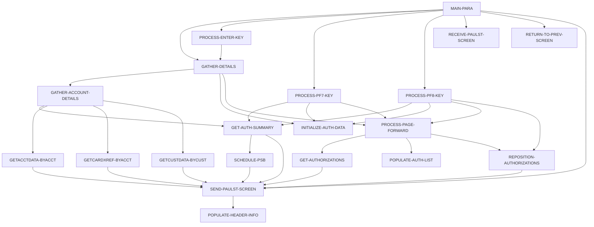

# Program COPAUS0C

| Item | Value |
|---|---|
| Source | `app/app-authorization-ims-db2-mq/cbl/COPAUS0C.cbl` |
| Lines | 1032 total, 792 code, 82 comment, 158 blank |
| PROGRAM-ID | COPAUS0C |
| Author | AWS |
| Runtime | cics-online |
| Module | auth |
| CICS transactions | CPVS (`app/app-authorization-ims-db2-mq/csd/CRDDEMO2.csd:49-58`) |
| JCL steps | None |
| Paragraphs | 20 |
| Semantic analysis | validated (batch B01) |
| Version banner |  |

## Summary

COPAUS0C is a pseudo-conversational CICS program (transaction 'CPVS', map COPAU0A of mapset COPAU00) that shows the pending authorization summary for an account and a pageable list of its pending authorization details, five per page. For an entered or passed account id it reads the card cross-reference by account (CXACAIX), the account (ACCTDAT) and customer (CUSTDAT) VSAM files to show customer name, address, phone and limits, and reads the IMS pending authorization summary root (PAUTSUM0, PSB PSBPAUTB) to show approved/declined counts, amounts and balances. Detail segments (PAUTDTL1) are read with GNP and shown with transaction id, date, time, type, approval status (A/D), match status and amount. PF7/PF8 page backward/forward using keys saved in the commarea; selecting a row with 'S' transfers (XCTL) to COPAUS1C for the detail view; PF3 returns to the menu COMEN01C. The PSB is released with CICS SYNCPOINT before every screen send. (Confirmed)

Evidence: `app/app-authorization-ims-db2-mq/cbl/COPAUS0C.cbl:32-42`, `app/app-authorization-ims-db2-mq/cbl/COPAUS0C.cbl:178-257`, `app/app-authorization-ims-db2-mq/cbl/COPAUS0C.cbl:261-338`, `app/app-authorization-ims-db2-mq/cbl/COPAUS0C.cbl:415-454`, `app/app-authorization-ims-db2-mq/cbl/COPAUS0C.cbl:681-709`, `app/app-authorization-ims-db2-mq/cbl/COPAUS0C.cbl:750-808`, `app/app-authorization-ims-db2-mq/cbl/COPAUS0C.cbl:966-997`

Header comment (Unverified, `app/app-authorization-ims-db2-mq/cbl/COPAUS0C.cbl:1`): See the comment block at the top of the source. Unverified until matched to code.

## Divisions and sections

| Division / section | Lines | Notes |
|---|---|---|
| IDENTIFICATION DIVISION | `app/app-authorization-ims-db2-mq/cbl/COPAUS0C.cbl:22-25` |  |
| ENVIRONMENT DIVISION | `app/app-authorization-ims-db2-mq/cbl/COPAUS0C.cbl:26-28` |  |
| DATA DIVISION | `app/app-authorization-ims-db2-mq/cbl/COPAUS0C.cbl:29-175` |  |
| PROCEDURE DIVISION | `app/app-authorization-ims-db2-mq/cbl/COPAUS0C.cbl:176-1032` |  |
| ENVIRONMENT / CONFIGURATION SECTION | `app/app-authorization-ims-db2-mq/cbl/COPAUS0C.cbl:27-28` |  |
| DATA / WORKING-STORAGE SECTION | `app/app-authorization-ims-db2-mq/cbl/COPAUS0C.cbl:30-170` |  |
| DATA / LINKAGE SECTION | `app/app-authorization-ims-db2-mq/cbl/COPAUS0C.cbl:171-175` |  |

## Files and data stores

No SELECT entries (no COBOL file I/O).

CICS file commands (file name resolved from VALUE clauses and the CSD):

| Command | FILE option | Resolved name | CSD DSNAME | CSD evidence | Line |
|---|---|---|---|---|---|
| READ | WS-CARDXREFNAME-ACCT-PATH | CXACAIX | AWS.M2.CARDDEMO.CARDXREF.VSAM.AIX.PATH | `app/csd/CARDDEMO.CSD:63-75` | `app/app-authorization-ims-db2-mq/cbl/COPAUS0C.cbl:818-826` |
| READ | WS-ACCTFILENAME | ACCTDAT | AWS.M2.CARDDEMO.ACCTDATA.VSAM.KSDS | `app/csd/CARDDEMO.CSD:1-12` | `app/app-authorization-ims-db2-mq/cbl/COPAUS0C.cbl:869-877` |
| READ | WS-CUSTFILENAME | CUSTDAT | AWS.M2.CARDDEMO.CUSTDATA.VSAM.KSDS | `app/csd/CARDDEMO.CSD:50-62` | `app/app-authorization-ims-db2-mq/cbl/COPAUS0C.cbl:920-928` |

CRUD summary from the program facts:

| Store | Kind | Ops | Evidence |
|---|---|---|---|
| DLI-GU | logical | R | `app/app-authorization-ims-db2-mq/cbl/COPAUS0C.cbl:973` |
| ACCTDAT | logical | R | `app/app-authorization-ims-db2-mq/cbl/COPAUS0C.cbl:869` |
| DLI-GNP | logical | R | `app/app-authorization-ims-db2-mq/cbl/COPAUS0C.cbl:461` |
| CXACAIX | logical | R | `app/app-authorization-ims-db2-mq/cbl/COPAUS0C.cbl:818` |
| CUSTDAT | logical | R | `app/app-authorization-ims-db2-mq/cbl/COPAUS0C.cbl:920` |

## Embedded CICS, SQL and DL/I commands

| Paragraph | Kind | Verb | Resources | Response | Lines |
|---|---|---|---|---|---|
| MAIN-PARA | CICS | RETURN | TRANSID(WS-CICS-TRANID) |  | `app/app-authorization-ims-db2-mq/cbl/COPAUS0C.cbl:254-257` |
| PROCESS-ENTER-KEY | CICS | XCTL | PROGRAM(CDEMO-TO-PROGRAM) |  | `app/app-authorization-ims-db2-mq/cbl/COPAUS0C.cbl:322-325` |
| GET-AUTHORIZATIONS | DLI | GNP | PAUTDTL1 PCB PAUT-PCB-NUM |  | `app/app-authorization-ims-db2-mq/cbl/COPAUS0C.cbl:461-464` |
| REPOSITION-AUTHORIZATIONS | DLI | GNP | PAUTDTL1 PCB PAUT-PCB-NUM |  | `app/app-authorization-ims-db2-mq/cbl/COPAUS0C.cbl:493-497` |
| RETURN-TO-PREV-SCREEN | CICS | XCTL | PROGRAM(CDEMO-TO-PROGRAM) |  | `app/app-authorization-ims-db2-mq/cbl/COPAUS0C.cbl:674-677` |
| SEND-PAULST-SCREEN | CICS | SYNCPOINT |  |  | `app/app-authorization-ims-db2-mq/cbl/COPAUS0C.cbl:686-687` |
| SEND-PAULST-SCREEN | CICS | SEND MAP | MAP('COPAU0A'), MAPSET('COPAU00') |  | `app/app-authorization-ims-db2-mq/cbl/COPAUS0C.cbl:695-701` |
| SEND-PAULST-SCREEN | CICS | SEND MAP | MAP('COPAU0A'), MAPSET('COPAU00') |  | `app/app-authorization-ims-db2-mq/cbl/COPAUS0C.cbl:703-708` |
| RECEIVE-PAULST-SCREEN | CICS | RECEIVE MAP | MAP('COPAU0A'), MAPSET('COPAU00') | RESP | `app/app-authorization-ims-db2-mq/cbl/COPAUS0C.cbl:715-721` |
| GETCARDXREF-BYACCT | CICS | READ | DATASET(WS-CARDXREFNAME-ACCT-PATH) | RESP | `app/app-authorization-ims-db2-mq/cbl/COPAUS0C.cbl:818-826` |
| GETACCTDATA-BYACCT | CICS | READ | DATASET(WS-ACCTFILENAME) | RESP | `app/app-authorization-ims-db2-mq/cbl/COPAUS0C.cbl:869-877` |
| GETCUSTDATA-BYCUST | CICS | READ | DATASET(WS-CUSTFILENAME) | RESP | `app/app-authorization-ims-db2-mq/cbl/COPAUS0C.cbl:920-928` |
| GET-AUTH-SUMMARY | DLI | GU | PAUTSUM0 PCB PAUT-PCB-NUM |  | `app/app-authorization-ims-db2-mq/cbl/COPAUS0C.cbl:973-977` |
| SCHEDULE-PSB | DLI | SCHD |  |  | `app/app-authorization-ims-db2-mq/cbl/COPAUS0C.cbl:1002-1005` |
| SCHEDULE-PSB | DLI | TERM |  |  | `app/app-authorization-ims-db2-mq/cbl/COPAUS0C.cbl:1008-1009` |
| SCHEDULE-PSB | DLI | SCHD |  |  | `app/app-authorization-ims-db2-mq/cbl/COPAUS0C.cbl:1011-1014` |

## Calls, transfers and callers

| Mechanism | Target | Parameters | Paragraph | Lines |
|---|---|---|---|---|
| EXEC CICS RETURN | WS-CICS-TRANID = CPVS | CARDDEMO-COMMAREA | MAIN-PARA | `app/app-authorization-ims-db2-mq/cbl/COPAUS0C.cbl:254-257` |
| EXEC CICS XCTL | CDEMO-TO-PROGRAM = COPAUS1C | CARDDEMO-COMMAREA | PROCESS-ENTER-KEY | `app/app-authorization-ims-db2-mq/cbl/COPAUS0C.cbl:322-325` |
| EXEC CICS XCTL | CDEMO-TO-PROGRAM = COMEN01C, COSGN00C | CARDDEMO-COMMAREA | RETURN-TO-PREV-SCREEN | `app/app-authorization-ims-db2-mq/cbl/COPAUS0C.cbl:674-677` |

Programs that transfer to or call this program (from `docs/_work/xref/call-graph.json`):

| Caller | Mechanism | Confidence | Evidence |
|---|---|---|---|
| COMEN01C | XCTL | Confirmed | `app/cbl/COMEN01C.cbl:185` |
| COPAUS1C | XCTL | Confirmed | `app/app-authorization-ims-db2-mq/cbl/COPAUS1C.cbl:367` |

## Copybooks

| Copybook | Statement | Resolution | Resolved path | REPLACING | Line |
|---|---|---|---|---|---|
| [COCOM01Y](../08-data/layouts/COCOM01Y.md) | COPY | inventory | app/cpy/COCOM01Y.cpy |  | `app/app-authorization-ims-db2-mq/cbl/COPAUS0C.cbl:116` |
| COPAU00 | COPY | inventory | app/app-authorization-ims-db2-mq/cpy-bms/COPAU00.cpy |  | `app/app-authorization-ims-db2-mq/cbl/COPAUS0C.cbl:129` |
| [COTTL01Y](../08-data/layouts/COTTL01Y.md) | COPY | inventory | app/cpy/COTTL01Y.cpy |  | `app/app-authorization-ims-db2-mq/cbl/COPAUS0C.cbl:132` |
| [CSDAT01Y](../08-data/layouts/CSDAT01Y.md) | COPY | inventory | app/cpy/CSDAT01Y.cpy |  | `app/app-authorization-ims-db2-mq/cbl/COPAUS0C.cbl:135` |
| [CSMSG01Y](../08-data/layouts/CSMSG01Y.md) | COPY | inventory | app/cpy/CSMSG01Y.cpy |  | `app/app-authorization-ims-db2-mq/cbl/COPAUS0C.cbl:138` |
| [CSMSG02Y](../08-data/layouts/CSMSG02Y.md) | COPY | inventory | app/cpy/CSMSG02Y.cpy |  | `app/app-authorization-ims-db2-mq/cbl/COPAUS0C.cbl:141` |
| [CVACT01Y](../08-data/layouts/CVACT01Y.md) | COPY | inventory | app/cpy/CVACT01Y.cpy |  | `app/app-authorization-ims-db2-mq/cbl/COPAUS0C.cbl:144` |
| [CVACT02Y](../08-data/layouts/CVACT02Y.md) | COPY | inventory | app/cpy/CVACT02Y.cpy |  | `app/app-authorization-ims-db2-mq/cbl/COPAUS0C.cbl:147` |
| [CVACT03Y](../08-data/layouts/CVACT03Y.md) | COPY | inventory | app/cpy/CVACT03Y.cpy |  | `app/app-authorization-ims-db2-mq/cbl/COPAUS0C.cbl:150` |
| [CVCUS01Y](../08-data/layouts/CVCUS01Y.md) | COPY | inventory | app/cpy/CVCUS01Y.cpy |  | `app/app-authorization-ims-db2-mq/cbl/COPAUS0C.cbl:153` |
| [CIPAUSMY](../08-data/layouts/CIPAUSMY.md) | COPY | inventory | app/app-authorization-ims-db2-mq/cpy/CIPAUSMY.cpy |  | `app/app-authorization-ims-db2-mq/cbl/COPAUS0C.cbl:161` |
| [CIPAUDTY](../08-data/layouts/CIPAUDTY.md) | COPY | inventory | app/app-authorization-ims-db2-mq/cpy/CIPAUDTY.cpy |  | `app/app-authorization-ims-db2-mq/cbl/COPAUS0C.cbl:165` |
| DFHAID | COPY | system |  |  | `app/app-authorization-ims-db2-mq/cbl/COPAUS0C.cbl:168` |
| DFHBMSCA | COPY | system |  |  | `app/app-authorization-ims-db2-mq/cbl/COPAUS0C.cbl:169` |

## Data division items

Every data entry coded in this source (copybook contents are on the copybook pages). Lengths are computed from PIC and USAGE.

| Section | Lvl | Name | PIC | Usage | Len | OCCURS | REDEFINES | VALUE | 88-levels | Line |
|---|---|---|---|---|---|---|---|---|---|---|
| WORKING-STORAGE | 01 | WS-VARIABLES |  |  |  |  |  |  |  | 32 |
| WORKING-STORAGE | 05 | WS-PGM-AUTH-SMRY | X(08) |  | 8 |  |  | 'COPAUS0C' |  | 33 |
| WORKING-STORAGE | 05 | WS-PGM-AUTH-DTL | X(08) |  | 8 |  |  | 'COPAUS1C' |  | 34 |
| WORKING-STORAGE | 05 | WS-PGM-MENU | X(08) |  | 8 |  |  | 'COMEN01C' |  | 35 |
| WORKING-STORAGE | 05 | WS-CICS-TRANID | X(04) |  | 4 |  |  | 'CPVS' |  | 36 |
| WORKING-STORAGE | 05 | WS-MESSAGE | X(80) |  | 80 |  |  | SPACES |  | 37 |
| WORKING-STORAGE | 05 | WS-ACCTFILENAME | X(8) |  | 8 |  |  | 'ACCTDAT ' |  | 38 |
| WORKING-STORAGE | 05 | WS-CUSTFILENAME | X(8) |  | 8 |  |  | 'CUSTDAT ' |  | 39 |
| WORKING-STORAGE | 05 | WS-CARDFILENAME | X(8) |  | 8 |  |  | 'CARDDAT ' |  | 40 |
| WORKING-STORAGE | 05 | WS-CARDXREFNAME-ACCT-PATH | X(8) |  | 8 |  |  | 'CXACAIX ' |  | 41 |
| WORKING-STORAGE | 05 | WS-CCXREF-FILE | X(08) |  | 8 |  |  | 'CCXREF ' |  | 42 |
| WORKING-STORAGE | 05 | WS-ACCT-ID | X(11) |  | 11 |  |  |  |  | 44 |
| WORKING-STORAGE | 05 | WS-AUTH-KEY-SAVE | X(08) |  | 8 |  |  |  |  | 45 |
| WORKING-STORAGE | 05 | WS-AUTH-APRV-STAT | X(01) |  | 1 |  |  |  |  | 46 |
| WORKING-STORAGE | 05 | WS-RESP-CD | S9(09) | COMP | 4 |  |  | ZEROS |  | 47 |
| WORKING-STORAGE | 05 | WS-REAS-CD | S9(09) | COMP | 4 |  |  | ZEROS |  | 48 |
| WORKING-STORAGE | 05 | WS-RESP-CD-DIS | 9(09) |  | 9 |  |  |  |  | 49 |
| WORKING-STORAGE | 05 | WS-REAS-CD-DIS | 9(09) |  | 9 |  |  |  |  | 50 |
| WORKING-STORAGE | 05 | WS-REC-COUNT | S9(04) | COMP | 2 |  |  | ZEROS |  | 51 |
| WORKING-STORAGE | 05 | WS-IDX | S9(04) | COMP | 2 |  |  | ZEROS |  | 52 |
| WORKING-STORAGE | 05 | WS-PAGE-NUM | S9(04) | COMP | 2 |  |  | ZEROS |  | 53 |
| WORKING-STORAGE | 05 | WS-AUTH-AMT | -ZZZZZZZ9.99 |  | 12 |  |  |  |  | 55 |
| WORKING-STORAGE | 05 | WS-DISPLAY-AMT12 | -ZZZZZZZ9.99 |  | 12 |  |  |  |  | 56 |
| WORKING-STORAGE | 05 | WS-DISPLAY-AMT9 | -ZZZZ9.99 |  | 9 |  |  |  |  | 57 |
| WORKING-STORAGE | 05 | WS-DISPLAY-COUNT | 9(03) |  | 3 |  |  |  |  | 58 |
| WORKING-STORAGE | 05 | WS-AUTH-DATE | X(08) |  | 8 |  |  | '00/00/00' |  | 59 |
| WORKING-STORAGE | 05 | WS-AUTH-TIME | X(08) |  | 8 |  |  | '00:00:00' |  | 60 |
| WORKING-STORAGE | 05 | WS-XREF-RID |  |  |  |  |  |  |  | 65 |
| WORKING-STORAGE | 10 | WS-CARD-RID-CARDNUM | X(16) |  | 16 |  |  |  |  | 66 |
| WORKING-STORAGE | 10 | WS-CARD-RID-CUST-ID | 9(09) |  | 9 |  |  |  |  | 67 |
| WORKING-STORAGE | 10 | WS-CARD-RID-CUST-ID-X | X(09) |  | 9 |  | WS-CARD-RID-CUST-ID |  |  | 68 |
| WORKING-STORAGE | 10 | WS-CARD-RID-ACCT-ID | 9(11) |  | 11 |  |  |  |  | 70 |
| WORKING-STORAGE | 10 | WS-CARD-RID-ACCT-ID-X | X(11) |  | 11 |  | WS-CARD-RID-ACCT-ID |  |  | 71 |
| WORKING-STORAGE | 01 | WS-IMS-VARIABLES |  |  |  |  |  |  |  | 74 |
| WORKING-STORAGE | 05 | PSB-NAME | X(8) |  | 8 |  |  | 'PSBPAUTB' |  | 75 |
| WORKING-STORAGE | 05 | PCB-OFFSET |  |  |  |  |  |  |  | 76 |
| WORKING-STORAGE | 10 | PAUT-PCB-NUM | S9(4) | COMP | 2 |  |  | +1 |  | 77 |
| WORKING-STORAGE | 05 | IMS-RETURN-CODE | X(02) |  | 2 |  |  |  | STATUS-OK = ' ', 'FW'; SEGMENT-NOT-FOUND = 'GE'; DUPLICATE-SEGMENT-FOUND = 'II'; WRONG-PARENTAGE = 'GP'; END-OF-DB = 'GB'; DATABASE-UNAVAILABLE = 'BA'; PSB-SCHEDULED-MORE-THAN-ONCE = 'TC'; COULD-NOT-S | 78 |
| WORKING-STORAGE | 05 | WS-IMS-PSB-SCHD-FLG | X(1) |  | 1 |  |  |  | IMS-PSB-SCHD = 'Y'; IMS-PSB-NOT-SCHD = 'N' | 88 |
| WORKING-STORAGE | 01 | WS-SWITCHES |  |  |  |  |  |  |  | 93 |
| WORKING-STORAGE | 05 | WS-XREF-READ-FLG | X(1) |  | 1 |  |  |  | ACCT-NFOUND-XREF = 'N'; ACCT-FOUND-XREF = 'Y' | 94 |
| WORKING-STORAGE | 05 | WS-ACCT-MASTER-READ-FLG | X(1) |  | 1 |  |  |  | FOUND-ACCT-IN-MSTR = 'Y'; NFOUND-ACCT-IN-MSTR = 'N' | 97 |
| WORKING-STORAGE | 05 | WS-CUST-MASTER-READ-FLG | X(1) |  | 1 |  |  |  | FOUND-CUST-IN-MSTR = 'Y'; NFOUND-CUST-IN-MSTR = 'N' | 100 |
| WORKING-STORAGE | 05 | WS-PAUT-SMRY-SEG-FLG | X(1) |  | 1 |  |  |  | FOUND-PAUT-SMRY-SEG = 'Y'; NFOUND-PAUT-SMRY-SEG = 'N' | 103 |
| WORKING-STORAGE | 05 | WS-ERR-FLG | X(1) |  | 1 |  |  | 'N' | ERR-FLG-ON = 'Y'; ERR-FLG-OFF = 'N' | 106 |
| WORKING-STORAGE | 05 | WS-AUTHS-EOF | X(1) |  | 1 |  |  | 'N' | AUTHS-EOF = 'Y'; AUTHS-NOT-EOF = 'N' | 109 |
| WORKING-STORAGE | 05 | WS-SEND-ERASE-FLG | X(1) |  | 1 |  |  | 'Y' | SEND-ERASE-YES = 'Y'; SEND-ERASE-NO = 'N' | 112 |
| WORKING-STORAGE | 05 | CDEMO-CPVS-INFO |  |  |  |  |  |  |  | 117 |
| WORKING-STORAGE | 10 | CDEMO-CPVS-PAU-SEL-FLG | X(01) |  | 1 |  |  |  |  | 118 |
| WORKING-STORAGE | 10 | CDEMO-CPVS-PAU-SELECTED | X(08) |  | 8 |  |  |  |  | 119 |
| WORKING-STORAGE | 10 | CDEMO-CPVS-PAUKEY-PREV-PG | X(08) |  | 8 | 20 |  |  |  | 120 |
| WORKING-STORAGE | 10 | CDEMO-CPVS-PAUKEY-LAST | X(08) |  | 8 |  |  |  |  | 121 |
| WORKING-STORAGE | 10 | CDEMO-CPVS-PAGE-NUM | S9(04) | COMP | 2 |  |  |  |  | 122 |
| WORKING-STORAGE | 10 | CDEMO-CPVS-NEXT-PAGE-FLG | X(01) |  | 1 |  |  | 'N' | NEXT-PAGE-YES = 'Y'; NEXT-PAGE-NO = 'N' | 123 |
| WORKING-STORAGE | 10 | CDEMO-CPVS-AUTH-KEYS | X(08) |  | 8 | 5 |  |  |  | 126 |
| WORKING-STORAGE | 01 | PENDING-AUTH-SUMMARY |  |  |  |  |  |  |  | 160 |
| WORKING-STORAGE | 01 | PENDING-AUTH-DETAILS |  |  |  |  |  |  |  | 164 |
| LINKAGE | 01 | DFHCOMMAREA |  |  |  |  |  |  |  | 172 |
| LINKAGE | 05 | LK-COMMAREA | X(01) |  | 1 | 1 TO 32767 DEPENDING ON EIBCALEN |  |  |  | 173 |

## Statement inventory

Every procedure statement the parser recorded, by kind. Each one is listed with its line under Paragraph details.

| Kind | Count |
|---|---|
| Decisions (IF, EVALUATE, WHEN, loops, handlers) | 84 |
| Calculations | 3 |
| File I/O | 0 |
| EXEC CICS / SQL / DLI | 16 |
| CALL | 0 |
| PERFORM | 46 |
| GO TO | 0 |
| MOVE literal | 40 |
| MOVE field | 189 |
| SET | 22 |
| STRING, UNSTRING, INSPECT, INITIALIZE, COPY, ENTRY and others | 14 |
| DISPLAY | 0 |
| GOBACK, STOP RUN, RETURN, XCTL | 3 |
| Not classified by the parser | 0 |

## Control flow

| Paragraph | Lines | Logic | Performs | Performed by | Reachable |
|---|---|---|---|---|---|
| [MAIN-PARA](#para-main-para) | 178-257 | Resets error/EOF/next-page/erase flags. With no commarea it initializes CARDDEMO-COMMAREA, marks re-entry and sends an empty screen. On first entry from another program it prefills the account id from CDEMO-ACCT-ID when numeric, gathers details and sends the screen; on re-entry it receives the map and dispatches ENTER, PF3 (menu COMEN01C), PF7, PF8, or shows the invalid-key message. Always ends with CICS RETURN TRANSID 'CPVS' and the commarea. (Confirmed) | GATHER-DETAILS, PROCESS-ENTER-KEY, PROCESS-PF7-KEY, PROCESS-PF8-KEY, RECEIVE-PAULST-SCREEN, RETURN-TO-PREV-SCREEN, SEND-PAULST-SCREEN |  | yes |
| [PROCESS-ENTER-KEY](#para-process-enter-key) | 261-338 | Validates ACCTIDI: blank gives 'Please enter Acct Id...', non-numeric gives 'Acct Id must be Numeric ...'. For a valid id it stores it in WS-ACCT-ID and CDEMO-ACCT-ID, captures the first non-blank selection field SEL0001I-SEL0005I with its saved auth key, and on 'S'/'s' XCTLs to COPAUS1C; any other selection value gives 'Invalid selection. Valid value is S'. Finally performs GATHER-DETAILS. (Confirmed) | GATHER-DETAILS | MAIN-PARA | yes |
| [GATHER-DETAILS](#para-gather-details) | 342-358 | Resets the page number to 0; when WS-ACCT-ID is present it gathers account/customer/summary details, clears the five list rows and, if an IMS summary exists, loads the first page of authorizations. (Confirmed) | GATHER-ACCOUNT-DETAILS, INITIALIZE-AUTH-DATA, PROCESS-PAGE-FORWARD | MAIN-PARA, PROCESS-ENTER-KEY | yes |
| [PROCESS-PF7-KEY](#para-process-pf7-key) | 362-385 | If CDEMO-CPVS-PAGE-NUM > 1, decrements it, takes the saved first key of that page from CDEMO-CPVS-PAUKEY-PREV-PG, re-reads the summary, clears the rows and pages forward from that key. Otherwise shows 'You are already at the top of the page...'. (Confirmed) | GET-AUTH-SUMMARY, INITIALIZE-AUTH-DATA, PROCESS-PAGE-FORWARD | MAIN-PARA | yes |
| [PROCESS-PF8-KEY](#para-process-pf8-key) | 388-412 | If a last key (CDEMO-CPVS-PAUKEY-LAST) is saved it re-reads the summary and repositions on that detail key. If NEXT-PAGE-YES it clears rows and loads the next page, otherwise shows 'You are already at the bottom of the page...'. (Confirmed) | GET-AUTH-SUMMARY, INITIALIZE-AUTH-DATA, PROCESS-PAGE-FORWARD, REPOSITION-AUTHORIZATIONS | MAIN-PARA | yes |
| [PROCESS-PAGE-FORWARD](#para-process-page-forward) | 415-454 | When no error, reads up to five detail segments (repositioning on the first row for PF7) and populates rows, saving the last key and, on the first row, incrementing the page number and saving that row's key as the page's first key. Then performs one look-ahead read to set NEXT-PAGE-YES or NEXT-PAGE-NO. (Confirmed) | GET-AUTHORIZATIONS, POPULATE-AUTH-LIST, REPOSITION-AUTHORIZATIONS | GATHER-DETAILS, PROCESS-PF7-KEY, PROCESS-PF8-KEY | yes |
| [GET-AUTHORIZATIONS](#para-get-authorizations) | 458-486 | Issues DLI GNP for the next PAUTDTL1 under the current summary. OK sets AUTHS-NOT-EOF; 'GE'/'GB' sets AUTHS-EOF; other statuses set the error flag, build ' System error while reading AUTH Details: Code:' and send the screen. (Confirmed) | SEND-PAULST-SCREEN | PROCESS-PAGE-FORWARD | yes |
| [REPOSITION-AUTHORIZATIONS](#para-reposition-authorizations) | 488-519 | Moves WS-AUTH-KEY-SAVE to PA-AUTHORIZATION-KEY and issues DLI GNP for PAUTDTL1 WHERE PAUT9CTS equals that key. Status handling mirrors GET-AUTHORIZATIONS with message ' System error while repos. AUTH Details: Code:'. (Confirmed) | SEND-PAULST-SCREEN | PROCESS-PAGE-FORWARD, PROCESS-PF8-KEY | yes |
| [POPULATE-AUTH-LIST](#para-populate-auth-list) | 522-605 | Formats the approved amount, original time HH:MM:SS and original date MM/DD/YY, derives approval status 'A' when PA-AUTH-RESP-CODE = '00' else 'D', and moves key, transaction id, date, time, type, status, match status and amount into row WS-IDX (1-5), saving the key in CDEMO-CPVS-AUTH-KEYS and unprotecting that row's selection field. (Confirmed) |  | PROCESS-PAGE-FORWARD | yes |
| [INITIALIZE-AUTH-DATA](#para-initialize-auth-data) | 608-662 | For rows 1 to 5 protects the selection field (DFHBMPRO) and blanks transaction id, date, time, type, approval, status and amount fields. (Confirmed) |  | GATHER-DETAILS, PROCESS-PF7-KEY, PROCESS-PF8-KEY | yes |
| [RETURN-TO-PREV-SCREEN](#para-return-to-prev-screen) | 665-677 | Defaults CDEMO-TO-PROGRAM to 'COSGN00C' when empty, sets from-tranid/from-program to CPVS/COPAUS0C, zeroes the context and XCTLs to CDEMO-TO-PROGRAM with the commarea. (Confirmed) |  | MAIN-PARA | yes |
| [SEND-PAULST-SCREEN](#para-send-paulst-screen) | 681-709 | If the PSB is scheduled it marks it not scheduled and issues CICS SYNCPOINT. Fills the header, moves WS-MESSAGE to ERRMSGO and sends map COPAU0A with ERASE when SEND-ERASE-YES, otherwise without ERASE, positioning the cursor. (Confirmed) | POPULATE-HEADER-INFO | GET-AUTH-SUMMARY, GET-AUTHORIZATIONS, GETACCTDATA-BYACCT, GETCARDXREF-BYACCT, GETCUSTDATA-BYCUST, MAIN-PARA, REPOSITION-AUTHORIZATIONS, SCHEDULE-PSB | yes |
| [RECEIVE-PAULST-SCREEN](#para-receive-paulst-screen) | 712-722 | Receives map COPAU0A of mapset COPAU00 into COPAU0AI, capturing RESP/RESP2 (not checked). (Confirmed) |  | MAIN-PARA | yes |
| [POPULATE-HEADER-INFO](#para-populate-header-info) | 726-747 | Moves titles, transaction id 'CPVS', program name and current date (MM/DD/YY) and time (HH:MM:SS) from FUNCTION CURRENT-DATE to the map header. (Confirmed) |  | SEND-PAULST-SCREEN | yes |
| [GATHER-ACCOUNT-DETAILS](#para-gather-account-details) | 750-808 | Performs GETCARDXREF-BYACCT, GETACCTDATA-BYACCT and GETCUSTDATA-BYCUST, then moves CUST-ID to CUSTIDO, STRINGs first name, middle initial CUST-MIDDLE-NAME(1:1) and last name into CNAMEO, address lines 1-2 into ADDR001O and line 3, state and CUST-ADDR-ZIP(1:5) into ADDR002O, and CUST-PHONE-NUM-1, ACCT-CREDIT-LIMIT and ACCT-CASH-CREDIT-LIMIT to PHONE1O, CREDLIMO and CASHLIMO. After GET-AUTH-SUMMARY, when FOUND-PAUT-SMRY-SEG it shows PA-APPROVED-AUTH-CNT, PA-DECLINED-AUTH-CNT, PA-CREDIT-BALANCE, PA-CASH-BALANCE, PA-APPROVED-AUTH-AMT and PA-DECLINED-AUTH-AMT; otherwise it moves ZERO to all six fields. (Confirmed) | GET-AUTH-SUMMARY, GETACCTDATA-BYACCT, GETCARDXREF-BYACCT, GETCUSTDATA-BYCUST | GATHER-DETAILS | yes |
| [GETCARDXREF-BYACCT](#para-getcardxref-byacct) | 812-862 | Reads CXACAIX (xref by account alternate index) with WS-ACCT-ID. NORMAL saves XREF-CUST-ID and XREF-CARD-NUM in the commarea; NOTFND builds 'Account:... not found in XREF file' and sends the screen; other responses also set the error flag with a system-error message. (Confirmed) | SEND-PAULST-SCREEN | GATHER-ACCOUNT-DETAILS | yes |
| [GETACCTDATA-BYACCT](#para-getacctdata-byacct) | 865-912 | Reads ACCTDAT by XREF-ACCT-ID into ACCOUNT-RECORD. NOTFND builds a 'not found in ACCT file' message and sends the screen; other responses set the error flag with a system-error message and send the screen. (Confirmed) | SEND-PAULST-SCREEN | GATHER-ACCOUNT-DETAILS | yes |
| [GETCUSTDATA-BYCUST](#para-getcustdata-bycust) | 915-963 | Reads CUSTDAT by XREF-CUST-ID into CUSTOMER-RECORD. NOTFND builds a 'not found in CUST file' message and sends the screen; other responses set the error flag with a system-error message and send the screen. (Confirmed) | SEND-PAULST-SCREEN | GATHER-ACCOUNT-DETAILS | yes |
| [GET-AUTH-SUMMARY](#para-get-auth-summary) | 966-997 | Schedules the PSB, then issues DLI GU for PAUTSUM0 WHERE ACCNTID = CDEMO-ACCT-ID. OK sets FOUND-PAUT-SMRY-SEG, 'GE' sets NFOUND-PAUT-SMRY-SEG, other statuses set the error flag with ' System error while reading AUTH Summary: Code:' and send the screen. (Confirmed) | SCHEDULE-PSB, SEND-PAULST-SCREEN | GATHER-ACCOUNT-DETAILS, PROCESS-PF7-KEY, PROCESS-PF8-KEY | yes |
| [SCHEDULE-PSB](#para-schedule-psb) | 1001-1031 | Schedules PSB 'PSBPAUTB' (NODHABEND); on 'TC' terminates and reschedules. OK sets IMS-PSB-SCHD; otherwise sets the error flag, builds ' System error while scheduling PSB: Code:' and sends the screen. (Confirmed) | SEND-PAULST-SCREEN | GET-AUTH-SUMMARY | yes |

## Paragraph details

### Para MAIN-PARA

Lines `app/app-authorization-ims-db2-mq/cbl/COPAUS0C.cbl:178-257`. 

Logic: Resets error/EOF/next-page/erase flags. With no commarea it initializes CARDDEMO-COMMAREA, marks re-entry and sends an empty screen. On first entry from another program it prefills the account id from CDEMO-ACCT-ID when numeric, gathers details and sends the screen; on re-entry it receives the map and dispatches ENTER, PF3 (menu COMEN01C), PF7, PF8, or shows the invalid-key message. Always ends with CICS RETURN TRANSID 'CPVS' and the commarea. (Confirmed)

Rules: [BR-COPAUS0C-007](../09-business-rules-catalog.md#br-copaus0c-007), [BR-COPAUS0C-008](../09-business-rules-catalog.md#br-copaus0c-008)

Statements in source order:

- `SET ERR-FLG-OFF TO TRUE` at `app/app-authorization-ims-db2-mq/cbl/COPAUS0C.cbl:181`
- `SET AUTHS-NOT-EOF TO TRUE` at `app/app-authorization-ims-db2-mq/cbl/COPAUS0C.cbl:182`
- `SET NEXT-PAGE-NO TO TRUE` at `app/app-authorization-ims-db2-mq/cbl/COPAUS0C.cbl:183`
- `SET SEND-ERASE-YES TO TRUE` at `app/app-authorization-ims-db2-mq/cbl/COPAUS0C.cbl:184`
- `MOVE SPACES TO WS-MESSAGE ERRMSGO OF COPAU0AO` at `app/app-authorization-ims-db2-mq/cbl/COPAUS0C.cbl:186`
- MOVE `-1` TO ACCTIDL OF COPAU0AI at `app/app-authorization-ims-db2-mq/cbl/COPAUS0C.cbl:188`
- IF `EIBCALEN = 0` at `app/app-authorization-ims-db2-mq/cbl/COPAUS0C.cbl:190` (pseudo-conversation)
- `INITIALIZE CARDDEMO-COMMAREA` at `app/app-authorization-ims-db2-mq/cbl/COPAUS0C.cbl:191`
- `MOVE WS-PGM-AUTH-SMRY TO CDEMO-TO-PROGRAM` at `app/app-authorization-ims-db2-mq/cbl/COPAUS0C.cbl:192`
- `SET CDEMO-PGM-REENTER TO TRUE` at `app/app-authorization-ims-db2-mq/cbl/COPAUS0C.cbl:194`
- `MOVE LOW-VALUES TO COPAU0AO` at `app/app-authorization-ims-db2-mq/cbl/COPAUS0C.cbl:195`
- MOVE `-1` TO ACCTIDL OF COPAU0AI at `app/app-authorization-ims-db2-mq/cbl/COPAUS0C.cbl:196`
- PERFORM SEND-PAULST-SCREEN at `app/app-authorization-ims-db2-mq/cbl/COPAUS0C.cbl:198`
- `MOVE DFHCOMMAREA(1:EIBCALEN) TO CARDDEMO-COMMAREA` at `app/app-authorization-ims-db2-mq/cbl/COPAUS0C.cbl:200`
- IF `NOT CDEMO-PGM-REENTER` at `app/app-authorization-ims-db2-mq/cbl/COPAUS0C.cbl:202` (pseudo-conversation)
- `SET CDEMO-PGM-REENTER TO TRUE` at `app/app-authorization-ims-db2-mq/cbl/COPAUS0C.cbl:203`
- `MOVE LOW-VALUES TO COPAU0AO` at `app/app-authorization-ims-db2-mq/cbl/COPAUS0C.cbl:205`
- IF `CDEMO-ACCT-ID IS NUMERIC` at `app/app-authorization-ims-db2-mq/cbl/COPAUS0C.cbl:207` (business-candidate)
- `MOVE CDEMO-ACCT-ID TO WS-ACCT-ID ACCTIDO OF COPAU0AO` at `app/app-authorization-ims-db2-mq/cbl/COPAUS0C.cbl:208-209`
- `MOVE SPACE TO ACCTIDO OF COPAU0AO` at `app/app-authorization-ims-db2-mq/cbl/COPAUS0C.cbl:211`
- `MOVE LOW-VALUES TO WS-ACCT-ID` at `app/app-authorization-ims-db2-mq/cbl/COPAUS0C.cbl:212`
- PERFORM GATHER-DETAILS at `app/app-authorization-ims-db2-mq/cbl/COPAUS0C.cbl:215`
- `SET SEND-ERASE-YES TO TRUE` at `app/app-authorization-ims-db2-mq/cbl/COPAUS0C.cbl:217`
- PERFORM SEND-PAULST-SCREEN at `app/app-authorization-ims-db2-mq/cbl/COPAUS0C.cbl:219`
- PERFORM RECEIVE-PAULST-SCREEN at `app/app-authorization-ims-db2-mq/cbl/COPAUS0C.cbl:222`
- EVALUATE `EIBAID` at `app/app-authorization-ims-db2-mq/cbl/COPAUS0C.cbl:224` (screen-key)
- WHEN `DFHENTER` at `app/app-authorization-ims-db2-mq/cbl/COPAUS0C.cbl:225` (screen-key)
- PERFORM PROCESS-ENTER-KEY at `app/app-authorization-ims-db2-mq/cbl/COPAUS0C.cbl:226`
- IF `WS-ACCT-ID = LOW-VALUES` at `app/app-authorization-ims-db2-mq/cbl/COPAUS0C.cbl:228` (business-candidate)
- `MOVE SPACE TO ACCTIDO OF COPAU0AO` at `app/app-authorization-ims-db2-mq/cbl/COPAUS0C.cbl:229`
- `MOVE WS-ACCT-ID TO ACCTIDO OF COPAU0AO` at `app/app-authorization-ims-db2-mq/cbl/COPAUS0C.cbl:231`
- PERFORM SEND-PAULST-SCREEN at `app/app-authorization-ims-db2-mq/cbl/COPAUS0C.cbl:234`
- WHEN `DFHPF3` at `app/app-authorization-ims-db2-mq/cbl/COPAUS0C.cbl:235` (screen-key)
- `MOVE WS-PGM-MENU TO CDEMO-TO-PROGRAM` at `app/app-authorization-ims-db2-mq/cbl/COPAUS0C.cbl:236`
- PERFORM RETURN-TO-PREV-SCREEN at `app/app-authorization-ims-db2-mq/cbl/COPAUS0C.cbl:237`
- PERFORM SEND-PAULST-SCREEN at `app/app-authorization-ims-db2-mq/cbl/COPAUS0C.cbl:238`
- WHEN `DFHPF7` at `app/app-authorization-ims-db2-mq/cbl/COPAUS0C.cbl:239` (screen-key)
- PERFORM PROCESS-PF7-KEY at `app/app-authorization-ims-db2-mq/cbl/COPAUS0C.cbl:240`
- PERFORM SEND-PAULST-SCREEN at `app/app-authorization-ims-db2-mq/cbl/COPAUS0C.cbl:241`
- WHEN `DFHPF8` at `app/app-authorization-ims-db2-mq/cbl/COPAUS0C.cbl:242` (screen-key)
- PERFORM PROCESS-PF8-KEY at `app/app-authorization-ims-db2-mq/cbl/COPAUS0C.cbl:243`
- PERFORM SEND-PAULST-SCREEN at `app/app-authorization-ims-db2-mq/cbl/COPAUS0C.cbl:244`
- WHEN `OTHER` at `app/app-authorization-ims-db2-mq/cbl/COPAUS0C.cbl:245` (screen-key)
- MOVE `'Y'` TO WS-ERR-FLG at `app/app-authorization-ims-db2-mq/cbl/COPAUS0C.cbl:246`
- MOVE `-1` TO ACCTIDL OF COPAU0AI at `app/app-authorization-ims-db2-mq/cbl/COPAUS0C.cbl:247`
- `MOVE CCDA-MSG-INVALID-KEY TO WS-MESSAGE` at `app/app-authorization-ims-db2-mq/cbl/COPAUS0C.cbl:248`
- PERFORM SEND-PAULST-SCREEN at `app/app-authorization-ims-db2-mq/cbl/COPAUS0C.cbl:249`
- EXEC CICS RETURN at `app/app-authorization-ims-db2-mq/cbl/COPAUS0C.cbl:254-257`
- Ends with EXEC CICS RETURN at `app/app-authorization-ims-db2-mq/cbl/COPAUS0C.cbl:254-257`

### Para PROCESS-ENTER-KEY

Lines `app/app-authorization-ims-db2-mq/cbl/COPAUS0C.cbl:261-338`. 

Logic: Validates ACCTIDI: blank gives 'Please enter Acct Id...', non-numeric gives 'Acct Id must be Numeric ...'. For a valid id it stores it in WS-ACCT-ID and CDEMO-ACCT-ID, captures the first non-blank selection field SEL0001I-SEL0005I with its saved auth key, and on 'S'/'s' XCTLs to COPAUS1C; any other selection value gives 'Invalid selection. Valid value is S'. Finally performs GATHER-DETAILS. (Confirmed)

Rules: [BR-COPAUS0C-001](../09-business-rules-catalog.md#br-copaus0c-001), [BR-COPAUS0C-002](../09-business-rules-catalog.md#br-copaus0c-002)

Statements in source order:

- IF `ACCTIDI OF COPAU0AI = SPACES OR LOW-VALUES` at `app/app-authorization-ims-db2-mq/cbl/COPAUS0C.cbl:264` (business-candidate)
- `MOVE LOW-VALUES TO WS-ACCT-ID` at `app/app-authorization-ims-db2-mq/cbl/COPAUS0C.cbl:265`
- MOVE `'Y'` TO WS-ERR-FLG at `app/app-authorization-ims-db2-mq/cbl/COPAUS0C.cbl:267`
- MOVE `'Please enter Acct Id...'` TO WS-MESSAGE at `app/app-authorization-ims-db2-mq/cbl/COPAUS0C.cbl:268-269`
- MOVE `-1` TO ACCTIDL OF COPAU0AI at `app/app-authorization-ims-db2-mq/cbl/COPAUS0C.cbl:271`
- IF `ACCTIDI OF COPAU0AI IS NOT NUMERIC` at `app/app-authorization-ims-db2-mq/cbl/COPAUS0C.cbl:273` (business-candidate)
- `MOVE LOW-VALUES TO WS-ACCT-ID` at `app/app-authorization-ims-db2-mq/cbl/COPAUS0C.cbl:274`
- MOVE `'Y'` TO WS-ERR-FLG at `app/app-authorization-ims-db2-mq/cbl/COPAUS0C.cbl:276`
- MOVE `'Acct Id must be Numeric ...'` TO WS-MESSAGE at `app/app-authorization-ims-db2-mq/cbl/COPAUS0C.cbl:277-278`
- MOVE `-1` TO ACCTIDL OF COPAU0AI at `app/app-authorization-ims-db2-mq/cbl/COPAUS0C.cbl:280`
- `MOVE ACCTIDI OF COPAU0AI TO WS-ACCT-ID CDEMO-ACCT-ID` at `app/app-authorization-ims-db2-mq/cbl/COPAUS0C.cbl:283-284`
- EVALUATE `TRUE` at `app/app-authorization-ims-db2-mq/cbl/COPAUS0C.cbl:285` (business-candidate)
- WHEN `SEL0001I OF COPAU0AI NOT = SPACES AND LOW-VALUES` at `app/app-authorization-ims-db2-mq/cbl/COPAUS0C.cbl:286` (business-candidate)
- `MOVE SEL0001I OF COPAU0AI TO CDEMO-CPVS-PAU-SEL-FLG` at `app/app-authorization-ims-db2-mq/cbl/COPAUS0C.cbl:287`
- `MOVE CDEMO-CPVS-AUTH-KEYS(1) TO CDEMO-CPVS-PAU-SELECTED` at `app/app-authorization-ims-db2-mq/cbl/COPAUS0C.cbl:288-289`
- WHEN `SEL0002I OF COPAU0AI NOT = SPACES AND LOW-VALUES` at `app/app-authorization-ims-db2-mq/cbl/COPAUS0C.cbl:290` (business-candidate)
- `MOVE SEL0002I OF COPAU0AI TO CDEMO-CPVS-PAU-SEL-FLG` at `app/app-authorization-ims-db2-mq/cbl/COPAUS0C.cbl:291`
- `MOVE CDEMO-CPVS-AUTH-KEYS(2) TO CDEMO-CPVS-PAU-SELECTED` at `app/app-authorization-ims-db2-mq/cbl/COPAUS0C.cbl:292-293`
- WHEN `SEL0003I OF COPAU0AI NOT = SPACES AND LOW-VALUES` at `app/app-authorization-ims-db2-mq/cbl/COPAUS0C.cbl:294` (business-candidate)
- `MOVE SEL0003I OF COPAU0AI TO CDEMO-CPVS-PAU-SEL-FLG` at `app/app-authorization-ims-db2-mq/cbl/COPAUS0C.cbl:295`
- `MOVE CDEMO-CPVS-AUTH-KEYS(3) TO CDEMO-CPVS-PAU-SELECTED` at `app/app-authorization-ims-db2-mq/cbl/COPAUS0C.cbl:296-297`
- WHEN `SEL0004I OF COPAU0AI NOT = SPACES AND LOW-VALUES` at `app/app-authorization-ims-db2-mq/cbl/COPAUS0C.cbl:298` (business-candidate)
- `MOVE SEL0004I OF COPAU0AI TO CDEMO-CPVS-PAU-SEL-FLG` at `app/app-authorization-ims-db2-mq/cbl/COPAUS0C.cbl:299`
- `MOVE CDEMO-CPVS-AUTH-KEYS(4) TO CDEMO-CPVS-PAU-SELECTED` at `app/app-authorization-ims-db2-mq/cbl/COPAUS0C.cbl:300-301`
- WHEN `SEL0005I OF COPAU0AI NOT = SPACES AND LOW-VALUES` at `app/app-authorization-ims-db2-mq/cbl/COPAUS0C.cbl:302` (business-candidate)
- `MOVE SEL0005I OF COPAU0AI TO CDEMO-CPVS-PAU-SEL-FLG` at `app/app-authorization-ims-db2-mq/cbl/COPAUS0C.cbl:303`
- `MOVE CDEMO-CPVS-AUTH-KEYS(5) TO CDEMO-CPVS-PAU-SELECTED` at `app/app-authorization-ims-db2-mq/cbl/COPAUS0C.cbl:304-305`
- WHEN `OTHER` at `app/app-authorization-ims-db2-mq/cbl/COPAUS0C.cbl:306` (business-candidate)
- `MOVE SPACES TO CDEMO-CPVS-PAU-SEL-FLG` at `app/app-authorization-ims-db2-mq/cbl/COPAUS0C.cbl:307`
- `MOVE SPACES TO CDEMO-CPVS-PAU-SELECTED` at `app/app-authorization-ims-db2-mq/cbl/COPAUS0C.cbl:308`
- IF `(CDEMO-CPVS-PAU-SEL-FLG NOT = SPACES AND LOW-VALUES) AND (CDEMO-CPVS-PAU-SELECTED NOT = SPACES AND LOW-VALUES)` at `app/app-authorization-ims-db2-mq/cbl/COPAUS0C.cbl:310-312` (business-candidate)
- EVALUATE `CDEMO-CPVS-PAU-SEL-FLG` at `app/app-authorization-ims-db2-mq/cbl/COPAUS0C.cbl:313` (business-candidate)
- WHEN `'S'` at `app/app-authorization-ims-db2-mq/cbl/COPAUS0C.cbl:314` (business-candidate)
- WHEN `'s'` at `app/app-authorization-ims-db2-mq/cbl/COPAUS0C.cbl:315` (business-candidate)
- `MOVE WS-PGM-AUTH-DTL TO CDEMO-TO-PROGRAM` at `app/app-authorization-ims-db2-mq/cbl/COPAUS0C.cbl:316`
- `MOVE WS-CICS-TRANID TO CDEMO-FROM-TRANID` at `app/app-authorization-ims-db2-mq/cbl/COPAUS0C.cbl:317`
- `MOVE WS-PGM-AUTH-SMRY TO CDEMO-FROM-PROGRAM` at `app/app-authorization-ims-db2-mq/cbl/COPAUS0C.cbl:318`
- MOVE `0` TO CDEMO-PGM-CONTEXT at `app/app-authorization-ims-db2-mq/cbl/COPAUS0C.cbl:319`
- `SET CDEMO-PGM-ENTER TO TRUE` at `app/app-authorization-ims-db2-mq/cbl/COPAUS0C.cbl:320`
- EXEC CICS XCTL at `app/app-authorization-ims-db2-mq/cbl/COPAUS0C.cbl:322-325`
- Ends with EXEC CICS XCTL at `app/app-authorization-ims-db2-mq/cbl/COPAUS0C.cbl:322-325`
- WHEN `OTHER` at `app/app-authorization-ims-db2-mq/cbl/COPAUS0C.cbl:326` (business-candidate)
- MOVE `'Invalid selection. Valid value is S'` TO WS-MESSAGE at `app/app-authorization-ims-db2-mq/cbl/COPAUS0C.cbl:327-329`
- MOVE `-1` TO ACCTIDL OF COPAU0AI at `app/app-authorization-ims-db2-mq/cbl/COPAUS0C.cbl:330`
- PERFORM GATHER-DETAILS at `app/app-authorization-ims-db2-mq/cbl/COPAUS0C.cbl:337-338`

### Para GATHER-DETAILS

Lines `app/app-authorization-ims-db2-mq/cbl/COPAUS0C.cbl:342-358`. 

Logic: Resets the page number to 0; when WS-ACCT-ID is present it gathers account/customer/summary details, clears the five list rows and, if an IMS summary exists, loads the first page of authorizations. (Confirmed)

Statements in source order:

- MOVE `-1` TO ACCTIDL OF COPAU0AI at `app/app-authorization-ims-db2-mq/cbl/COPAUS0C.cbl:345`
- MOVE `0` TO CDEMO-CPVS-PAGE-NUM at `app/app-authorization-ims-db2-mq/cbl/COPAUS0C.cbl:347`
- IF `WS-ACCT-ID NOT = LOW-VALUES` at `app/app-authorization-ims-db2-mq/cbl/COPAUS0C.cbl:349` (business-candidate)
- PERFORM GATHER-ACCOUNT-DETAILS at `app/app-authorization-ims-db2-mq/cbl/COPAUS0C.cbl:350`
- PERFORM INITIALIZE-AUTH-DATA at `app/app-authorization-ims-db2-mq/cbl/COPAUS0C.cbl:352`
- IF `FOUND-PAUT-SMRY-SEG` at `app/app-authorization-ims-db2-mq/cbl/COPAUS0C.cbl:354` (business-candidate)
- PERFORM PROCESS-PAGE-FORWARD at `app/app-authorization-ims-db2-mq/cbl/COPAUS0C.cbl:355`

### Para PROCESS-PF7-KEY

Lines `app/app-authorization-ims-db2-mq/cbl/COPAUS0C.cbl:362-385`. 

Logic: If CDEMO-CPVS-PAGE-NUM > 1, decrements it, takes the saved first key of that page from CDEMO-CPVS-PAUKEY-PREV-PG, re-reads the summary, clears the rows and pages forward from that key. Otherwise shows 'You are already at the top of the page...'. (Confirmed)

Rules: [BR-COPAUS0C-004](../09-business-rules-catalog.md#br-copaus0c-004)

Statements in source order:

- IF `CDEMO-CPVS-PAGE-NUM > 1` at `app/app-authorization-ims-db2-mq/cbl/COPAUS0C.cbl:365` (business-candidate)
- Calculation `COMPUTE CDEMO-CPVS-PAGE-NUM = CDEMO-CPVS-PAGE-NUM - 1` at `app/app-authorization-ims-db2-mq/cbl/COPAUS0C.cbl:366` (no ROUNDED)
- `MOVE CDEMO-CPVS-PAUKEY-PREV-PG(CDEMO-CPVS-PAGE-NUM) TO WS-AUTH-KEY-SAVE` at `app/app-authorization-ims-db2-mq/cbl/COPAUS0C.cbl:368-369`
- PERFORM GET-AUTH-SUMMARY at `app/app-authorization-ims-db2-mq/cbl/COPAUS0C.cbl:370`
- `SET SEND-ERASE-NO TO TRUE` at `app/app-authorization-ims-db2-mq/cbl/COPAUS0C.cbl:372`
- `SET NEXT-PAGE-YES TO TRUE` at `app/app-authorization-ims-db2-mq/cbl/COPAUS0C.cbl:374`
- MOVE `-1` TO ACCTIDL OF COPAU0AI at `app/app-authorization-ims-db2-mq/cbl/COPAUS0C.cbl:375`
- PERFORM INITIALIZE-AUTH-DATA at `app/app-authorization-ims-db2-mq/cbl/COPAUS0C.cbl:377`
- PERFORM PROCESS-PAGE-FORWARD at `app/app-authorization-ims-db2-mq/cbl/COPAUS0C.cbl:379`
- MOVE `'You are already at the top of the page...'` TO WS-MESSAGE at `app/app-authorization-ims-db2-mq/cbl/COPAUS0C.cbl:381-382`
- `SET SEND-ERASE-NO TO TRUE` at `app/app-authorization-ims-db2-mq/cbl/COPAUS0C.cbl:383`

### Para PROCESS-PF8-KEY

Lines `app/app-authorization-ims-db2-mq/cbl/COPAUS0C.cbl:388-412`. 

Logic: If a last key (CDEMO-CPVS-PAUKEY-LAST) is saved it re-reads the summary and repositions on that detail key. If NEXT-PAGE-YES it clears rows and loads the next page, otherwise shows 'You are already at the bottom of the page...'. (Confirmed)

Statements in source order:

- IF `CDEMO-CPVS-PAUKEY-LAST = SPACES OR LOW-VALUES` at `app/app-authorization-ims-db2-mq/cbl/COPAUS0C.cbl:391` (business-candidate)
- `MOVE LOW-VALUES TO WS-AUTH-KEY-SAVE` at `app/app-authorization-ims-db2-mq/cbl/COPAUS0C.cbl:392`
- `MOVE CDEMO-CPVS-PAUKEY-LAST TO WS-AUTH-KEY-SAVE` at `app/app-authorization-ims-db2-mq/cbl/COPAUS0C.cbl:394`
- PERFORM GET-AUTH-SUMMARY at `app/app-authorization-ims-db2-mq/cbl/COPAUS0C.cbl:396`
- PERFORM REPOSITION-AUTHORIZATIONS at `app/app-authorization-ims-db2-mq/cbl/COPAUS0C.cbl:397`
- MOVE `-1` TO ACCTIDL OF COPAU0AI at `app/app-authorization-ims-db2-mq/cbl/COPAUS0C.cbl:400`
- `SET SEND-ERASE-NO TO TRUE` at `app/app-authorization-ims-db2-mq/cbl/COPAUS0C.cbl:402`
- IF `NEXT-PAGE-YES` at `app/app-authorization-ims-db2-mq/cbl/COPAUS0C.cbl:404` (business-candidate)
- PERFORM INITIALIZE-AUTH-DATA at `app/app-authorization-ims-db2-mq/cbl/COPAUS0C.cbl:405`
- PERFORM PROCESS-PAGE-FORWARD at `app/app-authorization-ims-db2-mq/cbl/COPAUS0C.cbl:407`
- MOVE `'You are already at the bottom of the page...'` TO WS-MESSAGE at `app/app-authorization-ims-db2-mq/cbl/COPAUS0C.cbl:409-410`

### Para PROCESS-PAGE-FORWARD

Lines `app/app-authorization-ims-db2-mq/cbl/COPAUS0C.cbl:415-454`. 

Logic: When no error, reads up to five detail segments (repositioning on the first row for PF7) and populates rows, saving the last key and, on the first row, incrementing the page number and saving that row's key as the page's first key. Then performs one look-ahead read to set NEXT-PAGE-YES or NEXT-PAGE-NO. (Confirmed)

Rules: [BR-COPAUS0C-003](../09-business-rules-catalog.md#br-copaus0c-003)

Statements in source order:

- IF `ERR-FLG-OFF` at `app/app-authorization-ims-db2-mq/cbl/COPAUS0C.cbl:418` (error-flag)
- MOVE `1` TO WS-IDX at `app/app-authorization-ims-db2-mq/cbl/COPAUS0C.cbl:420`
- `MOVE LOW-VALUES TO CDEMO-CPVS-PAUKEY-LAST` at `app/app-authorization-ims-db2-mq/cbl/COPAUS0C.cbl:422`
- LOOP `UNTIL WS-IDX > 5 OR AUTHS-EOF OR ERR-FLG-ON` at `app/app-authorization-ims-db2-mq/cbl/COPAUS0C.cbl:424` (io-status)
- Inline PERFORM `UNTIL WS-IDX > 5 OR AUTHS-EOF OR ERR-FLG-ON` at `app/app-authorization-ims-db2-mq/cbl/COPAUS0C.cbl:424`
- IF `EIBAID = DFHPF7 AND WS-IDX = 1` at `app/app-authorization-ims-db2-mq/cbl/COPAUS0C.cbl:425` (screen-key)
- PERFORM REPOSITION-AUTHORIZATIONS at `app/app-authorization-ims-db2-mq/cbl/COPAUS0C.cbl:426`
- PERFORM GET-AUTHORIZATIONS at `app/app-authorization-ims-db2-mq/cbl/COPAUS0C.cbl:428`
- IF `AUTHS-NOT-EOF AND ERR-FLG-OFF` at `app/app-authorization-ims-db2-mq/cbl/COPAUS0C.cbl:430` (io-status)
- PERFORM POPULATE-AUTH-LIST at `app/app-authorization-ims-db2-mq/cbl/COPAUS0C.cbl:431`
- Calculation `COMPUTE WS-IDX = WS-IDX + 1` at `app/app-authorization-ims-db2-mq/cbl/COPAUS0C.cbl:432` (no ROUNDED)
- `MOVE PA-AUTHORIZATION-KEY TO CDEMO-CPVS-PAUKEY-LAST` at `app/app-authorization-ims-db2-mq/cbl/COPAUS0C.cbl:434-435`
- IF `WS-IDX = 2` at `app/app-authorization-ims-db2-mq/cbl/COPAUS0C.cbl:436` (business-candidate)
- Calculation `COMPUTE CDEMO-CPVS-PAGE-NUM = CDEMO-CPVS-PAGE-NUM + 1` at `app/app-authorization-ims-db2-mq/cbl/COPAUS0C.cbl:437-438` (no ROUNDED)
- `MOVE PA-AUTHORIZATION-KEY TO CDEMO-CPVS-PAUKEY-PREV-PG(CDEMO-CPVS-PAGE-NUM)` at `app/app-authorization-ims-db2-mq/cbl/COPAUS0C.cbl:439-440`
- IF `AUTHS-NOT-EOF AND ERR-FLG-OFF` at `app/app-authorization-ims-db2-mq/cbl/COPAUS0C.cbl:445` (io-status)
- PERFORM GET-AUTHORIZATIONS at `app/app-authorization-ims-db2-mq/cbl/COPAUS0C.cbl:446`
- IF `AUTHS-NOT-EOF AND ERR-FLG-OFF` at `app/app-authorization-ims-db2-mq/cbl/COPAUS0C.cbl:447` (io-status)
- `SET NEXT-PAGE-YES TO TRUE` at `app/app-authorization-ims-db2-mq/cbl/COPAUS0C.cbl:448`
- `SET NEXT-PAGE-NO TO TRUE` at `app/app-authorization-ims-db2-mq/cbl/COPAUS0C.cbl:450`

### Para GET-AUTHORIZATIONS

Lines `app/app-authorization-ims-db2-mq/cbl/COPAUS0C.cbl:458-486`. 

Logic: Issues DLI GNP for the next PAUTDTL1 under the current summary. OK sets AUTHS-NOT-EOF; 'GE'/'GB' sets AUTHS-EOF; other statuses set the error flag, build ' System error while reading AUTH Details: Code:' and send the screen. (Confirmed)

Rules: [BR-COPAUS0C-009](../09-business-rules-catalog.md#br-copaus0c-009)

Statements in source order:

- EXEC DLI GNP at `app/app-authorization-ims-db2-mq/cbl/COPAUS0C.cbl:461-464`
- `MOVE DIBSTAT TO IMS-RETURN-CODE` at `app/app-authorization-ims-db2-mq/cbl/COPAUS0C.cbl:466`
- EVALUATE `TRUE` at `app/app-authorization-ims-db2-mq/cbl/COPAUS0C.cbl:467` (business-candidate)
- WHEN `STATUS-OK` at `app/app-authorization-ims-db2-mq/cbl/COPAUS0C.cbl:468` (io-status)
- `SET AUTHS-NOT-EOF TO TRUE` at `app/app-authorization-ims-db2-mq/cbl/COPAUS0C.cbl:469`
- WHEN `SEGMENT-NOT-FOUND` at `app/app-authorization-ims-db2-mq/cbl/COPAUS0C.cbl:470` (business-candidate)
- WHEN `END-OF-DB` at `app/app-authorization-ims-db2-mq/cbl/COPAUS0C.cbl:471` (business-candidate)
- `SET AUTHS-EOF TO TRUE` at `app/app-authorization-ims-db2-mq/cbl/COPAUS0C.cbl:472`
- WHEN `OTHER` at `app/app-authorization-ims-db2-mq/cbl/COPAUS0C.cbl:473` (business-candidate)
- MOVE `'Y'` TO WS-ERR-FLG at `app/app-authorization-ims-db2-mq/cbl/COPAUS0C.cbl:474`
- `STRING ' System error while reading AUTH Details: Code:' IMS-RETURN-CODE DELIMITED BY SIZE INTO WS-MESSAGE` at `app/app-authorization-ims-db2-mq/cbl/COPAUS0C.cbl:476-480`
- MOVE `-1` TO ACCTIDL OF COPAU0AI at `app/app-authorization-ims-db2-mq/cbl/COPAUS0C.cbl:482`
- PERFORM SEND-PAULST-SCREEN at `app/app-authorization-ims-db2-mq/cbl/COPAUS0C.cbl:483`

### Para REPOSITION-AUTHORIZATIONS

Lines `app/app-authorization-ims-db2-mq/cbl/COPAUS0C.cbl:488-519`. 

Logic: Moves WS-AUTH-KEY-SAVE to PA-AUTHORIZATION-KEY and issues DLI GNP for PAUTDTL1 WHERE PAUT9CTS equals that key. Status handling mirrors GET-AUTHORIZATIONS with message ' System error while repos. AUTH Details: Code:'. (Confirmed)

Statements in source order:

- `MOVE WS-AUTH-KEY-SAVE TO PA-AUTHORIZATION-KEY` at `app/app-authorization-ims-db2-mq/cbl/COPAUS0C.cbl:491`
- EXEC DLI GNP at `app/app-authorization-ims-db2-mq/cbl/COPAUS0C.cbl:493-497`
- `MOVE DIBSTAT TO IMS-RETURN-CODE` at `app/app-authorization-ims-db2-mq/cbl/COPAUS0C.cbl:499`
- EVALUATE `TRUE` at `app/app-authorization-ims-db2-mq/cbl/COPAUS0C.cbl:500` (business-candidate)
- WHEN `STATUS-OK` at `app/app-authorization-ims-db2-mq/cbl/COPAUS0C.cbl:501` (io-status)
- `SET AUTHS-NOT-EOF TO TRUE` at `app/app-authorization-ims-db2-mq/cbl/COPAUS0C.cbl:502`
- WHEN `SEGMENT-NOT-FOUND` at `app/app-authorization-ims-db2-mq/cbl/COPAUS0C.cbl:503` (business-candidate)
- WHEN `END-OF-DB` at `app/app-authorization-ims-db2-mq/cbl/COPAUS0C.cbl:504` (business-candidate)
- `SET AUTHS-EOF TO TRUE` at `app/app-authorization-ims-db2-mq/cbl/COPAUS0C.cbl:505`
- WHEN `OTHER` at `app/app-authorization-ims-db2-mq/cbl/COPAUS0C.cbl:506` (business-candidate)
- MOVE `'Y'` TO WS-ERR-FLG at `app/app-authorization-ims-db2-mq/cbl/COPAUS0C.cbl:507`
- `STRING ' System error while repos. AUTH Details: Code:' IMS-RETURN-CODE DELIMITED BY SIZE INTO WS-MESSAGE` at `app/app-authorization-ims-db2-mq/cbl/COPAUS0C.cbl:509-513`
- MOVE `-1` TO ACCTIDL OF COPAU0AI at `app/app-authorization-ims-db2-mq/cbl/COPAUS0C.cbl:515`
- PERFORM SEND-PAULST-SCREEN at `app/app-authorization-ims-db2-mq/cbl/COPAUS0C.cbl:516`

### Para POPULATE-AUTH-LIST

Lines `app/app-authorization-ims-db2-mq/cbl/COPAUS0C.cbl:522-605`. 

Logic: Formats the approved amount, original time HH:MM:SS and original date MM/DD/YY, derives approval status 'A' when PA-AUTH-RESP-CODE = '00' else 'D', and moves key, transaction id, date, time, type, status, match status and amount into row WS-IDX (1-5), saving the key in CDEMO-CPVS-AUTH-KEYS and unprotecting that row's selection field. (Confirmed)

Rules: [BR-COPAUS0C-005](../09-business-rules-catalog.md#br-copaus0c-005)

Statements in source order:

- `MOVE PA-APPROVED-AMT TO WS-AUTH-AMT` at `app/app-authorization-ims-db2-mq/cbl/COPAUS0C.cbl:525`
- `MOVE PA-AUTH-ORIG-TIME(1:2) TO WS-AUTH-TIME(1:2)` at `app/app-authorization-ims-db2-mq/cbl/COPAUS0C.cbl:527`
- `MOVE PA-AUTH-ORIG-TIME(3:2) TO WS-AUTH-TIME(4:2)` at `app/app-authorization-ims-db2-mq/cbl/COPAUS0C.cbl:528`
- `MOVE PA-AUTH-ORIG-TIME(5:2) TO WS-AUTH-TIME(7:2)` at `app/app-authorization-ims-db2-mq/cbl/COPAUS0C.cbl:529`
- `MOVE PA-AUTH-ORIG-DATE(1:2) TO WS-CURDATE-YY` at `app/app-authorization-ims-db2-mq/cbl/COPAUS0C.cbl:531`
- `MOVE PA-AUTH-ORIG-DATE(3:2) TO WS-CURDATE-MM` at `app/app-authorization-ims-db2-mq/cbl/COPAUS0C.cbl:532`
- `MOVE PA-AUTH-ORIG-DATE(5:2) TO WS-CURDATE-DD` at `app/app-authorization-ims-db2-mq/cbl/COPAUS0C.cbl:533`
- `MOVE WS-CURDATE-MM-DD-YY TO WS-AUTH-DATE` at `app/app-authorization-ims-db2-mq/cbl/COPAUS0C.cbl:534`
- IF `PA-AUTH-RESP-CODE = '00'` at `app/app-authorization-ims-db2-mq/cbl/COPAUS0C.cbl:536` (io-status)
- MOVE `'A'` TO WS-AUTH-APRV-STAT at `app/app-authorization-ims-db2-mq/cbl/COPAUS0C.cbl:537`
- MOVE `'D'` TO WS-AUTH-APRV-STAT at `app/app-authorization-ims-db2-mq/cbl/COPAUS0C.cbl:539`
- EVALUATE `WS-IDX` at `app/app-authorization-ims-db2-mq/cbl/COPAUS0C.cbl:542` (business-candidate)
- WHEN `1` at `app/app-authorization-ims-db2-mq/cbl/COPAUS0C.cbl:543` (business-candidate)
- `MOVE PA-AUTHORIZATION-KEY TO CDEMO-CPVS-AUTH-KEYS(1)` at `app/app-authorization-ims-db2-mq/cbl/COPAUS0C.cbl:544-545`
- `MOVE PA-TRANSACTION-ID TO TRNID01I OF COPAU0AI` at `app/app-authorization-ims-db2-mq/cbl/COPAUS0C.cbl:547`
- `MOVE WS-AUTH-DATE TO PDATE01I OF COPAU0AI` at `app/app-authorization-ims-db2-mq/cbl/COPAUS0C.cbl:548`
- `MOVE WS-AUTH-TIME TO PTIME01I OF COPAU0AI` at `app/app-authorization-ims-db2-mq/cbl/COPAUS0C.cbl:549`
- `MOVE PA-AUTH-TYPE TO PTYPE01I OF COPAU0AI` at `app/app-authorization-ims-db2-mq/cbl/COPAUS0C.cbl:550`
- `MOVE WS-AUTH-APRV-STAT TO PAPRV01I OF COPAU0AI` at `app/app-authorization-ims-db2-mq/cbl/COPAUS0C.cbl:551`
- `MOVE PA-MATCH-STATUS TO PSTAT01I OF COPAU0AI` at `app/app-authorization-ims-db2-mq/cbl/COPAUS0C.cbl:552`
- `MOVE WS-AUTH-AMT TO PAMT001I OF COPAU0AI` at `app/app-authorization-ims-db2-mq/cbl/COPAUS0C.cbl:553`
- `MOVE DFHBMUNP TO SEL0001A OF COPAU0AI` at `app/app-authorization-ims-db2-mq/cbl/COPAUS0C.cbl:554`
- WHEN `2` at `app/app-authorization-ims-db2-mq/cbl/COPAUS0C.cbl:555` (business-candidate)
- `MOVE PA-AUTHORIZATION-KEY TO CDEMO-CPVS-AUTH-KEYS(2)` at `app/app-authorization-ims-db2-mq/cbl/COPAUS0C.cbl:556-557`
- `MOVE PA-TRANSACTION-ID TO TRNID02I OF COPAU0AI` at `app/app-authorization-ims-db2-mq/cbl/COPAUS0C.cbl:559`
- `MOVE WS-AUTH-DATE TO PDATE02I OF COPAU0AI` at `app/app-authorization-ims-db2-mq/cbl/COPAUS0C.cbl:560`
- `MOVE WS-AUTH-TIME TO PTIME02I OF COPAU0AI` at `app/app-authorization-ims-db2-mq/cbl/COPAUS0C.cbl:561`
- `MOVE PA-AUTH-TYPE TO PTYPE02I OF COPAU0AI` at `app/app-authorization-ims-db2-mq/cbl/COPAUS0C.cbl:562`
- `MOVE WS-AUTH-APRV-STAT TO PAPRV02I OF COPAU0AI` at `app/app-authorization-ims-db2-mq/cbl/COPAUS0C.cbl:563`
- `MOVE PA-MATCH-STATUS TO PSTAT02I OF COPAU0AI` at `app/app-authorization-ims-db2-mq/cbl/COPAUS0C.cbl:564`
- `MOVE WS-AUTH-AMT TO PAMT002I OF COPAU0AI` at `app/app-authorization-ims-db2-mq/cbl/COPAUS0C.cbl:565`
- `MOVE DFHBMUNP TO SEL0002A OF COPAU0AI` at `app/app-authorization-ims-db2-mq/cbl/COPAUS0C.cbl:566`
- WHEN `3` at `app/app-authorization-ims-db2-mq/cbl/COPAUS0C.cbl:567` (business-candidate)
- `MOVE PA-AUTHORIZATION-KEY TO CDEMO-CPVS-AUTH-KEYS(3)` at `app/app-authorization-ims-db2-mq/cbl/COPAUS0C.cbl:568-569`
- `MOVE PA-TRANSACTION-ID TO TRNID03I OF COPAU0AI` at `app/app-authorization-ims-db2-mq/cbl/COPAUS0C.cbl:571`
- `MOVE WS-AUTH-DATE TO PDATE03I OF COPAU0AI` at `app/app-authorization-ims-db2-mq/cbl/COPAUS0C.cbl:572`
- `MOVE WS-AUTH-TIME TO PTIME03I OF COPAU0AI` at `app/app-authorization-ims-db2-mq/cbl/COPAUS0C.cbl:573`
- `MOVE PA-AUTH-TYPE TO PTYPE03I OF COPAU0AI` at `app/app-authorization-ims-db2-mq/cbl/COPAUS0C.cbl:574`
- `MOVE WS-AUTH-APRV-STAT TO PAPRV03I OF COPAU0AI` at `app/app-authorization-ims-db2-mq/cbl/COPAUS0C.cbl:575`
- `MOVE PA-MATCH-STATUS TO PSTAT03I OF COPAU0AI` at `app/app-authorization-ims-db2-mq/cbl/COPAUS0C.cbl:576`
- `MOVE WS-AUTH-AMT TO PAMT003I OF COPAU0AI` at `app/app-authorization-ims-db2-mq/cbl/COPAUS0C.cbl:577`
- `MOVE DFHBMUNP TO SEL0003A OF COPAU0AI` at `app/app-authorization-ims-db2-mq/cbl/COPAUS0C.cbl:578`
- WHEN `4` at `app/app-authorization-ims-db2-mq/cbl/COPAUS0C.cbl:579` (business-candidate)
- `MOVE PA-AUTHORIZATION-KEY TO CDEMO-CPVS-AUTH-KEYS(4)` at `app/app-authorization-ims-db2-mq/cbl/COPAUS0C.cbl:580-581`
- `MOVE PA-TRANSACTION-ID TO TRNID04I OF COPAU0AI` at `app/app-authorization-ims-db2-mq/cbl/COPAUS0C.cbl:583`
- `MOVE WS-AUTH-DATE TO PDATE04I OF COPAU0AI` at `app/app-authorization-ims-db2-mq/cbl/COPAUS0C.cbl:584`
- `MOVE WS-AUTH-TIME TO PTIME04I OF COPAU0AI` at `app/app-authorization-ims-db2-mq/cbl/COPAUS0C.cbl:585`
- `MOVE PA-AUTH-TYPE TO PTYPE04I OF COPAU0AI` at `app/app-authorization-ims-db2-mq/cbl/COPAUS0C.cbl:586`
- `MOVE WS-AUTH-APRV-STAT TO PAPRV04I OF COPAU0AI` at `app/app-authorization-ims-db2-mq/cbl/COPAUS0C.cbl:587`
- `MOVE PA-MATCH-STATUS TO PSTAT04I OF COPAU0AI` at `app/app-authorization-ims-db2-mq/cbl/COPAUS0C.cbl:588`
- `MOVE WS-AUTH-AMT TO PAMT004I OF COPAU0AI` at `app/app-authorization-ims-db2-mq/cbl/COPAUS0C.cbl:589`
- `MOVE DFHBMUNP TO SEL0004A OF COPAU0AI` at `app/app-authorization-ims-db2-mq/cbl/COPAUS0C.cbl:590`
- WHEN `5` at `app/app-authorization-ims-db2-mq/cbl/COPAUS0C.cbl:591` (business-candidate)
- `MOVE PA-AUTHORIZATION-KEY TO CDEMO-CPVS-AUTH-KEYS(5)` at `app/app-authorization-ims-db2-mq/cbl/COPAUS0C.cbl:592-593`
- `MOVE PA-TRANSACTION-ID TO TRNID05I OF COPAU0AI` at `app/app-authorization-ims-db2-mq/cbl/COPAUS0C.cbl:595`
- `MOVE WS-AUTH-DATE TO PDATE05I OF COPAU0AI` at `app/app-authorization-ims-db2-mq/cbl/COPAUS0C.cbl:596`
- `MOVE WS-AUTH-TIME TO PTIME05I OF COPAU0AI` at `app/app-authorization-ims-db2-mq/cbl/COPAUS0C.cbl:597`
- `MOVE PA-AUTH-TYPE TO PTYPE05I OF COPAU0AI` at `app/app-authorization-ims-db2-mq/cbl/COPAUS0C.cbl:598`
- `MOVE WS-AUTH-APRV-STAT TO PAPRV05I OF COPAU0AI` at `app/app-authorization-ims-db2-mq/cbl/COPAUS0C.cbl:599`
- `MOVE PA-MATCH-STATUS TO PSTAT05I OF COPAU0AI` at `app/app-authorization-ims-db2-mq/cbl/COPAUS0C.cbl:600`
- `MOVE WS-AUTH-AMT TO PAMT005I OF COPAU0AI` at `app/app-authorization-ims-db2-mq/cbl/COPAUS0C.cbl:601`
- `MOVE DFHBMUNP TO SEL0005A OF COPAU0AI` at `app/app-authorization-ims-db2-mq/cbl/COPAUS0C.cbl:602`
- WHEN `OTHER` at `app/app-authorization-ims-db2-mq/cbl/COPAUS0C.cbl:603` (business-candidate)

### Para INITIALIZE-AUTH-DATA

Lines `app/app-authorization-ims-db2-mq/cbl/COPAUS0C.cbl:608-662`. 

Logic: For rows 1 to 5 protects the selection field (DFHBMPRO) and blanks transaction id, date, time, type, approval, status and amount fields. (Confirmed)

Statements in source order:

- LOOP `VARYING WS-IDX FROM 1 BY 1 UNTIL WS-IDX > 5` at `app/app-authorization-ims-db2-mq/cbl/COPAUS0C.cbl:611` (business-candidate)
- Inline PERFORM `VARYING WS-IDX FROM 1 BY 1 UNTIL WS-IDX > 5` at `app/app-authorization-ims-db2-mq/cbl/COPAUS0C.cbl:611`
- EVALUATE `WS-IDX` at `app/app-authorization-ims-db2-mq/cbl/COPAUS0C.cbl:612` (business-candidate)
- WHEN `1` at `app/app-authorization-ims-db2-mq/cbl/COPAUS0C.cbl:613` (business-candidate)
- `MOVE DFHBMPRO TO SEL0001A OF COPAU0AI` at `app/app-authorization-ims-db2-mq/cbl/COPAUS0C.cbl:614`
- `MOVE SPACES TO TRNID01I OF COPAU0AI` at `app/app-authorization-ims-db2-mq/cbl/COPAUS0C.cbl:615`
- `MOVE SPACES TO PDATE01I OF COPAU0AI` at `app/app-authorization-ims-db2-mq/cbl/COPAUS0C.cbl:616`
- `MOVE SPACES TO PTIME01I OF COPAU0AI` at `app/app-authorization-ims-db2-mq/cbl/COPAUS0C.cbl:617`
- `MOVE SPACES TO PTYPE01I OF COPAU0AI` at `app/app-authorization-ims-db2-mq/cbl/COPAUS0C.cbl:618`
- `MOVE SPACES TO PAPRV01I OF COPAU0AI` at `app/app-authorization-ims-db2-mq/cbl/COPAUS0C.cbl:619`
- `MOVE SPACES TO PSTAT01I OF COPAU0AI` at `app/app-authorization-ims-db2-mq/cbl/COPAUS0C.cbl:620`
- `MOVE SPACES TO PAMT001I OF COPAU0AI` at `app/app-authorization-ims-db2-mq/cbl/COPAUS0C.cbl:621`
- WHEN `2` at `app/app-authorization-ims-db2-mq/cbl/COPAUS0C.cbl:622` (business-candidate)
- `MOVE DFHBMPRO TO SEL0002A OF COPAU0AI` at `app/app-authorization-ims-db2-mq/cbl/COPAUS0C.cbl:623`
- `MOVE SPACES TO TRNID02I OF COPAU0AI` at `app/app-authorization-ims-db2-mq/cbl/COPAUS0C.cbl:624`
- `MOVE SPACES TO PDATE02I OF COPAU0AI` at `app/app-authorization-ims-db2-mq/cbl/COPAUS0C.cbl:625`
- `MOVE SPACES TO PTIME02I OF COPAU0AI` at `app/app-authorization-ims-db2-mq/cbl/COPAUS0C.cbl:626`
- `MOVE SPACES TO PTYPE02I OF COPAU0AI` at `app/app-authorization-ims-db2-mq/cbl/COPAUS0C.cbl:627`
- `MOVE SPACES TO PAPRV02I OF COPAU0AI` at `app/app-authorization-ims-db2-mq/cbl/COPAUS0C.cbl:628`
- `MOVE SPACES TO PSTAT02I OF COPAU0AI` at `app/app-authorization-ims-db2-mq/cbl/COPAUS0C.cbl:629`
- `MOVE SPACES TO PAMT002I OF COPAU0AI` at `app/app-authorization-ims-db2-mq/cbl/COPAUS0C.cbl:630`
- WHEN `3` at `app/app-authorization-ims-db2-mq/cbl/COPAUS0C.cbl:631` (business-candidate)
- `MOVE DFHBMPRO TO SEL0003A OF COPAU0AI` at `app/app-authorization-ims-db2-mq/cbl/COPAUS0C.cbl:632`
- `MOVE SPACES TO TRNID03I OF COPAU0AI` at `app/app-authorization-ims-db2-mq/cbl/COPAUS0C.cbl:633`
- `MOVE SPACES TO PDATE03I OF COPAU0AI` at `app/app-authorization-ims-db2-mq/cbl/COPAUS0C.cbl:634`
- `MOVE SPACES TO PTIME03I OF COPAU0AI` at `app/app-authorization-ims-db2-mq/cbl/COPAUS0C.cbl:635`
- `MOVE SPACES TO PTYPE03I OF COPAU0AI` at `app/app-authorization-ims-db2-mq/cbl/COPAUS0C.cbl:636`
- `MOVE SPACES TO PAPRV03I OF COPAU0AI` at `app/app-authorization-ims-db2-mq/cbl/COPAUS0C.cbl:637`
- `MOVE SPACES TO PSTAT03I OF COPAU0AI` at `app/app-authorization-ims-db2-mq/cbl/COPAUS0C.cbl:638`
- `MOVE SPACES TO PAMT003I OF COPAU0AI` at `app/app-authorization-ims-db2-mq/cbl/COPAUS0C.cbl:639`
- WHEN `4` at `app/app-authorization-ims-db2-mq/cbl/COPAUS0C.cbl:640` (business-candidate)
- `MOVE DFHBMPRO TO SEL0004A OF COPAU0AI` at `app/app-authorization-ims-db2-mq/cbl/COPAUS0C.cbl:641`
- `MOVE SPACES TO TRNID04I OF COPAU0AI` at `app/app-authorization-ims-db2-mq/cbl/COPAUS0C.cbl:642`
- `MOVE SPACES TO PDATE04I OF COPAU0AI` at `app/app-authorization-ims-db2-mq/cbl/COPAUS0C.cbl:643`
- `MOVE SPACES TO PTIME04I OF COPAU0AI` at `app/app-authorization-ims-db2-mq/cbl/COPAUS0C.cbl:644`
- `MOVE SPACES TO PTYPE04I OF COPAU0AI` at `app/app-authorization-ims-db2-mq/cbl/COPAUS0C.cbl:645`
- `MOVE SPACES TO PAPRV04I OF COPAU0AI` at `app/app-authorization-ims-db2-mq/cbl/COPAUS0C.cbl:646`
- `MOVE SPACES TO PSTAT04I OF COPAU0AI` at `app/app-authorization-ims-db2-mq/cbl/COPAUS0C.cbl:647`
- `MOVE SPACES TO PAMT004I OF COPAU0AI` at `app/app-authorization-ims-db2-mq/cbl/COPAUS0C.cbl:648`
- WHEN `5` at `app/app-authorization-ims-db2-mq/cbl/COPAUS0C.cbl:649` (business-candidate)
- `MOVE DFHBMPRO TO SEL0005A OF COPAU0AI` at `app/app-authorization-ims-db2-mq/cbl/COPAUS0C.cbl:650`
- `MOVE SPACES TO TRNID05I OF COPAU0AI` at `app/app-authorization-ims-db2-mq/cbl/COPAUS0C.cbl:651`
- `MOVE SPACES TO PDATE05I OF COPAU0AI` at `app/app-authorization-ims-db2-mq/cbl/COPAUS0C.cbl:652`
- `MOVE SPACES TO PTIME05I OF COPAU0AI` at `app/app-authorization-ims-db2-mq/cbl/COPAUS0C.cbl:653`
- `MOVE SPACES TO PTYPE05I OF COPAU0AI` at `app/app-authorization-ims-db2-mq/cbl/COPAUS0C.cbl:654`
- `MOVE SPACES TO PAPRV05I OF COPAU0AI` at `app/app-authorization-ims-db2-mq/cbl/COPAUS0C.cbl:655`
- `MOVE SPACES TO PSTAT05I OF COPAU0AI` at `app/app-authorization-ims-db2-mq/cbl/COPAUS0C.cbl:656`
- `MOVE SPACES TO PAMT005I OF COPAU0AI` at `app/app-authorization-ims-db2-mq/cbl/COPAUS0C.cbl:657`
- WHEN `OTHER` at `app/app-authorization-ims-db2-mq/cbl/COPAUS0C.cbl:658` (business-candidate)

### Para RETURN-TO-PREV-SCREEN

Lines `app/app-authorization-ims-db2-mq/cbl/COPAUS0C.cbl:665-677`. 

Logic: Defaults CDEMO-TO-PROGRAM to 'COSGN00C' when empty, sets from-tranid/from-program to CPVS/COPAUS0C, zeroes the context and XCTLs to CDEMO-TO-PROGRAM with the commarea. (Confirmed)

Statements in source order:

- IF `CDEMO-TO-PROGRAM = LOW-VALUES OR SPACES` at `app/app-authorization-ims-db2-mq/cbl/COPAUS0C.cbl:668` (business-candidate)
- MOVE `'COSGN00C'` TO CDEMO-TO-PROGRAM at `app/app-authorization-ims-db2-mq/cbl/COPAUS0C.cbl:669`
- `MOVE WS-CICS-TRANID TO CDEMO-FROM-TRANID` at `app/app-authorization-ims-db2-mq/cbl/COPAUS0C.cbl:671`
- `MOVE WS-PGM-AUTH-SMRY TO CDEMO-FROM-PROGRAM` at `app/app-authorization-ims-db2-mq/cbl/COPAUS0C.cbl:672`
- `MOVE ZEROS TO CDEMO-PGM-CONTEXT` at `app/app-authorization-ims-db2-mq/cbl/COPAUS0C.cbl:673`
- EXEC CICS XCTL at `app/app-authorization-ims-db2-mq/cbl/COPAUS0C.cbl:674-677`
- Ends with EXEC CICS XCTL at `app/app-authorization-ims-db2-mq/cbl/COPAUS0C.cbl:674-677`

### Para SEND-PAULST-SCREEN

Lines `app/app-authorization-ims-db2-mq/cbl/COPAUS0C.cbl:681-709`. 

Logic: If the PSB is scheduled it marks it not scheduled and issues CICS SYNCPOINT. Fills the header, moves WS-MESSAGE to ERRMSGO and sends map COPAU0A with ERASE when SEND-ERASE-YES, otherwise without ERASE, positioning the cursor. (Confirmed)

Statements in source order:

- IF `IMS-PSB-SCHD` at `app/app-authorization-ims-db2-mq/cbl/COPAUS0C.cbl:684` (business-candidate)
- `SET IMS-PSB-NOT-SCHD TO TRUE` at `app/app-authorization-ims-db2-mq/cbl/COPAUS0C.cbl:685`
- EXEC CICS SYNCPOINT at `app/app-authorization-ims-db2-mq/cbl/COPAUS0C.cbl:686-687`
- PERFORM POPULATE-HEADER-INFO at `app/app-authorization-ims-db2-mq/cbl/COPAUS0C.cbl:690`
- `MOVE WS-MESSAGE TO ERRMSGO OF COPAU0AO` at `app/app-authorization-ims-db2-mq/cbl/COPAUS0C.cbl:692`
- IF `SEND-ERASE-YES` at `app/app-authorization-ims-db2-mq/cbl/COPAUS0C.cbl:694` (business-candidate)
- EXEC CICS SEND MAP at `app/app-authorization-ims-db2-mq/cbl/COPAUS0C.cbl:695-701`
- EXEC CICS SEND MAP at `app/app-authorization-ims-db2-mq/cbl/COPAUS0C.cbl:703-708`

### Para RECEIVE-PAULST-SCREEN

Lines `app/app-authorization-ims-db2-mq/cbl/COPAUS0C.cbl:712-722`. 

Logic: Receives map COPAU0A of mapset COPAU00 into COPAU0AI, capturing RESP/RESP2 (not checked). (Confirmed)

Statements in source order:

- EXEC CICS RECEIVE MAP at `app/app-authorization-ims-db2-mq/cbl/COPAUS0C.cbl:715-721`

### Para POPULATE-HEADER-INFO

Lines `app/app-authorization-ims-db2-mq/cbl/COPAUS0C.cbl:726-747`. 

Logic: Moves titles, transaction id 'CPVS', program name and current date (MM/DD/YY) and time (HH:MM:SS) from FUNCTION CURRENT-DATE to the map header. (Confirmed)

Statements in source order:

- `MOVE FUNCTION CURRENT-DATE TO WS-CURDATE-DATA` at `app/app-authorization-ims-db2-mq/cbl/COPAUS0C.cbl:729`
- `MOVE CCDA-TITLE01 TO TITLE01O OF COPAU0AO` at `app/app-authorization-ims-db2-mq/cbl/COPAUS0C.cbl:731`
- `MOVE CCDA-TITLE02 TO TITLE02O OF COPAU0AO` at `app/app-authorization-ims-db2-mq/cbl/COPAUS0C.cbl:732`
- `MOVE WS-CICS-TRANID TO TRNNAMEO OF COPAU0AO` at `app/app-authorization-ims-db2-mq/cbl/COPAUS0C.cbl:733`
- `MOVE WS-PGM-AUTH-SMRY TO PGMNAMEO OF COPAU0AO` at `app/app-authorization-ims-db2-mq/cbl/COPAUS0C.cbl:734`
- `MOVE WS-CURDATE-MONTH TO WS-CURDATE-MM` at `app/app-authorization-ims-db2-mq/cbl/COPAUS0C.cbl:736`
- `MOVE WS-CURDATE-DAY TO WS-CURDATE-DD` at `app/app-authorization-ims-db2-mq/cbl/COPAUS0C.cbl:737`
- `MOVE WS-CURDATE-YEAR(3:2) TO WS-CURDATE-YY` at `app/app-authorization-ims-db2-mq/cbl/COPAUS0C.cbl:738`
- `MOVE WS-CURDATE-MM-DD-YY TO CURDATEO OF COPAU0AO` at `app/app-authorization-ims-db2-mq/cbl/COPAUS0C.cbl:740`
- `MOVE WS-CURTIME-HOURS TO WS-CURTIME-HH` at `app/app-authorization-ims-db2-mq/cbl/COPAUS0C.cbl:742`
- `MOVE WS-CURTIME-MINUTE TO WS-CURTIME-MM` at `app/app-authorization-ims-db2-mq/cbl/COPAUS0C.cbl:743`
- `MOVE WS-CURTIME-SECOND TO WS-CURTIME-SS` at `app/app-authorization-ims-db2-mq/cbl/COPAUS0C.cbl:744`
- `MOVE WS-CURTIME-HH-MM-SS TO CURTIMEO OF COPAU0AO` at `app/app-authorization-ims-db2-mq/cbl/COPAUS0C.cbl:746-747`

### Para GATHER-ACCOUNT-DETAILS

Lines `app/app-authorization-ims-db2-mq/cbl/COPAUS0C.cbl:750-808`. 

Logic: Performs GETCARDXREF-BYACCT, GETACCTDATA-BYACCT and GETCUSTDATA-BYCUST, then moves CUST-ID to CUSTIDO, STRINGs first name, middle initial CUST-MIDDLE-NAME(1:1) and last name into CNAMEO, address lines 1-2 into ADDR001O and line 3, state and CUST-ADDR-ZIP(1:5) into ADDR002O, and CUST-PHONE-NUM-1, ACCT-CREDIT-LIMIT and ACCT-CASH-CREDIT-LIMIT to PHONE1O, CREDLIMO and CASHLIMO. After GET-AUTH-SUMMARY, when FOUND-PAUT-SMRY-SEG it shows PA-APPROVED-AUTH-CNT, PA-DECLINED-AUTH-CNT, PA-CREDIT-BALANCE, PA-CASH-BALANCE, PA-APPROVED-AUTH-AMT and PA-DECLINED-AUTH-AMT; otherwise it moves ZERO to all six fields. (Confirmed)

Rules: [BR-COPAUS0C-006](../09-business-rules-catalog.md#br-copaus0c-006)

Statements in source order:

- PERFORM GETCARDXREF-BYACCT at `app/app-authorization-ims-db2-mq/cbl/COPAUS0C.cbl:753`
- PERFORM GETACCTDATA-BYACCT at `app/app-authorization-ims-db2-mq/cbl/COPAUS0C.cbl:754`
- PERFORM GETCUSTDATA-BYCUST at `app/app-authorization-ims-db2-mq/cbl/COPAUS0C.cbl:755`
- `MOVE CUST-ID TO CUSTIDO` at `app/app-authorization-ims-db2-mq/cbl/COPAUS0C.cbl:757`
- `STRING CUST-FIRST-NAME DELIMITED BY SPACES ' ' DELIMITED BY SIZE CUST-MIDDLE-NAME(1:1) DELIMITED BY SIZE ' ' DELIMITED BY SIZE CUST-LAST-NAME DELIMITED BY SPACE` at `app/app-authorization-ims-db2-mq/cbl/COPAUS0C.cbl:758-763`
- `STRING CUST-ADDR-LINE-1 DELIMITED BY ' ' ',' DELIMITED BY SIZE CUST-ADDR-LINE-2 DELIMITED BY ' ' INTO ADDR001O` at `app/app-authorization-ims-db2-mq/cbl/COPAUS0C.cbl:766-769`
- `STRING CUST-ADDR-LINE-3 DELIMITED BY ' ' ',' DELIMITED BY SIZE CUST-ADDR-STATE-CD DELIMITED BY SIZE ',' DELIMITED BY SIZE CUST-ADDR-ZIP(1:5) DELIMITED BY SIZE I` at `app/app-authorization-ims-db2-mq/cbl/COPAUS0C.cbl:771-776`
- `MOVE CUST-PHONE-NUM-1 TO PHONE1O` at `app/app-authorization-ims-db2-mq/cbl/COPAUS0C.cbl:779`
- `MOVE ACCT-CREDIT-LIMIT TO WS-DISPLAY-AMT12` at `app/app-authorization-ims-db2-mq/cbl/COPAUS0C.cbl:780`
- `MOVE WS-DISPLAY-AMT12 TO CREDLIMO` at `app/app-authorization-ims-db2-mq/cbl/COPAUS0C.cbl:781`
- `MOVE ACCT-CASH-CREDIT-LIMIT TO WS-DISPLAY-AMT9` at `app/app-authorization-ims-db2-mq/cbl/COPAUS0C.cbl:782`
- `MOVE WS-DISPLAY-AMT9 TO CASHLIMO` at `app/app-authorization-ims-db2-mq/cbl/COPAUS0C.cbl:783`
- PERFORM GET-AUTH-SUMMARY at `app/app-authorization-ims-db2-mq/cbl/COPAUS0C.cbl:785`
- IF `FOUND-PAUT-SMRY-SEG` at `app/app-authorization-ims-db2-mq/cbl/COPAUS0C.cbl:787` (business-candidate)
- `MOVE PA-APPROVED-AUTH-CNT TO WS-DISPLAY-COUNT` at `app/app-authorization-ims-db2-mq/cbl/COPAUS0C.cbl:788`
- `MOVE WS-DISPLAY-COUNT TO APPRCNTO` at `app/app-authorization-ims-db2-mq/cbl/COPAUS0C.cbl:789`
- `MOVE PA-DECLINED-AUTH-CNT TO WS-DISPLAY-COUNT` at `app/app-authorization-ims-db2-mq/cbl/COPAUS0C.cbl:790`
- `MOVE WS-DISPLAY-COUNT TO DECLCNTO` at `app/app-authorization-ims-db2-mq/cbl/COPAUS0C.cbl:791`
- `MOVE PA-CREDIT-BALANCE TO WS-DISPLAY-AMT12` at `app/app-authorization-ims-db2-mq/cbl/COPAUS0C.cbl:792`
- `MOVE WS-DISPLAY-AMT12 TO CREDBALO` at `app/app-authorization-ims-db2-mq/cbl/COPAUS0C.cbl:793`
- `MOVE PA-CASH-BALANCE TO WS-DISPLAY-AMT9` at `app/app-authorization-ims-db2-mq/cbl/COPAUS0C.cbl:794`
- `MOVE WS-DISPLAY-AMT9 TO CASHBALO` at `app/app-authorization-ims-db2-mq/cbl/COPAUS0C.cbl:795`
- `MOVE PA-APPROVED-AUTH-AMT TO WS-DISPLAY-AMT9` at `app/app-authorization-ims-db2-mq/cbl/COPAUS0C.cbl:796`
- `MOVE WS-DISPLAY-AMT9 TO APPRAMTO` at `app/app-authorization-ims-db2-mq/cbl/COPAUS0C.cbl:797`
- `MOVE PA-DECLINED-AUTH-AMT TO WS-DISPLAY-AMT9` at `app/app-authorization-ims-db2-mq/cbl/COPAUS0C.cbl:798`
- `MOVE WS-DISPLAY-AMT9 TO DECLAMTO` at `app/app-authorization-ims-db2-mq/cbl/COPAUS0C.cbl:799`
- `MOVE ZERO TO APPRCNTO DECLCNTO CREDBALO CASHBALO APPRAMTO DECLAMTO` at `app/app-authorization-ims-db2-mq/cbl/COPAUS0C.cbl:801-806`

### Para GETCARDXREF-BYACCT

Lines `app/app-authorization-ims-db2-mq/cbl/COPAUS0C.cbl:812-862`. 

Logic: Reads CXACAIX (xref by account alternate index) with WS-ACCT-ID. NORMAL saves XREF-CUST-ID and XREF-CARD-NUM in the commarea; NOTFND builds 'Account:... not found in XREF file' and sends the screen; other responses also set the error flag with a system-error message. (Confirmed)

Statements in source order:

- `MOVE WS-ACCT-ID TO WS-CARD-RID-ACCT-ID-X` at `app/app-authorization-ims-db2-mq/cbl/COPAUS0C.cbl:817`
- EXEC CICS READ at `app/app-authorization-ims-db2-mq/cbl/COPAUS0C.cbl:818-826`
- EVALUATE `WS-RESP-CD` at `app/app-authorization-ims-db2-mq/cbl/COPAUS0C.cbl:828` (io-status)
- WHEN `DFHRESP(NORMAL)` at `app/app-authorization-ims-db2-mq/cbl/COPAUS0C.cbl:829` (io-status)
- `MOVE XREF-CUST-ID TO CDEMO-CUST-ID` at `app/app-authorization-ims-db2-mq/cbl/COPAUS0C.cbl:830`
- `MOVE XREF-CARD-NUM TO CDEMO-CARD-NUM` at `app/app-authorization-ims-db2-mq/cbl/COPAUS0C.cbl:831`
- WHEN `DFHRESP(NOTFND)` at `app/app-authorization-ims-db2-mq/cbl/COPAUS0C.cbl:832` (io-status)
- `MOVE WS-RESP-CD TO WS-RESP-CD-DIS` at `app/app-authorization-ims-db2-mq/cbl/COPAUS0C.cbl:833`
- `MOVE WS-REAS-CD TO WS-REAS-CD-DIS` at `app/app-authorization-ims-db2-mq/cbl/COPAUS0C.cbl:834`
- `STRING 'Account:' WS-ACCT-ID ' not found in XREF file. Resp:' WS-RESP-CD-DIS ' Reas:' WS-REAS-CD-DIS DELIMITED BY SIZE INTO WS-MESSAGE` at `app/app-authorization-ims-db2-mq/cbl/COPAUS0C.cbl:836-842`
- MOVE `-1` TO ACCTIDL OF COPAU0AI at `app/app-authorization-ims-db2-mq/cbl/COPAUS0C.cbl:844`
- PERFORM SEND-PAULST-SCREEN at `app/app-authorization-ims-db2-mq/cbl/COPAUS0C.cbl:845`
- WHEN `OTHER` at `app/app-authorization-ims-db2-mq/cbl/COPAUS0C.cbl:846` (io-status)
- MOVE `'Y'` TO WS-ERR-FLG at `app/app-authorization-ims-db2-mq/cbl/COPAUS0C.cbl:847`
- `MOVE WS-RESP-CD TO WS-RESP-CD-DIS` at `app/app-authorization-ims-db2-mq/cbl/COPAUS0C.cbl:848`
- `MOVE WS-REAS-CD TO WS-REAS-CD-DIS` at `app/app-authorization-ims-db2-mq/cbl/COPAUS0C.cbl:849`
- `STRING 'Account:' WS-CARD-RID-ACCT-ID-X ' System error while reading XREF file. Resp:' WS-RESP-CD-DIS ' Reas:' WS-REAS-CD-DIS DELIMITED BY SIZE INTO WS-MESSAGE` at `app/app-authorization-ims-db2-mq/cbl/COPAUS0C.cbl:851-857`
- MOVE `-1` TO ACCTIDL OF COPAU0AI at `app/app-authorization-ims-db2-mq/cbl/COPAUS0C.cbl:859`
- PERFORM SEND-PAULST-SCREEN at `app/app-authorization-ims-db2-mq/cbl/COPAUS0C.cbl:860`

### Para GETACCTDATA-BYACCT

Lines `app/app-authorization-ims-db2-mq/cbl/COPAUS0C.cbl:865-912`. 

Logic: Reads ACCTDAT by XREF-ACCT-ID into ACCOUNT-RECORD. NOTFND builds a 'not found in ACCT file' message and sends the screen; other responses set the error flag with a system-error message and send the screen. (Confirmed)

Statements in source order:

- `MOVE XREF-ACCT-ID TO WS-CARD-RID-ACCT-ID` at `app/app-authorization-ims-db2-mq/cbl/COPAUS0C.cbl:868`
- EXEC CICS READ at `app/app-authorization-ims-db2-mq/cbl/COPAUS0C.cbl:869-877`
- EVALUATE `WS-RESP-CD` at `app/app-authorization-ims-db2-mq/cbl/COPAUS0C.cbl:879` (io-status)
- WHEN `DFHRESP(NORMAL)` at `app/app-authorization-ims-db2-mq/cbl/COPAUS0C.cbl:880` (io-status)
- WHEN `DFHRESP(NOTFND)` at `app/app-authorization-ims-db2-mq/cbl/COPAUS0C.cbl:882` (io-status)
- `MOVE WS-RESP-CD TO WS-RESP-CD-DIS` at `app/app-authorization-ims-db2-mq/cbl/COPAUS0C.cbl:883`
- `MOVE WS-REAS-CD TO WS-REAS-CD-DIS` at `app/app-authorization-ims-db2-mq/cbl/COPAUS0C.cbl:884`
- `STRING 'Account:' WS-CARD-RID-ACCT-ID-X ' not found in ACCT file. Resp:' WS-RESP-CD-DIS ' Reas:' WS-REAS-CD-DIS DELIMITED BY SIZE INTO WS-MESSAGE` at `app/app-authorization-ims-db2-mq/cbl/COPAUS0C.cbl:886-892`
- MOVE `-1` TO ACCTIDL OF COPAU0AI at `app/app-authorization-ims-db2-mq/cbl/COPAUS0C.cbl:894`
- PERFORM SEND-PAULST-SCREEN at `app/app-authorization-ims-db2-mq/cbl/COPAUS0C.cbl:895`
- WHEN `OTHER` at `app/app-authorization-ims-db2-mq/cbl/COPAUS0C.cbl:896` (io-status)
- MOVE `'Y'` TO WS-ERR-FLG at `app/app-authorization-ims-db2-mq/cbl/COPAUS0C.cbl:897`
- `MOVE WS-RESP-CD TO WS-RESP-CD-DIS` at `app/app-authorization-ims-db2-mq/cbl/COPAUS0C.cbl:898`
- `MOVE WS-REAS-CD TO WS-REAS-CD-DIS` at `app/app-authorization-ims-db2-mq/cbl/COPAUS0C.cbl:899`
- `STRING 'Account:' WS-CARD-RID-ACCT-ID-X ' System error while reading ACCT file. Resp:' WS-RESP-CD-DIS ' Reas:' WS-REAS-CD-DIS DELIMITED BY SIZE INTO WS-MESSAGE` at `app/app-authorization-ims-db2-mq/cbl/COPAUS0C.cbl:901-907`
- MOVE `-1` TO ACCTIDL OF COPAU0AI at `app/app-authorization-ims-db2-mq/cbl/COPAUS0C.cbl:909`
- PERFORM SEND-PAULST-SCREEN at `app/app-authorization-ims-db2-mq/cbl/COPAUS0C.cbl:910`

### Para GETCUSTDATA-BYCUST

Lines `app/app-authorization-ims-db2-mq/cbl/COPAUS0C.cbl:915-963`. 

Logic: Reads CUSTDAT by XREF-CUST-ID into CUSTOMER-RECORD. NOTFND builds a 'not found in CUST file' message and sends the screen; other responses set the error flag with a system-error message and send the screen. (Confirmed)

Statements in source order:

- `MOVE XREF-CUST-ID TO WS-CARD-RID-CUST-ID` at `app/app-authorization-ims-db2-mq/cbl/COPAUS0C.cbl:918`
- EXEC CICS READ at `app/app-authorization-ims-db2-mq/cbl/COPAUS0C.cbl:920-928`
- EVALUATE `WS-RESP-CD` at `app/app-authorization-ims-db2-mq/cbl/COPAUS0C.cbl:930` (io-status)
- WHEN `DFHRESP(NORMAL)` at `app/app-authorization-ims-db2-mq/cbl/COPAUS0C.cbl:931` (io-status)
- WHEN `DFHRESP(NOTFND)` at `app/app-authorization-ims-db2-mq/cbl/COPAUS0C.cbl:933` (io-status)
- `MOVE WS-RESP-CD TO WS-RESP-CD-DIS` at `app/app-authorization-ims-db2-mq/cbl/COPAUS0C.cbl:934`
- `MOVE WS-REAS-CD TO WS-REAS-CD-DIS` at `app/app-authorization-ims-db2-mq/cbl/COPAUS0C.cbl:935`
- `STRING 'Customer:' WS-CARD-RID-CUST-ID-X ' not found in CUST file. Resp:' WS-RESP-CD-DIS ' Reas:' WS-REAS-CD-DIS DELIMITED BY SIZE INTO WS-MESSAGE` at `app/app-authorization-ims-db2-mq/cbl/COPAUS0C.cbl:937-943`
- MOVE `-1` TO ACCTIDL OF COPAU0AI at `app/app-authorization-ims-db2-mq/cbl/COPAUS0C.cbl:945`
- PERFORM SEND-PAULST-SCREEN at `app/app-authorization-ims-db2-mq/cbl/COPAUS0C.cbl:946`
- WHEN `OTHER` at `app/app-authorization-ims-db2-mq/cbl/COPAUS0C.cbl:947` (io-status)
- MOVE `'Y'` TO WS-ERR-FLG at `app/app-authorization-ims-db2-mq/cbl/COPAUS0C.cbl:948`
- `MOVE WS-RESP-CD TO WS-RESP-CD-DIS` at `app/app-authorization-ims-db2-mq/cbl/COPAUS0C.cbl:949`
- `MOVE WS-REAS-CD TO WS-REAS-CD-DIS` at `app/app-authorization-ims-db2-mq/cbl/COPAUS0C.cbl:950`
- `STRING 'Customer:' WS-CARD-RID-CUST-ID-X ' System error while reading CUST file. Resp:' WS-RESP-CD-DIS ' Reas:' WS-REAS-CD-DIS DELIMITED BY SIZE INTO WS-MESSAGE` at `app/app-authorization-ims-db2-mq/cbl/COPAUS0C.cbl:952-958`
- MOVE `-1` TO ACCTIDL OF COPAU0AI at `app/app-authorization-ims-db2-mq/cbl/COPAUS0C.cbl:960`
- PERFORM SEND-PAULST-SCREEN at `app/app-authorization-ims-db2-mq/cbl/COPAUS0C.cbl:961`

### Para GET-AUTH-SUMMARY

Lines `app/app-authorization-ims-db2-mq/cbl/COPAUS0C.cbl:966-997`. 

Logic: Schedules the PSB, then issues DLI GU for PAUTSUM0 WHERE ACCNTID = CDEMO-ACCT-ID. OK sets FOUND-PAUT-SMRY-SEG, 'GE' sets NFOUND-PAUT-SMRY-SEG, other statuses set the error flag with ' System error while reading AUTH Summary: Code:' and send the screen. (Confirmed)

Statements in source order:

- PERFORM SCHEDULE-PSB at `app/app-authorization-ims-db2-mq/cbl/COPAUS0C.cbl:969`
- `MOVE CDEMO-ACCT-ID TO PA-ACCT-ID` at `app/app-authorization-ims-db2-mq/cbl/COPAUS0C.cbl:971`
- EXEC DLI GU at `app/app-authorization-ims-db2-mq/cbl/COPAUS0C.cbl:973-977`
- `MOVE DIBSTAT TO IMS-RETURN-CODE` at `app/app-authorization-ims-db2-mq/cbl/COPAUS0C.cbl:979`
- EVALUATE `TRUE` at `app/app-authorization-ims-db2-mq/cbl/COPAUS0C.cbl:980` (business-candidate)
- WHEN `STATUS-OK` at `app/app-authorization-ims-db2-mq/cbl/COPAUS0C.cbl:981` (io-status)
- `SET FOUND-PAUT-SMRY-SEG TO TRUE` at `app/app-authorization-ims-db2-mq/cbl/COPAUS0C.cbl:982`
- WHEN `SEGMENT-NOT-FOUND` at `app/app-authorization-ims-db2-mq/cbl/COPAUS0C.cbl:983` (business-candidate)
- `SET NFOUND-PAUT-SMRY-SEG TO TRUE` at `app/app-authorization-ims-db2-mq/cbl/COPAUS0C.cbl:984`
- WHEN `OTHER` at `app/app-authorization-ims-db2-mq/cbl/COPAUS0C.cbl:985` (business-candidate)
- MOVE `'Y'` TO WS-ERR-FLG at `app/app-authorization-ims-db2-mq/cbl/COPAUS0C.cbl:986`
- `STRING ' System error while reading AUTH Summary: Code:' IMS-RETURN-CODE DELIMITED BY SIZE INTO WS-MESSAGE` at `app/app-authorization-ims-db2-mq/cbl/COPAUS0C.cbl:988-992`
- MOVE `-1` TO ACCTIDL OF COPAU0AI at `app/app-authorization-ims-db2-mq/cbl/COPAUS0C.cbl:994`
- PERFORM SEND-PAULST-SCREEN at `app/app-authorization-ims-db2-mq/cbl/COPAUS0C.cbl:995`

### Para SCHEDULE-PSB

Lines `app/app-authorization-ims-db2-mq/cbl/COPAUS0C.cbl:1001-1031`. 

Logic: Schedules PSB 'PSBPAUTB' (NODHABEND); on 'TC' terminates and reschedules. OK sets IMS-PSB-SCHD; otherwise sets the error flag, builds ' System error while scheduling PSB: Code:' and sends the screen. (Confirmed)

Statements in source order:

- EXEC DLI SCHD at `app/app-authorization-ims-db2-mq/cbl/COPAUS0C.cbl:1002-1005`
- `MOVE DIBSTAT TO IMS-RETURN-CODE` at `app/app-authorization-ims-db2-mq/cbl/COPAUS0C.cbl:1006`
- IF `PSB-SCHEDULED-MORE-THAN-ONCE` at `app/app-authorization-ims-db2-mq/cbl/COPAUS0C.cbl:1007` (business-candidate)
- EXEC DLI TERM at `app/app-authorization-ims-db2-mq/cbl/COPAUS0C.cbl:1008-1009`
- EXEC DLI SCHD at `app/app-authorization-ims-db2-mq/cbl/COPAUS0C.cbl:1011-1014`
- `MOVE DIBSTAT TO IMS-RETURN-CODE` at `app/app-authorization-ims-db2-mq/cbl/COPAUS0C.cbl:1015`
- IF `STATUS-OK` at `app/app-authorization-ims-db2-mq/cbl/COPAUS0C.cbl:1017` (io-status)
- `SET IMS-PSB-SCHD TO TRUE` at `app/app-authorization-ims-db2-mq/cbl/COPAUS0C.cbl:1018`
- MOVE `'Y'` TO WS-ERR-FLG at `app/app-authorization-ims-db2-mq/cbl/COPAUS0C.cbl:1020`
- `STRING ' System error while scheduling PSB: Code:' IMS-RETURN-CODE DELIMITED BY SIZE INTO WS-MESSAGE` at `app/app-authorization-ims-db2-mq/cbl/COPAUS0C.cbl:1022-1026`
- MOVE `-1` TO ACCTIDL OF COPAU0AI at `app/app-authorization-ims-db2-mq/cbl/COPAUS0C.cbl:1028`
- PERFORM SEND-PAULST-SCREEN at `app/app-authorization-ims-db2-mq/cbl/COPAUS0C.cbl:1029`

## Business rules

| Rule | Category | Statement | Paragraph | Source | Confidence |
|---|---|---|---|---|---|
| [BR-COPAUS0C-001](../09-business-rules-catalog.md#br-copaus0c-001) | validation | The account id entered on the authorization summary screen is mandatory and must be numeric; otherwise the account is cleared, the error flag is set and a message is shown. | PROCESS-ENTER-KEY | `app/app-authorization-ims-db2-mq/cbl/COPAUS0C.cbl:264-284` | Confirmed |
| [BR-COPAUS0C-002](../09-business-rules-catalog.md#br-copaus0c-002) | routing | Selecting a listed authorization with 'S' or 's' transfers control to the authorization detail program COPAUS1C, passing the selected authorization key in CDEMO-CPVS-PAU-SELECTED; only the first non-blank selection field of the five rows is honoured and any other selection value is rejected. | PROCESS-ENTER-KEY | `app/app-authorization-ims-db2-mq/cbl/COPAUS0C.cbl:285-332` | Confirmed |
| [BR-COPAUS0C-003](../09-business-rules-catalog.md#br-copaus0c-003) | decision | Pending authorizations are listed five per page in IMS key order under the account's summary; a page number and the first key of each page are kept in the commarea, and one look-ahead read decides whether a next page exists. | PROCESS-PAGE-FORWARD | `app/app-authorization-ims-db2-mq/cbl/COPAUS0C.cbl:418-452` | Confirmed |
| [BR-COPAUS0C-004](../09-business-rules-catalog.md#br-copaus0c-004) | decision | PF7 pages backward only when the current page number is greater than 1, otherwise shows a top-of-list message; PF8 pages forward only when a next page was detected, otherwise shows a bottom-of-list message. | PROCESS-PF7-KEY | `app/app-authorization-ims-db2-mq/cbl/COPAUS0C.cbl:365-384`, `app/app-authorization-ims-db2-mq/cbl/COPAUS0C.cbl:391-411` | Confirmed |
| [BR-COPAUS0C-005](../09-business-rules-catalog.md#br-copaus0c-005) | transformation | In the authorization list an authorization is shown as approved ('A') when its response code is '00' and as declined ('D') for any other response code. | POPULATE-AUTH-LIST | `app/app-authorization-ims-db2-mq/cbl/COPAUS0C.cbl:536-540` | Confirmed |
| [BR-COPAUS0C-006](../09-business-rules-catalog.md#br-copaus0c-006) | decision | Account-level authorization totals (approved/declined counts and amounts, credit and cash balances) are shown from the IMS pending authorization summary when one exists for the account; otherwise they are shown as zero and no authorization list is loaded. | GATHER-ACCOUNT-DETAILS | `app/app-authorization-ims-db2-mq/cbl/COPAUS0C.cbl:787-807`, `app/app-authorization-ims-db2-mq/cbl/COPAUS0C.cbl:349-356` | Confirmed |
| [BR-COPAUS0C-007](../09-business-rules-catalog.md#br-copaus0c-007) | routing | PF3 returns to the main menu program COMEN01C; any key other than ENTER, PF3, PF7 or PF8 is rejected with the common invalid-key message. When no target program is set, return defaults to the sign-on program COSGN00C. | MAIN-PARA | `app/app-authorization-ims-db2-mq/cbl/COPAUS0C.cbl:224-250`, `app/app-authorization-ims-db2-mq/cbl/COPAUS0C.cbl:668-670` | Confirmed |
| [BR-COPAUS0C-008](../09-business-rules-catalog.md#br-copaus0c-008) | decision | When entered from another CardDemo program, the account id passed in the commarea is used to load the screen immediately if it is numeric; otherwise the account field is left blank and nothing is loaded. | MAIN-PARA | `app/app-authorization-ims-db2-mq/cbl/COPAUS0C.cbl:207-213` | Confirmed |
| [BR-COPAUS0C-009](../09-business-rules-catalog.md#br-copaus0c-009) | error-policy | Unexpected IMS statuses while reading the summary or detail segments set the error flag, stop further list loading and display a system-error message with the IMS status code. | GET-AUTHORIZATIONS | `app/app-authorization-ims-db2-mq/cbl/COPAUS0C.cbl:467-483`, `app/app-authorization-ims-db2-mq/cbl/COPAUS0C.cbl:500-517`, `app/app-authorization-ims-db2-mq/cbl/COPAUS0C.cbl:980-995` | Confirmed |

Decision points reviewed and classified as not business rules:

| Lines | Reason |
|---|---|
| `app/app-authorization-ims-db2-mq/cbl/COPAUS0C.cbl:228-232` | Redisplay of the account id field on the screen. |
| `app/app-authorization-ims-db2-mq/cbl/COPAUS0C.cbl:542-605` | Moves the formatted row into one of five screen line positions; presentation only. |
| `app/app-authorization-ims-db2-mq/cbl/COPAUS0C.cbl:611-660` | Clears and protects the five screen rows; presentation only. |
| `app/app-authorization-ims-db2-mq/cbl/COPAUS0C.cbl:684-709` | Technical PSB release via SYNCPOINT and SEND with or without ERASE. |
| `app/app-authorization-ims-db2-mq/cbl/COPAUS0C.cbl:1007-1016` | Technical IMS PSB re-schedule when already scheduled ('TC'). |

Decision coverage: 53 of 53 business-candidate decision points are linked to a rule or a no-rule reason (35 inside rule ranges).

## Error handling

| Paragraph | Kind | Detail | Lines |
|---|---|---|---|
| PROCESS-PAGE-FORWARD | check | `UNTIL WS-IDX > 5 OR AUTHS-EOF OR ERR-FLG-ON` | `app/app-authorization-ims-db2-mq/cbl/COPAUS0C.cbl:424` |
| PROCESS-PAGE-FORWARD | check | `AUTHS-NOT-EOF AND ERR-FLG-OFF` | `app/app-authorization-ims-db2-mq/cbl/COPAUS0C.cbl:430` |
| PROCESS-PAGE-FORWARD | check | `AUTHS-NOT-EOF AND ERR-FLG-OFF` | `app/app-authorization-ims-db2-mq/cbl/COPAUS0C.cbl:445` |
| PROCESS-PAGE-FORWARD | check | `AUTHS-NOT-EOF AND ERR-FLG-OFF` | `app/app-authorization-ims-db2-mq/cbl/COPAUS0C.cbl:447` |
| GET-AUTHORIZATIONS | check | `STATUS-OK` | `app/app-authorization-ims-db2-mq/cbl/COPAUS0C.cbl:468` |
| REPOSITION-AUTHORIZATIONS | check | `STATUS-OK` | `app/app-authorization-ims-db2-mq/cbl/COPAUS0C.cbl:501` |
| POPULATE-AUTH-LIST | check | `PA-AUTH-RESP-CODE = '00'` | `app/app-authorization-ims-db2-mq/cbl/COPAUS0C.cbl:536` |
| GETCARDXREF-BYACCT | check | `WS-RESP-CD` | `app/app-authorization-ims-db2-mq/cbl/COPAUS0C.cbl:828` |
| GETCARDXREF-BYACCT | check | `DFHRESP(NORMAL)` | `app/app-authorization-ims-db2-mq/cbl/COPAUS0C.cbl:829` |
| GETCARDXREF-BYACCT | check | `DFHRESP(NOTFND)` | `app/app-authorization-ims-db2-mq/cbl/COPAUS0C.cbl:832` |
| GETCARDXREF-BYACCT | check | `OTHER` | `app/app-authorization-ims-db2-mq/cbl/COPAUS0C.cbl:846` |
| GETACCTDATA-BYACCT | check | `WS-RESP-CD` | `app/app-authorization-ims-db2-mq/cbl/COPAUS0C.cbl:879` |
| GETACCTDATA-BYACCT | check | `DFHRESP(NORMAL)` | `app/app-authorization-ims-db2-mq/cbl/COPAUS0C.cbl:880` |
| GETACCTDATA-BYACCT | check | `DFHRESP(NOTFND)` | `app/app-authorization-ims-db2-mq/cbl/COPAUS0C.cbl:882` |
| GETACCTDATA-BYACCT | check | `OTHER` | `app/app-authorization-ims-db2-mq/cbl/COPAUS0C.cbl:896` |
| GETCUSTDATA-BYCUST | check | `WS-RESP-CD` | `app/app-authorization-ims-db2-mq/cbl/COPAUS0C.cbl:930` |
| GETCUSTDATA-BYCUST | check | `DFHRESP(NORMAL)` | `app/app-authorization-ims-db2-mq/cbl/COPAUS0C.cbl:931` |
| GETCUSTDATA-BYCUST | check | `DFHRESP(NOTFND)` | `app/app-authorization-ims-db2-mq/cbl/COPAUS0C.cbl:933` |
| GETCUSTDATA-BYCUST | check | `OTHER` | `app/app-authorization-ims-db2-mq/cbl/COPAUS0C.cbl:947` |
| GET-AUTH-SUMMARY | check | `STATUS-OK` | `app/app-authorization-ims-db2-mq/cbl/COPAUS0C.cbl:981` |
| SCHEDULE-PSB | check | `STATUS-OK` | `app/app-authorization-ims-db2-mq/cbl/COPAUS0C.cbl:1017` |

## Observations and SME questions

- anomaly: PF7 decrements the page number, but PROCESS-PAGE-FORWARD increments it again on the first row and overwrites CDEMO-CPVS-PAUKEY-PREV-PG for that page with the previous page's first key; after one PF7 from page 2 the page counter still reads 2 while page 1 is shown (Inferred from tracing 365-379 and 436-441). (`app/app-authorization-ims-db2-mq/cbl/COPAUS0C.cbl:436-441`)
- anomaly: CDEMO-CPVS-PAUKEY-PREV-PG has OCCURS 20 and is subscripted by CDEMO-CPVS-PAGE-NUM with no upper-bound check; paging past 20 pages overwrites following commarea storage. (`app/app-authorization-ims-db2-mq/cbl/COPAUS0C.cbl:120`)
- anomaly: Not-found conditions in xref/account/customer reads do not set the error flag; processing continues with stale record data and SEND-PAULST-SCREEN can be issued several times in one task (each error path performs a SEND). (`app/app-authorization-ims-db2-mq/cbl/COPAUS0C.cbl:832-845`)
- anomaly: GET-AUTH-SUMMARY keys the IMS GU on CDEMO-ACCT-ID (XREF-ACCT-ID line is commented out), not WS-ACCT-ID; on first entry with a non-numeric CDEMO-ACCT-ID it is not reached, but the two can diverge. (`app/app-authorization-ims-db2-mq/cbl/COPAUS0C.cbl:971-972`)
- unchecked-io: RECEIVE MAP RESP/RESP2 are captured but never tested. (`app/app-authorization-ims-db2-mq/cbl/COPAUS0C.cbl:716-721`)
- dead-code: WS-CARDFILENAME, WS-CCXREF-FILE, WS-REC-COUNT, WS-PAGE-NUM and CVACT02Y card record are declared but not used. (`app/app-authorization-ims-db2-mq/cbl/COPAUS0C.cbl:40-53`)
- SME question: Is the PF7 page-number behaviour (counter re-incremented on backward paging) intended, and what should happen beyond 20 pages? (`app/app-authorization-ims-db2-mq/cbl/COPAUS0C.cbl:362-385`)
- SME question: Should not-found errors on xref/account/customer stop further processing (set WS-ERR-FLG) rather than continue? (`app/app-authorization-ims-db2-mq/cbl/COPAUS0C.cbl:832-845`)

## Sources

- `app/app-authorization-ims-db2-mq/cbl/COPAUS0C.cbl`
- `docs/_work/structure/programs/COPAUS0C.json`
- `docs/_work/semantic/programs/COPAUS0C.json`
- `docs/_work/programs/COPAUS0C.json`

## Confidence

Structure tables (divisions, items, paragraphs, statements, line numbers) are Confirmed: they are parsed from the source. Paragraph logic and rule statements carry their own Confirmed/Inferred tag from the batch analysis, and every rule anchor was checked against the cited lines. Decision-point classes are a keyword heuristic used only for coverage measurement. Header comments are Unverified.
