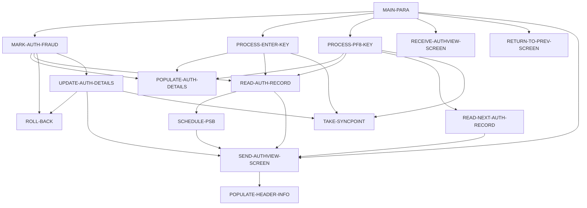

# Program COPAUS1C

| Item | Value |
|---|---|
| Source | `app/app-authorization-ims-db2-mq/cbl/COPAUS1C.cbl` |
| Lines | 604 total, 461 code, 39 comment, 104 blank |
| PROGRAM-ID | COPAUS1C |
| Author | AWS |
| Runtime | cics-online |
| Module | auth |
| CICS transactions | CPVD (`app/app-authorization-ims-db2-mq/csd/CRDDEMO2.csd:39-48`) |
| JCL steps | None |
| Paragraphs | 15 |
| Semantic analysis | validated (batch B01) |
| Version banner |  |

## Summary

COPAUS1C is a pseudo-conversational CICS program (transaction 'CPVD', map COPAU1A of mapset COPAU01) that displays one pending authorization detail selected on the summary screen COPAUS0C. It reads the IMS pending authorization summary (PAUTSUM0) for CDEMO-ACCT-ID and the detail segment (PAUTDTL1) whose key equals CDEMO-CPVD-PAU-SELECTED, and shows card number, date/time, amount, approve/decline status with a decoded decline reason, merchant and fraud information. PF8 moves to the next authorization of the same account; PF3 returns to COPAUS0C. PF5 toggles the fraud flag: it links to COPAUS2C, which records the fraud report in DB2 table AUTHFRDS, and on success replaces the IMS detail segment and commits, otherwise rolls back. (Confirmed)

Evidence: `app/app-authorization-ims-db2-mq/cbl/COPAUS1C.cbl:32-36`, `app/app-authorization-ims-db2-mq/cbl/COPAUS1C.cbl:157-206`, `app/app-authorization-ims-db2-mq/cbl/COPAUS1C.cbl:230-266`, `app/app-authorization-ims-db2-mq/cbl/COPAUS1C.cbl:291-358`, `app/app-authorization-ims-db2-mq/cbl/COPAUS1C.cbl:431-491`, `app/app-authorization-ims-db2-mq/cbl/COPAUS1C.cbl:520-552`

Header comment (Unverified, `app/app-authorization-ims-db2-mq/cbl/COPAUS1C.cbl:1`): See the comment block at the top of the source. Unverified until matched to code.

## Divisions and sections

| Division / section | Lines | Notes |
|---|---|---|
| IDENTIFICATION DIVISION | `app/app-authorization-ims-db2-mq/cbl/COPAUS1C.cbl:22-25` |  |
| ENVIRONMENT DIVISION | `app/app-authorization-ims-db2-mq/cbl/COPAUS1C.cbl:26-28` |  |
| DATA DIVISION | `app/app-authorization-ims-db2-mq/cbl/COPAUS1C.cbl:29-155` |  |
| PROCEDURE DIVISION | `app/app-authorization-ims-db2-mq/cbl/COPAUS1C.cbl:156-604` |  |
| ENVIRONMENT / CONFIGURATION SECTION | `app/app-authorization-ims-db2-mq/cbl/COPAUS1C.cbl:27-28` |  |
| DATA / WORKING-STORAGE SECTION | `app/app-authorization-ims-db2-mq/cbl/COPAUS1C.cbl:30-150` |  |
| DATA / LINKAGE SECTION | `app/app-authorization-ims-db2-mq/cbl/COPAUS1C.cbl:151-155` |  |

## Files and data stores

No SELECT entries (no COBOL file I/O).

CRUD summary from the program facts:

| Store | Kind | Ops | Evidence |
|---|---|---|---|
| DLI-GNP | logical | R | `app/app-authorization-ims-db2-mq/cbl/COPAUS1C.cbl:465` |
| DLI-GU | logical | R | `app/app-authorization-ims-db2-mq/cbl/COPAUS1C.cbl:439` |
| DLI-REPL | logical | U | `app/app-authorization-ims-db2-mq/cbl/COPAUS1C.cbl:525` |

## Embedded CICS, SQL and DL/I commands

| Paragraph | Kind | Verb | Resources | Response | Lines |
|---|---|---|---|---|---|
| MAIN-PARA | CICS | RETURN | TRANSID(WS-CICS-TRANID) |  | `app/app-authorization-ims-db2-mq/cbl/COPAUS1C.cbl:202-205` |
| MARK-AUTH-FRAUD | CICS | LINK | PROGRAM(WS-PGM-AUTH-FRAUD) | NOHANDLE | `app/app-authorization-ims-db2-mq/cbl/COPAUS1C.cbl:248-252` |
| RETURN-TO-PREV-SCREEN | CICS | XCTL | PROGRAM(CDEMO-TO-PROGRAM) |  | `app/app-authorization-ims-db2-mq/cbl/COPAUS1C.cbl:367-370` |
| SEND-AUTHVIEW-SCREEN | CICS | SEND MAP | MAP('COPAU1A'), MAPSET('COPAU01') |  | `app/app-authorization-ims-db2-mq/cbl/COPAUS1C.cbl:381-387` |
| SEND-AUTHVIEW-SCREEN | CICS | SEND MAP | MAP('COPAU1A'), MAPSET('COPAU01') |  | `app/app-authorization-ims-db2-mq/cbl/COPAUS1C.cbl:389-394` |
| RECEIVE-AUTHVIEW-SCREEN | CICS | RECEIVE MAP | MAP('COPAU1A'), MAPSET('COPAU01') | NOHANDLE | `app/app-authorization-ims-db2-mq/cbl/COPAUS1C.cbl:400-405` |
| READ-AUTH-RECORD | DLI | GU | PAUTSUM0 PCB PAUT-PCB-NUM |  | `app/app-authorization-ims-db2-mq/cbl/COPAUS1C.cbl:439-443` |
| READ-AUTH-RECORD | DLI | GNP | PAUTDTL1 PCB PAUT-PCB-NUM |  | `app/app-authorization-ims-db2-mq/cbl/COPAUS1C.cbl:465-469` |
| READ-NEXT-AUTH-RECORD | DLI | GNP | PAUTDTL1 PCB PAUT-PCB-NUM |  | `app/app-authorization-ims-db2-mq/cbl/COPAUS1C.cbl:495-498` |
| UPDATE-AUTH-DETAILS | DLI | REPL | PAUTDTL1 PCB PAUT-PCB-NUM |  | `app/app-authorization-ims-db2-mq/cbl/COPAUS1C.cbl:525-528` |
| TAKE-SYNCPOINT | CICS | SYNCPOINT |  |  | `app/app-authorization-ims-db2-mq/cbl/COPAUS1C.cbl:558-559` |
| ROLL-BACK | CICS | SYNCPOINT |  |  | `app/app-authorization-ims-db2-mq/cbl/COPAUS1C.cbl:566-568` |
| SCHEDULE-PSB | DLI | SCHD |  |  | `app/app-authorization-ims-db2-mq/cbl/COPAUS1C.cbl:575-578` |
| SCHEDULE-PSB | DLI | TERM |  |  | `app/app-authorization-ims-db2-mq/cbl/COPAUS1C.cbl:581-582` |
| SCHEDULE-PSB | DLI | SCHD |  |  | `app/app-authorization-ims-db2-mq/cbl/COPAUS1C.cbl:584-587` |

## Calls, transfers and callers

| Mechanism | Target | Parameters | Paragraph | Lines |
|---|---|---|---|---|
| EXEC CICS RETURN | WS-CICS-TRANID = CPVD | CARDDEMO-COMMAREA | MAIN-PARA | `app/app-authorization-ims-db2-mq/cbl/COPAUS1C.cbl:202-205` |
| EXEC CICS LINK | WS-PGM-AUTH-FRAUD = COPAUS2C | WS-FRAUD-DATA | MARK-AUTH-FRAUD | `app/app-authorization-ims-db2-mq/cbl/COPAUS1C.cbl:248-252` |
| EXEC CICS XCTL | CDEMO-TO-PROGRAM = COPAUS0C | CARDDEMO-COMMAREA | RETURN-TO-PREV-SCREEN | `app/app-authorization-ims-db2-mq/cbl/COPAUS1C.cbl:367-370` |

Programs that transfer to or call this program (from `docs/_work/xref/call-graph.json`):

| Caller | Mechanism | Confidence | Evidence |
|---|---|---|---|
| COPAUS0C | XCTL | Confirmed | `app/app-authorization-ims-db2-mq/cbl/COPAUS0C.cbl:322` |

## Copybooks

| Copybook | Statement | Resolution | Resolved path | REPLACING | Line |
|---|---|---|---|---|---|
| [COCOM01Y](../08-data/layouts/COCOM01Y.md) | COPY | inventory | app/cpy/COCOM01Y.cpy |  | `app/app-authorization-ims-db2-mq/cbl/COPAUS1C.cbl:109` |
| COPAU01 | COPY | inventory | app/app-authorization-ims-db2-mq/cpy-bms/COPAU01.cpy |  | `app/app-authorization-ims-db2-mq/cbl/COPAUS1C.cbl:122` |
| [COTTL01Y](../08-data/layouts/COTTL01Y.md) | COPY | inventory | app/cpy/COTTL01Y.cpy |  | `app/app-authorization-ims-db2-mq/cbl/COPAUS1C.cbl:126` |
| [CSDAT01Y](../08-data/layouts/CSDAT01Y.md) | COPY | inventory | app/cpy/CSDAT01Y.cpy |  | `app/app-authorization-ims-db2-mq/cbl/COPAUS1C.cbl:129` |
| [CSMSG01Y](../08-data/layouts/CSMSG01Y.md) | COPY | inventory | app/cpy/CSMSG01Y.cpy |  | `app/app-authorization-ims-db2-mq/cbl/COPAUS1C.cbl:132` |
| [CSMSG02Y](../08-data/layouts/CSMSG02Y.md) | COPY | inventory | app/cpy/CSMSG02Y.cpy |  | `app/app-authorization-ims-db2-mq/cbl/COPAUS1C.cbl:135` |
| [CIPAUSMY](../08-data/layouts/CIPAUSMY.md) | COPY | inventory | app/app-authorization-ims-db2-mq/cpy/CIPAUSMY.cpy |  | `app/app-authorization-ims-db2-mq/cbl/COPAUS1C.cbl:142` |
| [CIPAUDTY](../08-data/layouts/CIPAUDTY.md) | COPY | inventory | app/app-authorization-ims-db2-mq/cpy/CIPAUDTY.cpy |  | `app/app-authorization-ims-db2-mq/cbl/COPAUS1C.cbl:146` |
| DFHAID | COPY | system |  |  | `app/app-authorization-ims-db2-mq/cbl/COPAUS1C.cbl:148` |
| DFHBMSCA | COPY | system |  |  | `app/app-authorization-ims-db2-mq/cbl/COPAUS1C.cbl:149` |

## Data division items

Every data entry coded in this source (copybook contents are on the copybook pages). Lengths are computed from PIC and USAGE.

| Section | Lvl | Name | PIC | Usage | Len | OCCURS | REDEFINES | VALUE | 88-levels | Line |
|---|---|---|---|---|---|---|---|---|---|---|
| WORKING-STORAGE | 01 | WS-VARIABLES |  |  |  |  |  |  |  | 32 |
| WORKING-STORAGE | 05 | WS-PGM-AUTH-DTL | X(08) |  | 8 |  |  | 'COPAUS1C' |  | 33 |
| WORKING-STORAGE | 05 | WS-PGM-AUTH-SMRY | X(08) |  | 8 |  |  | 'COPAUS0C' |  | 34 |
| WORKING-STORAGE | 05 | WS-PGM-AUTH-FRAUD | X(08) |  | 8 |  |  | 'COPAUS2C' |  | 35 |
| WORKING-STORAGE | 05 | WS-CICS-TRANID | X(04) |  | 4 |  |  | 'CPVD' |  | 36 |
| WORKING-STORAGE | 05 | WS-MESSAGE | X(80) |  | 80 |  |  | SPACES |  | 37 |
| WORKING-STORAGE | 05 | WS-ERR-FLG | X(01) |  | 1 |  |  | 'N' | ERR-FLG-ON = 'Y'; ERR-FLG-OFF = 'N' | 38 |
| WORKING-STORAGE | 05 | WS-AUTHS-EOF | X(01) |  | 1 |  |  | 'N' | AUTHS-EOF = 'Y'; AUTHS-NOT-EOF = 'N' | 41 |
| WORKING-STORAGE | 05 | WS-SEND-ERASE-FLG | X(01) |  | 1 |  |  | 'Y' | SEND-ERASE-YES = 'Y'; SEND-ERASE-NO = 'N' | 44 |
| WORKING-STORAGE | 05 | WS-RESP-CD | S9(09) | COMP | 4 |  |  | ZEROS |  | 47 |
| WORKING-STORAGE | 05 | WS-REAS-CD | S9(09) | COMP | 4 |  |  | ZEROS |  | 48 |
| WORKING-STORAGE | 05 | WS-ACCT-ID | 9(11) |  | 11 |  |  |  |  | 50 |
| WORKING-STORAGE | 05 | WS-AUTH-KEY | X(08) |  | 8 |  |  |  |  | 51 |
| WORKING-STORAGE | 05 | WS-AUTH-AMT | -ZZZZZZZ9.99 |  | 12 |  |  |  |  | 52 |
| WORKING-STORAGE | 05 | WS-AUTH-DATE | X(08) |  | 8 |  |  | '00/00/00' |  | 53 |
| WORKING-STORAGE | 05 | WS-AUTH-TIME | X(08) |  | 8 |  |  | '00:00:00' |  | 54 |
| WORKING-STORAGE | 01 | WS-TABLES |  |  |  |  |  |  |  | 56 |
| WORKING-STORAGE | 05 | WS-DECLINE-REASON-TABLE |  |  |  |  |  |  |  | 57 |
| WORKING-STORAGE | 10 | FILLER | X(20) |  | 20 |  |  | '0000APPROVED' |  | 58 |
| WORKING-STORAGE | 10 | FILLER | X(20) |  | 20 |  |  | '3100INVALID CARD' |  | 59 |
| WORKING-STORAGE | 10 | FILLER | X(20) |  | 20 |  |  | '4100INSUFFICNT FUND' |  | 60 |
| WORKING-STORAGE | 10 | FILLER | X(20) |  | 20 |  |  | '4200CARD NOT ACTIVE' |  | 61 |
| WORKING-STORAGE | 10 | FILLER | X(20) |  | 20 |  |  | '4300ACCOUNT CLOSED' |  | 62 |
| WORKING-STORAGE | 10 | FILLER | X(20) |  | 20 |  |  | '4400EXCED DAILY LMT' |  | 63 |
| WORKING-STORAGE | 10 | FILLER | X(20) |  | 20 |  |  | '5100CARD FRAUD' |  | 64 |
| WORKING-STORAGE | 10 | FILLER | X(20) |  | 20 |  |  | '5200MERCHANT FRAUD' |  | 65 |
| WORKING-STORAGE | 10 | FILLER | X(20) |  | 20 |  |  | '5300LOST CARD' |  | 66 |
| WORKING-STORAGE | 10 | FILLER | X(20) |  | 20 |  |  | '9000UNKNOWN' |  | 67 |
| WORKING-STORAGE | 05 | WS-DECLINE-REASON-TAB |  |  |  | 10 | WS-DECLINE-REASON-TABLE |  |  | 68 |
| WORKING-STORAGE | 10 | DECL-CODE | X(4) |  | 4 |  |  |  |  | 72 |
| WORKING-STORAGE | 10 | DECL-DESC | X(16) |  | 16 |  |  |  |  | 73 |
| WORKING-STORAGE | 01 | WS-IMS-VARIABLES |  |  |  |  |  |  |  | 75 |
| WORKING-STORAGE | 05 | PSB-NAME | X(8) |  | 8 |  |  | 'PSBPAUTB' |  | 76 |
| WORKING-STORAGE | 05 | PCB-OFFSET |  |  |  |  |  |  |  | 77 |
| WORKING-STORAGE | 10 | PAUT-PCB-NUM | S9(4) | COMP | 2 |  |  | +1 |  | 78 |
| WORKING-STORAGE | 05 | IMS-RETURN-CODE | X(02) |  | 2 |  |  |  | STATUS-OK = ' ', 'FW'; SEGMENT-NOT-FOUND = 'GE'; DUPLICATE-SEGMENT-FOUND = 'II'; WRONG-PARENTAGE = 'GP'; END-OF-DB = 'GB'; DATABASE-UNAVAILABLE = 'BA'; PSB-SCHEDULED-MORE-THAN-ONCE = 'TC'; COULD-NOT-S | 79 |
| WORKING-STORAGE | 05 | WS-IMS-PSB-SCHD-FLG | X(1) |  | 1 |  |  |  | IMS-PSB-SCHD = 'Y'; IMS-PSB-NOT-SCHD = 'N' | 89 |
| WORKING-STORAGE | 01 | WS-FRAUD-DATA |  |  |  |  |  |  |  | 93 |
| WORKING-STORAGE | 02 | WS-FRD-ACCT-ID | 9(11) |  | 11 |  |  |  |  | 94 |
| WORKING-STORAGE | 02 | WS-FRD-CUST-ID | 9(9) |  | 9 |  |  |  |  | 95 |
| WORKING-STORAGE | 02 | WS-FRAUD-AUTH-RECORD | X(200) |  | 200 |  |  |  |  | 96 |
| WORKING-STORAGE | 02 | WS-FRAUD-STATUS-RECORD |  |  |  |  |  |  |  | 97 |
| WORKING-STORAGE | 05 | WS-FRD-ACTION | X(01) |  | 1 |  |  |  | WS-REPORT-FRAUD = 'F'; WS-REMOVE-FRAUD = 'R' | 98 |
| WORKING-STORAGE | 05 | WS-FRD-UPDATE-STATUS | X(01) |  | 1 |  |  |  | WS-FRD-UPDT-SUCCESS = 'S'; WS-FRD-UPDT-FAILED = 'F' | 101 |
| WORKING-STORAGE | 05 | WS-FRD-ACT-MSG | X(50) |  | 50 |  |  |  |  | 104 |
| WORKING-STORAGE | 05 | CDEMO-CPVD-INFO |  |  |  |  |  |  |  | 110 |
| WORKING-STORAGE | 10 | CDEMO-CPVD-PAU-SEL-FLG | X(01) |  | 1 |  |  |  |  | 111 |
| WORKING-STORAGE | 10 | CDEMO-CPVD-PAU-SELECTED | X(08) |  | 8 |  |  |  |  | 112 |
| WORKING-STORAGE | 10 | CDEMO-CPVD-PAUKEY-PREV-PG | X(08) |  | 8 | 20 |  |  |  | 113 |
| WORKING-STORAGE | 10 | CDEMO-CPVD-PAUKEY-LAST | X(08) |  | 8 |  |  |  |  | 114 |
| WORKING-STORAGE | 10 | CDEMO-CPVD-PAGE-NUM | S9(04) | COMP | 2 |  |  |  |  | 115 |
| WORKING-STORAGE | 10 | CDEMO-CPVD-NEXT-PAGE-FLG | X(01) |  | 1 |  |  | 'N' | NEXT-PAGE-YES = 'Y'; NEXT-PAGE-NO = 'N' | 116 |
| WORKING-STORAGE | 10 | CDEMO-CPVD-AUTH-KEYS | X(08) |  | 8 | 5 |  |  |  | 119 |
| WORKING-STORAGE | 10 | CDEMO-CPVD-FRAUD-DATA | X(100) |  | 100 |  |  |  |  | 120 |
| WORKING-STORAGE | 01 | PENDING-AUTH-SUMMARY |  |  |  |  |  |  |  | 141 |
| WORKING-STORAGE | 01 | PENDING-AUTH-DETAILS |  |  |  |  |  |  |  | 145 |
| LINKAGE | 01 | DFHCOMMAREA |  |  |  |  |  |  |  | 152 |
| LINKAGE | 05 | LK-COMMAREA | X(01) |  | 1 | 1 TO 32767 DEPENDING ON EIBCALEN |  |  |  | 153 |

## Statement inventory

Every procedure statement the parser recorded, by kind. Each one is listed with its line under Paragraph details.

| Kind | Count |
|---|---|
| Decisions (IF, EVALUATE, WHEN, loops, handlers) | 43 |
| Calculations | 0 |
| File I/O | 0 |
| EXEC CICS / SQL / DLI | 15 |
| CALL | 0 |
| PERFORM | 34 |
| GO TO | 0 |
| MOVE literal | 18 |
| MOVE field | 77 |
| SET | 19 |
| STRING, UNSTRING, INSPECT, INITIALIZE, COPY, ENTRY and others | 7 |
| DISPLAY | 1 |
| GOBACK, STOP RUN, RETURN, XCTL | 2 |
| Not classified by the parser | 0 |

## Control flow

| Paragraph | Lines | Logic | Performs | Performed by | Reachable |
|---|---|---|---|---|---|
| [MAIN-PARA](#para-main-para) | 157-206 | Resets error and erase flags. With no commarea it returns to COPAUS0C. Otherwise it loads the commarea, blanks CDEMO-CPVD-FRAUD-DATA and on first entry shows the selected authorization; on re-entry it receives the map and dispatches ENTER (redisplay), PF3 (back to COPAUS0C), PF5 (toggle fraud), PF8 (next authorization) or shows the invalid-key message. Ends with CICS RETURN TRANSID 'CPVD'. (Confirmed) | MARK-AUTH-FRAUD, PROCESS-ENTER-KEY, PROCESS-PF8-KEY, RECEIVE-AUTHVIEW-SCREEN, RETURN-TO-PREV-SCREEN, SEND-AUTHVIEW-SCREEN |  | yes |
| [PROCESS-ENTER-KEY](#para-process-enter-key) | 208-228 | Clears the map; when CDEMO-ACCT-ID is numeric and a selected auth key is present it reads the summary and detail segments and releases the PSB with SYNCPOINT, otherwise sets the error flag. Then populates the detail fields. (Confirmed) | POPULATE-AUTH-DETAILS, READ-AUTH-RECORD, TAKE-SYNCPOINT | MAIN-PARA | yes |
| [MARK-AUTH-FRAUD](#para-mark-auth-fraud) | 230-266 | Re-reads the selected authorization and toggles PA-AUTH-FRAUD: confirmed ('F') becomes removed ('R') with action WS-REMOVE-FRAUD, anything else becomes confirmed with WS-REPORT-FRAUD. Links to COPAUS2C with account id, customer id and the detail record; on NORMAL response and WS-FRD-UPDT-SUCCESS updates the IMS detail, otherwise shows COPAUS2C's message (if any) and rolls back. Redisplays the details. (Confirmed) | POPULATE-AUTH-DETAILS, READ-AUTH-RECORD, ROLL-BACK, UPDATE-AUTH-DETAILS | MAIN-PARA | yes |
| [PROCESS-PF8-KEY](#para-process-pf8-key) | 268-289 | Reads the current authorization, then the next PAUTDTL1 under the same summary with GNP, and releases the PSB. At end shows 'Already at the last Authorization...' without erase; otherwise saves the new key in CDEMO-CPVD-PAU-SELECTED and populates the details. (Confirmed) | POPULATE-AUTH-DETAILS, READ-AUTH-RECORD, READ-NEXT-AUTH-RECORD, TAKE-SYNCPOINT | MAIN-PARA | yes |
| [POPULATE-AUTH-DETAILS](#para-populate-auth-details) | 291-358 | When no error: formats card number, original date MM/DD/YY and time HH:MM:SS, approved amount, response 'A' (green) when code '00' else 'D' (red), and looks up PA-AUTH-RESP-REASON in the decline-reason table with SEARCH ALL (shows '9999-ERROR' if absent). Also moves processing code, POS mode, source, MCC, expiry MM/YY, type, transaction id, match status, fraud flag with report date (or '-') and merchant name/id/city/state/zip. (Confirmed) |  | MARK-AUTH-FRAUD, PROCESS-ENTER-KEY, PROCESS-PF8-KEY | yes |
| [RETURN-TO-PREV-SCREEN](#para-return-to-prev-screen) | 360-370 | Sets from-tranid/from-program to CPVD/COPAUS1C, zeroes the context, sets CDEMO-PGM-ENTER and XCTLs to CDEMO-TO-PROGRAM with the commarea. (Confirmed) |  | MAIN-PARA | yes |
| [SEND-AUTHVIEW-SCREEN](#para-send-authview-screen) | 373-396 | Populates the header, moves WS-MESSAGE to ERRMSGO, places the cursor on the card number and sends map COPAU1A with or without ERASE depending on SEND-ERASE-YES. (Confirmed) | POPULATE-HEADER-INFO | MAIN-PARA, READ-AUTH-RECORD, READ-NEXT-AUTH-RECORD, SCHEDULE-PSB, UPDATE-AUTH-DETAILS | yes |
| [RECEIVE-AUTHVIEW-SCREEN](#para-receive-authview-screen) | 398-406 | Receives map COPAU1A of mapset COPAU01 into COPAU1AI with NOHANDLE. (Confirmed) |  | MAIN-PARA | yes |
| [POPULATE-HEADER-INFO](#para-populate-header-info) | 409-429 | Moves FUNCTION CURRENT-DATE to WS-CURDATE-DATA, CCDA-TITLE01/CCDA-TITLE02 to TITLE01O/TITLE02O, WS-CICS-TRANID to TRNNAMEO and WS-PGM-AUTH-DTL to PGMNAMEO of COPAU1AO; rebuilds the date as WS-CURDATE-MM-DD-YY (MM/DD/YY from WS-CURDATE-MONTH, WS-CURDATE-DAY, WS-CURDATE-YEAR(3:2)) into CURDATEO and the time as WS-CURTIME-HH-MM-SS into CURTIMEO. (Confirmed) |  | SEND-AUTHVIEW-SCREEN | yes |
| [READ-AUTH-RECORD](#para-read-auth-record) | 431-491 | Schedules the PSB, issues DLI GU for PAUTSUM0 WHERE ACCNTID = WS-ACCT-ID and, when found, GNP for PAUTDTL1 WHERE PAUT9CTS = WS-AUTH-KEY. 'GE'/'GB' set AUTHS-EOF; other statuses set the error flag with a system-error message and send the screen. (Confirmed) | SCHEDULE-PSB, SEND-AUTHVIEW-SCREEN | MARK-AUTH-FRAUD, PROCESS-ENTER-KEY, PROCESS-PF8-KEY | yes |
| [READ-NEXT-AUTH-RECORD](#para-read-next-auth-record) | 493-518 | Issues DLI GNP for the next PAUTDTL1; OK sets AUTHS-NOT-EOF, 'GE'/'GB' sets AUTHS-EOF, other statuses set the error flag with ' System error while reading next Auth: Code:' and send the screen. (Confirmed) | SEND-AUTHVIEW-SCREEN | PROCESS-PF8-KEY | yes |
| [UPDATE-AUTH-DETAILS](#para-update-auth-details) | 520-552 | Moves the detail returned from COPAUS2C (with fraud report date) into PENDING-AUTH-DETAILS, displays the report date and issues DLI REPL of PAUTDTL1. On success commits with SYNCPOINT and shows 'AUTH FRAUD REMOVED...' or 'AUTH MARKED FRAUD...'; otherwise rolls back, sets the error flag and shows ' System error while FRAUD Tagging, ROLLBACK\|\|' with the IMS status. (Confirmed) | ROLL-BACK, SEND-AUTHVIEW-SCREEN, TAKE-SYNCPOINT | MARK-AUTH-FRAUD | yes |
| [TAKE-SYNCPOINT](#para-take-syncpoint) | 557-560 | Issues EXEC CICS SYNCPOINT to commit and release the PSB. (Confirmed) |  | PROCESS-ENTER-KEY, PROCESS-PF8-KEY, UPDATE-AUTH-DETAILS | yes |
| [ROLL-BACK](#para-roll-back) | 565-569 | Issues EXEC CICS SYNCPOINT ROLLBACK, backing out IMS and DB2 changes of the unit of work. (Confirmed) |  | MARK-AUTH-FRAUD, UPDATE-AUTH-DETAILS | yes |
| [SCHEDULE-PSB](#para-schedule-psb) | 574-603 | Schedules PSB 'PSBPAUTB' (NODHABEND), terminating and rescheduling on 'TC'. OK sets IMS-PSB-SCHD; otherwise sets the error flag with ' System error while scheduling PSB: Code:' and sends the screen. (Confirmed) | SEND-AUTHVIEW-SCREEN | READ-AUTH-RECORD | yes |

## Paragraph details

### Para MAIN-PARA

Lines `app/app-authorization-ims-db2-mq/cbl/COPAUS1C.cbl:157-206`. 

Logic: Resets error and erase flags. With no commarea it returns to COPAUS0C. Otherwise it loads the commarea, blanks CDEMO-CPVD-FRAUD-DATA and on first entry shows the selected authorization; on re-entry it receives the map and dispatches ENTER (redisplay), PF3 (back to COPAUS0C), PF5 (toggle fraud), PF8 (next authorization) or shows the invalid-key message. Ends with CICS RETURN TRANSID 'CPVD'. (Confirmed)

Rules: [BR-COPAUS1C-008](../09-business-rules-catalog.md#br-copaus1c-008)

Statements in source order:

- `SET ERR-FLG-OFF TO TRUE` at `app/app-authorization-ims-db2-mq/cbl/COPAUS1C.cbl:159`
- `SET SEND-ERASE-YES TO TRUE` at `app/app-authorization-ims-db2-mq/cbl/COPAUS1C.cbl:160`
- `MOVE SPACES TO WS-MESSAGE ERRMSGO OF COPAU1AO` at `app/app-authorization-ims-db2-mq/cbl/COPAUS1C.cbl:162-163`
- IF `EIBCALEN = 0` at `app/app-authorization-ims-db2-mq/cbl/COPAUS1C.cbl:165` (pseudo-conversation)
- `INITIALIZE CARDDEMO-COMMAREA` at `app/app-authorization-ims-db2-mq/cbl/COPAUS1C.cbl:166`
- `MOVE WS-PGM-AUTH-SMRY TO CDEMO-TO-PROGRAM` at `app/app-authorization-ims-db2-mq/cbl/COPAUS1C.cbl:168`
- PERFORM RETURN-TO-PREV-SCREEN at `app/app-authorization-ims-db2-mq/cbl/COPAUS1C.cbl:169`
- `MOVE DFHCOMMAREA(1:EIBCALEN) TO CARDDEMO-COMMAREA` at `app/app-authorization-ims-db2-mq/cbl/COPAUS1C.cbl:171`
- `MOVE SPACES TO CDEMO-CPVD-FRAUD-DATA` at `app/app-authorization-ims-db2-mq/cbl/COPAUS1C.cbl:172`
- IF `NOT CDEMO-PGM-REENTER` at `app/app-authorization-ims-db2-mq/cbl/COPAUS1C.cbl:173` (pseudo-conversation)
- `SET CDEMO-PGM-REENTER TO TRUE` at `app/app-authorization-ims-db2-mq/cbl/COPAUS1C.cbl:174`
- PERFORM PROCESS-ENTER-KEY at `app/app-authorization-ims-db2-mq/cbl/COPAUS1C.cbl:175`
- PERFORM SEND-AUTHVIEW-SCREEN at `app/app-authorization-ims-db2-mq/cbl/COPAUS1C.cbl:177`
- PERFORM RECEIVE-AUTHVIEW-SCREEN at `app/app-authorization-ims-db2-mq/cbl/COPAUS1C.cbl:179`
- EVALUATE `EIBAID` at `app/app-authorization-ims-db2-mq/cbl/COPAUS1C.cbl:180` (screen-key)
- WHEN `DFHENTER` at `app/app-authorization-ims-db2-mq/cbl/COPAUS1C.cbl:181` (screen-key)
- PERFORM PROCESS-ENTER-KEY at `app/app-authorization-ims-db2-mq/cbl/COPAUS1C.cbl:182`
- PERFORM SEND-AUTHVIEW-SCREEN at `app/app-authorization-ims-db2-mq/cbl/COPAUS1C.cbl:183`
- WHEN `DFHPF3` at `app/app-authorization-ims-db2-mq/cbl/COPAUS1C.cbl:184` (screen-key)
- `MOVE WS-PGM-AUTH-SMRY TO CDEMO-TO-PROGRAM` at `app/app-authorization-ims-db2-mq/cbl/COPAUS1C.cbl:185`
- PERFORM RETURN-TO-PREV-SCREEN at `app/app-authorization-ims-db2-mq/cbl/COPAUS1C.cbl:186`
- WHEN `DFHPF5` at `app/app-authorization-ims-db2-mq/cbl/COPAUS1C.cbl:187` (screen-key)
- PERFORM MARK-AUTH-FRAUD at `app/app-authorization-ims-db2-mq/cbl/COPAUS1C.cbl:188`
- PERFORM SEND-AUTHVIEW-SCREEN at `app/app-authorization-ims-db2-mq/cbl/COPAUS1C.cbl:189`
- WHEN `DFHPF8` at `app/app-authorization-ims-db2-mq/cbl/COPAUS1C.cbl:190` (screen-key)
- PERFORM PROCESS-PF8-KEY at `app/app-authorization-ims-db2-mq/cbl/COPAUS1C.cbl:191`
- PERFORM SEND-AUTHVIEW-SCREEN at `app/app-authorization-ims-db2-mq/cbl/COPAUS1C.cbl:192`
- WHEN `OTHER` at `app/app-authorization-ims-db2-mq/cbl/COPAUS1C.cbl:193` (screen-key)
- PERFORM PROCESS-ENTER-KEY at `app/app-authorization-ims-db2-mq/cbl/COPAUS1C.cbl:194`
- `MOVE CCDA-MSG-INVALID-KEY TO WS-MESSAGE` at `app/app-authorization-ims-db2-mq/cbl/COPAUS1C.cbl:196`
- PERFORM SEND-AUTHVIEW-SCREEN at `app/app-authorization-ims-db2-mq/cbl/COPAUS1C.cbl:197`
- EXEC CICS RETURN at `app/app-authorization-ims-db2-mq/cbl/COPAUS1C.cbl:202-205`
- Ends with EXEC CICS RETURN at `app/app-authorization-ims-db2-mq/cbl/COPAUS1C.cbl:202-205`

### Para PROCESS-ENTER-KEY

Lines `app/app-authorization-ims-db2-mq/cbl/COPAUS1C.cbl:208-228`. 

Logic: Clears the map; when CDEMO-ACCT-ID is numeric and a selected auth key is present it reads the summary and detail segments and releases the PSB with SYNCPOINT, otherwise sets the error flag. Then populates the detail fields. (Confirmed)

Rules: [BR-COPAUS1C-001](../09-business-rules-catalog.md#br-copaus1c-001)

Statements in source order:

- `MOVE LOW-VALUES TO COPAU1AO` at `app/app-authorization-ims-db2-mq/cbl/COPAUS1C.cbl:210`
- IF `CDEMO-ACCT-ID IS NUMERIC AND CDEMO-CPVD-PAU-SELECTED NOT = SPACES AND LOW-VALUES` at `app/app-authorization-ims-db2-mq/cbl/COPAUS1C.cbl:211-212` (business-candidate)
- `MOVE CDEMO-ACCT-ID TO WS-ACCT-ID` at `app/app-authorization-ims-db2-mq/cbl/COPAUS1C.cbl:213`
- `MOVE CDEMO-CPVD-PAU-SELECTED TO WS-AUTH-KEY` at `app/app-authorization-ims-db2-mq/cbl/COPAUS1C.cbl:214-215`
- PERFORM READ-AUTH-RECORD at `app/app-authorization-ims-db2-mq/cbl/COPAUS1C.cbl:216`
- IF `IMS-PSB-SCHD` at `app/app-authorization-ims-db2-mq/cbl/COPAUS1C.cbl:218` (business-candidate)
- `SET IMS-PSB-NOT-SCHD TO TRUE` at `app/app-authorization-ims-db2-mq/cbl/COPAUS1C.cbl:219`
- PERFORM TAKE-SYNCPOINT at `app/app-authorization-ims-db2-mq/cbl/COPAUS1C.cbl:220`
- `SET ERR-FLG-ON TO TRUE` at `app/app-authorization-ims-db2-mq/cbl/COPAUS1C.cbl:224`
- PERFORM POPULATE-AUTH-DETAILS at `app/app-authorization-ims-db2-mq/cbl/COPAUS1C.cbl:227-228`

### Para MARK-AUTH-FRAUD

Lines `app/app-authorization-ims-db2-mq/cbl/COPAUS1C.cbl:230-266`. 

Logic: Re-reads the selected authorization and toggles PA-AUTH-FRAUD: confirmed ('F') becomes removed ('R') with action WS-REMOVE-FRAUD, anything else becomes confirmed with WS-REPORT-FRAUD. Links to COPAUS2C with account id, customer id and the detail record; on NORMAL response and WS-FRD-UPDT-SUCCESS updates the IMS detail, otherwise shows COPAUS2C's message (if any) and rolls back. Redisplays the details. (Confirmed)

Rules: [BR-COPAUS1C-002](../09-business-rules-catalog.md#br-copaus1c-002), [BR-COPAUS1C-003](../09-business-rules-catalog.md#br-copaus1c-003)

Statements in source order:

- `MOVE CDEMO-ACCT-ID TO WS-ACCT-ID` at `app/app-authorization-ims-db2-mq/cbl/COPAUS1C.cbl:231`
- `MOVE CDEMO-CPVD-PAU-SELECTED TO WS-AUTH-KEY` at `app/app-authorization-ims-db2-mq/cbl/COPAUS1C.cbl:232`
- PERFORM READ-AUTH-RECORD at `app/app-authorization-ims-db2-mq/cbl/COPAUS1C.cbl:234`
- IF `PA-FRAUD-CONFIRMED` at `app/app-authorization-ims-db2-mq/cbl/COPAUS1C.cbl:236` (business-candidate)
- `SET PA-FRAUD-REMOVED TO TRUE` at `app/app-authorization-ims-db2-mq/cbl/COPAUS1C.cbl:237`
- `SET WS-REMOVE-FRAUD TO TRUE` at `app/app-authorization-ims-db2-mq/cbl/COPAUS1C.cbl:238`
- `SET PA-FRAUD-CONFIRMED TO TRUE` at `app/app-authorization-ims-db2-mq/cbl/COPAUS1C.cbl:240`
- `SET WS-REPORT-FRAUD TO TRUE` at `app/app-authorization-ims-db2-mq/cbl/COPAUS1C.cbl:241`
- `MOVE PENDING-AUTH-DETAILS TO WS-FRAUD-AUTH-RECORD` at `app/app-authorization-ims-db2-mq/cbl/COPAUS1C.cbl:244`
- `MOVE CDEMO-ACCT-ID TO WS-FRD-ACCT-ID` at `app/app-authorization-ims-db2-mq/cbl/COPAUS1C.cbl:245`
- `MOVE CDEMO-CUST-ID TO WS-FRD-CUST-ID` at `app/app-authorization-ims-db2-mq/cbl/COPAUS1C.cbl:246`
- EXEC CICS LINK at `app/app-authorization-ims-db2-mq/cbl/COPAUS1C.cbl:248-252`
- IF `EIBRESP = DFHRESP(NORMAL)` at `app/app-authorization-ims-db2-mq/cbl/COPAUS1C.cbl:253` (io-status)
- IF `WS-FRD-UPDT-SUCCESS` at `app/app-authorization-ims-db2-mq/cbl/COPAUS1C.cbl:254` (business-candidate)
- PERFORM UPDATE-AUTH-DETAILS at `app/app-authorization-ims-db2-mq/cbl/COPAUS1C.cbl:255`
- `MOVE WS-FRD-ACT-MSG TO WS-MESSAGE` at `app/app-authorization-ims-db2-mq/cbl/COPAUS1C.cbl:257`
- PERFORM ROLL-BACK at `app/app-authorization-ims-db2-mq/cbl/COPAUS1C.cbl:258`
- PERFORM ROLL-BACK at `app/app-authorization-ims-db2-mq/cbl/COPAUS1C.cbl:261`
- `MOVE PA-AUTHORIZATION-KEY TO CDEMO-CPVD-PAU-SELECTED` at `app/app-authorization-ims-db2-mq/cbl/COPAUS1C.cbl:264`
- PERFORM POPULATE-AUTH-DETAILS at `app/app-authorization-ims-db2-mq/cbl/COPAUS1C.cbl:265-266`

### Para PROCESS-PF8-KEY

Lines `app/app-authorization-ims-db2-mq/cbl/COPAUS1C.cbl:268-289`. 

Logic: Reads the current authorization, then the next PAUTDTL1 under the same summary with GNP, and releases the PSB. At end shows 'Already at the last Authorization...' without erase; otherwise saves the new key in CDEMO-CPVD-PAU-SELECTED and populates the details. (Confirmed)

Rules: [BR-COPAUS1C-006](../09-business-rules-catalog.md#br-copaus1c-006)

Statements in source order:

- `MOVE CDEMO-ACCT-ID TO WS-ACCT-ID` at `app/app-authorization-ims-db2-mq/cbl/COPAUS1C.cbl:270`
- `MOVE CDEMO-CPVD-PAU-SELECTED TO WS-AUTH-KEY` at `app/app-authorization-ims-db2-mq/cbl/COPAUS1C.cbl:271`
- PERFORM READ-AUTH-RECORD at `app/app-authorization-ims-db2-mq/cbl/COPAUS1C.cbl:273`
- PERFORM READ-NEXT-AUTH-RECORD at `app/app-authorization-ims-db2-mq/cbl/COPAUS1C.cbl:274`
- IF `IMS-PSB-SCHD` at `app/app-authorization-ims-db2-mq/cbl/COPAUS1C.cbl:276` (business-candidate)
- `SET IMS-PSB-NOT-SCHD TO TRUE` at `app/app-authorization-ims-db2-mq/cbl/COPAUS1C.cbl:277`
- PERFORM TAKE-SYNCPOINT at `app/app-authorization-ims-db2-mq/cbl/COPAUS1C.cbl:278`
- IF `AUTHS-EOF` at `app/app-authorization-ims-db2-mq/cbl/COPAUS1C.cbl:281` (io-status)
- `SET SEND-ERASE-NO TO TRUE` at `app/app-authorization-ims-db2-mq/cbl/COPAUS1C.cbl:282`
- MOVE `'Already at the last Authorization...'` TO WS-MESSAGE at `app/app-authorization-ims-db2-mq/cbl/COPAUS1C.cbl:283-284`
- `MOVE PA-AUTHORIZATION-KEY TO CDEMO-CPVD-PAU-SELECTED` at `app/app-authorization-ims-db2-mq/cbl/COPAUS1C.cbl:286`
- PERFORM POPULATE-AUTH-DETAILS at `app/app-authorization-ims-db2-mq/cbl/COPAUS1C.cbl:287`

### Para POPULATE-AUTH-DETAILS

Lines `app/app-authorization-ims-db2-mq/cbl/COPAUS1C.cbl:291-358`. 

Logic: When no error: formats card number, original date MM/DD/YY and time HH:MM:SS, approved amount, response 'A' (green) when code '00' else 'D' (red), and looks up PA-AUTH-RESP-REASON in the decline-reason table with SEARCH ALL (shows '9999-ERROR' if absent). Also moves processing code, POS mode, source, MCC, expiry MM/YY, type, transaction id, match status, fraud flag with report date (or '-') and merchant name/id/city/state/zip. (Confirmed)

Rules: [BR-COPAUS1C-004](../09-business-rules-catalog.md#br-copaus1c-004), [BR-COPAUS1C-005](../09-business-rules-catalog.md#br-copaus1c-005)

Statements in source order:

- IF `ERR-FLG-OFF` at `app/app-authorization-ims-db2-mq/cbl/COPAUS1C.cbl:294` (error-flag)
- `MOVE PA-CARD-NUM TO CARDNUMO` at `app/app-authorization-ims-db2-mq/cbl/COPAUS1C.cbl:295`
- `MOVE PA-AUTH-ORIG-DATE(1:2) TO WS-CURDATE-YY` at `app/app-authorization-ims-db2-mq/cbl/COPAUS1C.cbl:297`
- `MOVE PA-AUTH-ORIG-DATE(3:2) TO WS-CURDATE-MM` at `app/app-authorization-ims-db2-mq/cbl/COPAUS1C.cbl:298`
- `MOVE PA-AUTH-ORIG-DATE(5:2) TO WS-CURDATE-DD` at `app/app-authorization-ims-db2-mq/cbl/COPAUS1C.cbl:299`
- `MOVE WS-CURDATE-MM-DD-YY TO WS-AUTH-DATE` at `app/app-authorization-ims-db2-mq/cbl/COPAUS1C.cbl:300`
- `MOVE WS-AUTH-DATE TO AUTHDTO` at `app/app-authorization-ims-db2-mq/cbl/COPAUS1C.cbl:301`
- `MOVE PA-AUTH-ORIG-TIME(1:2) TO WS-AUTH-TIME(1:2)` at `app/app-authorization-ims-db2-mq/cbl/COPAUS1C.cbl:303`
- `MOVE PA-AUTH-ORIG-TIME(3:2) TO WS-AUTH-TIME(4:2)` at `app/app-authorization-ims-db2-mq/cbl/COPAUS1C.cbl:304`
- `MOVE PA-AUTH-ORIG-TIME(5:2) TO WS-AUTH-TIME(7:2)` at `app/app-authorization-ims-db2-mq/cbl/COPAUS1C.cbl:305`
- `MOVE WS-AUTH-TIME TO AUTHTMO` at `app/app-authorization-ims-db2-mq/cbl/COPAUS1C.cbl:306`
- `MOVE PA-APPROVED-AMT TO WS-AUTH-AMT` at `app/app-authorization-ims-db2-mq/cbl/COPAUS1C.cbl:308`
- `MOVE WS-AUTH-AMT TO AUTHAMTO` at `app/app-authorization-ims-db2-mq/cbl/COPAUS1C.cbl:309`
- IF `PA-AUTH-RESP-CODE = '00'` at `app/app-authorization-ims-db2-mq/cbl/COPAUS1C.cbl:311` (io-status)
- MOVE `'A'` TO AUTHRSPO at `app/app-authorization-ims-db2-mq/cbl/COPAUS1C.cbl:312`
- `MOVE DFHGREEN TO AUTHRSPC` at `app/app-authorization-ims-db2-mq/cbl/COPAUS1C.cbl:313`
- MOVE `'D'` TO AUTHRSPO at `app/app-authorization-ims-db2-mq/cbl/COPAUS1C.cbl:315`
- `MOVE DFHRED TO AUTHRSPC` at `app/app-authorization-ims-db2-mq/cbl/COPAUS1C.cbl:316`
- `SEARCH ALL WS-DECLINE-REASON-TAB` at `app/app-authorization-ims-db2-mq/cbl/COPAUS1C.cbl:319`
- HANDLER `AT END` at `app/app-authorization-ims-db2-mq/cbl/COPAUS1C.cbl:320` (io-status)
- MOVE `'9999'` TO AUTHRSNO at `app/app-authorization-ims-db2-mq/cbl/COPAUS1C.cbl:321`
- MOVE `'-'` TO AUTHRSNO(5:1) at `app/app-authorization-ims-db2-mq/cbl/COPAUS1C.cbl:322`
- MOVE `'ERROR'` TO AUTHRSNO(6:) at `app/app-authorization-ims-db2-mq/cbl/COPAUS1C.cbl:323`
- WHEN `DECL-CODE(WS-DECL-RSN-IDX) = PA-AUTH-RESP-REASON` at `app/app-authorization-ims-db2-mq/cbl/COPAUS1C.cbl:324` (io-status)
- `MOVE PA-AUTH-RESP-REASON TO AUTHRSNO` at `app/app-authorization-ims-db2-mq/cbl/COPAUS1C.cbl:325`
- MOVE `'-'` TO AUTHRSNO(5:1) at `app/app-authorization-ims-db2-mq/cbl/COPAUS1C.cbl:326`
- `MOVE DECL-DESC(WS-DECL-RSN-IDX) TO AUTHRSNO(6:)` at `app/app-authorization-ims-db2-mq/cbl/COPAUS1C.cbl:327`
- `MOVE PA-PROCESSING-CODE TO AUTHCDO` at `app/app-authorization-ims-db2-mq/cbl/COPAUS1C.cbl:331`
- `MOVE PA-POS-ENTRY-MODE TO POSEMDO` at `app/app-authorization-ims-db2-mq/cbl/COPAUS1C.cbl:332`
- `MOVE PA-MESSAGE-SOURCE TO AUTHSRCO` at `app/app-authorization-ims-db2-mq/cbl/COPAUS1C.cbl:333`
- `MOVE PA-MERCHANT-CATAGORY-CODE TO MCCCDO` at `app/app-authorization-ims-db2-mq/cbl/COPAUS1C.cbl:334`
- `MOVE PA-CARD-EXPIRY-DATE(1:2) TO CRDEXPO(1:2)` at `app/app-authorization-ims-db2-mq/cbl/COPAUS1C.cbl:336`
- MOVE `'/'` TO CRDEXPO(3:1) at `app/app-authorization-ims-db2-mq/cbl/COPAUS1C.cbl:337`
- `MOVE PA-CARD-EXPIRY-DATE(3:2) TO CRDEXPO(4:2)` at `app/app-authorization-ims-db2-mq/cbl/COPAUS1C.cbl:338`
- `MOVE PA-AUTH-TYPE TO AUTHTYPO` at `app/app-authorization-ims-db2-mq/cbl/COPAUS1C.cbl:340`
- `MOVE PA-TRANSACTION-ID TO TRNIDO` at `app/app-authorization-ims-db2-mq/cbl/COPAUS1C.cbl:341`
- `MOVE PA-MATCH-STATUS TO AUTHMTCO` at `app/app-authorization-ims-db2-mq/cbl/COPAUS1C.cbl:342`
- IF `PA-FRAUD-CONFIRMED OR PA-FRAUD-REMOVED` at `app/app-authorization-ims-db2-mq/cbl/COPAUS1C.cbl:344` (business-candidate)
- `MOVE PA-AUTH-FRAUD TO AUTHFRDO(1:1)` at `app/app-authorization-ims-db2-mq/cbl/COPAUS1C.cbl:345`
- MOVE `'-'` TO AUTHFRDO(2:1) at `app/app-authorization-ims-db2-mq/cbl/COPAUS1C.cbl:346`
- `MOVE PA-FRAUD-RPT-DATE TO AUTHFRDO(3:)` at `app/app-authorization-ims-db2-mq/cbl/COPAUS1C.cbl:347`
- MOVE `'-'` TO AUTHFRDO at `app/app-authorization-ims-db2-mq/cbl/COPAUS1C.cbl:349`
- `MOVE PA-MERCHANT-NAME TO MERNAMEO` at `app/app-authorization-ims-db2-mq/cbl/COPAUS1C.cbl:352`
- `MOVE PA-MERCHANT-ID TO MERIDO` at `app/app-authorization-ims-db2-mq/cbl/COPAUS1C.cbl:353`
- `MOVE PA-MERCHANT-CITY TO MERCITYO` at `app/app-authorization-ims-db2-mq/cbl/COPAUS1C.cbl:354`
- `MOVE PA-MERCHANT-STATE TO MERSTO` at `app/app-authorization-ims-db2-mq/cbl/COPAUS1C.cbl:355`
- `MOVE PA-MERCHANT-ZIP TO MERZIPO` at `app/app-authorization-ims-db2-mq/cbl/COPAUS1C.cbl:356`

### Para RETURN-TO-PREV-SCREEN

Lines `app/app-authorization-ims-db2-mq/cbl/COPAUS1C.cbl:360-370`. 

Logic: Sets from-tranid/from-program to CPVD/COPAUS1C, zeroes the context, sets CDEMO-PGM-ENTER and XCTLs to CDEMO-TO-PROGRAM with the commarea. (Confirmed)

Statements in source order:

- `MOVE WS-CICS-TRANID TO CDEMO-FROM-TRANID` at `app/app-authorization-ims-db2-mq/cbl/COPAUS1C.cbl:362`
- `MOVE WS-PGM-AUTH-DTL TO CDEMO-FROM-PROGRAM` at `app/app-authorization-ims-db2-mq/cbl/COPAUS1C.cbl:363`
- `MOVE ZEROS TO CDEMO-PGM-CONTEXT` at `app/app-authorization-ims-db2-mq/cbl/COPAUS1C.cbl:364`
- `SET CDEMO-PGM-ENTER TO TRUE` at `app/app-authorization-ims-db2-mq/cbl/COPAUS1C.cbl:365`
- EXEC CICS XCTL at `app/app-authorization-ims-db2-mq/cbl/COPAUS1C.cbl:367-370`
- Ends with EXEC CICS XCTL at `app/app-authorization-ims-db2-mq/cbl/COPAUS1C.cbl:367-370`

### Para SEND-AUTHVIEW-SCREEN

Lines `app/app-authorization-ims-db2-mq/cbl/COPAUS1C.cbl:373-396`. 

Logic: Populates the header, moves WS-MESSAGE to ERRMSGO, places the cursor on the card number and sends map COPAU1A with or without ERASE depending on SEND-ERASE-YES. (Confirmed)

Statements in source order:

- PERFORM POPULATE-HEADER-INFO at `app/app-authorization-ims-db2-mq/cbl/COPAUS1C.cbl:375`
- `MOVE WS-MESSAGE TO ERRMSGO OF COPAU1AO` at `app/app-authorization-ims-db2-mq/cbl/COPAUS1C.cbl:377`
- MOVE `-1` TO CARDNUML at `app/app-authorization-ims-db2-mq/cbl/COPAUS1C.cbl:378`
- IF `SEND-ERASE-YES` at `app/app-authorization-ims-db2-mq/cbl/COPAUS1C.cbl:380` (business-candidate)
- EXEC CICS SEND MAP at `app/app-authorization-ims-db2-mq/cbl/COPAUS1C.cbl:381-387`
- EXEC CICS SEND MAP at `app/app-authorization-ims-db2-mq/cbl/COPAUS1C.cbl:389-394`

### Para RECEIVE-AUTHVIEW-SCREEN

Lines `app/app-authorization-ims-db2-mq/cbl/COPAUS1C.cbl:398-406`. 

Logic: Receives map COPAU1A of mapset COPAU01 into COPAU1AI with NOHANDLE. (Confirmed)

Statements in source order:

- EXEC CICS RECEIVE MAP at `app/app-authorization-ims-db2-mq/cbl/COPAUS1C.cbl:400-405`

### Para POPULATE-HEADER-INFO

Lines `app/app-authorization-ims-db2-mq/cbl/COPAUS1C.cbl:409-429`. 

Logic: Moves FUNCTION CURRENT-DATE to WS-CURDATE-DATA, CCDA-TITLE01/CCDA-TITLE02 to TITLE01O/TITLE02O, WS-CICS-TRANID to TRNNAMEO and WS-PGM-AUTH-DTL to PGMNAMEO of COPAU1AO; rebuilds the date as WS-CURDATE-MM-DD-YY (MM/DD/YY from WS-CURDATE-MONTH, WS-CURDATE-DAY, WS-CURDATE-YEAR(3:2)) into CURDATEO and the time as WS-CURTIME-HH-MM-SS into CURTIMEO. (Confirmed)

Statements in source order:

- `MOVE FUNCTION CURRENT-DATE TO WS-CURDATE-DATA` at `app/app-authorization-ims-db2-mq/cbl/COPAUS1C.cbl:411`
- `MOVE CCDA-TITLE01 TO TITLE01O OF COPAU1AO` at `app/app-authorization-ims-db2-mq/cbl/COPAUS1C.cbl:413`
- `MOVE CCDA-TITLE02 TO TITLE02O OF COPAU1AO` at `app/app-authorization-ims-db2-mq/cbl/COPAUS1C.cbl:414`
- `MOVE WS-CICS-TRANID TO TRNNAMEO OF COPAU1AO` at `app/app-authorization-ims-db2-mq/cbl/COPAUS1C.cbl:415`
- `MOVE WS-PGM-AUTH-DTL TO PGMNAMEO OF COPAU1AO` at `app/app-authorization-ims-db2-mq/cbl/COPAUS1C.cbl:416`
- `MOVE WS-CURDATE-MONTH TO WS-CURDATE-MM` at `app/app-authorization-ims-db2-mq/cbl/COPAUS1C.cbl:418`
- `MOVE WS-CURDATE-DAY TO WS-CURDATE-DD` at `app/app-authorization-ims-db2-mq/cbl/COPAUS1C.cbl:419`
- `MOVE WS-CURDATE-YEAR(3:2) TO WS-CURDATE-YY` at `app/app-authorization-ims-db2-mq/cbl/COPAUS1C.cbl:420`
- `MOVE WS-CURDATE-MM-DD-YY TO CURDATEO OF COPAU1AO` at `app/app-authorization-ims-db2-mq/cbl/COPAUS1C.cbl:422`
- `MOVE WS-CURTIME-HOURS TO WS-CURTIME-HH` at `app/app-authorization-ims-db2-mq/cbl/COPAUS1C.cbl:424`
- `MOVE WS-CURTIME-MINUTE TO WS-CURTIME-MM` at `app/app-authorization-ims-db2-mq/cbl/COPAUS1C.cbl:425`
- `MOVE WS-CURTIME-SECOND TO WS-CURTIME-SS` at `app/app-authorization-ims-db2-mq/cbl/COPAUS1C.cbl:426`
- `MOVE WS-CURTIME-HH-MM-SS TO CURTIMEO OF COPAU1AO` at `app/app-authorization-ims-db2-mq/cbl/COPAUS1C.cbl:428-429`

### Para READ-AUTH-RECORD

Lines `app/app-authorization-ims-db2-mq/cbl/COPAUS1C.cbl:431-491`. 

Logic: Schedules the PSB, issues DLI GU for PAUTSUM0 WHERE ACCNTID = WS-ACCT-ID and, when found, GNP for PAUTDTL1 WHERE PAUT9CTS = WS-AUTH-KEY. 'GE'/'GB' set AUTHS-EOF; other statuses set the error flag with a system-error message and send the screen. (Confirmed)

Rules: [BR-COPAUS1C-007](../09-business-rules-catalog.md#br-copaus1c-007)

Statements in source order:

- PERFORM SCHEDULE-PSB at `app/app-authorization-ims-db2-mq/cbl/COPAUS1C.cbl:433`
- `MOVE WS-ACCT-ID TO PA-ACCT-ID` at `app/app-authorization-ims-db2-mq/cbl/COPAUS1C.cbl:436`
- `MOVE WS-AUTH-KEY TO PA-AUTHORIZATION-KEY` at `app/app-authorization-ims-db2-mq/cbl/COPAUS1C.cbl:437`
- EXEC DLI GU at `app/app-authorization-ims-db2-mq/cbl/COPAUS1C.cbl:439-443`
- `MOVE DIBSTAT TO IMS-RETURN-CODE` at `app/app-authorization-ims-db2-mq/cbl/COPAUS1C.cbl:445`
- EVALUATE `TRUE` at `app/app-authorization-ims-db2-mq/cbl/COPAUS1C.cbl:446` (business-candidate)
- WHEN `STATUS-OK` at `app/app-authorization-ims-db2-mq/cbl/COPAUS1C.cbl:447` (io-status)
- `SET AUTHS-NOT-EOF TO TRUE` at `app/app-authorization-ims-db2-mq/cbl/COPAUS1C.cbl:448`
- WHEN `SEGMENT-NOT-FOUND` at `app/app-authorization-ims-db2-mq/cbl/COPAUS1C.cbl:449` (business-candidate)
- WHEN `END-OF-DB` at `app/app-authorization-ims-db2-mq/cbl/COPAUS1C.cbl:450` (business-candidate)
- `SET AUTHS-EOF TO TRUE` at `app/app-authorization-ims-db2-mq/cbl/COPAUS1C.cbl:451`
- WHEN `OTHER` at `app/app-authorization-ims-db2-mq/cbl/COPAUS1C.cbl:452` (business-candidate)
- MOVE `'Y'` TO WS-ERR-FLG at `app/app-authorization-ims-db2-mq/cbl/COPAUS1C.cbl:453`
- `STRING ' System error while reading Auth Summary: Code:' IMS-RETURN-CODE DELIMITED BY SIZE INTO WS-MESSAGE` at `app/app-authorization-ims-db2-mq/cbl/COPAUS1C.cbl:455-459`
- PERFORM SEND-AUTHVIEW-SCREEN at `app/app-authorization-ims-db2-mq/cbl/COPAUS1C.cbl:461`
- IF `AUTHS-NOT-EOF` at `app/app-authorization-ims-db2-mq/cbl/COPAUS1C.cbl:464` (io-status)
- EXEC DLI GNP at `app/app-authorization-ims-db2-mq/cbl/COPAUS1C.cbl:465-469`
- `MOVE DIBSTAT TO IMS-RETURN-CODE` at `app/app-authorization-ims-db2-mq/cbl/COPAUS1C.cbl:471`
- EVALUATE `TRUE` at `app/app-authorization-ims-db2-mq/cbl/COPAUS1C.cbl:472` (business-candidate)
- WHEN `STATUS-OK` at `app/app-authorization-ims-db2-mq/cbl/COPAUS1C.cbl:473` (io-status)
- `SET AUTHS-NOT-EOF TO TRUE` at `app/app-authorization-ims-db2-mq/cbl/COPAUS1C.cbl:474`
- WHEN `SEGMENT-NOT-FOUND` at `app/app-authorization-ims-db2-mq/cbl/COPAUS1C.cbl:475` (business-candidate)
- WHEN `END-OF-DB` at `app/app-authorization-ims-db2-mq/cbl/COPAUS1C.cbl:476` (business-candidate)
- `SET AUTHS-EOF TO TRUE` at `app/app-authorization-ims-db2-mq/cbl/COPAUS1C.cbl:477`
- WHEN `OTHER` at `app/app-authorization-ims-db2-mq/cbl/COPAUS1C.cbl:478` (business-candidate)
- MOVE `'Y'` TO WS-ERR-FLG at `app/app-authorization-ims-db2-mq/cbl/COPAUS1C.cbl:479`
- `STRING ' System error while reading Auth Details: Code:' IMS-RETURN-CODE DELIMITED BY SIZE INTO WS-MESSAGE` at `app/app-authorization-ims-db2-mq/cbl/COPAUS1C.cbl:481-485`
- PERFORM SEND-AUTHVIEW-SCREEN at `app/app-authorization-ims-db2-mq/cbl/COPAUS1C.cbl:487`

### Para READ-NEXT-AUTH-RECORD

Lines `app/app-authorization-ims-db2-mq/cbl/COPAUS1C.cbl:493-518`. 

Logic: Issues DLI GNP for the next PAUTDTL1; OK sets AUTHS-NOT-EOF, 'GE'/'GB' sets AUTHS-EOF, other statuses set the error flag with ' System error while reading next Auth: Code:' and send the screen. (Confirmed)

Statements in source order:

- EXEC DLI GNP at `app/app-authorization-ims-db2-mq/cbl/COPAUS1C.cbl:495-498`
- `MOVE DIBSTAT TO IMS-RETURN-CODE` at `app/app-authorization-ims-db2-mq/cbl/COPAUS1C.cbl:500`
- EVALUATE `TRUE` at `app/app-authorization-ims-db2-mq/cbl/COPAUS1C.cbl:501` (business-candidate)
- WHEN `STATUS-OK` at `app/app-authorization-ims-db2-mq/cbl/COPAUS1C.cbl:502` (io-status)
- `SET AUTHS-NOT-EOF TO TRUE` at `app/app-authorization-ims-db2-mq/cbl/COPAUS1C.cbl:503`
- WHEN `SEGMENT-NOT-FOUND` at `app/app-authorization-ims-db2-mq/cbl/COPAUS1C.cbl:504` (business-candidate)
- WHEN `END-OF-DB` at `app/app-authorization-ims-db2-mq/cbl/COPAUS1C.cbl:505` (business-candidate)
- `SET AUTHS-EOF TO TRUE` at `app/app-authorization-ims-db2-mq/cbl/COPAUS1C.cbl:506`
- WHEN `OTHER` at `app/app-authorization-ims-db2-mq/cbl/COPAUS1C.cbl:507` (business-candidate)
- MOVE `'Y'` TO WS-ERR-FLG at `app/app-authorization-ims-db2-mq/cbl/COPAUS1C.cbl:508`
- `STRING ' System error while reading next Auth: Code:' IMS-RETURN-CODE DELIMITED BY SIZE INTO WS-MESSAGE` at `app/app-authorization-ims-db2-mq/cbl/COPAUS1C.cbl:510-514`
- PERFORM SEND-AUTHVIEW-SCREEN at `app/app-authorization-ims-db2-mq/cbl/COPAUS1C.cbl:516`

### Para UPDATE-AUTH-DETAILS

Lines `app/app-authorization-ims-db2-mq/cbl/COPAUS1C.cbl:520-552`. 

Logic: Moves the detail returned from COPAUS2C (with fraud report date) into PENDING-AUTH-DETAILS, displays the report date and issues DLI REPL of PAUTDTL1. On success commits with SYNCPOINT and shows 'AUTH FRAUD REMOVED...' or 'AUTH MARKED FRAUD...'; otherwise rolls back, sets the error flag and shows ' System error while FRAUD Tagging, ROLLBACK||' with the IMS status. (Confirmed)

Statements in source order:

- `MOVE WS-FRAUD-AUTH-RECORD TO PENDING-AUTH-DETAILS` at `app/app-authorization-ims-db2-mq/cbl/COPAUS1C.cbl:522`
- `DISPLAY 'RPT DT: ' PA-FRAUD-RPT-DATE` at `app/app-authorization-ims-db2-mq/cbl/COPAUS1C.cbl:523`
- EXEC DLI REPL at `app/app-authorization-ims-db2-mq/cbl/COPAUS1C.cbl:525-528`
- `MOVE DIBSTAT TO IMS-RETURN-CODE` at `app/app-authorization-ims-db2-mq/cbl/COPAUS1C.cbl:530`
- EVALUATE `TRUE` at `app/app-authorization-ims-db2-mq/cbl/COPAUS1C.cbl:531` (business-candidate)
- WHEN `STATUS-OK` at `app/app-authorization-ims-db2-mq/cbl/COPAUS1C.cbl:532` (io-status)
- PERFORM TAKE-SYNCPOINT at `app/app-authorization-ims-db2-mq/cbl/COPAUS1C.cbl:533`
- IF `PA-FRAUD-REMOVED` at `app/app-authorization-ims-db2-mq/cbl/COPAUS1C.cbl:534` (business-candidate)
- MOVE `'AUTH FRAUD REMOVED...'` TO WS-MESSAGE at `app/app-authorization-ims-db2-mq/cbl/COPAUS1C.cbl:535`
- MOVE `'AUTH MARKED FRAUD...'` TO WS-MESSAGE at `app/app-authorization-ims-db2-mq/cbl/COPAUS1C.cbl:537`
- WHEN `OTHER` at `app/app-authorization-ims-db2-mq/cbl/COPAUS1C.cbl:539` (business-candidate)
- PERFORM ROLL-BACK at `app/app-authorization-ims-db2-mq/cbl/COPAUS1C.cbl:540`
- MOVE `'Y'` TO WS-ERR-FLG at `app/app-authorization-ims-db2-mq/cbl/COPAUS1C.cbl:542`
- `STRING ' System error while FRAUD Tagging, ROLLBACK\|\|' IMS-RETURN-CODE DELIMITED BY SIZE INTO WS-MESSAGE` at `app/app-authorization-ims-db2-mq/cbl/COPAUS1C.cbl:544-548`
- PERFORM SEND-AUTHVIEW-SCREEN at `app/app-authorization-ims-db2-mq/cbl/COPAUS1C.cbl:550`

### Para TAKE-SYNCPOINT

Lines `app/app-authorization-ims-db2-mq/cbl/COPAUS1C.cbl:557-560`. 

Logic: Issues EXEC CICS SYNCPOINT to commit and release the PSB. (Confirmed)

Statements in source order:

- EXEC CICS SYNCPOINT at `app/app-authorization-ims-db2-mq/cbl/COPAUS1C.cbl:558-559`

### Para ROLL-BACK

Lines `app/app-authorization-ims-db2-mq/cbl/COPAUS1C.cbl:565-569`. 

Logic: Issues EXEC CICS SYNCPOINT ROLLBACK, backing out IMS and DB2 changes of the unit of work. (Confirmed)

Statements in source order:

- EXEC CICS SYNCPOINT at `app/app-authorization-ims-db2-mq/cbl/COPAUS1C.cbl:566-568`

### Para SCHEDULE-PSB

Lines `app/app-authorization-ims-db2-mq/cbl/COPAUS1C.cbl:574-603`. 

Logic: Schedules PSB 'PSBPAUTB' (NODHABEND), terminating and rescheduling on 'TC'. OK sets IMS-PSB-SCHD; otherwise sets the error flag with ' System error while scheduling PSB: Code:' and sends the screen. (Confirmed)

Statements in source order:

- EXEC DLI SCHD at `app/app-authorization-ims-db2-mq/cbl/COPAUS1C.cbl:575-578`
- `MOVE DIBSTAT TO IMS-RETURN-CODE` at `app/app-authorization-ims-db2-mq/cbl/COPAUS1C.cbl:579`
- IF `PSB-SCHEDULED-MORE-THAN-ONCE` at `app/app-authorization-ims-db2-mq/cbl/COPAUS1C.cbl:580` (business-candidate)
- EXEC DLI TERM at `app/app-authorization-ims-db2-mq/cbl/COPAUS1C.cbl:581-582`
- EXEC DLI SCHD at `app/app-authorization-ims-db2-mq/cbl/COPAUS1C.cbl:584-587`
- `MOVE DIBSTAT TO IMS-RETURN-CODE` at `app/app-authorization-ims-db2-mq/cbl/COPAUS1C.cbl:588`
- IF `STATUS-OK` at `app/app-authorization-ims-db2-mq/cbl/COPAUS1C.cbl:590` (io-status)
- `SET IMS-PSB-SCHD TO TRUE` at `app/app-authorization-ims-db2-mq/cbl/COPAUS1C.cbl:591`
- MOVE `'Y'` TO WS-ERR-FLG at `app/app-authorization-ims-db2-mq/cbl/COPAUS1C.cbl:593`
- `STRING ' System error while scheduling PSB: Code:' IMS-RETURN-CODE DELIMITED BY SIZE INTO WS-MESSAGE` at `app/app-authorization-ims-db2-mq/cbl/COPAUS1C.cbl:595-599`
- PERFORM SEND-AUTHVIEW-SCREEN at `app/app-authorization-ims-db2-mq/cbl/COPAUS1C.cbl:601`

## Business rules

| Rule | Category | Statement | Paragraph | Source | Confidence |
|---|---|---|---|---|---|
| [BR-COPAUS1C-001](../09-business-rules-catalog.md#br-copaus1c-001) | validation | An authorization detail is displayed only when the commarea carries a numeric account id and a non-blank selected authorization key; otherwise the error flag is set and the detail fields are left empty. | PROCESS-ENTER-KEY | `app/app-authorization-ims-db2-mq/cbl/COPAUS1C.cbl:211-224` | Confirmed |
| [BR-COPAUS1C-002](../09-business-rules-catalog.md#br-copaus1c-002) | decision | PF5 toggles the fraud status of the displayed authorization: if it is currently confirmed fraud ('F') it becomes fraud removed ('R') and the action sent to COPAUS2C is remove; otherwise it becomes confirmed fraud ('F') and the action is report. | MARK-AUTH-FRAUD | `app/app-authorization-ims-db2-mq/cbl/COPAUS1C.cbl:236-242` | Confirmed |
| [BR-COPAUS1C-003](../09-business-rules-catalog.md#br-copaus1c-003) | data-integrity | The IMS detail is updated with the new fraud status only when COPAUS2C has recorded the fraud action in DB2 successfully; if the LINK fails or COPAUS2C reports failure, the unit of work is rolled back and COPAUS2C's message is shown. A failed IMS replace also rolls back both updates. | MARK-AUTH-FRAUD | `app/app-authorization-ims-db2-mq/cbl/COPAUS1C.cbl:253-262`, `app/app-authorization-ims-db2-mq/cbl/COPAUS1C.cbl:531-551` | Confirmed |
| [BR-COPAUS1C-004](../09-business-rules-catalog.md#br-copaus1c-004) | transformation | The response is displayed as 'A' in green when the response code is '00' and 'D' in red otherwise; the reason code is decoded through a sorted table (0000 APPROVED, 3100 INVALID CARD, 4100 INSUFFICNT FUND, 4200 CARD NOT ACTIVE, 4300 ACCOUNT CLOSED, 4400 EXCED DAILY LMT, 5100 CARD FRAUD, 5200 MERCHANT FRAUD, 5300 LOST CARD, 9000 UNKNOWN) and shown as '9999-ERROR' when not in the table. | POPULATE-AUTH-DETAILS | `app/app-authorization-ims-db2-mq/cbl/COPAUS1C.cbl:311-328`, `app/app-authorization-ims-db2-mq/cbl/COPAUS1C.cbl:56-73` | Confirmed |
| [BR-COPAUS1C-005](../09-business-rules-catalog.md#br-copaus1c-005) | transformation | The fraud field shows the fraud flag and the fraud report date only when the authorization is confirmed fraud or fraud removed; otherwise it shows '-'. | POPULATE-AUTH-DETAILS | `app/app-authorization-ims-db2-mq/cbl/COPAUS1C.cbl:344-350` | Confirmed |
| [BR-COPAUS1C-006](../09-business-rules-catalog.md#br-copaus1c-006) | decision | PF8 shows the next pending authorization of the same account in IMS key order; when there is none the current one stays and the message 'Already at the last Authorization...' is shown. | PROCESS-PF8-KEY | `app/app-authorization-ims-db2-mq/cbl/COPAUS1C.cbl:281-287`, `app/app-authorization-ims-db2-mq/cbl/COPAUS1C.cbl:501-517` | Confirmed |
| [BR-COPAUS1C-007](../09-business-rules-catalog.md#br-copaus1c-007) | error-policy | Unexpected IMS statuses on reading the summary or the selected detail set the error flag and display a system-error message with the IMS code; a missing summary or detail ('GE'/'GB') is treated as end of data. | READ-AUTH-RECORD | `app/app-authorization-ims-db2-mq/cbl/COPAUS1C.cbl:446-488` | Confirmed |
| [BR-COPAUS1C-008](../09-business-rules-catalog.md#br-copaus1c-008) | routing | PF3, or entry without a commarea, returns to the authorization summary program COPAUS0C. | MAIN-PARA | `app/app-authorization-ims-db2-mq/cbl/COPAUS1C.cbl:164-185` | Confirmed |

Decision points reviewed and classified as not business rules:

| Lines | Reason |
|---|---|
| `app/app-authorization-ims-db2-mq/cbl/COPAUS1C.cbl:218-221` | Technical PSB release via SYNCPOINT. |
| `app/app-authorization-ims-db2-mq/cbl/COPAUS1C.cbl:276-279` | Technical PSB release via SYNCPOINT. |
| `app/app-authorization-ims-db2-mq/cbl/COPAUS1C.cbl:380-395` | SEND with or without ERASE; presentation only. |
| `app/app-authorization-ims-db2-mq/cbl/COPAUS1C.cbl:580-589` | Technical IMS PSB re-schedule when already scheduled ('TC'). |

Decision coverage: 23 of 23 business-candidate decision points are linked to a rule or a no-rule reason (20 inside rule ranges).

## Error handling

| Paragraph | Kind | Detail | Lines |
|---|---|---|---|
| MARK-AUTH-FRAUD | check | `EIBRESP = DFHRESP(NORMAL)` | `app/app-authorization-ims-db2-mq/cbl/COPAUS1C.cbl:253` |
| PROCESS-PF8-KEY | check | `AUTHS-EOF` | `app/app-authorization-ims-db2-mq/cbl/COPAUS1C.cbl:281` |
| POPULATE-AUTH-DETAILS | check | `PA-AUTH-RESP-CODE = '00'` | `app/app-authorization-ims-db2-mq/cbl/COPAUS1C.cbl:311` |
| POPULATE-AUTH-DETAILS | check | `AT END` | `app/app-authorization-ims-db2-mq/cbl/COPAUS1C.cbl:320` |
| POPULATE-AUTH-DETAILS | check | `DECL-CODE(WS-DECL-RSN-IDX) = PA-AUTH-RESP-REASON` | `app/app-authorization-ims-db2-mq/cbl/COPAUS1C.cbl:324` |
| READ-AUTH-RECORD | check | `STATUS-OK` | `app/app-authorization-ims-db2-mq/cbl/COPAUS1C.cbl:447` |
| READ-AUTH-RECORD | check | `AUTHS-NOT-EOF` | `app/app-authorization-ims-db2-mq/cbl/COPAUS1C.cbl:464` |
| READ-AUTH-RECORD | check | `STATUS-OK` | `app/app-authorization-ims-db2-mq/cbl/COPAUS1C.cbl:473` |
| READ-NEXT-AUTH-RECORD | check | `STATUS-OK` | `app/app-authorization-ims-db2-mq/cbl/COPAUS1C.cbl:502` |
| UPDATE-AUTH-DETAILS | check | `STATUS-OK` | `app/app-authorization-ims-db2-mq/cbl/COPAUS1C.cbl:532` |
| SCHEDULE-PSB | check | `STATUS-OK` | `app/app-authorization-ims-db2-mq/cbl/COPAUS1C.cbl:590` |

## Observations and SME questions

- anomaly: The PAUTDTL1 segment is read with GU/GNP (no hold) and later replaced with DLI REPL; IMS requires a Get Hold call before REPL, and the PSB was released by SYNCPOINT in between, so the replace is expected to fail and roll back the fraud update (Inferred from IMS DL/I REPL semantics; not verified at runtime). (`app/app-authorization-ims-db2-mq/cbl/COPAUS1C.cbl:525-528`)
- anomaly: MARK-AUTH-FRAUD does not check WS-ERR-FLG or AUTHS-EOF after READ-AUTH-RECORD; if the read failed it still toggles and links COPAUS2C with whatever is in PENDING-AUTH-DETAILS. (`app/app-authorization-ims-db2-mq/cbl/COPAUS1C.cbl:234-243`)
- anomaly: When the LINK to COPAUS2C fails (EIBRESP not NORMAL) the rollback happens with no user message. (`app/app-authorization-ims-db2-mq/cbl/COPAUS1C.cbl:260-262`)
- anomaly: DISPLAY 'RPT DT: ' in an online CICS program writes to the CICS job log; debugging leftover. (`app/app-authorization-ims-db2-mq/cbl/COPAUS1C.cbl:523`)
- conflict: The decline-reason table includes codes 4400 (EXCED DAILY LMT) and 5300 (LOST CARD) that the decision program COPAUA0C never assigns, and COPAUA0C's 4200/4300/5100/5200 paths are unreachable there. (`app/app-authorization-ims-db2-mq/cbl/COPAUS1C.cbl:56-66`)
- dead-code: PF7 is not handled (no previous-authorization navigation); CDEMO-CPVD-PAUKEY-PREV-PG/LAST/PAGE-NUM fields are unused here. (`app/app-authorization-ims-db2-mq/cbl/COPAUS1C.cbl:110-120`)
- SME question: Has PF5 fraud tagging been tested end to end? The REPL is not preceded by a Get Hold (GHU/GHNP) call. (`app/app-authorization-ims-db2-mq/cbl/COPAUS1C.cbl:431-491`)
- SME question: Should reason codes 4400 and 5300 be produced by the authorization decision program? (`app/app-authorization-ims-db2-mq/cbl/COPAUS1C.cbl:62-65`)

## Sources

- `app/app-authorization-ims-db2-mq/cbl/COPAUS1C.cbl`
- `docs/_work/structure/programs/COPAUS1C.json`
- `docs/_work/semantic/programs/COPAUS1C.json`
- `docs/_work/programs/COPAUS1C.json`

## Confidence

Structure tables (divisions, items, paragraphs, statements, line numbers) are Confirmed: they are parsed from the source. Paragraph logic and rule statements carry their own Confirmed/Inferred tag from the batch analysis, and every rule anchor was checked against the cited lines. Decision-point classes are a keyword heuristic used only for coverage measurement. Header comments are Unverified.
