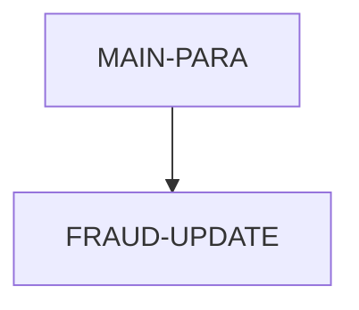

# Program COPAUS2C

| Item | Value |
|---|---|
| Source | `app/app-authorization-ims-db2-mq/cbl/COPAUS2C.cbl` |
| Lines | 244 total, 201 code, 25 comment, 18 blank |
| PROGRAM-ID | COPAUS2C |
| Author | AWS |
| Runtime | cics-online, db2 |
| Module | auth |
| CICS transactions | None in CSD |
| JCL steps | None |
| Paragraphs | 2 |
| Semantic analysis | validated (batch B01) |
| Version banner |  |

## Summary

COPAUS2C is a CICS DB2 subprogram LINKed from COPAUS1C with a commarea holding account id, customer id, a pending authorization detail record (CIPAUDTY layout) and a fraud action/status area. It stamps today's date (MM/DD/YY) into the detail's fraud report date, builds an authorization timestamp from the original authorization date and the complemented authorization time, and maps the detail into the AUTHFRDS DCLGEN host variables. It inserts a row into CARDDEMO.AUTHFRDS; on duplicate key (SQLCODE -803) it updates AUTH_FRAUD and FRAUD_RPT_DATE of the existing row instead. The outcome (S/F) and a message are returned in the commarea and control returns with CICS RETURN; commit or rollback is left to the caller. (Confirmed)

Evidence: `app/app-authorization-ims-db2-mq/cbl/COPAUS2C.cbl:65-86`, `app/app-authorization-ims-db2-mq/cbl/COPAUS2C.cbl:89-139`, `app/app-authorization-ims-db2-mq/cbl/COPAUS2C.cbl:141-220`, `app/app-authorization-ims-db2-mq/cbl/COPAUS2C.cbl:221-244`

Header comment (Unverified, `app/app-authorization-ims-db2-mq/cbl/COPAUS2C.cbl:1`): See the comment block at the top of the source. Unverified until matched to code.

## Divisions and sections

| Division / section | Lines | Notes |
|---|---|---|
| IDENTIFICATION DIVISION | `app/app-authorization-ims-db2-mq/cbl/COPAUS2C.cbl:22-25` |  |
| ENVIRONMENT DIVISION | `app/app-authorization-ims-db2-mq/cbl/COPAUS2C.cbl:26-28` |  |
| DATA DIVISION | `app/app-authorization-ims-db2-mq/cbl/COPAUS2C.cbl:29-87` |  |
| PROCEDURE DIVISION | `app/app-authorization-ims-db2-mq/cbl/COPAUS2C.cbl:88-244` |  |
| ENVIRONMENT / CONFIGURATION SECTION | `app/app-authorization-ims-db2-mq/cbl/COPAUS2C.cbl:27-28` |  |
| DATA / WORKING-STORAGE SECTION | `app/app-authorization-ims-db2-mq/cbl/COPAUS2C.cbl:30-72` |  |
| DATA / LINKAGE SECTION | `app/app-authorization-ims-db2-mq/cbl/COPAUS2C.cbl:73-87` |  |

## Files and data stores

No SELECT entries (no COBOL file I/O).

CRUD summary from the program facts:

| Store | Kind | Ops | Evidence |
|---|---|---|---|
| CARDDEMO.AUTHFRDS | logical | C, U | `app/app-authorization-ims-db2-mq/cbl/COPAUS2C.cbl:141` |

## Embedded CICS, SQL and DL/I commands

| Paragraph | Kind | Verb | Resources | Response | Lines |
|---|---|---|---|---|---|
| MAIN-PARA | CICS | ASKTIME |  | NOHANDLE | `app/app-authorization-ims-db2-mq/cbl/COPAUS2C.cbl:91-94` |
| MAIN-PARA | CICS | FORMATTIME |  | NOHANDLE | `app/app-authorization-ims-db2-mq/cbl/COPAUS2C.cbl:95-100` |
| MAIN-PARA | SQL | INSERT | CARDDEMO.AUTHFRDS |  | `app/app-authorization-ims-db2-mq/cbl/COPAUS2C.cbl:141-198` |
| MAIN-PARA | CICS | RETURN |  |  | `app/app-authorization-ims-db2-mq/cbl/COPAUS2C.cbl:218-219` |
| FRAUD-UPDATE | SQL | UPDATE | CARDDEMO.AUTHFRDS |  | `app/app-authorization-ims-db2-mq/cbl/COPAUS2C.cbl:222-229` |

## Calls, transfers and callers

No CALL, XCTL, LINK or START.

Programs that transfer to or call this program (from `docs/_work/xref/call-graph.json`):

| Caller | Mechanism | Confidence | Evidence |
|---|---|---|---|
| COPAUS1C | LINK | Confirmed | `app/app-authorization-ims-db2-mq/cbl/COPAUS1C.cbl:248` |

## Copybooks

| Copybook | Statement | Resolution | Resolved path | REPLACING | Line |
|---|---|---|---|---|---|
| SQLCA | EXEC SQL INCLUDE | system |  |  | `app/app-authorization-ims-db2-mq/cbl/COPAUS2C.cbl:65-67` |
| [AUTHFRDS](../08-data/layouts/AUTHFRDS.md) | EXEC SQL INCLUDE | inventory | app/app-authorization-ims-db2-mq/dcl/AUTHFRDS.dcl |  | `app/app-authorization-ims-db2-mq/cbl/COPAUS2C.cbl:68-70` |
| [CIPAUDTY](../08-data/layouts/CIPAUDTY.md) | COPY | inventory | app/app-authorization-ims-db2-mq/cpy/CIPAUDTY.cpy |  | `app/app-authorization-ims-db2-mq/cbl/COPAUS2C.cbl:78` |
| DFHBMSCA | COPY | system (commented out) |  |  | `app/app-authorization-ims-db2-mq/cbl/COPAUS2C.cbl:61` |

## Data division items

Every data entry coded in this source (copybook contents are on the copybook pages). Lengths are computed from PIC and USAGE.

| Section | Lvl | Name | PIC | Usage | Len | OCCURS | REDEFINES | VALUE | 88-levels | Line |
|---|---|---|---|---|---|---|---|---|---|---|
| WORKING-STORAGE | 01 | WS-VARIABLES |  |  |  |  |  |  |  | 32 |
| WORKING-STORAGE | 05 | WS-PGMNAME | X(08) |  | 8 |  |  | 'COPAUS2C' |  | 33 |
| WORKING-STORAGE | 05 | WS-LENGTH | S9(4) | COMP | 2 |  |  | ZERO |  | 34 |
| WORKING-STORAGE | 05 | WS-AUTH-TIME | 9(09) |  | 9 |  |  |  |  | 35 |
| WORKING-STORAGE | 05 | WS-AUTH-TIME-AN | X(09) |  | 9 |  | WS-AUTH-TIME |  |  | 36 |
| WORKING-STORAGE | 05 | WS-AUTH-TS |  |  |  |  |  |  |  | 38 |
| WORKING-STORAGE | 10 | WS-AUTH-YY | X(02) |  | 2 |  |  |  |  | 39 |
| WORKING-STORAGE | 10 | FILLER | X(01) |  | 1 |  |  | '-' |  | 40 |
| WORKING-STORAGE | 10 | WS-AUTH-MM | X(02) |  | 2 |  |  |  |  | 41 |
| WORKING-STORAGE | 10 | FILLER | X(01) |  | 1 |  |  | '-' |  | 42 |
| WORKING-STORAGE | 10 | WS-AUTH-DD | X(02) |  | 2 |  |  |  |  | 43 |
| WORKING-STORAGE | 10 | FILLER | X(01) |  | 1 |  |  | ' ' |  | 44 |
| WORKING-STORAGE | 10 | WS-AUTH-HH | X(02) |  | 2 |  |  |  |  | 45 |
| WORKING-STORAGE | 10 | FILLER | X(01) |  | 1 |  |  | '.' |  | 46 |
| WORKING-STORAGE | 10 | WS-AUTH-MI | X(02) |  | 2 |  |  |  |  | 47 |
| WORKING-STORAGE | 10 | FILLER | X(01) |  | 1 |  |  | '.' |  | 48 |
| WORKING-STORAGE | 10 | WS-AUTH-SS | X(02) |  | 2 |  |  |  |  | 49 |
| WORKING-STORAGE | 10 | WS-AUTH-SSS | X(03) |  | 3 |  |  |  |  | 50 |
| WORKING-STORAGE | 10 | FILLER | X(03) |  | 3 |  |  | '000' |  | 51 |
| WORKING-STORAGE | 05 | WS-ERR-FLG | X(01) |  | 1 |  |  | 'N' | ERR-FLG-ON = 'Y'; ERR-FLG-OF = 'N' | 52 |
| WORKING-STORAGE | 05 | WS-SQLCODE | +9(06) |  | 7 |  |  |  |  | 55 |
| WORKING-STORAGE | 05 | WS-SQLSTATE | +9(09) |  | 10 |  |  |  |  | 56 |
| WORKING-STORAGE | 05 | WS-ABS-TIME | S9(15) | COMP-3 | 8 |  |  | 0 |  | 58 |
| WORKING-STORAGE | 05 | WS-CUR-DATE | X(08) |  | 8 |  |  | SPACES |  | 59 |
| LINKAGE | 01 | DFHCOMMAREA |  |  |  |  |  |  |  | 74 |
| LINKAGE | 02 | WS-ACCT-ID | 9(11) |  | 11 |  |  |  |  | 75 |
| LINKAGE | 02 | WS-CUST-ID | 9(9) |  | 9 |  |  |  |  | 76 |
| LINKAGE | 02 | WS-FRAUD-AUTH-RECORD |  |  |  |  |  |  |  | 77 |
| LINKAGE | 02 | WS-FRAUD-STATUS-RECORD |  |  |  |  |  |  |  | 79 |
| LINKAGE | 05 | WS-FRD-ACTION | X(01) |  | 1 |  |  |  | WS-REPORT-FRAUD = 'F'; WS-REMOVE-FRAUD = 'R' | 80 |
| LINKAGE | 05 | WS-FRD-UPDATE-STATUS | X(01) |  | 1 |  |  |  | WS-FRD-UPDT-SUCCESS = 'S'; WS-FRD-UPDT-FAILED = 'F' | 83 |
| LINKAGE | 05 | WS-FRD-ACT-MSG | X(50) |  | 50 |  |  |  |  | 86 |

## Statement inventory

Every procedure statement the parser recorded, by kind. Each one is listed with its line under Paragraph details.

| Kind | Count |
|---|---|
| Decisions (IF, EVALUATE, WHEN, loops, handlers) | 3 |
| Calculations | 1 |
| File I/O | 0 |
| EXEC CICS / SQL / DLI | 5 |
| CALL | 0 |
| PERFORM | 1 |
| GO TO | 0 |
| MOVE literal | 2 |
| MOVE field | 38 |
| SET | 4 |
| STRING, UNSTRING, INSPECT, INITIALIZE, COPY, ENTRY and others | 2 |
| DISPLAY | 0 |
| GOBACK, STOP RUN, RETURN, XCTL | 1 |
| Not classified by the parser | 0 |

## Control flow

| Paragraph | Lines | Logic | Performs | Performed by | Reachable |
|---|---|---|---|---|---|
| [MAIN-PARA](#para-main-para) | 89-220 | Gets the current date as MM/DD/YY into PA-FRAUD-RPT-DATE, builds WS-AUTH-TS 'YY-MM-DD HH.MI.SSsss000' from PA-AUTH-ORIG-DATE and 999999999 - PA-AUTH-TIME-9C, and moves the detail fields, WS-FRD-ACTION (as AUTH-FRAUD), account and customer id to the DCLAUTHFRDS host variables. INSERTs into CARDDEMO.AUTHFRDS with FRAUD_RPT_DATE = CURRENT DATE; SQLCODE 0 returns success 'ADD SUCCESS', -803 performs FRAUD-UPDATE, any other code returns failure with ' SYSTEM ERROR DB2: CODE:...'. Ends with CICS RETURN. (Confirmed) | FRAUD-UPDATE |  | yes |
| [FRAUD-UPDATE](#para-fraud-update) | 221-244 | UPDATEs CARDDEMO.AUTHFRDS setting AUTH_FRAUD = :AUTH-FRAUD and FRAUD_RPT_DATE = CURRENT DATE for the row with the same CARD_NUM and AUTH_TS. SQLCODE 0 returns success 'UPDT SUCCESS'; otherwise failure with ' UPDT ERROR DB2: CODE:...'. (Confirmed) |  | MAIN-PARA | yes |

## Paragraph details

### Para MAIN-PARA

Lines `app/app-authorization-ims-db2-mq/cbl/COPAUS2C.cbl:89-220`. 

Logic: Gets the current date as MM/DD/YY into PA-FRAUD-RPT-DATE, builds WS-AUTH-TS 'YY-MM-DD HH.MI.SSsss000' from PA-AUTH-ORIG-DATE and 999999999 - PA-AUTH-TIME-9C, and moves the detail fields, WS-FRD-ACTION (as AUTH-FRAUD), account and customer id to the DCLAUTHFRDS host variables. INSERTs into CARDDEMO.AUTHFRDS with FRAUD_RPT_DATE = CURRENT DATE; SQLCODE 0 returns success 'ADD SUCCESS', -803 performs FRAUD-UPDATE, any other code returns failure with ' SYSTEM ERROR DB2: CODE:...'. Ends with CICS RETURN. (Confirmed)

Rules: [BR-COPAUS2C-001](../09-business-rules-catalog.md#br-copaus2c-001), [BR-COPAUS2C-002](../09-business-rules-catalog.md#br-copaus2c-002)

Statements in source order:

- EXEC CICS ASKTIME at `app/app-authorization-ims-db2-mq/cbl/COPAUS2C.cbl:91-94`
- EXEC CICS FORMATTIME at `app/app-authorization-ims-db2-mq/cbl/COPAUS2C.cbl:95-100`
- `MOVE WS-CUR-DATE TO PA-FRAUD-RPT-DATE` at `app/app-authorization-ims-db2-mq/cbl/COPAUS2C.cbl:101`
- `MOVE PA-AUTH-ORIG-DATE(1:2) TO WS-AUTH-YY` at `app/app-authorization-ims-db2-mq/cbl/COPAUS2C.cbl:103`
- `MOVE PA-AUTH-ORIG-DATE(3:2) TO WS-AUTH-MM` at `app/app-authorization-ims-db2-mq/cbl/COPAUS2C.cbl:104`
- `MOVE PA-AUTH-ORIG-DATE(5:2) TO WS-AUTH-DD` at `app/app-authorization-ims-db2-mq/cbl/COPAUS2C.cbl:105`
- Calculation `COMPUTE WS-AUTH-TIME = 999999999 - PA-AUTH-TIME-9C` at `app/app-authorization-ims-db2-mq/cbl/COPAUS2C.cbl:107` (no ROUNDED)
- `MOVE WS-AUTH-TIME-AN(1:2) TO WS-AUTH-HH` at `app/app-authorization-ims-db2-mq/cbl/COPAUS2C.cbl:108`
- `MOVE WS-AUTH-TIME-AN(3:2) TO WS-AUTH-MI` at `app/app-authorization-ims-db2-mq/cbl/COPAUS2C.cbl:109`
- `MOVE WS-AUTH-TIME-AN(5:2) TO WS-AUTH-SS` at `app/app-authorization-ims-db2-mq/cbl/COPAUS2C.cbl:110`
- `MOVE WS-AUTH-TIME-AN(7:3) TO WS-AUTH-SSS` at `app/app-authorization-ims-db2-mq/cbl/COPAUS2C.cbl:111`
- `MOVE PA-CARD-NUM TO CARD-NUM` at `app/app-authorization-ims-db2-mq/cbl/COPAUS2C.cbl:113`
- `MOVE WS-AUTH-TS TO AUTH-TS` at `app/app-authorization-ims-db2-mq/cbl/COPAUS2C.cbl:114`
- `MOVE PA-AUTH-TYPE TO AUTH-TYPE` at `app/app-authorization-ims-db2-mq/cbl/COPAUS2C.cbl:115`
- `MOVE PA-CARD-EXPIRY-DATE TO CARD-EXPIRY-DATE` at `app/app-authorization-ims-db2-mq/cbl/COPAUS2C.cbl:116`
- `MOVE PA-MESSAGE-TYPE TO MESSAGE-TYPE` at `app/app-authorization-ims-db2-mq/cbl/COPAUS2C.cbl:117`
- `MOVE PA-MESSAGE-SOURCE TO MESSAGE-SOURCE` at `app/app-authorization-ims-db2-mq/cbl/COPAUS2C.cbl:118`
- `MOVE PA-AUTH-ID-CODE TO AUTH-ID-CODE` at `app/app-authorization-ims-db2-mq/cbl/COPAUS2C.cbl:119`
- `MOVE PA-AUTH-RESP-CODE TO AUTH-RESP-CODE` at `app/app-authorization-ims-db2-mq/cbl/COPAUS2C.cbl:120`
- `MOVE PA-AUTH-RESP-REASON TO AUTH-RESP-REASON` at `app/app-authorization-ims-db2-mq/cbl/COPAUS2C.cbl:121`
- `MOVE PA-PROCESSING-CODE TO PROCESSING-CODE` at `app/app-authorization-ims-db2-mq/cbl/COPAUS2C.cbl:122`
- `MOVE PA-TRANSACTION-AMT TO TRANSACTION-AMT` at `app/app-authorization-ims-db2-mq/cbl/COPAUS2C.cbl:123`
- `MOVE PA-APPROVED-AMT TO APPROVED-AMT` at `app/app-authorization-ims-db2-mq/cbl/COPAUS2C.cbl:124`
- `MOVE PA-MERCHANT-CATAGORY-CODE TO MERCHANT-CATAGORY-CODE` at `app/app-authorization-ims-db2-mq/cbl/COPAUS2C.cbl:125-126`
- `MOVE PA-ACQR-COUNTRY-CODE TO ACQR-COUNTRY-CODE` at `app/app-authorization-ims-db2-mq/cbl/COPAUS2C.cbl:127`
- `MOVE PA-POS-ENTRY-MODE TO POS-ENTRY-MODE` at `app/app-authorization-ims-db2-mq/cbl/COPAUS2C.cbl:128`
- `MOVE PA-MERCHANT-ID TO MERCHANT-ID` at `app/app-authorization-ims-db2-mq/cbl/COPAUS2C.cbl:129`
- `MOVE LENGTH OF PA-MERCHANT-NAME TO MERCHANT-NAME-LEN` at `app/app-authorization-ims-db2-mq/cbl/COPAUS2C.cbl:130`
- `MOVE PA-MERCHANT-NAME TO MERCHANT-NAME-TEXT` at `app/app-authorization-ims-db2-mq/cbl/COPAUS2C.cbl:131`
- `MOVE PA-MERCHANT-CITY TO MERCHANT-CITY` at `app/app-authorization-ims-db2-mq/cbl/COPAUS2C.cbl:132`
- `MOVE PA-MERCHANT-STATE TO MERCHANT-STATE` at `app/app-authorization-ims-db2-mq/cbl/COPAUS2C.cbl:133`
- `MOVE PA-MERCHANT-ZIP TO MERCHANT-ZIP` at `app/app-authorization-ims-db2-mq/cbl/COPAUS2C.cbl:134`
- `MOVE PA-TRANSACTION-ID TO TRANSACTION-ID` at `app/app-authorization-ims-db2-mq/cbl/COPAUS2C.cbl:135`
- `MOVE PA-MATCH-STATUS TO MATCH-STATUS` at `app/app-authorization-ims-db2-mq/cbl/COPAUS2C.cbl:136`
- `MOVE WS-FRD-ACTION TO AUTH-FRAUD` at `app/app-authorization-ims-db2-mq/cbl/COPAUS2C.cbl:137`
- `MOVE WS-ACCT-ID TO ACCT-ID` at `app/app-authorization-ims-db2-mq/cbl/COPAUS2C.cbl:138`
- `MOVE WS-CUST-ID TO CUST-ID` at `app/app-authorization-ims-db2-mq/cbl/COPAUS2C.cbl:139`
- EXEC SQL INSERT at `app/app-authorization-ims-db2-mq/cbl/COPAUS2C.cbl:141-198`
- IF `SQLCODE = ZERO` at `app/app-authorization-ims-db2-mq/cbl/COPAUS2C.cbl:199` (io-status)
- `SET WS-FRD-UPDT-SUCCESS TO TRUE` at `app/app-authorization-ims-db2-mq/cbl/COPAUS2C.cbl:200`
- MOVE `'ADD SUCCESS'` TO WS-FRD-ACT-MSG at `app/app-authorization-ims-db2-mq/cbl/COPAUS2C.cbl:201`
- IF `SQLCODE = -803` at `app/app-authorization-ims-db2-mq/cbl/COPAUS2C.cbl:203` (io-status)
- PERFORM FRAUD-UPDATE at `app/app-authorization-ims-db2-mq/cbl/COPAUS2C.cbl:204`
- `SET WS-FRD-UPDT-FAILED TO TRUE` at `app/app-authorization-ims-db2-mq/cbl/COPAUS2C.cbl:206`
- `MOVE SQLCODE TO WS-SQLCODE` at `app/app-authorization-ims-db2-mq/cbl/COPAUS2C.cbl:208`
- `MOVE SQLSTATE TO WS-SQLSTATE` at `app/app-authorization-ims-db2-mq/cbl/COPAUS2C.cbl:209`
- `STRING ' SYSTEM ERROR DB2: CODE:' WS-SQLCODE ', STATE: ' WS-SQLSTATE DELIMITED BY SIZE INTO WS-FRD-ACT-MSG` at `app/app-authorization-ims-db2-mq/cbl/COPAUS2C.cbl:211-213`
- EXEC CICS RETURN at `app/app-authorization-ims-db2-mq/cbl/COPAUS2C.cbl:218-219`
- Ends with EXEC CICS RETURN at `app/app-authorization-ims-db2-mq/cbl/COPAUS2C.cbl:218-219`

### Para FRAUD-UPDATE

Lines `app/app-authorization-ims-db2-mq/cbl/COPAUS2C.cbl:221-244`. 

Logic: UPDATEs CARDDEMO.AUTHFRDS setting AUTH_FRAUD = :AUTH-FRAUD and FRAUD_RPT_DATE = CURRENT DATE for the row with the same CARD_NUM and AUTH_TS. SQLCODE 0 returns success 'UPDT SUCCESS'; otherwise failure with ' UPDT ERROR DB2: CODE:...'. (Confirmed)

Rules: [BR-COPAUS2C-003](../09-business-rules-catalog.md#br-copaus2c-003)

Statements in source order:

- EXEC SQL UPDATE at `app/app-authorization-ims-db2-mq/cbl/COPAUS2C.cbl:222-229`
- IF `SQLCODE = ZERO` at `app/app-authorization-ims-db2-mq/cbl/COPAUS2C.cbl:230` (io-status)
- `SET WS-FRD-UPDT-SUCCESS TO TRUE` at `app/app-authorization-ims-db2-mq/cbl/COPAUS2C.cbl:231`
- MOVE `'UPDT SUCCESS'` TO WS-FRD-ACT-MSG at `app/app-authorization-ims-db2-mq/cbl/COPAUS2C.cbl:232`
- `SET WS-FRD-UPDT-FAILED TO TRUE` at `app/app-authorization-ims-db2-mq/cbl/COPAUS2C.cbl:234`
- `MOVE SQLCODE TO WS-SQLCODE` at `app/app-authorization-ims-db2-mq/cbl/COPAUS2C.cbl:236`
- `MOVE SQLSTATE TO WS-SQLSTATE` at `app/app-authorization-ims-db2-mq/cbl/COPAUS2C.cbl:237`
- `STRING ' UPDT ERROR DB2: CODE:' WS-SQLCODE ', STATE: ' WS-SQLSTATE DELIMITED BY SIZE INTO WS-FRD-ACT-MSG` at `app/app-authorization-ims-db2-mq/cbl/COPAUS2C.cbl:239-241`

## Business rules

| Rule | Category | Statement | Paragraph | Source | Confidence |
|---|---|---|---|---|---|
| [BR-COPAUS2C-001](../09-business-rules-catalog.md#br-copaus2c-001) | data-integrity | A fraud report/removal is recorded in DB2 table AUTHFRDS as an insert of the full authorization; if a row already exists for the same card number and authorization timestamp (SQLCODE -803), only its fraud flag and fraud report date are updated. | MAIN-PARA | `app/app-authorization-ims-db2-mq/cbl/COPAUS2C.cbl:199-216`, `app/app-authorization-ims-db2-mq/cbl/COPAUS2C.cbl:141-198`, `app/app-authorization-ims-db2-mq/cbl/COPAUS2C.cbl:222-229` | Confirmed |
| [BR-COPAUS2C-002](../09-business-rules-catalog.md#br-copaus2c-002) | transformation | The DB2 authorization timestamp is built from the original authorization date (YYMMDD from the request) and the time recovered from the complemented key (999999999 - PA-AUTH-TIME-9C = HHMMSSmmm), formatted 'YY-MM-DD HH.MI.SSmmm000' and converted with TIMESTAMP_FORMAT. | MAIN-PARA | `app/app-authorization-ims-db2-mq/cbl/COPAUS2C.cbl:103-114`, `app/app-authorization-ims-db2-mq/cbl/COPAUS2C.cbl:171-172` | Confirmed |
| [BR-COPAUS2C-003](../09-business-rules-catalog.md#br-copaus2c-003) | error-policy | Any DB2 error other than duplicate key on insert, or any error on the update, is returned to the caller as failure ('F') with the SQLCODE and SQLSTATE in the message; the caller decides to roll back. | FRAUD-UPDATE | `app/app-authorization-ims-db2-mq/cbl/COPAUS2C.cbl:230-243`, `app/app-authorization-ims-db2-mq/cbl/COPAUS2C.cbl:205-214` | Confirmed |

Decision coverage: 0 of 0 business-candidate decision points are linked to a rule or a no-rule reason (0 inside rule ranges).

## Error handling

| Paragraph | Kind | Detail | Lines |
|---|---|---|---|
| MAIN-PARA | check | `SQLCODE = ZERO` | `app/app-authorization-ims-db2-mq/cbl/COPAUS2C.cbl:199` |
| MAIN-PARA | check | `SQLCODE = -803` | `app/app-authorization-ims-db2-mq/cbl/COPAUS2C.cbl:203` |
| FRAUD-UPDATE | check | `SQLCODE = ZERO` | `app/app-authorization-ims-db2-mq/cbl/COPAUS2C.cbl:230` |

## Observations and SME questions

- anomaly: AUTH_TS combines the request's original date (PA-AUTH-ORIG-DATE) with the system processing time from PA-AUTH-TIME-9C (set by COPAUA0C from CICS time), so the timestamp mixes two different clocks/dates (Inferred from COPAUA0C 871-877). (`app/app-authorization-ims-db2-mq/cbl/COPAUS2C.cbl:103-111`)
- anomaly: PA-FRAUD-RPT-DATE is set to MM/DD/YY in the commarea record, while DB2 FRAUD_RPT_DATE uses CURRENT DATE; the two dates are stored in different formats in IMS and DB2. (`app/app-authorization-ims-db2-mq/cbl/COPAUS2C.cbl:95-101`)
- unchecked-io: ASKTIME/FORMATTIME use NOHANDLE without checking the response. (`app/app-authorization-ims-db2-mq/cbl/COPAUS2C.cbl:91-100`)
- conflict: DCLGEN header names table AWSTSSC.AUTHFRDS while the declared and used table is CARDDEMO.AUTHFRDS. (`app/app-authorization-ims-db2-mq/dcl/AUTHFRDS.dcl:2`)
- dead-code: WS-LENGTH, WS-ERR-FLG and WS-PGMNAME are not used. (`app/app-authorization-ims-db2-mq/cbl/COPAUS2C.cbl:33-54`)
- SME question: Should AUTH_TS be built from a single consistent source (original request date/time or system processing date/time)? (`app/app-authorization-ims-db2-mq/cbl/COPAUS2C.cbl:103-111`)

## Sources

- `app/app-authorization-ims-db2-mq/cbl/COPAUS2C.cbl`
- `docs/_work/structure/programs/COPAUS2C.json`
- `docs/_work/semantic/programs/COPAUS2C.json`
- `docs/_work/programs/COPAUS2C.json`

## Confidence

Structure tables (divisions, items, paragraphs, statements, line numbers) are Confirmed: they are parsed from the source. Paragraph logic and rule statements carry their own Confirmed/Inferred tag from the batch analysis, and every rule anchor was checked against the cited lines. Decision-point classes are a keyword heuristic used only for coverage measurement. Header comments are Unverified.
