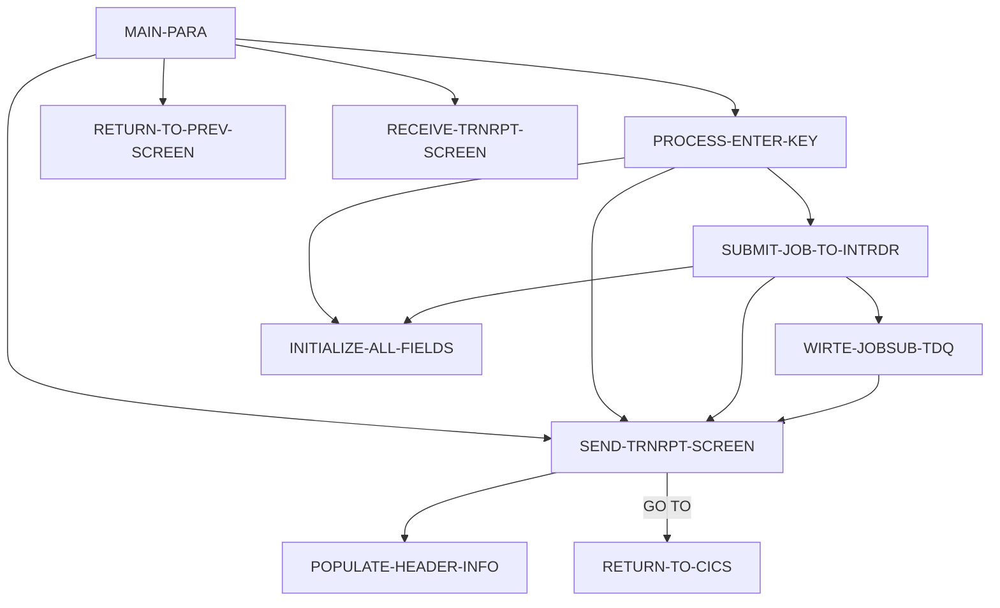

# Program CORPT00C

| Item | Value |
|---|---|
| Source | `app/cbl/CORPT00C.cbl` |
| Lines | 649 total, 498 code, 63 comment, 88 blank |
| PROGRAM-ID | CORPT00C |
| Author | AWS |
| Runtime | cics-online |
| Module | base |
| CICS transactions | CR00 (`app/csd/CARDDEMO.CSD:409-418`) |
| JCL steps | None |
| Paragraphs | 10 |
| Semantic analysis | validated (batch B06) |
| Version banner | * Ver: CardDemo_v1.0-15-g27d6c6f-68 Date: 2022-07-19 23:12:33 CDT |

## Summary

CORPT00C is a pseudo-conversational CICS program (transaction CR00, mapset CORPT00, map CORPT0A) that lets the user request a transaction report to be printed by a batch job. The user selects Monthly (current calendar month), Yearly (current calendar year) or Custom (start and end date typed on the screen); custom dates are checked for presence, numeric month/day/year ranges and calendar validity via the CSUTLDTC subprogram (LE CEEDAYS). After the user confirms with Y, the program fills the start/end dates into an in-storage JCL deck (job TRNRPT00 running procedure TRANREPT from library AWS.M2.CARDDEMO.PROC) and writes it line by line to the transient data queue JOBS. It reports 'Monthly/Yearly/Custom report submitted for printing ...' on success or 'Unable to Write TDQ (JOBS)...' on failure. PF3 returns to the main menu COMEN01C; entry without a commarea returns to the sign-on program COSGN00C. Every screen send ends the task (GO TO RETURN-TO-CICS), so the first validation error stops processing. (Confirmed)

Evidence: `app/cbl/CORPT00C.cbl:1-6`, `app/cbl/CORPT00C.cbl:81-125`, `app/cbl/CORPT00C.cbl:163-202`, `app/cbl/CORPT00C.cbl:208-456`, `app/cbl/CORPT00C.cbl:462-535`, `app/cbl/CORPT00C.cbl:556-591`

Header comment (Unverified, `app/cbl/CORPT00C.cbl:1-8`): Program     : CORPT00C.CBL Application : CardDemo Type        : CICS COBOL Program Function    : Print Transaction reports by submitting batch job from online using extra partition TDQ. All Rights Reserved.

## Divisions and sections

| Division / section | Lines | Notes |
|---|---|---|
| IDENTIFICATION DIVISION | `app/cbl/CORPT00C.cbl:23-26` |  |
| ENVIRONMENT DIVISION | `app/cbl/CORPT00C.cbl:27-29` |  |
| DATA DIVISION | `app/cbl/CORPT00C.cbl:30-161` |  |
| PROCEDURE DIVISION | `app/cbl/CORPT00C.cbl:162-649` |  |
| ENVIRONMENT / CONFIGURATION SECTION | `app/cbl/CORPT00C.cbl:28-29` |  |
| DATA / WORKING-STORAGE SECTION | `app/cbl/CORPT00C.cbl:34-153` |  |
| DATA / LINKAGE SECTION | `app/cbl/CORPT00C.cbl:154-161` |  |

## Files and data stores

No SELECT entries (no COBOL file I/O).

CRUD summary from the program facts:

| Store | Kind | Ops | Evidence |
|---|---|---|---|
| JOBS | cics-td-queue | C | `app/cbl/CORPT00C.cbl:517` |

## Embedded CICS, SQL and DL/I commands

| Paragraph | Kind | Verb | Resources | Response | Lines |
|---|---|---|---|---|---|
| MAIN-PARA | CICS | RETURN | TRANSID(WS-TRANID) |  | `app/cbl/CORPT00C.cbl:199-202` |
| WIRTE-JOBSUB-TDQ | CICS | WRITEQ TD | QUEUE('JOBS') | RESP | `app/cbl/CORPT00C.cbl:517-523` |
| RETURN-TO-PREV-SCREEN | CICS | XCTL | PROGRAM(CDEMO-TO-PROGRAM) |  | `app/cbl/CORPT00C.cbl:548-551` |
| SEND-TRNRPT-SCREEN | CICS | SEND MAP | MAP('CORPT0A'), MAPSET('CORPT00') |  | `app/cbl/CORPT00C.cbl:563-569` |
| SEND-TRNRPT-SCREEN | CICS | SEND MAP | MAP('CORPT0A'), MAPSET('CORPT00') |  | `app/cbl/CORPT00C.cbl:571-577` |
| RETURN-TO-CICS | CICS | RETURN | TRANSID(WS-TRANID) |  | `app/cbl/CORPT00C.cbl:587-591` |
| RECEIVE-TRNRPT-SCREEN | CICS | RECEIVE MAP | MAP('CORPT0A'), MAPSET('CORPT00') | RESP | `app/cbl/CORPT00C.cbl:598-604` |

## Calls, transfers and callers

| Mechanism | Target | Parameters | Paragraph | Lines |
|---|---|---|---|---|
| EXEC CICS RETURN | WS-TRANID = CR00 | CARDDEMO-COMMAREA | MAIN-PARA | `app/cbl/CORPT00C.cbl:199-202` |
| CALL static | CSUTLDTC | CSUTLDTC-DATE, CSUTLDTC-DATE-FORMAT, CSUTLDTC-RESULT | PROCESS-ENTER-KEY | `app/cbl/CORPT00C.cbl:392-394` |
| CALL static | CSUTLDTC | CSUTLDTC-DATE, CSUTLDTC-DATE-FORMAT, CSUTLDTC-RESULT | PROCESS-ENTER-KEY | `app/cbl/CORPT00C.cbl:412-414` |
| EXEC CICS XCTL | CDEMO-TO-PROGRAM = COMEN01C, COSGN00C | CARDDEMO-COMMAREA | RETURN-TO-PREV-SCREEN | `app/cbl/CORPT00C.cbl:548-551` |
| EXEC CICS RETURN | WS-TRANID = CR00 | CARDDEMO-COMMAREA | RETURN-TO-CICS | `app/cbl/CORPT00C.cbl:587-591` |

Programs that transfer to or call this program (from `docs/_work/xref/call-graph.json`):

| Caller | Mechanism | Confidence | Evidence |
|---|---|---|---|
| COMEN01C | XCTL | Confirmed | `app/cbl/COMEN01C.cbl:185` |

## Copybooks

| Copybook | Statement | Resolution | Resolved path | REPLACING | Line |
|---|---|---|---|---|---|
| [COCOM01Y](../08-data/layouts/COCOM01Y.md) | COPY | inventory | app/cpy/COCOM01Y.cpy |  | `app/cbl/CORPT00C.cbl:138` |
| CORPT00 | COPY | inventory | app/cpy-bms/CORPT00.CPY |  | `app/cbl/CORPT00C.cbl:140` |
| [COTTL01Y](../08-data/layouts/COTTL01Y.md) | COPY | inventory | app/cpy/COTTL01Y.cpy |  | `app/cbl/CORPT00C.cbl:142` |
| [CSDAT01Y](../08-data/layouts/CSDAT01Y.md) | COPY | inventory | app/cpy/CSDAT01Y.cpy |  | `app/cbl/CORPT00C.cbl:143` |
| [CSMSG01Y](../08-data/layouts/CSMSG01Y.md) | COPY | inventory | app/cpy/CSMSG01Y.cpy |  | `app/cbl/CORPT00C.cbl:144` |
| [CVTRA05Y](../08-data/layouts/CVTRA05Y.md) | COPY | inventory | app/cpy/CVTRA05Y.cpy |  | `app/cbl/CORPT00C.cbl:146` |
| DFHAID | COPY | system |  |  | `app/cbl/CORPT00C.cbl:148` |
| DFHBMSCA | COPY | system |  |  | `app/cbl/CORPT00C.cbl:149` |

## Data division items

Every data entry coded in this source (copybook contents are on the copybook pages). Lengths are computed from PIC and USAGE.

| Section | Lvl | Name | PIC | Usage | Len | OCCURS | REDEFINES | VALUE | 88-levels | Line |
|---|---|---|---|---|---|---|---|---|---|---|
| WORKING-STORAGE | 01 | WS-VARIABLES |  |  |  |  |  |  |  | 36 |
| WORKING-STORAGE | 05 | WS-PGMNAME | X(08) |  | 8 |  |  | 'CORPT00C' |  | 37 |
| WORKING-STORAGE | 05 | WS-TRANID | X(04) |  | 4 |  |  | 'CR00' |  | 38 |
| WORKING-STORAGE | 05 | WS-MESSAGE | X(80) |  | 80 |  |  | SPACES |  | 39 |
| WORKING-STORAGE | 05 | WS-TRANSACT-FILE | X(08) |  | 8 |  |  | 'TRANSACT' |  | 40 |
| WORKING-STORAGE | 05 | WS-ERR-FLG | X(01) |  | 1 |  |  | 'N' | ERR-FLG-ON = 'Y'; ERR-FLG-OFF = 'N' | 41 |
| WORKING-STORAGE | 05 | WS-TRANSACT-EOF | X(01) |  | 1 |  |  | 'N' | TRANSACT-EOF = 'Y'; TRANSACT-NOT-EOF = 'N' | 44 |
| WORKING-STORAGE | 05 | WS-SEND-ERASE-FLG | X(01) |  | 1 |  |  | 'Y' | SEND-ERASE-YES = 'Y'; SEND-ERASE-NO = 'N' | 47 |
| WORKING-STORAGE | 05 | WS-END-LOOP | X(01) |  | 1 |  |  | 'N' | END-LOOP-YES = 'Y'; END-LOOP-NO = 'N' | 50 |
| WORKING-STORAGE | 05 | WS-RESP-CD | S9(09) | COMP | 4 |  |  | ZEROS |  | 54 |
| WORKING-STORAGE | 05 | WS-REAS-CD | S9(09) | COMP | 4 |  |  | ZEROS |  | 55 |
| WORKING-STORAGE | 05 | WS-REC-COUNT | S9(04) | COMP | 2 |  |  | ZEROS |  | 56 |
| WORKING-STORAGE | 05 | WS-IDX | S9(04) | COMP | 2 |  |  | ZEROS |  | 57 |
| WORKING-STORAGE | 05 | WS-REPORT-NAME | X(10) |  | 10 |  |  | SPACES |  | 58 |
| WORKING-STORAGE | 05 | WS-START-DATE |  |  |  |  |  |  |  | 60 |
| WORKING-STORAGE | 10 | WS-START-DATE-YYYY | X(04) |  | 4 |  |  | SPACES |  | 61 |
| WORKING-STORAGE | 10 | FILLER | X(01) |  | 1 |  |  | '-' |  | 62 |
| WORKING-STORAGE | 10 | WS-START-DATE-MM | X(02) |  | 2 |  |  | SPACES |  | 63 |
| WORKING-STORAGE | 10 | FILLER | X(01) |  | 1 |  |  | '-' |  | 64 |
| WORKING-STORAGE | 10 | WS-START-DATE-DD | X(02) |  | 2 |  |  | SPACES |  | 65 |
| WORKING-STORAGE | 05 | WS-END-DATE |  |  |  |  |  |  |  | 66 |
| WORKING-STORAGE | 10 | WS-END-DATE-YYYY | X(04) |  | 4 |  |  | SPACES |  | 67 |
| WORKING-STORAGE | 10 | FILLER | X(01) |  | 1 |  |  | '-' |  | 68 |
| WORKING-STORAGE | 10 | WS-END-DATE-MM | X(02) |  | 2 |  |  | SPACES |  | 69 |
| WORKING-STORAGE | 10 | FILLER | X(01) |  | 1 |  |  | '-' |  | 70 |
| WORKING-STORAGE | 10 | WS-END-DATE-DD | X(02) |  | 2 |  |  | SPACES |  | 71 |
| WORKING-STORAGE | 05 | WS-DATE-FORMAT | X(10) |  | 10 |  |  | 'YYYY-MM-DD' |  | 72 |
| WORKING-STORAGE | 05 | WS-NUM-99 | 99 |  | 2 |  |  | 0 |  | 74 |
| WORKING-STORAGE | 05 | WS-NUM-9999 | 9999 |  | 4 |  |  | 0 |  | 75 |
| WORKING-STORAGE | 05 | WS-TRAN-AMT | +99999999.99 |  | 12 |  |  |  |  | 77 |
| WORKING-STORAGE | 05 | WS-TRAN-DATE | X(08) |  | 8 |  |  | '00/00/00' |  | 78 |
| WORKING-STORAGE | 05 | JCL-RECORD | X(80) |  | 80 |  |  | ' ' |  | 79 |
| WORKING-STORAGE | 01 | JOB-DATA |  |  |  |  |  |  |  | 81 |
| WORKING-STORAGE | 02 | JOB-DATA-1 |  |  |  |  |  |  |  | 82 |
| WORKING-STORAGE | 05 | FILLER | X(80) |  | 80 |  |  | "//TRNRPT00 JOB 'TRAN REPORT',CLASS=A,MSGCLASS=0," |  | 83 |
| WORKING-STORAGE | 05 | FILLER | X(80) |  | 80 |  |  | "// NOTIFY=&SYSUID" |  | 85 |
| WORKING-STORAGE | 05 | FILLER | X(80) |  | 80 |  |  | "//*" |  | 87 |
| WORKING-STORAGE | 05 | FILLER | X(80) |  | 80 |  |  | "//JOBLIB JCLLIB ORDER=('AWS.M2.CARDDEMO.PROC')" |  | 89 |
| WORKING-STORAGE | 05 | FILLER | X(80) |  | 80 |  |  | "//*" |  | 91 |
| WORKING-STORAGE | 05 | FILLER | X(80) |  | 80 |  |  | "//STEP10 EXEC PROC=TRANREPT" |  | 93 |
| WORKING-STORAGE | 05 | FILLER | X(80) |  | 80 |  |  | "//*" |  | 95 |
| WORKING-STORAGE | 05 | FILLER | X(80) |  | 80 |  |  | "//STEP05R.SYMNAMES DD *" |  | 97 |
| WORKING-STORAGE | 05 | FILLER | X(80) |  | 80 |  |  | "TRAN-CARD-NUM,263,16,ZD" |  | 99 |
| WORKING-STORAGE | 05 | FILLER | X(80) |  | 80 |  |  | "TRAN-PROC-DT,305,10,CH" |  | 101 |
| WORKING-STORAGE | 05 | FILLER-1 |  |  |  |  |  |  |  | 103 |
| WORKING-STORAGE | 10 | FILLER | X(18) |  | 18 |  |  | "PARM-START-DATE,C'" |  | 104 |
| WORKING-STORAGE | 10 | PARM-START-DATE-1 | X(10) |  | 10 |  |  | SPACES |  | 106 |
| WORKING-STORAGE | 10 | FILLER | X(52) |  | 52 |  |  | "'" |  | 107 |
| WORKING-STORAGE | 05 | FILLER-2 |  |  |  |  |  |  |  | 108 |
| WORKING-STORAGE | 10 | FILLER | X(16) |  | 16 |  |  | "PARM-END-DATE,C'" |  | 109 |
| WORKING-STORAGE | 10 | PARM-END-DATE-1 | X(10) |  | 10 |  |  | SPACES |  | 111 |
| WORKING-STORAGE | 10 | FILLER | X(54) |  | 54 |  |  | "'" |  | 112 |
| WORKING-STORAGE | 05 | FILLER | X(80) |  | 80 |  |  | "/*" |  | 113 |
| WORKING-STORAGE | 05 | FILLER | X(80) |  | 80 |  |  | "//STEP10R.DATEPARM DD *" |  | 115 |
| WORKING-STORAGE | 05 | FILLER-3 |  |  |  |  |  |  |  | 117 |
| WORKING-STORAGE | 10 | PARM-START-DATE-2 | X(10) |  | 10 |  |  | SPACES |  | 118 |
| WORKING-STORAGE | 10 | FILLER | X |  | 1 |  |  | SPACE |  | 119 |
| WORKING-STORAGE | 10 | PARM-END-DATE-2 | X(10) |  | 10 |  |  | SPACES |  | 120 |
| WORKING-STORAGE | 10 | FILLER | X(59) |  | 59 |  |  | SPACES |  | 121 |
| WORKING-STORAGE | 05 | FILLER | X(80) |  | 80 |  |  | "/*" |  | 122 |
| WORKING-STORAGE | 05 | FILLER | X(80) |  | 80 |  |  | "/*EOF" |  | 124 |
| WORKING-STORAGE | 02 | JOB-DATA-2 |  |  |  |  | JOB-DATA-1 |  |  | 126 |
| WORKING-STORAGE | 05 | JOB-LINES | X(80) |  | 80 | 1000 |  |  |  | 127 |
| WORKING-STORAGE | 01 | CSUTLDTC-PARM |  |  |  |  |  |  |  | 129 |
| WORKING-STORAGE | 05 | CSUTLDTC-DATE | X(10) |  | 10 |  |  |  |  | 130 |
| WORKING-STORAGE | 05 | CSUTLDTC-DATE-FORMAT | X(10) |  | 10 |  |  |  |  | 131 |
| WORKING-STORAGE | 05 | CSUTLDTC-RESULT |  |  |  |  |  |  |  | 132 |
| WORKING-STORAGE | 10 | CSUTLDTC-RESULT-SEV-CD | X(04) |  | 4 |  |  |  |  | 133 |
| WORKING-STORAGE | 10 | FILLER | X(11) |  | 11 |  |  |  |  | 134 |
| WORKING-STORAGE | 10 | CSUTLDTC-RESULT-MSG-NUM | X(04) |  | 4 |  |  |  |  | 135 |
| WORKING-STORAGE | 10 | CSUTLDTC-RESULT-MSG | X(61) |  | 61 |  |  |  |  | 136 |
| LINKAGE | 01 | DFHCOMMAREA |  |  |  |  |  |  |  | 155 |
| LINKAGE | 05 | LK-COMMAREA | X(01) |  | 1 | 1 TO 32767 DEPENDING ON EIBCALEN |  |  |  | 156 |

## Statement inventory

Every procedure statement the parser recorded, by kind. Each one is listed with its line under Paragraph details.

| Kind | Count |
|---|---|
| Decisions (IF, EVALUATE, WHEN, loops, handlers) | 45 |
| Calculations | 9 |
| File I/O | 0 |
| EXEC CICS / SQL / DLI | 7 |
| CALL | 2 |
| PERFORM | 34 |
| GO TO | 1 |
| MOVE literal | 70 |
| MOVE field | 55 |
| SET | 6 |
| STRING, UNSTRING, INSPECT, INITIALIZE, COPY, ENTRY and others | 4 |
| DISPLAY | 2 |
| GOBACK, STOP RUN, RETURN, XCTL | 3 |
| Not classified by the parser | 0 |

## Control flow

| Paragraph | Lines | Logic | Performs | Performed by | Reachable |
|---|---|---|---|---|---|
| [MAIN-PARA](#para-main-para) | 163-202 | Resets the error, EOF and erase flags and clears the message. With EIBCALEN 0 it XCTLs to COSGN00C; otherwise it loads CARDDEMO-COMMAREA and on first entry sets CDEMO-PGM-REENTER and sends an empty screen. On re-entry it receives the map and evaluates EIBAID: ENTER -> PROCESS-ENTER-KEY, PF3 -> XCTL to COMEN01C, other keys -> 'Invalid key pressed. Please see below...'. It ends with CICS RETURN TRANSID(CR00). (Confirmed) | PROCESS-ENTER-KEY, RECEIVE-TRNRPT-SCREEN, RETURN-TO-PREV-SCREEN, SEND-TRNRPT-SCREEN |  | yes |
| [PROCESS-ENTER-KEY](#para-process-enter-key) | 208-456 | Determines the report period from the first non-blank selection field: Monthly (first to last day of the current month), Yearly (01-01 to 12-31 of the current year) or Custom (screen dates, which must be present, numeric, month <= 12, day <= 31 and valid per CSUTLDTC). Dates are moved into PARM-START/END-DATE-1/2 of the JCL deck and SUBMIT-JOB-TO-INTRDR is performed; no selection gives 'Select a report type to print report...'. If no error, the fields are cleared and '<name> report submitted for printing ...' is shown in green. (Confirmed) | INITIALIZE-ALL-FIELDS, SEND-TRNRPT-SCREEN, SUBMIT-JOB-TO-INTRDR | MAIN-PARA | yes |
| [SUBMIT-JOB-TO-INTRDR](#para-submit-job-to-intrdr) | 462-510 | Requires the CONFIRM field: blank asks 'Please confirm to print the <name> report...'; 'N'/'n' clears the fields and redisplays; any value other than 'Y'/'y' gives '"<value>" is not a valid value to confirm...'. When confirmed it loops over JOB-LINES (max 1000), moving each to JCL-RECORD and writing it to the TDQ until a line equal to '/*EOF', spaces or low-values has been written. (Confirmed) | INITIALIZE-ALL-FIELDS, SEND-TRNRPT-SCREEN, WIRTE-JOBSUB-TDQ | PROCESS-ENTER-KEY | yes |
| [WIRTE-JOBSUB-TDQ](#para-wirte-jobsub-tdq) | 515-535 | Writes the 80-byte JCL-RECORD to transient data queue 'JOBS'. A non-NORMAL response DISPLAYs RESP/RESP2, sets the error flag and sends 'Unable to Write TDQ (JOBS)...'. (Confirmed) | SEND-TRNRPT-SCREEN | SUBMIT-JOB-TO-INTRDR | yes |
| [RETURN-TO-PREV-SCREEN](#para-return-to-prev-screen) | 540-551 | Defaults CDEMO-TO-PROGRAM to COSGN00C when blank, records CR00/CORPT00C as the from-transaction/program, zeroes CDEMO-PGM-CONTEXT and XCTLs to CDEMO-TO-PROGRAM with the commarea. (Confirmed) |  | MAIN-PARA | yes |
| [SEND-TRNRPT-SCREEN](#para-send-trnrpt-screen) | 556-580 | Fills the header, moves WS-MESSAGE to ERRMSGO and sends map CORPT0A (with ERASE when SEND-ERASE-YES, which is always set), then GO TO RETURN-TO-CICS so the task ends immediately after any screen send. (Confirmed) | POPULATE-HEADER-INFO | MAIN-PARA, PROCESS-ENTER-KEY, SUBMIT-JOB-TO-INTRDR, WIRTE-JOBSUB-TDQ | yes |
| [RETURN-TO-CICS](#para-return-to-cics) | 585-591 | Issues CICS RETURN TRANSID(CR00) with CARDDEMO-COMMAREA to wait for the next user input. (Confirmed) |  | SEND-TRNRPT-SCREEN | yes |
| [RECEIVE-TRNRPT-SCREEN](#para-receive-trnrpt-screen) | 596-604 | Receives map CORPT0A of mapset CORPT00 into CORPT0AI; RESP/RESP2 are captured but not tested. (Confirmed) |  | MAIN-PARA | yes |
| [POPULATE-HEADER-INFO](#para-populate-header-info) | 609-628 | Moves FUNCTION CURRENT-DATE to WS-CURDATE-DATA, CCDA-TITLE01/CCDA-TITLE02 to TITLE01O/TITLE02O, WS-TRANID to TRNNAMEO and WS-PGMNAME to PGMNAMEO of CORPT0AO; rebuilds the date as WS-CURDATE-MM-DD-YY (MM/DD/YY from WS-CURDATE-MONTH, WS-CURDATE-DAY, WS-CURDATE-YEAR(3:2)) into CURDATEO and the time as WS-CURTIME-HH-MM-SS into CURTIMEO. (Confirmed) |  | SEND-TRNRPT-SCREEN | yes |
| [INITIALIZE-ALL-FIELDS](#para-initialize-all-fields) | 633-646 | Puts the cursor on the Monthly field and initializes all selection, date and confirm input fields and WS-MESSAGE. (Confirmed) |  | PROCESS-ENTER-KEY, SUBMIT-JOB-TO-INTRDR | yes |

## Paragraph details

### Para MAIN-PARA

Lines `app/cbl/CORPT00C.cbl:163-202`. 

Logic: Resets the error, EOF and erase flags and clears the message. With EIBCALEN 0 it XCTLs to COSGN00C; otherwise it loads CARDDEMO-COMMAREA and on first entry sets CDEMO-PGM-REENTER and sends an empty screen. On re-entry it receives the map and evaluates EIBAID: ENTER -> PROCESS-ENTER-KEY, PF3 -> XCTL to COMEN01C, other keys -> 'Invalid key pressed. Please see below...'. It ends with CICS RETURN TRANSID(CR00). (Confirmed)

Rules: [BR-CORPT00C-001](../09-business-rules-catalog.md#br-corpt00c-001)

Statements in source order:

- `SET ERR-FLG-OFF TO TRUE` at `app/cbl/CORPT00C.cbl:165`
- `SET TRANSACT-NOT-EOF TO TRUE` at `app/cbl/CORPT00C.cbl:166`
- `SET SEND-ERASE-YES TO TRUE` at `app/cbl/CORPT00C.cbl:167`
- `MOVE SPACES TO WS-MESSAGE ERRMSGO OF CORPT0AO` at `app/cbl/CORPT00C.cbl:169-170`
- IF `EIBCALEN = 0` at `app/cbl/CORPT00C.cbl:172` (pseudo-conversation)
- MOVE `'COSGN00C'` TO CDEMO-TO-PROGRAM at `app/cbl/CORPT00C.cbl:173`
- PERFORM RETURN-TO-PREV-SCREEN at `app/cbl/CORPT00C.cbl:174`
- `MOVE DFHCOMMAREA(1:EIBCALEN) TO CARDDEMO-COMMAREA` at `app/cbl/CORPT00C.cbl:176`
- IF `NOT CDEMO-PGM-REENTER` at `app/cbl/CORPT00C.cbl:177` (pseudo-conversation)
- `SET CDEMO-PGM-REENTER TO TRUE` at `app/cbl/CORPT00C.cbl:178`
- `MOVE LOW-VALUES TO CORPT0AO` at `app/cbl/CORPT00C.cbl:179`
- MOVE `-1` TO MONTHLYL OF CORPT0AI at `app/cbl/CORPT00C.cbl:180`
- PERFORM SEND-TRNRPT-SCREEN at `app/cbl/CORPT00C.cbl:181`
- PERFORM RECEIVE-TRNRPT-SCREEN at `app/cbl/CORPT00C.cbl:183`
- EVALUATE `EIBAID` at `app/cbl/CORPT00C.cbl:184` (screen-key)
- WHEN `DFHENTER` at `app/cbl/CORPT00C.cbl:185` (screen-key)
- PERFORM PROCESS-ENTER-KEY at `app/cbl/CORPT00C.cbl:186`
- WHEN `DFHPF3` at `app/cbl/CORPT00C.cbl:187` (screen-key)
- MOVE `'COMEN01C'` TO CDEMO-TO-PROGRAM at `app/cbl/CORPT00C.cbl:188`
- PERFORM RETURN-TO-PREV-SCREEN at `app/cbl/CORPT00C.cbl:189`
- WHEN `OTHER` at `app/cbl/CORPT00C.cbl:190` (screen-key)
- MOVE `'Y'` TO WS-ERR-FLG at `app/cbl/CORPT00C.cbl:191`
- MOVE `-1` TO MONTHLYL OF CORPT0AI at `app/cbl/CORPT00C.cbl:192`
- `MOVE CCDA-MSG-INVALID-KEY TO WS-MESSAGE` at `app/cbl/CORPT00C.cbl:193`
- PERFORM SEND-TRNRPT-SCREEN at `app/cbl/CORPT00C.cbl:194`
- EXEC CICS RETURN at `app/cbl/CORPT00C.cbl:199-202`
- Ends with EXEC CICS RETURN at `app/cbl/CORPT00C.cbl:199-202`

### Para PROCESS-ENTER-KEY

Lines `app/cbl/CORPT00C.cbl:208-456`. 

Logic: Determines the report period from the first non-blank selection field: Monthly (first to last day of the current month), Yearly (01-01 to 12-31 of the current year) or Custom (screen dates, which must be present, numeric, month <= 12, day <= 31 and valid per CSUTLDTC). Dates are moved into PARM-START/END-DATE-1/2 of the JCL deck and SUBMIT-JOB-TO-INTRDR is performed; no selection gives 'Select a report type to print report...'. If no error, the fields are cleared and '<name> report submitted for printing ...' is shown in green. (Confirmed)

Rules: [BR-CORPT00C-002](../09-business-rules-catalog.md#br-corpt00c-002), [BR-CORPT00C-003](../09-business-rules-catalog.md#br-corpt00c-003), [BR-CORPT00C-004](../09-business-rules-catalog.md#br-corpt00c-004), [BR-CORPT00C-005](../09-business-rules-catalog.md#br-corpt00c-005), [BR-CORPT00C-006](../09-business-rules-catalog.md#br-corpt00c-006), [BR-CORPT00C-007](../09-business-rules-catalog.md#br-corpt00c-007), [BR-CORPT00C-008](../09-business-rules-catalog.md#br-corpt00c-008)

Statements in source order:

- `DISPLAY 'PROCESS ENTER KEY'` at `app/cbl/CORPT00C.cbl:210`
- EVALUATE `TRUE` at `app/cbl/CORPT00C.cbl:212` (business-candidate)
- WHEN `MONTHLYI OF CORPT0AI NOT = SPACES AND LOW-VALUES` at `app/cbl/CORPT00C.cbl:213` (business-candidate)
- MOVE `'Monthly'` TO WS-REPORT-NAME at `app/cbl/CORPT00C.cbl:214`
- `MOVE FUNCTION CURRENT-DATE TO WS-CURDATE-DATA` at `app/cbl/CORPT00C.cbl:215`
- `MOVE WS-CURDATE-YEAR TO WS-START-DATE-YYYY` at `app/cbl/CORPT00C.cbl:217`
- `MOVE WS-CURDATE-MONTH TO WS-START-DATE-MM` at `app/cbl/CORPT00C.cbl:218`
- MOVE `'01'` TO WS-START-DATE-DD at `app/cbl/CORPT00C.cbl:219`
- `MOVE WS-START-DATE TO PARM-START-DATE-1 PARM-START-DATE-2` at `app/cbl/CORPT00C.cbl:220-221`
- MOVE `1` TO WS-CURDATE-DAY at `app/cbl/CORPT00C.cbl:223`
- Calculation `ADD 1 TO WS-CURDATE-MONTH` at `app/cbl/CORPT00C.cbl:224`
- IF `WS-CURDATE-MONTH > 12` at `app/cbl/CORPT00C.cbl:225` (business-candidate)
- Calculation `ADD 1 TO WS-CURDATE-YEAR` at `app/cbl/CORPT00C.cbl:226`
- MOVE `1` TO WS-CURDATE-MONTH at `app/cbl/CORPT00C.cbl:227`
- Calculation `COMPUTE WS-CURDATE-N = FUNCTION DATE-OF-INTEGER( FUNCTION INTEGER-OF-DATE(WS-CURDATE-N) - 1)` at `app/cbl/CORPT00C.cbl:229-230` (no ROUNDED)
- `MOVE WS-CURDATE-YEAR TO WS-END-DATE-YYYY` at `app/cbl/CORPT00C.cbl:232`
- `MOVE WS-CURDATE-MONTH TO WS-END-DATE-MM` at `app/cbl/CORPT00C.cbl:233`
- `MOVE WS-CURDATE-DAY TO WS-END-DATE-DD` at `app/cbl/CORPT00C.cbl:234`
- `MOVE WS-END-DATE TO PARM-END-DATE-1 PARM-END-DATE-2` at `app/cbl/CORPT00C.cbl:235-236`
- PERFORM SUBMIT-JOB-TO-INTRDR at `app/cbl/CORPT00C.cbl:238`
- WHEN `YEARLYI OF CORPT0AI NOT = SPACES AND LOW-VALUES` at `app/cbl/CORPT00C.cbl:239` (business-candidate)
- MOVE `'Yearly'` TO WS-REPORT-NAME at `app/cbl/CORPT00C.cbl:240`
- `MOVE FUNCTION CURRENT-DATE TO WS-CURDATE-DATA` at `app/cbl/CORPT00C.cbl:241`
- `MOVE WS-CURDATE-YEAR TO WS-START-DATE-YYYY WS-END-DATE-YYYY` at `app/cbl/CORPT00C.cbl:243-244`
- MOVE `'01'` TO WS-START-DATE-MM WS-START-DATE-DD at `app/cbl/CORPT00C.cbl:245-246`
- `MOVE WS-START-DATE TO PARM-START-DATE-1 PARM-START-DATE-2` at `app/cbl/CORPT00C.cbl:247-248`
- MOVE `'12'` TO WS-END-DATE-MM at `app/cbl/CORPT00C.cbl:250`
- MOVE `'31'` TO WS-END-DATE-DD at `app/cbl/CORPT00C.cbl:251`
- `MOVE WS-END-DATE TO PARM-END-DATE-1 PARM-END-DATE-2` at `app/cbl/CORPT00C.cbl:252-253`
- PERFORM SUBMIT-JOB-TO-INTRDR at `app/cbl/CORPT00C.cbl:255`
- WHEN `CUSTOMI OF CORPT0AI NOT = SPACES AND LOW-VALUES` at `app/cbl/CORPT00C.cbl:256` (business-candidate)
- EVALUATE `TRUE` at `app/cbl/CORPT00C.cbl:258` (business-candidate)
- WHEN `SDTMMI OF CORPT0AI = SPACES OR LOW-VALUES` at `app/cbl/CORPT00C.cbl:259-260` (business-candidate)
- MOVE `'Start Date - Month can NOT be empty...'` TO WS-MESSAGE at `app/cbl/CORPT00C.cbl:261-262`
- MOVE `'Y'` TO WS-ERR-FLG at `app/cbl/CORPT00C.cbl:263`
- MOVE `-1` TO SDTMML OF CORPT0AI at `app/cbl/CORPT00C.cbl:264`
- PERFORM SEND-TRNRPT-SCREEN at `app/cbl/CORPT00C.cbl:265`
- WHEN `SDTDDI OF CORPT0AI = SPACES OR LOW-VALUES` at `app/cbl/CORPT00C.cbl:266-267` (business-candidate)
- MOVE `'Start Date - Day can NOT be empty...'` TO WS-MESSAGE at `app/cbl/CORPT00C.cbl:268-269`
- MOVE `'Y'` TO WS-ERR-FLG at `app/cbl/CORPT00C.cbl:270`
- MOVE `-1` TO SDTDDL OF CORPT0AI at `app/cbl/CORPT00C.cbl:271`
- PERFORM SEND-TRNRPT-SCREEN at `app/cbl/CORPT00C.cbl:272`
- WHEN `SDTYYYYI OF CORPT0AI = SPACES OR LOW-VALUES` at `app/cbl/CORPT00C.cbl:273-274` (business-candidate)
- MOVE `'Start Date - Year can NOT be empty...'` TO WS-MESSAGE at `app/cbl/CORPT00C.cbl:275-276`
- MOVE `'Y'` TO WS-ERR-FLG at `app/cbl/CORPT00C.cbl:277`
- MOVE `-1` TO SDTYYYYL OF CORPT0AI at `app/cbl/CORPT00C.cbl:278`
- PERFORM SEND-TRNRPT-SCREEN at `app/cbl/CORPT00C.cbl:279`
- WHEN `EDTMMI OF CORPT0AI = SPACES OR LOW-VALUES` at `app/cbl/CORPT00C.cbl:280-281` (business-candidate)
- MOVE `'End Date - Month can NOT be empty...'` TO WS-MESSAGE at `app/cbl/CORPT00C.cbl:282-283`
- MOVE `'Y'` TO WS-ERR-FLG at `app/cbl/CORPT00C.cbl:284`
- MOVE `-1` TO EDTMML OF CORPT0AI at `app/cbl/CORPT00C.cbl:285`
- PERFORM SEND-TRNRPT-SCREEN at `app/cbl/CORPT00C.cbl:286`
- WHEN `EDTDDI OF CORPT0AI = SPACES OR LOW-VALUES` at `app/cbl/CORPT00C.cbl:287-288` (business-candidate)
- MOVE `'End Date - Day can NOT be empty...'` TO WS-MESSAGE at `app/cbl/CORPT00C.cbl:289-290`
- MOVE `'Y'` TO WS-ERR-FLG at `app/cbl/CORPT00C.cbl:291`
- MOVE `-1` TO EDTDDL OF CORPT0AI at `app/cbl/CORPT00C.cbl:292`
- PERFORM SEND-TRNRPT-SCREEN at `app/cbl/CORPT00C.cbl:293`
- WHEN `EDTYYYYI OF CORPT0AI = SPACES OR LOW-VALUES` at `app/cbl/CORPT00C.cbl:294-295` (business-candidate)
- MOVE `'End Date - Year can NOT be empty...'` TO WS-MESSAGE at `app/cbl/CORPT00C.cbl:296-297`
- MOVE `'Y'` TO WS-ERR-FLG at `app/cbl/CORPT00C.cbl:298`
- MOVE `-1` TO EDTYYYYL OF CORPT0AI at `app/cbl/CORPT00C.cbl:299`
- PERFORM SEND-TRNRPT-SCREEN at `app/cbl/CORPT00C.cbl:300`
- WHEN `OTHER` at `app/cbl/CORPT00C.cbl:301` (business-candidate)
- Calculation `COMPUTE WS-NUM-99 = FUNCTION NUMVAL-C (SDTMMI OF CORPT0AI)` at `app/cbl/CORPT00C.cbl:305-306` (no ROUNDED)
- `MOVE WS-NUM-99 TO SDTMMI OF CORPT0AI` at `app/cbl/CORPT00C.cbl:307`
- Calculation `COMPUTE WS-NUM-99 = FUNCTION NUMVAL-C (SDTDDI OF CORPT0AI)` at `app/cbl/CORPT00C.cbl:309-310` (no ROUNDED)
- `MOVE WS-NUM-99 TO SDTDDI OF CORPT0AI` at `app/cbl/CORPT00C.cbl:311`
- Calculation `COMPUTE WS-NUM-9999 = FUNCTION NUMVAL-C (SDTYYYYI OF CORPT0AI)` at `app/cbl/CORPT00C.cbl:313-314` (no ROUNDED)
- `MOVE WS-NUM-9999 TO SDTYYYYI OF CORPT0AI` at `app/cbl/CORPT00C.cbl:315`
- Calculation `COMPUTE WS-NUM-99 = FUNCTION NUMVAL-C (EDTMMI OF CORPT0AI)` at `app/cbl/CORPT00C.cbl:317-318` (no ROUNDED)
- `MOVE WS-NUM-99 TO EDTMMI OF CORPT0AI` at `app/cbl/CORPT00C.cbl:319`
- Calculation `COMPUTE WS-NUM-99 = FUNCTION NUMVAL-C (EDTDDI OF CORPT0AI)` at `app/cbl/CORPT00C.cbl:321-322` (no ROUNDED)
- `MOVE WS-NUM-99 TO EDTDDI OF CORPT0AI` at `app/cbl/CORPT00C.cbl:323`
- Calculation `COMPUTE WS-NUM-9999 = FUNCTION NUMVAL-C (EDTYYYYI OF CORPT0AI)` at `app/cbl/CORPT00C.cbl:325-326` (no ROUNDED)
- `MOVE WS-NUM-9999 TO EDTYYYYI OF CORPT0AI` at `app/cbl/CORPT00C.cbl:327`
- IF `SDTMMI OF CORPT0AI IS NOT NUMERIC OR SDTMMI OF CORPT0AI > '12'` at `app/cbl/CORPT00C.cbl:329-330` (business-candidate)
- MOVE `'Start Date - Not a valid Month...'` TO WS-MESSAGE at `app/cbl/CORPT00C.cbl:331-332`
- MOVE `'Y'` TO WS-ERR-FLG at `app/cbl/CORPT00C.cbl:333`
- MOVE `-1` TO SDTMML OF CORPT0AI at `app/cbl/CORPT00C.cbl:334`
- PERFORM SEND-TRNRPT-SCREEN at `app/cbl/CORPT00C.cbl:335`
- IF `SDTDDI OF CORPT0AI IS NOT NUMERIC OR SDTDDI OF CORPT0AI > '31'` at `app/cbl/CORPT00C.cbl:338-339` (business-candidate)
- MOVE `'Start Date - Not a valid Day...'` TO WS-MESSAGE at `app/cbl/CORPT00C.cbl:340-341`
- MOVE `'Y'` TO WS-ERR-FLG at `app/cbl/CORPT00C.cbl:342`
- MOVE `-1` TO SDTDDL OF CORPT0AI at `app/cbl/CORPT00C.cbl:343`
- PERFORM SEND-TRNRPT-SCREEN at `app/cbl/CORPT00C.cbl:344`
- IF `SDTYYYYI OF CORPT0AI IS NOT NUMERIC` at `app/cbl/CORPT00C.cbl:347` (business-candidate)
- MOVE `'Start Date - Not a valid Year...'` TO WS-MESSAGE at `app/cbl/CORPT00C.cbl:348-349`
- MOVE `'Y'` TO WS-ERR-FLG at `app/cbl/CORPT00C.cbl:350`
- MOVE `-1` TO SDTYYYYL OF CORPT0AI at `app/cbl/CORPT00C.cbl:351`
- PERFORM SEND-TRNRPT-SCREEN at `app/cbl/CORPT00C.cbl:352`
- IF `EDTMMI OF CORPT0AI IS NOT NUMERIC OR EDTMMI OF CORPT0AI > '12'` at `app/cbl/CORPT00C.cbl:355-356` (business-candidate)
- MOVE `'End Date - Not a valid Month...'` TO WS-MESSAGE at `app/cbl/CORPT00C.cbl:357-358`
- MOVE `'Y'` TO WS-ERR-FLG at `app/cbl/CORPT00C.cbl:359`
- MOVE `-1` TO EDTMML OF CORPT0AI at `app/cbl/CORPT00C.cbl:360`
- PERFORM SEND-TRNRPT-SCREEN at `app/cbl/CORPT00C.cbl:361`
- IF `EDTDDI OF CORPT0AI IS NOT NUMERIC OR EDTDDI OF CORPT0AI > '31'` at `app/cbl/CORPT00C.cbl:364-365` (business-candidate)
- MOVE `'End Date - Not a valid Day...'` TO WS-MESSAGE at `app/cbl/CORPT00C.cbl:366-367`
- MOVE `'Y'` TO WS-ERR-FLG at `app/cbl/CORPT00C.cbl:368`
- MOVE `-1` TO EDTDDL OF CORPT0AI at `app/cbl/CORPT00C.cbl:369`
- PERFORM SEND-TRNRPT-SCREEN at `app/cbl/CORPT00C.cbl:370`
- IF `EDTYYYYI OF CORPT0AI IS NOT NUMERIC` at `app/cbl/CORPT00C.cbl:373` (business-candidate)
- MOVE `'End Date - Not a valid Year...'` TO WS-MESSAGE at `app/cbl/CORPT00C.cbl:374-375`
- MOVE `'Y'` TO WS-ERR-FLG at `app/cbl/CORPT00C.cbl:376`
- MOVE `-1` TO EDTYYYYL OF CORPT0AI at `app/cbl/CORPT00C.cbl:377`
- PERFORM SEND-TRNRPT-SCREEN at `app/cbl/CORPT00C.cbl:378`
- `MOVE SDTYYYYI OF CORPT0AI TO WS-START-DATE-YYYY` at `app/cbl/CORPT00C.cbl:381`
- `MOVE SDTMMI OF CORPT0AI TO WS-START-DATE-MM` at `app/cbl/CORPT00C.cbl:382`
- `MOVE SDTDDI OF CORPT0AI TO WS-START-DATE-DD` at `app/cbl/CORPT00C.cbl:383`
- `MOVE EDTYYYYI OF CORPT0AI TO WS-END-DATE-YYYY` at `app/cbl/CORPT00C.cbl:384`
- `MOVE EDTMMI OF CORPT0AI TO WS-END-DATE-MM` at `app/cbl/CORPT00C.cbl:385`
- `MOVE EDTDDI OF CORPT0AI TO WS-END-DATE-DD` at `app/cbl/CORPT00C.cbl:386`
- `MOVE WS-START-DATE TO CSUTLDTC-DATE` at `app/cbl/CORPT00C.cbl:388`
- `MOVE WS-DATE-FORMAT TO CSUTLDTC-DATE-FORMAT` at `app/cbl/CORPT00C.cbl:389`
- `MOVE SPACES TO CSUTLDTC-RESULT` at `app/cbl/CORPT00C.cbl:390`
- CALL CSUTLDTC at `app/cbl/CORPT00C.cbl:392-394`
- IF `CSUTLDTC-RESULT-SEV-CD = '0000'` at `app/cbl/CORPT00C.cbl:396` (business-candidate)
- IF `CSUTLDTC-RESULT-MSG-NUM NOT = '2513'` at `app/cbl/CORPT00C.cbl:399` (business-candidate)
- MOVE `'Start Date - Not a valid date...'` TO WS-MESSAGE at `app/cbl/CORPT00C.cbl:400-401`
- MOVE `'Y'` TO WS-ERR-FLG at `app/cbl/CORPT00C.cbl:402`
- MOVE `-1` TO SDTMML OF CORPT0AI at `app/cbl/CORPT00C.cbl:403`
- PERFORM SEND-TRNRPT-SCREEN at `app/cbl/CORPT00C.cbl:404`
- `MOVE WS-END-DATE TO CSUTLDTC-DATE` at `app/cbl/CORPT00C.cbl:408`
- `MOVE WS-DATE-FORMAT TO CSUTLDTC-DATE-FORMAT` at `app/cbl/CORPT00C.cbl:409`
- `MOVE SPACES TO CSUTLDTC-RESULT` at `app/cbl/CORPT00C.cbl:410`
- CALL CSUTLDTC at `app/cbl/CORPT00C.cbl:412-414`
- IF `CSUTLDTC-RESULT-SEV-CD = '0000'` at `app/cbl/CORPT00C.cbl:416` (business-candidate)
- IF `CSUTLDTC-RESULT-MSG-NUM NOT = '2513'` at `app/cbl/CORPT00C.cbl:419` (business-candidate)
- MOVE `'End Date - Not a valid date...'` TO WS-MESSAGE at `app/cbl/CORPT00C.cbl:420-421`
- MOVE `'Y'` TO WS-ERR-FLG at `app/cbl/CORPT00C.cbl:422`
- MOVE `-1` TO EDTMML OF CORPT0AI at `app/cbl/CORPT00C.cbl:423`
- PERFORM SEND-TRNRPT-SCREEN at `app/cbl/CORPT00C.cbl:424`
- `MOVE WS-START-DATE TO PARM-START-DATE-1 PARM-START-DATE-2` at `app/cbl/CORPT00C.cbl:429-430`
- `MOVE WS-END-DATE TO PARM-END-DATE-1 PARM-END-DATE-2` at `app/cbl/CORPT00C.cbl:431-432`
- MOVE `'Custom'` TO WS-REPORT-NAME at `app/cbl/CORPT00C.cbl:433`
- IF `NOT ERR-FLG-ON` at `app/cbl/CORPT00C.cbl:434` (error-flag)
- PERFORM SUBMIT-JOB-TO-INTRDR at `app/cbl/CORPT00C.cbl:435`
- WHEN `OTHER` at `app/cbl/CORPT00C.cbl:437` (business-candidate)
- MOVE `'Select a report type to print report...'` TO WS-MESSAGE at `app/cbl/CORPT00C.cbl:438-439`
- MOVE `'Y'` TO WS-ERR-FLG at `app/cbl/CORPT00C.cbl:440`
- MOVE `-1` TO MONTHLYL OF CORPT0AI at `app/cbl/CORPT00C.cbl:441`
- PERFORM SEND-TRNRPT-SCREEN at `app/cbl/CORPT00C.cbl:442`
- IF `NOT ERR-FLG-ON` at `app/cbl/CORPT00C.cbl:445` (error-flag)
- PERFORM INITIALIZE-ALL-FIELDS at `app/cbl/CORPT00C.cbl:447`
- `MOVE DFHGREEN TO ERRMSGC OF CORPT0AO` at `app/cbl/CORPT00C.cbl:448`
- `STRING WS-REPORT-NAME DELIMITED BY SPACE ' report submitted for printing ...' DELIMITED BY SIZE INTO WS-MESSAGE` at `app/cbl/CORPT00C.cbl:449-452`
- MOVE `-1` TO MONTHLYL OF CORPT0AI at `app/cbl/CORPT00C.cbl:453`
- PERFORM SEND-TRNRPT-SCREEN at `app/cbl/CORPT00C.cbl:454`

### Para SUBMIT-JOB-TO-INTRDR

Lines `app/cbl/CORPT00C.cbl:462-510`. 

Logic: Requires the CONFIRM field: blank asks 'Please confirm to print the <name> report...'; 'N'/'n' clears the fields and redisplays; any value other than 'Y'/'y' gives '"<value>" is not a valid value to confirm...'. When confirmed it loops over JOB-LINES (max 1000), moving each to JCL-RECORD and writing it to the TDQ until a line equal to '/*EOF', spaces or low-values has been written. (Confirmed)

Rules: [BR-CORPT00C-009](../09-business-rules-catalog.md#br-corpt00c-009), [BR-CORPT00C-010](../09-business-rules-catalog.md#br-corpt00c-010)

Statements in source order:

- IF `CONFIRMI OF CORPT0AI = SPACES OR LOW-VALUES` at `app/cbl/CORPT00C.cbl:464` (business-candidate)
- `STRING 'Please confirm to print the ' DELIMITED BY SIZE WS-REPORT-NAME DELIMITED BY SPACE ' report...' DELIMITED BY SIZE INTO WS-MESSAGE` at `app/cbl/CORPT00C.cbl:465-470`
- MOVE `'Y'` TO WS-ERR-FLG at `app/cbl/CORPT00C.cbl:471`
- MOVE `-1` TO CONFIRML OF CORPT0AI at `app/cbl/CORPT00C.cbl:472`
- PERFORM SEND-TRNRPT-SCREEN at `app/cbl/CORPT00C.cbl:473`
- IF `NOT ERR-FLG-ON` at `app/cbl/CORPT00C.cbl:476` (error-flag)
- EVALUATE `TRUE` at `app/cbl/CORPT00C.cbl:477` (business-candidate)
- WHEN `CONFIRMI OF CORPT0AI = 'Y' OR 'y'` at `app/cbl/CORPT00C.cbl:478` (business-candidate)
- WHEN `CONFIRMI OF CORPT0AI = 'N' OR 'n'` at `app/cbl/CORPT00C.cbl:480` (business-candidate)
- PERFORM INITIALIZE-ALL-FIELDS at `app/cbl/CORPT00C.cbl:481`
- MOVE `'Y'` TO WS-ERR-FLG at `app/cbl/CORPT00C.cbl:482`
- PERFORM SEND-TRNRPT-SCREEN at `app/cbl/CORPT00C.cbl:483`
- WHEN `OTHER` at `app/cbl/CORPT00C.cbl:484` (business-candidate)
- `STRING '"' DELIMITED BY SIZE CONFIRMI OF CORPT0AI DELIMITED BY SPACE '" is not a valid value to confirm...' DELIMITED BY SIZE INTO WS-MESSAGE` at `app/cbl/CORPT00C.cbl:485-490`
- MOVE `'Y'` TO WS-ERR-FLG at `app/cbl/CORPT00C.cbl:491`
- MOVE `-1` TO CONFIRML OF CORPT0AI at `app/cbl/CORPT00C.cbl:492`
- PERFORM SEND-TRNRPT-SCREEN at `app/cbl/CORPT00C.cbl:493`
- `SET END-LOOP-NO TO TRUE` at `app/cbl/CORPT00C.cbl:496`
- LOOP `VARYING WS-IDX FROM 1 BY 1 UNTIL WS-IDX > 1000 OR END-LOOP-YES OR ERR-FLG-ON` at `app/cbl/CORPT00C.cbl:498-499` (error-flag)
- Inline PERFORM `VARYING WS-IDX FROM 1 BY 1 UNTIL WS-IDX > 1000 OR END-LOOP-YES OR ERR-FLG-ON` at `app/cbl/CORPT00C.cbl:498-499`
- `MOVE JOB-LINES(WS-IDX) TO JCL-RECORD` at `app/cbl/CORPT00C.cbl:501`
- IF `JCL-RECORD = '/*EOF' OR JCL-RECORD = SPACES OR LOW-VALUES` at `app/cbl/CORPT00C.cbl:502-503` (io-status)
- `SET END-LOOP-YES TO TRUE` at `app/cbl/CORPT00C.cbl:504`
- PERFORM WIRTE-JOBSUB-TDQ at `app/cbl/CORPT00C.cbl:507`

### Para WIRTE-JOBSUB-TDQ

Lines `app/cbl/CORPT00C.cbl:515-535`. 

Logic: Writes the 80-byte JCL-RECORD to transient data queue 'JOBS'. A non-NORMAL response DISPLAYs RESP/RESP2, sets the error flag and sends 'Unable to Write TDQ (JOBS)...'. (Confirmed)

Rules: [BR-CORPT00C-011](../09-business-rules-catalog.md#br-corpt00c-011)

Statements in source order:

- EXEC CICS WRITEQ TD at `app/cbl/CORPT00C.cbl:517-523`
- EVALUATE `WS-RESP-CD` at `app/cbl/CORPT00C.cbl:525` (io-status)
- WHEN `DFHRESP(NORMAL)` at `app/cbl/CORPT00C.cbl:526` (io-status)
- WHEN `OTHER` at `app/cbl/CORPT00C.cbl:528` (io-status)
- `DISPLAY 'RESP:' WS-RESP-CD 'REAS:' WS-REAS-CD` at `app/cbl/CORPT00C.cbl:529`
- MOVE `'Y'` TO WS-ERR-FLG at `app/cbl/CORPT00C.cbl:530`
- MOVE `'Unable to Write TDQ (JOBS)...'` TO WS-MESSAGE at `app/cbl/CORPT00C.cbl:531-532`
- MOVE `-1` TO MONTHLYL OF CORPT0AI at `app/cbl/CORPT00C.cbl:533`
- PERFORM SEND-TRNRPT-SCREEN at `app/cbl/CORPT00C.cbl:534`

### Para RETURN-TO-PREV-SCREEN

Lines `app/cbl/CORPT00C.cbl:540-551`. 

Logic: Defaults CDEMO-TO-PROGRAM to COSGN00C when blank, records CR00/CORPT00C as the from-transaction/program, zeroes CDEMO-PGM-CONTEXT and XCTLs to CDEMO-TO-PROGRAM with the commarea. (Confirmed)

Rules: [BR-CORPT00C-012](../09-business-rules-catalog.md#br-corpt00c-012)

Statements in source order:

- IF `CDEMO-TO-PROGRAM = LOW-VALUES OR SPACES` at `app/cbl/CORPT00C.cbl:542` (business-candidate)
- MOVE `'COSGN00C'` TO CDEMO-TO-PROGRAM at `app/cbl/CORPT00C.cbl:543`
- `MOVE WS-TRANID TO CDEMO-FROM-TRANID` at `app/cbl/CORPT00C.cbl:545`
- `MOVE WS-PGMNAME TO CDEMO-FROM-PROGRAM` at `app/cbl/CORPT00C.cbl:546`
- `MOVE ZEROS TO CDEMO-PGM-CONTEXT` at `app/cbl/CORPT00C.cbl:547`
- EXEC CICS XCTL at `app/cbl/CORPT00C.cbl:548-551`
- Ends with EXEC CICS XCTL at `app/cbl/CORPT00C.cbl:548-551`

### Para SEND-TRNRPT-SCREEN

Lines `app/cbl/CORPT00C.cbl:556-580`. 

Logic: Fills the header, moves WS-MESSAGE to ERRMSGO and sends map CORPT0A (with ERASE when SEND-ERASE-YES, which is always set), then GO TO RETURN-TO-CICS so the task ends immediately after any screen send. (Confirmed)

Statements in source order:

- PERFORM POPULATE-HEADER-INFO at `app/cbl/CORPT00C.cbl:558`
- `MOVE WS-MESSAGE TO ERRMSGO OF CORPT0AO` at `app/cbl/CORPT00C.cbl:560`
- IF `SEND-ERASE-YES` at `app/cbl/CORPT00C.cbl:562` (business-candidate)
- EXEC CICS SEND MAP at `app/cbl/CORPT00C.cbl:563-569`
- EXEC CICS SEND MAP at `app/cbl/CORPT00C.cbl:571-577`
- GO TO RETURN-TO-CICS at `app/cbl/CORPT00C.cbl:580`

### Para RETURN-TO-CICS

Lines `app/cbl/CORPT00C.cbl:585-591`. 

Logic: Issues CICS RETURN TRANSID(CR00) with CARDDEMO-COMMAREA to wait for the next user input. (Confirmed)

Statements in source order:

- EXEC CICS RETURN at `app/cbl/CORPT00C.cbl:587-591`
- Ends with EXEC CICS RETURN at `app/cbl/CORPT00C.cbl:587-591`

### Para RECEIVE-TRNRPT-SCREEN

Lines `app/cbl/CORPT00C.cbl:596-604`. 

Logic: Receives map CORPT0A of mapset CORPT00 into CORPT0AI; RESP/RESP2 are captured but not tested. (Confirmed)

Statements in source order:

- EXEC CICS RECEIVE MAP at `app/cbl/CORPT00C.cbl:598-604`

### Para POPULATE-HEADER-INFO

Lines `app/cbl/CORPT00C.cbl:609-628`. 

Logic: Moves FUNCTION CURRENT-DATE to WS-CURDATE-DATA, CCDA-TITLE01/CCDA-TITLE02 to TITLE01O/TITLE02O, WS-TRANID to TRNNAMEO and WS-PGMNAME to PGMNAMEO of CORPT0AO; rebuilds the date as WS-CURDATE-MM-DD-YY (MM/DD/YY from WS-CURDATE-MONTH, WS-CURDATE-DAY, WS-CURDATE-YEAR(3:2)) into CURDATEO and the time as WS-CURTIME-HH-MM-SS into CURTIMEO. (Confirmed)

Statements in source order:

- `MOVE FUNCTION CURRENT-DATE TO WS-CURDATE-DATA` at `app/cbl/CORPT00C.cbl:611`
- `MOVE CCDA-TITLE01 TO TITLE01O OF CORPT0AO` at `app/cbl/CORPT00C.cbl:613`
- `MOVE CCDA-TITLE02 TO TITLE02O OF CORPT0AO` at `app/cbl/CORPT00C.cbl:614`
- `MOVE WS-TRANID TO TRNNAMEO OF CORPT0AO` at `app/cbl/CORPT00C.cbl:615`
- `MOVE WS-PGMNAME TO PGMNAMEO OF CORPT0AO` at `app/cbl/CORPT00C.cbl:616`
- `MOVE WS-CURDATE-MONTH TO WS-CURDATE-MM` at `app/cbl/CORPT00C.cbl:618`
- `MOVE WS-CURDATE-DAY TO WS-CURDATE-DD` at `app/cbl/CORPT00C.cbl:619`
- `MOVE WS-CURDATE-YEAR(3:2) TO WS-CURDATE-YY` at `app/cbl/CORPT00C.cbl:620`
- `MOVE WS-CURDATE-MM-DD-YY TO CURDATEO OF CORPT0AO` at `app/cbl/CORPT00C.cbl:622`
- `MOVE WS-CURTIME-HOURS TO WS-CURTIME-HH` at `app/cbl/CORPT00C.cbl:624`
- `MOVE WS-CURTIME-MINUTE TO WS-CURTIME-MM` at `app/cbl/CORPT00C.cbl:625`
- `MOVE WS-CURTIME-SECOND TO WS-CURTIME-SS` at `app/cbl/CORPT00C.cbl:626`
- `MOVE WS-CURTIME-HH-MM-SS TO CURTIMEO OF CORPT0AO` at `app/cbl/CORPT00C.cbl:628`

### Para INITIALIZE-ALL-FIELDS

Lines `app/cbl/CORPT00C.cbl:633-646`. 

Logic: Puts the cursor on the Monthly field and initializes all selection, date and confirm input fields and WS-MESSAGE. (Confirmed)

Statements in source order:

- MOVE `-1` TO MONTHLYL OF CORPT0AI at `app/cbl/CORPT00C.cbl:635`
- `INITIALIZE MONTHLYI OF CORPT0AI YEARLYI OF CORPT0AI CUSTOMI OF CORPT0AI SDTMMI OF CORPT0AI SDTDDI OF CORPT0AI SDTYYYYI OF CORPT0AI EDTMMI OF CORPT0AI EDTDDI OF` at `app/cbl/CORPT00C.cbl:636-646`

## Business rules

| Rule | Category | Statement | Paragraph | Source | Confidence |
|---|---|---|---|---|---|
| [BR-CORPT00C-001](../09-business-rules-catalog.md#br-corpt00c-001) | routing | Without a commarea the program returns to the sign-on program COSGN00C. On first entry it shows the report selection screen; afterwards ENTER processes the request, PF3 returns to the main menu COMEN01C and any other key shows 'Invalid key pressed. Please see below...'. | MAIN-PARA | `app/cbl/CORPT00C.cbl:172-196`, `app/cpy/CSMSG01Y.cpy:20-21` | Confirmed |
| [BR-CORPT00C-002](../09-business-rules-catalog.md#br-corpt00c-002) | calculation | Monthly report: the reporting period runs from the first day of the current month (YYYY-MM-01) to the last day of the current month, computed as the day before the first day of the next month (with year roll-over after December). | PROCESS-ENTER-KEY | `app/cbl/CORPT00C.cbl:212-237` | Confirmed |
| [BR-CORPT00C-003](../09-business-rules-catalog.md#br-corpt00c-003) | calculation | Yearly report: the reporting period is January 1 to December 31 of the current year. It applies only when Monthly is not selected. | PROCESS-ENTER-KEY | `app/cbl/CORPT00C.cbl:239-254` | Confirmed |
| [BR-CORPT00C-004](../09-business-rules-catalog.md#br-corpt00c-004) | validation | Custom report: start month, start day, start year, end month, end day and end year are all required, checked in that order; the first empty one is reported ('Start Date - Month can NOT be empty...' etc.) and processing stops. | PROCESS-ENTER-KEY | `app/cbl/CORPT00C.cbl:256-303` | Confirmed |
| [BR-CORPT00C-005](../09-business-rules-catalog.md#br-corpt00c-005) | validation | Custom report dates: each part is converted with NUMVAL-C; month must be numeric and not greater than 12, day numeric and not greater than 31, and year numeric, for both start and end date; the first failure is reported ('Start Date - Not a valid Month...' etc.). | PROCESS-ENTER-KEY | `app/cbl/CORPT00C.cbl:304-378` | Confirmed |
| [BR-CORPT00C-006](../09-business-rules-catalog.md#br-corpt00c-006) | validation | Custom start and end dates (YYYY-MM-DD) must be valid calendar dates according to CSUTLDTC/CEEDAYS. A non-zero severity is rejected ('Start Date - Not a valid date...' / 'End Date - Not a valid date...') except when the CEEDAYS message number is 2513, which is accepted. | PROCESS-ENTER-KEY | `app/cbl/CORPT00C.cbl:386-426`, `app/cbl/CSUTLDTC.cbl:62-70` | Confirmed |
| [BR-CORPT00C-007](../09-business-rules-catalog.md#br-corpt00c-007) | decision | A custom report is submitted only when no validation error was raised; on success of any report the selection fields are cleared and '<Monthly\|Yearly\|Custom> report submitted for printing ...' is shown in green. | PROCESS-ENTER-KEY | `app/cbl/CORPT00C.cbl:429-455` | Confirmed |
| [BR-CORPT00C-008](../09-business-rules-catalog.md#br-corpt00c-008) | validation | If none of Monthly, Yearly or Custom is selected, the request is rejected with 'Select a report type to print report...'. The selection fields are evaluated in priority order Monthly, Yearly, Custom. | PROCESS-ENTER-KEY | `app/cbl/CORPT00C.cbl:437-442` | Confirmed |
| [BR-CORPT00C-009](../09-business-rules-catalog.md#br-corpt00c-009) | validation | The report job is submitted only after explicit confirmation: a blank CONFIRM field asks 'Please confirm to print the <name> report...'; 'N' or 'n' cancels and clears the screen; any value other than 'Y'/'y'/'N'/'n' is rejected with '"<value>" is not a valid value to confirm...'. | SUBMIT-JOB-TO-INTRDR | `app/cbl/CORPT00C.cbl:464-493` | Confirmed |
| [BR-CORPT00C-010](../09-business-rules-catalog.md#br-corpt00c-010) | transformation | Job submission: the in-storage JCL deck (job TRNRPT00, JCLLIB AWS.M2.CARDDEMO.PROC, EXEC PROC=TRANREPT, SYMNAMES TRAN-CARD-NUM,263,16,ZD and TRAN-PROC-DT,305,10,CH, PARM-START-DATE/PARM-END-DATE symbols and a DATEPARM card with start and end date) is written one 80-byte line at a time to TDQ 'JOBS', up to and including the first line that is '/*EOF', spaces or low-values (maximum 1000 lines) or until an error occurs. | SUBMIT-JOB-TO-INTRDR | `app/cbl/CORPT00C.cbl:496-508`, `app/cbl/CORPT00C.cbl:81-127`, `app/cbl/CORPT00C.cbl:515-523` | Confirmed |
| [BR-CORPT00C-011](../09-business-rules-catalog.md#br-corpt00c-011) | error-policy | If any write to TDQ 'JOBS' fails, the RESP/RESP2 codes are DISPLAYed, the error flag is set and 'Unable to Write TDQ (JOBS)...' is shown; lines already written are not removed. | WIRTE-JOBSUB-TDQ | `app/cbl/CORPT00C.cbl:524-535` | Confirmed |
| [BR-CORPT00C-012](../09-business-rules-catalog.md#br-corpt00c-012) | routing | When returning to a previous screen and no target program is set, the sign-on program COSGN00C is used. | RETURN-TO-PREV-SCREEN | `app/cbl/CORPT00C.cbl:542-551` | Confirmed |

Decision points reviewed and classified as not business rules:

| Lines | Reason |
|---|---|
| `app/cbl/CORPT00C.cbl:562-578` | Technical: choose SEND MAP with or without ERASE; SEND-ERASE-YES is always set at entry. |

Decision coverage: 31 of 31 business-candidate decision points are linked to a rule or a no-rule reason (30 inside rule ranges).

## Error handling

| Paragraph | Kind | Detail | Lines |
|---|---|---|---|
| SUBMIT-JOB-TO-INTRDR | check | `JCL-RECORD = '/*EOF' OR JCL-RECORD = SPACES OR LOW-VALUES` | `app/cbl/CORPT00C.cbl:502-503` |
| WIRTE-JOBSUB-TDQ | check | `WS-RESP-CD` | `app/cbl/CORPT00C.cbl:525` |
| WIRTE-JOBSUB-TDQ | check | `DFHRESP(NORMAL)` | `app/cbl/CORPT00C.cbl:526` |
| WIRTE-JOBSUB-TDQ | check | `OTHER` | `app/cbl/CORPT00C.cbl:528` |

## Observations and SME questions

- anomaly: SEND-TRNRPT-SCREEN always ends with GO TO RETURN-TO-CICS, so every PERFORM of it terminates the task; the later 'IF NOT ERR-FLG-ON' tests only matter on paths where no screen was sent. Error handling depends on this implicit exit. (`app/cbl/CORPT00C.cbl:556-580`)
- anomaly: The IS NOT NUMERIC checks run after each date part has been converted with NUMVAL-C and moved back from a PIC 99/9999 field, so they can no longer detect non-numeric input; invalid characters are left to NUMVAL-C, whose result for invalid input is not defined (Inferred). (`app/cbl/CORPT00C.cbl:304-378`)
- anomaly: CEEDAYS message number 2513 (X'09D1', FC-UNSUPP-RANGE in CSUTLDTC) is accepted as a valid date, so dates outside the CEEDAYS supported range pass validation. (`app/cbl/CORPT00C.cbl:396-406`)
- anomaly: There is no check that the custom start date is on or before the end date. (`app/cbl/CORPT00C.cbl:380-436`)
- anomaly: JOB-LINES OCCURS 1000 TIMES redefines JOB-DATA-1, which holds only 17 80-byte lines; the loop relies on the '/*EOF' terminator to avoid reading beyond the deck. (`app/cbl/CORPT00C.cbl:126-127`)
- hardcoded-value: JCL is hardcoded: job TRNRPT00 CLASS=A MSGCLASS=0, NOTIFY=&SYSUID (symbolic left for JES, not resolved here), JCLLIB AWS.M2.CARDDEMO.PROC, PROC TRANREPT, step overrides STEP05R.SYMNAMES and STEP10R.DATEPARM. (`app/cbl/CORPT00C.cbl:81-125`)
- hardcoded-value: SYMNAMES offsets TRAN-CARD-NUM,263,16 and TRAN-PROC-DT,305,10 are hardcoded; they match TRAN-CARD-NUM (bytes 263-278) and the date part of TRAN-PROC-TS (from byte 305) in CVTRA05Y, so a record layout change would silently break the report. (`app/cbl/CORPT00C.cbl:99-102`)
- hardcoded-value: TDQ name 'JOBS' is hardcoded; that it is an extrapartition queue routed to the JES internal reader is stated only in the header comment (Unverified, depends on the CICS DCT/TDQUEUE definition). (`app/cbl/CORPT00C.cbl:517-518`)
- security: No user-type or authorization check is made before submitting the batch job; any user who can run CR00 can submit the report job. (`app/cbl/CORPT00C.cbl:462-510`)
- dead-code: WS-TRANSACT-FILE, TRANSACT-EOF, WS-REC-COUNT, WS-TRAN-AMT, WS-TRAN-DATE and the CVTRA05Y record are declared but not used; SEND without ERASE branch is unreachable. (`app/cbl/CORPT00C.cbl:40-78`)
- anomaly: DISPLAY statements are used in a CICS program (output goes to the CICS job log). (`app/cbl/CORPT00C.cbl:210`)
- unchecked-io: RECEIVE MAP RESP/RESP2 are captured but never tested. (`app/cbl/CORPT00C.cbl:598-604`)
- SME question: Why is CEEDAYS message 2513 (unsupported date range) treated as a valid date for the custom report dates? (`app/cbl/CORPT00C.cbl:399`)
- SME question: Should the custom report reject an end date earlier than the start date? (`app/cbl/CORPT00C.cbl:380-385`)
- SME question: Confirm that TDQ 'JOBS' is defined as an extrapartition queue to the JES internal reader in the target CICS region, and how &SYSUID is resolved for jobs submitted from CICS. (`app/cbl/CORPT00C.cbl:515-523`)
- SME question: Should report submission be restricted by user type (admin vs regular user)? (`app/cbl/CORPT00C.cbl:462-510`)

## Sources

- `app/cbl/CORPT00C.cbl`
- `docs/_work/structure/programs/CORPT00C.json`
- `docs/_work/semantic/programs/CORPT00C.json`
- `docs/_work/programs/CORPT00C.json`

## Confidence

Structure tables (divisions, items, paragraphs, statements, line numbers) are Confirmed: they are parsed from the source. Paragraph logic and rule statements carry their own Confirmed/Inferred tag from the batch analysis, and every rule anchor was checked against the cited lines. Decision-point classes are a keyword heuristic used only for coverage measurement. Header comments are Unverified.
