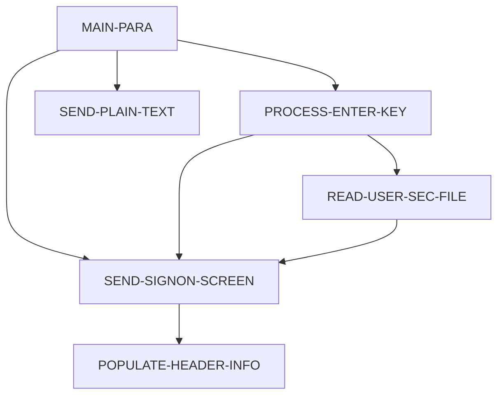

# Program COSGN00C

| Item | Value |
|---|---|
| Source | `app/cbl/COSGN00C.cbl` |
| Lines | 260 total, 172 code, 49 comment, 39 blank |
| PROGRAM-ID | COSGN00C |
| Author | AWS |
| Runtime | cics-online |
| Module | base |
| CICS transactions | CC00 (`app/csd/CARDDEMO.CSD:378-387`) |
| JCL steps | None |
| Paragraphs | 6 |
| Semantic analysis | validated (batch B05) |
| Version banner | * Ver: CardDemo_v1.0-15-g27d6c6f-68 Date: 2022-07-19 23:12:33 CDT |

## Summary

COSGN00C is the CICS pseudo-conversational sign-on program of CardDemo (transaction CC00). On first entry (EIBCALEN = 0) it sends a blank sign-on map COSGN0A (mapset COSGN00); on ENTER it receives the user id and password, requires both to be non-blank, upper-cases them and reads the user-security VSAM file USRSEC keyed by user id. When the stored password SEC-USR-PWD equals the entered password, it fills the CARDDEMO-COMMAREA (from-tranid, from-program, user id, user type, context 0) and XCTLs to the admin menu COADM01C for user type 'A' or to the main menu COMEN01C otherwise. Wrong password, user-not-found (RESP 13) and other read failures redisplay the sign-on screen with a message. PF3 sends a plain-text thank-you message and ends the transaction; any other key redisplays the screen with an invalid-key message. Each normal turn ends with CICS RETURN TRANSID(CC00) passing the commarea. (Confirmed)

Evidence: `app/cbl/COSGN00C.cbl:35-46`, `app/cbl/COSGN00C.cbl:73-102`, `app/cbl/COSGN00C.cbl:108-140`, `app/cbl/COSGN00C.cbl:209-257`

Header comment (Unverified, `app/cbl/COSGN00C.cbl:1-8`): Program     : COSGN00C.CBL Application : CardDemo Type        : CICS COBOL Program Function    : Signon Screen for the CardDemo Application All Rights Reserved. http://www.apache.org/licenses/LICENSE-2.0

## Divisions and sections

| Division / section | Lines | Notes |
|---|---|---|
| IDENTIFICATION DIVISION | `app/cbl/COSGN00C.cbl:22-25` |  |
| ENVIRONMENT DIVISION | `app/cbl/COSGN00C.cbl:26-28` |  |
| DATA DIVISION | `app/cbl/COSGN00C.cbl:29-71` |  |
| PROCEDURE DIVISION | `app/cbl/COSGN00C.cbl:72-260` |  |
| ENVIRONMENT / CONFIGURATION SECTION | `app/cbl/COSGN00C.cbl:27-28` |  |
| DATA / WORKING-STORAGE SECTION | `app/cbl/COSGN00C.cbl:33-63` |  |
| DATA / LINKAGE SECTION | `app/cbl/COSGN00C.cbl:64-71` |  |

## Files and data stores

No SELECT entries (no COBOL file I/O).

CICS file commands (file name resolved from VALUE clauses and the CSD):

| Command | FILE option | Resolved name | CSD DSNAME | CSD evidence | Line |
|---|---|---|---|---|---|
| READ | WS-USRSEC-FILE | USRSEC | AWS.M2.CARDDEMO.USRSEC.VSAM.KSDS | `app/csd/CARDDEMO.CSD:88-99` | `app/cbl/COSGN00C.cbl:211-219` |

CRUD summary from the program facts:

| Store | Kind | Ops | Evidence |
|---|---|---|---|
| USRSEC | cics-file | R | `app/cbl/COSGN00C.cbl:211` |

## Embedded CICS, SQL and DL/I commands

| Paragraph | Kind | Verb | Resources | Response | Lines |
|---|---|---|---|---|---|
| MAIN-PARA | CICS | RETURN | TRANSID(WS-TRANID) |  | `app/cbl/COSGN00C.cbl:98-102` |
| PROCESS-ENTER-KEY | CICS | RECEIVE MAP | MAP('COSGN0A'), MAPSET('COSGN00') | RESP | `app/cbl/COSGN00C.cbl:110-115` |
| SEND-SIGNON-SCREEN | CICS | SEND MAP | MAP('COSGN0A'), MAPSET('COSGN00') |  | `app/cbl/COSGN00C.cbl:151-157` |
| SEND-PLAIN-TEXT | CICS | SEND TEXT |  |  | `app/cbl/COSGN00C.cbl:164-169` |
| SEND-PLAIN-TEXT | CICS | RETURN |  |  | `app/cbl/COSGN00C.cbl:171-172` |
| POPULATE-HEADER-INFO | CICS | ASSIGN |  |  | `app/cbl/COSGN00C.cbl:198-200` |
| POPULATE-HEADER-INFO | CICS | ASSIGN |  |  | `app/cbl/COSGN00C.cbl:202-204` |
| READ-USER-SEC-FILE | CICS | READ | DATASET(WS-USRSEC-FILE) | RESP | `app/cbl/COSGN00C.cbl:211-219` |
| READ-USER-SEC-FILE | CICS | XCTL | PROGRAM('COADM01C') |  | `app/cbl/COSGN00C.cbl:231-234` |
| READ-USER-SEC-FILE | CICS | XCTL | PROGRAM('COMEN01C') |  | `app/cbl/COSGN00C.cbl:236-239` |

## Calls, transfers and callers

| Mechanism | Target | Parameters | Paragraph | Lines |
|---|---|---|---|---|
| EXEC CICS RETURN | WS-TRANID = CC00 | CARDDEMO-COMMAREA | MAIN-PARA | `app/cbl/COSGN00C.cbl:98-102` |
| EXEC CICS XCTL | 'COADM01C' = COADM01C | CARDDEMO-COMMAREA | READ-USER-SEC-FILE | `app/cbl/COSGN00C.cbl:231-234` |
| EXEC CICS XCTL | 'COMEN01C' = COMEN01C | CARDDEMO-COMMAREA | READ-USER-SEC-FILE | `app/cbl/COSGN00C.cbl:236-239` |

Programs that transfer to or call this program (from `docs/_work/xref/call-graph.json`):

| Caller | Mechanism | Confidence | Evidence |
|---|---|---|---|
| COADM01C | XCTL | Confirmed | `app/cbl/COADM01C.cbl:166` |
| COADM01C | XCTL | Confirmed | `app/cbl/COADM01C.cbl:168` |
| COBIL00C | XCTL | Confirmed | `app/cbl/COBIL00C.cbl:281` |
| COMEN01C | XCTL | Confirmed | `app/cbl/COMEN01C.cbl:199` |
| COMEN01C | XCTL | Confirmed | `app/cbl/COMEN01C.cbl:201` |
| COPAUS0C | XCTL | Confirmed | `app/app-authorization-ims-db2-mq/cbl/COPAUS0C.cbl:674` |
| CORPT00C | XCTL | Confirmed | `app/cbl/CORPT00C.cbl:548` |
| COTRN00C | XCTL | Confirmed | `app/cbl/COTRN00C.cbl:518` |
| COTRN01C | XCTL | Confirmed | `app/cbl/COTRN01C.cbl:205` |
| COTRN02C | XCTL | Confirmed | `app/cbl/COTRN02C.cbl:508` |
| COUSR00C | XCTL | Confirmed | `app/cbl/COUSR00C.cbl:514` |
| COUSR01C | XCTL | Confirmed | `app/cbl/COUSR01C.cbl:175` |
| COUSR02C | XCTL | Confirmed | `app/cbl/COUSR02C.cbl:258` |
| COUSR03C | XCTL | Confirmed | `app/cbl/COUSR03C.cbl:205` |

## Copybooks

| Copybook | Statement | Resolution | Resolved path | REPLACING | Line |
|---|---|---|---|---|---|
| [COCOM01Y](../08-data/layouts/COCOM01Y.md) | COPY | inventory | app/cpy/COCOM01Y.cpy |  | `app/cbl/COSGN00C.cbl:48` |
| COSGN00 | COPY | inventory | app/cpy-bms/COSGN00.CPY |  | `app/cbl/COSGN00C.cbl:50` |
| [COTTL01Y](../08-data/layouts/COTTL01Y.md) | COPY | inventory | app/cpy/COTTL01Y.cpy |  | `app/cbl/COSGN00C.cbl:52` |
| [CSDAT01Y](../08-data/layouts/CSDAT01Y.md) | COPY | inventory | app/cpy/CSDAT01Y.cpy |  | `app/cbl/COSGN00C.cbl:53` |
| [CSMSG01Y](../08-data/layouts/CSMSG01Y.md) | COPY | inventory | app/cpy/CSMSG01Y.cpy |  | `app/cbl/COSGN00C.cbl:54` |
| [CSUSR01Y](../08-data/layouts/CSUSR01Y.md) | COPY | inventory | app/cpy/CSUSR01Y.cpy |  | `app/cbl/COSGN00C.cbl:55` |
| DFHAID | COPY | system |  |  | `app/cbl/COSGN00C.cbl:57` |
| DFHBMSCA | COPY | system |  |  | `app/cbl/COSGN00C.cbl:58` |
| DFHATTR | COPY | system (commented out) |  |  | `app/cbl/COSGN00C.cbl:59` |

## Data division items

Every data entry coded in this source (copybook contents are on the copybook pages). Lengths are computed from PIC and USAGE.

| Section | Lvl | Name | PIC | Usage | Len | OCCURS | REDEFINES | VALUE | 88-levels | Line |
|---|---|---|---|---|---|---|---|---|---|---|
| WORKING-STORAGE | 01 | WS-VARIABLES |  |  |  |  |  |  |  | 35 |
| WORKING-STORAGE | 05 | WS-PGMNAME | X(08) |  | 8 |  |  | 'COSGN00C' |  | 36 |
| WORKING-STORAGE | 05 | WS-TRANID | X(04) |  | 4 |  |  | 'CC00' |  | 37 |
| WORKING-STORAGE | 05 | WS-MESSAGE | X(80) |  | 80 |  |  | SPACES |  | 38 |
| WORKING-STORAGE | 05 | WS-USRSEC-FILE | X(08) |  | 8 |  |  | 'USRSEC ' |  | 39 |
| WORKING-STORAGE | 05 | WS-ERR-FLG | X(01) |  | 1 |  |  | 'N' | ERR-FLG-ON = 'Y'; ERR-FLG-OFF = 'N' | 40 |
| WORKING-STORAGE | 05 | WS-RESP-CD | S9(09) | COMP | 4 |  |  | ZEROS |  | 43 |
| WORKING-STORAGE | 05 | WS-REAS-CD | S9(09) | COMP | 4 |  |  | ZEROS |  | 44 |
| WORKING-STORAGE | 05 | WS-USER-ID | X(08) |  | 8 |  |  |  |  | 45 |
| WORKING-STORAGE | 05 | WS-USER-PWD | X(08) |  | 8 |  |  |  |  | 46 |
| LINKAGE | 01 | DFHCOMMAREA |  |  |  |  |  |  |  | 65 |
| LINKAGE | 05 | LK-COMMAREA | X(01) |  | 1 | 1 TO 32767 DEPENDING ON EIBCALEN |  |  |  | 66 |

## Statement inventory

Every procedure statement the parser recorded, by kind. Each one is listed with its line under Paragraph details.

| Kind | Count |
|---|---|
| Decisions (IF, EVALUATE, WHEN, loops, handlers) | 16 |
| Calculations | 0 |
| File I/O | 0 |
| EXEC CICS / SQL / DLI | 10 |
| CALL | 0 |
| PERFORM | 11 |
| GO TO | 0 |
| MOVE literal | 16 |
| MOVE field | 25 |
| SET | 1 |
| STRING, UNSTRING, INSPECT, INITIALIZE, COPY, ENTRY and others | 0 |
| DISPLAY | 0 |
| GOBACK, STOP RUN, RETURN, XCTL | 4 |
| Not classified by the parser | 0 |

## Control flow

| Paragraph | Lines | Logic | Performs | Performed by | Reachable |
|---|---|---|---|---|---|
| [MAIN-PARA](#para-main-para) | 73-102 | Clears the error flag and message. If EIBCALEN = 0 it clears COSGN0AO, puts the cursor on USERID and sends the sign-on screen; otherwise it evaluates EIBAID: ENTER performs PROCESS-ENTER-KEY, PF3 moves CCDA-MSG-THANK-YOU to WS-MESSAGE and performs SEND-PLAIN-TEXT, any other key sets the error flag and redisplays the screen with CCDA-MSG-INVALID-KEY. Ends with EXEC CICS RETURN TRANSID(WS-TRANID='CC00') COMMAREA(CARDDEMO-COMMAREA). (Confirmed) | PROCESS-ENTER-KEY, SEND-PLAIN-TEXT, SEND-SIGNON-SCREEN |  | yes |
| [PROCESS-ENTER-KEY](#para-process-enter-key) | 108-140 | Receives map COSGN0A. If USERIDI is spaces/low-values it sets the error flag and redisplays with 'Please enter User ID ...'; else if PASSWDI is spaces/low-values it redisplays with 'Please enter Password ...'. It then upper-cases USERIDI into WS-USER-ID and CDEMO-USER-ID and PASSWDI into WS-USER-PWD, and performs READ-USER-SEC-FILE only when the error flag is off. (Confirmed) | READ-USER-SEC-FILE, SEND-SIGNON-SCREEN | MAIN-PARA | yes |
| [SEND-SIGNON-SCREEN](#para-send-signon-screen) | 145-157 | Performs POPULATE-HEADER-INFO, moves WS-MESSAGE to ERRMSGO and sends map COSGN0A of mapset COSGN00 with ERASE and CURSOR. (Confirmed) | POPULATE-HEADER-INFO | MAIN-PARA, PROCESS-ENTER-KEY, READ-USER-SEC-FILE | yes |
| [SEND-PLAIN-TEXT](#para-send-plain-text) | 162-172 | Sends WS-MESSAGE as plain text (SEND TEXT ERASE FREEKB) and issues EXEC CICS RETURN without a TRANSID, ending the pseudo-conversation. (Confirmed) |  | MAIN-PARA | yes |
| [POPULATE-HEADER-INFO](#para-populate-header-info) | 177-204 | Fills the screen header: titles CCDA-TITLE01/02, transaction id, program name, current date formatted MM/DD/YY and time HH:MM:SS from FUNCTION CURRENT-DATE, and the CICS APPLID and SYSID via EXEC CICS ASSIGN. (Confirmed) |  | SEND-SIGNON-SCREEN | yes |
| [READ-USER-SEC-FILE](#para-read-user-sec-file) | 209-257 | Reads USRSEC into SEC-USER-DATA keyed by WS-USER-ID. On RESP 0 it compares SEC-USR-PWD with WS-USER-PWD: on match it populates the commarea (CDEMO-FROM-TRANID, CDEMO-FROM-PROGRAM, CDEMO-USER-ID, CDEMO-USER-TYPE from SEC-USR-TYPE, CDEMO-PGM-CONTEXT 0) and XCTLs to COADM01C when CDEMO-USRTYP-ADMIN else COMEN01C; on mismatch it redisplays with 'Wrong Password. Try again ...'. RESP 13 redisplays with 'User not found. Try again ...'; any other response with 'Unable to verify the User ...'. (Confirmed) | SEND-SIGNON-SCREEN | PROCESS-ENTER-KEY | yes |

## Paragraph details

### Para MAIN-PARA

Lines `app/cbl/COSGN00C.cbl:73-102`. 

Logic: Clears the error flag and message. If EIBCALEN = 0 it clears COSGN0AO, puts the cursor on USERID and sends the sign-on screen; otherwise it evaluates EIBAID: ENTER performs PROCESS-ENTER-KEY, PF3 moves CCDA-MSG-THANK-YOU to WS-MESSAGE and performs SEND-PLAIN-TEXT, any other key sets the error flag and redisplays the screen with CCDA-MSG-INVALID-KEY. Ends with EXEC CICS RETURN TRANSID(WS-TRANID='CC00') COMMAREA(CARDDEMO-COMMAREA). (Confirmed)

Rules: [BR-COSGN00C-001](../09-business-rules-catalog.md#br-cosgn00c-001)

Statements in source order:

- `SET ERR-FLG-OFF TO TRUE` at `app/cbl/COSGN00C.cbl:75`
- `MOVE SPACES TO WS-MESSAGE ERRMSGO OF COSGN0AO` at `app/cbl/COSGN00C.cbl:77-78`
- IF `EIBCALEN = 0` at `app/cbl/COSGN00C.cbl:80` (pseudo-conversation)
- `MOVE LOW-VALUES TO COSGN0AO` at `app/cbl/COSGN00C.cbl:81`
- MOVE `-1` TO USERIDL OF COSGN0AI at `app/cbl/COSGN00C.cbl:82`
- PERFORM SEND-SIGNON-SCREEN at `app/cbl/COSGN00C.cbl:83`
- EVALUATE `EIBAID` at `app/cbl/COSGN00C.cbl:85` (screen-key)
- WHEN `DFHENTER` at `app/cbl/COSGN00C.cbl:86` (screen-key)
- PERFORM PROCESS-ENTER-KEY at `app/cbl/COSGN00C.cbl:87`
- WHEN `DFHPF3` at `app/cbl/COSGN00C.cbl:88` (screen-key)
- `MOVE CCDA-MSG-THANK-YOU TO WS-MESSAGE` at `app/cbl/COSGN00C.cbl:89`
- PERFORM SEND-PLAIN-TEXT at `app/cbl/COSGN00C.cbl:90`
- WHEN `OTHER` at `app/cbl/COSGN00C.cbl:91` (screen-key)
- MOVE `'Y'` TO WS-ERR-FLG at `app/cbl/COSGN00C.cbl:92`
- `MOVE CCDA-MSG-INVALID-KEY TO WS-MESSAGE` at `app/cbl/COSGN00C.cbl:93`
- PERFORM SEND-SIGNON-SCREEN at `app/cbl/COSGN00C.cbl:94`
- EXEC CICS RETURN at `app/cbl/COSGN00C.cbl:98-102`
- Ends with EXEC CICS RETURN at `app/cbl/COSGN00C.cbl:98-102`

### Para PROCESS-ENTER-KEY

Lines `app/cbl/COSGN00C.cbl:108-140`. 

Logic: Receives map COSGN0A. If USERIDI is spaces/low-values it sets the error flag and redisplays with 'Please enter User ID ...'; else if PASSWDI is spaces/low-values it redisplays with 'Please enter Password ...'. It then upper-cases USERIDI into WS-USER-ID and CDEMO-USER-ID and PASSWDI into WS-USER-PWD, and performs READ-USER-SEC-FILE only when the error flag is off. (Confirmed)

Rules: [BR-BASE-COSGN00C-001](../09-business-rules-catalog.md#br-base-cosgn00c-001), [BR-BASE-COSGN00C-002](../09-business-rules-catalog.md#br-base-cosgn00c-002), [BR-BASE-COSGN00C-003](../09-business-rules-catalog.md#br-base-cosgn00c-003)

Statements in source order:

- EXEC CICS RECEIVE MAP at `app/cbl/COSGN00C.cbl:110-115`
- EVALUATE `TRUE` at `app/cbl/COSGN00C.cbl:117` (business-candidate)
- WHEN `USERIDI OF COSGN0AI = SPACES OR LOW-VALUES` at `app/cbl/COSGN00C.cbl:118` (business-candidate)
- MOVE `'Y'` TO WS-ERR-FLG at `app/cbl/COSGN00C.cbl:119`
- MOVE `'Please enter User ID ...'` TO WS-MESSAGE at `app/cbl/COSGN00C.cbl:120`
- MOVE `-1` TO USERIDL OF COSGN0AI at `app/cbl/COSGN00C.cbl:121`
- PERFORM SEND-SIGNON-SCREEN at `app/cbl/COSGN00C.cbl:122`
- WHEN `PASSWDI OF COSGN0AI = SPACES OR LOW-VALUES` at `app/cbl/COSGN00C.cbl:123` (business-candidate)
- MOVE `'Y'` TO WS-ERR-FLG at `app/cbl/COSGN00C.cbl:124`
- MOVE `'Please enter Password ...'` TO WS-MESSAGE at `app/cbl/COSGN00C.cbl:125`
- MOVE `-1` TO PASSWDL OF COSGN0AI at `app/cbl/COSGN00C.cbl:126`
- PERFORM SEND-SIGNON-SCREEN at `app/cbl/COSGN00C.cbl:127`
- WHEN `OTHER` at `app/cbl/COSGN00C.cbl:128` (business-candidate)
- `MOVE FUNCTION UPPER-CASE(USERIDI OF COSGN0AI) TO WS-USER-ID CDEMO-USER-ID` at `app/cbl/COSGN00C.cbl:132-134`
- `MOVE FUNCTION UPPER-CASE(PASSWDI OF COSGN0AI) TO WS-USER-PWD` at `app/cbl/COSGN00C.cbl:135-136`
- IF `NOT ERR-FLG-ON` at `app/cbl/COSGN00C.cbl:138` (error-flag)
- PERFORM READ-USER-SEC-FILE at `app/cbl/COSGN00C.cbl:139`

### Para SEND-SIGNON-SCREEN

Lines `app/cbl/COSGN00C.cbl:145-157`. 

Logic: Performs POPULATE-HEADER-INFO, moves WS-MESSAGE to ERRMSGO and sends map COSGN0A of mapset COSGN00 with ERASE and CURSOR. (Confirmed)

Statements in source order:

- PERFORM POPULATE-HEADER-INFO at `app/cbl/COSGN00C.cbl:147`
- `MOVE WS-MESSAGE TO ERRMSGO OF COSGN0AO` at `app/cbl/COSGN00C.cbl:149`
- EXEC CICS SEND MAP at `app/cbl/COSGN00C.cbl:151-157`

### Para SEND-PLAIN-TEXT

Lines `app/cbl/COSGN00C.cbl:162-172`. 

Logic: Sends WS-MESSAGE as plain text (SEND TEXT ERASE FREEKB) and issues EXEC CICS RETURN without a TRANSID, ending the pseudo-conversation. (Confirmed)

Statements in source order:

- EXEC CICS SEND TEXT at `app/cbl/COSGN00C.cbl:164-169`
- EXEC CICS RETURN at `app/cbl/COSGN00C.cbl:171-172`
- Ends with EXEC CICS RETURN at `app/cbl/COSGN00C.cbl:171-172`

### Para POPULATE-HEADER-INFO

Lines `app/cbl/COSGN00C.cbl:177-204`. 

Logic: Fills the screen header: titles CCDA-TITLE01/02, transaction id, program name, current date formatted MM/DD/YY and time HH:MM:SS from FUNCTION CURRENT-DATE, and the CICS APPLID and SYSID via EXEC CICS ASSIGN. (Confirmed)

Statements in source order:

- `MOVE FUNCTION CURRENT-DATE TO WS-CURDATE-DATA` at `app/cbl/COSGN00C.cbl:179`
- `MOVE CCDA-TITLE01 TO TITLE01O OF COSGN0AO` at `app/cbl/COSGN00C.cbl:181`
- `MOVE CCDA-TITLE02 TO TITLE02O OF COSGN0AO` at `app/cbl/COSGN00C.cbl:182`
- `MOVE WS-TRANID TO TRNNAMEO OF COSGN0AO` at `app/cbl/COSGN00C.cbl:183`
- `MOVE WS-PGMNAME TO PGMNAMEO OF COSGN0AO` at `app/cbl/COSGN00C.cbl:184`
- `MOVE WS-CURDATE-MONTH TO WS-CURDATE-MM` at `app/cbl/COSGN00C.cbl:186`
- `MOVE WS-CURDATE-DAY TO WS-CURDATE-DD` at `app/cbl/COSGN00C.cbl:187`
- `MOVE WS-CURDATE-YEAR(3:2) TO WS-CURDATE-YY` at `app/cbl/COSGN00C.cbl:188`
- `MOVE WS-CURDATE-MM-DD-YY TO CURDATEO OF COSGN0AO` at `app/cbl/COSGN00C.cbl:190`
- `MOVE WS-CURTIME-HOURS TO WS-CURTIME-HH` at `app/cbl/COSGN00C.cbl:192`
- `MOVE WS-CURTIME-MINUTE TO WS-CURTIME-MM` at `app/cbl/COSGN00C.cbl:193`
- `MOVE WS-CURTIME-SECOND TO WS-CURTIME-SS` at `app/cbl/COSGN00C.cbl:194`
- `MOVE WS-CURTIME-HH-MM-SS TO CURTIMEO OF COSGN0AO` at `app/cbl/COSGN00C.cbl:196`
- EXEC CICS ASSIGN at `app/cbl/COSGN00C.cbl:198-200`
- EXEC CICS ASSIGN at `app/cbl/COSGN00C.cbl:202-204`

### Para READ-USER-SEC-FILE

Lines `app/cbl/COSGN00C.cbl:209-257`. 

Logic: Reads USRSEC into SEC-USER-DATA keyed by WS-USER-ID. On RESP 0 it compares SEC-USR-PWD with WS-USER-PWD: on match it populates the commarea (CDEMO-FROM-TRANID, CDEMO-FROM-PROGRAM, CDEMO-USER-ID, CDEMO-USER-TYPE from SEC-USR-TYPE, CDEMO-PGM-CONTEXT 0) and XCTLs to COADM01C when CDEMO-USRTYP-ADMIN else COMEN01C; on mismatch it redisplays with 'Wrong Password. Try again ...'. RESP 13 redisplays with 'User not found. Try again ...'; any other response with 'Unable to verify the User ...'. (Confirmed)

Rules: [BR-BASE-COSGN00C-004](../09-business-rules-catalog.md#br-base-cosgn00c-004), [BR-BASE-COSGN00C-005](../09-business-rules-catalog.md#br-base-cosgn00c-005), [BR-BASE-COSGN00C-006](../09-business-rules-catalog.md#br-base-cosgn00c-006), [BR-COSGN00C-002](../09-business-rules-catalog.md#br-cosgn00c-002)

Statements in source order:

- EXEC CICS READ at `app/cbl/COSGN00C.cbl:211-219`
- EVALUATE `WS-RESP-CD` at `app/cbl/COSGN00C.cbl:221` (io-status)
- WHEN `0` at `app/cbl/COSGN00C.cbl:222` (io-status)
- IF `SEC-USR-PWD = WS-USER-PWD` at `app/cbl/COSGN00C.cbl:223` (business-candidate)
- `MOVE WS-TRANID TO CDEMO-FROM-TRANID` at `app/cbl/COSGN00C.cbl:224`
- `MOVE WS-PGMNAME TO CDEMO-FROM-PROGRAM` at `app/cbl/COSGN00C.cbl:225`
- `MOVE WS-USER-ID TO CDEMO-USER-ID` at `app/cbl/COSGN00C.cbl:226`
- `MOVE SEC-USR-TYPE TO CDEMO-USER-TYPE` at `app/cbl/COSGN00C.cbl:227`
- `MOVE ZEROS TO CDEMO-PGM-CONTEXT` at `app/cbl/COSGN00C.cbl:228`
- IF `CDEMO-USRTYP-ADMIN` at `app/cbl/COSGN00C.cbl:230` (business-candidate)
- EXEC CICS XCTL at `app/cbl/COSGN00C.cbl:231-234`
- Ends with EXEC CICS XCTL at `app/cbl/COSGN00C.cbl:231-234`
- EXEC CICS XCTL at `app/cbl/COSGN00C.cbl:236-239`
- Ends with EXEC CICS XCTL at `app/cbl/COSGN00C.cbl:236-239`
- MOVE `'Wrong Password. Try again ...'` TO WS-MESSAGE at `app/cbl/COSGN00C.cbl:242-243`
- MOVE `-1` TO PASSWDL OF COSGN0AI at `app/cbl/COSGN00C.cbl:244`
- PERFORM SEND-SIGNON-SCREEN at `app/cbl/COSGN00C.cbl:245`
- WHEN `13` at `app/cbl/COSGN00C.cbl:247` (io-status)
- MOVE `'Y'` TO WS-ERR-FLG at `app/cbl/COSGN00C.cbl:248`
- MOVE `'User not found. Try again ...'` TO WS-MESSAGE at `app/cbl/COSGN00C.cbl:249`
- MOVE `-1` TO USERIDL OF COSGN0AI at `app/cbl/COSGN00C.cbl:250`
- PERFORM SEND-SIGNON-SCREEN at `app/cbl/COSGN00C.cbl:251`
- WHEN `OTHER` at `app/cbl/COSGN00C.cbl:252` (io-status)
- MOVE `'Y'` TO WS-ERR-FLG at `app/cbl/COSGN00C.cbl:253`
- MOVE `'Unable to verify the User ...'` TO WS-MESSAGE at `app/cbl/COSGN00C.cbl:254`
- MOVE `-1` TO USERIDL OF COSGN0AI at `app/cbl/COSGN00C.cbl:255`
- PERFORM SEND-SIGNON-SCREEN at `app/cbl/COSGN00C.cbl:256`

## Business rules

| Rule | Category | Statement | Paragraph | Source | Confidence |
|---|---|---|---|---|---|
| [BR-BASE-COSGN00C-001](../09-business-rules-catalog.md#br-base-cosgn00c-001) | validation | Sign-on stops before the password is checked when the entered user id is spaces or low-values, and the screen is redisplayed with 'Please enter User ID ...'. | PROCESS-ENTER-KEY | `app/cbl/COSGN00C.cbl:118-122` | Confirmed / review: confirmed |
| [BR-BASE-COSGN00C-002](../09-business-rules-catalog.md#br-base-cosgn00c-002) | validation | Sign-on stops when a user id is present and the password is spaces or low-values, and the screen is redisplayed with 'Please enter Password ...'. | PROCESS-ENTER-KEY | `app/cbl/COSGN00C.cbl:123-127` | Confirmed / review: confirmed |
| [BR-BASE-COSGN00C-003](../09-business-rules-catalog.md#br-base-cosgn00c-003) | validation | The entered user id and password are converted to upper case before the user-security file is read and the password is compared. | PROCESS-ENTER-KEY | `app/cbl/COSGN00C.cbl:132-136` | Confirmed / review: confirmed |
| [BR-BASE-COSGN00C-004](../09-business-rules-catalog.md#br-base-cosgn00c-004) | authorization | Sign-on is refused when the stored password does not equal the upper-cased entered password, and the screen is redisplayed with 'Wrong Password. Try again ...'. | READ-USER-SEC-FILE | `app/cbl/COSGN00C.cbl:241-246` | Confirmed / review: confirmed |
| [BR-BASE-COSGN00C-005](../09-business-rules-catalog.md#br-base-cosgn00c-005) | routing | A matching password transfers an admin user to COADM01C and any other user to COMEN01C. Admin means CDEMO-USER-TYPE equals 'A'. | READ-USER-SEC-FILE | `app/cbl/COSGN00C.cbl:223-239` | Confirmed / review: confirmed |
| [BR-BASE-COSGN00C-006](../09-business-rules-catalog.md#br-base-cosgn00c-006) | validation | A user-security read response of 13 redisplays sign-on with 'User not found. Try again ...'. Any other non-zero response redisplays sign-on with 'Unable to verify the User ...'. | READ-USER-SEC-FILE | `app/cbl/COSGN00C.cbl:221-256` | Confirmed / review: confirmed |
| [BR-COSGN00C-001](../09-business-rules-catalog.md#br-cosgn00c-001) | routing | On the sign-on screen PF3 ends the CardDemo session: the program sends the plain-text message 'Thank you for using CardDemo application...' and returns to CICS without a next transaction; any key other than ENTER or PF3 is rejected and the sign-on screen is redisplayed with 'Invalid key pressed. Please see below...'. | MAIN-PARA | `app/cbl/COSGN00C.cbl:85-95`, `app/cbl/COSGN00C.cbl:162-172`, `app/cpy/CSMSG01Y.cpy:18-21` | Confirmed |
| [BR-COSGN00C-002](../09-business-rules-catalog.md#br-cosgn00c-002) | data-integrity | On successful sign-on the commarea passed to the menu carries the signed-on user id, the user type copied from SEC-USR-TYPE of the security record, from-transaction CC00, from-program COSGN00C and program context 0 (first entry), so the target menu starts in first-entry mode with the role from the security file. | READ-USER-SEC-FILE | `app/cbl/COSGN00C.cbl:224-228` | Confirmed |

Decision points reviewed and classified as not business rules:

| Lines | Reason |
|---|---|
| `app/cbl/COSGN00C.cbl:117-117` | EVALUATE TRUE header of the mandatory-field checks; the business branches are covered by BR-BASE-COSGN00C-001/002. |
| `app/cbl/COSGN00C.cbl:128-129` | WHEN OTHER CONTINUE: both fields present, no action; processing continues to the upper-case conversion and file read. |

Decision coverage: 6 of 6 business-candidate decision points are linked to a rule or a no-rule reason (4 inside rule ranges).

## Error handling

| Paragraph | Kind | Detail | Lines |
|---|---|---|---|
| READ-USER-SEC-FILE | check | `WS-RESP-CD` | `app/cbl/COSGN00C.cbl:221` |
| READ-USER-SEC-FILE | check | `0` | `app/cbl/COSGN00C.cbl:222` |
| READ-USER-SEC-FILE | check | `13` | `app/cbl/COSGN00C.cbl:247` |
| READ-USER-SEC-FILE | check | `OTHER` | `app/cbl/COSGN00C.cbl:252` |

## Observations and SME questions

- security: Passwords are stored in USRSEC as 8-byte clear text (SEC-USR-PWD PIC X(08)) and compared directly with the upper-cased input; no hashing, lockout or attempt counter exists. (`app/cbl/COSGN00C.cbl:223`)
- security: Distinct messages for 'User not found' and 'Wrong Password' allow user-id enumeration. (`app/cbl/COSGN00C.cbl:242-249`)
- anomaly: Passwords are upper-cased before comparison, so password matching is effectively case-insensitive only if stored passwords are upper case; a stored mixed/lower-case password could never match. (`app/cbl/COSGN00C.cbl:135-136`)
- unchecked-io: RESP/RESP2 of EXEC CICS RECEIVE MAP are captured but never tested (e.g. MAPFAIL). (`app/cbl/COSGN00C.cbl:110-115`)
- hardcoded-value: Target programs COADM01C and COMEN01C, file name USRSEC and transaction CC00 are hard-coded literals. (`app/cbl/COSGN00C.cbl:36-39`)
- earlier pass: Commented COPY is not expanded: COPY DFHATTR. (Confirmed, `app/cbl/COSGN00C.cbl:59`)
- SME question: Are USRSEC passwords always stored in upper case (the input is upper-cased before comparison)? Is the absence of lockout/attempt limits acceptable for the target system? (`app/cbl/COSGN00C.cbl:132-136`)

## Sources

- `app/cbl/COSGN00C.cbl`
- `docs/_work/structure/programs/COSGN00C.json`
- `docs/_work/semantic/programs/COSGN00C.json`
- `docs/_work/programs/COSGN00C.json`

## Confidence

Structure tables (divisions, items, paragraphs, statements, line numbers) are Confirmed: they are parsed from the source. Paragraph logic and rule statements carry their own Confirmed/Inferred tag from the batch analysis, and every rule anchor was checked against the cited lines. Decision-point classes are a keyword heuristic used only for coverage measurement. Header comments are Unverified.
