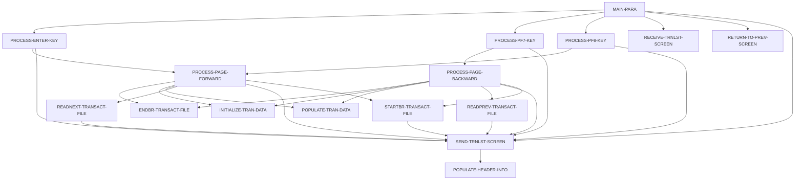

# Program COTRN00C

| Item | Value |
|---|---|
| Source | `app/cbl/COTRN00C.cbl` |
| Lines | 699 total, 529 code, 82 comment, 88 blank |
| PROGRAM-ID | COTRN00C |
| Author | AWS |
| Runtime | cics-online |
| Module | base |
| CICS transactions | CT00 (`app/csd/CARDDEMO.CSD:419-428`) |
| JCL steps | None |
| Paragraphs | 16 |
| Semantic analysis | validated (batch B07) |
| Version banner | * Ver: CardDemo_v1.0-15-g27d6c6f-68 Date: 2022-07-19 23:12:34 CDT |

## Summary

COTRN00C is a pseudo-conversational CICS COBOL program (transaction CT00, map COTRN0A in mapset COTRN00) that lists records of the TRANSACT VSAM file ten at a time. On entry without a COMMAREA it transfers to sign-on (COSGN00C); on first entry it lists from the beginning of the file, and on re-entry it dispatches on the attention key: Enter (optional numeric start Tran ID and/or row selection), PF3 (back to menu COMEN01C), PF7 (previous page) and PF8 (next page). Paging uses a STARTBR/READNEXT or READPREV/ENDBR browse keyed on TRAN-ID, keeping the first and last Tran ID shown, the page number and a next-page flag in the CardDemo COMMAREA extension CDEMO-CT00-INFO. Each row shows Tran ID, original date as MM/DD/YY, description and edited amount. Entering 'S' or 's' next to a row stores the Tran ID in CDEMO-CT00-TRN-SELECTED and transfers control (XCTL) to the transaction view program COTRN01C. The program only reads TRANSACT; it never updates it. (Confirmed)

Evidence: `app/cbl/COTRN00C.cbl:1-5`, `app/cbl/COTRN00C.cbl:35-39`, `app/cbl/COTRN00C.cbl:61-70`, `app/cbl/COTRN00C.cbl:107-141`, `app/cbl/COTRN00C.cbl:183-195`, `app/cbl/COTRN00C.cbl:279-376`, `app/cbl/COTRN00C.cbl:381-445`, `app/cbl/COTRN00C.cbl:591-696`

Header comment (Unverified, `app/cbl/COTRN00C.cbl:1-8`): Program     : COTRN00C.CBL Application : CardDemo Type        : CICS COBOL Program Function    : List Transactions from TRANSACT file All Rights Reserved. http://www.apache.org/licenses/LICENSE-2.0

## Divisions and sections

| Division / section | Lines | Notes |
|---|---|---|
| IDENTIFICATION DIVISION | `app/cbl/COTRN00C.cbl:22-25` |  |
| ENVIRONMENT DIVISION | `app/cbl/COTRN00C.cbl:26-28` |  |
| DATA DIVISION | `app/cbl/COTRN00C.cbl:29-93` |  |
| PROCEDURE DIVISION | `app/cbl/COTRN00C.cbl:94-699` |  |
| ENVIRONMENT / CONFIGURATION SECTION | `app/cbl/COTRN00C.cbl:27-28` |  |
| DATA / WORKING-STORAGE SECTION | `app/cbl/COTRN00C.cbl:33-85` |  |
| DATA / LINKAGE SECTION | `app/cbl/COTRN00C.cbl:86-93` |  |

## Files and data stores

No SELECT entries (no COBOL file I/O).

CICS file commands (file name resolved from VALUE clauses and the CSD):

| Command | FILE option | Resolved name | CSD DSNAME | CSD evidence | Line |
|---|---|---|---|---|---|
| STARTBR | WS-TRANSACT-FILE | TRANSACT | AWS.M2.CARDDEMO.TRANSACT.VSAM.KSDS | `app/csd/CARDDEMO.CSD:76-87` | `app/cbl/COTRN00C.cbl:593-600` |
| READNEXT | WS-TRANSACT-FILE | TRANSACT | AWS.M2.CARDDEMO.TRANSACT.VSAM.KSDS | `app/csd/CARDDEMO.CSD:76-87` | `app/cbl/COTRN00C.cbl:626-634` |
| READPREV | WS-TRANSACT-FILE | TRANSACT | AWS.M2.CARDDEMO.TRANSACT.VSAM.KSDS | `app/csd/CARDDEMO.CSD:76-87` | `app/cbl/COTRN00C.cbl:660-668` |
| ENDBR | WS-TRANSACT-FILE | TRANSACT | AWS.M2.CARDDEMO.TRANSACT.VSAM.KSDS | `app/csd/CARDDEMO.CSD:76-87` | `app/cbl/COTRN00C.cbl:694-696` |

CRUD summary from the program facts:

| Store | Kind | Ops | Evidence |
|---|---|---|---|
| TRANSACT | cics-file | B | `app/cbl/COTRN00C.cbl:593-694` |

## Embedded CICS, SQL and DL/I commands

| Paragraph | Kind | Verb | Resources | Response | Lines |
|---|---|---|---|---|---|
| MAIN-PARA | CICS | RETURN | TRANSID(WS-TRANID) |  | `app/cbl/COTRN00C.cbl:138-141` |
| PROCESS-ENTER-KEY | CICS | XCTL | PROGRAM(CDEMO-TO-PROGRAM) |  | `app/cbl/COTRN00C.cbl:192-195` |
| RETURN-TO-PREV-SCREEN | CICS | XCTL | PROGRAM(CDEMO-TO-PROGRAM) |  | `app/cbl/COTRN00C.cbl:518-521` |
| SEND-TRNLST-SCREEN | CICS | SEND MAP | MAP('COTRN0A'), MAPSET('COTRN00') |  | `app/cbl/COTRN00C.cbl:534-540` |
| SEND-TRNLST-SCREEN | CICS | SEND MAP | MAP('COTRN0A'), MAPSET('COTRN00') |  | `app/cbl/COTRN00C.cbl:542-548` |
| RECEIVE-TRNLST-SCREEN | CICS | RECEIVE MAP | MAP('COTRN0A'), MAPSET('COTRN00') | RESP | `app/cbl/COTRN00C.cbl:556-562` |
| STARTBR-TRANSACT-FILE | CICS | STARTBR | DATASET(WS-TRANSACT-FILE) | RESP | `app/cbl/COTRN00C.cbl:593-600` |
| READNEXT-TRANSACT-FILE | CICS | READNEXT | DATASET(WS-TRANSACT-FILE) | RESP | `app/cbl/COTRN00C.cbl:626-634` |
| READPREV-TRANSACT-FILE | CICS | READPREV | DATASET(WS-TRANSACT-FILE) | RESP | `app/cbl/COTRN00C.cbl:660-668` |
| ENDBR-TRANSACT-FILE | CICS | ENDBR | DATASET(WS-TRANSACT-FILE) |  | `app/cbl/COTRN00C.cbl:694-696` |

## Calls, transfers and callers

| Mechanism | Target | Parameters | Paragraph | Lines |
|---|---|---|---|---|
| EXEC CICS RETURN | WS-TRANID = CT00 | CARDDEMO-COMMAREA | MAIN-PARA | `app/cbl/COTRN00C.cbl:138-141` |
| EXEC CICS XCTL | CDEMO-TO-PROGRAM = COTRN01C | CARDDEMO-COMMAREA | PROCESS-ENTER-KEY | `app/cbl/COTRN00C.cbl:192-195` |
| EXEC CICS XCTL | CDEMO-TO-PROGRAM = COMEN01C, COSGN00C | CARDDEMO-COMMAREA | RETURN-TO-PREV-SCREEN | `app/cbl/COTRN00C.cbl:518-521` |

Programs that transfer to or call this program (from `docs/_work/xref/call-graph.json`):

| Caller | Mechanism | Confidence | Evidence |
|---|---|---|---|
| COMEN01C | XCTL | Confirmed | `app/cbl/COMEN01C.cbl:185` |
| COTRN01C | XCTL | Confirmed | `app/cbl/COTRN01C.cbl:205` |

## Copybooks

| Copybook | Statement | Resolution | Resolved path | REPLACING | Line |
|---|---|---|---|---|---|
| [COCOM01Y](../08-data/layouts/COCOM01Y.md) | COPY | inventory | app/cpy/COCOM01Y.cpy |  | `app/cbl/COTRN00C.cbl:61` |
| COTRN00 | COPY | inventory | app/cpy-bms/COTRN00.CPY |  | `app/cbl/COTRN00C.cbl:72` |
| [COTTL01Y](../08-data/layouts/COTTL01Y.md) | COPY | inventory | app/cpy/COTTL01Y.cpy |  | `app/cbl/COTRN00C.cbl:74` |
| [CSDAT01Y](../08-data/layouts/CSDAT01Y.md) | COPY | inventory | app/cpy/CSDAT01Y.cpy |  | `app/cbl/COTRN00C.cbl:75` |
| [CSMSG01Y](../08-data/layouts/CSMSG01Y.md) | COPY | inventory | app/cpy/CSMSG01Y.cpy |  | `app/cbl/COTRN00C.cbl:76` |
| [CVTRA05Y](../08-data/layouts/CVTRA05Y.md) | COPY | inventory | app/cpy/CVTRA05Y.cpy |  | `app/cbl/COTRN00C.cbl:78` |
| DFHAID | COPY | system |  |  | `app/cbl/COTRN00C.cbl:80` |
| DFHBMSCA | COPY | system |  |  | `app/cbl/COTRN00C.cbl:81` |

## Data division items

Every data entry coded in this source (copybook contents are on the copybook pages). Lengths are computed from PIC and USAGE.

| Section | Lvl | Name | PIC | Usage | Len | OCCURS | REDEFINES | VALUE | 88-levels | Line |
|---|---|---|---|---|---|---|---|---|---|---|
| WORKING-STORAGE | 01 | WS-VARIABLES |  |  |  |  |  |  |  | 35 |
| WORKING-STORAGE | 05 | WS-PGMNAME | X(08) |  | 8 |  |  | 'COTRN00C' |  | 36 |
| WORKING-STORAGE | 05 | WS-TRANID | X(04) |  | 4 |  |  | 'CT00' |  | 37 |
| WORKING-STORAGE | 05 | WS-MESSAGE | X(80) |  | 80 |  |  | SPACES |  | 38 |
| WORKING-STORAGE | 05 | WS-TRANSACT-FILE | X(08) |  | 8 |  |  | 'TRANSACT' |  | 39 |
| WORKING-STORAGE | 05 | WS-ERR-FLG | X(01) |  | 1 |  |  | 'N' | ERR-FLG-ON = 'Y'; ERR-FLG-OFF = 'N' | 40 |
| WORKING-STORAGE | 05 | WS-TRANSACT-EOF | X(01) |  | 1 |  |  | 'N' | TRANSACT-EOF = 'Y'; TRANSACT-NOT-EOF = 'N' | 43 |
| WORKING-STORAGE | 05 | WS-SEND-ERASE-FLG | X(01) |  | 1 |  |  | 'Y' | SEND-ERASE-YES = 'Y'; SEND-ERASE-NO = 'N' | 46 |
| WORKING-STORAGE | 05 | WS-RESP-CD | S9(09) | COMP | 4 |  |  | ZEROS |  | 50 |
| WORKING-STORAGE | 05 | WS-REAS-CD | S9(09) | COMP | 4 |  |  | ZEROS |  | 51 |
| WORKING-STORAGE | 05 | WS-REC-COUNT | S9(04) | COMP | 2 |  |  | ZEROS |  | 52 |
| WORKING-STORAGE | 05 | WS-IDX | S9(04) | COMP | 2 |  |  | ZEROS |  | 53 |
| WORKING-STORAGE | 05 | WS-PAGE-NUM | S9(04) | COMP | 2 |  |  | ZEROS |  | 54 |
| WORKING-STORAGE | 05 | WS-TRAN-AMT | +99999999.99 |  | 12 |  |  |  |  | 56 |
| WORKING-STORAGE | 05 | WS-TRAN-DATE | X(08) |  | 8 |  |  | '00/00/00' |  | 57 |
| WORKING-STORAGE | 05 | CDEMO-CT00-INFO |  |  |  |  |  |  |  | 62 |
| WORKING-STORAGE | 10 | CDEMO-CT00-TRNID-FIRST | X(16) |  | 16 |  |  |  |  | 63 |
| WORKING-STORAGE | 10 | CDEMO-CT00-TRNID-LAST | X(16) |  | 16 |  |  |  |  | 64 |
| WORKING-STORAGE | 10 | CDEMO-CT00-PAGE-NUM | 9(08) |  | 8 |  |  |  |  | 65 |
| WORKING-STORAGE | 10 | CDEMO-CT00-NEXT-PAGE-FLG | X(01) |  | 1 |  |  | 'N' | NEXT-PAGE-YES = 'Y'; NEXT-PAGE-NO = 'N' | 66 |
| WORKING-STORAGE | 10 | CDEMO-CT00-TRN-SEL-FLG | X(01) |  | 1 |  |  |  |  | 69 |
| WORKING-STORAGE | 10 | CDEMO-CT00-TRN-SELECTED | X(16) |  | 16 |  |  |  |  | 70 |
| LINKAGE | 01 | DFHCOMMAREA |  |  |  |  |  |  |  | 87 |
| LINKAGE | 05 | LK-COMMAREA | X(01) |  | 1 | 1 TO 32767 DEPENDING ON EIBCALEN |  |  |  | 88 |

## Statement inventory

Every procedure statement the parser recorded, by kind. Each one is listed with its line under Paragraph details.

| Kind | Count |
|---|---|
| Decisions (IF, EVALUATE, WHEN, loops, handlers) | 88 |
| Calculations | 5 |
| File I/O | 0 |
| EXEC CICS / SQL / DLI | 10 |
| CALL | 0 |
| PERFORM | 42 |
| GO TO | 0 |
| MOVE literal | 37 |
| MOVE field | 141 |
| SET | 14 |
| STRING, UNSTRING, INSPECT, INITIALIZE, COPY, ENTRY and others | 0 |
| DISPLAY | 3 |
| GOBACK, STOP RUN, RETURN, XCTL | 3 |
| Not classified by the parser | 0 |

## Control flow

| Paragraph | Lines | Logic | Performs | Performed by | Reachable |
|---|---|---|---|---|---|
| [MAIN-PARA](#para-main-para) | 95-141 | Resets the error, EOF, next-page and erase flags and clears the message. With EIBCALEN = 0 it XCTLs to COSGN00C; otherwise it copies DFHCOMMAREA into CARDDEMO-COMMAREA and, on first entry (not CDEMO-PGM-REENTER), sets re-enter, clears the map, performs PROCESS-ENTER-KEY and sends the list. On re-entry it receives the map and dispatches on EIBAID: Enter, PF3 (XCTL to COMEN01C), PF7, PF8, any other key shows CCDA-MSG-INVALID-KEY. Always ends with CICS RETURN TRANSID CT00 and the COMMAREA. (Confirmed) | PROCESS-ENTER-KEY, PROCESS-PF7-KEY, PROCESS-PF8-KEY, RECEIVE-TRNLST-SCREEN, RETURN-TO-PREV-SCREEN, SEND-TRNLST-SCREEN |  | yes |
| [PROCESS-ENTER-KEY](#para-process-enter-key) | 146-229 | Captures the first non-blank selection field SEL0001I..SEL0010I and its row Tran ID into CDEMO-CT00-TRN-SEL-FLG / CDEMO-CT00-TRN-SELECTED. A selection of 'S'/'s' XCTLs to COTRN01C; any other value sets 'Invalid selection. Valid value is S'. Then sets the browse start key TRAN-ID from TRNIDINI (LOW-VALUES when blank, the value when numeric, else error 'Tran ID must be Numeric ...'), resets CDEMO-CT00-PAGE-NUM to 0 and performs PROCESS-PAGE-FORWARD. (Confirmed) | PROCESS-PAGE-FORWARD, SEND-TRNLST-SCREEN | MAIN-PARA | yes |
| [PROCESS-PF7-KEY](#para-process-pf7-key) | 234-252 | Sets TRAN-ID to CDEMO-CT00-TRNID-FIRST (LOW-VALUES when blank) and sets NEXT-PAGE-YES. If CDEMO-CT00-PAGE-NUM > 1 performs PROCESS-PAGE-BACKWARD, otherwise sends the screen without erase with 'You are already at the top of the page...'. (Confirmed) | PROCESS-PAGE-BACKWARD, SEND-TRNLST-SCREEN | MAIN-PARA | yes |
| [PROCESS-PF8-KEY](#para-process-pf8-key) | 257-274 | Sets TRAN-ID to CDEMO-CT00-TRNID-LAST (HIGH-VALUES when blank). If NEXT-PAGE-YES performs PROCESS-PAGE-FORWARD, otherwise sends the screen without erase with 'You are already at the bottom of the page...'. (Confirmed) | PROCESS-PAGE-FORWARD, SEND-TRNLST-SCREEN | MAIN-PARA | yes |
| [PROCESS-PAGE-FORWARD](#para-process-page-forward) | 279-328 | Starts a browse at TRAN-ID; if no error, skips one record with READNEXT unless the key was Enter/PF7/PF3, clears the 10 rows, then reads up to 10 records into rows 1-10. If more records remain it adds 1 to CDEMO-CT00-PAGE-NUM and reads one extra record to set NEXT-PAGE-YES/NO; otherwise sets NEXT-PAGE-NO and adds 1 to the page only if at least one row was filled. Ends the browse, moves the page number to the map and sends the screen. (Confirmed) | ENDBR-TRANSACT-FILE, INITIALIZE-TRAN-DATA, POPULATE-TRAN-DATA, READNEXT-TRANSACT-FILE, SEND-TRNLST-SCREEN, STARTBR-TRANSACT-FILE | PROCESS-ENTER-KEY, PROCESS-PF8-KEY | yes |
| [PROCESS-PAGE-BACKWARD](#para-process-page-backward) | 333-376 | Starts a browse at TRAN-ID; if no error, skips one record with READPREV unless the key was Enter/PF8, clears the 10 rows, then reads up to 10 previous records filling rows 10 down to 1. If records remain it reads one more previous record and, when NEXT-PAGE-YES, subtracts 1 from CDEMO-CT00-PAGE-NUM if that read succeeded and the page is > 1, otherwise sets the page to 1. Ends the browse and sends the screen. (Confirmed) | ENDBR-TRANSACT-FILE, INITIALIZE-TRAN-DATA, POPULATE-TRAN-DATA, READPREV-TRANSACT-FILE, SEND-TRNLST-SCREEN, STARTBR-TRANSACT-FILE | PROCESS-PF7-KEY | yes |
| [POPULATE-TRAN-DATA](#para-populate-tran-data) | 381-445 | Formats TRAN-AMT into the edited WS-TRAN-AMT (+99999999.99) and TRAN-ORIG-TS into WS-TRAN-DATE as MM/DD/YY, then moves TRAN-ID, date, TRAN-DESC and amount into row WS-IDX (1-10) of COTRN0AI. Row 1 also saves TRAN-ID in CDEMO-CT00-TRNID-FIRST and row 10 in CDEMO-CT00-TRNID-LAST. (Confirmed) |  | PROCESS-PAGE-BACKWARD, PROCESS-PAGE-FORWARD | yes |
| [INITIALIZE-TRAN-DATA](#para-initialize-tran-data) | 450-505 | Moves SPACES to the Tran ID, date, description and amount fields of row WS-IDX (1-10) of COTRN0AI; other index values do nothing. (Confirmed) |  | PROCESS-PAGE-BACKWARD, PROCESS-PAGE-FORWARD | yes |
| [RETURN-TO-PREV-SCREEN](#para-return-to-prev-screen) | 510-521 | Defaults CDEMO-TO-PROGRAM to COSGN00C when blank, sets CDEMO-FROM-TRANID/CDEMO-FROM-PROGRAM to CT00/COTRN00C, resets CDEMO-PGM-CONTEXT to 0 and XCTLs to CDEMO-TO-PROGRAM with the COMMAREA. (Confirmed) |  | MAIN-PARA | yes |
| [SEND-TRNLST-SCREEN](#para-send-trnlst-screen) | 527-549 | Fills the header, moves WS-MESSAGE to ERRMSGO and sends map COTRN0A with ERASE when SEND-ERASE-YES, otherwise without ERASE; cursor placement is requested in both cases. (Confirmed) | POPULATE-HEADER-INFO | MAIN-PARA, PROCESS-ENTER-KEY, PROCESS-PAGE-BACKWARD, PROCESS-PAGE-FORWARD, PROCESS-PF7-KEY, PROCESS-PF8-KEY, READNEXT-TRANSACT-FILE, READPREV-TRANSACT-FILE, STARTBR-TRANSACT-FILE | yes |
| [RECEIVE-TRNLST-SCREEN](#para-receive-trnlst-screen) | 554-562 | Receives map COTRN0A into COTRN0AI with RESP/RESP2; the response code is not tested. (Confirmed) |  | MAIN-PARA | yes |
| [POPULATE-HEADER-INFO](#para-populate-header-info) | 567-586 | Moves CURRENT-DATE, titles CCDA-TITLE01/02, transaction CT00 and program name to the header and formats current date as MM/DD/YY and time as HH:MM:SS. (Confirmed) |  | SEND-TRNLST-SCREEN | yes |
| [STARTBR-TRANSACT-FILE](#para-startbr-transact-file) | 591-619 | Issues CICS STARTBR on TRANSACT with RIDFLD TRAN-ID (GTEQ option commented out). NORMAL continues; NOTFND sets TRANSACT-EOF and sends 'You are at the top of the page...'; any other response displays RESP/REAS, sets the error flag and sends 'Unable to lookup transaction...'. (Confirmed) | SEND-TRNLST-SCREEN | PROCESS-PAGE-BACKWARD, PROCESS-PAGE-FORWARD | yes |
| [READNEXT-TRANSACT-FILE](#para-readnext-transact-file) | 624-653 | Issues CICS READNEXT into TRAN-RECORD. NORMAL continues; ENDFILE sets TRANSACT-EOF and sends 'You have reached the bottom of the page...'; other responses set the error flag and send 'Unable to lookup transaction...'. (Confirmed) | SEND-TRNLST-SCREEN | PROCESS-PAGE-FORWARD | yes |
| [READPREV-TRANSACT-FILE](#para-readprev-transact-file) | 658-687 | Issues CICS READPREV into TRAN-RECORD. NORMAL continues; ENDFILE sets TRANSACT-EOF and sends 'You have reached the top of the page...'; other responses set the error flag and send 'Unable to lookup transaction...'. (Confirmed) | SEND-TRNLST-SCREEN | PROCESS-PAGE-BACKWARD | yes |
| [ENDBR-TRANSACT-FILE](#para-endbr-transact-file) | 692-696 | Issues CICS ENDBR on TRANSACT without a RESP option. (Confirmed) |  | PROCESS-PAGE-BACKWARD, PROCESS-PAGE-FORWARD | yes |

## Paragraph details

### Para MAIN-PARA

Lines `app/cbl/COTRN00C.cbl:95-141`. 

Logic: Resets the error, EOF, next-page and erase flags and clears the message. With EIBCALEN = 0 it XCTLs to COSGN00C; otherwise it copies DFHCOMMAREA into CARDDEMO-COMMAREA and, on first entry (not CDEMO-PGM-REENTER), sets re-enter, clears the map, performs PROCESS-ENTER-KEY and sends the list. On re-entry it receives the map and dispatches on EIBAID: Enter, PF3 (XCTL to COMEN01C), PF7, PF8, any other key shows CCDA-MSG-INVALID-KEY. Always ends with CICS RETURN TRANSID CT00 and the COMMAREA. (Confirmed)

Rules: [BR-COTRN00C-001](../09-business-rules-catalog.md#br-cotrn00c-001), [BR-COTRN00C-002](../09-business-rules-catalog.md#br-cotrn00c-002)

Statements in source order:

- `SET ERR-FLG-OFF TO TRUE` at `app/cbl/COTRN00C.cbl:97`
- `SET TRANSACT-NOT-EOF TO TRUE` at `app/cbl/COTRN00C.cbl:98`
- `SET NEXT-PAGE-NO TO TRUE` at `app/cbl/COTRN00C.cbl:99`
- `SET SEND-ERASE-YES TO TRUE` at `app/cbl/COTRN00C.cbl:100`
- `MOVE SPACES TO WS-MESSAGE ERRMSGO OF COTRN0AO` at `app/cbl/COTRN00C.cbl:102-103`
- MOVE `-1` TO TRNIDINL OF COTRN0AI at `app/cbl/COTRN00C.cbl:105`
- IF `EIBCALEN = 0` at `app/cbl/COTRN00C.cbl:107` (pseudo-conversation)
- MOVE `'COSGN00C'` TO CDEMO-TO-PROGRAM at `app/cbl/COTRN00C.cbl:108`
- PERFORM RETURN-TO-PREV-SCREEN at `app/cbl/COTRN00C.cbl:109`
- `MOVE DFHCOMMAREA(1:EIBCALEN) TO CARDDEMO-COMMAREA` at `app/cbl/COTRN00C.cbl:111`
- IF `NOT CDEMO-PGM-REENTER` at `app/cbl/COTRN00C.cbl:112` (pseudo-conversation)
- `SET CDEMO-PGM-REENTER TO TRUE` at `app/cbl/COTRN00C.cbl:113`
- `MOVE LOW-VALUES TO COTRN0AO` at `app/cbl/COTRN00C.cbl:114`
- PERFORM PROCESS-ENTER-KEY at `app/cbl/COTRN00C.cbl:115`
- PERFORM SEND-TRNLST-SCREEN at `app/cbl/COTRN00C.cbl:116`
- PERFORM RECEIVE-TRNLST-SCREEN at `app/cbl/COTRN00C.cbl:118`
- EVALUATE `EIBAID` at `app/cbl/COTRN00C.cbl:119` (screen-key)
- WHEN `DFHENTER` at `app/cbl/COTRN00C.cbl:120` (screen-key)
- PERFORM PROCESS-ENTER-KEY at `app/cbl/COTRN00C.cbl:121`
- WHEN `DFHPF3` at `app/cbl/COTRN00C.cbl:122` (screen-key)
- MOVE `'COMEN01C'` TO CDEMO-TO-PROGRAM at `app/cbl/COTRN00C.cbl:123`
- PERFORM RETURN-TO-PREV-SCREEN at `app/cbl/COTRN00C.cbl:124`
- WHEN `DFHPF7` at `app/cbl/COTRN00C.cbl:125` (screen-key)
- PERFORM PROCESS-PF7-KEY at `app/cbl/COTRN00C.cbl:126`
- WHEN `DFHPF8` at `app/cbl/COTRN00C.cbl:127` (screen-key)
- PERFORM PROCESS-PF8-KEY at `app/cbl/COTRN00C.cbl:128`
- WHEN `OTHER` at `app/cbl/COTRN00C.cbl:129` (screen-key)
- MOVE `'Y'` TO WS-ERR-FLG at `app/cbl/COTRN00C.cbl:130`
- MOVE `-1` TO TRNIDINL OF COTRN0AI at `app/cbl/COTRN00C.cbl:131`
- `MOVE CCDA-MSG-INVALID-KEY TO WS-MESSAGE` at `app/cbl/COTRN00C.cbl:132`
- PERFORM SEND-TRNLST-SCREEN at `app/cbl/COTRN00C.cbl:133`
- EXEC CICS RETURN at `app/cbl/COTRN00C.cbl:138-141`
- Ends with EXEC CICS RETURN at `app/cbl/COTRN00C.cbl:138-141`

### Para PROCESS-ENTER-KEY

Lines `app/cbl/COTRN00C.cbl:146-229`. 

Logic: Captures the first non-blank selection field SEL0001I..SEL0010I and its row Tran ID into CDEMO-CT00-TRN-SEL-FLG / CDEMO-CT00-TRN-SELECTED. A selection of 'S'/'s' XCTLs to COTRN01C; any other value sets 'Invalid selection. Valid value is S'. Then sets the browse start key TRAN-ID from TRNIDINI (LOW-VALUES when blank, the value when numeric, else error 'Tran ID must be Numeric ...'), resets CDEMO-CT00-PAGE-NUM to 0 and performs PROCESS-PAGE-FORWARD. (Confirmed)

Rules: [BR-COTRN00C-003](../09-business-rules-catalog.md#br-cotrn00c-003), [BR-COTRN00C-004](../09-business-rules-catalog.md#br-cotrn00c-004), [BR-COTRN00C-005](../09-business-rules-catalog.md#br-cotrn00c-005), [BR-COTRN00C-006](../09-business-rules-catalog.md#br-cotrn00c-006)

Statements in source order:

- EVALUATE `TRUE` at `app/cbl/COTRN00C.cbl:148` (business-candidate)
- WHEN `SEL0001I OF COTRN0AI NOT = SPACES AND LOW-VALUES` at `app/cbl/COTRN00C.cbl:149` (business-candidate)
- `MOVE SEL0001I OF COTRN0AI TO CDEMO-CT00-TRN-SEL-FLG` at `app/cbl/COTRN00C.cbl:150`
- `MOVE TRNID01I OF COTRN0AI TO CDEMO-CT00-TRN-SELECTED` at `app/cbl/COTRN00C.cbl:151`
- WHEN `SEL0002I OF COTRN0AI NOT = SPACES AND LOW-VALUES` at `app/cbl/COTRN00C.cbl:152` (business-candidate)
- `MOVE SEL0002I OF COTRN0AI TO CDEMO-CT00-TRN-SEL-FLG` at `app/cbl/COTRN00C.cbl:153`
- `MOVE TRNID02I OF COTRN0AI TO CDEMO-CT00-TRN-SELECTED` at `app/cbl/COTRN00C.cbl:154`
- WHEN `SEL0003I OF COTRN0AI NOT = SPACES AND LOW-VALUES` at `app/cbl/COTRN00C.cbl:155` (business-candidate)
- `MOVE SEL0003I OF COTRN0AI TO CDEMO-CT00-TRN-SEL-FLG` at `app/cbl/COTRN00C.cbl:156`
- `MOVE TRNID03I OF COTRN0AI TO CDEMO-CT00-TRN-SELECTED` at `app/cbl/COTRN00C.cbl:157`
- WHEN `SEL0004I OF COTRN0AI NOT = SPACES AND LOW-VALUES` at `app/cbl/COTRN00C.cbl:158` (business-candidate)
- `MOVE SEL0004I OF COTRN0AI TO CDEMO-CT00-TRN-SEL-FLG` at `app/cbl/COTRN00C.cbl:159`
- `MOVE TRNID04I OF COTRN0AI TO CDEMO-CT00-TRN-SELECTED` at `app/cbl/COTRN00C.cbl:160`
- WHEN `SEL0005I OF COTRN0AI NOT = SPACES AND LOW-VALUES` at `app/cbl/COTRN00C.cbl:161` (business-candidate)
- `MOVE SEL0005I OF COTRN0AI TO CDEMO-CT00-TRN-SEL-FLG` at `app/cbl/COTRN00C.cbl:162`
- `MOVE TRNID05I OF COTRN0AI TO CDEMO-CT00-TRN-SELECTED` at `app/cbl/COTRN00C.cbl:163`
- WHEN `SEL0006I OF COTRN0AI NOT = SPACES AND LOW-VALUES` at `app/cbl/COTRN00C.cbl:164` (business-candidate)
- `MOVE SEL0006I OF COTRN0AI TO CDEMO-CT00-TRN-SEL-FLG` at `app/cbl/COTRN00C.cbl:165`
- `MOVE TRNID06I OF COTRN0AI TO CDEMO-CT00-TRN-SELECTED` at `app/cbl/COTRN00C.cbl:166`
- WHEN `SEL0007I OF COTRN0AI NOT = SPACES AND LOW-VALUES` at `app/cbl/COTRN00C.cbl:167` (business-candidate)
- `MOVE SEL0007I OF COTRN0AI TO CDEMO-CT00-TRN-SEL-FLG` at `app/cbl/COTRN00C.cbl:168`
- `MOVE TRNID07I OF COTRN0AI TO CDEMO-CT00-TRN-SELECTED` at `app/cbl/COTRN00C.cbl:169`
- WHEN `SEL0008I OF COTRN0AI NOT = SPACES AND LOW-VALUES` at `app/cbl/COTRN00C.cbl:170` (business-candidate)
- `MOVE SEL0008I OF COTRN0AI TO CDEMO-CT00-TRN-SEL-FLG` at `app/cbl/COTRN00C.cbl:171`
- `MOVE TRNID08I OF COTRN0AI TO CDEMO-CT00-TRN-SELECTED` at `app/cbl/COTRN00C.cbl:172`
- WHEN `SEL0009I OF COTRN0AI NOT = SPACES AND LOW-VALUES` at `app/cbl/COTRN00C.cbl:173` (business-candidate)
- `MOVE SEL0009I OF COTRN0AI TO CDEMO-CT00-TRN-SEL-FLG` at `app/cbl/COTRN00C.cbl:174`
- `MOVE TRNID09I OF COTRN0AI TO CDEMO-CT00-TRN-SELECTED` at `app/cbl/COTRN00C.cbl:175`
- WHEN `SEL0010I OF COTRN0AI NOT = SPACES AND LOW-VALUES` at `app/cbl/COTRN00C.cbl:176` (business-candidate)
- `MOVE SEL0010I OF COTRN0AI TO CDEMO-CT00-TRN-SEL-FLG` at `app/cbl/COTRN00C.cbl:177`
- `MOVE TRNID10I OF COTRN0AI TO CDEMO-CT00-TRN-SELECTED` at `app/cbl/COTRN00C.cbl:178`
- WHEN `OTHER` at `app/cbl/COTRN00C.cbl:179` (business-candidate)
- `MOVE SPACES TO CDEMO-CT00-TRN-SEL-FLG` at `app/cbl/COTRN00C.cbl:180`
- `MOVE SPACES TO CDEMO-CT00-TRN-SELECTED` at `app/cbl/COTRN00C.cbl:181`
- IF `(CDEMO-CT00-TRN-SEL-FLG NOT = SPACES AND LOW-VALUES) AND (CDEMO-CT00-TRN-SELECTED NOT = SPACES AND LOW-VALUES)` at `app/cbl/COTRN00C.cbl:183-184` (business-candidate)
- EVALUATE `CDEMO-CT00-TRN-SEL-FLG` at `app/cbl/COTRN00C.cbl:185` (business-candidate)
- WHEN `'S'` at `app/cbl/COTRN00C.cbl:186` (business-candidate)
- WHEN `'s'` at `app/cbl/COTRN00C.cbl:187` (business-candidate)
- MOVE `'COTRN01C'` TO CDEMO-TO-PROGRAM at `app/cbl/COTRN00C.cbl:188`
- `MOVE WS-TRANID TO CDEMO-FROM-TRANID` at `app/cbl/COTRN00C.cbl:189`
- `MOVE WS-PGMNAME TO CDEMO-FROM-PROGRAM` at `app/cbl/COTRN00C.cbl:190`
- MOVE `0` TO CDEMO-PGM-CONTEXT at `app/cbl/COTRN00C.cbl:191`
- EXEC CICS XCTL at `app/cbl/COTRN00C.cbl:192-195`
- Ends with EXEC CICS XCTL at `app/cbl/COTRN00C.cbl:192-195`
- WHEN `OTHER` at `app/cbl/COTRN00C.cbl:196` (business-candidate)
- MOVE `'Invalid selection. Valid value is S'` TO WS-MESSAGE at `app/cbl/COTRN00C.cbl:198-200`
- MOVE `-1` TO TRNIDINL OF COTRN0AI at `app/cbl/COTRN00C.cbl:201`
- IF `TRNIDINI OF COTRN0AI = SPACES OR LOW-VALUES` at `app/cbl/COTRN00C.cbl:206` (business-candidate)
- `MOVE LOW-VALUES TO TRAN-ID` at `app/cbl/COTRN00C.cbl:207`
- IF `TRNIDINI OF COTRN0AI IS NUMERIC` at `app/cbl/COTRN00C.cbl:209` (business-candidate)
- `MOVE TRNIDINI OF COTRN0AI TO TRAN-ID` at `app/cbl/COTRN00C.cbl:210`
- MOVE `'Y'` TO WS-ERR-FLG at `app/cbl/COTRN00C.cbl:212`
- MOVE `'Tran ID must be Numeric ...'` TO WS-MESSAGE at `app/cbl/COTRN00C.cbl:213-215`
- MOVE `-1` TO TRNIDINL OF COTRN0AI at `app/cbl/COTRN00C.cbl:216`
- PERFORM SEND-TRNLST-SCREEN at `app/cbl/COTRN00C.cbl:217`
- MOVE `-1` TO TRNIDINL OF COTRN0AI at `app/cbl/COTRN00C.cbl:221`
- MOVE `0` TO CDEMO-CT00-PAGE-NUM at `app/cbl/COTRN00C.cbl:224`
- PERFORM PROCESS-PAGE-FORWARD at `app/cbl/COTRN00C.cbl:225`
- IF `NOT ERR-FLG-ON` at `app/cbl/COTRN00C.cbl:227` (error-flag)
- `MOVE SPACE TO TRNIDINO OF COTRN0AO` at `app/cbl/COTRN00C.cbl:228`

### Para PROCESS-PF7-KEY

Lines `app/cbl/COTRN00C.cbl:234-252`. 

Logic: Sets TRAN-ID to CDEMO-CT00-TRNID-FIRST (LOW-VALUES when blank) and sets NEXT-PAGE-YES. If CDEMO-CT00-PAGE-NUM > 1 performs PROCESS-PAGE-BACKWARD, otherwise sends the screen without erase with 'You are already at the top of the page...'. (Confirmed)

Rules: [BR-COTRN00C-007](../09-business-rules-catalog.md#br-cotrn00c-007)

Statements in source order:

- IF `CDEMO-CT00-TRNID-FIRST = SPACES OR LOW-VALUES` at `app/cbl/COTRN00C.cbl:236` (business-candidate)
- `MOVE LOW-VALUES TO TRAN-ID` at `app/cbl/COTRN00C.cbl:237`
- `MOVE CDEMO-CT00-TRNID-FIRST TO TRAN-ID` at `app/cbl/COTRN00C.cbl:239`
- `SET NEXT-PAGE-YES TO TRUE` at `app/cbl/COTRN00C.cbl:242`
- MOVE `-1` TO TRNIDINL OF COTRN0AI at `app/cbl/COTRN00C.cbl:243`
- IF `CDEMO-CT00-PAGE-NUM > 1` at `app/cbl/COTRN00C.cbl:245` (business-candidate)
- PERFORM PROCESS-PAGE-BACKWARD at `app/cbl/COTRN00C.cbl:246`
- MOVE `'You are already at the top of the page...'` TO WS-MESSAGE at `app/cbl/COTRN00C.cbl:248-249`
- `SET SEND-ERASE-NO TO TRUE` at `app/cbl/COTRN00C.cbl:250`
- PERFORM SEND-TRNLST-SCREEN at `app/cbl/COTRN00C.cbl:251`

### Para PROCESS-PF8-KEY

Lines `app/cbl/COTRN00C.cbl:257-274`. 

Logic: Sets TRAN-ID to CDEMO-CT00-TRNID-LAST (HIGH-VALUES when blank). If NEXT-PAGE-YES performs PROCESS-PAGE-FORWARD, otherwise sends the screen without erase with 'You are already at the bottom of the page...'. (Confirmed)

Rules: [BR-COTRN00C-008](../09-business-rules-catalog.md#br-cotrn00c-008)

Statements in source order:

- IF `CDEMO-CT00-TRNID-LAST = SPACES OR LOW-VALUES` at `app/cbl/COTRN00C.cbl:259` (business-candidate)
- `MOVE HIGH-VALUES TO TRAN-ID` at `app/cbl/COTRN00C.cbl:260`
- `MOVE CDEMO-CT00-TRNID-LAST TO TRAN-ID` at `app/cbl/COTRN00C.cbl:262`
- MOVE `-1` TO TRNIDINL OF COTRN0AI at `app/cbl/COTRN00C.cbl:265`
- IF `NEXT-PAGE-YES` at `app/cbl/COTRN00C.cbl:267` (business-candidate)
- PERFORM PROCESS-PAGE-FORWARD at `app/cbl/COTRN00C.cbl:268`
- MOVE `'You are already at the bottom of the page...'` TO WS-MESSAGE at `app/cbl/COTRN00C.cbl:270-271`
- `SET SEND-ERASE-NO TO TRUE` at `app/cbl/COTRN00C.cbl:272`
- PERFORM SEND-TRNLST-SCREEN at `app/cbl/COTRN00C.cbl:273`

### Para PROCESS-PAGE-FORWARD

Lines `app/cbl/COTRN00C.cbl:279-328`. 

Logic: Starts a browse at TRAN-ID; if no error, skips one record with READNEXT unless the key was Enter/PF7/PF3, clears the 10 rows, then reads up to 10 records into rows 1-10. If more records remain it adds 1 to CDEMO-CT00-PAGE-NUM and reads one extra record to set NEXT-PAGE-YES/NO; otherwise sets NEXT-PAGE-NO and adds 1 to the page only if at least one row was filled. Ends the browse, moves the page number to the map and sends the screen. (Confirmed)

Rules: [BR-COTRN00C-009](../09-business-rules-catalog.md#br-cotrn00c-009), [BR-COTRN00C-010](../09-business-rules-catalog.md#br-cotrn00c-010), [BR-COTRN00C-011](../09-business-rules-catalog.md#br-cotrn00c-011)

Statements in source order:

- PERFORM STARTBR-TRANSACT-FILE at `app/cbl/COTRN00C.cbl:281`
- IF `NOT ERR-FLG-ON` at `app/cbl/COTRN00C.cbl:283` (error-flag)
- IF `EIBAID NOT = DFHENTER AND DFHPF7 AND DFHPF3` at `app/cbl/COTRN00C.cbl:285` (screen-key)
- PERFORM READNEXT-TRANSACT-FILE at `app/cbl/COTRN00C.cbl:286`
- IF `TRANSACT-NOT-EOF AND ERR-FLG-OFF` at `app/cbl/COTRN00C.cbl:289` (io-status)
- LOOP `VARYING WS-IDX FROM 1 BY 1 UNTIL WS-IDX > 10` at `app/cbl/COTRN00C.cbl:290` (business-candidate)
- Inline PERFORM `VARYING WS-IDX FROM 1 BY 1 UNTIL WS-IDX > 10` at `app/cbl/COTRN00C.cbl:290`
- PERFORM INITIALIZE-TRAN-DATA at `app/cbl/COTRN00C.cbl:291`
- MOVE `1` TO WS-IDX at `app/cbl/COTRN00C.cbl:295`
- LOOP `UNTIL WS-IDX >= 11 OR TRANSACT-EOF OR ERR-FLG-ON` at `app/cbl/COTRN00C.cbl:297` (io-status)
- Inline PERFORM `UNTIL WS-IDX >= 11 OR TRANSACT-EOF OR ERR-FLG-ON` at `app/cbl/COTRN00C.cbl:297`
- PERFORM READNEXT-TRANSACT-FILE at `app/cbl/COTRN00C.cbl:298`
- IF `TRANSACT-NOT-EOF AND ERR-FLG-OFF` at `app/cbl/COTRN00C.cbl:299` (io-status)
- PERFORM POPULATE-TRAN-DATA at `app/cbl/COTRN00C.cbl:300`
- Calculation `COMPUTE WS-IDX = WS-IDX + 1` at `app/cbl/COTRN00C.cbl:301` (no ROUNDED)
- IF `TRANSACT-NOT-EOF AND ERR-FLG-OFF` at `app/cbl/COTRN00C.cbl:305` (io-status)
- Calculation `COMPUTE CDEMO-CT00-PAGE-NUM = CDEMO-CT00-PAGE-NUM + 1` at `app/cbl/COTRN00C.cbl:306-307` (no ROUNDED)
- PERFORM READNEXT-TRANSACT-FILE at `app/cbl/COTRN00C.cbl:308`
- IF `TRANSACT-NOT-EOF AND ERR-FLG-OFF` at `app/cbl/COTRN00C.cbl:309` (io-status)
- `SET NEXT-PAGE-YES TO TRUE` at `app/cbl/COTRN00C.cbl:310`
- `SET NEXT-PAGE-NO TO TRUE` at `app/cbl/COTRN00C.cbl:312`
- `SET NEXT-PAGE-NO TO TRUE` at `app/cbl/COTRN00C.cbl:315`
- IF `WS-IDX > 1` at `app/cbl/COTRN00C.cbl:316` (business-candidate)
- Calculation `COMPUTE CDEMO-CT00-PAGE-NUM = CDEMO-CT00-PAGE-NUM + 1` at `app/cbl/COTRN00C.cbl:317-318` (no ROUNDED)
- PERFORM ENDBR-TRANSACT-FILE at `app/cbl/COTRN00C.cbl:322`
- `MOVE CDEMO-CT00-PAGE-NUM TO PAGENUMI OF COTRN0AI` at `app/cbl/COTRN00C.cbl:324`
- `MOVE SPACE TO TRNIDINO OF COTRN0AO` at `app/cbl/COTRN00C.cbl:325`
- PERFORM SEND-TRNLST-SCREEN at `app/cbl/COTRN00C.cbl:326`

### Para PROCESS-PAGE-BACKWARD

Lines `app/cbl/COTRN00C.cbl:333-376`. 

Logic: Starts a browse at TRAN-ID; if no error, skips one record with READPREV unless the key was Enter/PF8, clears the 10 rows, then reads up to 10 previous records filling rows 10 down to 1. If records remain it reads one more previous record and, when NEXT-PAGE-YES, subtracts 1 from CDEMO-CT00-PAGE-NUM if that read succeeded and the page is > 1, otherwise sets the page to 1. Ends the browse and sends the screen. (Confirmed)

Rules: [BR-COTRN00C-012](../09-business-rules-catalog.md#br-cotrn00c-012), [BR-COTRN00C-013](../09-business-rules-catalog.md#br-cotrn00c-013)

Statements in source order:

- PERFORM STARTBR-TRANSACT-FILE at `app/cbl/COTRN00C.cbl:335`
- IF `NOT ERR-FLG-ON` at `app/cbl/COTRN00C.cbl:337` (error-flag)
- IF `EIBAID NOT = DFHENTER AND DFHPF8` at `app/cbl/COTRN00C.cbl:339` (screen-key)
- PERFORM READPREV-TRANSACT-FILE at `app/cbl/COTRN00C.cbl:340`
- IF `TRANSACT-NOT-EOF AND ERR-FLG-OFF` at `app/cbl/COTRN00C.cbl:343` (io-status)
- LOOP `VARYING WS-IDX FROM 1 BY 1 UNTIL WS-IDX > 10` at `app/cbl/COTRN00C.cbl:344` (business-candidate)
- Inline PERFORM `VARYING WS-IDX FROM 1 BY 1 UNTIL WS-IDX > 10` at `app/cbl/COTRN00C.cbl:344`
- PERFORM INITIALIZE-TRAN-DATA at `app/cbl/COTRN00C.cbl:345`
- MOVE `10` TO WS-IDX at `app/cbl/COTRN00C.cbl:349`
- LOOP `UNTIL WS-IDX <= 0 OR TRANSACT-EOF OR ERR-FLG-ON` at `app/cbl/COTRN00C.cbl:351` (io-status)
- Inline PERFORM `UNTIL WS-IDX <= 0 OR TRANSACT-EOF OR ERR-FLG-ON` at `app/cbl/COTRN00C.cbl:351`
- PERFORM READPREV-TRANSACT-FILE at `app/cbl/COTRN00C.cbl:352`
- IF `TRANSACT-NOT-EOF AND ERR-FLG-OFF` at `app/cbl/COTRN00C.cbl:353` (io-status)
- PERFORM POPULATE-TRAN-DATA at `app/cbl/COTRN00C.cbl:354`
- Calculation `COMPUTE WS-IDX = WS-IDX - 1` at `app/cbl/COTRN00C.cbl:355` (no ROUNDED)
- IF `TRANSACT-NOT-EOF AND ERR-FLG-OFF` at `app/cbl/COTRN00C.cbl:359` (io-status)
- PERFORM READPREV-TRANSACT-FILE at `app/cbl/COTRN00C.cbl:360`
- IF `NEXT-PAGE-YES` at `app/cbl/COTRN00C.cbl:361` (business-candidate)
- IF `TRANSACT-NOT-EOF AND ERR-FLG-OFF AND CDEMO-CT00-PAGE-NUM > 1` at `app/cbl/COTRN00C.cbl:362-363` (io-status)
- Calculation `SUBTRACT 1 FROM CDEMO-CT00-PAGE-NUM` at `app/cbl/COTRN00C.cbl:364`
- MOVE `1` TO CDEMO-CT00-PAGE-NUM at `app/cbl/COTRN00C.cbl:366`
- PERFORM ENDBR-TRANSACT-FILE at `app/cbl/COTRN00C.cbl:371`
- `MOVE CDEMO-CT00-PAGE-NUM TO PAGENUMI OF COTRN0AI` at `app/cbl/COTRN00C.cbl:373`
- PERFORM SEND-TRNLST-SCREEN at `app/cbl/COTRN00C.cbl:374`

### Para POPULATE-TRAN-DATA

Lines `app/cbl/COTRN00C.cbl:381-445`. 

Logic: Formats TRAN-AMT into the edited WS-TRAN-AMT (+99999999.99) and TRAN-ORIG-TS into WS-TRAN-DATE as MM/DD/YY, then moves TRAN-ID, date, TRAN-DESC and amount into row WS-IDX (1-10) of COTRN0AI. Row 1 also saves TRAN-ID in CDEMO-CT00-TRNID-FIRST and row 10 in CDEMO-CT00-TRNID-LAST. (Confirmed)

Rules: [BR-COTRN00C-014](../09-business-rules-catalog.md#br-cotrn00c-014), [BR-COTRN00C-015](../09-business-rules-catalog.md#br-cotrn00c-015)

Statements in source order:

- `MOVE TRAN-AMT TO WS-TRAN-AMT` at `app/cbl/COTRN00C.cbl:383`
- `MOVE TRAN-ORIG-TS TO WS-TIMESTAMP` at `app/cbl/COTRN00C.cbl:384`
- `MOVE WS-TIMESTAMP-DT-YYYY(3:2) TO WS-CURDATE-YY` at `app/cbl/COTRN00C.cbl:385`
- `MOVE WS-TIMESTAMP-DT-MM TO WS-CURDATE-MM` at `app/cbl/COTRN00C.cbl:386`
- `MOVE WS-TIMESTAMP-DT-DD TO WS-CURDATE-DD` at `app/cbl/COTRN00C.cbl:387`
- `MOVE WS-CURDATE-MM-DD-YY TO WS-TRAN-DATE` at `app/cbl/COTRN00C.cbl:388`
- EVALUATE `WS-IDX` at `app/cbl/COTRN00C.cbl:390` (business-candidate)
- WHEN `1` at `app/cbl/COTRN00C.cbl:391` (business-candidate)
- `MOVE TRAN-ID TO TRNID01I OF COTRN0AI CDEMO-CT00-TRNID-FIRST` at `app/cbl/COTRN00C.cbl:392-393`
- `MOVE WS-TRAN-DATE TO TDATE01I OF COTRN0AI` at `app/cbl/COTRN00C.cbl:394`
- `MOVE TRAN-DESC TO TDESC01I OF COTRN0AI` at `app/cbl/COTRN00C.cbl:395`
- `MOVE WS-TRAN-AMT TO TAMT001I OF COTRN0AI` at `app/cbl/COTRN00C.cbl:396`
- WHEN `2` at `app/cbl/COTRN00C.cbl:397` (business-candidate)
- `MOVE TRAN-ID TO TRNID02I OF COTRN0AI` at `app/cbl/COTRN00C.cbl:398`
- `MOVE WS-TRAN-DATE TO TDATE02I OF COTRN0AI` at `app/cbl/COTRN00C.cbl:399`
- `MOVE TRAN-DESC TO TDESC02I OF COTRN0AI` at `app/cbl/COTRN00C.cbl:400`
- `MOVE WS-TRAN-AMT TO TAMT002I OF COTRN0AI` at `app/cbl/COTRN00C.cbl:401`
- WHEN `3` at `app/cbl/COTRN00C.cbl:402` (business-candidate)
- `MOVE TRAN-ID TO TRNID03I OF COTRN0AI` at `app/cbl/COTRN00C.cbl:403`
- `MOVE WS-TRAN-DATE TO TDATE03I OF COTRN0AI` at `app/cbl/COTRN00C.cbl:404`
- `MOVE TRAN-DESC TO TDESC03I OF COTRN0AI` at `app/cbl/COTRN00C.cbl:405`
- `MOVE WS-TRAN-AMT TO TAMT003I OF COTRN0AI` at `app/cbl/COTRN00C.cbl:406`
- WHEN `4` at `app/cbl/COTRN00C.cbl:407` (business-candidate)
- `MOVE TRAN-ID TO TRNID04I OF COTRN0AI` at `app/cbl/COTRN00C.cbl:408`
- `MOVE WS-TRAN-DATE TO TDATE04I OF COTRN0AI` at `app/cbl/COTRN00C.cbl:409`
- `MOVE TRAN-DESC TO TDESC04I OF COTRN0AI` at `app/cbl/COTRN00C.cbl:410`
- `MOVE WS-TRAN-AMT TO TAMT004I OF COTRN0AI` at `app/cbl/COTRN00C.cbl:411`
- WHEN `5` at `app/cbl/COTRN00C.cbl:412` (business-candidate)
- `MOVE TRAN-ID TO TRNID05I OF COTRN0AI` at `app/cbl/COTRN00C.cbl:413`
- `MOVE WS-TRAN-DATE TO TDATE05I OF COTRN0AI` at `app/cbl/COTRN00C.cbl:414`
- `MOVE TRAN-DESC TO TDESC05I OF COTRN0AI` at `app/cbl/COTRN00C.cbl:415`
- `MOVE WS-TRAN-AMT TO TAMT005I OF COTRN0AI` at `app/cbl/COTRN00C.cbl:416`
- WHEN `6` at `app/cbl/COTRN00C.cbl:417` (business-candidate)
- `MOVE TRAN-ID TO TRNID06I OF COTRN0AI` at `app/cbl/COTRN00C.cbl:418`
- `MOVE WS-TRAN-DATE TO TDATE06I OF COTRN0AI` at `app/cbl/COTRN00C.cbl:419`
- `MOVE TRAN-DESC TO TDESC06I OF COTRN0AI` at `app/cbl/COTRN00C.cbl:420`
- `MOVE WS-TRAN-AMT TO TAMT006I OF COTRN0AI` at `app/cbl/COTRN00C.cbl:421`
- WHEN `7` at `app/cbl/COTRN00C.cbl:422` (business-candidate)
- `MOVE TRAN-ID TO TRNID07I OF COTRN0AI` at `app/cbl/COTRN00C.cbl:423`
- `MOVE WS-TRAN-DATE TO TDATE07I OF COTRN0AI` at `app/cbl/COTRN00C.cbl:424`
- `MOVE TRAN-DESC TO TDESC07I OF COTRN0AI` at `app/cbl/COTRN00C.cbl:425`
- `MOVE WS-TRAN-AMT TO TAMT007I OF COTRN0AI` at `app/cbl/COTRN00C.cbl:426`
- WHEN `8` at `app/cbl/COTRN00C.cbl:427` (business-candidate)
- `MOVE TRAN-ID TO TRNID08I OF COTRN0AI` at `app/cbl/COTRN00C.cbl:428`
- `MOVE WS-TRAN-DATE TO TDATE08I OF COTRN0AI` at `app/cbl/COTRN00C.cbl:429`
- `MOVE TRAN-DESC TO TDESC08I OF COTRN0AI` at `app/cbl/COTRN00C.cbl:430`
- `MOVE WS-TRAN-AMT TO TAMT008I OF COTRN0AI` at `app/cbl/COTRN00C.cbl:431`
- WHEN `9` at `app/cbl/COTRN00C.cbl:432` (business-candidate)
- `MOVE TRAN-ID TO TRNID09I OF COTRN0AI` at `app/cbl/COTRN00C.cbl:433`
- `MOVE WS-TRAN-DATE TO TDATE09I OF COTRN0AI` at `app/cbl/COTRN00C.cbl:434`
- `MOVE TRAN-DESC TO TDESC09I OF COTRN0AI` at `app/cbl/COTRN00C.cbl:435`
- `MOVE WS-TRAN-AMT TO TAMT009I OF COTRN0AI` at `app/cbl/COTRN00C.cbl:436`
- WHEN `10` at `app/cbl/COTRN00C.cbl:437` (business-candidate)
- `MOVE TRAN-ID TO TRNID10I OF COTRN0AI CDEMO-CT00-TRNID-LAST` at `app/cbl/COTRN00C.cbl:438-439`
- `MOVE WS-TRAN-DATE TO TDATE10I OF COTRN0AI` at `app/cbl/COTRN00C.cbl:440`
- `MOVE TRAN-DESC TO TDESC10I OF COTRN0AI` at `app/cbl/COTRN00C.cbl:441`
- `MOVE WS-TRAN-AMT TO TAMT010I OF COTRN0AI` at `app/cbl/COTRN00C.cbl:442`
- WHEN `OTHER` at `app/cbl/COTRN00C.cbl:443` (business-candidate)

### Para INITIALIZE-TRAN-DATA

Lines `app/cbl/COTRN00C.cbl:450-505`. 

Logic: Moves SPACES to the Tran ID, date, description and amount fields of row WS-IDX (1-10) of COTRN0AI; other index values do nothing. (Confirmed)

Statements in source order:

- EVALUATE `WS-IDX` at `app/cbl/COTRN00C.cbl:452` (business-candidate)
- WHEN `1` at `app/cbl/COTRN00C.cbl:453` (business-candidate)
- `MOVE SPACES TO TRNID01I OF COTRN0AI` at `app/cbl/COTRN00C.cbl:454`
- `MOVE SPACES TO TDATE01I OF COTRN0AI` at `app/cbl/COTRN00C.cbl:455`
- `MOVE SPACES TO TDESC01I OF COTRN0AI` at `app/cbl/COTRN00C.cbl:456`
- `MOVE SPACES TO TAMT001I OF COTRN0AI` at `app/cbl/COTRN00C.cbl:457`
- WHEN `2` at `app/cbl/COTRN00C.cbl:458` (business-candidate)
- `MOVE SPACES TO TRNID02I OF COTRN0AI` at `app/cbl/COTRN00C.cbl:459`
- `MOVE SPACES TO TDATE02I OF COTRN0AI` at `app/cbl/COTRN00C.cbl:460`
- `MOVE SPACES TO TDESC02I OF COTRN0AI` at `app/cbl/COTRN00C.cbl:461`
- `MOVE SPACES TO TAMT002I OF COTRN0AI` at `app/cbl/COTRN00C.cbl:462`
- WHEN `3` at `app/cbl/COTRN00C.cbl:463` (business-candidate)
- `MOVE SPACES TO TRNID03I OF COTRN0AI` at `app/cbl/COTRN00C.cbl:464`
- `MOVE SPACES TO TDATE03I OF COTRN0AI` at `app/cbl/COTRN00C.cbl:465`
- `MOVE SPACES TO TDESC03I OF COTRN0AI` at `app/cbl/COTRN00C.cbl:466`
- `MOVE SPACES TO TAMT003I OF COTRN0AI` at `app/cbl/COTRN00C.cbl:467`
- WHEN `4` at `app/cbl/COTRN00C.cbl:468` (business-candidate)
- `MOVE SPACES TO TRNID04I OF COTRN0AI` at `app/cbl/COTRN00C.cbl:469`
- `MOVE SPACES TO TDATE04I OF COTRN0AI` at `app/cbl/COTRN00C.cbl:470`
- `MOVE SPACES TO TDESC04I OF COTRN0AI` at `app/cbl/COTRN00C.cbl:471`
- `MOVE SPACES TO TAMT004I OF COTRN0AI` at `app/cbl/COTRN00C.cbl:472`
- WHEN `5` at `app/cbl/COTRN00C.cbl:473` (business-candidate)
- `MOVE SPACES TO TRNID05I OF COTRN0AI` at `app/cbl/COTRN00C.cbl:474`
- `MOVE SPACES TO TDATE05I OF COTRN0AI` at `app/cbl/COTRN00C.cbl:475`
- `MOVE SPACES TO TDESC05I OF COTRN0AI` at `app/cbl/COTRN00C.cbl:476`
- `MOVE SPACES TO TAMT005I OF COTRN0AI` at `app/cbl/COTRN00C.cbl:477`
- WHEN `6` at `app/cbl/COTRN00C.cbl:478` (business-candidate)
- `MOVE SPACES TO TRNID06I OF COTRN0AI` at `app/cbl/COTRN00C.cbl:479`
- `MOVE SPACES TO TDATE06I OF COTRN0AI` at `app/cbl/COTRN00C.cbl:480`
- `MOVE SPACES TO TDESC06I OF COTRN0AI` at `app/cbl/COTRN00C.cbl:481`
- `MOVE SPACES TO TAMT006I OF COTRN0AI` at `app/cbl/COTRN00C.cbl:482`
- WHEN `7` at `app/cbl/COTRN00C.cbl:483` (business-candidate)
- `MOVE SPACES TO TRNID07I OF COTRN0AI` at `app/cbl/COTRN00C.cbl:484`
- `MOVE SPACES TO TDATE07I OF COTRN0AI` at `app/cbl/COTRN00C.cbl:485`
- `MOVE SPACES TO TDESC07I OF COTRN0AI` at `app/cbl/COTRN00C.cbl:486`
- `MOVE SPACES TO TAMT007I OF COTRN0AI` at `app/cbl/COTRN00C.cbl:487`
- WHEN `8` at `app/cbl/COTRN00C.cbl:488` (business-candidate)
- `MOVE SPACES TO TRNID08I OF COTRN0AI` at `app/cbl/COTRN00C.cbl:489`
- `MOVE SPACES TO TDATE08I OF COTRN0AI` at `app/cbl/COTRN00C.cbl:490`
- `MOVE SPACES TO TDESC08I OF COTRN0AI` at `app/cbl/COTRN00C.cbl:491`
- `MOVE SPACES TO TAMT008I OF COTRN0AI` at `app/cbl/COTRN00C.cbl:492`
- WHEN `9` at `app/cbl/COTRN00C.cbl:493` (business-candidate)
- `MOVE SPACES TO TRNID09I OF COTRN0AI` at `app/cbl/COTRN00C.cbl:494`
- `MOVE SPACES TO TDATE09I OF COTRN0AI` at `app/cbl/COTRN00C.cbl:495`
- `MOVE SPACES TO TDESC09I OF COTRN0AI` at `app/cbl/COTRN00C.cbl:496`
- `MOVE SPACES TO TAMT009I OF COTRN0AI` at `app/cbl/COTRN00C.cbl:497`
- WHEN `10` at `app/cbl/COTRN00C.cbl:498` (business-candidate)
- `MOVE SPACES TO TRNID10I OF COTRN0AI` at `app/cbl/COTRN00C.cbl:499`
- `MOVE SPACES TO TDATE10I OF COTRN0AI` at `app/cbl/COTRN00C.cbl:500`
- `MOVE SPACES TO TDESC10I OF COTRN0AI` at `app/cbl/COTRN00C.cbl:501`
- `MOVE SPACES TO TAMT010I OF COTRN0AI` at `app/cbl/COTRN00C.cbl:502`
- WHEN `OTHER` at `app/cbl/COTRN00C.cbl:503` (business-candidate)

### Para RETURN-TO-PREV-SCREEN

Lines `app/cbl/COTRN00C.cbl:510-521`. 

Logic: Defaults CDEMO-TO-PROGRAM to COSGN00C when blank, sets CDEMO-FROM-TRANID/CDEMO-FROM-PROGRAM to CT00/COTRN00C, resets CDEMO-PGM-CONTEXT to 0 and XCTLs to CDEMO-TO-PROGRAM with the COMMAREA. (Confirmed)

Statements in source order:

- IF `CDEMO-TO-PROGRAM = LOW-VALUES OR SPACES` at `app/cbl/COTRN00C.cbl:512` (business-candidate)
- MOVE `'COSGN00C'` TO CDEMO-TO-PROGRAM at `app/cbl/COTRN00C.cbl:513`
- `MOVE WS-TRANID TO CDEMO-FROM-TRANID` at `app/cbl/COTRN00C.cbl:515`
- `MOVE WS-PGMNAME TO CDEMO-FROM-PROGRAM` at `app/cbl/COTRN00C.cbl:516`
- `MOVE ZEROS TO CDEMO-PGM-CONTEXT` at `app/cbl/COTRN00C.cbl:517`
- EXEC CICS XCTL at `app/cbl/COTRN00C.cbl:518-521`
- Ends with EXEC CICS XCTL at `app/cbl/COTRN00C.cbl:518-521`

### Para SEND-TRNLST-SCREEN

Lines `app/cbl/COTRN00C.cbl:527-549`. 

Logic: Fills the header, moves WS-MESSAGE to ERRMSGO and sends map COTRN0A with ERASE when SEND-ERASE-YES, otherwise without ERASE; cursor placement is requested in both cases. (Confirmed)

Statements in source order:

- PERFORM POPULATE-HEADER-INFO at `app/cbl/COTRN00C.cbl:529`
- `MOVE WS-MESSAGE TO ERRMSGO OF COTRN0AO` at `app/cbl/COTRN00C.cbl:531`
- IF `SEND-ERASE-YES` at `app/cbl/COTRN00C.cbl:533` (business-candidate)
- EXEC CICS SEND MAP at `app/cbl/COTRN00C.cbl:534-540`
- EXEC CICS SEND MAP at `app/cbl/COTRN00C.cbl:542-548`

### Para RECEIVE-TRNLST-SCREEN

Lines `app/cbl/COTRN00C.cbl:554-562`. 

Logic: Receives map COTRN0A into COTRN0AI with RESP/RESP2; the response code is not tested. (Confirmed)

Statements in source order:

- EXEC CICS RECEIVE MAP at `app/cbl/COTRN00C.cbl:556-562`

### Para POPULATE-HEADER-INFO

Lines `app/cbl/COTRN00C.cbl:567-586`. 

Logic: Moves CURRENT-DATE, titles CCDA-TITLE01/02, transaction CT00 and program name to the header and formats current date as MM/DD/YY and time as HH:MM:SS. (Confirmed)

Statements in source order:

- `MOVE FUNCTION CURRENT-DATE TO WS-CURDATE-DATA` at `app/cbl/COTRN00C.cbl:569`
- `MOVE CCDA-TITLE01 TO TITLE01O OF COTRN0AO` at `app/cbl/COTRN00C.cbl:571`
- `MOVE CCDA-TITLE02 TO TITLE02O OF COTRN0AO` at `app/cbl/COTRN00C.cbl:572`
- `MOVE WS-TRANID TO TRNNAMEO OF COTRN0AO` at `app/cbl/COTRN00C.cbl:573`
- `MOVE WS-PGMNAME TO PGMNAMEO OF COTRN0AO` at `app/cbl/COTRN00C.cbl:574`
- `MOVE WS-CURDATE-MONTH TO WS-CURDATE-MM` at `app/cbl/COTRN00C.cbl:576`
- `MOVE WS-CURDATE-DAY TO WS-CURDATE-DD` at `app/cbl/COTRN00C.cbl:577`
- `MOVE WS-CURDATE-YEAR(3:2) TO WS-CURDATE-YY` at `app/cbl/COTRN00C.cbl:578`
- `MOVE WS-CURDATE-MM-DD-YY TO CURDATEO OF COTRN0AO` at `app/cbl/COTRN00C.cbl:580`
- `MOVE WS-CURTIME-HOURS TO WS-CURTIME-HH` at `app/cbl/COTRN00C.cbl:582`
- `MOVE WS-CURTIME-MINUTE TO WS-CURTIME-MM` at `app/cbl/COTRN00C.cbl:583`
- `MOVE WS-CURTIME-SECOND TO WS-CURTIME-SS` at `app/cbl/COTRN00C.cbl:584`
- `MOVE WS-CURTIME-HH-MM-SS TO CURTIMEO OF COTRN0AO` at `app/cbl/COTRN00C.cbl:586`

### Para STARTBR-TRANSACT-FILE

Lines `app/cbl/COTRN00C.cbl:591-619`. 

Logic: Issues CICS STARTBR on TRANSACT with RIDFLD TRAN-ID (GTEQ option commented out). NORMAL continues; NOTFND sets TRANSACT-EOF and sends 'You are at the top of the page...'; any other response displays RESP/REAS, sets the error flag and sends 'Unable to lookup transaction...'. (Confirmed)

Rules: [BR-COTRN00C-016](../09-business-rules-catalog.md#br-cotrn00c-016)

Statements in source order:

- EXEC CICS STARTBR at `app/cbl/COTRN00C.cbl:593-600`
- EVALUATE `WS-RESP-CD` at `app/cbl/COTRN00C.cbl:602` (io-status)
- WHEN `DFHRESP(NORMAL)` at `app/cbl/COTRN00C.cbl:603` (io-status)
- WHEN `DFHRESP(NOTFND)` at `app/cbl/COTRN00C.cbl:605` (io-status)
- `SET TRANSACT-EOF TO TRUE` at `app/cbl/COTRN00C.cbl:607`
- MOVE `'You are at the top of the page...'` TO WS-MESSAGE at `app/cbl/COTRN00C.cbl:608-609`
- MOVE `-1` TO TRNIDINL OF COTRN0AI at `app/cbl/COTRN00C.cbl:610`
- PERFORM SEND-TRNLST-SCREEN at `app/cbl/COTRN00C.cbl:611`
- WHEN `OTHER` at `app/cbl/COTRN00C.cbl:612` (io-status)
- `DISPLAY 'RESP:' WS-RESP-CD 'REAS:' WS-REAS-CD` at `app/cbl/COTRN00C.cbl:613`
- MOVE `'Y'` TO WS-ERR-FLG at `app/cbl/COTRN00C.cbl:614`
- MOVE `'Unable to lookup transaction...'` TO WS-MESSAGE at `app/cbl/COTRN00C.cbl:615-616`
- MOVE `-1` TO TRNIDINL OF COTRN0AI at `app/cbl/COTRN00C.cbl:617`
- PERFORM SEND-TRNLST-SCREEN at `app/cbl/COTRN00C.cbl:618`

### Para READNEXT-TRANSACT-FILE

Lines `app/cbl/COTRN00C.cbl:624-653`. 

Logic: Issues CICS READNEXT into TRAN-RECORD. NORMAL continues; ENDFILE sets TRANSACT-EOF and sends 'You have reached the bottom of the page...'; other responses set the error flag and send 'Unable to lookup transaction...'. (Confirmed)

Rules: [BR-COTRN00C-017](../09-business-rules-catalog.md#br-cotrn00c-017)

Statements in source order:

- EXEC CICS READNEXT at `app/cbl/COTRN00C.cbl:626-634`
- EVALUATE `WS-RESP-CD` at `app/cbl/COTRN00C.cbl:636` (io-status)
- WHEN `DFHRESP(NORMAL)` at `app/cbl/COTRN00C.cbl:637` (io-status)
- WHEN `DFHRESP(ENDFILE)` at `app/cbl/COTRN00C.cbl:639` (io-status)
- `SET TRANSACT-EOF TO TRUE` at `app/cbl/COTRN00C.cbl:641`
- MOVE `'You have reached the bottom of the page...'` TO WS-MESSAGE at `app/cbl/COTRN00C.cbl:642-643`
- MOVE `-1` TO TRNIDINL OF COTRN0AI at `app/cbl/COTRN00C.cbl:644`
- PERFORM SEND-TRNLST-SCREEN at `app/cbl/COTRN00C.cbl:645`
- WHEN `OTHER` at `app/cbl/COTRN00C.cbl:646` (io-status)
- `DISPLAY 'RESP:' WS-RESP-CD 'REAS:' WS-REAS-CD` at `app/cbl/COTRN00C.cbl:647`
- MOVE `'Y'` TO WS-ERR-FLG at `app/cbl/COTRN00C.cbl:648`
- MOVE `'Unable to lookup transaction...'` TO WS-MESSAGE at `app/cbl/COTRN00C.cbl:649-650`
- MOVE `-1` TO TRNIDINL OF COTRN0AI at `app/cbl/COTRN00C.cbl:651`
- PERFORM SEND-TRNLST-SCREEN at `app/cbl/COTRN00C.cbl:652`

### Para READPREV-TRANSACT-FILE

Lines `app/cbl/COTRN00C.cbl:658-687`. 

Logic: Issues CICS READPREV into TRAN-RECORD. NORMAL continues; ENDFILE sets TRANSACT-EOF and sends 'You have reached the top of the page...'; other responses set the error flag and send 'Unable to lookup transaction...'. (Confirmed)

Rules: [BR-COTRN00C-018](../09-business-rules-catalog.md#br-cotrn00c-018)

Statements in source order:

- EXEC CICS READPREV at `app/cbl/COTRN00C.cbl:660-668`
- EVALUATE `WS-RESP-CD` at `app/cbl/COTRN00C.cbl:670` (io-status)
- WHEN `DFHRESP(NORMAL)` at `app/cbl/COTRN00C.cbl:671` (io-status)
- WHEN `DFHRESP(ENDFILE)` at `app/cbl/COTRN00C.cbl:673` (io-status)
- `SET TRANSACT-EOF TO TRUE` at `app/cbl/COTRN00C.cbl:675`
- MOVE `'You have reached the top of the page...'` TO WS-MESSAGE at `app/cbl/COTRN00C.cbl:676-677`
- MOVE `-1` TO TRNIDINL OF COTRN0AI at `app/cbl/COTRN00C.cbl:678`
- PERFORM SEND-TRNLST-SCREEN at `app/cbl/COTRN00C.cbl:679`
- WHEN `OTHER` at `app/cbl/COTRN00C.cbl:680` (io-status)
- `DISPLAY 'RESP:' WS-RESP-CD 'REAS:' WS-REAS-CD` at `app/cbl/COTRN00C.cbl:681`
- MOVE `'Y'` TO WS-ERR-FLG at `app/cbl/COTRN00C.cbl:682`
- MOVE `'Unable to lookup transaction...'` TO WS-MESSAGE at `app/cbl/COTRN00C.cbl:683-684`
- MOVE `-1` TO TRNIDINL OF COTRN0AI at `app/cbl/COTRN00C.cbl:685`
- PERFORM SEND-TRNLST-SCREEN at `app/cbl/COTRN00C.cbl:686`

### Para ENDBR-TRANSACT-FILE

Lines `app/cbl/COTRN00C.cbl:692-696`. 

Logic: Issues CICS ENDBR on TRANSACT without a RESP option. (Confirmed)

Statements in source order:

- EXEC CICS ENDBR at `app/cbl/COTRN00C.cbl:694-696`

## Business rules

| Rule | Category | Statement | Paragraph | Source | Confidence |
|---|---|---|---|---|---|
| [BR-COTRN00C-001](../09-business-rules-catalog.md#br-cotrn00c-001) | routing | When the program is started without a COMMAREA (EIBCALEN = 0) the user is sent to the sign-on program COSGN00C instead of the transaction list. | MAIN-PARA | `app/cbl/COTRN00C.cbl:107-109`, `app/cbl/COTRN00C.cbl:512-520` | Confirmed |
| [BR-COTRN00C-002](../09-business-rules-catalog.md#br-cotrn00c-002) | routing | On re-entry the attention key decides the action: Enter processes selection/filter, PF3 returns to the main menu COMEN01C, PF7 pages backward, PF8 pages forward; any other key is rejected with the invalid-key message and the list is redisplayed. | MAIN-PARA | `app/cbl/COTRN00C.cbl:119-134` | Confirmed |
| [BR-COTRN00C-003](../09-business-rules-catalog.md#br-cotrn00c-003) | decision | Only one row selection is honoured per Enter: the selection fields are tested in screen order SEL0001I to SEL0010I and the first non-blank one is taken together with the Tran ID of the same row; if none is filled the stored selection is cleared. | PROCESS-ENTER-KEY | `app/cbl/COTRN00C.cbl:148-181` | Confirmed |
| [BR-COTRN00C-004](../09-business-rules-catalog.md#br-cotrn00c-004) | validation | The only valid row selection code is 'S' (upper or lower case). A valid selection on a row with a Tran ID transfers control to the transaction view program COTRN01C with the selected Tran ID in the COMMAREA; any other code is rejected with a message and the list is refreshed. | PROCESS-ENTER-KEY | `app/cbl/COTRN00C.cbl:183-203` | Confirmed |
| [BR-COTRN00C-005](../09-business-rules-catalog.md#br-cotrn00c-005) | validation | The optional start Tran ID entered on the screen must be numeric. Blank means list from the start of the file; a numeric value positions the list at that Tran ID; a non-numeric value is rejected. | PROCESS-ENTER-KEY | `app/cbl/COTRN00C.cbl:206-219` | Confirmed |
| [BR-COTRN00C-006](../09-business-rules-catalog.md#br-cotrn00c-006) | decision | Every Enter (and the first display) restarts paging: the page number is reset to 0 before the forward page read, so the first page shown is page 1. | PROCESS-ENTER-KEY | `app/cbl/COTRN00C.cbl:224-225` | Confirmed |
| [BR-COTRN00C-007](../09-business-rules-catalog.md#br-cotrn00c-007) | decision | PF7 (previous page) is allowed only when the current page number is greater than 1; the backward browse starts at the first Tran ID of the current page (or LOW-VALUES if none is stored). On page 1 the user is told they are already at the top. | PROCESS-PF7-KEY | `app/cbl/COTRN00C.cbl:236-252` | Confirmed |
| [BR-COTRN00C-008](../09-business-rules-catalog.md#br-cotrn00c-008) | decision | PF8 (next page) is allowed only when the previous forward read found a record beyond the 10 shown (next-page flag 'Y'); the browse starts at the last Tran ID of the current page (HIGH-VALUES if none is stored). Otherwise the user is told they are already at the bottom. | PROCESS-PF8-KEY | `app/cbl/COTRN00C.cbl:259-274` | Confirmed |
| [BR-COTRN00C-009](../09-business-rules-catalog.md#br-cotrn00c-009) | decision | When paging forward with PF8 the record at the start key (the last Tran ID of the previous page) is skipped so it is not repeated; for Enter (filter or first display) the list starts with the record at the start key itself. | PROCESS-PAGE-FORWARD | `app/cbl/COTRN00C.cbl:284-286` | Confirmed |
| [BR-COTRN00C-010](../09-business-rules-catalog.md#br-cotrn00c-010) | decision | A page holds at most 10 transactions: the 10 rows are cleared and then filled with up to 10 consecutive TRANSACT records in ascending Tran ID order, stopping early at end of file or on error. | PROCESS-PAGE-FORWARD | `app/cbl/COTRN00C.cbl:289-303` | Confirmed |
| [BR-COTRN00C-011](../09-business-rules-catalog.md#br-cotrn00c-011) | calculation | After a forward page fill, the page number is increased by 1 when the page is full and records remain, and a look-ahead read decides whether a next page exists; when end of file was reached during the fill, there is no next page and the page number is increased only if at least one row was shown. | PROCESS-PAGE-FORWARD | `app/cbl/COTRN00C.cbl:305-320` | Confirmed |
| [BR-COTRN00C-012](../09-business-rules-catalog.md#br-cotrn00c-012) | decision | When paging backward with PF7 the record at the start key (the first Tran ID of the current page) is skipped, then up to 10 previous records are read in descending Tran ID order and placed from row 10 up to row 1 so the screen remains in ascending order. | PROCESS-PAGE-BACKWARD | `app/cbl/COTRN00C.cbl:339-357` | Confirmed |
| [BR-COTRN00C-013](../09-business-rules-catalog.md#br-cotrn00c-013) | calculation | After a full backward page, a further previous record is read: if it exists and the page number is above 1, the page number is decreased by 1; otherwise the page number is forced to 1. If the backward fill hit the start of the file, the page number is left unchanged. | PROCESS-PAGE-BACKWARD | `app/cbl/COTRN00C.cbl:359-369` | Confirmed |
| [BR-COTRN00C-014](../09-business-rules-catalog.md#br-cotrn00c-014) | transformation | Each listed transaction shows its original timestamp date reformatted from YYYY-MM-DD to MM/DD/YY and its amount edited with sign and two decimals (+99999999.99). | POPULATE-TRAN-DATA | `app/cbl/COTRN00C.cbl:383-388` | Confirmed |
| [BR-COTRN00C-015](../09-business-rules-catalog.md#br-cotrn00c-015) | data-integrity | The Tran ID shown on row 1 is remembered as the page's first key and the Tran ID on row 10 as the page's last key; these keys are the start positions for PF7 and PF8 paging. | POPULATE-TRAN-DATA | `app/cbl/COTRN00C.cbl:391-393`, `app/cbl/COTRN00C.cbl:437-439` | Confirmed |
| [BR-COTRN00C-016](../09-business-rules-catalog.md#br-cotrn00c-016) | error-policy | Starting the browse: if no record exists at or after the start key the list is treated as at end and the user sees a top-of-page message; any other failure sets the error flag and shows a lookup-failure message, which stops the page fill. | STARTBR-TRANSACT-FILE | `app/cbl/COTRN00C.cbl:602-619` | Confirmed |
| [BR-COTRN00C-017](../09-business-rules-catalog.md#br-cotrn00c-017) | error-policy | Reading forward: end of file stops the list with a bottom-of-page message; any other failure sets the error flag and shows a lookup-failure message. | READNEXT-TRANSACT-FILE | `app/cbl/COTRN00C.cbl:636-653` | Confirmed |
| [BR-COTRN00C-018](../09-business-rules-catalog.md#br-cotrn00c-018) | error-policy | Reading backward: start of file stops the list with a top-of-page message; any other failure sets the error flag and shows a lookup-failure message. | READPREV-TRANSACT-FILE | `app/cbl/COTRN00C.cbl:670-687` | Confirmed |

Decision points reviewed and classified as not business rules:

| Lines | Reason |
|---|---|
| `app/cbl/COTRN00C.cbl:390-445` | Row-index EVALUATE that only moves record fields to the screen row WS-IDX (presentation mapping); the first/last key capture is covered by BR-COTRN00C-015. |
| `app/cbl/COTRN00C.cbl:452-505` | Row-index EVALUATE that blanks screen row fields (screen housekeeping). |
| `app/cbl/COTRN00C.cbl:512-514` | Defensive default of the XCTL target to COSGN00C when CDEMO-TO-PROGRAM is blank (technical fallback). |
| `app/cbl/COTRN00C.cbl:533-549` | Chooses SEND with or without ERASE (presentation only). |

Decision coverage: 53 of 53 business-candidate decision points are linked to a rule or a no-rule reason (30 inside rule ranges).

## Error handling

| Paragraph | Kind | Detail | Lines |
|---|---|---|---|
| PROCESS-PAGE-FORWARD | check | `TRANSACT-NOT-EOF AND ERR-FLG-OFF` | `app/cbl/COTRN00C.cbl:289` |
| PROCESS-PAGE-FORWARD | check | `UNTIL WS-IDX >= 11 OR TRANSACT-EOF OR ERR-FLG-ON` | `app/cbl/COTRN00C.cbl:297` |
| PROCESS-PAGE-FORWARD | check | `TRANSACT-NOT-EOF AND ERR-FLG-OFF` | `app/cbl/COTRN00C.cbl:299` |
| PROCESS-PAGE-FORWARD | check | `TRANSACT-NOT-EOF AND ERR-FLG-OFF` | `app/cbl/COTRN00C.cbl:305` |
| PROCESS-PAGE-FORWARD | check | `TRANSACT-NOT-EOF AND ERR-FLG-OFF` | `app/cbl/COTRN00C.cbl:309` |
| PROCESS-PAGE-BACKWARD | check | `TRANSACT-NOT-EOF AND ERR-FLG-OFF` | `app/cbl/COTRN00C.cbl:343` |
| PROCESS-PAGE-BACKWARD | check | `UNTIL WS-IDX <= 0 OR TRANSACT-EOF OR ERR-FLG-ON` | `app/cbl/COTRN00C.cbl:351` |
| PROCESS-PAGE-BACKWARD | check | `TRANSACT-NOT-EOF AND ERR-FLG-OFF` | `app/cbl/COTRN00C.cbl:353` |
| PROCESS-PAGE-BACKWARD | check | `TRANSACT-NOT-EOF AND ERR-FLG-OFF` | `app/cbl/COTRN00C.cbl:359` |
| PROCESS-PAGE-BACKWARD | check | `TRANSACT-NOT-EOF AND ERR-FLG-OFF AND CDEMO-CT00-PAGE-NUM > 1` | `app/cbl/COTRN00C.cbl:362-363` |
| STARTBR-TRANSACT-FILE | check | `WS-RESP-CD` | `app/cbl/COTRN00C.cbl:602` |
| STARTBR-TRANSACT-FILE | check | `DFHRESP(NORMAL)` | `app/cbl/COTRN00C.cbl:603` |
| STARTBR-TRANSACT-FILE | check | `DFHRESP(NOTFND)` | `app/cbl/COTRN00C.cbl:605` |
| STARTBR-TRANSACT-FILE | check | `OTHER` | `app/cbl/COTRN00C.cbl:612` |
| READNEXT-TRANSACT-FILE | check | `WS-RESP-CD` | `app/cbl/COTRN00C.cbl:636` |
| READNEXT-TRANSACT-FILE | check | `DFHRESP(NORMAL)` | `app/cbl/COTRN00C.cbl:637` |
| READNEXT-TRANSACT-FILE | check | `DFHRESP(ENDFILE)` | `app/cbl/COTRN00C.cbl:639` |
| READNEXT-TRANSACT-FILE | check | `OTHER` | `app/cbl/COTRN00C.cbl:646` |
| READPREV-TRANSACT-FILE | check | `WS-RESP-CD` | `app/cbl/COTRN00C.cbl:670` |
| READPREV-TRANSACT-FILE | check | `DFHRESP(NORMAL)` | `app/cbl/COTRN00C.cbl:671` |
| READPREV-TRANSACT-FILE | check | `DFHRESP(ENDFILE)` | `app/cbl/COTRN00C.cbl:673` |
| READPREV-TRANSACT-FILE | check | `OTHER` | `app/cbl/COTRN00C.cbl:680` |

## Observations and SME questions

- anomaly: On first entry PROCESS-ENTER-KEY ends with PROCESS-PAGE-FORWARD, which already sends the map (line 326), and MAIN-PARA then sends it again, so two SEND MAP commands are issued in the same task. (`app/cbl/COTRN00C.cbl:114-116`)
- anomaly: When the start Tran ID is not numeric, TRAN-ID is not set, the error screen is sent, but processing continues into PROCESS-PAGE-FORWARD which still issues STARTBR; because ERR-FLG-ON skips the rest of the paragraph, ENDBR (line 322) is not executed and the browse stays open until task end (Inferred from control flow). (`app/cbl/COTRN00C.cbl:209-225`)
- anomaly: STARTBR NOTFND sets TRANSACT-EOF but not the error flag, so PROCESS-PAGE-FORWARD/BACKWARD still perform the skip read (PF8/PF7) and ENDBR on a browse that was never started; ENDBR has no RESP option, so an INVREQ would raise a CICS abend (Inferred from CICS semantics). The NOTFND message 'You are at the top of the page...' is also shown when paging forward from HIGH-VALUES. (`app/cbl/COTRN00C.cbl:605-611`)
- anomaly: STARTBR is coded without GTEQ/EQUAL (GTEQ commented out); positioning therefore relies on the CICS default for STARTBR (Inferred: GTEQ), so a numeric start Tran ID that does not exist lists from the next higher key. (`app/cbl/COTRN00C.cbl:593-600`)
- anomaly: If a backward page reaches the start of file before row 1 is filled, the top rows stay blank, CDEMO-CT00-TRNID-FIRST keeps its previous value (it is only set for WS-IDX = 1) and the page number is not adjusted (Inferred from control flow). (`app/cbl/COTRN00C.cbl:351-369`)
- anomaly: An invalid selection code sets a message but not WS-ERR-FLG, so the list is still re-read and the message is shown with the refreshed page. (`app/cbl/COTRN00C.cbl:196-202`)
- dead-code: Commented-out SET TRANSACT-EOF and PERFORM SEND-TRNLST-SCREEN in the invalid-selection branch. (`app/cbl/COTRN00C.cbl:197-201`)
- unchecked-io: RECEIVE MAP response codes WS-RESP-CD/WS-REAS-CD are captured but never tested (e.g. MAPFAIL). (`app/cbl/COTRN00C.cbl:556-562`)
- unchecked-io: ENDBR has no RESP/RESP2, so any error abends the task. (`app/cbl/COTRN00C.cbl:694-696`)
- hardcoded-value: File name 'TRANSACT', transaction 'CT00', program names COSGN00C, COMEN01C and COTRN01C are literals. (`app/cbl/COTRN00C.cbl:36-39`)
- security: The list browses the whole TRANSACT file with no filter on the signed-on user, account or card (CDEMO-USER-ID, CDEMO-USER-TYPE, CDEMO-ACCT-ID are not referenced), so any user who reaches CT00 can see every transaction. (`app/cbl/COTRN00C.cbl:591-600`)
- SME question: Should the transaction list be restricted to the signed-on user's accounts/cards (or to admin users), given that the browse reads every TRANSACT record? (`app/cbl/COTRN00C.cbl:591-600`)
- SME question: Is the start Tran ID meant to be an exact match or a 'start at or after' position? STARTBR is coded without GTEQ (commented out). (`app/cbl/COTRN00C.cbl:593-600`)
- SME question: Is the page number expected to remain accurate when a backward page reaches the beginning of the file with fewer than 10 records, and should the browse be ended when the start Tran ID is invalid? (`app/cbl/COTRN00C.cbl:359-371`)

## Sources

- `app/cbl/COTRN00C.cbl`
- `docs/_work/structure/programs/COTRN00C.json`
- `docs/_work/semantic/programs/COTRN00C.json`
- `docs/_work/programs/COTRN00C.json`

## Confidence

Structure tables (divisions, items, paragraphs, statements, line numbers) are Confirmed: they are parsed from the source. Paragraph logic and rule statements carry their own Confirmed/Inferred tag from the batch analysis, and every rule anchor was checked against the cited lines. Decision-point classes are a keyword heuristic used only for coverage measurement. Header comments are Unverified.
