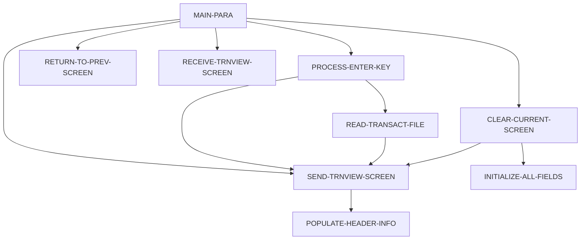

# Program COTRN01C

| Item | Value |
|---|---|
| Source | `app/cbl/COTRN01C.cbl` |
| Lines | 330 total, 231 code, 57 comment, 42 blank |
| PROGRAM-ID | COTRN01C |
| Author | AWS |
| Runtime | cics-online |
| Module | base |
| CICS transactions | CT01 (`app/csd/CARDDEMO.CSD:429-438`) |
| JCL steps | None |
| Paragraphs | 9 |
| Semantic analysis | validated (batch B07) |
| Version banner | * Ver: CardDemo_v1.0-15-g27d6c6f-68 Date: 2022-07-19 23:12:34 CDT |

## Summary

COTRN01C is a pseudo-conversational CICS COBOL program (transaction CT01, map COTRN1A in mapset COTRN01) that displays the details of one record of the TRANSACT VSAM file. Without a COMMAREA it transfers to sign-on (COSGN00C). On first entry, if the transaction list COTRN00C passed a selected Tran ID in CDEMO-CT01-TRN-SELECTED, it looks it up immediately; otherwise it shows an empty screen. On re-entry, Enter reads the Tran ID typed on the screen with CICS READ (coded with UPDATE) and shows card number, type, category, source, amount, description, original and processed timestamps and merchant details; PF3 returns to the calling program (or COMEN01C), PF4 clears the screen and PF5 goes to the transaction list COTRN00C. The program never modifies TRANSACT. (Confirmed)

Evidence: `app/cbl/COTRN01C.cbl:1-5`, `app/cbl/COTRN01C.cbl:35-39`, `app/cbl/COTRN01C.cbl:52-61`, `app/cbl/COTRN01C.cbl:94-138`, `app/cbl/COTRN01C.cbl:144-192`, `app/cbl/COTRN01C.cbl:267-296`

Header comment (Unverified, `app/cbl/COTRN01C.cbl:1-8`): Program     : COTRN01C.CBL Application : CardDemo Type        : CICS COBOL Program Function    : View a Transaction from TRANSACT file All Rights Reserved. http://www.apache.org/licenses/LICENSE-2.0

## Divisions and sections

| Division / section | Lines | Notes |
|---|---|---|
| IDENTIFICATION DIVISION | `app/cbl/COTRN01C.cbl:22-25` |  |
| ENVIRONMENT DIVISION | `app/cbl/COTRN01C.cbl:26-28` |  |
| DATA DIVISION | `app/cbl/COTRN01C.cbl:29-84` |  |
| PROCEDURE DIVISION | `app/cbl/COTRN01C.cbl:85-330` |  |
| ENVIRONMENT / CONFIGURATION SECTION | `app/cbl/COTRN01C.cbl:27-28` |  |
| DATA / WORKING-STORAGE SECTION | `app/cbl/COTRN01C.cbl:33-76` |  |
| DATA / LINKAGE SECTION | `app/cbl/COTRN01C.cbl:77-84` |  |

## Files and data stores

No SELECT entries (no COBOL file I/O).

CICS file commands (file name resolved from VALUE clauses and the CSD):

| Command | FILE option | Resolved name | CSD DSNAME | CSD evidence | Line |
|---|---|---|---|---|---|
| READ | WS-TRANSACT-FILE | TRANSACT | AWS.M2.CARDDEMO.TRANSACT.VSAM.KSDS | `app/csd/CARDDEMO.CSD:76-87` | `app/cbl/COTRN01C.cbl:269-278` |

CRUD summary from the program facts:

| Store | Kind | Ops | Evidence |
|---|---|---|---|
| TRANSACT | cics-file | R, U | `app/cbl/COTRN01C.cbl:269` |

## Embedded CICS, SQL and DL/I commands

| Paragraph | Kind | Verb | Resources | Response | Lines |
|---|---|---|---|---|---|
| MAIN-PARA | CICS | RETURN | TRANSID(WS-TRANID) |  | `app/cbl/COTRN01C.cbl:136-139` |
| RETURN-TO-PREV-SCREEN | CICS | XCTL | PROGRAM(CDEMO-TO-PROGRAM) |  | `app/cbl/COTRN01C.cbl:205-208` |
| SEND-TRNVIEW-SCREEN | CICS | SEND MAP | MAP('COTRN1A'), MAPSET('COTRN01') |  | `app/cbl/COTRN01C.cbl:219-225` |
| RECEIVE-TRNVIEW-SCREEN | CICS | RECEIVE MAP | MAP('COTRN1A'), MAPSET('COTRN01') | RESP | `app/cbl/COTRN01C.cbl:232-238` |
| READ-TRANSACT-FILE | CICS | READ | DATASET(WS-TRANSACT-FILE) | RESP | `app/cbl/COTRN01C.cbl:269-278` |

## Calls, transfers and callers

| Mechanism | Target | Parameters | Paragraph | Lines |
|---|---|---|---|---|
| EXEC CICS RETURN | WS-TRANID = CT01 | CARDDEMO-COMMAREA | MAIN-PARA | `app/cbl/COTRN01C.cbl:136-139` |
| EXEC CICS XCTL | CDEMO-TO-PROGRAM = COMEN01C, COSGN00C, COTRN00C | CARDDEMO-COMMAREA | RETURN-TO-PREV-SCREEN | `app/cbl/COTRN01C.cbl:205-208` |

Programs that transfer to or call this program (from `docs/_work/xref/call-graph.json`):

| Caller | Mechanism | Confidence | Evidence |
|---|---|---|---|
| COMEN01C | XCTL | Confirmed | `app/cbl/COMEN01C.cbl:185` |
| COTRN00C | XCTL | Confirmed | `app/cbl/COTRN00C.cbl:192` |

## Copybooks

| Copybook | Statement | Resolution | Resolved path | REPLACING | Line |
|---|---|---|---|---|---|
| [COCOM01Y](../08-data/layouts/COCOM01Y.md) | COPY | inventory | app/cpy/COCOM01Y.cpy |  | `app/cbl/COTRN01C.cbl:52` |
| COTRN01 | COPY | inventory | app/cpy-bms/COTRN01.CPY |  | `app/cbl/COTRN01C.cbl:63` |
| [COTTL01Y](../08-data/layouts/COTTL01Y.md) | COPY | inventory | app/cpy/COTTL01Y.cpy |  | `app/cbl/COTRN01C.cbl:65` |
| [CSDAT01Y](../08-data/layouts/CSDAT01Y.md) | COPY | inventory | app/cpy/CSDAT01Y.cpy |  | `app/cbl/COTRN01C.cbl:66` |
| [CSMSG01Y](../08-data/layouts/CSMSG01Y.md) | COPY | inventory | app/cpy/CSMSG01Y.cpy |  | `app/cbl/COTRN01C.cbl:67` |
| [CVTRA05Y](../08-data/layouts/CVTRA05Y.md) | COPY | inventory | app/cpy/CVTRA05Y.cpy |  | `app/cbl/COTRN01C.cbl:69` |
| DFHAID | COPY | system |  |  | `app/cbl/COTRN01C.cbl:71` |
| DFHBMSCA | COPY | system |  |  | `app/cbl/COTRN01C.cbl:72` |

## Data division items

Every data entry coded in this source (copybook contents are on the copybook pages). Lengths are computed from PIC and USAGE.

| Section | Lvl | Name | PIC | Usage | Len | OCCURS | REDEFINES | VALUE | 88-levels | Line |
|---|---|---|---|---|---|---|---|---|---|---|
| WORKING-STORAGE | 01 | WS-VARIABLES |  |  |  |  |  |  |  | 35 |
| WORKING-STORAGE | 05 | WS-PGMNAME | X(08) |  | 8 |  |  | 'COTRN01C' |  | 36 |
| WORKING-STORAGE | 05 | WS-TRANID | X(04) |  | 4 |  |  | 'CT01' |  | 37 |
| WORKING-STORAGE | 05 | WS-MESSAGE | X(80) |  | 80 |  |  | SPACES |  | 38 |
| WORKING-STORAGE | 05 | WS-TRANSACT-FILE | X(08) |  | 8 |  |  | 'TRANSACT' |  | 39 |
| WORKING-STORAGE | 05 | WS-ERR-FLG | X(01) |  | 1 |  |  | 'N' | ERR-FLG-ON = 'Y'; ERR-FLG-OFF = 'N' | 40 |
| WORKING-STORAGE | 05 | WS-RESP-CD | S9(09) | COMP | 4 |  |  | ZEROS |  | 43 |
| WORKING-STORAGE | 05 | WS-REAS-CD | S9(09) | COMP | 4 |  |  | ZEROS |  | 44 |
| WORKING-STORAGE | 05 | WS-USR-MODIFIED | X(01) |  | 1 |  |  | 'N' | USR-MODIFIED-YES = 'Y'; USR-MODIFIED-NO = 'N' | 45 |
| WORKING-STORAGE | 05 | WS-TRAN-AMT | +99999999.99 |  | 12 |  |  |  |  | 49 |
| WORKING-STORAGE | 05 | WS-TRAN-DATE | X(08) |  | 8 |  |  | '00/00/00' |  | 50 |
| WORKING-STORAGE | 05 | CDEMO-CT01-INFO |  |  |  |  |  |  |  | 53 |
| WORKING-STORAGE | 10 | CDEMO-CT01-TRNID-FIRST | X(16) |  | 16 |  |  |  |  | 54 |
| WORKING-STORAGE | 10 | CDEMO-CT01-TRNID-LAST | X(16) |  | 16 |  |  |  |  | 55 |
| WORKING-STORAGE | 10 | CDEMO-CT01-PAGE-NUM | 9(08) |  | 8 |  |  |  |  | 56 |
| WORKING-STORAGE | 10 | CDEMO-CT01-NEXT-PAGE-FLG | X(01) |  | 1 |  |  | 'N' | NEXT-PAGE-YES = 'Y'; NEXT-PAGE-NO = 'N' | 57 |
| WORKING-STORAGE | 10 | CDEMO-CT01-TRN-SEL-FLG | X(01) |  | 1 |  |  |  |  | 60 |
| WORKING-STORAGE | 10 | CDEMO-CT01-TRN-SELECTED | X(16) |  | 16 |  |  |  |  | 61 |
| LINKAGE | 01 | DFHCOMMAREA |  |  |  |  |  |  |  | 78 |
| LINKAGE | 05 | LK-COMMAREA | X(01) |  | 1 | 1 TO 32767 DEPENDING ON EIBCALEN |  |  |  | 79 |

## Statement inventory

Every procedure statement the parser recorded, by kind. Each one is listed with its line under Paragraph details.

| Kind | Count |
|---|---|
| Decisions (IF, EVALUATE, WHEN, loops, handlers) | 20 |
| Calculations | 0 |
| File I/O | 0 |
| EXEC CICS / SQL / DLI | 5 |
| CALL | 0 |
| PERFORM | 17 |
| GO TO | 0 |
| MOVE literal | 17 |
| MOVE field | 40 |
| SET | 3 |
| STRING, UNSTRING, INSPECT, INITIALIZE, COPY, ENTRY and others | 0 |
| DISPLAY | 1 |
| GOBACK, STOP RUN, RETURN, XCTL | 2 |
| Not classified by the parser | 0 |

## Control flow

| Paragraph | Lines | Logic | Performs | Performed by | Reachable |
|---|---|---|---|---|---|
| [MAIN-PARA](#para-main-para) | 86-139 | Resets flags and message. EIBCALEN = 0 XCTLs to COSGN00C. Otherwise loads CARDDEMO-COMMAREA; on first entry sets re-enter, clears the map and, when CDEMO-CT01-TRN-SELECTED is not blank, moves it to TRNIDINI and performs PROCESS-ENTER-KEY, then sends the screen. On re-entry it receives the map and dispatches on EIBAID: Enter, PF3 (XCTL to CDEMO-FROM-PROGRAM or COMEN01C), PF4 (clear), PF5 (XCTL to COTRN00C), other keys show CCDA-MSG-INVALID-KEY. Ends with CICS RETURN TRANSID CT01. (Confirmed) | CLEAR-CURRENT-SCREEN, PROCESS-ENTER-KEY, RECEIVE-TRNVIEW-SCREEN, RETURN-TO-PREV-SCREEN, SEND-TRNVIEW-SCREEN |  | yes |
| [PROCESS-ENTER-KEY](#para-process-enter-key) | 144-192 | Rejects a blank TRNIDINI with 'Tran ID can NOT be empty...'. Otherwise blanks the detail fields, moves TRNIDINI to TRAN-ID and performs READ-TRANSACT-FILE. If no error, moves the TRAN-RECORD fields (amount edited via WS-TRAN-AMT) to the map detail fields and sends the screen. (Confirmed) | READ-TRANSACT-FILE, SEND-TRNVIEW-SCREEN | MAIN-PARA | yes |
| [RETURN-TO-PREV-SCREEN](#para-return-to-prev-screen) | 197-208 | Defaults CDEMO-TO-PROGRAM to COSGN00C when blank, sets CDEMO-FROM-TRANID/CDEMO-FROM-PROGRAM to CT01/COTRN01C, resets CDEMO-PGM-CONTEXT to 0 and XCTLs to CDEMO-TO-PROGRAM with the COMMAREA. (Confirmed) |  | MAIN-PARA | yes |
| [SEND-TRNVIEW-SCREEN](#para-send-trnview-screen) | 213-225 | Fills the header, moves WS-MESSAGE to ERRMSGO and sends map COTRN1A with ERASE and CURSOR. (Confirmed) | POPULATE-HEADER-INFO | CLEAR-CURRENT-SCREEN, MAIN-PARA, PROCESS-ENTER-KEY, READ-TRANSACT-FILE | yes |
| [RECEIVE-TRNVIEW-SCREEN](#para-receive-trnview-screen) | 230-238 | Receives map COTRN1A into COTRN1AI with RESP/RESP2; the response is not tested. (Confirmed) |  | MAIN-PARA | yes |
| [POPULATE-HEADER-INFO](#para-populate-header-info) | 243-262 | Moves FUNCTION CURRENT-DATE to WS-CURDATE-DATA, CCDA-TITLE01/CCDA-TITLE02 to TITLE01O/TITLE02O, WS-TRANID to TRNNAMEO and WS-PGMNAME to PGMNAMEO of COTRN1AO; rebuilds the date as WS-CURDATE-MM-DD-YY (MM/DD/YY from WS-CURDATE-MONTH, WS-CURDATE-DAY, WS-CURDATE-YEAR(3:2)) into CURDATEO and the time as WS-CURTIME-HH-MM-SS into CURTIMEO. (Confirmed) |  | SEND-TRNVIEW-SCREEN | yes |
| [READ-TRANSACT-FILE](#para-read-transact-file) | 267-296 | Issues CICS READ UPDATE on TRANSACT by TRAN-ID into TRAN-RECORD. NORMAL continues; NOTFND sets the error flag and sends 'Transaction ID NOT found...'; any other response displays RESP/REAS, sets the error flag and sends 'Unable to lookup Transaction...'. (Confirmed) | SEND-TRNVIEW-SCREEN | PROCESS-ENTER-KEY | yes |
| [CLEAR-CURRENT-SCREEN](#para-clear-current-screen) | 301-304 | Performs INITIALIZE-ALL-FIELDS and sends the screen. (Confirmed) | INITIALIZE-ALL-FIELDS, SEND-TRNVIEW-SCREEN | MAIN-PARA | yes |
| [INITIALIZE-ALL-FIELDS](#para-initialize-all-fields) | 309-326 | Positions the cursor on TRNIDIN and moves SPACES to the input Tran ID, all detail fields and WS-MESSAGE. (Confirmed) |  | CLEAR-CURRENT-SCREEN | yes |

## Paragraph details

### Para MAIN-PARA

Lines `app/cbl/COTRN01C.cbl:86-139`. 

Logic: Resets flags and message. EIBCALEN = 0 XCTLs to COSGN00C. Otherwise loads CARDDEMO-COMMAREA; on first entry sets re-enter, clears the map and, when CDEMO-CT01-TRN-SELECTED is not blank, moves it to TRNIDINI and performs PROCESS-ENTER-KEY, then sends the screen. On re-entry it receives the map and dispatches on EIBAID: Enter, PF3 (XCTL to CDEMO-FROM-PROGRAM or COMEN01C), PF4 (clear), PF5 (XCTL to COTRN00C), other keys show CCDA-MSG-INVALID-KEY. Ends with CICS RETURN TRANSID CT01. (Confirmed)

Rules: [BR-COTRN01C-001](../09-business-rules-catalog.md#br-cotrn01c-001), [BR-COTRN01C-002](../09-business-rules-catalog.md#br-cotrn01c-002), [BR-COTRN01C-003](../09-business-rules-catalog.md#br-cotrn01c-003)

Statements in source order:

- `SET ERR-FLG-OFF TO TRUE` at `app/cbl/COTRN01C.cbl:88`
- `SET USR-MODIFIED-NO TO TRUE` at `app/cbl/COTRN01C.cbl:89`
- `MOVE SPACES TO WS-MESSAGE ERRMSGO OF COTRN1AO` at `app/cbl/COTRN01C.cbl:91-92`
- IF `EIBCALEN = 0` at `app/cbl/COTRN01C.cbl:94` (pseudo-conversation)
- MOVE `'COSGN00C'` TO CDEMO-TO-PROGRAM at `app/cbl/COTRN01C.cbl:95`
- PERFORM RETURN-TO-PREV-SCREEN at `app/cbl/COTRN01C.cbl:96`
- `MOVE DFHCOMMAREA(1:EIBCALEN) TO CARDDEMO-COMMAREA` at `app/cbl/COTRN01C.cbl:98`
- IF `NOT CDEMO-PGM-REENTER` at `app/cbl/COTRN01C.cbl:99` (pseudo-conversation)
- `SET CDEMO-PGM-REENTER TO TRUE` at `app/cbl/COTRN01C.cbl:100`
- `MOVE LOW-VALUES TO COTRN1AO` at `app/cbl/COTRN01C.cbl:101`
- MOVE `-1` TO TRNIDINL OF COTRN1AI at `app/cbl/COTRN01C.cbl:102`
- IF `CDEMO-CT01-TRN-SELECTED NOT = SPACES AND LOW-VALUES` at `app/cbl/COTRN01C.cbl:103-104` (business-candidate)
- `MOVE CDEMO-CT01-TRN-SELECTED TO TRNIDINI OF COTRN1AI` at `app/cbl/COTRN01C.cbl:105-106`
- PERFORM PROCESS-ENTER-KEY at `app/cbl/COTRN01C.cbl:107`
- PERFORM SEND-TRNVIEW-SCREEN at `app/cbl/COTRN01C.cbl:109`
- PERFORM RECEIVE-TRNVIEW-SCREEN at `app/cbl/COTRN01C.cbl:111`
- EVALUATE `EIBAID` at `app/cbl/COTRN01C.cbl:112` (screen-key)
- WHEN `DFHENTER` at `app/cbl/COTRN01C.cbl:113` (screen-key)
- PERFORM PROCESS-ENTER-KEY at `app/cbl/COTRN01C.cbl:114`
- WHEN `DFHPF3` at `app/cbl/COTRN01C.cbl:115` (screen-key)
- IF `CDEMO-FROM-PROGRAM = SPACES OR LOW-VALUES` at `app/cbl/COTRN01C.cbl:116` (pseudo-conversation)
- MOVE `'COMEN01C'` TO CDEMO-TO-PROGRAM at `app/cbl/COTRN01C.cbl:117`
- `MOVE CDEMO-FROM-PROGRAM TO CDEMO-TO-PROGRAM` at `app/cbl/COTRN01C.cbl:119-120`
- PERFORM RETURN-TO-PREV-SCREEN at `app/cbl/COTRN01C.cbl:122`
- WHEN `DFHPF4` at `app/cbl/COTRN01C.cbl:123` (screen-key)
- PERFORM CLEAR-CURRENT-SCREEN at `app/cbl/COTRN01C.cbl:124`
- WHEN `DFHPF5` at `app/cbl/COTRN01C.cbl:125` (screen-key)
- MOVE `'COTRN00C'` TO CDEMO-TO-PROGRAM at `app/cbl/COTRN01C.cbl:126`
- PERFORM RETURN-TO-PREV-SCREEN at `app/cbl/COTRN01C.cbl:127`
- WHEN `OTHER` at `app/cbl/COTRN01C.cbl:128` (screen-key)
- MOVE `'Y'` TO WS-ERR-FLG at `app/cbl/COTRN01C.cbl:129`
- `MOVE CCDA-MSG-INVALID-KEY TO WS-MESSAGE` at `app/cbl/COTRN01C.cbl:130`
- PERFORM SEND-TRNVIEW-SCREEN at `app/cbl/COTRN01C.cbl:131`
- EXEC CICS RETURN at `app/cbl/COTRN01C.cbl:136-139`
- Ends with EXEC CICS RETURN at `app/cbl/COTRN01C.cbl:136-139`

### Para PROCESS-ENTER-KEY

Lines `app/cbl/COTRN01C.cbl:144-192`. 

Logic: Rejects a blank TRNIDINI with 'Tran ID can NOT be empty...'. Otherwise blanks the detail fields, moves TRNIDINI to TRAN-ID and performs READ-TRANSACT-FILE. If no error, moves the TRAN-RECORD fields (amount edited via WS-TRAN-AMT) to the map detail fields and sends the screen. (Confirmed)

Rules: [BR-COTRN01C-004](../09-business-rules-catalog.md#br-cotrn01c-004), [BR-COTRN01C-006](../09-business-rules-catalog.md#br-cotrn01c-006)

Statements in source order:

- EVALUATE `TRUE` at `app/cbl/COTRN01C.cbl:146` (business-candidate)
- WHEN `TRNIDINI OF COTRN1AI = SPACES OR LOW-VALUES` at `app/cbl/COTRN01C.cbl:147` (business-candidate)
- MOVE `'Y'` TO WS-ERR-FLG at `app/cbl/COTRN01C.cbl:148`
- MOVE `'Tran ID can NOT be empty...'` TO WS-MESSAGE at `app/cbl/COTRN01C.cbl:149-150`
- MOVE `-1` TO TRNIDINL OF COTRN1AI at `app/cbl/COTRN01C.cbl:151`
- PERFORM SEND-TRNVIEW-SCREEN at `app/cbl/COTRN01C.cbl:152`
- WHEN `OTHER` at `app/cbl/COTRN01C.cbl:153` (business-candidate)
- MOVE `-1` TO TRNIDINL OF COTRN1AI at `app/cbl/COTRN01C.cbl:154`
- IF `NOT ERR-FLG-ON` at `app/cbl/COTRN01C.cbl:158` (error-flag)
- `MOVE SPACES TO TRNIDI OF COTRN1AI CARDNUMI OF COTRN1AI TTYPCDI OF COTRN1AI TCATCDI OF COTRN1AI TRNSRCI OF COTRN1AI TRNAMTI OF COTRN1AI TDESCI OF COTRN1AI TORIGDTI OF COTRN1AI TPROCDTI OF COTRN1AI MIDI` at `app/cbl/COTRN01C.cbl:159-171`
- `MOVE TRNIDINI OF COTRN1AI TO TRAN-ID` at `app/cbl/COTRN01C.cbl:172`
- PERFORM READ-TRANSACT-FILE at `app/cbl/COTRN01C.cbl:173`
- IF `NOT ERR-FLG-ON` at `app/cbl/COTRN01C.cbl:176` (error-flag)
- `MOVE TRAN-AMT TO WS-TRAN-AMT` at `app/cbl/COTRN01C.cbl:177`
- `MOVE TRAN-ID TO TRNIDI OF COTRN1AI` at `app/cbl/COTRN01C.cbl:178`
- `MOVE TRAN-CARD-NUM TO CARDNUMI OF COTRN1AI` at `app/cbl/COTRN01C.cbl:179`
- `MOVE TRAN-TYPE-CD TO TTYPCDI OF COTRN1AI` at `app/cbl/COTRN01C.cbl:180`
- `MOVE TRAN-CAT-CD TO TCATCDI OF COTRN1AI` at `app/cbl/COTRN01C.cbl:181`
- `MOVE TRAN-SOURCE TO TRNSRCI OF COTRN1AI` at `app/cbl/COTRN01C.cbl:182`
- `MOVE WS-TRAN-AMT TO TRNAMTI OF COTRN1AI` at `app/cbl/COTRN01C.cbl:183`
- `MOVE TRAN-DESC TO TDESCI OF COTRN1AI` at `app/cbl/COTRN01C.cbl:184`
- `MOVE TRAN-ORIG-TS TO TORIGDTI OF COTRN1AI` at `app/cbl/COTRN01C.cbl:185`
- `MOVE TRAN-PROC-TS TO TPROCDTI OF COTRN1AI` at `app/cbl/COTRN01C.cbl:186`
- `MOVE TRAN-MERCHANT-ID TO MIDI OF COTRN1AI` at `app/cbl/COTRN01C.cbl:187`
- `MOVE TRAN-MERCHANT-NAME TO MNAMEI OF COTRN1AI` at `app/cbl/COTRN01C.cbl:188`
- `MOVE TRAN-MERCHANT-CITY TO MCITYI OF COTRN1AI` at `app/cbl/COTRN01C.cbl:189`
- `MOVE TRAN-MERCHANT-ZIP TO MZIPI OF COTRN1AI` at `app/cbl/COTRN01C.cbl:190`
- PERFORM SEND-TRNVIEW-SCREEN at `app/cbl/COTRN01C.cbl:191`

### Para RETURN-TO-PREV-SCREEN

Lines `app/cbl/COTRN01C.cbl:197-208`. 

Logic: Defaults CDEMO-TO-PROGRAM to COSGN00C when blank, sets CDEMO-FROM-TRANID/CDEMO-FROM-PROGRAM to CT01/COTRN01C, resets CDEMO-PGM-CONTEXT to 0 and XCTLs to CDEMO-TO-PROGRAM with the COMMAREA. (Confirmed)

Statements in source order:

- IF `CDEMO-TO-PROGRAM = LOW-VALUES OR SPACES` at `app/cbl/COTRN01C.cbl:199` (business-candidate)
- MOVE `'COSGN00C'` TO CDEMO-TO-PROGRAM at `app/cbl/COTRN01C.cbl:200`
- `MOVE WS-TRANID TO CDEMO-FROM-TRANID` at `app/cbl/COTRN01C.cbl:202`
- `MOVE WS-PGMNAME TO CDEMO-FROM-PROGRAM` at `app/cbl/COTRN01C.cbl:203`
- `MOVE ZEROS TO CDEMO-PGM-CONTEXT` at `app/cbl/COTRN01C.cbl:204`
- EXEC CICS XCTL at `app/cbl/COTRN01C.cbl:205-208`
- Ends with EXEC CICS XCTL at `app/cbl/COTRN01C.cbl:205-208`

### Para SEND-TRNVIEW-SCREEN

Lines `app/cbl/COTRN01C.cbl:213-225`. 

Logic: Fills the header, moves WS-MESSAGE to ERRMSGO and sends map COTRN1A with ERASE and CURSOR. (Confirmed)

Statements in source order:

- PERFORM POPULATE-HEADER-INFO at `app/cbl/COTRN01C.cbl:215`
- `MOVE WS-MESSAGE TO ERRMSGO OF COTRN1AO` at `app/cbl/COTRN01C.cbl:217`
- EXEC CICS SEND MAP at `app/cbl/COTRN01C.cbl:219-225`

### Para RECEIVE-TRNVIEW-SCREEN

Lines `app/cbl/COTRN01C.cbl:230-238`. 

Logic: Receives map COTRN1A into COTRN1AI with RESP/RESP2; the response is not tested. (Confirmed)

Statements in source order:

- EXEC CICS RECEIVE MAP at `app/cbl/COTRN01C.cbl:232-238`

### Para POPULATE-HEADER-INFO

Lines `app/cbl/COTRN01C.cbl:243-262`. 

Logic: Moves FUNCTION CURRENT-DATE to WS-CURDATE-DATA, CCDA-TITLE01/CCDA-TITLE02 to TITLE01O/TITLE02O, WS-TRANID to TRNNAMEO and WS-PGMNAME to PGMNAMEO of COTRN1AO; rebuilds the date as WS-CURDATE-MM-DD-YY (MM/DD/YY from WS-CURDATE-MONTH, WS-CURDATE-DAY, WS-CURDATE-YEAR(3:2)) into CURDATEO and the time as WS-CURTIME-HH-MM-SS into CURTIMEO. (Confirmed)

Statements in source order:

- `MOVE FUNCTION CURRENT-DATE TO WS-CURDATE-DATA` at `app/cbl/COTRN01C.cbl:245`
- `MOVE CCDA-TITLE01 TO TITLE01O OF COTRN1AO` at `app/cbl/COTRN01C.cbl:247`
- `MOVE CCDA-TITLE02 TO TITLE02O OF COTRN1AO` at `app/cbl/COTRN01C.cbl:248`
- `MOVE WS-TRANID TO TRNNAMEO OF COTRN1AO` at `app/cbl/COTRN01C.cbl:249`
- `MOVE WS-PGMNAME TO PGMNAMEO OF COTRN1AO` at `app/cbl/COTRN01C.cbl:250`
- `MOVE WS-CURDATE-MONTH TO WS-CURDATE-MM` at `app/cbl/COTRN01C.cbl:252`
- `MOVE WS-CURDATE-DAY TO WS-CURDATE-DD` at `app/cbl/COTRN01C.cbl:253`
- `MOVE WS-CURDATE-YEAR(3:2) TO WS-CURDATE-YY` at `app/cbl/COTRN01C.cbl:254`
- `MOVE WS-CURDATE-MM-DD-YY TO CURDATEO OF COTRN1AO` at `app/cbl/COTRN01C.cbl:256`
- `MOVE WS-CURTIME-HOURS TO WS-CURTIME-HH` at `app/cbl/COTRN01C.cbl:258`
- `MOVE WS-CURTIME-MINUTE TO WS-CURTIME-MM` at `app/cbl/COTRN01C.cbl:259`
- `MOVE WS-CURTIME-SECOND TO WS-CURTIME-SS` at `app/cbl/COTRN01C.cbl:260`
- `MOVE WS-CURTIME-HH-MM-SS TO CURTIMEO OF COTRN1AO` at `app/cbl/COTRN01C.cbl:262`

### Para READ-TRANSACT-FILE

Lines `app/cbl/COTRN01C.cbl:267-296`. 

Logic: Issues CICS READ UPDATE on TRANSACT by TRAN-ID into TRAN-RECORD. NORMAL continues; NOTFND sets the error flag and sends 'Transaction ID NOT found...'; any other response displays RESP/REAS, sets the error flag and sends 'Unable to lookup Transaction...'. (Confirmed)

Rules: [BR-COTRN01C-005](../09-business-rules-catalog.md#br-cotrn01c-005)

Statements in source order:

- EXEC CICS READ at `app/cbl/COTRN01C.cbl:269-278`
- EVALUATE `WS-RESP-CD` at `app/cbl/COTRN01C.cbl:280` (io-status)
- WHEN `DFHRESP(NORMAL)` at `app/cbl/COTRN01C.cbl:281` (io-status)
- WHEN `DFHRESP(NOTFND)` at `app/cbl/COTRN01C.cbl:283` (io-status)
- MOVE `'Y'` TO WS-ERR-FLG at `app/cbl/COTRN01C.cbl:284`
- MOVE `'Transaction ID NOT found...'` TO WS-MESSAGE at `app/cbl/COTRN01C.cbl:285-286`
- MOVE `-1` TO TRNIDINL OF COTRN1AI at `app/cbl/COTRN01C.cbl:287`
- PERFORM SEND-TRNVIEW-SCREEN at `app/cbl/COTRN01C.cbl:288`
- WHEN `OTHER` at `app/cbl/COTRN01C.cbl:289` (io-status)
- `DISPLAY 'RESP:' WS-RESP-CD 'REAS:' WS-REAS-CD` at `app/cbl/COTRN01C.cbl:290`
- MOVE `'Y'` TO WS-ERR-FLG at `app/cbl/COTRN01C.cbl:291`
- MOVE `'Unable to lookup Transaction...'` TO WS-MESSAGE at `app/cbl/COTRN01C.cbl:292-293`
- MOVE `-1` TO TRNIDINL OF COTRN1AI at `app/cbl/COTRN01C.cbl:294`
- PERFORM SEND-TRNVIEW-SCREEN at `app/cbl/COTRN01C.cbl:295`

### Para CLEAR-CURRENT-SCREEN

Lines `app/cbl/COTRN01C.cbl:301-304`. 

Logic: Performs INITIALIZE-ALL-FIELDS and sends the screen. (Confirmed)

Statements in source order:

- PERFORM INITIALIZE-ALL-FIELDS at `app/cbl/COTRN01C.cbl:303`
- PERFORM SEND-TRNVIEW-SCREEN at `app/cbl/COTRN01C.cbl:304`

### Para INITIALIZE-ALL-FIELDS

Lines `app/cbl/COTRN01C.cbl:309-326`. 

Logic: Positions the cursor on TRNIDIN and moves SPACES to the input Tran ID, all detail fields and WS-MESSAGE. (Confirmed)

Statements in source order:

- MOVE `-1` TO TRNIDINL OF COTRN1AI at `app/cbl/COTRN01C.cbl:311`
- `MOVE SPACES TO TRNIDINI OF COTRN1AI TRNIDI OF COTRN1AI CARDNUMI OF COTRN1AI TTYPCDI OF COTRN1AI TCATCDI OF COTRN1AI TRNSRCI OF COTRN1AI TRNAMTI OF COTRN1AI TDESCI OF COTRN1AI TORIGDTI OF COTRN1AI TPRO` at `app/cbl/COTRN01C.cbl:312-326`

## Business rules

| Rule | Category | Statement | Paragraph | Source | Confidence |
|---|---|---|---|---|---|
| [BR-COTRN01C-001](../09-business-rules-catalog.md#br-cotrn01c-001) | routing | When started without a COMMAREA (EIBCALEN = 0) the user is sent to the sign-on program COSGN00C. | MAIN-PARA | `app/cbl/COTRN01C.cbl:94-96`, `app/cbl/COTRN01C.cbl:199-207` | Confirmed |
| [BR-COTRN01C-002](../09-business-rules-catalog.md#br-cotrn01c-002) | decision | On first entry, when a Tran ID was selected on the transaction list (CDEMO-CT01-TRN-SELECTED not blank), that transaction is looked up and displayed immediately without the user typing it; otherwise an empty view screen is shown. | MAIN-PARA | `app/cbl/COTRN01C.cbl:99-109` | Confirmed |
| [BR-COTRN01C-003](../09-business-rules-catalog.md#br-cotrn01c-003) | routing | On re-entry the attention key decides the action: Enter looks up the typed Tran ID; PF3 returns to the program that called this one (CDEMO-FROM-PROGRAM) or to the main menu COMEN01C when unknown; PF4 clears the screen; PF5 goes to the transaction list COTRN00C; any other key shows the invalid-key message. | MAIN-PARA | `app/cbl/COTRN01C.cbl:112-132` | Confirmed |
| [BR-COTRN01C-004](../09-business-rules-catalog.md#br-cotrn01c-004) | validation | A Tran ID is mandatory to view a transaction; no format (numeric) check is applied. | PROCESS-ENTER-KEY | `app/cbl/COTRN01C.cbl:146-156` | Confirmed |
| [BR-COTRN01C-005](../09-business-rules-catalog.md#br-cotrn01c-005) | error-policy | The transaction is read by exact Tran ID; if it does not exist the user is told it was not found, and any other read failure shows a lookup-failure message; in both cases the details are not displayed. | READ-TRANSACT-FILE | `app/cbl/COTRN01C.cbl:280-295` | Confirmed |
| [BR-COTRN01C-006](../09-business-rules-catalog.md#br-cotrn01c-006) | transformation | A found transaction is displayed with its amount edited with sign and two decimals (+99999999.99); timestamps and other fields are shown as stored. | PROCESS-ENTER-KEY | `app/cbl/COTRN01C.cbl:176-191` | Confirmed |

Decision points reviewed and classified as not business rules:

| Lines | Reason |
|---|---|
| `app/cbl/COTRN01C.cbl:199-201` | Defensive default of the XCTL target to COSGN00C when CDEMO-TO-PROGRAM is blank (technical fallback). |

Decision coverage: 5 of 5 business-candidate decision points are linked to a rule or a no-rule reason (5 inside rule ranges).

## Error handling

| Paragraph | Kind | Detail | Lines |
|---|---|---|---|
| READ-TRANSACT-FILE | check | `WS-RESP-CD` | `app/cbl/COTRN01C.cbl:280` |
| READ-TRANSACT-FILE | check | `DFHRESP(NORMAL)` | `app/cbl/COTRN01C.cbl:281` |
| READ-TRANSACT-FILE | check | `DFHRESP(NOTFND)` | `app/cbl/COTRN01C.cbl:283` |
| READ-TRANSACT-FILE | check | `OTHER` | `app/cbl/COTRN01C.cbl:289` |

## Observations and SME questions

- anomaly: The read for a view-only screen is coded with UPDATE, which takes an exclusive record lock; no REWRITE or UNLOCK follows, so the lock is held until the task ends at CICS RETURN. (`app/cbl/COTRN01C.cbl:269-278`)
- anomaly: On first entry with a selected Tran ID, PROCESS-ENTER-KEY already sends the map (line 191 or the error sends at 152/287/294) and MAIN-PARA sends it again at line 109, so two SEND MAP commands are issued in one task. (`app/cbl/COTRN01C.cbl:103-109`)
- anomaly: CDEMO-CT01-INFO is declared inline and must match the CDEMO-CT00-INFO layout declared inline in COTRN00C for the selected Tran ID to be passed correctly; no shared copybook enforces this. (`app/cbl/COTRN01C.cbl:52-61`)
- dead-code: WS-USR-MODIFIED and its 88-levels are set but never tested. (`app/cbl/COTRN01C.cbl:45-47`)
- unchecked-io: RECEIVE MAP response codes are captured but never tested. (`app/cbl/COTRN01C.cbl:232-238`)
- hardcoded-value: File 'TRANSACT', transaction 'CT01' and program names COSGN00C, COMEN01C, COTRN00C are literals. (`app/cbl/COTRN01C.cbl:36-39`)
- security: Any Tran ID can be viewed; there is no check that the transaction belongs to the signed-on user's account or card. (`app/cbl/COTRN01C.cbl:172-173`)
- SME question: Is the READ ... UPDATE on TRANSACT intentional (e.g. planned edit function) or should it be a plain read for this view screen? (`app/cbl/COTRN01C.cbl:269-278`)
- SME question: Should viewing a transaction be limited to the signed-on user's accounts/cards, and should the Tran ID be validated as numeric as on the list screen? (`app/cbl/COTRN01C.cbl:146-156`)

## Sources

- `app/cbl/COTRN01C.cbl`
- `docs/_work/structure/programs/COTRN01C.json`
- `docs/_work/semantic/programs/COTRN01C.json`
- `docs/_work/programs/COTRN01C.json`

## Confidence

Structure tables (divisions, items, paragraphs, statements, line numbers) are Confirmed: they are parsed from the source. Paragraph logic and rule statements carry their own Confirmed/Inferred tag from the batch analysis, and every rule anchor was checked against the cited lines. Decision-point classes are a keyword heuristic used only for coverage measurement. Header comments are Unverified.
