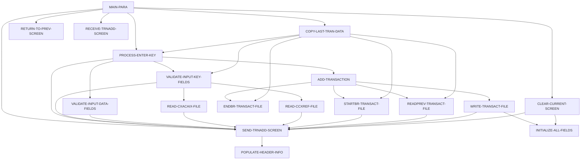

# Program COTRN02C

| Item | Value |
|---|---|
| Source | `app/cbl/COTRN02C.cbl` |
| Lines | 783 total, 614 code, 85 comment, 84 blank |
| PROGRAM-ID | COTRN02C |
| Author | AWS |
| Runtime | cics-online |
| Module | base |
| CICS transactions | CT02 (`app/csd/CARDDEMO.CSD:439-448`) |
| JCL steps | None |
| Paragraphs | 18 |
| Semantic analysis | validated (batch B06) |
| Version banner | * Ver: CardDemo_v1.0-15-g27d6c6f-68 Date: 2022-07-19 23:12:34 CDT |

## Summary

COTRN02C is a pseudo-conversational CICS program (transaction CT02, mapset COTRN02, map COTRN2A) that adds a new transaction record to the TRANSACT VSAM file. The user identifies the card either by account number (resolved to a card through the CXACAIX alternate index of the card cross-reference) or by card number (resolved to an account through CCXREF), then enters type code, category code, source, description, amount (format -99999999.99), origination and processing dates (YYYY-MM-DD, validated with CSUTLDTC) and merchant id, name, city and zip. After the user confirms with Y, the next transaction id is computed as the highest existing TRAN-ID plus 1 (STARTBR/READPREV from HIGH-VALUES) and the record is written; the user sees 'Transaction added successfully.  Your Tran ID is <id>.'. PF4 clears the screen, PF5 copies the data fields of the last transaction in the file, PF3 returns to the calling program or the main menu COMEN01C. Every screen send ends the task with CICS RETURN, so the first validation error stops processing. (Confirmed)

Evidence: `app/cbl/COTRN02C.cbl:1-5`, `app/cbl/COTRN02C.cbl:36-60`, `app/cbl/COTRN02C.cbl:107-159`, `app/cbl/COTRN02C.cbl:164-437`, `app/cbl/COTRN02C.cbl:442-466`, `app/cbl/COTRN02C.cbl:516-534`, `app/cbl/COTRN02C.cbl:711-749`

Header comment (Unverified, `app/cbl/COTRN02C.cbl:1-8`): Program     : COTRN02C.CBL Application : CardDemo Type        : CICS COBOL Program Function    : Add a new Transaction to TRANSACT file All Rights Reserved. http://www.apache.org/licenses/LICENSE-2.0

## Divisions and sections

| Division / section | Lines | Notes |
|---|---|---|
| IDENTIFICATION DIVISION | `app/cbl/COTRN02C.cbl:22-25` |  |
| ENVIRONMENT DIVISION | `app/cbl/COTRN02C.cbl:26-28` |  |
| DATA DIVISION | `app/cbl/COTRN02C.cbl:29-105` |  |
| PROCEDURE DIVISION | `app/cbl/COTRN02C.cbl:106-783` |  |
| ENVIRONMENT / CONFIGURATION SECTION | `app/cbl/COTRN02C.cbl:27-28` |  |
| DATA / WORKING-STORAGE SECTION | `app/cbl/COTRN02C.cbl:33-97` |  |
| DATA / LINKAGE SECTION | `app/cbl/COTRN02C.cbl:98-105` |  |

## Files and data stores

No SELECT entries (no COBOL file I/O).

CICS file commands (file name resolved from VALUE clauses and the CSD):

| Command | FILE option | Resolved name | CSD DSNAME | CSD evidence | Line |
|---|---|---|---|---|---|
| READ | WS-CXACAIX-FILE | CXACAIX | AWS.M2.CARDDEMO.CARDXREF.VSAM.AIX.PATH | `app/csd/CARDDEMO.CSD:63-75` | `app/cbl/COTRN02C.cbl:578-586` |
| READ | WS-CCXREF-FILE | CCXREF | AWS.M2.CARDDEMO.CARDXREF.VSAM.KSDS | `app/csd/CARDDEMO.CSD:37-49` | `app/cbl/COTRN02C.cbl:611-619` |
| STARTBR | WS-TRANSACT-FILE | TRANSACT | AWS.M2.CARDDEMO.TRANSACT.VSAM.KSDS | `app/csd/CARDDEMO.CSD:76-87` | `app/cbl/COTRN02C.cbl:644-650` |
| READPREV | WS-TRANSACT-FILE | TRANSACT | AWS.M2.CARDDEMO.TRANSACT.VSAM.KSDS | `app/csd/CARDDEMO.CSD:76-87` | `app/cbl/COTRN02C.cbl:675-683` |
| ENDBR | WS-TRANSACT-FILE | TRANSACT | AWS.M2.CARDDEMO.TRANSACT.VSAM.KSDS | `app/csd/CARDDEMO.CSD:76-87` | `app/cbl/COTRN02C.cbl:704-706` |
| WRITE | WS-TRANSACT-FILE | TRANSACT | AWS.M2.CARDDEMO.TRANSACT.VSAM.KSDS | `app/csd/CARDDEMO.CSD:76-87` | `app/cbl/COTRN02C.cbl:713-721` |

CRUD summary from the program facts:

| Store | Kind | Ops | Evidence |
|---|---|---|---|
| TRANSACT | cics-file | B, C | `app/cbl/COTRN02C.cbl:644-713` |
| CXACAIX | cics-file | R | `app/cbl/COTRN02C.cbl:578` |
| CCXREF | cics-file | R | `app/cbl/COTRN02C.cbl:611` |

## Embedded CICS, SQL and DL/I commands

| Paragraph | Kind | Verb | Resources | Response | Lines |
|---|---|---|---|---|---|
| MAIN-PARA | CICS | RETURN | TRANSID(WS-TRANID) |  | `app/cbl/COTRN02C.cbl:156-159` |
| RETURN-TO-PREV-SCREEN | CICS | XCTL | PROGRAM(CDEMO-TO-PROGRAM) |  | `app/cbl/COTRN02C.cbl:508-511` |
| SEND-TRNADD-SCREEN | CICS | SEND MAP | MAP('COTRN2A'), MAPSET('COTRN02') |  | `app/cbl/COTRN02C.cbl:522-528` |
| SEND-TRNADD-SCREEN | CICS | RETURN | TRANSID(WS-TRANID) |  | `app/cbl/COTRN02C.cbl:530-534` |
| RECEIVE-TRNADD-SCREEN | CICS | RECEIVE MAP | MAP('COTRN2A'), MAPSET('COTRN02') | RESP | `app/cbl/COTRN02C.cbl:541-547` |
| READ-CXACAIX-FILE | CICS | READ | DATASET(WS-CXACAIX-FILE) | RESP | `app/cbl/COTRN02C.cbl:578-586` |
| READ-CCXREF-FILE | CICS | READ | DATASET(WS-CCXREF-FILE) | RESP | `app/cbl/COTRN02C.cbl:611-619` |
| STARTBR-TRANSACT-FILE | CICS | STARTBR | DATASET(WS-TRANSACT-FILE) | RESP | `app/cbl/COTRN02C.cbl:644-650` |
| READPREV-TRANSACT-FILE | CICS | READPREV | DATASET(WS-TRANSACT-FILE) | RESP | `app/cbl/COTRN02C.cbl:675-683` |
| ENDBR-TRANSACT-FILE | CICS | ENDBR | DATASET(WS-TRANSACT-FILE) |  | `app/cbl/COTRN02C.cbl:704-706` |
| WRITE-TRANSACT-FILE | CICS | WRITE | DATASET(WS-TRANSACT-FILE) | RESP | `app/cbl/COTRN02C.cbl:713-721` |

## Calls, transfers and callers

| Mechanism | Target | Parameters | Paragraph | Lines |
|---|---|---|---|---|
| EXEC CICS RETURN | WS-TRANID = CT02 | CARDDEMO-COMMAREA | MAIN-PARA | `app/cbl/COTRN02C.cbl:156-159` |
| CALL static | CSUTLDTC | CSUTLDTC-DATE, CSUTLDTC-DATE-FORMAT, CSUTLDTC-RESULT | VALIDATE-INPUT-DATA-FIELDS | `app/cbl/COTRN02C.cbl:393-395` |
| CALL static | CSUTLDTC | CSUTLDTC-DATE, CSUTLDTC-DATE-FORMAT, CSUTLDTC-RESULT | VALIDATE-INPUT-DATA-FIELDS | `app/cbl/COTRN02C.cbl:413-415` |
| EXEC CICS XCTL | CDEMO-TO-PROGRAM = COMEN01C, COSGN00C | CARDDEMO-COMMAREA | RETURN-TO-PREV-SCREEN | `app/cbl/COTRN02C.cbl:508-511` |
| EXEC CICS RETURN | WS-TRANID = CT02 | CARDDEMO-COMMAREA | SEND-TRNADD-SCREEN | `app/cbl/COTRN02C.cbl:530-534` |

Programs that transfer to or call this program (from `docs/_work/xref/call-graph.json`):

| Caller | Mechanism | Confidence | Evidence |
|---|---|---|---|
| COMEN01C | XCTL | Confirmed | `app/cbl/COMEN01C.cbl:185` |

## Copybooks

| Copybook | Statement | Resolution | Resolved path | REPLACING | Line |
|---|---|---|---|---|---|
| [COCOM01Y](../08-data/layouts/COCOM01Y.md) | COPY | inventory | app/cpy/COCOM01Y.cpy |  | `app/cbl/COTRN02C.cbl:71` |
| COTRN02 | COPY | inventory | app/cpy-bms/COTRN02.CPY |  | `app/cbl/COTRN02C.cbl:82` |
| [COTTL01Y](../08-data/layouts/COTTL01Y.md) | COPY | inventory | app/cpy/COTTL01Y.cpy |  | `app/cbl/COTRN02C.cbl:84` |
| [CSDAT01Y](../08-data/layouts/CSDAT01Y.md) | COPY | inventory | app/cpy/CSDAT01Y.cpy |  | `app/cbl/COTRN02C.cbl:85` |
| [CSMSG01Y](../08-data/layouts/CSMSG01Y.md) | COPY | inventory | app/cpy/CSMSG01Y.cpy |  | `app/cbl/COTRN02C.cbl:86` |
| [CVTRA05Y](../08-data/layouts/CVTRA05Y.md) | COPY | inventory | app/cpy/CVTRA05Y.cpy |  | `app/cbl/COTRN02C.cbl:88` |
| [CVACT01Y](../08-data/layouts/CVACT01Y.md) | COPY | inventory | app/cpy/CVACT01Y.cpy |  | `app/cbl/COTRN02C.cbl:89` |
| [CVACT03Y](../08-data/layouts/CVACT03Y.md) | COPY | inventory | app/cpy/CVACT03Y.cpy |  | `app/cbl/COTRN02C.cbl:90` |
| DFHAID | COPY | system |  |  | `app/cbl/COTRN02C.cbl:92` |
| DFHBMSCA | COPY | system |  |  | `app/cbl/COTRN02C.cbl:93` |

## Data division items

Every data entry coded in this source (copybook contents are on the copybook pages). Lengths are computed from PIC and USAGE.

| Section | Lvl | Name | PIC | Usage | Len | OCCURS | REDEFINES | VALUE | 88-levels | Line |
|---|---|---|---|---|---|---|---|---|---|---|
| WORKING-STORAGE | 01 | WS-VARIABLES |  |  |  |  |  |  |  | 35 |
| WORKING-STORAGE | 05 | WS-PGMNAME | X(08) |  | 8 |  |  | 'COTRN02C' |  | 36 |
| WORKING-STORAGE | 05 | WS-TRANID | X(04) |  | 4 |  |  | 'CT02' |  | 37 |
| WORKING-STORAGE | 05 | WS-MESSAGE | X(80) |  | 80 |  |  | SPACES |  | 38 |
| WORKING-STORAGE | 05 | WS-TRANSACT-FILE | X(08) |  | 8 |  |  | 'TRANSACT' |  | 39 |
| WORKING-STORAGE | 05 | WS-ACCTDAT-FILE | X(08) |  | 8 |  |  | 'ACCTDAT ' |  | 40 |
| WORKING-STORAGE | 05 | WS-CCXREF-FILE | X(08) |  | 8 |  |  | 'CCXREF ' |  | 41 |
| WORKING-STORAGE | 05 | WS-CXACAIX-FILE | X(08) |  | 8 |  |  | 'CXACAIX ' |  | 42 |
| WORKING-STORAGE | 05 | WS-ERR-FLG | X(01) |  | 1 |  |  | 'N' | ERR-FLG-ON = 'Y'; ERR-FLG-OFF = 'N' | 44 |
| WORKING-STORAGE | 05 | WS-RESP-CD | S9(09) | COMP | 4 |  |  | ZEROS |  | 47 |
| WORKING-STORAGE | 05 | WS-REAS-CD | S9(09) | COMP | 4 |  |  | ZEROS |  | 48 |
| WORKING-STORAGE | 05 | WS-USR-MODIFIED | X(01) |  | 1 |  |  | 'N' | USR-MODIFIED-YES = 'Y'; USR-MODIFIED-NO = 'N' | 49 |
| WORKING-STORAGE | 05 | WS-TRAN-AMT | +99999999.99 |  | 12 |  |  |  |  | 53 |
| WORKING-STORAGE | 05 | WS-TRAN-DATE | X(08) |  | 8 |  |  | '00/00/00' |  | 54 |
| WORKING-STORAGE | 05 | WS-ACCT-ID-N | 9(11) |  | 11 |  |  | 0 |  | 55 |
| WORKING-STORAGE | 05 | WS-CARD-NUM-N | 9(16) |  | 16 |  |  | 0 |  | 56 |
| WORKING-STORAGE | 05 | WS-TRAN-ID-N | 9(16) |  | 16 |  |  | ZEROS |  | 57 |
| WORKING-STORAGE | 05 | WS-TRAN-AMT-N | S9(9)V99 |  | 11 |  |  | ZERO |  | 58 |
| WORKING-STORAGE | 05 | WS-TRAN-AMT-E | +99999999.99 |  | 12 |  |  | ZEROS |  | 59 |
| WORKING-STORAGE | 05 | WS-DATE-FORMAT | X(10) |  | 10 |  |  | 'YYYY-MM-DD' |  | 60 |
| WORKING-STORAGE | 01 | CSUTLDTC-PARM |  |  |  |  |  |  |  | 62 |
| WORKING-STORAGE | 05 | CSUTLDTC-DATE | X(10) |  | 10 |  |  |  |  | 63 |
| WORKING-STORAGE | 05 | CSUTLDTC-DATE-FORMAT | X(10) |  | 10 |  |  |  |  | 64 |
| WORKING-STORAGE | 05 | CSUTLDTC-RESULT |  |  |  |  |  |  |  | 65 |
| WORKING-STORAGE | 10 | CSUTLDTC-RESULT-SEV-CD | X(04) |  | 4 |  |  |  |  | 66 |
| WORKING-STORAGE | 10 | FILLER | X(11) |  | 11 |  |  |  |  | 67 |
| WORKING-STORAGE | 10 | CSUTLDTC-RESULT-MSG-NUM | X(04) |  | 4 |  |  |  |  | 68 |
| WORKING-STORAGE | 10 | CSUTLDTC-RESULT-MSG | X(61) |  | 61 |  |  |  |  | 69 |
| WORKING-STORAGE | 05 | CDEMO-CT02-INFO |  |  |  |  |  |  |  | 72 |
| WORKING-STORAGE | 10 | CDEMO-CT02-TRNID-FIRST | X(16) |  | 16 |  |  |  |  | 73 |
| WORKING-STORAGE | 10 | CDEMO-CT02-TRNID-LAST | X(16) |  | 16 |  |  |  |  | 74 |
| WORKING-STORAGE | 10 | CDEMO-CT02-PAGE-NUM | 9(08) |  | 8 |  |  |  |  | 75 |
| WORKING-STORAGE | 10 | CDEMO-CT02-NEXT-PAGE-FLG | X(01) |  | 1 |  |  | 'N' | NEXT-PAGE-YES = 'Y'; NEXT-PAGE-NO = 'N' | 76 |
| WORKING-STORAGE | 10 | CDEMO-CT02-TRN-SEL-FLG | X(01) |  | 1 |  |  |  |  | 79 |
| WORKING-STORAGE | 10 | CDEMO-CT02-TRN-SELECTED | X(16) |  | 16 |  |  |  |  | 80 |
| LINKAGE | 01 | DFHCOMMAREA |  |  |  |  |  |  |  | 99 |
| LINKAGE | 05 | LK-COMMAREA | X(01) |  | 1 | 1 TO 32767 DEPENDING ON EIBCALEN |  |  |  | 100 |

## Statement inventory

Every procedure statement the parser recorded, by kind. Each one is listed with its line under Paragraph details.

| Kind | Count |
|---|---|
| Decisions (IF, EVALUATE, WHEN, loops, handlers) | 90 |
| Calculations | 5 |
| File I/O | 0 |
| EXEC CICS / SQL / DLI | 11 |
| CALL | 2 |
| PERFORM | 61 |
| GO TO | 0 |
| MOVE literal | 105 |
| MOVE field | 68 |
| SET | 3 |
| STRING, UNSTRING, INSPECT, INITIALIZE, COPY, ENTRY and others | 2 |
| DISPLAY | 5 |
| GOBACK, STOP RUN, RETURN, XCTL | 3 |
| Not classified by the parser | 0 |

## Control flow

| Paragraph | Lines | Logic | Performs | Performed by | Reachable |
|---|---|---|---|---|---|
| [MAIN-PARA](#para-main-para) | 107-159 | Resets flags and the message. With EIBCALEN 0 it XCTLs to COSGN00C. On first entry it sets CDEMO-PGM-REENTER, clears the map and, if CDEMO-CT02-TRN-SELECTED is non-blank, moves it into the card number field and performs PROCESS-ENTER-KEY; then sends the screen. On re-entry it receives the map and evaluates EIBAID: ENTER -> PROCESS-ENTER-KEY, PF3 -> XCTL to CDEMO-FROM-PROGRAM or COMEN01C, PF4 -> clear screen, PF5 -> copy last transaction data, other -> 'Invalid key pressed. Please see below...'. Ends with CICS RETURN TRANSID(CT02). (Confirmed) | CLEAR-CURRENT-SCREEN, COPY-LAST-TRAN-DATA, PROCESS-ENTER-KEY, RECEIVE-TRNADD-SCREEN, RETURN-TO-PREV-SCREEN, SEND-TRNADD-SCREEN |  | yes |
| [PROCESS-ENTER-KEY](#para-process-enter-key) | 164-188 | Performs VALIDATE-INPUT-KEY-FIELDS and VALIDATE-INPUT-DATA-FIELDS, then evaluates CONFIRMI: 'Y'/'y' -> ADD-TRANSACTION; 'N'/'n'/SPACES/LOW-VALUES -> 'Confirm to add this transaction...'; anything else -> 'Invalid value. Valid values are (Y/N)...'. (Confirmed) | ADD-TRANSACTION, SEND-TRNADD-SCREEN, VALIDATE-INPUT-DATA-FIELDS, VALIDATE-INPUT-KEY-FIELDS | COPY-LAST-TRAN-DATA, MAIN-PARA | yes |
| [VALIDATE-INPUT-KEY-FIELDS](#para-validate-input-key-fields) | 193-230 | If an account id is entered it must be numeric ('Account ID must be Numeric...'); it is converted with NUMVAL, looked up in CXACAIX and the cross-reference card number is moved to the card field. Else if a card number is entered it must be numeric ('Card Number must be Numeric...'), is looked up in CCXREF and the cross-reference account id is moved to the account field. If neither is entered: 'Account or Card Number must be entered...'. (Confirmed) | READ-CCXREF-FILE, READ-CXACAIX-FILE, SEND-TRNADD-SCREEN | COPY-LAST-TRAN-DATA, PROCESS-ENTER-KEY | yes |
| [VALIDATE-INPUT-DATA-FIELDS](#para-validate-input-data-fields) | 235-437 | Clears the data fields if the error flag is on, then checks in order that type, category, source, description, amount, orig date, proc date, merchant id, name, city and zip are not empty; type and category numeric; amount in format sign + 8 digits + '.' + 2 digits; both dates in format YYYY-MM-DD; the amount is normalised via NUMVAL-C to +99999999.99; both dates are validated by CSUTLDTC (error unless severity '0000' or message 2513); merchant id numeric. Each failure sets a specific message and sends the screen. (Confirmed) | SEND-TRNADD-SCREEN | PROCESS-ENTER-KEY | yes |
| [ADD-TRANSACTION](#para-add-transaction) | 442-466 | Browses TRANSACT backwards from HIGH-VALUES to get the highest TRAN-ID, adds 1 to form the new id, initializes TRAN-RECORD and fills it from the screen (type, category, source, description, NUMVAL-C amount, card number, merchant id/name/city/zip, orig and proc dates into TRAN-ORIG-TS/TRAN-PROC-TS), then performs WRITE-TRANSACT-FILE. (Confirmed) | ENDBR-TRANSACT-FILE, READPREV-TRANSACT-FILE, STARTBR-TRANSACT-FILE, WRITE-TRANSACT-FILE | PROCESS-ENTER-KEY | yes |
| [COPY-LAST-TRAN-DATA](#para-copy-last-tran-data) | 471-495 | Validates the key fields, reads the last record of TRANSACT (highest TRAN-ID) and, if no error, copies its type, category, source, amount, description, orig/proc timestamps and merchant fields to the screen, then performs PROCESS-ENTER-KEY. (Confirmed) | ENDBR-TRANSACT-FILE, PROCESS-ENTER-KEY, READPREV-TRANSACT-FILE, STARTBR-TRANSACT-FILE, VALIDATE-INPUT-KEY-FIELDS | MAIN-PARA | yes |
| [RETURN-TO-PREV-SCREEN](#para-return-to-prev-screen) | 500-511 | Defaults CDEMO-TO-PROGRAM to COSGN00C when blank, sets CDEMO-FROM-TRANID/PROGRAM to CT02/COTRN02C, zeroes CDEMO-PGM-CONTEXT and XCTLs to CDEMO-TO-PROGRAM. (Confirmed) |  | MAIN-PARA | yes |
| [SEND-TRNADD-SCREEN](#para-send-trnadd-screen) | 516-534 | Fills the header, moves WS-MESSAGE to ERRMSGO, sends map COTRN2A with ERASE and CURSOR and immediately issues CICS RETURN TRANSID(CT02), ending the task. (Confirmed) | POPULATE-HEADER-INFO | CLEAR-CURRENT-SCREEN, MAIN-PARA, PROCESS-ENTER-KEY, READ-CCXREF-FILE, READ-CXACAIX-FILE, READPREV-TRANSACT-FILE, STARTBR-TRANSACT-FILE, VALIDATE-INPUT-DATA-FIELDS, VALIDATE-INPUT-KEY-FIELDS, WRITE-TRANSACT-FILE | yes |
| [RECEIVE-TRNADD-SCREEN](#para-receive-trnadd-screen) | 539-547 | Receives map COTRN2A of mapset COTRN02 into COTRN2AI; RESP/RESP2 are captured but not tested. (Confirmed) |  | MAIN-PARA | yes |
| [POPULATE-HEADER-INFO](#para-populate-header-info) | 552-571 | Moves FUNCTION CURRENT-DATE to WS-CURDATE-DATA, CCDA-TITLE01/CCDA-TITLE02 to TITLE01O/TITLE02O, WS-TRANID to TRNNAMEO and WS-PGMNAME to PGMNAMEO of COTRN2AO; rebuilds the date as WS-CURDATE-MM-DD-YY (MM/DD/YY from WS-CURDATE-MONTH, WS-CURDATE-DAY, WS-CURDATE-YEAR(3:2)) into CURDATEO and the time as WS-CURTIME-HH-MM-SS into CURTIMEO. (Confirmed) |  | SEND-TRNADD-SCREEN | yes |
| [READ-CXACAIX-FILE](#para-read-cxacaix-file) | 576-604 | Reads CXACAIX (card cross-reference by account id) into CARD-XREF-RECORD keyed by XREF-ACCT-ID. NOTFND -> 'Account ID NOT found...'; other errors DISPLAY RESP/RESP2 and show 'Unable to lookup Acct in XREF AIX file...'. (Confirmed) | SEND-TRNADD-SCREEN | VALIDATE-INPUT-KEY-FIELDS | yes |
| [READ-CCXREF-FILE](#para-read-ccxref-file) | 609-637 | Reads CCXREF into CARD-XREF-RECORD keyed by XREF-CARD-NUM. NOTFND -> 'Card Number NOT found...'; other errors DISPLAY RESP/RESP2 and show 'Unable to lookup Card # in XREF file...'. (Confirmed) | SEND-TRNADD-SCREEN | VALIDATE-INPUT-KEY-FIELDS | yes |
| [STARTBR-TRANSACT-FILE](#para-startbr-transact-file) | 642-668 | Starts a browse on TRANSACT at TRAN-ID. NOTFND -> 'Transaction ID NOT found...'; other errors -> 'Unable to lookup Transaction...'. (Confirmed) | SEND-TRNADD-SCREEN | ADD-TRANSACTION, COPY-LAST-TRAN-DATA | yes |
| [READPREV-TRANSACT-FILE](#para-readprev-transact-file) | 673-697 | Reads the previous TRANSACT record into TRAN-RECORD. ENDFILE (empty file) sets TRAN-ID to zeros; other errors -> 'Unable to lookup Transaction...'. (Confirmed) | SEND-TRNADD-SCREEN | ADD-TRANSACTION, COPY-LAST-TRAN-DATA | yes |
| [ENDBR-TRANSACT-FILE](#para-endbr-transact-file) | 702-706 | Issues EXEC CICS ENDBR on DATASET(WS-TRANSACT-FILE) to end the browse; no RESP option is coded, so the response is not checked. (Confirmed) |  | ADD-TRANSACTION, COPY-LAST-TRAN-DATA | yes |
| [WRITE-TRANSACT-FILE](#para-write-transact-file) | 711-749 | Writes TRAN-RECORD to TRANSACT keyed by TRAN-ID. NORMAL clears the fields and shows in green 'Transaction added successfully.  Your Tran ID is <TRAN-ID>.'; DUPKEY/DUPREC -> 'Tran ID already exist...'; other -> 'Unable to Add Transaction...'. (Confirmed) | INITIALIZE-ALL-FIELDS, SEND-TRNADD-SCREEN | ADD-TRANSACTION | yes |
| [CLEAR-CURRENT-SCREEN](#para-clear-current-screen) | 754-757 | Performs INITIALIZE-ALL-FIELDS and sends the empty screen. (Confirmed) | INITIALIZE-ALL-FIELDS, SEND-TRNADD-SCREEN | MAIN-PARA | yes |
| [INITIALIZE-ALL-FIELDS](#para-initialize-all-fields) | 762-779 | Puts the cursor on the account field and moves SPACES to all key, data and confirm input fields and to WS-MESSAGE. (Confirmed) |  | CLEAR-CURRENT-SCREEN, WRITE-TRANSACT-FILE | yes |

## Paragraph details

### Para MAIN-PARA

Lines `app/cbl/COTRN02C.cbl:107-159`. 

Logic: Resets flags and the message. With EIBCALEN 0 it XCTLs to COSGN00C. On first entry it sets CDEMO-PGM-REENTER, clears the map and, if CDEMO-CT02-TRN-SELECTED is non-blank, moves it into the card number field and performs PROCESS-ENTER-KEY; then sends the screen. On re-entry it receives the map and evaluates EIBAID: ENTER -> PROCESS-ENTER-KEY, PF3 -> XCTL to CDEMO-FROM-PROGRAM or COMEN01C, PF4 -> clear screen, PF5 -> copy last transaction data, other -> 'Invalid key pressed. Please see below...'. Ends with CICS RETURN TRANSID(CT02). (Confirmed)

Rules: [BR-COTRN02C-001](../09-business-rules-catalog.md#br-cotrn02c-001), [BR-COTRN02C-002](../09-business-rules-catalog.md#br-cotrn02c-002)

Statements in source order:

- `SET ERR-FLG-OFF TO TRUE` at `app/cbl/COTRN02C.cbl:109`
- `SET USR-MODIFIED-NO TO TRUE` at `app/cbl/COTRN02C.cbl:110`
- `MOVE SPACES TO WS-MESSAGE ERRMSGO OF COTRN2AO` at `app/cbl/COTRN02C.cbl:112-113`
- IF `EIBCALEN = 0` at `app/cbl/COTRN02C.cbl:115` (pseudo-conversation)
- MOVE `'COSGN00C'` TO CDEMO-TO-PROGRAM at `app/cbl/COTRN02C.cbl:116`
- PERFORM RETURN-TO-PREV-SCREEN at `app/cbl/COTRN02C.cbl:117`
- `MOVE DFHCOMMAREA(1:EIBCALEN) TO CARDDEMO-COMMAREA` at `app/cbl/COTRN02C.cbl:119`
- IF `NOT CDEMO-PGM-REENTER` at `app/cbl/COTRN02C.cbl:120` (pseudo-conversation)
- `SET CDEMO-PGM-REENTER TO TRUE` at `app/cbl/COTRN02C.cbl:121`
- `MOVE LOW-VALUES TO COTRN2AO` at `app/cbl/COTRN02C.cbl:122`
- MOVE `-1` TO ACTIDINL OF COTRN2AI at `app/cbl/COTRN02C.cbl:123`
- IF `CDEMO-CT02-TRN-SELECTED NOT = SPACES AND LOW-VALUES` at `app/cbl/COTRN02C.cbl:124-125` (business-candidate)
- `MOVE CDEMO-CT02-TRN-SELECTED TO CARDNINI OF COTRN2AI` at `app/cbl/COTRN02C.cbl:126-127`
- PERFORM PROCESS-ENTER-KEY at `app/cbl/COTRN02C.cbl:128`
- PERFORM SEND-TRNADD-SCREEN at `app/cbl/COTRN02C.cbl:130`
- PERFORM RECEIVE-TRNADD-SCREEN at `app/cbl/COTRN02C.cbl:132`
- EVALUATE `EIBAID` at `app/cbl/COTRN02C.cbl:133` (screen-key)
- WHEN `DFHENTER` at `app/cbl/COTRN02C.cbl:134` (screen-key)
- PERFORM PROCESS-ENTER-KEY at `app/cbl/COTRN02C.cbl:135`
- WHEN `DFHPF3` at `app/cbl/COTRN02C.cbl:136` (screen-key)
- IF `CDEMO-FROM-PROGRAM = SPACES OR LOW-VALUES` at `app/cbl/COTRN02C.cbl:137` (pseudo-conversation)
- MOVE `'COMEN01C'` TO CDEMO-TO-PROGRAM at `app/cbl/COTRN02C.cbl:138`
- `MOVE CDEMO-FROM-PROGRAM TO CDEMO-TO-PROGRAM` at `app/cbl/COTRN02C.cbl:140-141`
- PERFORM RETURN-TO-PREV-SCREEN at `app/cbl/COTRN02C.cbl:143`
- WHEN `DFHPF4` at `app/cbl/COTRN02C.cbl:144` (screen-key)
- PERFORM CLEAR-CURRENT-SCREEN at `app/cbl/COTRN02C.cbl:145`
- WHEN `DFHPF5` at `app/cbl/COTRN02C.cbl:146` (screen-key)
- PERFORM COPY-LAST-TRAN-DATA at `app/cbl/COTRN02C.cbl:147`
- WHEN `OTHER` at `app/cbl/COTRN02C.cbl:148` (screen-key)
- MOVE `'Y'` TO WS-ERR-FLG at `app/cbl/COTRN02C.cbl:149`
- `MOVE CCDA-MSG-INVALID-KEY TO WS-MESSAGE` at `app/cbl/COTRN02C.cbl:150`
- PERFORM SEND-TRNADD-SCREEN at `app/cbl/COTRN02C.cbl:151`
- EXEC CICS RETURN at `app/cbl/COTRN02C.cbl:156-159`
- Ends with EXEC CICS RETURN at `app/cbl/COTRN02C.cbl:156-159`

### Para PROCESS-ENTER-KEY

Lines `app/cbl/COTRN02C.cbl:164-188`. 

Logic: Performs VALIDATE-INPUT-KEY-FIELDS and VALIDATE-INPUT-DATA-FIELDS, then evaluates CONFIRMI: 'Y'/'y' -> ADD-TRANSACTION; 'N'/'n'/SPACES/LOW-VALUES -> 'Confirm to add this transaction...'; anything else -> 'Invalid value. Valid values are (Y/N)...'. (Confirmed)

Rules: [BR-COTRN02C-003](../09-business-rules-catalog.md#br-cotrn02c-003)

Statements in source order:

- PERFORM VALIDATE-INPUT-KEY-FIELDS at `app/cbl/COTRN02C.cbl:166`
- PERFORM VALIDATE-INPUT-DATA-FIELDS at `app/cbl/COTRN02C.cbl:167`
- EVALUATE `CONFIRMI OF COTRN2AI` at `app/cbl/COTRN02C.cbl:169` (business-candidate)
- WHEN `'Y'` at `app/cbl/COTRN02C.cbl:170` (business-candidate)
- WHEN `'y'` at `app/cbl/COTRN02C.cbl:171` (business-candidate)
- PERFORM ADD-TRANSACTION at `app/cbl/COTRN02C.cbl:172`
- WHEN `'N'` at `app/cbl/COTRN02C.cbl:173` (business-candidate)
- WHEN `'n'` at `app/cbl/COTRN02C.cbl:174` (business-candidate)
- WHEN `SPACES` at `app/cbl/COTRN02C.cbl:175` (business-candidate)
- WHEN `LOW-VALUES` at `app/cbl/COTRN02C.cbl:176` (business-candidate)
- MOVE `'Y'` TO WS-ERR-FLG at `app/cbl/COTRN02C.cbl:177`
- MOVE `'Confirm to add this transaction...'` TO WS-MESSAGE at `app/cbl/COTRN02C.cbl:178-179`
- MOVE `-1` TO CONFIRML OF COTRN2AI at `app/cbl/COTRN02C.cbl:180`
- PERFORM SEND-TRNADD-SCREEN at `app/cbl/COTRN02C.cbl:181`
- WHEN `OTHER` at `app/cbl/COTRN02C.cbl:182` (business-candidate)
- MOVE `'Y'` TO WS-ERR-FLG at `app/cbl/COTRN02C.cbl:183`
- MOVE `'Invalid value. Valid values are (Y/N)...'` TO WS-MESSAGE at `app/cbl/COTRN02C.cbl:184-185`
- MOVE `-1` TO CONFIRML OF COTRN2AI at `app/cbl/COTRN02C.cbl:186`
- PERFORM SEND-TRNADD-SCREEN at `app/cbl/COTRN02C.cbl:187`

### Para VALIDATE-INPUT-KEY-FIELDS

Lines `app/cbl/COTRN02C.cbl:193-230`. 

Logic: If an account id is entered it must be numeric ('Account ID must be Numeric...'); it is converted with NUMVAL, looked up in CXACAIX and the cross-reference card number is moved to the card field. Else if a card number is entered it must be numeric ('Card Number must be Numeric...'), is looked up in CCXREF and the cross-reference account id is moved to the account field. If neither is entered: 'Account or Card Number must be entered...'. (Confirmed)

Rules: [BR-COTRN02C-004](../09-business-rules-catalog.md#br-cotrn02c-004)

Statements in source order:

- EVALUATE `TRUE` at `app/cbl/COTRN02C.cbl:195` (business-candidate)
- WHEN `ACTIDINI OF COTRN2AI NOT = SPACES AND LOW-VALUES` at `app/cbl/COTRN02C.cbl:196` (business-candidate)
- IF `ACTIDINI OF COTRN2AI IS NOT NUMERIC` at `app/cbl/COTRN02C.cbl:197` (business-candidate)
- MOVE `'Y'` TO WS-ERR-FLG at `app/cbl/COTRN02C.cbl:198`
- MOVE `'Account ID must be Numeric...'` TO WS-MESSAGE at `app/cbl/COTRN02C.cbl:199-200`
- MOVE `-1` TO ACTIDINL OF COTRN2AI at `app/cbl/COTRN02C.cbl:201`
- PERFORM SEND-TRNADD-SCREEN at `app/cbl/COTRN02C.cbl:202`
- Calculation `COMPUTE WS-ACCT-ID-N = FUNCTION NUMVAL(ACTIDINI OF COTRN2AI)` at `app/cbl/COTRN02C.cbl:204-205` (no ROUNDED)
- `MOVE WS-ACCT-ID-N TO XREF-ACCT-ID ACTIDINI OF COTRN2AI` at `app/cbl/COTRN02C.cbl:206-207`
- PERFORM READ-CXACAIX-FILE at `app/cbl/COTRN02C.cbl:208`
- `MOVE XREF-CARD-NUM TO CARDNINI OF COTRN2AI` at `app/cbl/COTRN02C.cbl:209`
- WHEN `CARDNINI OF COTRN2AI NOT = SPACES AND LOW-VALUES` at `app/cbl/COTRN02C.cbl:210` (business-candidate)
- IF `CARDNINI OF COTRN2AI IS NOT NUMERIC` at `app/cbl/COTRN02C.cbl:211` (business-candidate)
- MOVE `'Y'` TO WS-ERR-FLG at `app/cbl/COTRN02C.cbl:212`
- MOVE `'Card Number must be Numeric...'` TO WS-MESSAGE at `app/cbl/COTRN02C.cbl:213-214`
- MOVE `-1` TO CARDNINL OF COTRN2AI at `app/cbl/COTRN02C.cbl:215`
- PERFORM SEND-TRNADD-SCREEN at `app/cbl/COTRN02C.cbl:216`
- Calculation `COMPUTE WS-CARD-NUM-N = FUNCTION NUMVAL(CARDNINI OF COTRN2AI)` at `app/cbl/COTRN02C.cbl:218-219` (no ROUNDED)
- `MOVE WS-CARD-NUM-N TO XREF-CARD-NUM CARDNINI OF COTRN2AI` at `app/cbl/COTRN02C.cbl:220-221`
- PERFORM READ-CCXREF-FILE at `app/cbl/COTRN02C.cbl:222`
- `MOVE XREF-ACCT-ID TO ACTIDINI OF COTRN2AI` at `app/cbl/COTRN02C.cbl:223`
- WHEN `OTHER` at `app/cbl/COTRN02C.cbl:224` (business-candidate)
- MOVE `'Y'` TO WS-ERR-FLG at `app/cbl/COTRN02C.cbl:225`
- MOVE `'Account or Card Number must be entered...'` TO WS-MESSAGE at `app/cbl/COTRN02C.cbl:226-227`
- MOVE `-1` TO ACTIDINL OF COTRN2AI at `app/cbl/COTRN02C.cbl:228`
- PERFORM SEND-TRNADD-SCREEN at `app/cbl/COTRN02C.cbl:229`

### Para VALIDATE-INPUT-DATA-FIELDS

Lines `app/cbl/COTRN02C.cbl:235-437`. 

Logic: Clears the data fields if the error flag is on, then checks in order that type, category, source, description, amount, orig date, proc date, merchant id, name, city and zip are not empty; type and category numeric; amount in format sign + 8 digits + '.' + 2 digits; both dates in format YYYY-MM-DD; the amount is normalised via NUMVAL-C to +99999999.99; both dates are validated by CSUTLDTC (error unless severity '0000' or message 2513); merchant id numeric. Each failure sets a specific message and sends the screen. (Confirmed)

Rules: [BR-COTRN02C-005](../09-business-rules-catalog.md#br-cotrn02c-005), [BR-COTRN02C-006](../09-business-rules-catalog.md#br-cotrn02c-006), [BR-COTRN02C-007](../09-business-rules-catalog.md#br-cotrn02c-007), [BR-COTRN02C-008](../09-business-rules-catalog.md#br-cotrn02c-008), [BR-COTRN02C-009](../09-business-rules-catalog.md#br-cotrn02c-009), [BR-COTRN02C-010](../09-business-rules-catalog.md#br-cotrn02c-010)

Statements in source order:

- IF `ERR-FLG-ON` at `app/cbl/COTRN02C.cbl:237` (error-flag)
- `MOVE SPACES TO TTYPCDI OF COTRN2AI TCATCDI OF COTRN2AI TRNSRCI OF COTRN2AI TRNAMTI OF COTRN2AI TDESCI OF COTRN2AI TORIGDTI OF COTRN2AI TPROCDTI OF COTRN2AI MIDI OF COTRN2AI MNAMEI OF COTRN2AI MCITYI O` at `app/cbl/COTRN02C.cbl:238-248`
- EVALUATE `TRUE` at `app/cbl/COTRN02C.cbl:251` (business-candidate)
- WHEN `TTYPCDI OF COTRN2AI = SPACES OR LOW-VALUES` at `app/cbl/COTRN02C.cbl:252` (business-candidate)
- MOVE `'Y'` TO WS-ERR-FLG at `app/cbl/COTRN02C.cbl:253`
- MOVE `'Type CD can NOT be empty...'` TO WS-MESSAGE at `app/cbl/COTRN02C.cbl:254-255`
- MOVE `-1` TO TTYPCDL OF COTRN2AI at `app/cbl/COTRN02C.cbl:256`
- PERFORM SEND-TRNADD-SCREEN at `app/cbl/COTRN02C.cbl:257`
- WHEN `TCATCDI OF COTRN2AI = SPACES OR LOW-VALUES` at `app/cbl/COTRN02C.cbl:258` (business-candidate)
- MOVE `'Y'` TO WS-ERR-FLG at `app/cbl/COTRN02C.cbl:259`
- MOVE `'Category CD can NOT be empty...'` TO WS-MESSAGE at `app/cbl/COTRN02C.cbl:260-261`
- MOVE `-1` TO TCATCDL OF COTRN2AI at `app/cbl/COTRN02C.cbl:262`
- PERFORM SEND-TRNADD-SCREEN at `app/cbl/COTRN02C.cbl:263`
- WHEN `TRNSRCI OF COTRN2AI = SPACES OR LOW-VALUES` at `app/cbl/COTRN02C.cbl:264` (business-candidate)
- MOVE `'Y'` TO WS-ERR-FLG at `app/cbl/COTRN02C.cbl:265`
- MOVE `'Source can NOT be empty...'` TO WS-MESSAGE at `app/cbl/COTRN02C.cbl:266-267`
- MOVE `-1` TO TRNSRCL OF COTRN2AI at `app/cbl/COTRN02C.cbl:268`
- PERFORM SEND-TRNADD-SCREEN at `app/cbl/COTRN02C.cbl:269`
- WHEN `TDESCI OF COTRN2AI = SPACES OR LOW-VALUES` at `app/cbl/COTRN02C.cbl:270` (business-candidate)
- MOVE `'Y'` TO WS-ERR-FLG at `app/cbl/COTRN02C.cbl:271`
- MOVE `'Description can NOT be empty...'` TO WS-MESSAGE at `app/cbl/COTRN02C.cbl:272-273`
- MOVE `-1` TO TDESCL OF COTRN2AI at `app/cbl/COTRN02C.cbl:274`
- PERFORM SEND-TRNADD-SCREEN at `app/cbl/COTRN02C.cbl:275`
- WHEN `TRNAMTI OF COTRN2AI = SPACES OR LOW-VALUES` at `app/cbl/COTRN02C.cbl:276` (business-candidate)
- MOVE `'Y'` TO WS-ERR-FLG at `app/cbl/COTRN02C.cbl:277`
- MOVE `'Amount can NOT be empty...'` TO WS-MESSAGE at `app/cbl/COTRN02C.cbl:278-279`
- MOVE `-1` TO TRNAMTL OF COTRN2AI at `app/cbl/COTRN02C.cbl:280`
- PERFORM SEND-TRNADD-SCREEN at `app/cbl/COTRN02C.cbl:281`
- WHEN `TORIGDTI OF COTRN2AI = SPACES OR LOW-VALUES` at `app/cbl/COTRN02C.cbl:282` (business-candidate)
- MOVE `'Y'` TO WS-ERR-FLG at `app/cbl/COTRN02C.cbl:283`
- MOVE `'Orig Date can NOT be empty...'` TO WS-MESSAGE at `app/cbl/COTRN02C.cbl:284-285`
- MOVE `-1` TO TORIGDTL OF COTRN2AI at `app/cbl/COTRN02C.cbl:286`
- PERFORM SEND-TRNADD-SCREEN at `app/cbl/COTRN02C.cbl:287`
- WHEN `TPROCDTI OF COTRN2AI = SPACES OR LOW-VALUES` at `app/cbl/COTRN02C.cbl:288` (business-candidate)
- MOVE `'Y'` TO WS-ERR-FLG at `app/cbl/COTRN02C.cbl:289`
- MOVE `'Proc Date can NOT be empty...'` TO WS-MESSAGE at `app/cbl/COTRN02C.cbl:290-291`
- MOVE `-1` TO TPROCDTL OF COTRN2AI at `app/cbl/COTRN02C.cbl:292`
- PERFORM SEND-TRNADD-SCREEN at `app/cbl/COTRN02C.cbl:293`
- WHEN `MIDI OF COTRN2AI = SPACES OR LOW-VALUES` at `app/cbl/COTRN02C.cbl:294` (business-candidate)
- MOVE `'Y'` TO WS-ERR-FLG at `app/cbl/COTRN02C.cbl:295`
- MOVE `'Merchant ID can NOT be empty...'` TO WS-MESSAGE at `app/cbl/COTRN02C.cbl:296-297`
- MOVE `-1` TO MIDL OF COTRN2AI at `app/cbl/COTRN02C.cbl:298`
- PERFORM SEND-TRNADD-SCREEN at `app/cbl/COTRN02C.cbl:299`
- WHEN `MNAMEI OF COTRN2AI = SPACES OR LOW-VALUES` at `app/cbl/COTRN02C.cbl:300` (business-candidate)
- MOVE `'Y'` TO WS-ERR-FLG at `app/cbl/COTRN02C.cbl:301`
- MOVE `'Merchant Name can NOT be empty...'` TO WS-MESSAGE at `app/cbl/COTRN02C.cbl:302-303`
- MOVE `-1` TO MNAMEL OF COTRN2AI at `app/cbl/COTRN02C.cbl:304`
- PERFORM SEND-TRNADD-SCREEN at `app/cbl/COTRN02C.cbl:305`
- WHEN `MCITYI OF COTRN2AI = SPACES OR LOW-VALUES` at `app/cbl/COTRN02C.cbl:306` (business-candidate)
- MOVE `'Y'` TO WS-ERR-FLG at `app/cbl/COTRN02C.cbl:307`
- MOVE `'Merchant City can NOT be empty...'` TO WS-MESSAGE at `app/cbl/COTRN02C.cbl:308-309`
- MOVE `-1` TO MCITYL OF COTRN2AI at `app/cbl/COTRN02C.cbl:310`
- PERFORM SEND-TRNADD-SCREEN at `app/cbl/COTRN02C.cbl:311`
- WHEN `MZIPI OF COTRN2AI = SPACES OR LOW-VALUES` at `app/cbl/COTRN02C.cbl:312` (business-candidate)
- MOVE `'Y'` TO WS-ERR-FLG at `app/cbl/COTRN02C.cbl:313`
- MOVE `'Merchant Zip can NOT be empty...'` TO WS-MESSAGE at `app/cbl/COTRN02C.cbl:314-315`
- MOVE `-1` TO MZIPL OF COTRN2AI at `app/cbl/COTRN02C.cbl:316`
- PERFORM SEND-TRNADD-SCREEN at `app/cbl/COTRN02C.cbl:317`
- WHEN `OTHER` at `app/cbl/COTRN02C.cbl:318` (business-candidate)
- EVALUATE `TRUE` at `app/cbl/COTRN02C.cbl:322` (business-candidate)
- WHEN `TTYPCDI OF COTRN2AI NOT NUMERIC` at `app/cbl/COTRN02C.cbl:323` (business-candidate)
- MOVE `'Y'` TO WS-ERR-FLG at `app/cbl/COTRN02C.cbl:324`
- MOVE `'Type CD must be Numeric...'` TO WS-MESSAGE at `app/cbl/COTRN02C.cbl:325-326`
- MOVE `-1` TO TTYPCDL OF COTRN2AI at `app/cbl/COTRN02C.cbl:327`
- PERFORM SEND-TRNADD-SCREEN at `app/cbl/COTRN02C.cbl:328`
- WHEN `TCATCDI OF COTRN2AI NOT NUMERIC` at `app/cbl/COTRN02C.cbl:329` (business-candidate)
- MOVE `'Y'` TO WS-ERR-FLG at `app/cbl/COTRN02C.cbl:330`
- MOVE `'Category CD must be Numeric...'` TO WS-MESSAGE at `app/cbl/COTRN02C.cbl:331-332`
- MOVE `-1` TO TCATCDL OF COTRN2AI at `app/cbl/COTRN02C.cbl:333`
- PERFORM SEND-TRNADD-SCREEN at `app/cbl/COTRN02C.cbl:334`
- WHEN `OTHER` at `app/cbl/COTRN02C.cbl:335` (business-candidate)
- EVALUATE `TRUE` at `app/cbl/COTRN02C.cbl:339` (business-candidate)
- WHEN `TRNAMTI OF COTRN2AI(1:1) NOT EQUAL '-' AND '+'` at `app/cbl/COTRN02C.cbl:340` (business-candidate)
- WHEN `TRNAMTI OF COTRN2AI(2:8) NOT NUMERIC` at `app/cbl/COTRN02C.cbl:341` (business-candidate)
- WHEN `TRNAMTI OF COTRN2AI(10:1) NOT = '.'` at `app/cbl/COTRN02C.cbl:342` (business-candidate)
- WHEN `TRNAMTI OF COTRN2AI(11:2) IS NOT NUMERIC` at `app/cbl/COTRN02C.cbl:343` (business-candidate)
- MOVE `'Y'` TO WS-ERR-FLG at `app/cbl/COTRN02C.cbl:344`
- MOVE `'Amount should be in format -99999999.99'` TO WS-MESSAGE at `app/cbl/COTRN02C.cbl:345-346`
- MOVE `-1` TO TRNAMTL OF COTRN2AI at `app/cbl/COTRN02C.cbl:347`
- PERFORM SEND-TRNADD-SCREEN at `app/cbl/COTRN02C.cbl:348`
- WHEN `OTHER` at `app/cbl/COTRN02C.cbl:349` (business-candidate)
- EVALUATE `TRUE` at `app/cbl/COTRN02C.cbl:353` (business-candidate)
- WHEN `TORIGDTI OF COTRN2AI(1:4) IS NOT NUMERIC` at `app/cbl/COTRN02C.cbl:354` (business-candidate)
- WHEN `TORIGDTI OF COTRN2AI(5:1) NOT EQUAL '-'` at `app/cbl/COTRN02C.cbl:355` (business-candidate)
- WHEN `TORIGDTI OF COTRN2AI(6:2) NOT NUMERIC` at `app/cbl/COTRN02C.cbl:356` (business-candidate)
- WHEN `TORIGDTI OF COTRN2AI(8:1) NOT EQUAL '-'` at `app/cbl/COTRN02C.cbl:357` (business-candidate)
- WHEN `TORIGDTI OF COTRN2AI(9:2) NOT NUMERIC` at `app/cbl/COTRN02C.cbl:358` (business-candidate)
- MOVE `'Y'` TO WS-ERR-FLG at `app/cbl/COTRN02C.cbl:359`
- MOVE `'Orig Date should be in format YYYY-MM-DD'` TO WS-MESSAGE at `app/cbl/COTRN02C.cbl:360-361`
- MOVE `-1` TO TORIGDTL OF COTRN2AI at `app/cbl/COTRN02C.cbl:362`
- PERFORM SEND-TRNADD-SCREEN at `app/cbl/COTRN02C.cbl:363`
- WHEN `OTHER` at `app/cbl/COTRN02C.cbl:364` (business-candidate)
- EVALUATE `TRUE` at `app/cbl/COTRN02C.cbl:368` (business-candidate)
- WHEN `TPROCDTI OF COTRN2AI(1:4) IS NOT NUMERIC` at `app/cbl/COTRN02C.cbl:369` (business-candidate)
- WHEN `TPROCDTI OF COTRN2AI(5:1) NOT EQUAL '-'` at `app/cbl/COTRN02C.cbl:370` (business-candidate)
- WHEN `TPROCDTI OF COTRN2AI(6:2) NOT NUMERIC` at `app/cbl/COTRN02C.cbl:371` (business-candidate)
- WHEN `TPROCDTI OF COTRN2AI(8:1) NOT EQUAL '-'` at `app/cbl/COTRN02C.cbl:372` (business-candidate)
- WHEN `TPROCDTI OF COTRN2AI(9:2) NOT NUMERIC` at `app/cbl/COTRN02C.cbl:373` (business-candidate)
- MOVE `'Y'` TO WS-ERR-FLG at `app/cbl/COTRN02C.cbl:374`
- MOVE `'Proc Date should be in format YYYY-MM-DD'` TO WS-MESSAGE at `app/cbl/COTRN02C.cbl:375-376`
- MOVE `-1` TO TPROCDTL OF COTRN2AI at `app/cbl/COTRN02C.cbl:377`
- PERFORM SEND-TRNADD-SCREEN at `app/cbl/COTRN02C.cbl:378`
- WHEN `OTHER` at `app/cbl/COTRN02C.cbl:379` (business-candidate)
- Calculation `COMPUTE WS-TRAN-AMT-N = FUNCTION NUMVAL-C(TRNAMTI OF COTRN2AI)` at `app/cbl/COTRN02C.cbl:383-384` (no ROUNDED)
- `MOVE WS-TRAN-AMT-N TO WS-TRAN-AMT-E` at `app/cbl/COTRN02C.cbl:385`
- `MOVE WS-TRAN-AMT-E TO TRNAMTI OF COTRN2AI` at `app/cbl/COTRN02C.cbl:386`
- `MOVE TORIGDTI OF COTRN2AI TO CSUTLDTC-DATE` at `app/cbl/COTRN02C.cbl:389`
- `MOVE WS-DATE-FORMAT TO CSUTLDTC-DATE-FORMAT` at `app/cbl/COTRN02C.cbl:390`
- `MOVE SPACES TO CSUTLDTC-RESULT` at `app/cbl/COTRN02C.cbl:391`
- CALL CSUTLDTC at `app/cbl/COTRN02C.cbl:393-395`
- IF `CSUTLDTC-RESULT-SEV-CD = '0000'` at `app/cbl/COTRN02C.cbl:397` (business-candidate)
- IF `CSUTLDTC-RESULT-MSG-NUM NOT = '2513'` at `app/cbl/COTRN02C.cbl:400` (business-candidate)
- MOVE `'Orig Date - Not a valid date...'` TO WS-MESSAGE at `app/cbl/COTRN02C.cbl:401-402`
- MOVE `'Y'` TO WS-ERR-FLG at `app/cbl/COTRN02C.cbl:403`
- MOVE `-1` TO TORIGDTL OF COTRN2AI at `app/cbl/COTRN02C.cbl:404`
- PERFORM SEND-TRNADD-SCREEN at `app/cbl/COTRN02C.cbl:405`
- `MOVE TPROCDTI OF COTRN2AI TO CSUTLDTC-DATE` at `app/cbl/COTRN02C.cbl:409`
- `MOVE WS-DATE-FORMAT TO CSUTLDTC-DATE-FORMAT` at `app/cbl/COTRN02C.cbl:410`
- `MOVE SPACES TO CSUTLDTC-RESULT` at `app/cbl/COTRN02C.cbl:411`
- CALL CSUTLDTC at `app/cbl/COTRN02C.cbl:413-415`
- IF `CSUTLDTC-RESULT-SEV-CD = '0000'` at `app/cbl/COTRN02C.cbl:417` (business-candidate)
- IF `CSUTLDTC-RESULT-MSG-NUM NOT = '2513'` at `app/cbl/COTRN02C.cbl:420` (business-candidate)
- MOVE `'Proc Date - Not a valid date...'` TO WS-MESSAGE at `app/cbl/COTRN02C.cbl:421-422`
- MOVE `'Y'` TO WS-ERR-FLG at `app/cbl/COTRN02C.cbl:423`
- MOVE `-1` TO TPROCDTL OF COTRN2AI at `app/cbl/COTRN02C.cbl:424`
- PERFORM SEND-TRNADD-SCREEN at `app/cbl/COTRN02C.cbl:425`
- IF `MIDI OF COTRN2AI IS NOT NUMERIC` at `app/cbl/COTRN02C.cbl:430` (business-candidate)
- MOVE `'Y'` TO WS-ERR-FLG at `app/cbl/COTRN02C.cbl:431`
- MOVE `'Merchant ID must be Numeric...'` TO WS-MESSAGE at `app/cbl/COTRN02C.cbl:432-433`
- MOVE `-1` TO MIDL OF COTRN2AI at `app/cbl/COTRN02C.cbl:434`
- PERFORM SEND-TRNADD-SCREEN at `app/cbl/COTRN02C.cbl:435`

### Para ADD-TRANSACTION

Lines `app/cbl/COTRN02C.cbl:442-466`. 

Logic: Browses TRANSACT backwards from HIGH-VALUES to get the highest TRAN-ID, adds 1 to form the new id, initializes TRAN-RECORD and fills it from the screen (type, category, source, description, NUMVAL-C amount, card number, merchant id/name/city/zip, orig and proc dates into TRAN-ORIG-TS/TRAN-PROC-TS), then performs WRITE-TRANSACT-FILE. (Confirmed)

Rules: [BR-COTRN02C-011](../09-business-rules-catalog.md#br-cotrn02c-011), [BR-COTRN02C-012](../09-business-rules-catalog.md#br-cotrn02c-012)

Statements in source order:

- `MOVE HIGH-VALUES TO TRAN-ID` at `app/cbl/COTRN02C.cbl:444`
- PERFORM STARTBR-TRANSACT-FILE at `app/cbl/COTRN02C.cbl:445`
- PERFORM READPREV-TRANSACT-FILE at `app/cbl/COTRN02C.cbl:446`
- PERFORM ENDBR-TRANSACT-FILE at `app/cbl/COTRN02C.cbl:447`
- `MOVE TRAN-ID TO WS-TRAN-ID-N` at `app/cbl/COTRN02C.cbl:448`
- Calculation `ADD 1 TO WS-TRAN-ID-N` at `app/cbl/COTRN02C.cbl:449`
- `INITIALIZE TRAN-RECORD` at `app/cbl/COTRN02C.cbl:450`
- `MOVE WS-TRAN-ID-N TO TRAN-ID` at `app/cbl/COTRN02C.cbl:451`
- `MOVE TTYPCDI OF COTRN2AI TO TRAN-TYPE-CD` at `app/cbl/COTRN02C.cbl:452`
- `MOVE TCATCDI OF COTRN2AI TO TRAN-CAT-CD` at `app/cbl/COTRN02C.cbl:453`
- `MOVE TRNSRCI OF COTRN2AI TO TRAN-SOURCE` at `app/cbl/COTRN02C.cbl:454`
- `MOVE TDESCI OF COTRN2AI TO TRAN-DESC` at `app/cbl/COTRN02C.cbl:455`
- Calculation `COMPUTE WS-TRAN-AMT-N = FUNCTION NUMVAL-C(TRNAMTI OF COTRN2AI)` at `app/cbl/COTRN02C.cbl:456-457` (no ROUNDED)
- `MOVE WS-TRAN-AMT-N TO TRAN-AMT` at `app/cbl/COTRN02C.cbl:458`
- `MOVE CARDNINI OF COTRN2AI TO TRAN-CARD-NUM` at `app/cbl/COTRN02C.cbl:459`
- `MOVE MIDI OF COTRN2AI TO TRAN-MERCHANT-ID` at `app/cbl/COTRN02C.cbl:460`
- `MOVE MNAMEI OF COTRN2AI TO TRAN-MERCHANT-NAME` at `app/cbl/COTRN02C.cbl:461`
- `MOVE MCITYI OF COTRN2AI TO TRAN-MERCHANT-CITY` at `app/cbl/COTRN02C.cbl:462`
- `MOVE MZIPI OF COTRN2AI TO TRAN-MERCHANT-ZIP` at `app/cbl/COTRN02C.cbl:463`
- `MOVE TORIGDTI OF COTRN2AI TO TRAN-ORIG-TS` at `app/cbl/COTRN02C.cbl:464`
- `MOVE TPROCDTI OF COTRN2AI TO TRAN-PROC-TS` at `app/cbl/COTRN02C.cbl:465`
- PERFORM WRITE-TRANSACT-FILE at `app/cbl/COTRN02C.cbl:466`

### Para COPY-LAST-TRAN-DATA

Lines `app/cbl/COTRN02C.cbl:471-495`. 

Logic: Validates the key fields, reads the last record of TRANSACT (highest TRAN-ID) and, if no error, copies its type, category, source, amount, description, orig/proc timestamps and merchant fields to the screen, then performs PROCESS-ENTER-KEY. (Confirmed)

Rules: [BR-COTRN02C-014](../09-business-rules-catalog.md#br-cotrn02c-014)

Statements in source order:

- PERFORM VALIDATE-INPUT-KEY-FIELDS at `app/cbl/COTRN02C.cbl:473`
- `MOVE HIGH-VALUES TO TRAN-ID` at `app/cbl/COTRN02C.cbl:475`
- PERFORM STARTBR-TRANSACT-FILE at `app/cbl/COTRN02C.cbl:476`
- PERFORM READPREV-TRANSACT-FILE at `app/cbl/COTRN02C.cbl:477`
- PERFORM ENDBR-TRANSACT-FILE at `app/cbl/COTRN02C.cbl:478`
- IF `NOT ERR-FLG-ON` at `app/cbl/COTRN02C.cbl:480` (error-flag)
- `MOVE TRAN-AMT TO WS-TRAN-AMT-E` at `app/cbl/COTRN02C.cbl:481`
- `MOVE TRAN-TYPE-CD TO TTYPCDI OF COTRN2AI` at `app/cbl/COTRN02C.cbl:482`
- `MOVE TRAN-CAT-CD TO TCATCDI OF COTRN2AI` at `app/cbl/COTRN02C.cbl:483`
- `MOVE TRAN-SOURCE TO TRNSRCI OF COTRN2AI` at `app/cbl/COTRN02C.cbl:484`
- `MOVE WS-TRAN-AMT-E TO TRNAMTI OF COTRN2AI` at `app/cbl/COTRN02C.cbl:485`
- `MOVE TRAN-DESC TO TDESCI OF COTRN2AI` at `app/cbl/COTRN02C.cbl:486`
- `MOVE TRAN-ORIG-TS TO TORIGDTI OF COTRN2AI` at `app/cbl/COTRN02C.cbl:487`
- `MOVE TRAN-PROC-TS TO TPROCDTI OF COTRN2AI` at `app/cbl/COTRN02C.cbl:488`
- `MOVE TRAN-MERCHANT-ID TO MIDI OF COTRN2AI` at `app/cbl/COTRN02C.cbl:489`
- `MOVE TRAN-MERCHANT-NAME TO MNAMEI OF COTRN2AI` at `app/cbl/COTRN02C.cbl:490`
- `MOVE TRAN-MERCHANT-CITY TO MCITYI OF COTRN2AI` at `app/cbl/COTRN02C.cbl:491`
- `MOVE TRAN-MERCHANT-ZIP TO MZIPI OF COTRN2AI` at `app/cbl/COTRN02C.cbl:492`
- PERFORM PROCESS-ENTER-KEY at `app/cbl/COTRN02C.cbl:495`

### Para RETURN-TO-PREV-SCREEN

Lines `app/cbl/COTRN02C.cbl:500-511`. 

Logic: Defaults CDEMO-TO-PROGRAM to COSGN00C when blank, sets CDEMO-FROM-TRANID/PROGRAM to CT02/COTRN02C, zeroes CDEMO-PGM-CONTEXT and XCTLs to CDEMO-TO-PROGRAM. (Confirmed)

Rules: [BR-COTRN02C-015](../09-business-rules-catalog.md#br-cotrn02c-015)

Statements in source order:

- IF `CDEMO-TO-PROGRAM = LOW-VALUES OR SPACES` at `app/cbl/COTRN02C.cbl:502` (business-candidate)
- MOVE `'COSGN00C'` TO CDEMO-TO-PROGRAM at `app/cbl/COTRN02C.cbl:503`
- `MOVE WS-TRANID TO CDEMO-FROM-TRANID` at `app/cbl/COTRN02C.cbl:505`
- `MOVE WS-PGMNAME TO CDEMO-FROM-PROGRAM` at `app/cbl/COTRN02C.cbl:506`
- `MOVE ZEROS TO CDEMO-PGM-CONTEXT` at `app/cbl/COTRN02C.cbl:507`
- EXEC CICS XCTL at `app/cbl/COTRN02C.cbl:508-511`
- Ends with EXEC CICS XCTL at `app/cbl/COTRN02C.cbl:508-511`

### Para SEND-TRNADD-SCREEN

Lines `app/cbl/COTRN02C.cbl:516-534`. 

Logic: Fills the header, moves WS-MESSAGE to ERRMSGO, sends map COTRN2A with ERASE and CURSOR and immediately issues CICS RETURN TRANSID(CT02), ending the task. (Confirmed)

Statements in source order:

- PERFORM POPULATE-HEADER-INFO at `app/cbl/COTRN02C.cbl:518`
- `MOVE WS-MESSAGE TO ERRMSGO OF COTRN2AO` at `app/cbl/COTRN02C.cbl:520`
- EXEC CICS SEND MAP at `app/cbl/COTRN02C.cbl:522-528`
- EXEC CICS RETURN at `app/cbl/COTRN02C.cbl:530-534`
- Ends with EXEC CICS RETURN at `app/cbl/COTRN02C.cbl:530-534`

### Para RECEIVE-TRNADD-SCREEN

Lines `app/cbl/COTRN02C.cbl:539-547`. 

Logic: Receives map COTRN2A of mapset COTRN02 into COTRN2AI; RESP/RESP2 are captured but not tested. (Confirmed)

Statements in source order:

- EXEC CICS RECEIVE MAP at `app/cbl/COTRN02C.cbl:541-547`

### Para POPULATE-HEADER-INFO

Lines `app/cbl/COTRN02C.cbl:552-571`. 

Logic: Moves FUNCTION CURRENT-DATE to WS-CURDATE-DATA, CCDA-TITLE01/CCDA-TITLE02 to TITLE01O/TITLE02O, WS-TRANID to TRNNAMEO and WS-PGMNAME to PGMNAMEO of COTRN2AO; rebuilds the date as WS-CURDATE-MM-DD-YY (MM/DD/YY from WS-CURDATE-MONTH, WS-CURDATE-DAY, WS-CURDATE-YEAR(3:2)) into CURDATEO and the time as WS-CURTIME-HH-MM-SS into CURTIMEO. (Confirmed)

Statements in source order:

- `MOVE FUNCTION CURRENT-DATE TO WS-CURDATE-DATA` at `app/cbl/COTRN02C.cbl:554`
- `MOVE CCDA-TITLE01 TO TITLE01O OF COTRN2AO` at `app/cbl/COTRN02C.cbl:556`
- `MOVE CCDA-TITLE02 TO TITLE02O OF COTRN2AO` at `app/cbl/COTRN02C.cbl:557`
- `MOVE WS-TRANID TO TRNNAMEO OF COTRN2AO` at `app/cbl/COTRN02C.cbl:558`
- `MOVE WS-PGMNAME TO PGMNAMEO OF COTRN2AO` at `app/cbl/COTRN02C.cbl:559`
- `MOVE WS-CURDATE-MONTH TO WS-CURDATE-MM` at `app/cbl/COTRN02C.cbl:561`
- `MOVE WS-CURDATE-DAY TO WS-CURDATE-DD` at `app/cbl/COTRN02C.cbl:562`
- `MOVE WS-CURDATE-YEAR(3:2) TO WS-CURDATE-YY` at `app/cbl/COTRN02C.cbl:563`
- `MOVE WS-CURDATE-MM-DD-YY TO CURDATEO OF COTRN2AO` at `app/cbl/COTRN02C.cbl:565`
- `MOVE WS-CURTIME-HOURS TO WS-CURTIME-HH` at `app/cbl/COTRN02C.cbl:567`
- `MOVE WS-CURTIME-MINUTE TO WS-CURTIME-MM` at `app/cbl/COTRN02C.cbl:568`
- `MOVE WS-CURTIME-SECOND TO WS-CURTIME-SS` at `app/cbl/COTRN02C.cbl:569`
- `MOVE WS-CURTIME-HH-MM-SS TO CURTIMEO OF COTRN2AO` at `app/cbl/COTRN02C.cbl:571`

### Para READ-CXACAIX-FILE

Lines `app/cbl/COTRN02C.cbl:576-604`. 

Logic: Reads CXACAIX (card cross-reference by account id) into CARD-XREF-RECORD keyed by XREF-ACCT-ID. NOTFND -> 'Account ID NOT found...'; other errors DISPLAY RESP/RESP2 and show 'Unable to lookup Acct in XREF AIX file...'. (Confirmed)

Statements in source order:

- EXEC CICS READ at `app/cbl/COTRN02C.cbl:578-586`
- EVALUATE `WS-RESP-CD` at `app/cbl/COTRN02C.cbl:588` (io-status)
- WHEN `DFHRESP(NORMAL)` at `app/cbl/COTRN02C.cbl:589` (io-status)
- WHEN `DFHRESP(NOTFND)` at `app/cbl/COTRN02C.cbl:591` (io-status)
- MOVE `'Y'` TO WS-ERR-FLG at `app/cbl/COTRN02C.cbl:592`
- MOVE `'Account ID NOT found...'` TO WS-MESSAGE at `app/cbl/COTRN02C.cbl:593-594`
- MOVE `-1` TO ACTIDINL OF COTRN2AI at `app/cbl/COTRN02C.cbl:595`
- PERFORM SEND-TRNADD-SCREEN at `app/cbl/COTRN02C.cbl:596`
- WHEN `OTHER` at `app/cbl/COTRN02C.cbl:597` (io-status)
- `DISPLAY 'RESP:' WS-RESP-CD 'REAS:' WS-REAS-CD` at `app/cbl/COTRN02C.cbl:598`
- MOVE `'Y'` TO WS-ERR-FLG at `app/cbl/COTRN02C.cbl:599`
- MOVE `'Unable to lookup Acct in XREF AIX file...'` TO WS-MESSAGE at `app/cbl/COTRN02C.cbl:600-601`
- MOVE `-1` TO ACTIDINL OF COTRN2AI at `app/cbl/COTRN02C.cbl:602`
- PERFORM SEND-TRNADD-SCREEN at `app/cbl/COTRN02C.cbl:603`

### Para READ-CCXREF-FILE

Lines `app/cbl/COTRN02C.cbl:609-637`. 

Logic: Reads CCXREF into CARD-XREF-RECORD keyed by XREF-CARD-NUM. NOTFND -> 'Card Number NOT found...'; other errors DISPLAY RESP/RESP2 and show 'Unable to lookup Card # in XREF file...'. (Confirmed)

Statements in source order:

- EXEC CICS READ at `app/cbl/COTRN02C.cbl:611-619`
- EVALUATE `WS-RESP-CD` at `app/cbl/COTRN02C.cbl:621` (io-status)
- WHEN `DFHRESP(NORMAL)` at `app/cbl/COTRN02C.cbl:622` (io-status)
- WHEN `DFHRESP(NOTFND)` at `app/cbl/COTRN02C.cbl:624` (io-status)
- MOVE `'Y'` TO WS-ERR-FLG at `app/cbl/COTRN02C.cbl:625`
- MOVE `'Card Number NOT found...'` TO WS-MESSAGE at `app/cbl/COTRN02C.cbl:626-627`
- MOVE `-1` TO CARDNINL OF COTRN2AI at `app/cbl/COTRN02C.cbl:628`
- PERFORM SEND-TRNADD-SCREEN at `app/cbl/COTRN02C.cbl:629`
- WHEN `OTHER` at `app/cbl/COTRN02C.cbl:630` (io-status)
- `DISPLAY 'RESP:' WS-RESP-CD 'REAS:' WS-REAS-CD` at `app/cbl/COTRN02C.cbl:631`
- MOVE `'Y'` TO WS-ERR-FLG at `app/cbl/COTRN02C.cbl:632`
- MOVE `'Unable to lookup Card # in XREF file...'` TO WS-MESSAGE at `app/cbl/COTRN02C.cbl:633-634`
- MOVE `-1` TO CARDNINL OF COTRN2AI at `app/cbl/COTRN02C.cbl:635`
- PERFORM SEND-TRNADD-SCREEN at `app/cbl/COTRN02C.cbl:636`

### Para STARTBR-TRANSACT-FILE

Lines `app/cbl/COTRN02C.cbl:642-668`. 

Logic: Starts a browse on TRANSACT at TRAN-ID. NOTFND -> 'Transaction ID NOT found...'; other errors -> 'Unable to lookup Transaction...'. (Confirmed)

Statements in source order:

- EXEC CICS STARTBR at `app/cbl/COTRN02C.cbl:644-650`
- EVALUATE `WS-RESP-CD` at `app/cbl/COTRN02C.cbl:652` (io-status)
- WHEN `DFHRESP(NORMAL)` at `app/cbl/COTRN02C.cbl:653` (io-status)
- WHEN `DFHRESP(NOTFND)` at `app/cbl/COTRN02C.cbl:655` (io-status)
- MOVE `'Y'` TO WS-ERR-FLG at `app/cbl/COTRN02C.cbl:656`
- MOVE `'Transaction ID NOT found...'` TO WS-MESSAGE at `app/cbl/COTRN02C.cbl:657-658`
- MOVE `-1` TO ACTIDINL OF COTRN2AI at `app/cbl/COTRN02C.cbl:659`
- PERFORM SEND-TRNADD-SCREEN at `app/cbl/COTRN02C.cbl:660`
- WHEN `OTHER` at `app/cbl/COTRN02C.cbl:661` (io-status)
- `DISPLAY 'RESP:' WS-RESP-CD 'REAS:' WS-REAS-CD` at `app/cbl/COTRN02C.cbl:662`
- MOVE `'Y'` TO WS-ERR-FLG at `app/cbl/COTRN02C.cbl:663`
- MOVE `'Unable to lookup Transaction...'` TO WS-MESSAGE at `app/cbl/COTRN02C.cbl:664-665`
- MOVE `-1` TO ACTIDINL OF COTRN2AI at `app/cbl/COTRN02C.cbl:666`
- PERFORM SEND-TRNADD-SCREEN at `app/cbl/COTRN02C.cbl:667`

### Para READPREV-TRANSACT-FILE

Lines `app/cbl/COTRN02C.cbl:673-697`. 

Logic: Reads the previous TRANSACT record into TRAN-RECORD. ENDFILE (empty file) sets TRAN-ID to zeros; other errors -> 'Unable to lookup Transaction...'. (Confirmed)

Statements in source order:

- EXEC CICS READPREV at `app/cbl/COTRN02C.cbl:675-683`
- EVALUATE `WS-RESP-CD` at `app/cbl/COTRN02C.cbl:685` (io-status)
- WHEN `DFHRESP(NORMAL)` at `app/cbl/COTRN02C.cbl:686` (io-status)
- WHEN `DFHRESP(ENDFILE)` at `app/cbl/COTRN02C.cbl:688` (io-status)
- `MOVE ZEROS TO TRAN-ID` at `app/cbl/COTRN02C.cbl:689`
- WHEN `OTHER` at `app/cbl/COTRN02C.cbl:690` (io-status)
- `DISPLAY 'RESP:' WS-RESP-CD 'REAS:' WS-REAS-CD` at `app/cbl/COTRN02C.cbl:691`
- MOVE `'Y'` TO WS-ERR-FLG at `app/cbl/COTRN02C.cbl:692`
- MOVE `'Unable to lookup Transaction...'` TO WS-MESSAGE at `app/cbl/COTRN02C.cbl:693-694`
- MOVE `-1` TO ACTIDINL OF COTRN2AI at `app/cbl/COTRN02C.cbl:695`
- PERFORM SEND-TRNADD-SCREEN at `app/cbl/COTRN02C.cbl:696`

### Para ENDBR-TRANSACT-FILE

Lines `app/cbl/COTRN02C.cbl:702-706`. 

Logic: Issues EXEC CICS ENDBR on DATASET(WS-TRANSACT-FILE) to end the browse; no RESP option is coded, so the response is not checked. (Confirmed)

Statements in source order:

- EXEC CICS ENDBR at `app/cbl/COTRN02C.cbl:704-706`

### Para WRITE-TRANSACT-FILE

Lines `app/cbl/COTRN02C.cbl:711-749`. 

Logic: Writes TRAN-RECORD to TRANSACT keyed by TRAN-ID. NORMAL clears the fields and shows in green 'Transaction added successfully.  Your Tran ID is <TRAN-ID>.'; DUPKEY/DUPREC -> 'Tran ID already exist...'; other -> 'Unable to Add Transaction...'. (Confirmed)

Rules: [BR-COTRN02C-013](../09-business-rules-catalog.md#br-cotrn02c-013)

Statements in source order:

- EXEC CICS WRITE at `app/cbl/COTRN02C.cbl:713-721`
- EVALUATE `WS-RESP-CD` at `app/cbl/COTRN02C.cbl:723` (io-status)
- WHEN `DFHRESP(NORMAL)` at `app/cbl/COTRN02C.cbl:724` (io-status)
- PERFORM INITIALIZE-ALL-FIELDS at `app/cbl/COTRN02C.cbl:725`
- `MOVE SPACES TO WS-MESSAGE` at `app/cbl/COTRN02C.cbl:726`
- `MOVE DFHGREEN TO ERRMSGC OF COTRN2AO` at `app/cbl/COTRN02C.cbl:727`
- `STRING 'Transaction added successfully. ' DELIMITED BY SIZE ' Your Tran ID is ' DELIMITED BY SIZE TRAN-ID DELIMITED BY SPACE '.' DELIMITED BY SIZE INTO WS-MESSA` at `app/cbl/COTRN02C.cbl:728-733`
- PERFORM SEND-TRNADD-SCREEN at `app/cbl/COTRN02C.cbl:734`
- WHEN `DFHRESP(DUPKEY)` at `app/cbl/COTRN02C.cbl:735` (io-status)
- WHEN `DFHRESP(DUPREC)` at `app/cbl/COTRN02C.cbl:736` (io-status)
- MOVE `'Y'` TO WS-ERR-FLG at `app/cbl/COTRN02C.cbl:737`
- MOVE `'Tran ID already exist...'` TO WS-MESSAGE at `app/cbl/COTRN02C.cbl:738-739`
- MOVE `-1` TO ACTIDINL OF COTRN2AI at `app/cbl/COTRN02C.cbl:740`
- PERFORM SEND-TRNADD-SCREEN at `app/cbl/COTRN02C.cbl:741`
- WHEN `OTHER` at `app/cbl/COTRN02C.cbl:742` (io-status)
- `DISPLAY 'RESP:' WS-RESP-CD 'REAS:' WS-REAS-CD` at `app/cbl/COTRN02C.cbl:743`
- MOVE `'Y'` TO WS-ERR-FLG at `app/cbl/COTRN02C.cbl:744`
- MOVE `'Unable to Add Transaction...'` TO WS-MESSAGE at `app/cbl/COTRN02C.cbl:745-746`
- MOVE `-1` TO ACTIDINL OF COTRN2AI at `app/cbl/COTRN02C.cbl:747`
- PERFORM SEND-TRNADD-SCREEN at `app/cbl/COTRN02C.cbl:748`

### Para CLEAR-CURRENT-SCREEN

Lines `app/cbl/COTRN02C.cbl:754-757`. 

Logic: Performs INITIALIZE-ALL-FIELDS and sends the empty screen. (Confirmed)

Statements in source order:

- PERFORM INITIALIZE-ALL-FIELDS at `app/cbl/COTRN02C.cbl:756`
- PERFORM SEND-TRNADD-SCREEN at `app/cbl/COTRN02C.cbl:757`

### Para INITIALIZE-ALL-FIELDS

Lines `app/cbl/COTRN02C.cbl:762-779`. 

Logic: Puts the cursor on the account field and moves SPACES to all key, data and confirm input fields and to WS-MESSAGE. (Confirmed)

Statements in source order:

- MOVE `-1` TO ACTIDINL OF COTRN2AI at `app/cbl/COTRN02C.cbl:764`
- `MOVE SPACES TO ACTIDINI OF COTRN2AI CARDNINI OF COTRN2AI TTYPCDI OF COTRN2AI TCATCDI OF COTRN2AI TRNSRCI OF COTRN2AI TRNAMTI OF COTRN2AI TDESCI OF COTRN2AI TORIGDTI OF COTRN2AI TPROCDTI OF COTRN2AI MI` at `app/cbl/COTRN02C.cbl:765-779`

## Business rules

| Rule | Category | Statement | Paragraph | Source | Confidence |
|---|---|---|---|---|---|
| [BR-COTRN02C-001](../09-business-rules-catalog.md#br-cotrn02c-001) | routing | Without a commarea the program returns to sign-on COSGN00C. On re-entry ENTER processes the add request, PF3 returns to the calling program (or COMEN01C when none is recorded), PF4 clears the screen, PF5 copies the last transaction's data, and any other key shows 'Invalid key pressed. Please see below...'. | MAIN-PARA | `app/cbl/COTRN02C.cbl:115-152`, `app/cpy/CSMSG01Y.cpy:20-21` | Confirmed |
| [BR-COTRN02C-002](../09-business-rules-catalog.md#br-cotrn02c-002) | decision | On first entry, if a selected value is present in CDEMO-CT02-TRN-SELECTED of the commarea, it is placed in the card number field and the add request is processed immediately (key lookup and validation). | MAIN-PARA | `app/cbl/COTRN02C.cbl:124-129` | Confirmed |
| [BR-COTRN02C-003](../09-business-rules-catalog.md#br-cotrn02c-003) | validation | A transaction is added only after explicit confirmation 'Y' or 'y'. 'N', 'n' or blank does not cancel but asks 'Confirm to add this transaction...'; any other value gives 'Invalid value. Valid values are (Y/N)...'. Confirmation is evaluated only after all key and data validations passed. | PROCESS-ENTER-KEY | `app/cbl/COTRN02C.cbl:169-187` | Confirmed |
| [BR-COTRN02C-004](../09-business-rules-catalog.md#br-cotrn02c-004) | validation | The transaction must be tied to a card in the card cross-reference: if an account id is entered it must be numeric and exist in CXACAIX, and the cross-reference card number replaces the card field; otherwise a numeric card number must be entered and exist in CCXREF, and its account id is filled in. Account id takes precedence when both are entered; if neither is entered the request is rejected. | VALIDATE-INPUT-KEY-FIELDS | `app/cbl/COTRN02C.cbl:195-230`, `app/cbl/COTRN02C.cbl:587-603`, `app/cbl/COTRN02C.cbl:621-637` | Confirmed |
| [BR-COTRN02C-005](../09-business-rules-catalog.md#br-cotrn02c-005) | validation | All transaction data fields are mandatory and are checked in this order: type code, category code, source, description, amount, orig date, proc date, merchant id, merchant name, merchant city, merchant zip; the first empty field is reported ('<Field> can NOT be empty...'). | VALIDATE-INPUT-DATA-FIELDS | `app/cbl/COTRN02C.cbl:251-320` | Confirmed |
| [BR-COTRN02C-006](../09-business-rules-catalog.md#br-cotrn02c-006) | validation | Transaction type code and category code must be numeric. | VALIDATE-INPUT-DATA-FIELDS | `app/cbl/COTRN02C.cbl:322-337` | Confirmed |
| [BR-COTRN02C-007](../09-business-rules-catalog.md#br-cotrn02c-007) | validation | The amount must be entered exactly as a sign ('+' or '-'), 8 digits, a decimal point and 2 digits (format -99999999.99); it is then converted with NUMVAL-C and redisplayed as +99999999.99. | VALIDATE-INPUT-DATA-FIELDS | `app/cbl/COTRN02C.cbl:339-385` | Confirmed |
| [BR-COTRN02C-008](../09-business-rules-catalog.md#br-cotrn02c-008) | validation | Origination and processing dates must have the layout YYYY-MM-DD (4 digits, '-', 2 digits, '-', 2 digits). | VALIDATE-INPUT-DATA-FIELDS | `app/cbl/COTRN02C.cbl:353-381` | Confirmed |
| [BR-COTRN02C-009](../09-business-rules-catalog.md#br-cotrn02c-009) | validation | Origination and processing dates must be valid calendar dates according to CSUTLDTC/CEEDAYS; a non-zero severity is rejected unless the CEEDAYS message number is 2513 (unsupported range), which is accepted. | VALIDATE-INPUT-DATA-FIELDS | `app/cbl/COTRN02C.cbl:389-427`, `app/cbl/CSUTLDTC.cbl:62-70` | Confirmed |
| [BR-COTRN02C-010](../09-business-rules-catalog.md#br-cotrn02c-010) | validation | Merchant id must be numeric. | VALIDATE-INPUT-DATA-FIELDS | `app/cbl/COTRN02C.cbl:430-436` | Confirmed |
| [BR-COTRN02C-011](../09-business-rules-catalog.md#br-cotrn02c-011) | calculation | The new transaction id is the highest TRAN-ID currently in TRANSACT plus 1 (TRAN-ID treated as a 16-digit number); when the file is empty the first id is 1. | ADD-TRANSACTION | `app/cbl/COTRN02C.cbl:444-451`, `app/cbl/COTRN02C.cbl:684-689` | Confirmed |
| [BR-COTRN02C-012](../09-business-rules-catalog.md#br-cotrn02c-012) | transformation | The new transaction record is built from the screen: type, category, source, description, amount (NUMVAL-C of the entered amount), card number (from the cross-reference lookup), merchant id/name/city/zip, and the 10-character orig/proc dates stored in the 26-character TRAN-ORIG-TS/TRAN-PROC-TS fields. | ADD-TRANSACTION | `app/cbl/COTRN02C.cbl:450-466` | Confirmed |
| [BR-COTRN02C-013](../09-business-rules-catalog.md#br-cotrn02c-013) | error-policy | Writing the transaction: success clears the screen and shows 'Transaction added successfully.  Your Tran ID is <id>.' in green; a duplicate key gives 'Tran ID already exist...'; any other error gives 'Unable to Add Transaction...'. | WRITE-TRANSACT-FILE | `app/cbl/COTRN02C.cbl:723-749` | Confirmed |
| [BR-COTRN02C-014](../09-business-rules-catalog.md#br-cotrn02c-014) | transformation | PF5 pre-fills the data fields with those of the last transaction in TRANSACT (highest TRAN-ID, regardless of account or card) after validating the key fields, and then runs the normal add processing, which still requires confirmation. | COPY-LAST-TRAN-DATA | `app/cbl/COTRN02C.cbl:473-494` | Confirmed |
| [BR-COTRN02C-015](../09-business-rules-catalog.md#br-cotrn02c-015) | routing | When returning to a previous screen with no target program set, the sign-on program COSGN00C is used. | RETURN-TO-PREV-SCREEN | `app/cbl/COTRN02C.cbl:502-511` | Confirmed |

Decision coverage: 58 of 58 business-candidate decision points are linked to a rule or a no-rule reason (58 inside rule ranges).

## Error handling

| Paragraph | Kind | Detail | Lines |
|---|---|---|---|
| READ-CXACAIX-FILE | check | `WS-RESP-CD` | `app/cbl/COTRN02C.cbl:588` |
| READ-CXACAIX-FILE | check | `DFHRESP(NORMAL)` | `app/cbl/COTRN02C.cbl:589` |
| READ-CXACAIX-FILE | check | `DFHRESP(NOTFND)` | `app/cbl/COTRN02C.cbl:591` |
| READ-CXACAIX-FILE | check | `OTHER` | `app/cbl/COTRN02C.cbl:597` |
| READ-CCXREF-FILE | check | `WS-RESP-CD` | `app/cbl/COTRN02C.cbl:621` |
| READ-CCXREF-FILE | check | `DFHRESP(NORMAL)` | `app/cbl/COTRN02C.cbl:622` |
| READ-CCXREF-FILE | check | `DFHRESP(NOTFND)` | `app/cbl/COTRN02C.cbl:624` |
| READ-CCXREF-FILE | check | `OTHER` | `app/cbl/COTRN02C.cbl:630` |
| STARTBR-TRANSACT-FILE | check | `WS-RESP-CD` | `app/cbl/COTRN02C.cbl:652` |
| STARTBR-TRANSACT-FILE | check | `DFHRESP(NORMAL)` | `app/cbl/COTRN02C.cbl:653` |
| STARTBR-TRANSACT-FILE | check | `DFHRESP(NOTFND)` | `app/cbl/COTRN02C.cbl:655` |
| STARTBR-TRANSACT-FILE | check | `OTHER` | `app/cbl/COTRN02C.cbl:661` |
| READPREV-TRANSACT-FILE | check | `WS-RESP-CD` | `app/cbl/COTRN02C.cbl:685` |
| READPREV-TRANSACT-FILE | check | `DFHRESP(NORMAL)` | `app/cbl/COTRN02C.cbl:686` |
| READPREV-TRANSACT-FILE | check | `DFHRESP(ENDFILE)` | `app/cbl/COTRN02C.cbl:688` |
| READPREV-TRANSACT-FILE | check | `OTHER` | `app/cbl/COTRN02C.cbl:690` |
| WRITE-TRANSACT-FILE | check | `WS-RESP-CD` | `app/cbl/COTRN02C.cbl:723` |
| WRITE-TRANSACT-FILE | check | `DFHRESP(NORMAL)` | `app/cbl/COTRN02C.cbl:724` |
| WRITE-TRANSACT-FILE | check | `DFHRESP(DUPKEY)` | `app/cbl/COTRN02C.cbl:735` |
| WRITE-TRANSACT-FILE | check | `DFHRESP(DUPREC)` | `app/cbl/COTRN02C.cbl:736` |
| WRITE-TRANSACT-FILE | check | `OTHER` | `app/cbl/COTRN02C.cbl:742` |

## Observations and SME questions

- anomaly: SEND-TRNADD-SCREEN always issues CICS RETURN, so every PERFORM of it ends the task; the IF ERR-FLG-ON block that clears the data fields at the start of VALIDATE-INPUT-DATA-FIELDS can therefore never be true (Inferred) and the 'first error wins' behaviour relies on this implicit exit. (`app/cbl/COTRN02C.cbl:237-249`)
- anomaly: CDEMO-CT02-TRN-SELECTED (by name a selected transaction id) is moved into the card number field on first entry; no program under app/cbl sets this commarea extension, so the pre-fill path is not used by any program found (Inferred from grep of app/cbl). (`app/cbl/COTRN02C.cbl:124-129`)
- anomaly: When both account and card number are entered, the account wins and the typed card number is silently replaced by the card returned from the CXACAIX alternate-index read (for an account with several cards, which card is returned depends on the AIX order). (`app/cbl/COTRN02C.cbl:196-209`)
- anomaly: Transaction id generation (read highest id, add 1, write) is not serialized; concurrent adds can compute the same id and the second write fails with 'Tran ID already exist...' (Inferred). (`app/cbl/COTRN02C.cbl:444-451`)
- anomaly: The type and category codes are only checked for being numeric; they are not validated against the transaction type/category reference data, and no card status, expiry, account status, credit limit or balance check is made before the transaction is written. (`app/cbl/COTRN02C.cbl:322-337`)
- anomaly: CEEDAYS message 2513 (unsupported range) is accepted as a valid date for both orig and proc dates. (`app/cbl/COTRN02C.cbl:397-427`)
- anomaly: The user enters the processing date; TRAN-ORIG-TS and TRAN-PROC-TS receive only the 10-character date, the time part of the 26-character timestamp is left blank. (`app/cbl/COTRN02C.cbl:464-465`)
- anomaly: PF5 copies data from the globally last transaction in TRANSACT, not the last transaction of the entered account/card. (`app/cbl/COTRN02C.cbl:475-478`)
- unchecked-io: ENDBR response and RECEIVE MAP response are not checked. (`app/cbl/COTRN02C.cbl:702-706`)
- dead-code: WS-ACCTDAT-FILE, WS-USR-MODIFIED, WS-TRAN-AMT, WS-TRAN-DATE and the CVACT01Y account record are declared but unused. (`app/cbl/COTRN02C.cbl:40-54`)
- anomaly: DISPLAY statements are used for file errors in a CICS program. (`app/cbl/COTRN02C.cbl:597`)
- SME question: Which program is expected to populate CDEMO-CT02-TRN-SELECTED, and is a transaction id really meant to be used as a card number on first entry? (`app/cbl/COTRN02C.cbl:124-129`)
- SME question: Should online-added transactions validate type/category codes against reference data and check card/account status or credit limit, or is that deferred to batch posting? (`app/cbl/COTRN02C.cbl:322-337`)
- SME question: Is it intended that 'N' does not cancel the add but only re-prompts for confirmation? (`app/cbl/COTRN02C.cbl:173-181`)
- SME question: Should the processing date be user-entered, and should a time component be stored in TRAN-ORIG-TS/TRAN-PROC-TS? (`app/cbl/COTRN02C.cbl:464-465`)
- SME question: Is there a requirement to serialize transaction id generation (e.g. via ENQ or a control record) to avoid duplicate-key failures under concurrency? (`app/cbl/COTRN02C.cbl:444-451`)

## Sources

- `app/cbl/COTRN02C.cbl`
- `docs/_work/structure/programs/COTRN02C.json`
- `docs/_work/semantic/programs/COTRN02C.json`
- `docs/_work/programs/COTRN02C.json`

## Confidence

Structure tables (divisions, items, paragraphs, statements, line numbers) are Confirmed: they are parsed from the source. Paragraph logic and rule statements carry their own Confirmed/Inferred tag from the batch analysis, and every rule anchor was checked against the cited lines. Decision-point classes are a keyword heuristic used only for coverage measurement. Header comments are Unverified.
