# Program COTRTLIC

| Item | Value |
|---|---|
| Source | `app/app-transaction-type-db2/cbl/COTRTLIC.cbl` |
| Lines | 2098 total, 1597 code, 237 comment, 264 blank |
| PROGRAM-ID |  |
| Author |  |
| Runtime | cics-online, db2 |
| Module | trantype |
| CICS transactions | CTLI (`app/app-transaction-type-db2/csd/CRDDEMOD.csd:25-34`) |
| JCL steps | None |
| Paragraphs | 57 |
| Semantic analysis | validated (batch B08) |
| Version banner |  |

## Summary

COTRTLIC is a pseudo-conversational CICS/DB2 program (transaction CTLI, map CTRTLIA in mapset COTRTLI) that lists rows of CARDDEMO.TRANSACTION_TYPE, 7 per page, with optional filters on the 2-digit type code and on a description substring. Paging uses two DB2 cursors: a forward cursor (TR_TYPE >= start key, ascending, with an 8th-row look-ahead to detect a next page) for ENTER/PF8 and a backward cursor (TR_TYPE < first key, descending) for PF7. The user can mark one row with 'U' to edit its description or 'D' to delete it; ENTER validates and asks for confirmation and PF10 performs the UPDATE or DELETE, committing with CICS SYNCPOINT and handling not-found, deadlock (-911) and child-row restriction (-532) SQLCODEs. PF2 transfers to COTRTUPC (add/maintain screen) and PF3 returns to the caller or the admin menu COADM01C. A DB2 priming query checks connectivity first; state (filters, paging keys, displayed rows, pending action) is kept in the commarea appended to CARDDEMO-COMMAREA. (Confirmed)

Evidence: `app/app-transaction-type-db2/cbl/COTRTLIC.cbl:42-60`, `app/app-transaction-type-db2/cbl/COTRTLIC.cbl:338-368`, `app/app-transaction-type-db2/cbl/COTRTLIC.cbl:498-897`, `app/app-transaction-type-db2/cbl/COTRTLIC.cbl:899-915`, `app/app-transaction-type-db2/cbl/COTRTLIC.cbl:1603-1799`, `app/app-transaction-type-db2/cbl/COTRTLIC.cbl:1837-1936`

Header comment (Unverified, `app/app-transaction-type-db2/cbl/COTRTLIC.cbl:1`): See the comment block at the top of the source. Unverified until matched to code.

## Divisions and sections

| Division / section | Lines | Notes |
|---|---|---|
| IDENTIFICATION DIVISION | `app/app-transaction-type-db2/cbl/COTRTLIC.cbl:24-31` |  |
| ENVIRONMENT DIVISION | `app/app-transaction-type-db2/cbl/COTRTLIC.cbl:32-34` |  |
| DATA DIVISION | `app/app-transaction-type-db2/cbl/COTRTLIC.cbl:35-496` |  |
| PROCEDURE DIVISION | `app/app-transaction-type-db2/cbl/COTRTLIC.cbl:497-2098` |  |
| ENVIRONMENT / INPUT-OUTPUT SECTION | `app/app-transaction-type-db2/cbl/COTRTLIC.cbl:33-34` |  |
| DATA / WORKING-STORAGE SECTION | `app/app-transaction-type-db2/cbl/COTRTLIC.cbl:37-491` |  |
| DATA / LINKAGE SECTION | `app/app-transaction-type-db2/cbl/COTRTLIC.cbl:492-496` |  |

## Files and data stores

No SELECT entries (no COBOL file I/O).

CRUD summary from the program facts:

| Store | Kind | Ops | Evidence |
|---|---|---|---|
| CARDDEMO.TRANSACTION_TYPE | logical | D, R, U | `app/app-transaction-type-db2/cbl/COTRTLIC.cbl:1803` |

## Embedded CICS, SQL and DL/I commands

| Paragraph | Kind | Verb | Resources | Response | Lines |
|---|---|---|---|---|---|
| 0000-MAIN | CICS | SYNCPOINT |  |  | `app/app-transaction-type-db2/cbl/COTRTLIC.cbl:616-618` |
| 0000-MAIN | CICS | XCTL | PROGRAM(CDEMO-TO-PROGRAM) |  | `app/app-transaction-type-db2/cbl/COTRTLIC.cbl:620-623` |
| 0000-MAIN | CICS | XCTL | PROGRAM(LIT-ADDTPGM) |  | `app/app-transaction-type-db2/cbl/COTRTLIC.cbl:648-651` |
| COMMON-RETURN | CICS | RETURN | TRANSID(LIT-THISTRANID) |  | `app/app-transaction-type-db2/cbl/COTRTLIC.cbl:910-914` |
| 1100-RECEIVE-SCREEN | CICS | RECEIVE MAP | MAP(LIT-THISMAP), MAPSET(LIT-THISMAPSET) | RESP | `app/app-transaction-type-db2/cbl/COTRTLIC.cbl:931-935` |
| 2600-SEND-SCREEN | CICS | SEND MAP | MAP(LIT-THISMAP), MAPSET(LIT-THISMAPSET) | RESP | `app/app-transaction-type-db2/cbl/COTRTLIC.cbl:1588-1595` |
| 8000-READ-FORWARD | SQL | FETCH | cursor C-TR-TYPE-FORWARD |  | `app/app-transaction-type-db2/cbl/COTRTLIC.cbl:1626-1630` |
| 8000-READ-FORWARD | SQL | FETCH | cursor C-TR-TYPE-FORWARD |  | `app/app-transaction-type-db2/cbl/COTRTLIC.cbl:1661-1665` |
| 8100-READ-BACKWARDS | SQL | FETCH | cursor C-TR-TYPE-BACKWARD |  | `app/app-transaction-type-db2/cbl/COTRTLIC.cbl:1753-1757` |
| 9100-CHECK-FILTERS | SQL | SELECT | CARDDEMO.TRANSACTION_TYPE |  | `app/app-transaction-type-db2/cbl/COTRTLIC.cbl:1803-1815` |
| 9200-UPDATE-RECORD | SQL | UPDATE | CARDDEMO.TRANSACTION_TYPE |  | `app/app-transaction-type-db2/cbl/COTRTLIC.cbl:1846-1850` |
| 9200-UPDATE-RECORD | CICS | SYNCPOINT |  |  | `app/app-transaction-type-db2/cbl/COTRTLIC.cbl:1856` |
| 9300-DELETE-RECORD | SQL | DELETE | CARDDEMO.TRANSACTION_TYPE |  | `app/app-transaction-type-db2/cbl/COTRTLIC.cbl:1900-1903` |
| 9300-DELETE-RECORD | CICS | SYNCPOINT |  |  | `app/app-transaction-type-db2/cbl/COTRTLIC.cbl:1909` |
| 9400-OPEN-FORWARD-CURSOR | SQL | OPEN | cursor C-TR-TYPE-FORWARD |  | `app/app-transaction-type-db2/cbl/COTRTLIC.cbl:1943-1945` |
| 9450-CLOSE-FORWARD-CURSOR | SQL | CLOSE | cursor C-TR-TYPE-FORWARD |  | `app/app-transaction-type-db2/cbl/COTRTLIC.cbl:1971-1973` |
| 9500-OPEN-BACKWARD-CURSOR | SQL | OPEN | cursor C-TR-TYPE-BACKWARD |  | `app/app-transaction-type-db2/cbl/COTRTLIC.cbl:1998-2000` |
| 9550-CLOSE-BACK-CURSOR | SQL | CLOSE | cursor C-TR-TYPE-BACKWARD |  | `app/app-transaction-type-db2/cbl/COTRTLIC.cbl:2027-2029` |
| 9550-CLOSE-BACK-CURSOR-EXIT | SQL | INCLUDE |  |  | `app/app-transaction-type-db2/cbl/COTRTLIC.cbl:2055` |
| SEND-PLAIN-TEXT | CICS | SEND TEXT |  |  | `app/app-transaction-type-db2/cbl/COTRTLIC.cbl:2067-2072` |
| SEND-PLAIN-TEXT | CICS | RETURN |  |  | `app/app-transaction-type-db2/cbl/COTRTLIC.cbl:2074-2075` |
| SEND-LONG-TEXT | CICS | SEND TEXT |  |  | `app/app-transaction-type-db2/cbl/COTRTLIC.cbl:2086-2091` |
| SEND-LONG-TEXT | CICS | RETURN |  |  | `app/app-transaction-type-db2/cbl/COTRTLIC.cbl:2093-2094` |

## Calls, transfers and callers

| Mechanism | Target | Parameters | Paragraph | Lines |
|---|---|---|---|---|
| EXEC CICS XCTL | CDEMO-TO-PROGRAM = COADM01C | CARDDEMO-COMMAREA | 0000-MAIN | `app/app-transaction-type-db2/cbl/COTRTLIC.cbl:620-623` |
| EXEC CICS XCTL | LIT-ADDTPGM = COTRTUPC | CARDDEMO-COMMAREA | 0000-MAIN | `app/app-transaction-type-db2/cbl/COTRTLIC.cbl:648-651` |
| EXEC CICS RETURN | LIT-THISTRANID = CTLI | WS-COMMAREA | COMMON-RETURN | `app/app-transaction-type-db2/cbl/COTRTLIC.cbl:910-914` |

Programs that transfer to or call this program (from `docs/_work/xref/call-graph.json`):

| Caller | Mechanism | Confidence | Evidence |
|---|---|---|---|
| COADM01C | XCTL | Confirmed | `app/cbl/COADM01C.cbl:146` |
| COTRTUPC | XCTL | Inferred | `app/app-transaction-type-db2/cbl/COTRTUPC.cbl:457` |

## Copybooks

| Copybook | Statement | Resolution | Resolved path | REPLACING | Line |
|---|---|---|---|---|---|
| [CSDB2RWY](../08-data/layouts/CSDB2RWY.md) | EXEC SQL INCLUDE | inventory | app/app-transaction-type-db2/cpy/CSDB2RWY.cpy |  | `app/app-transaction-type-db2/cbl/COTRTLIC.cbl:304` |
| [CVCRD01Y](../08-data/layouts/CVCRD01Y.md) | COPY | inventory | app/cpy/CVCRD01Y.cpy |  | `app/app-transaction-type-db2/cbl/COTRTLIC.cbl:327` |
| SQLCA | EXEC SQL INCLUDE | system |  |  | `app/app-transaction-type-db2/cbl/COTRTLIC.cbl:331` |
| [DCLTRTYP](../08-data/layouts/DCLTRTYP.md) | EXEC SQL INCLUDE | inventory | app/app-transaction-type-db2/dcl/DCLTRTYP.dcl |  | `app/app-transaction-type-db2/cbl/COTRTLIC.cbl:333` |
| [COCOM01Y](../08-data/layouts/COCOM01Y.md) | COPY | inventory | app/cpy/COCOM01Y.cpy |  | `app/app-transaction-type-db2/cbl/COTRTLIC.cbl:375` |
| DFHBMSCA | COPY | system |  |  | `app/app-transaction-type-db2/cbl/COTRTLIC.cbl:425` |
| DFHAID | COPY | system |  |  | `app/app-transaction-type-db2/cbl/COTRTLIC.cbl:426` |
| [COTTL01Y](../08-data/layouts/COTTL01Y.md) | COPY | inventory | app/cpy/COTTL01Y.cpy |  | `app/app-transaction-type-db2/cbl/COTRTLIC.cbl:430` |
| COTRTLI | COPY | inventory | app/app-transaction-type-db2/cpy-bms/COTRTLI.cpy |  | `app/app-transaction-type-db2/cbl/COTRTLIC.cbl:433` |
| [CSDAT01Y](../08-data/layouts/CSDAT01Y.md) | COPY | inventory | app/cpy/CSDAT01Y.cpy |  | `app/app-transaction-type-db2/cbl/COTRTLIC.cbl:480` |
| [CSMSG01Y](../08-data/layouts/CSMSG01Y.md) | COPY | inventory | app/cpy/CSMSG01Y.cpy |  | `app/app-transaction-type-db2/cbl/COTRTLIC.cbl:482` |
| [CSUSR01Y](../08-data/layouts/CSUSR01Y.md) | COPY | inventory | app/cpy/CSUSR01Y.cpy |  | `app/app-transaction-type-db2/cbl/COTRTLIC.cbl:485` |
| [CVACT02Y](../08-data/layouts/CVACT02Y.md) | COPY | inventory | app/cpy/CVACT02Y.cpy |  | `app/app-transaction-type-db2/cbl/COTRTLIC.cbl:490` |
| [CSDB2RPY](../08-data/layouts/CSDB2RPY.md) | EXEC SQL INCLUDE | inventory | app/app-transaction-type-db2/cpy/CSDB2RPY.cpy |  | `app/app-transaction-type-db2/cbl/COTRTLIC.cbl:2055` |
| [CSSTRPFY](../08-data/layouts/CSSTRPFY.md) | COPY | inventory | app/cpy/CSSTRPFY.cpy |  | `app/app-transaction-type-db2/cbl/COTRTLIC.cbl:2060` |

## Data division items

Every data entry coded in this source (copybook contents are on the copybook pages). Lengths are computed from PIC and USAGE.

| Section | Lvl | Name | PIC | Usage | Len | OCCURS | REDEFINES | VALUE | 88-levels | Line |
|---|---|---|---|---|---|---|---|---|---|---|
| WORKING-STORAGE | 01 | WS-CONSTANTS |  |  |  |  |  |  |  | 42 |
| WORKING-STORAGE | 05 | LIT-THISPGM | X(8) |  | 8 |  |  | 'COTRTLIC' |  | 43 |
| WORKING-STORAGE | 05 | LIT-THISTRANID | X(4) |  | 4 |  |  | 'CTLI' |  | 44 |
| WORKING-STORAGE | 05 | LIT-THISMAPSET | X(7) |  | 7 |  |  | 'COTRTLI' |  | 45 |
| WORKING-STORAGE | 05 | LIT-THISMAP | X(7) |  | 7 |  |  | 'CTRTLIA' |  | 46 |
| WORKING-STORAGE | 05 | LIT-ADMINPGM | X(8) |  | 8 |  |  | 'COADM01C' |  | 47 |
| WORKING-STORAGE | 05 | LIT-ADMINTRANID | X(4) |  | 4 |  |  | 'CA00' |  | 48 |
| WORKING-STORAGE | 05 | LIT-ADMINMAPSET | X(7) |  | 7 |  |  | 'COADM01' |  | 49 |
| WORKING-STORAGE | 05 | LIT-ADDTPGM | X(8) |  | 8 |  |  | 'COTRTUPC' |  | 50 |
| WORKING-STORAGE | 05 | LIT-ADDTTRANID | X(4) |  | 4 |  |  | 'CTTU' |  | 51 |
| WORKING-STORAGE | 05 | LIT-ADDTMAPSET | X(7) |  | 7 |  |  | 'COTRTUP' |  | 52 |
| WORKING-STORAGE | 05 | LIT-ADDTMAP | X(7) |  | 7 |  |  | 'CTRTUPA' |  | 53 |
| WORKING-STORAGE | 05 | LIT-DSNTIAC | X(7) |  | 7 |  |  | 'DSNTIAC' |  | 54 |
| WORKING-STORAGE | 05 | LIT-ASTERISK | X(7) |  | 7 |  |  | '*' |  | 55 |
| WORKING-STORAGE | 05 | LIT-TRANTYPE-TABLE | X(30) |  | 30 |  |  | 'TRANSACTION_TYPE ' |  | 56 |
| WORKING-STORAGE | 05 | LIT-DELETE-FLAG | X(1) |  | 1 |  |  | 'D' |  | 58 |
| WORKING-STORAGE | 05 | LIT-UPDATE-FLAG | X(1) |  | 1 |  |  | 'U' |  | 59 |
| WORKING-STORAGE | 05 | WS-MAX-SCREEN-LINES | S9(4) | COMP | 2 |  |  | 7 |  | 60 |
| WORKING-STORAGE | 05 | LIT-ALL-ALPHANUM-FROM-X |  |  |  |  |  |  |  | 65 |
| WORKING-STORAGE | 10 | LIT-ALL-ALPHA-FROM-X |  |  |  |  |  |  |  | 66 |
| WORKING-STORAGE | 15 | LIT-UPPER | X(26) |  | 26 |  |  | 'ABCDEFGHIJKLMNOPQRSTUVWXYZ' |  | 67 |
| WORKING-STORAGE | 15 | LIT-LOWER | X(26) |  | 26 |  |  | 'abcdefghijklmnopqrstuvwxyz' |  | 69 |
| WORKING-STORAGE | 10 | LIT-NUMBERS | X(10) |  | 10 |  |  | '0123456789' |  | 71 |
| WORKING-STORAGE | 01 | LIT-ALL-ALPHA-FROM | X(52) |  | 52 |  |  | SPACES |  | 77 |
| WORKING-STORAGE | 01 | LIT-ALL-ALPHANUM-FROM | X(62) |  | 62 |  |  | SPACES |  | 78 |
| WORKING-STORAGE | 01 | LIT-ALL-NUM-FROM | X(10) |  | 10 |  |  | SPACES |  | 79 |
| WORKING-STORAGE | 77 | LIT-ALPHA-SPACES-TO | X(52) |  | 52 |  |  | SPACES |  | 80 |
| WORKING-STORAGE | 77 | LIT-ALPHANUM-SPACES-TO | X(62) |  | 62 |  |  | SPACES |  | 81 |
| WORKING-STORAGE | 77 | LIT-NUM-SPACES-TO | X(10) |  | 10 |  |  | SPACES |  | 82 |
| WORKING-STORAGE | 01 | WS-MISC-STORAGE |  |  |  |  |  |  |  | 84 |
| WORKING-STORAGE | 05 | WS-CICS-PROCESSNG-VARS |  |  |  |  |  |  |  | 89 |
| WORKING-STORAGE | 07 | WS-RESP-CD | S9(9) | COMP | 4 |  |  | ZEROS |  | 90 |
| WORKING-STORAGE | 07 | WS-REAS-CD | S9(9) | COMP | 4 |  |  | ZEROS |  | 91 |
| WORKING-STORAGE | 07 | WS-TRANID | X(4) |  | 4 |  |  | SPACES |  | 92 |
| WORKING-STORAGE | 05 | WS-INPUT-FLAG | X(1) |  | 1 |  |  |  | INPUT-OK = '0' ' ' LOW-VALUES; INPUT-ERROR = '1' | 98 |
| WORKING-STORAGE | 05 | WS-EDIT-TYPE-FLAG | X(1) |  | 1 |  |  |  | FLG-TYPEFILTER-NOT-OK = '0'; FLG-TYPEFILTER-ISVALID = '1'; FLG-TYPEFILTER-BLANK = ' ' | 103 |
| WORKING-STORAGE | 05 | WS-EDIT-DESC-FLAG | X(1) |  | 1 |  |  |  | FLG-DESCFILTER-NOT-OK = '0'; FLG-DESCFILTER-ISVALID = '1'; FLG-DESCFILTER-BLANK = ' ' | 107 |
| WORKING-STORAGE | 05 | WS-TYPEFILTER-CHANGED | X(1) |  | 1 |  |  |  | FLG-TYPEFILTER-CHANGED-NO = LOW-VALUES; FLG-TYPEFILTER-CHANGED-YES = 'Y' | 111 |
| WORKING-STORAGE | 05 | WS-DESCFILTER-CHANGED | X(1) |  | 1 |  |  |  | FLG-DESCFILTER-CHANGED-NO = LOW-VALUES; FLG-DESCFILTER-CHANGED-YES = 'Y' | 114 |
| WORKING-STORAGE | 05 | WS-ROW-RECORDS-CHANGED | X(01) |  | 1 | 7 |  |  | FLG-ROW-DESCR-CHANGED-NO = LOW-VALUES; FLG-ROW-DESCR-CHANGED-YES = 'Y' | 117 |
| WORKING-STORAGE | 05 | WS-DELETE-STATUS | X(1) |  | 1 |  |  |  | FLG-DELETED-NO = LOW-VALUES; FLG-DELETED-YES = 'Y' | 121 |
| WORKING-STORAGE | 05 | WS-UPDATE-STATUS | X(1) |  | 1 |  |  |  | FLG-UPDATED-NO = LOW-VALUES; FLG-UPDATE-COMPLETED = 'Y' | 124 |
| WORKING-STORAGE | 05 | WS-ROW-SELECTION-CHANGED | X(1) |  | 1 |  |  |  | FLG-ROW-SELECTION-CHANGED-NO = LOW-VALUES; FLG-ROW-SELECTION-CHANGED-YES = 'Y' | 127 |
| WORKING-STORAGE | 05 | WS-BAD-SELECTION-ACTION | X(1) |  | 1 |  |  |  | FLG-BAD-ACTIONS-SELECTED-NO = LOW-VALUES; FLG-BAD-ACTIONS-SELECTED-YES = 'Y' | 130 |
| WORKING-STORAGE | 05 | WS-ARRAY-DESCRIPTION-FLGS | X(1) |  | 1 |  |  |  | FLG-ROW-DESCRIPTION-ISVALID = LOW-VALUES SPACES; FLG-ROW-DESCRIPTION-NOT-OK = '0'; FLG-ROW-DESCRIPTION-BLANK = 'B' | 133 |
| WORKING-STORAGE | 05 | WS-DATACHANGED-FLAG | X(1) |  | 1 |  |  |  | NO-CHANGES-FOUND = '0'; CHANGES-HAVE-OCCURRED = '1' | 138 |
| WORKING-STORAGE | 05 | WS-GENERIC-EDITS |  |  |  |  |  |  |  | 143 |
| WORKING-STORAGE | 10 | WS-EDIT-VARIABLE-NAME | X(25) |  | 25 |  |  |  |  | 144 |
| WORKING-STORAGE | 10 | WS-EDIT-ALPHANUM-ONLY | X(256) |  | 256 |  |  |  |  | 146 |
| WORKING-STORAGE | 10 | WS-EDIT-ALPHANUM-LENGTH | S9(4) | COMP-3 | 3 |  |  |  |  | 147 |
| WORKING-STORAGE | 10 | WS-EDIT-ALPHANUM-ONLY-FLAGS | X(1) |  | 1 |  |  |  | FLG-ALPHNANUM-ISVALID = LOW-VALUES; FLG-ALPHNANUM-NOT-OK = '0'; FLG-ALPHNANUM-BLANK = 'B' | 149 |
| WORKING-STORAGE | 05 | WS-OTHER-EDIT-VARS |  |  |  |  |  |  |  | 154 |
| WORKING-STORAGE | 10 | WS-RECORDS-COUNT | S9(4) | COMP-3 | 3 |  |  | 0 |  | 155 |
| WORKING-STORAGE | 05 | WS-SCREEN-DATA-IN |  |  |  |  |  |  |  | 165 |
| WORKING-STORAGE | 10 | WS-ALL-ROWS-IN | X(364) |  | 364 |  |  |  |  | 166 |
| WORKING-STORAGE | 10 | FILLER |  |  |  |  | WS-ALL-ROWS-IN |  |  | 167 |
| WORKING-STORAGE | 15 | WS-SCREEN-ROWS-IN |  |  |  | 7 |  |  |  | 168 |
| WORKING-STORAGE | 20 | WS-EACH-ROW-IN |  |  |  |  |  |  |  | 169 |
| WORKING-STORAGE | 25 | WS-EACH-TTYP-IN |  |  |  |  |  |  |  | 170 |
| WORKING-STORAGE | 30 | WS-ROW-TR-CODE-IN | X(02) |  | 2 |  |  |  |  | 171 |
| WORKING-STORAGE | 30 | WS-ROW-TR-DESC-IN | X(50) |  | 50 |  |  |  |  | 172 |
| WORKING-STORAGE | 05 | WS-EDIT-SELECT-COUNTER | S9(04) | COMP-3 | 3 |  |  | 0 |  | 175 |
| WORKING-STORAGE | 05 | WS-EDIT-SELECT-FLAGS | X(7) |  | 7 |  |  | LOW-VALUES |  | 178 |
| WORKING-STORAGE | 05 | FILLER |  |  |  |  | WS-EDIT-SELECT-FLAGS |  |  | 180 |
| WORKING-STORAGE | 10 | WS-EDIT-SELECT | X(1) |  | 1 | 7 |  |  | SELECT-OK = 'D', 'U'; DELETE-REQUESTED-ON = 'D'; UPDATE-REQUESTED-ON = 'U'; SELECT-BLANK = ' ', LOW-VALUES | 181 |
| WORKING-STORAGE | 05 | WS-EDIT-SELECT-ERROR-FLAGS | X(7) |  | 7 |  |  | LOW-VALUES |  | 190 |
| WORKING-STORAGE | 05 | FILLER |  |  |  |  | WS-EDIT-SELECT-ERROR-FLAGS |  |  | 192 |
| WORKING-STORAGE | 10 | WS-EDIT-SELECT-ERRORS |  |  |  | 7 |  |  |  | 193 |
| WORKING-STORAGE | 20 | WS-ROW-TRTSELECT-ERROR | X(1) |  | 1 |  |  |  | WS-ROW-SELECT-ERROR = '1' | 194 |
| WORKING-STORAGE | 05 | WS-SUBSCRIPT-VARS |  |  |  |  |  |  |  | 197 |
| WORKING-STORAGE | 10 | I | S9(4) | COMP | 2 |  |  | 0 |  | 198 |
| WORKING-STORAGE | 10 | I-SELECTED | S9(4) | COMP | 2 |  |  | 0 |  | 200 |
| WORKING-STORAGE | 05 | WS-ACTIONS-SELECTED |  |  |  |  |  |  |  | 202 |
| WORKING-STORAGE | 07 | WS-ACTIONS-REQUESTED | S9(04) | COMP-3 | 3 |  |  | 0 | WS-ONLY-1-ACTION = 1; WS-MORETHAN1ACTION = 2 THRU 7 | 203 |
| WORKING-STORAGE | 07 | WS-DELETES-REQUESTED | S9(04) | COMP-3 | 3 |  |  | 0 |  | 208 |
| WORKING-STORAGE | 07 | WS-UPDATES-REQUESTED | S9(04) | COMP-3 | 3 |  |  | 0 |  | 211 |
| WORKING-STORAGE | 07 | WS-NO-ACTIONS-SELECTED | S9(04) | COMP-3 | 3 |  |  | 0 |  | 214 |
| WORKING-STORAGE | 05 | WS-VALID-ACTIONS-SELECTED | S9(04) | COMP-3 | 3 |  |  | 0 | WS-ONLY-1-VALID-ACTION = 1 | 217 |
| WORKING-STORAGE | 05 | CICS-OUTPUT-EDIT-VARS |  |  |  |  |  |  |  | 225 |
| WORKING-STORAGE | 10 | TRAN-TYPE-CD-X | X(02) |  | 2 |  |  |  |  | 226 |
| WORKING-STORAGE | 10 | TRAN-TYPE-CD-N | 9(02) |  | 2 |  | TRAN-TYPE-CD-X |  |  | 227 |
| WORKING-STORAGE | 10 | FLG-PROTECT-SELECT-ROWS | X(1) |  | 1 |  |  |  | FLG-PROTECT-SELECT-ROWS-NO = '0'; FLG-PROTECT-SELECT-ROWS-YES = '1' | 229 |
| WORKING-STORAGE | 05 | WS-LONG-MSG | X(800) |  | 800 |  |  |  |  | 235 |
| WORKING-STORAGE | 05 | WS-INFO-MSG | X(45) |  | 45 |  |  |  | WS-NO-INFO-MESSAGE = SPACES LOW-VALUES; WS-INFORM-REC-ACTIONS = 'Type U to update, D to delete any record'; WS-INFORM-DELETE = 'Delete HIGHLIGHTED row ? Press F10 to confirm'; WS-INFORM-UPDATE = 'Upda | 236 |
| WORKING-STORAGE | 05 | WS-RETURN-MSG | X(75) |  | 75 |  |  |  | WS-RETURN-MSG-OFF = SPACES; WS-EXIT-MESSAGE = 'PF03 pressed. Exiting'; WS-MESG-NO-RECORDS-FOUND = 'No records found for this search condition.'; WS-MESG-NO-MORE-RECORDS = 'No more pages for these sear | 249 |
| WORKING-STORAGE | 05 | WS-PFK-FLAG | X(1) |  | 1 |  |  |  | PFK-VALID = '0'; PFK-INVALID = '1' | 263 |
| WORKING-STORAGE | 05 | WS-STRING-FORMAT-VARS |  |  |  |  |  |  |  | 266 |
| WORKING-STORAGE | 10 | WS-STRING-MID | 9(3) |  | 3 |  |  | 0 |  | 267 |
| WORKING-STORAGE | 10 | WS-STRING-LEN | 9(3) |  | 3 |  |  | 0 |  | 268 |
| WORKING-STORAGE | 10 | WS-STRING-OUT | X(45) |  | 45 |  |  |  |  | 269 |
| WORKING-STORAGE | 05 | WS-DATA-FILTERS |  |  |  |  |  |  |  | 274 |
| WORKING-STORAGE | 10 | WS-START-KEY | X(02) |  | 2 |  |  |  |  | 275 |
| WORKING-STORAGE | 10 | WS-TYPE-CD-FILTER | X(02) |  | 2 |  |  | SPACES |  | 276 |
| WORKING-STORAGE | 10 | WS-TYPE-DESC-FILTER | X(52) |  | 52 |  |  |  |  | 278 |
| WORKING-STORAGE | 10 | WS-TYPE-CD-DELETE-FILTER |  |  |  |  |  |  |  | 279 |
| WORKING-STORAGE | 15 | FILLER | X(01) |  | 1 |  |  | '(' |  | 280 |
| WORKING-STORAGE | 15 | WS-TYPE-CD-DELETE-FILTER-X |  |  |  |  |  |  |  | 282 |
| WORKING-STORAGE | 20 | WS-TYPE-CD-DELETE-KEYS |  |  |  | 7 |  |  |  | 283 |
| WORKING-STORAGE | 25 | FILLER | X(01) |  | 1 |  |  | QUOTE |  | 284 |
| WORKING-STORAGE | 25 | WS-TYPE-CD-DELETE-KEY | X(02) |  | 2 |  |  | SPACES |  | 286 |
| WORKING-STORAGE | 25 | FILLER | X(01) |  | 1 |  |  | QUOTE |  | 288 |
| WORKING-STORAGE | 25 | FILLER | X(01) |  | 1 |  |  | ',' |  | 290 |
| WORKING-STORAGE | 20 | WS-DUMMY |  |  |  |  |  |  |  | 292 |
| WORKING-STORAGE | 25 | FILLER | X(01) |  | 1 |  |  | QUOTE |  | 293 |
| WORKING-STORAGE | 25 | FILLER | X(01) |  | 1 |  |  | SPACE |  | 295 |
| WORKING-STORAGE | 25 | FILLER | X(01) |  | 1 |  |  | QUOTE |  | 297 |
| WORKING-STORAGE | 15 | FILLER | X(1) |  | 1 |  |  | ')' |  | 300 |
| WORKING-STORAGE | 05 | WS-SCREEN-EDIT-VARS |  |  |  |  |  |  |  | 309 |
| WORKING-STORAGE | 10 | WS-IN-TYPE-CD | X(02) |  | 2 |  |  | SPACES |  | 310 |
| WORKING-STORAGE | 10 | WS-IN-TYPE-CD-N | 9(02) |  | 2 |  | WS-IN-TYPE-CD |  |  | 312 |
| WORKING-STORAGE | 10 | WS-IN-TYPE-DESC | X(50) |  | 50 |  |  |  |  | 313 |
| WORKING-STORAGE | 05 | WS-ROW-NUMBER | S9(4) | COMP | 2 |  |  | 0 |  | 318 |
| WORKING-STORAGE | 05 | WS-RECORDS-TO-PROCESS-FLAG | X(1) |  | 1 |  |  |  | READ-LOOP-EXIT = '0'; MORE-RECORDS-TO-READ = '1' | 320 |
|  | SQL | C-TR-TYPE-FORWARD |  |  |  |  |  | EXEC SQL DECLARE C-TR-TYPE-FORWARD CURSOR FOR SELECT TR_TYPE ,TR_DESCRIPTION FRO |  | 338 |
|  | SQL | C-TR-TYPE-BACKWARD |  |  |  |  |  | EXEC SQL DECLARE C-TR-TYPE-BACKWARD CURSOR FOR SELECT TR_TYPE ,TR_DESCRIPTION FR |  | 354 |
| WORKING-STORAGE | 01 | WS-THIS-PROGCOMMAREA |  |  |  |  |  |  |  | 377 |
| WORKING-STORAGE | 10 | WS-CA-TYPE-CD | X(02) |  | 2 |  |  | SPACES |  | 378 |
| WORKING-STORAGE | 10 | WS-CA-TYPE-CD-N | 9(02) |  | 2 |  | WS-CA-TYPE-CD |  |  | 380 |
| WORKING-STORAGE | 10 | WS-CA-TYPE-DESC | X(50) |  | 50 |  |  |  |  | 381 |
| WORKING-STORAGE | 10 | FILLER |  |  |  |  |  |  |  | 386 |
| WORKING-STORAGE | 15 | WS-CA-ALL-ROWS-OUT | X(364) |  | 364 |  |  |  |  | 387 |
| WORKING-STORAGE | 15 | FILLER |  |  |  |  | WS-CA-ALL-ROWS-OUT |  |  | 388 |
| WORKING-STORAGE | 20 | WS-CA-SCREEN-ROWS-OUT |  |  |  | 7 |  |  |  | 389 |
| WORKING-STORAGE | 30 | WS-CA-EACH-ROW-OUT |  |  |  |  |  |  |  | 390 |
| WORKING-STORAGE | 35 | WS-CA-ROW-TR-CODE-OUT | X(02) |  | 2 |  |  |  |  | 391 |
| WORKING-STORAGE | 35 | WS-CA-ROW-TR-DESC-OUT | X(50) |  | 50 |  |  |  |  | 392 |
| WORKING-STORAGE | 10 | WS-CA-ROW-SELECTED | S9(4) | COMP | 2 |  |  | 0 |  | 395 |
| WORKING-STORAGE | 10 | WS-CA-PAGING-VARIABLES |  |  |  |  |  |  |  | 397 |
| WORKING-STORAGE | 15 | WS-CA-LAST-TTYPEKEY |  |  |  |  |  |  |  | 398 |
| WORKING-STORAGE | 20 | WS-CA-LAST-TR-CODE | X(02) |  | 2 |  |  |  |  | 399 |
| WORKING-STORAGE | 15 | WS-CA-FIRST-TTYPEKEY |  |  |  |  |  |  |  | 400 |
| WORKING-STORAGE | 20 | WS-CA-FIRST-TR-CODE | X(02) |  | 2 |  |  |  |  | 401 |
| WORKING-STORAGE | 15 | WS-CA-SCREEN-NUM | 9(1) |  | 1 |  |  |  | CA-FIRST-PAGE = 1 | 403 |
| WORKING-STORAGE | 15 | WS-CA-LAST-PAGE-DISPLAYED | 9(1) |  | 1 |  |  |  | CA-LAST-PAGE-SHOWN = 0; CA-LAST-PAGE-NOT-SHOWN = 9 | 405 |
| WORKING-STORAGE | 15 | WS-CA-NEXT-PAGE-IND | X(1) |  | 1 |  |  |  | CA-NEXT-PAGE-NOT-EXISTS = LOW-VALUES; CA-NEXT-PAGE-EXISTS = 'Y' | 408 |
| WORKING-STORAGE | 10 | WS-CA-DELETE-FLAG | X |  | 1 |  |  |  | CA-DELETE-NOT-REQUESTED = LOW-VALUES; CA-DELETE-REQUESTED = 'Y'; CA-DELETE-SUCCEEDED = LOW-VALUES | 411 |
| WORKING-STORAGE | 10 | WS-CA-UPDATE-FLAG | X |  | 1 |  |  |  | CA-UPDATE-NOT-REQUESTED = LOW-VALUES; CA-UPDATE-REQUESTED = 'Y'; CA-UPDATE-SUCCEEDED = LOW-VALUES | 415 |
| WORKING-STORAGE | 01 | WS-COMMAREA | X(2000) |  | 2000 |  |  |  |  | 420 |
| WORKING-STORAGE | 01 | FILLER |  |  |  |  | CTRTLIAI |  |  | 434 |
| WORKING-STORAGE | 05 | FILLER | X(238) |  | 238 |  |  |  |  | 435 |
| WORKING-STORAGE | 05 | WS-ROW-DATAI |  |  |  |  |  |  |  | 436 |
| WORKING-STORAGE | 06 | EACH-ROWI |  |  |  | 7 |  |  |  | 437 |
| WORKING-STORAGE | 07 | TRTSELL | S9(4) | COMP | 2 |  |  |  |  | 438 |
| WORKING-STORAGE | 07 | TRTSELF | X |  | 1 |  |  |  |  | 439 |
| WORKING-STORAGE | 07 | FILLER |  |  |  |  | TRTSELF |  |  | 440 |
| WORKING-STORAGE | 10 | TRTSELA | X |  | 1 |  |  |  |  | 441 |
| WORKING-STORAGE | 07 | FILLER | X(4) |  | 4 |  |  |  |  | 442 |
| WORKING-STORAGE | 07 | TRTSELI | X(1) |  | 1 |  |  |  |  | 443 |
| WORKING-STORAGE | 07 | TRTTYPL | S9(4) | COMP | 2 |  |  |  |  | 444 |
| WORKING-STORAGE | 07 | TRTTYPF | X |  | 1 |  |  |  |  | 445 |
| WORKING-STORAGE | 07 | FILLER |  |  |  |  | TRTTYPF |  |  | 446 |
| WORKING-STORAGE | 10 | TRTTYPA | X |  | 1 |  |  |  |  | 447 |
| WORKING-STORAGE | 07 | FILLER | X(4) |  | 4 |  |  |  |  | 448 |
| WORKING-STORAGE | 07 | TRTTYPI | X(2) |  | 2 |  |  |  |  | 449 |
| WORKING-STORAGE | 07 | TRTYPDL | S9(4) | COMP | 2 |  |  |  |  | 450 |
| WORKING-STORAGE | 07 | TRTYPDF | X |  | 1 |  |  |  |  | 451 |
| WORKING-STORAGE | 07 | FILLER |  |  |  |  | TRTYPDF |  |  | 452 |
| WORKING-STORAGE | 10 | TRTYPDA | X |  | 1 |  |  |  |  | 453 |
| WORKING-STORAGE | 07 | FILLER | X(4) |  | 4 |  |  |  |  | 454 |
| WORKING-STORAGE | 07 | TRTYPDI | X(50) |  | 50 |  |  |  |  | 455 |
| WORKING-STORAGE | 05 | FILLER | X(137) |  | 137 |  |  |  |  | 456 |
| WORKING-STORAGE | 01 | FILLER |  |  |  |  | CTRTLIAO |  |  | 457 |
| WORKING-STORAGE | 05 | FILLER | X(238) |  | 238 |  |  |  |  | 458 |
| WORKING-STORAGE | 05 | EACH-ROWO |  |  |  | 7 |  |  |  | 459 |
| WORKING-STORAGE | 07 | FILLER | X(3) |  | 3 |  |  |  |  | 460 |
| WORKING-STORAGE | 07 | TRTSELC | X |  | 1 |  |  |  |  | 461 |
| WORKING-STORAGE | 07 | TRTSELP | X |  | 1 |  |  |  |  | 462 |
| WORKING-STORAGE | 07 | TRTSELH | X |  | 1 |  |  |  |  | 463 |
| WORKING-STORAGE | 07 | TRTSELV | X |  | 1 |  |  |  |  | 464 |
| WORKING-STORAGE | 07 | TRTSELO | X(1) |  | 1 |  |  |  |  | 465 |
| WORKING-STORAGE | 07 | FILLER | X(3) |  | 3 |  |  |  |  | 466 |
| WORKING-STORAGE | 07 | TRTTYPC | X |  | 1 |  |  |  |  | 467 |
| WORKING-STORAGE | 07 | TRTTYPP | X |  | 1 |  |  |  |  | 468 |
| WORKING-STORAGE | 07 | TRTTYPH | X |  | 1 |  |  |  |  | 469 |
| WORKING-STORAGE | 07 | TRTTYPV | X |  | 1 |  |  |  |  | 470 |
| WORKING-STORAGE | 07 | TRTTYPO | X(2) |  | 2 |  |  |  |  | 471 |
| WORKING-STORAGE | 07 | FILLER | X(3) |  | 3 |  |  |  |  | 472 |
| WORKING-STORAGE | 07 | TRTYPDC | X |  | 1 |  |  |  |  | 473 |
| WORKING-STORAGE | 07 | TRTYPDP | X |  | 1 |  |  |  |  | 474 |
| WORKING-STORAGE | 07 | TRTYPDH | X |  | 1 |  |  |  |  | 475 |
| WORKING-STORAGE | 07 | TRTYPDV | X |  | 1 |  |  |  |  | 476 |
| WORKING-STORAGE | 07 | TRTYPDO | X(50) |  | 50 |  |  |  |  | 477 |
| WORKING-STORAGE | 05 | FILLER | X(137) |  | 137 |  |  |  |  | 478 |
| LINKAGE | 01 | DFHCOMMAREA |  |  |  |  |  |  |  | 493 |
| LINKAGE | 05 | FILLER | X(1) |  | 1 | 1 TO 32767 DEPENDING ON EIBCALEN |  |  |  | 494 |

## Statement inventory

Every procedure statement the parser recorded, by kind. Each one is listed with its line under Paragraph details.

| Kind | Count |
|---|---|
| Decisions (IF, EVALUATE, WHEN, loops, handlers) | 171 |
| Calculations | 11 |
| File I/O | 0 |
| EXEC CICS / SQL / DLI | 23 |
| CALL | 0 |
| PERFORM | 63 |
| GO TO | 28 |
| MOVE literal | 28 |
| MOVE field | 153 |
| SET | 113 |
| STRING, UNSTRING, INSPECT, INITIALIZE, COPY, ENTRY and others | 18 |
| DISPLAY | 0 |
| GOBACK, STOP RUN, RETURN, XCTL | 5 |
| Not classified by the parser | 0 |

## Control flow

```mermaid
flowchart TD
    P0["0000-MAIN"]
    P1["COMMON-RETURN"]
    P3["1000-RECEIVE-MAP"]
    P5["1100-RECEIVE-SCREEN"]
    P7["1200-EDIT-INPUTS"]
    P9["1210-EDIT-ARRAY"]
    P10["1210-EDIT-ARRAY-EXIT"]
    P11["1211-EDIT-ARRAY-DESC"]
    P12["1211-EDIT-ARRAY-DESC-EXIT"]
    P13["1220-EDIT-TYPECD"]
    P14["1220-EDIT-TYPECD-EXIT"]
    P15["1230-EDIT-DESC"]
    P16["1230-EDIT-DESC-EXIT"]
    P17["1240-EDIT-ALPHANUM-REQD"]
    P18["1240-EDIT-ALPHANUM-REQD-EXIT"]
    P19["1290-CROSS-EDITS"]
    P20["1290-CROSS-EDITS-EXIT"]
    P21["2000-SEND-MAP"]
    P23["2100-SCREEN-INIT"]
    P25["2200-SETUP-ARRAY-ATTRIBS"]
    P27["2300-SCREEN-ARRAY-INIT"]
    P29["2400-SETUP-SCREEN-ATTRS"]
    P31["2500-SETUP-MESSAGE"]
    P33["2600-SEND-SCREEN"]
    P35["8000-READ-FORWARD"]
    P36["8000-READ-FORWARD-EXIT"]
    P37["8100-READ-BACKWARDS"]
    P38["8100-READ-BACKWARDS-EXIT"]
    P39["9100-CHECK-FILTERS"]
    P40["9100-CHECK-FILTERS-EXIT"]
    P41["9200-UPDATE-RECORD"]
    P42["9200-UPDATE-RECORD-EXIT"]
    P43["9300-DELETE-RECORD"]
    P44["9300-DELETE-RECORD-EXIT"]
    P45["9400-OPEN-FORWARD-CURSOR"]
    P47["9450-CLOSE-FORWARD-CURSOR"]
    P49["9500-OPEN-BACKWARD-CURSOR"]
    P51["9550-CLOSE-BACK-CURSOR"]
    P55["SEND-LONG-TEXT"]
    P0 --> P3
    P0 --> P21
    P0 --> P35
    P0 --> P37
    P0 --> P41
    P0 --> P43
    P0 --> P55
    P0 -->|"GO TO"| P1
    P3 --> P5
    P3 --> P7
    P7 --> P9
    P7 --> P13
    P7 --> P15
    P7 --> P19
    P9 --> P11
    P9 -->|"GO TO"| P10
    P11 --> P17
    P11 -->|"GO TO"| P12
    P13 -->|"GO TO"| P14
    P15 -->|"GO TO"| P16
    P17 -->|"GO TO"| P18
    P19 --> P39
    P19 -->|"GO TO"| P20
    P21 --> P23
    P21 --> P25
    P21 --> P27
    P21 --> P29
    P21 --> P31
    P21 --> P33
    P35 --> P45
    P35 --> P47
    P35 -->|"GO TO"| P36
    P37 --> P49
    P38 --> P51
    P39 -->|"GO TO"| P40
    P41 -->|"GO TO"| P42
    P43 -->|"GO TO"| P44
```

| Paragraph | Lines | Logic | Performs | Performed by | Reachable |
|---|---|---|---|---|---|
| [0000-MAIN](#para-0000-main) | 498-897 | Initialises work areas, restores CARDDEMO-COMMAREA and WS-THIS-PROGCOMMAREA from DFHCOMMAREA (or initialises them on first entry), maps the AID key and, when re-entered from itself, receives and edits the screen. Handles PF3 (XCTL back to caller or COADM01C) and PF2 (XCTL to COTRTUPC), demotes invalid keys and unconfirmed PF10 to ENTER, checks DB2 connectivity, then EVALUATEs input error, PF7/PF8 paging, ENTER/PF10 for delete or update, or default refresh, and finally goes to COMMON-RETURN. (Confirmed) | 1000-RECEIVE-MAP, 2000-SEND-MAP, 8000-READ-FORWARD, 8100-READ-BACKWARDS, 9200-UPDATE-RECORD, 9300-DELETE-RECORD, 9998-PRIMING-QUERY, SEND-LONG-TEXT, YYYY-STORE-PFKEY |  | yes |
| [COMMON-RETURN](#para-common-return) | 899-915 | Stamps CDEMO-FROM-TRANID/PROGRAM and last map/mapset, packs CARDDEMO-COMMAREA plus WS-THIS-PROGCOMMAREA into the 2000-byte WS-COMMAREA and issues EXEC CICS RETURN TRANSID('CTLI') (pseudo-conversational). (Confirmed) |  | 0000-MAIN | yes |
| [0000-MAIN-EXIT](#para-0000-main-exit) | 916-918 | Exit paragraph for 0000-MAIN. (Confirmed) |  |  | no static path |
| [1000-RECEIVE-MAP](#para-1000-receive-map) | 919-925 | Performs 1100-RECEIVE-SCREEN then 1200-EDIT-INPUTS. (Confirmed) | 1100-RECEIVE-SCREEN, 1200-EDIT-INPUTS | 0000-MAIN | yes |
| [1000-RECEIVE-MAP-EXIT](#para-1000-receive-map-exit) | 926-928 | Exit paragraph for 1000-RECEIVE-MAP. (Confirmed) |  | 0000-MAIN | yes |
| [1100-RECEIVE-SCREEN](#para-1100-receive-screen) | 930-954 | RECEIVE MAP CTRTLIA/COTRTLI into CTRTLIAI; moves filter fields TRTYPEI/TRDESCI to WS-IN-TYPE-CD/WS-IN-TYPE-DESC. For each of 7 rows copies the select code, type code and (trimmed) description, leaving the description LOW-VALUES when the screen shows '*' or spaces. (Confirmed) |  | 1000-RECEIVE-MAP | yes |
| [1100-RECEIVE-SCREEN-EXIT](#para-1100-receive-screen-exit) | 956-958 | Exit paragraph for 1100-RECEIVE-SCREEN. (Confirmed) |  | 1000-RECEIVE-MAP | yes |
| [1200-EDIT-INPUTS](#para-1200-edit-inputs) | 960-976 | Sets INPUT-OK and unprotected rows, then performs 1210-EDIT-ARRAY, 1230-EDIT-DESC, 1220-EDIT-TYPECD and 1290-CROSS-EDITS in that order. (Confirmed) | 1210-EDIT-ARRAY, 1220-EDIT-TYPECD, 1230-EDIT-DESC, 1290-CROSS-EDITS | 1000-RECEIVE-MAP | yes |
| [1200-EDIT-INPUTS-EXIT](#para-1200-edit-inputs-exit) | 978-980 | Exit paragraph for 1200-EDIT-INPUTS. (Confirmed) |  | 1000-RECEIVE-MAP | yes |
| [1210-EDIT-ARRAY](#para-1210-edit-array) | 982-1053 | Counts blank, 'D' and 'U' select codes with INSPECT, computes WS-ACTIONS-REQUESTED (7 minus blanks) and WS-VALID-ACTIONS-SELECTED (D+U). Scans rows 7..1: valid codes record I-SELECTED and flag errors when more than one action; 'U' rows get 1211-EDIT-ARRAY-DESC; other non-blank codes set INPUT-ERROR with 'Action code selected is invalid'. Records whether the selected row changed versus WS-CA-ROW-SELECTED and sets 'Please select only 1 action' when more than one action. (Confirmed) | 1211-EDIT-ARRAY-DESC | 1200-EDIT-INPUTS | yes |
| [1210-EDIT-ARRAY-EXIT](#para-1210-edit-array-exit) | 1055-1057 | Exit paragraph for 1210-EDIT-ARRAY. (Confirmed) |  | 1200-EDIT-INPUTS, 1210-EDIT-ARRAY | yes |
| [1211-EDIT-ARRAY-DESC](#para-1211-edit-array-desc) | 1060-1090 | For an update row, compares the entered description with the one shown from the database (trimmed, upper-cased, same length); if equal sets 'No change detected with respect to database values.' and exits. Otherwise marks CHANGES-HAVE-OCCURRED and validates the description via 1240-EDIT-ALPHANUM-REQD (name 'Transaction Desc', length 50), storing the result in WS-ARRAY-DESCRIPTION-FLGS. (Confirmed) | 1240-EDIT-ALPHANUM-REQD | 1210-EDIT-ARRAY | yes |
| [1211-EDIT-ARRAY-DESC-EXIT](#para-1211-edit-array-desc-exit) | 1092-1094 | Exit paragraph for 1211-EDIT-ARRAY-DESC. (Confirmed) |  | 1210-EDIT-ARRAY, 1211-EDIT-ARRAY-DESC | yes |
| [1220-EDIT-TYPECD](#para-1220-edit-typecd) | 1096-1123 | Type code filter edit: blank, spaces or zeros means no filter (WS-TYPE-CD-FILTER = zeros). A non-numeric value sets INPUT-ERROR, FLG-TYPEFILTER-NOT-OK, protects the rows and sets 'TYPE CODE FILTER,IF SUPPLIED MUST BE A 2 DIGIT NUMBER'. A numeric value becomes WS-TYPE-CD-FILTER with FLG-TYPEFILTER-ISVALID. (Confirmed) |  | 1200-EDIT-INPUTS | yes |
| [1220-EDIT-TYPECD-EXIT](#para-1220-edit-typecd-exit) | 1125-1140 | If the type filter equals the saved WS-CA-TYPE-CD (or both are empty) sets FLG-TYPEFILTER-CHANGED-NO; otherwise resets WS-CA-PAGING-VARIABLES, saves the new filter and sets FLG-TYPEFILTER-CHANGED-YES. (Confirmed) |  | 1200-EDIT-INPUTS, 1220-EDIT-TYPECD | yes |
| [1230-EDIT-DESC](#para-1230-edit-desc) | 1142-1164 | Description filter edit: blank means no filter; otherwise FLG-DESCFILTER-ISVALID and WS-TYPE-DESC-FILTER is built as '%' + trimmed text + '%' for a LIKE search. (Confirmed) |  | 1200-EDIT-INPUTS | yes |
| [1230-EDIT-DESC-EXIT](#para-1230-edit-desc-exit) | 1165-1178 | If the description filter equals the saved WS-CA-TYPE-DESC (or both are empty) sets FLG-DESCFILTER-CHANGED-NO; otherwise resets WS-CA-PAGING-VARIABLES, saves it and sets FLG-DESCFILTER-CHANGED-YES. (Confirmed) |  | 1200-EDIT-INPUTS, 1230-EDIT-DESC | yes |
| [1240-EDIT-ALPHANUM-REQD](#para-1240-edit-alphanum-reqd) | 1181-1234 | Generic required alphanumeric edit of WS-EDIT-ALPHANUM-ONLY(1:WS-EDIT-ALPHANUM-LENGTH): empty input sets INPUT-ERROR, FLG-ALPHNANUM-BLANK and '<name> must be supplied.'; after converting letters and digits to spaces, any remaining character sets INPUT-ERROR, FLG-ALPHNANUM-NOT-OK and '<name> can have numbers or alphabets only.'; otherwise FLG-ALPHNANUM-ISVALID. Messages only set when no earlier message exists. (Confirmed) |  | 1211-EDIT-ARRAY-DESC | yes |
| [1240-EDIT-ALPHANUM-REQD-EXIT](#para-1240-edit-alphanum-reqd-exit) | 1235-1237 | Exit paragraph for 1240-EDIT-ALPHANUM-REQD. (Confirmed) |  | 1211-EDIT-ARRAY-DESC, 1240-EDIT-ALPHANUM-REQD | yes |
| [1290-CROSS-EDITS](#para-1290-cross-edits) | 1239-1268 | When at least one filter is valid, counts matching rows via 9100-CHECK-FILTERS; zero matches sets INPUT-ERROR, marks the supplied filters NOT-OK, protects the select fields and sets 'No Records found for these filter conditions'. (Confirmed) | 9100-CHECK-FILTERS | 1200-EDIT-INPUTS | yes |
| [1290-CROSS-EDITS-EXIT](#para-1290-cross-edits-exit) | 1269-1271 | Exit paragraph for 1290-CROSS-EDITS. (Confirmed) |  | 1200-EDIT-INPUTS, 1290-CROSS-EDITS | yes |
| [2000-SEND-MAP](#para-2000-send-map) | 1274-1288 | Performs 2100-SCREEN-INIT, 2200-SETUP-ARRAY-ATTRIBS, 2300-SCREEN-ARRAY-INIT, 2400-SETUP-SCREEN-ATTRS, 2500-SETUP-MESSAGE and 2600-SEND-SCREEN, each THRU its -EXIT paragraph. The period that ends the paragraph name is on the following line. (Confirmed) | 2100-SCREEN-INIT, 2200-SETUP-ARRAY-ATTRIBS, 2300-SCREEN-ARRAY-INIT, 2400-SETUP-SCREEN-ATTRS, 2500-SETUP-MESSAGE, 2600-SEND-SCREEN | 0000-MAIN | yes |
| [2000-SEND-MAP-EXIT](#para-2000-send-map-exit) | 1290-1292 | Exit paragraph for 2000-SEND-MAP. (Confirmed) |  | 0000-MAIN | yes |
| [2100-SCREEN-INIT](#para-2100-screen-init) | 1293-1323 | Clears CTRTLIAO and fills titles, transaction id CTLI, program name, current date (MM/DD/YY) and time, page number WS-CA-SCREEN-NUM, and an empty information message. (Confirmed) |  | 2000-SEND-MAP | yes |
| [2100-SCREEN-INIT-EXIT](#para-2100-screen-init-exit) | 1325-1327 | Exit paragraph for 2100-SCREEN-INIT. (Confirmed) |  | 2000-SEND-MAP | yes |
| [2200-SETUP-ARRAY-ATTRIBS](#para-2200-setup-array-attribs) | 1329-1374 | Loops I from WS-MAX-SCREEN-LINES down to 1. Each row's description TRTYPDA is protected (DFHBMPRF). When WS-CA-EACH-ROW-OUT(I) is LOW-VALUES or FLG-PROTECT-SELECT-ROWS-YES the select field TRTSELA is protected (DFHBMPRO). Otherwise a WS-ROW-TRTSELECT-ERROR(I) of '1' turns TRTSELC red with the cursor; a single valid DELETE-REQUESTED-ON(I) or UPDATE-REQUESTED-ON(I) with FLG-BAD-ACTIONS-SELECTED-NO highlights the row (DFHNEUTR); for a pending update that is not FLG-UPDATE-COMPLETED the description becomes enterable with the cursor and red when not FLG-ROW-DESCRIPTION-ISVALID; TRTSELA is then made enterable (DFHBMFSE). (Confirmed) |  | 2000-SEND-MAP | yes |
| [2200-SETUP-ARRAY-ATTRIBS-EXIT](#para-2200-setup-array-attribs-exit) | 1377-1379 | Exit paragraph for 2200-SETUP-ARRAY-ATTRIBS. (Confirmed) |  | 2000-SEND-MAP | yes |
| [2300-SCREEN-ARRAY-INIT](#para-2300-screen-array-init) | 1383-1431 | For each non-empty row moves type code and description to the map. For a single valid 'D' or 'U' it arms CA-DELETE-REQUESTED / CA-UPDATE-REQUESTED, or blanks the select code after a completed delete/update; for an edited update shows the new description ('*' if blank). Moves the select code to TRTSELO. (Confirmed) |  | 2000-SEND-MAP | yes |
| [2300-SCREEN-ARRAY-INIT-EXIT](#para-2300-screen-array-init-exit) | 1433-1435 | Exit paragraph for 2300-SCREEN-ARRAY-INIT. (Confirmed) |  | 2000-SEND-MAP | yes |
| [2400-SETUP-SCREEN-ATTRS](#para-2400-setup-screen-attrs) | 1438-1498 | Skips the filter redisplay when EIBCALEN = 0 or on first entry from LIT-ADMINPGM. Otherwise moves WS-IN-TYPE-CD to TRTYPEO and WS-IN-TYPE-DESC to TRDESCO: protected and blue (DFHBMASF, DFHBLUE) when WS-ACTIONS-REQUESTED > 0, enterable when the filter flags are valid or not ok, and LOW-VALUES for a zero type code. FLG-TYPEFILTER-NOT-OK and FLG-DESCFILTER-NOT-OK colour the filter DFHRED with the cursor. When INPUT-OK the cursor goes to TRTYPEL unless WS-ACTIONS-REQUESTED > 0 and the key is neither CCARD-AID-PFK07 nor CCARD-AID-PFK08. (Confirmed) |  | 2000-SEND-MAP | yes |
| [2400-SETUP-SCREEN-ATTRS-EXIT](#para-2400-setup-screen-attrs-exit) | 1499-1501 | Exit paragraph for 2400-SETUP-SCREEN-ATTRS. (Confirmed) |  | 2000-SEND-MAP | yes |
| [2500-SETUP-MESSAGE](#para-2500-setup-message) | 1504-1581 | Chooses the information/error message: delete or update success, confirmation prompts for a single delete/update on ENTER, 'No previous pages to display' on PF7 at page 1, 'No more pages to display' on repeated PF8 at the end (tracking CA-LAST-PAGE-SHOWN), otherwise 'Type U to update, D to delete any record'. Moves WS-RETURN-MSG to ERRMSGO and the centred info message to INFOMSGO. (Confirmed) |  | 2000-SEND-MAP | yes |
| [2500-SETUP-MESSAGE-EXIT](#para-2500-setup-message-exit) | 1582-1584 | Exit paragraph for 2500-SETUP-MESSAGE. (Confirmed) |  | 2000-SEND-MAP | yes |
| [2600-SEND-SCREEN](#para-2600-send-screen) | 1587-1596 | EXEC CICS SEND MAP CTRTLIA MAPSET COTRTLI FROM CTRTLIAO with CURSOR, ERASE and FREEKB. (Confirmed) |  | 2000-SEND-MAP | yes |
| [2600-SEND-SCREEN-EXIT](#para-2600-send-screen-exit) | 1597-1599 | Exit paragraph for 2600-SEND-SCREEN. (Confirmed) |  | 2000-SEND-MAP | yes |
| [8000-READ-FORWARD](#para-8000-read-forward) | 1603-1723 | Clears the page rows, opens C-TR-TYPE-FORWARD (TR_TYPE >= WS-START-KEY with optional filters, ORDER BY TR_TYPE) and fetches up to 7 rows into WS-CA-ROW-TR-CODE-OUT/DESC-OUT, recording the first code and setting page 1 if the page number is 0. After the 7th row a look-ahead fetch sets CA-NEXT-PAGE-EXISTS and WS-CA-LAST-TR-CODE, or CA-NEXT-PAGE-NOT-EXISTS. +100 ends the page ('No records found for this search condition.' when page 1 is empty); other SQLCODEs set WS-DB2-ERROR with a formatted message. Closes the cursor. (Confirmed) | 9400-OPEN-FORWARD-CURSOR, 9450-CLOSE-FORWARD-CURSOR, 9999-FORMAT-DB2-MESSAGE | 0000-MAIN | yes |
| [8000-READ-FORWARD-EXIT](#para-8000-read-forward-exit) | 1724-1726 | Exit paragraph for 8000-READ-FORWARD. (Confirmed) |  | 0000-MAIN, 8000-READ-FORWARD | yes |
| [8100-READ-BACKWARDS](#para-8100-read-backwards) | 1727-1792 | Clears the page rows, sets the last key to the current first key, opens C-TR-TYPE-BACKWARD (TR_TYPE < WS-START-KEY, ORDER BY TR_TYPE DESC) and fills rows 7 down to 1, recording the new first code. Any non-zero SQLCODE sets WS-DB2-ERROR with 'Error on fetch Cursor C-TR-TYPE-BACKWARD'. (Confirmed) | 9500-OPEN-BACKWARD-CURSOR, 9999-FORMAT-DB2-MESSAGE | 0000-MAIN | yes |
| [8100-READ-BACKWARDS-EXIT](#para-8100-read-backwards-exit) | 1794-1799 | Exit paragraph that also closes the backward cursor via 9550-CLOSE-BACK-CURSOR. (Confirmed) | 9550-CLOSE-BACK-CURSOR | 0000-MAIN | yes |
| [9100-CHECK-FILTERS](#para-9100-check-filters) | 1801-1833 | SELECT COUNT(1) INTO WS-RECORDS-COUNT FROM CARDDEMO.TRANSACTION_TYPE applying the type filter (TR_TYPE =) and description filter (LIKE) when their flags are '1'. Non-zero SQLCODE sets INPUT-ERROR and formats 'Error reading TRANSACTION_TYPE table '. (Confirmed) | 9999-FORMAT-DB2-MESSAGE | 1290-CROSS-EDITS | yes |
| [9100-CHECK-FILTERS-EXIT](#para-9100-check-filters-exit) | 1834-1836 | Exit paragraph for 9100-CHECK-FILTERS. (Confirmed) |  | 1290-CROSS-EDITS, 9100-CHECK-FILTERS | yes |
| [9200-UPDATE-RECORD](#para-9200-update-record) | 1837-1890 | UPDATE CARDDEMO.TRANSACTION_TYPE SET TR_DESCRIPTION = trimmed new description WHERE TR_TYPE = selected row code. SQLCODE 0: CICS SYNCPOINT, CA-UPDATE-SUCCEEDED and 'HIGHLIGHTED row was updated'. +100: re-arm update, 'Record not found. Deleted by others ? '. -911: re-arm, INPUT-ERROR, 'Deadlock. Someone else updating ?'. Other negative: re-arm, 'Update failed with'. (Confirmed) | 9999-FORMAT-DB2-MESSAGE | 0000-MAIN | yes |
| [9200-UPDATE-RECORD-EXIT](#para-9200-update-record-exit) | 1892-1894 | Exit paragraph for 9200-UPDATE-RECORD. (Confirmed) |  | 0000-MAIN, 9200-UPDATE-RECORD | yes |
| [9300-DELETE-RECORD](#para-9300-delete-record) | 1896-1936 | DELETE FROM CARDDEMO.TRANSACTION_TYPE WHERE TR_TYPE = selected row code. SQLCODE 0: CICS SYNCPOINT, CA-DELETE-SUCCEEDED, 'HIGHLIGHTED row deleted.Hit Enter to continue'. -532: re-arm delete, 'Please delete associated child records first:'. Other: 'Delete failed with message:'. (Confirmed) | 9999-FORMAT-DB2-MESSAGE | 0000-MAIN | yes |
| [9300-DELETE-RECORD-EXIT](#para-9300-delete-record-exit) | 1938-1940 | Exit paragraph for 9300-DELETE-RECORD. (Confirmed) |  | 0000-MAIN, 9300-DELETE-RECORD | yes |
| [9400-OPEN-FORWARD-CURSOR](#para-9400-open-forward-cursor) | 1942-1964 | OPEN C-TR-TYPE-FORWARD; non-zero SQLCODE sets WS-DB2-ERROR and formats 'C-TR-TYPE-FORWARD Open'. (Confirmed) | 9999-FORMAT-DB2-MESSAGE | 8000-READ-FORWARD | yes |
| [9400-OPEN-FORWARD-CURSOR-EXIT](#para-9400-open-forward-cursor-exit) | 1965-1967 | Exit paragraph for 9400-OPEN-FORWARD-CURSOR. (Confirmed) |  | 8000-READ-FORWARD | yes |
| [9450-CLOSE-FORWARD-CURSOR](#para-9450-close-forward-cursor) | 1970-1992 | CLOSE C-TR-TYPE-FORWARD; non-zero SQLCODE sets WS-DB2-ERROR and formats 'C-TR-TYPE-FORWARD close'. (Confirmed) | 9999-FORMAT-DB2-MESSAGE | 8000-READ-FORWARD | yes |
| [9450-CLOSE-FORWARD-CURSOR-EXIT](#para-9450-close-forward-cursor-exit) | 1993-1995 | Exit paragraph for 9450-CLOSE-FORWARD-CURSOR. (Confirmed) |  | 8000-READ-FORWARD | yes |
| [9500-OPEN-BACKWARD-CURSOR](#para-9500-open-backward-cursor) | 1997-2020 | OPEN C-TR-TYPE-BACKWARD; non-zero SQLCODE sets WS-DB2-ERROR and formats 'C-TR-TYPE-BACKWARD Open'. (Confirmed) | 9999-FORMAT-DB2-MESSAGE | 8100-READ-BACKWARDS | yes |
| [9500-OPEN-BACKWARD-CURSOR-EXIT](#para-9500-open-backward-cursor-exit) | 2021-2023 | Exit paragraph for 9500-OPEN-BACKWARD-CURSOR. (Confirmed) |  | 8100-READ-BACKWARDS | yes |
| [9550-CLOSE-BACK-CURSOR](#para-9550-close-back-cursor) | 2026-2048 | CLOSE C-TR-TYPE-BACKWARD; non-zero SQLCODE sets WS-DB2-ERROR and formats 'C-TR-TYPE-BACKWARD close'. (Confirmed) | 9999-FORMAT-DB2-MESSAGE | 8100-READ-BACKWARDS-EXIT | yes |
| [9550-CLOSE-BACK-CURSOR-EXIT](#para-9550-close-back-cursor-exit) | 2049-2061 | Exit paragraph for 9550-CLOSE-BACK-CURSOR; followed by EXEC SQL INCLUDE CSDB2RPY (9998-PRIMING-QUERY, 9999-FORMAT-DB2-MESSAGE) and COPY CSSTRPFY (YYYY-STORE-PFKEY). (Confirmed) |  | 8100-READ-BACKWARDS-EXIT | yes |
| [SEND-PLAIN-TEXT](#para-send-plain-text) | 2066-2076 | Debug exit: SEND TEXT of WS-RETURN-MSG and plain EXEC CICS RETURN. Not performed anywhere in the program. (Confirmed) |  |  | no static path |
| [SEND-PLAIN-TEXT-EXIT](#para-send-plain-text-exit) | 2077-2079 | Exit paragraph for SEND-PLAIN-TEXT. (Confirmed) |  |  | no static path |
| [SEND-LONG-TEXT](#para-send-long-text) | 2085-2095 | SEND TEXT of WS-LONG-MSG (800 bytes) and plain EXEC CICS RETURN, ending the conversation; used when the DB2 priming query fails. (Confirmed) |  | 0000-MAIN | yes |
| [SEND-LONG-TEXT-EXIT](#para-send-long-text-exit) | 2096-2098 | Exit paragraph for SEND-LONG-TEXT. (Confirmed) |  | 0000-MAIN | yes |

## Paragraph details

### Para 0000-MAIN

Lines `app/app-transaction-type-db2/cbl/COTRTLIC.cbl:498-897`. 

Logic: Initialises work areas, restores CARDDEMO-COMMAREA and WS-THIS-PROGCOMMAREA from DFHCOMMAREA (or initialises them on first entry), maps the AID key and, when re-entered from itself, receives and edits the screen. Handles PF3 (XCTL back to caller or COADM01C) and PF2 (XCTL to COTRTUPC), demotes invalid keys and unconfirmed PF10 to ENTER, checks DB2 connectivity, then EVALUATEs input error, PF7/PF8 paging, ENTER/PF10 for delete or update, or default refresh, and finally goes to COMMON-RETURN. (Confirmed)

Rules: [BR-COTRTLIC-001](../09-business-rules-catalog.md#br-cotrtlic-001), [BR-COTRTLIC-002](../09-business-rules-catalog.md#br-cotrtlic-002), [BR-COTRTLIC-003](../09-business-rules-catalog.md#br-cotrtlic-003), [BR-COTRTLIC-004](../09-business-rules-catalog.md#br-cotrtlic-004), [BR-COTRTLIC-005](../09-business-rules-catalog.md#br-cotrtlic-005), [BR-COTRTLIC-006](../09-business-rules-catalog.md#br-cotrtlic-006), [BR-COTRTLIC-007](../09-business-rules-catalog.md#br-cotrtlic-007)

Statements in source order:

- `INITIALIZE CC-WORK-AREA WS-MISC-STORAGE WS-COMMAREA` at `app/app-transaction-type-db2/cbl/COTRTLIC.cbl:500-502`
- `MOVE LIT-THISTRANID TO WS-TRANID` at `app/app-transaction-type-db2/cbl/COTRTLIC.cbl:507`
- `SET WS-RETURN-MSG-OFF TO TRUE` at `app/app-transaction-type-db2/cbl/COTRTLIC.cbl:511`
- IF `EIBCALEN = 0` at `app/app-transaction-type-db2/cbl/COTRTLIC.cbl:515` (pseudo-conversation)
- `INITIALIZE CARDDEMO-COMMAREA WS-THIS-PROGCOMMAREA` at `app/app-transaction-type-db2/cbl/COTRTLIC.cbl:516-517`
- `MOVE LIT-THISTRANID TO CDEMO-FROM-TRANID` at `app/app-transaction-type-db2/cbl/COTRTLIC.cbl:518`
- `MOVE LIT-THISPGM TO CDEMO-FROM-PROGRAM` at `app/app-transaction-type-db2/cbl/COTRTLIC.cbl:519`
- `SET CDEMO-USRTYP-ADMIN TO TRUE` at `app/app-transaction-type-db2/cbl/COTRTLIC.cbl:520`
- `SET CDEMO-PGM-ENTER TO TRUE` at `app/app-transaction-type-db2/cbl/COTRTLIC.cbl:521`
- `MOVE LIT-THISMAP TO CDEMO-LAST-MAP` at `app/app-transaction-type-db2/cbl/COTRTLIC.cbl:522`
- `MOVE LIT-THISMAPSET TO CDEMO-LAST-MAPSET` at `app/app-transaction-type-db2/cbl/COTRTLIC.cbl:523`
- `SET CA-FIRST-PAGE TO TRUE` at `app/app-transaction-type-db2/cbl/COTRTLIC.cbl:524`
- `SET CA-LAST-PAGE-NOT-SHOWN TO TRUE` at `app/app-transaction-type-db2/cbl/COTRTLIC.cbl:525`
- `MOVE DFHCOMMAREA (1:LENGTH OF CARDDEMO-COMMAREA) TO CARDDEMO-COMMAREA` at `app/app-transaction-type-db2/cbl/COTRTLIC.cbl:527-528`
- `MOVE DFHCOMMAREA(LENGTH OF CARDDEMO-COMMAREA + 1: LENGTH OF WS-THIS-PROGCOMMAREA )TO WS-THIS-PROGCOMMAREA` at `app/app-transaction-type-db2/cbl/COTRTLIC.cbl:529-531`
- PERFORM YYYY-STORE-PFKEY THRU YYYY-STORE-PFKEY-EXIT at `app/app-transaction-type-db2/cbl/COTRTLIC.cbl:538-539`
- IF `(CDEMO-PGM-ENTER AND CDEMO-FROM-PROGRAM NOT EQUAL LIT-THISPGM) OR ( CCARD-AID-PFK03 AND CDEMO-FROM-TRANID EQUAL LIT-ADDTTRANID)` at `app/app-transaction-type-db2/cbl/COTRTLIC.cbl:544-547` (pseudo-conversation)
- `INITIALIZE WS-THIS-PROGCOMMAREA` at `app/app-transaction-type-db2/cbl/COTRTLIC.cbl:548`
- `SET CDEMO-PGM-ENTER TO TRUE` at `app/app-transaction-type-db2/cbl/COTRTLIC.cbl:549`
- `SET CCARD-AID-ENTER TO TRUE` at `app/app-transaction-type-db2/cbl/COTRTLIC.cbl:550`
- `MOVE LIT-THISMAP TO CDEMO-LAST-MAP` at `app/app-transaction-type-db2/cbl/COTRTLIC.cbl:551`
- `SET CA-FIRST-PAGE TO TRUE` at `app/app-transaction-type-db2/cbl/COTRTLIC.cbl:552`
- `SET CA-LAST-PAGE-NOT-SHOWN TO TRUE` at `app/app-transaction-type-db2/cbl/COTRTLIC.cbl:553`
- IF `EIBCALEN > 0 AND CDEMO-FROM-PROGRAM EQUAL LIT-THISPGM` at `app/app-transaction-type-db2/cbl/COTRTLIC.cbl:561-562` (pseudo-conversation)
- PERFORM 1000-RECEIVE-MAP THRU 1000-RECEIVE-MAP-EXIT at `app/app-transaction-type-db2/cbl/COTRTLIC.cbl:563-564`
- `SET PFK-INVALID TO TRUE` at `app/app-transaction-type-db2/cbl/COTRTLIC.cbl:574`
- IF `CCARD-AID-ENTER OR CCARD-AID-PFK02 OR CCARD-AID-PFK03 OR CCARD-AID-PFK07 OR CCARD-AID-PFK08 OR (CCARD-AID-PFK10 AND CA-DELETE-REQUESTED) OR (CCARD-AID-PFK10 AND CA-UPDATE-REQUESTED)` at `app/app-transaction-type-db2/cbl/COTRTLIC.cbl:575-581` (screen-key)
- `SET PFK-VALID TO TRUE` at `app/app-transaction-type-db2/cbl/COTRTLIC.cbl:582`
- IF `PFK-INVALID` at `app/app-transaction-type-db2/cbl/COTRTLIC.cbl:585` (screen-key)
- `SET CCARD-AID-ENTER TO TRUE` at `app/app-transaction-type-db2/cbl/COTRTLIC.cbl:586`
- IF `CCARD-AID-PFK03` at `app/app-transaction-type-db2/cbl/COTRTLIC.cbl:591` (screen-key)
- IF `CDEMO-FROM-TRANID EQUAL LOW-VALUES OR CDEMO-FROM-TRANID EQUAL SPACES OR CDEMO-FROM-TRANID EQUAL LIT-THISTRANID` at `app/app-transaction-type-db2/cbl/COTRTLIC.cbl:592-594` (business-candidate)
- `MOVE LIT-ADMINTRANID TO CDEMO-TO-TRANID` at `app/app-transaction-type-db2/cbl/COTRTLIC.cbl:595`
- `MOVE CDEMO-FROM-TRANID TO CDEMO-TO-TRANID` at `app/app-transaction-type-db2/cbl/COTRTLIC.cbl:597`
- IF `CDEMO-FROM-PROGRAM EQUAL LOW-VALUES OR CDEMO-FROM-PROGRAM EQUAL SPACES OR CDEMO-FROM-PROGRAM EQUAL LIT-THISPGM` at `app/app-transaction-type-db2/cbl/COTRTLIC.cbl:600-602` (pseudo-conversation)
- `MOVE LIT-ADMINPGM TO CDEMO-TO-PROGRAM` at `app/app-transaction-type-db2/cbl/COTRTLIC.cbl:603`
- `MOVE CDEMO-FROM-PROGRAM TO CDEMO-TO-PROGRAM` at `app/app-transaction-type-db2/cbl/COTRTLIC.cbl:605`
- `MOVE LIT-THISTRANID TO CDEMO-FROM-TRANID` at `app/app-transaction-type-db2/cbl/COTRTLIC.cbl:608`
- `MOVE LIT-THISPGM TO CDEMO-FROM-PROGRAM` at `app/app-transaction-type-db2/cbl/COTRTLIC.cbl:609`
- `SET CDEMO-USRTYP-ADMIN TO TRUE` at `app/app-transaction-type-db2/cbl/COTRTLIC.cbl:611`
- `SET CDEMO-PGM-ENTER TO TRUE` at `app/app-transaction-type-db2/cbl/COTRTLIC.cbl:612`
- `MOVE LIT-THISMAPSET TO CDEMO-LAST-MAPSET` at `app/app-transaction-type-db2/cbl/COTRTLIC.cbl:613`
- `MOVE LIT-THISMAP TO CDEMO-LAST-MAP` at `app/app-transaction-type-db2/cbl/COTRTLIC.cbl:614`
- EXEC CICS SYNCPOINT at `app/app-transaction-type-db2/cbl/COTRTLIC.cbl:616-618`
- EXEC CICS XCTL at `app/app-transaction-type-db2/cbl/COTRTLIC.cbl:620-623`
- Ends with EXEC CICS XCTL at `app/app-transaction-type-db2/cbl/COTRTLIC.cbl:620-623`
- IF `(CCARD-AID-PFK02 AND CDEMO-FROM-PROGRAM EQUAL LIT-THISPGM)` at `app/app-transaction-type-db2/cbl/COTRTLIC.cbl:630-631` (pseudo-conversation)
- `MOVE LIT-THISTRANID TO CDEMO-FROM-TRANID` at `app/app-transaction-type-db2/cbl/COTRTLIC.cbl:632`
- `MOVE LIT-THISPGM TO CDEMO-FROM-PROGRAM` at `app/app-transaction-type-db2/cbl/COTRTLIC.cbl:633`
- `SET CDEMO-USRTYP-USER TO TRUE` at `app/app-transaction-type-db2/cbl/COTRTLIC.cbl:634`
- `SET CDEMO-PGM-ENTER TO TRUE` at `app/app-transaction-type-db2/cbl/COTRTLIC.cbl:635`
- `MOVE LIT-THISMAPSET TO CDEMO-LAST-MAPSET` at `app/app-transaction-type-db2/cbl/COTRTLIC.cbl:636`
- `MOVE LIT-THISMAP TO CDEMO-LAST-MAP` at `app/app-transaction-type-db2/cbl/COTRTLIC.cbl:637`
- `MOVE LIT-ADDTPGM TO CDEMO-TO-PROGRAM` at `app/app-transaction-type-db2/cbl/COTRTLIC.cbl:638`
- `MOVE LIT-ADDTMAPSET TO CCARD-NEXT-MAPSET` at `app/app-transaction-type-db2/cbl/COTRTLIC.cbl:640`
- `MOVE LIT-ADDTMAP TO CCARD-NEXT-MAP` at `app/app-transaction-type-db2/cbl/COTRTLIC.cbl:641`
- `SET WS-EXIT-MESSAGE TO TRUE` at `app/app-transaction-type-db2/cbl/COTRTLIC.cbl:642`
- `SET CDEMO-PGM-ENTER TO TRUE` at `app/app-transaction-type-db2/cbl/COTRTLIC.cbl:646`
- EXEC CICS XCTL at `app/app-transaction-type-db2/cbl/COTRTLIC.cbl:648-651`
- Ends with EXEC CICS XCTL at `app/app-transaction-type-db2/cbl/COTRTLIC.cbl:648-651`
- IF `CCARD-AID-PFK08` at `app/app-transaction-type-db2/cbl/COTRTLIC.cbl:657` (screen-key)
- `SET CA-LAST-PAGE-NOT-SHOWN TO TRUE` at `app/app-transaction-type-db2/cbl/COTRTLIC.cbl:660`
- IF `CCARD-AID-PFK10` at `app/app-transaction-type-db2/cbl/COTRTLIC.cbl:666` (screen-key)
- IF `(CA-DELETE-REQUESTED OR CA-UPDATE-REQUESTED) AND FLG-TYPEFILTER-CHANGED-NO AND FLG-DESCFILTER-CHANGED-NO AND FLG-ROW-SELECTION-CHANGED-NO` at `app/app-transaction-type-db2/cbl/COTRTLIC.cbl:667-671` (business-candidate)
- `SET CCARD-AID-ENTER TO TRUE` at `app/app-transaction-type-db2/cbl/COTRTLIC.cbl:674`
- PERFORM 9998-PRIMING-QUERY THRU 9998-PRIMING-QUERY-EXIT at `app/app-transaction-type-db2/cbl/COTRTLIC.cbl:684-685`
- IF `WS-DB2-ERROR` at `app/app-transaction-type-db2/cbl/COTRTLIC.cbl:687` (business-candidate)
- PERFORM SEND-LONG-TEXT THRU SEND-LONG-TEXT-EXIT at `app/app-transaction-type-db2/cbl/COTRTLIC.cbl:688-689`
- GO TO COMMON-RETURN at `app/app-transaction-type-db2/cbl/COTRTLIC.cbl:690`
- EVALUATE `TRUE` at `app/app-transaction-type-db2/cbl/COTRTLIC.cbl:698` (business-candidate)
- WHEN `INPUT-ERROR` at `app/app-transaction-type-db2/cbl/COTRTLIC.cbl:699` (error-flag)
- `MOVE WS-RETURN-MSG TO CCARD-ERROR-MSG` at `app/app-transaction-type-db2/cbl/COTRTLIC.cbl:703`
- `MOVE LIT-THISPGM TO CDEMO-FROM-PROGRAM` at `app/app-transaction-type-db2/cbl/COTRTLIC.cbl:704`
- `MOVE LIT-THISMAPSET TO CDEMO-LAST-MAPSET` at `app/app-transaction-type-db2/cbl/COTRTLIC.cbl:705`
- `MOVE LIT-THISMAP TO CDEMO-LAST-MAP` at `app/app-transaction-type-db2/cbl/COTRTLIC.cbl:706`
- `MOVE LIT-THISPGM TO CCARD-NEXT-PROG` at `app/app-transaction-type-db2/cbl/COTRTLIC.cbl:708`
- `MOVE LIT-THISMAPSET TO CCARD-NEXT-MAPSET` at `app/app-transaction-type-db2/cbl/COTRTLIC.cbl:709`
- `MOVE LIT-THISMAP TO CCARD-NEXT-MAP` at `app/app-transaction-type-db2/cbl/COTRTLIC.cbl:710`
- `MOVE WS-CA-FIRST-TR-CODE TO WS-START-KEY` at `app/app-transaction-type-db2/cbl/COTRTLIC.cbl:711-712`
- IF `NOT FLG-TYPEFILTER-NOT-OK AND NOT FLG-DESCFILTER-NOT-OK` at `app/app-transaction-type-db2/cbl/COTRTLIC.cbl:713-714` (business-candidate)
- PERFORM 8000-READ-FORWARD THRU 8000-READ-FORWARD-EXIT at `app/app-transaction-type-db2/cbl/COTRTLIC.cbl:715-716`
- PERFORM 2000-SEND-MAP THRU 2000-SEND-MAP-EXIT at `app/app-transaction-type-db2/cbl/COTRTLIC.cbl:718-719`
- GO TO COMMON-RETURN at `app/app-transaction-type-db2/cbl/COTRTLIC.cbl:720`
- WHEN `CCARD-AID-PFK07 AND CA-FIRST-PAGE` at `app/app-transaction-type-db2/cbl/COTRTLIC.cbl:721-722` (screen-key)
- WHEN `CCARD-AID-PFK07 AND CA-FIRST-PAGE` at `app/app-transaction-type-db2/cbl/COTRTLIC.cbl:726-727` (screen-key)
- `MOVE WS-CA-FIRST-TR-CODE TO WS-START-KEY` at `app/app-transaction-type-db2/cbl/COTRTLIC.cbl:728-729`
- PERFORM 8000-READ-FORWARD THRU 8000-READ-FORWARD-EXIT at `app/app-transaction-type-db2/cbl/COTRTLIC.cbl:730-731`
- PERFORM 2000-SEND-MAP THRU 2000-SEND-MAP-EXIT at `app/app-transaction-type-db2/cbl/COTRTLIC.cbl:732-733`
- GO TO COMMON-RETURN at `app/app-transaction-type-db2/cbl/COTRTLIC.cbl:734`
- WHEN `CCARD-AID-PFK03` at `app/app-transaction-type-db2/cbl/COTRTLIC.cbl:738` (screen-key)
- WHEN `CDEMO-PGM-REENTER AND CDEMO-FROM-PROGRAM NOT EQUAL LIT-THISPGM` at `app/app-transaction-type-db2/cbl/COTRTLIC.cbl:739-740` (pseudo-conversation)
- `INITIALIZE CARDDEMO-COMMAREA WS-THIS-PROGCOMMAREA WS-MISC-STORAGE` at `app/app-transaction-type-db2/cbl/COTRTLIC.cbl:742-744`
- `MOVE LIT-THISTRANID TO CDEMO-FROM-TRANID` at `app/app-transaction-type-db2/cbl/COTRTLIC.cbl:746`
- `MOVE LIT-THISPGM TO CDEMO-FROM-PROGRAM` at `app/app-transaction-type-db2/cbl/COTRTLIC.cbl:747`
- `MOVE LIT-THISMAP TO CDEMO-LAST-MAP` at `app/app-transaction-type-db2/cbl/COTRTLIC.cbl:748`
- `MOVE LIT-THISMAPSET TO CDEMO-LAST-MAPSET` at `app/app-transaction-type-db2/cbl/COTRTLIC.cbl:749`
- `SET CDEMO-USRTYP-ADMIN TO TRUE` at `app/app-transaction-type-db2/cbl/COTRTLIC.cbl:751`
- `SET CDEMO-PGM-ENTER TO TRUE` at `app/app-transaction-type-db2/cbl/COTRTLIC.cbl:752`
- `SET CA-FIRST-PAGE TO TRUE` at `app/app-transaction-type-db2/cbl/COTRTLIC.cbl:753`
- `SET CA-LAST-PAGE-NOT-SHOWN TO TRUE` at `app/app-transaction-type-db2/cbl/COTRTLIC.cbl:754`
- `MOVE WS-CA-FIRST-TR-CODE TO WS-START-KEY` at `app/app-transaction-type-db2/cbl/COTRTLIC.cbl:756`
- PERFORM 8000-READ-FORWARD THRU 8000-READ-FORWARD-EXIT at `app/app-transaction-type-db2/cbl/COTRTLIC.cbl:758-759`
- PERFORM 2000-SEND-MAP THRU 2000-SEND-MAP-EXIT at `app/app-transaction-type-db2/cbl/COTRTLIC.cbl:760-761`
- GO TO COMMON-RETURN at `app/app-transaction-type-db2/cbl/COTRTLIC.cbl:762`
- WHEN `CCARD-AID-PFK08 AND CA-NEXT-PAGE-EXISTS` at `app/app-transaction-type-db2/cbl/COTRTLIC.cbl:766-767` (screen-key)
- `MOVE WS-CA-LAST-TR-CODE TO WS-START-KEY` at `app/app-transaction-type-db2/cbl/COTRTLIC.cbl:768-769`
- Calculation `ADD +1 TO WS-CA-SCREEN-NUM` at `app/app-transaction-type-db2/cbl/COTRTLIC.cbl:770`
- PERFORM 8000-READ-FORWARD THRU 8000-READ-FORWARD-EXIT at `app/app-transaction-type-db2/cbl/COTRTLIC.cbl:771-772`
- `INITIALIZE WS-EDIT-SELECT-FLAGS` at `app/app-transaction-type-db2/cbl/COTRTLIC.cbl:773`
- PERFORM 2000-SEND-MAP THRU 2000-SEND-MAP-EXIT at `app/app-transaction-type-db2/cbl/COTRTLIC.cbl:774-775`
- GO TO COMMON-RETURN at `app/app-transaction-type-db2/cbl/COTRTLIC.cbl:776`
- WHEN `CCARD-AID-PFK07 AND NOT CA-FIRST-PAGE` at `app/app-transaction-type-db2/cbl/COTRTLIC.cbl:780-781` (screen-key)
- `MOVE WS-CA-FIRST-TR-CODE TO WS-START-KEY` at `app/app-transaction-type-db2/cbl/COTRTLIC.cbl:782-783`
- Calculation `SUBTRACT 1 FROM WS-CA-SCREEN-NUM` at `app/app-transaction-type-db2/cbl/COTRTLIC.cbl:784`
- PERFORM 8100-READ-BACKWARDS THRU 8100-READ-BACKWARDS-EXIT at `app/app-transaction-type-db2/cbl/COTRTLIC.cbl:785-786`
- `INITIALIZE WS-EDIT-SELECT-FLAGS` at `app/app-transaction-type-db2/cbl/COTRTLIC.cbl:787`
- PERFORM 2000-SEND-MAP THRU 2000-SEND-MAP-EXIT at `app/app-transaction-type-db2/cbl/COTRTLIC.cbl:788-789`
- GO TO COMMON-RETURN at `app/app-transaction-type-db2/cbl/COTRTLIC.cbl:790`
- WHEN `CCARD-AID-ENTER AND WS-DELETES-REQUESTED > 0 AND CDEMO-FROM-PROGRAM EQUAL LIT-THISPGM` at `app/app-transaction-type-db2/cbl/COTRTLIC.cbl:794-796` (pseudo-conversation)
- `MOVE WS-CA-FIRST-TR-CODE TO WS-START-KEY` at `app/app-transaction-type-db2/cbl/COTRTLIC.cbl:797-798`
- IF `NOT FLG-TYPEFILTER-NOT-OK AND NOT FLG-DESCFILTER-NOT-OK` at `app/app-transaction-type-db2/cbl/COTRTLIC.cbl:799-800` (business-candidate)
- PERFORM 8000-READ-FORWARD THRU 8000-READ-FORWARD-EXIT at `app/app-transaction-type-db2/cbl/COTRTLIC.cbl:801-802`
- PERFORM 2000-SEND-MAP THRU 2000-SEND-MAP-EXIT at `app/app-transaction-type-db2/cbl/COTRTLIC.cbl:804-805`
- GO TO COMMON-RETURN at `app/app-transaction-type-db2/cbl/COTRTLIC.cbl:806`
- WHEN `CCARD-AID-PFK10 AND WS-DELETES-REQUESTED > 0 AND CDEMO-FROM-PROGRAM EQUAL LIT-THISPGM` at `app/app-transaction-type-db2/cbl/COTRTLIC.cbl:810-812` (pseudo-conversation)
- PERFORM 9300-DELETE-RECORD THRU 9300-DELETE-RECORD-EXIT at `app/app-transaction-type-db2/cbl/COTRTLIC.cbl:814-815`
- IF `CA-DELETE-SUCCEEDED` at `app/app-transaction-type-db2/cbl/COTRTLIC.cbl:817` (business-candidate)
- `SET FLG-DELETED-YES TO TRUE` at `app/app-transaction-type-db2/cbl/COTRTLIC.cbl:818`
- `SET FLG-DELETED-NO TO TRUE` at `app/app-transaction-type-db2/cbl/COTRTLIC.cbl:820`
- PERFORM 2000-SEND-MAP THRU 2000-SEND-MAP-EXIT at `app/app-transaction-type-db2/cbl/COTRTLIC.cbl:823-824`
- IF `FLG-DELETED-YES` at `app/app-transaction-type-db2/cbl/COTRTLIC.cbl:826` (business-candidate)
- `INITIALIZE CARDDEMO-COMMAREA WS-THIS-PROGCOMMAREA WS-MISC-STORAGE` at `app/app-transaction-type-db2/cbl/COTRTLIC.cbl:827-829`
- `SET CDEMO-PGM-ENTER TO TRUE` at `app/app-transaction-type-db2/cbl/COTRTLIC.cbl:830`
- `SET CA-FIRST-PAGE TO TRUE` at `app/app-transaction-type-db2/cbl/COTRTLIC.cbl:831`
- `SET CA-LAST-PAGE-NOT-SHOWN TO TRUE` at `app/app-transaction-type-db2/cbl/COTRTLIC.cbl:832`
- GO TO COMMON-RETURN at `app/app-transaction-type-db2/cbl/COTRTLIC.cbl:834`
- WHEN `CCARD-AID-ENTER AND WS-UPDATES-REQUESTED > 0 AND CDEMO-FROM-PROGRAM EQUAL LIT-THISPGM` at `app/app-transaction-type-db2/cbl/COTRTLIC.cbl:838-840` (pseudo-conversation)
- `MOVE WS-CA-FIRST-TR-CODE TO WS-START-KEY` at `app/app-transaction-type-db2/cbl/COTRTLIC.cbl:841-842`
- IF `NOT FLG-TYPEFILTER-NOT-OK AND NOT FLG-DESCFILTER-NOT-OK` at `app/app-transaction-type-db2/cbl/COTRTLIC.cbl:843-844` (business-candidate)
- PERFORM 8000-READ-FORWARD THRU 8000-READ-FORWARD-EXIT at `app/app-transaction-type-db2/cbl/COTRTLIC.cbl:845-846`
- PERFORM 2000-SEND-MAP THRU 2000-SEND-MAP-EXIT at `app/app-transaction-type-db2/cbl/COTRTLIC.cbl:848-849`
- GO TO COMMON-RETURN at `app/app-transaction-type-db2/cbl/COTRTLIC.cbl:850`
- WHEN `CCARD-AID-PFK10 AND WS-UPDATES-REQUESTED > 0 AND CDEMO-FROM-PROGRAM EQUAL LIT-THISPGM` at `app/app-transaction-type-db2/cbl/COTRTLIC.cbl:854-856` (pseudo-conversation)
- PERFORM 9200-UPDATE-RECORD THRU 9200-UPDATE-RECORD-EXIT at `app/app-transaction-type-db2/cbl/COTRTLIC.cbl:858-859`
- IF `CA-UPDATE-SUCCEEDED` at `app/app-transaction-type-db2/cbl/COTRTLIC.cbl:860` (business-candidate)
- `SET FLG-UPDATE-COMPLETED TO TRUE` at `app/app-transaction-type-db2/cbl/COTRTLIC.cbl:861`
- `MOVE WS-CA-FIRST-TR-CODE TO WS-START-KEY` at `app/app-transaction-type-db2/cbl/COTRTLIC.cbl:863-864`
- PERFORM 8000-READ-FORWARD THRU 8000-READ-FORWARD-EXIT at `app/app-transaction-type-db2/cbl/COTRTLIC.cbl:865-866`
- PERFORM 2000-SEND-MAP THRU 2000-SEND-MAP-EXIT at `app/app-transaction-type-db2/cbl/COTRTLIC.cbl:867-868`
- WHEN `OTHER` at `app/app-transaction-type-db2/cbl/COTRTLIC.cbl:870` (business-candidate)
- `MOVE WS-CA-FIRST-TR-CODE TO WS-START-KEY` at `app/app-transaction-type-db2/cbl/COTRTLIC.cbl:872-873`
- PERFORM 8000-READ-FORWARD THRU 8000-READ-FORWARD-EXIT at `app/app-transaction-type-db2/cbl/COTRTLIC.cbl:874-875`
- PERFORM 2000-SEND-MAP THRU 2000-SEND-MAP-EXIT at `app/app-transaction-type-db2/cbl/COTRTLIC.cbl:876-877`
- GO TO COMMON-RETURN at `app/app-transaction-type-db2/cbl/COTRTLIC.cbl:878`
- IF `INPUT-ERROR` at `app/app-transaction-type-db2/cbl/COTRTLIC.cbl:882` (error-flag)
- `MOVE WS-RETURN-MSG TO CCARD-ERROR-MSG` at `app/app-transaction-type-db2/cbl/COTRTLIC.cbl:883`
- `MOVE LIT-THISPGM TO CDEMO-FROM-PROGRAM` at `app/app-transaction-type-db2/cbl/COTRTLIC.cbl:884`
- `MOVE LIT-THISMAPSET TO CDEMO-LAST-MAPSET` at `app/app-transaction-type-db2/cbl/COTRTLIC.cbl:885`
- `MOVE LIT-THISMAP TO CDEMO-LAST-MAP` at `app/app-transaction-type-db2/cbl/COTRTLIC.cbl:886`
- `MOVE LIT-THISPGM TO CCARD-NEXT-PROG` at `app/app-transaction-type-db2/cbl/COTRTLIC.cbl:888`
- `MOVE LIT-THISMAPSET TO CCARD-NEXT-MAPSET` at `app/app-transaction-type-db2/cbl/COTRTLIC.cbl:889`
- `MOVE LIT-THISMAP TO CCARD-NEXT-MAP` at `app/app-transaction-type-db2/cbl/COTRTLIC.cbl:890`
- GO TO COMMON-RETURN at `app/app-transaction-type-db2/cbl/COTRTLIC.cbl:892`
- `MOVE LIT-THISPGM TO CCARD-NEXT-PROG` at `app/app-transaction-type-db2/cbl/COTRTLIC.cbl:895`
- GO TO COMMON-RETURN at `app/app-transaction-type-db2/cbl/COTRTLIC.cbl:896-897`

### Para COMMON-RETURN

Lines `app/app-transaction-type-db2/cbl/COTRTLIC.cbl:899-915`. 

Logic: Stamps CDEMO-FROM-TRANID/PROGRAM and last map/mapset, packs CARDDEMO-COMMAREA plus WS-THIS-PROGCOMMAREA into the 2000-byte WS-COMMAREA and issues EXEC CICS RETURN TRANSID('CTLI') (pseudo-conversational). (Confirmed)

Statements in source order:

- `MOVE LIT-THISTRANID TO CDEMO-FROM-TRANID` at `app/app-transaction-type-db2/cbl/COTRTLIC.cbl:900`
- `MOVE LIT-THISPGM TO CDEMO-FROM-PROGRAM` at `app/app-transaction-type-db2/cbl/COTRTLIC.cbl:901`
- `MOVE LIT-THISMAPSET TO CDEMO-LAST-MAPSET` at `app/app-transaction-type-db2/cbl/COTRTLIC.cbl:902`
- `MOVE LIT-THISMAP TO CDEMO-LAST-MAP` at `app/app-transaction-type-db2/cbl/COTRTLIC.cbl:903`
- `MOVE CARDDEMO-COMMAREA TO WS-COMMAREA` at `app/app-transaction-type-db2/cbl/COTRTLIC.cbl:904`
- `MOVE WS-THIS-PROGCOMMAREA TO WS-COMMAREA(LENGTH OF CARDDEMO-COMMAREA + 1: LENGTH OF WS-THIS-PROGCOMMAREA )` at `app/app-transaction-type-db2/cbl/COTRTLIC.cbl:905-907`
- EXEC CICS RETURN at `app/app-transaction-type-db2/cbl/COTRTLIC.cbl:910-914`
- Ends with EXEC CICS RETURN at `app/app-transaction-type-db2/cbl/COTRTLIC.cbl:910-914`

### Para 0000-MAIN-EXIT

Lines `app/app-transaction-type-db2/cbl/COTRTLIC.cbl:916-918`. 

Logic: Exit paragraph for 0000-MAIN. (Confirmed)

### Para 1000-RECEIVE-MAP

Lines `app/app-transaction-type-db2/cbl/COTRTLIC.cbl:919-925`. 

Logic: Performs 1100-RECEIVE-SCREEN then 1200-EDIT-INPUTS. (Confirmed)

Statements in source order:

- PERFORM 1100-RECEIVE-SCREEN THRU 1100-RECEIVE-SCREEN-EXIT at `app/app-transaction-type-db2/cbl/COTRTLIC.cbl:920-921`
- PERFORM 1200-EDIT-INPUTS THRU 1200-EDIT-INPUTS-EXIT at `app/app-transaction-type-db2/cbl/COTRTLIC.cbl:923-925`

### Para 1000-RECEIVE-MAP-EXIT

Lines `app/app-transaction-type-db2/cbl/COTRTLIC.cbl:926-928`. 

Logic: Exit paragraph for 1000-RECEIVE-MAP. (Confirmed)

### Para 1100-RECEIVE-SCREEN

Lines `app/app-transaction-type-db2/cbl/COTRTLIC.cbl:930-954`. 

Logic: RECEIVE MAP CTRTLIA/COTRTLI into CTRTLIAI; moves filter fields TRTYPEI/TRDESCI to WS-IN-TYPE-CD/WS-IN-TYPE-DESC. For each of 7 rows copies the select code, type code and (trimmed) description, leaving the description LOW-VALUES when the screen shows '*' or spaces. (Confirmed)

Rules: [BR-COTRTLIC-008](../09-business-rules-catalog.md#br-cotrtlic-008)

Statements in source order:

- EXEC CICS RECEIVE MAP at `app/app-transaction-type-db2/cbl/COTRTLIC.cbl:931-935`
- `MOVE TRTYPEI OF CTRTLIAI TO WS-IN-TYPE-CD` at `app/app-transaction-type-db2/cbl/COTRTLIC.cbl:937`
- `MOVE TRDESCI OF CTRTLIAI TO WS-IN-TYPE-DESC` at `app/app-transaction-type-db2/cbl/COTRTLIC.cbl:938`
- LOOP `VARYING I FROM 1 BY 1 UNTIL I > WS-MAX-SCREEN-LINES` at `app/app-transaction-type-db2/cbl/COTRTLIC.cbl:940` (business-candidate)
- Inline PERFORM `VARYING I FROM 1 BY 1 UNTIL I > WS-MAX-SCREEN-LINES` at `app/app-transaction-type-db2/cbl/COTRTLIC.cbl:940`
- `MOVE TRTSELI(I) TO WS-EDIT-SELECT(I)` at `app/app-transaction-type-db2/cbl/COTRTLIC.cbl:941`
- `MOVE TRTTYPI(I) TO WS-ROW-TR-CODE-IN(I)` at `app/app-transaction-type-db2/cbl/COTRTLIC.cbl:942`
- `MOVE LOW-VALUES TO WS-ROW-TR-DESC-IN(I)` at `app/app-transaction-type-db2/cbl/COTRTLIC.cbl:944`
- IF `TRTYPDI(I) = LIT-ASTERISK OR TRTYPDI(I) = SPACES` at `app/app-transaction-type-db2/cbl/COTRTLIC.cbl:945-946` (business-candidate)
- `MOVE FUNCTION TRIM(TRTYPDI(I)) TO WS-ROW-TR-DESC-IN(I)` at `app/app-transaction-type-db2/cbl/COTRTLIC.cbl:949-950`

### Para 1100-RECEIVE-SCREEN-EXIT

Lines `app/app-transaction-type-db2/cbl/COTRTLIC.cbl:956-958`. 

Logic: Exit paragraph for 1100-RECEIVE-SCREEN. (Confirmed)

### Para 1200-EDIT-INPUTS

Lines `app/app-transaction-type-db2/cbl/COTRTLIC.cbl:960-976`. 

Logic: Sets INPUT-OK and unprotected rows, then performs 1210-EDIT-ARRAY, 1230-EDIT-DESC, 1220-EDIT-TYPECD and 1290-CROSS-EDITS in that order. (Confirmed)

Statements in source order:

- `SET INPUT-OK TO TRUE` at `app/app-transaction-type-db2/cbl/COTRTLIC.cbl:962`
- `SET FLG-PROTECT-SELECT-ROWS-NO TO TRUE` at `app/app-transaction-type-db2/cbl/COTRTLIC.cbl:963`
- PERFORM 1210-EDIT-ARRAY THRU 1210-EDIT-ARRAY-EXIT at `app/app-transaction-type-db2/cbl/COTRTLIC.cbl:965-966`
- PERFORM 1230-EDIT-DESC THRU 1230-EDIT-DESC-EXIT at `app/app-transaction-type-db2/cbl/COTRTLIC.cbl:968-969`
- PERFORM 1220-EDIT-TYPECD THRU 1220-EDIT-TYPECD-EXIT at `app/app-transaction-type-db2/cbl/COTRTLIC.cbl:971-972`
- PERFORM 1290-CROSS-EDITS THRU 1290-CROSS-EDITS-EXIT at `app/app-transaction-type-db2/cbl/COTRTLIC.cbl:974-976`

### Para 1200-EDIT-INPUTS-EXIT

Lines `app/app-transaction-type-db2/cbl/COTRTLIC.cbl:978-980`. 

Logic: Exit paragraph for 1200-EDIT-INPUTS. (Confirmed)

### Para 1210-EDIT-ARRAY

Lines `app/app-transaction-type-db2/cbl/COTRTLIC.cbl:982-1053`. 

Logic: Counts blank, 'D' and 'U' select codes with INSPECT, computes WS-ACTIONS-REQUESTED (7 minus blanks) and WS-VALID-ACTIONS-SELECTED (D+U). Scans rows 7..1: valid codes record I-SELECTED and flag errors when more than one action; 'U' rows get 1211-EDIT-ARRAY-DESC; other non-blank codes set INPUT-ERROR with 'Action code selected is invalid'. Records whether the selected row changed versus WS-CA-ROW-SELECTED and sets 'Please select only 1 action' when more than one action. (Confirmed)

Rules: [BR-COTRTLIC-009](../09-business-rules-catalog.md#br-cotrtlic-009), [BR-COTRTLIC-010](../09-business-rules-catalog.md#br-cotrtlic-010), [BR-COTRTLIC-011](../09-business-rules-catalog.md#br-cotrtlic-011)

Statements in source order:

- `MOVE ZERO TO WS-ACTIONS-REQUESTED WS-NO-ACTIONS-SELECTED WS-DELETES-REQUESTED WS-UPDATES-REQUESTED WS-VALID-ACTIONS-SELECTED` at `app/app-transaction-type-db2/cbl/COTRTLIC.cbl:984-988`
- IF `FLG-TYPEFILTER-CHANGED-YES OR FLG-DESCFILTER-CHANGED-YES` at `app/app-transaction-type-db2/cbl/COTRTLIC.cbl:991-992` (business-candidate)
- `INITIALIZE WS-EDIT-SELECT-FLAGS` at `app/app-transaction-type-db2/cbl/COTRTLIC.cbl:993`
- GO TO 1210-EDIT-ARRAY-EXIT at `app/app-transaction-type-db2/cbl/COTRTLIC.cbl:994`
- `INSPECT WS-EDIT-SELECT-FLAGS TALLYING WS-NO-ACTIONS-SELECTED FOR ALL SPACES LOW-VALUES WS-DELETES-REQUESTED FOR ALL LIT-DELETE-FLAG WS-UPDATES-REQUESTED FOR ALL` at `app/app-transaction-type-db2/cbl/COTRTLIC.cbl:997-1001`
- Calculation `COMPUTE WS-ACTIONS-REQUESTED = WS-MAX-SCREEN-LINES - WS-NO-ACTIONS-SELECTED` at `app/app-transaction-type-db2/cbl/COTRTLIC.cbl:1003-1005` (no ROUNDED)
- Calculation `COMPUTE WS-VALID-ACTIONS-SELECTED = WS-DELETES-REQUESTED + WS-UPDATES-REQUESTED` at `app/app-transaction-type-db2/cbl/COTRTLIC.cbl:1009-1011` (no ROUNDED)
- `MOVE ZERO TO I-SELECTED` at `app/app-transaction-type-db2/cbl/COTRTLIC.cbl:1014`
- `SET FLG-BAD-ACTIONS-SELECTED-NO TO TRUE` at `app/app-transaction-type-db2/cbl/COTRTLIC.cbl:1015`
- LOOP `VARYING I FROM WS-MAX-SCREEN-LINES BY -1 UNTIL I = 0` at `app/app-transaction-type-db2/cbl/COTRTLIC.cbl:1017-1020` (business-candidate)
- Inline PERFORM `VARYING I FROM WS-MAX-SCREEN-LINES BY -1 UNTIL I = 0` at `app/app-transaction-type-db2/cbl/COTRTLIC.cbl:1017-1020`
- EVALUATE `TRUE` at `app/app-transaction-type-db2/cbl/COTRTLIC.cbl:1021` (business-candidate)
- WHEN `SELECT-OK(I)` at `app/app-transaction-type-db2/cbl/COTRTLIC.cbl:1022` (business-candidate)
- `MOVE I TO I-SELECTED` at `app/app-transaction-type-db2/cbl/COTRTLIC.cbl:1023`
- IF `WS-MORETHAN1ACTION` at `app/app-transaction-type-db2/cbl/COTRTLIC.cbl:1024` (business-candidate)
- MOVE `'1'` TO WS-ROW-TRTSELECT-ERROR(I) at `app/app-transaction-type-db2/cbl/COTRTLIC.cbl:1025`
- `SET FLG-BAD-ACTIONS-SELECTED-YES TO TRUE` at `app/app-transaction-type-db2/cbl/COTRTLIC.cbl:1026`
- IF `UPDATE-REQUESTED-ON(I)` at `app/app-transaction-type-db2/cbl/COTRTLIC.cbl:1028` (business-candidate)
- PERFORM 1211-EDIT-ARRAY-DESC THRU 1211-EDIT-ARRAY-DESC-EXIT at `app/app-transaction-type-db2/cbl/COTRTLIC.cbl:1029-1030`
- WHEN `SELECT-BLANK(I)` at `app/app-transaction-type-db2/cbl/COTRTLIC.cbl:1032` (business-candidate)
- WHEN `OTHER` at `app/app-transaction-type-db2/cbl/COTRTLIC.cbl:1034` (business-candidate)
- `SET INPUT-ERROR TO TRUE` at `app/app-transaction-type-db2/cbl/COTRTLIC.cbl:1035`
- MOVE `'1'` TO WS-ROW-TRTSELECT-ERROR(I) at `app/app-transaction-type-db2/cbl/COTRTLIC.cbl:1036`
- `SET FLG-BAD-ACTIONS-SELECTED-YES TO TRUE` at `app/app-transaction-type-db2/cbl/COTRTLIC.cbl:1037`
- `SET WS-MESG-INVALID-ACTION-CODE TO TRUE` at `app/app-transaction-type-db2/cbl/COTRTLIC.cbl:1038`
- IF `I-SELECTED EQUAL WS-CA-ROW-SELECTED` at `app/app-transaction-type-db2/cbl/COTRTLIC.cbl:1042` (business-candidate)
- `SET FLG-ROW-SELECTION-CHANGED-NO TO TRUE` at `app/app-transaction-type-db2/cbl/COTRTLIC.cbl:1043`
- `SET FLG-ROW-SELECTION-CHANGED-YES TO TRUE` at `app/app-transaction-type-db2/cbl/COTRTLIC.cbl:1045`
- `MOVE I-SELECTED TO WS-CA-ROW-SELECTED` at `app/app-transaction-type-db2/cbl/COTRTLIC.cbl:1046`
- IF `WS-MORETHAN1ACTION` at `app/app-transaction-type-db2/cbl/COTRTLIC.cbl:1049` (business-candidate)
- `SET INPUT-ERROR TO TRUE` at `app/app-transaction-type-db2/cbl/COTRTLIC.cbl:1050`
- `SET WS-MESG-MORE-THAN-1-ACTION TO TRUE` at `app/app-transaction-type-db2/cbl/COTRTLIC.cbl:1051`

### Para 1210-EDIT-ARRAY-EXIT

Lines `app/app-transaction-type-db2/cbl/COTRTLIC.cbl:1055-1057`. 

Logic: Exit paragraph for 1210-EDIT-ARRAY. (Confirmed)

### Para 1211-EDIT-ARRAY-DESC

Lines `app/app-transaction-type-db2/cbl/COTRTLIC.cbl:1060-1090`. 

Logic: For an update row, compares the entered description with the one shown from the database (trimmed, upper-cased, same length); if equal sets 'No change detected with respect to database values.' and exits. Otherwise marks CHANGES-HAVE-OCCURRED and validates the description via 1240-EDIT-ALPHANUM-REQD (name 'Transaction Desc', length 50), storing the result in WS-ARRAY-DESCRIPTION-FLGS. (Confirmed)

Rules: [BR-COTRTLIC-012](../09-business-rules-catalog.md#br-cotrtlic-012)

Statements in source order:

- `SET NO-CHANGES-FOUND TO TRUE` at `app/app-transaction-type-db2/cbl/COTRTLIC.cbl:1062`
- IF `FUNCTION UPPER-CASE ( FUNCTION TRIM (WS-ROW-TR-DESC-IN(I)))= FUNCTION UPPER-CASE ( FUNCTION TRIM (WS-CA-ROW-TR-DESC-OUT(I))) AND FUNCTION LENGTH ( FUNCTION TRIM (WS-ROW-TR-DESC-IN(I)))= FUNCTION LENGT` at `app/app-transaction-type-db2/cbl/COTRTLIC.cbl:1064-1071` (business-candidate)
- `SET WS-MESG-NO-CHANGES-DETECTED TO TRUE` at `app/app-transaction-type-db2/cbl/COTRTLIC.cbl:1072`
- GO TO 1211-EDIT-ARRAY-DESC-EXIT at `app/app-transaction-type-db2/cbl/COTRTLIC.cbl:1073`
- `SET CHANGES-HAVE-OCCURRED TO TRUE` at `app/app-transaction-type-db2/cbl/COTRTLIC.cbl:1075`
- `SET FLG-ROW-DESCRIPTION-NOT-OK TO TRUE` at `app/app-transaction-type-db2/cbl/COTRTLIC.cbl:1078`
- MOVE `'Transaction Desc'` TO WS-EDIT-VARIABLE-NAME at `app/app-transaction-type-db2/cbl/COTRTLIC.cbl:1083`
- `MOVE WS-ROW-TR-DESC-IN(I) TO WS-EDIT-ALPHANUM-ONLY` at `app/app-transaction-type-db2/cbl/COTRTLIC.cbl:1084`
- MOVE `50` TO WS-EDIT-ALPHANUM-LENGTH at `app/app-transaction-type-db2/cbl/COTRTLIC.cbl:1085`
- PERFORM 1240-EDIT-ALPHANUM-REQD THRU 1240-EDIT-ALPHANUM-REQD-EXIT at `app/app-transaction-type-db2/cbl/COTRTLIC.cbl:1086-1087`
- `MOVE WS-EDIT-ALPHANUM-ONLY-FLAGS TO WS-ARRAY-DESCRIPTION-FLGS` at `app/app-transaction-type-db2/cbl/COTRTLIC.cbl:1088-1090`

### Para 1211-EDIT-ARRAY-DESC-EXIT

Lines `app/app-transaction-type-db2/cbl/COTRTLIC.cbl:1092-1094`. 

Logic: Exit paragraph for 1211-EDIT-ARRAY-DESC. (Confirmed)

### Para 1220-EDIT-TYPECD

Lines `app/app-transaction-type-db2/cbl/COTRTLIC.cbl:1096-1123`. 

Logic: Type code filter edit: blank, spaces or zeros means no filter (WS-TYPE-CD-FILTER = zeros). A non-numeric value sets INPUT-ERROR, FLG-TYPEFILTER-NOT-OK, protects the rows and sets 'TYPE CODE FILTER,IF SUPPLIED MUST BE A 2 DIGIT NUMBER'. A numeric value becomes WS-TYPE-CD-FILTER with FLG-TYPEFILTER-ISVALID. (Confirmed)

Rules: [BR-COTRTLIC-014](../09-business-rules-catalog.md#br-cotrtlic-014)

Statements in source order:

- `SET FLG-TYPEFILTER-BLANK TO TRUE` at `app/app-transaction-type-db2/cbl/COTRTLIC.cbl:1098`
- IF `WS-IN-TYPE-CD EQUAL LOW-VALUES OR WS-IN-TYPE-CD EQUAL SPACES OR WS-IN-TYPE-CD EQUAL ZEROS` at `app/app-transaction-type-db2/cbl/COTRTLIC.cbl:1101-1103` (business-candidate)
- `SET FLG-TYPEFILTER-BLANK TO TRUE` at `app/app-transaction-type-db2/cbl/COTRTLIC.cbl:1104`
- `MOVE ZEROES TO WS-TYPE-CD-FILTER` at `app/app-transaction-type-db2/cbl/COTRTLIC.cbl:1105`
- GO TO 1220-EDIT-TYPECD-EXIT at `app/app-transaction-type-db2/cbl/COTRTLIC.cbl:1106`
- IF `WS-IN-TYPE-CD IS NOT NUMERIC` at `app/app-transaction-type-db2/cbl/COTRTLIC.cbl:1111` (business-candidate)
- `SET INPUT-ERROR TO TRUE` at `app/app-transaction-type-db2/cbl/COTRTLIC.cbl:1112`
- `SET FLG-TYPEFILTER-NOT-OK TO TRUE` at `app/app-transaction-type-db2/cbl/COTRTLIC.cbl:1113`
- `SET FLG-PROTECT-SELECT-ROWS-YES TO TRUE` at `app/app-transaction-type-db2/cbl/COTRTLIC.cbl:1114`
- MOVE `'TYPE CODE FILTER,IF SUPPLIED MUST BE A 2 DIGIT NUMBER'` TO WS-RETURN-MSG at `app/app-transaction-type-db2/cbl/COTRTLIC.cbl:1115-1117`
- GO TO 1220-EDIT-TYPECD-EXIT at `app/app-transaction-type-db2/cbl/COTRTLIC.cbl:1118`
- `MOVE WS-IN-TYPE-CD TO WS-TYPE-CD-FILTER` at `app/app-transaction-type-db2/cbl/COTRTLIC.cbl:1120`
- `SET FLG-TYPEFILTER-ISVALID TO TRUE` at `app/app-transaction-type-db2/cbl/COTRTLIC.cbl:1121`

### Para 1220-EDIT-TYPECD-EXIT

Lines `app/app-transaction-type-db2/cbl/COTRTLIC.cbl:1125-1140`. 

Logic: If the type filter equals the saved WS-CA-TYPE-CD (or both are empty) sets FLG-TYPEFILTER-CHANGED-NO; otherwise resets WS-CA-PAGING-VARIABLES, saves the new filter and sets FLG-TYPEFILTER-CHANGED-YES. (Confirmed)

Rules: [BR-COTRTLIC-015](../09-business-rules-catalog.md#br-cotrtlic-015)

Statements in source order:

- IF `WS-IN-TYPE-CD EQUAL WS-CA-TYPE-CD OR FLG-TYPEFILTER-BLANK AND (WS-CA-TYPE-CD EQUAL ZEROES OR WS-CA-TYPE-CD EQUAL LOW-VALUES OR WS-CA-TYPE-CD EQUAL SPACES)` at `app/app-transaction-type-db2/cbl/COTRTLIC.cbl:1127-1131` (business-candidate)
- `SET FLG-TYPEFILTER-CHANGED-NO TO TRUE` at `app/app-transaction-type-db2/cbl/COTRTLIC.cbl:1132`
- `INITIALIZE WS-CA-PAGING-VARIABLES` at `app/app-transaction-type-db2/cbl/COTRTLIC.cbl:1134`
- `MOVE WS-IN-TYPE-CD TO WS-CA-TYPE-CD` at `app/app-transaction-type-db2/cbl/COTRTLIC.cbl:1135`
- `SET FLG-TYPEFILTER-CHANGED-YES TO TRUE` at `app/app-transaction-type-db2/cbl/COTRTLIC.cbl:1136`

### Para 1230-EDIT-DESC

Lines `app/app-transaction-type-db2/cbl/COTRTLIC.cbl:1142-1164`. 

Logic: Description filter edit: blank means no filter; otherwise FLG-DESCFILTER-ISVALID and WS-TYPE-DESC-FILTER is built as '%' + trimmed text + '%' for a LIKE search. (Confirmed)

Rules: [BR-COTRTLIC-016](../09-business-rules-catalog.md#br-cotrtlic-016)

Statements in source order:

- `SET FLG-DESCFILTER-BLANK TO TRUE` at `app/app-transaction-type-db2/cbl/COTRTLIC.cbl:1144`
- IF `WS-IN-TYPE-DESC EQUAL LOW-VALUES OR WS-IN-TYPE-DESC EQUAL SPACES` at `app/app-transaction-type-db2/cbl/COTRTLIC.cbl:1147-1148` (business-candidate)
- `SET FLG-DESCFILTER-BLANK TO TRUE` at `app/app-transaction-type-db2/cbl/COTRTLIC.cbl:1149`
- GO TO 1230-EDIT-DESC-EXIT at `app/app-transaction-type-db2/cbl/COTRTLIC.cbl:1150`
- `SET FLG-DESCFILTER-ISVALID TO TRUE` at `app/app-transaction-type-db2/cbl/COTRTLIC.cbl:1152`
- IF `FLG-DESCFILTER-ISVALID` at `app/app-transaction-type-db2/cbl/COTRTLIC.cbl:1155` (business-candidate)
- `STRING '%' FUNCTION TRIM(WS-IN-TYPE-DESC) '%' DELIMITED BY SIZE INTO WS-TYPE-DESC-FILTER` at `app/app-transaction-type-db2/cbl/COTRTLIC.cbl:1156-1161`

### Para 1230-EDIT-DESC-EXIT

Lines `app/app-transaction-type-db2/cbl/COTRTLIC.cbl:1165-1178`. 

Logic: If the description filter equals the saved WS-CA-TYPE-DESC (or both are empty) sets FLG-DESCFILTER-CHANGED-NO; otherwise resets WS-CA-PAGING-VARIABLES, saves it and sets FLG-DESCFILTER-CHANGED-YES. (Confirmed)

Statements in source order:

- IF `WS-IN-TYPE-DESC EQUAL WS-CA-TYPE-DESC OR FLG-DESCFILTER-BLANK AND (WS-CA-TYPE-DESC EQUAL LOW-VALUES OR WS-CA-TYPE-DESC EQUAL SPACES)` at `app/app-transaction-type-db2/cbl/COTRTLIC.cbl:1166-1169` (business-candidate)
- `SET FLG-DESCFILTER-CHANGED-NO TO TRUE` at `app/app-transaction-type-db2/cbl/COTRTLIC.cbl:1170`
- `INITIALIZE WS-CA-PAGING-VARIABLES` at `app/app-transaction-type-db2/cbl/COTRTLIC.cbl:1172`
- `MOVE WS-IN-TYPE-DESC TO WS-CA-TYPE-DESC` at `app/app-transaction-type-db2/cbl/COTRTLIC.cbl:1173`
- `SET FLG-DESCFILTER-CHANGED-YES TO TRUE` at `app/app-transaction-type-db2/cbl/COTRTLIC.cbl:1174`

### Para 1240-EDIT-ALPHANUM-REQD

Lines `app/app-transaction-type-db2/cbl/COTRTLIC.cbl:1181-1234`. 

Logic: Generic required alphanumeric edit of WS-EDIT-ALPHANUM-ONLY(1:WS-EDIT-ALPHANUM-LENGTH): empty input sets INPUT-ERROR, FLG-ALPHNANUM-BLANK and '<name> must be supplied.'; after converting letters and digits to spaces, any remaining character sets INPUT-ERROR, FLG-ALPHNANUM-NOT-OK and '<name> can have numbers or alphabets only.'; otherwise FLG-ALPHNANUM-ISVALID. Messages only set when no earlier message exists. (Confirmed)

Rules: [BR-COTRTLIC-013](../09-business-rules-catalog.md#br-cotrtlic-013)

Statements in source order:

- `SET FLG-ALPHNANUM-NOT-OK TO TRUE` at `app/app-transaction-type-db2/cbl/COTRTLIC.cbl:1183`
- IF `WS-EDIT-ALPHANUM-ONLY(1:WS-EDIT-ALPHANUM-LENGTH) EQUAL LOW-VALUES OR WS-EDIT-ALPHANUM-ONLY(1:WS-EDIT-ALPHANUM-LENGTH) EQUAL SPACES OR FUNCTION LENGTH(FUNCTION TRIM( WS-EDIT-ALPHANUM-ONLY(1:WS-EDIT-ALP` at `app/app-transaction-type-db2/cbl/COTRTLIC.cbl:1186-1191` (business-candidate)
- `SET INPUT-ERROR TO TRUE` at `app/app-transaction-type-db2/cbl/COTRTLIC.cbl:1193`
- `SET FLG-ALPHNANUM-BLANK TO TRUE` at `app/app-transaction-type-db2/cbl/COTRTLIC.cbl:1194`
- IF `WS-RETURN-MSG-OFF` at `app/app-transaction-type-db2/cbl/COTRTLIC.cbl:1195` (error-flag)
- `STRING FUNCTION TRIM(WS-EDIT-VARIABLE-NAME) ' must be supplied.' DELIMITED BY SIZE INTO WS-RETURN-MSG` at `app/app-transaction-type-db2/cbl/COTRTLIC.cbl:1196-1200`
- GO TO 1240-EDIT-ALPHANUM-REQD-EXIT at `app/app-transaction-type-db2/cbl/COTRTLIC.cbl:1204`
- `MOVE LIT-ALL-ALPHANUM-FROM-X TO LIT-ALL-ALPHANUM-FROM` at `app/app-transaction-type-db2/cbl/COTRTLIC.cbl:1208`
- `INSPECT WS-EDIT-ALPHANUM-ONLY(1:WS-EDIT-ALPHANUM-LENGTH) CONVERTING LIT-ALL-ALPHANUM-FROM TO LIT-ALPHANUM-SPACES-TO` at `app/app-transaction-type-db2/cbl/COTRTLIC.cbl:1210-1212`
- IF `FUNCTION LENGTH( FUNCTION TRIM( WS-EDIT-ALPHANUM-ONLY(1:WS-EDIT-ALPHANUM-LENGTH) )) = 0` at `app/app-transaction-type-db2/cbl/COTRTLIC.cbl:1214-1217` (business-candidate)
- `SET INPUT-ERROR TO TRUE` at `app/app-transaction-type-db2/cbl/COTRTLIC.cbl:1220`
- `SET FLG-ALPHNANUM-NOT-OK TO TRUE` at `app/app-transaction-type-db2/cbl/COTRTLIC.cbl:1221`
- IF `WS-RETURN-MSG-OFF` at `app/app-transaction-type-db2/cbl/COTRTLIC.cbl:1222` (error-flag)
- `STRING FUNCTION TRIM(WS-EDIT-VARIABLE-NAME) ' can have numbers or alphabets only.' DELIMITED BY SIZE INTO WS-RETURN-MSG` at `app/app-transaction-type-db2/cbl/COTRTLIC.cbl:1223-1227`
- GO TO 1240-EDIT-ALPHANUM-REQD-EXIT at `app/app-transaction-type-db2/cbl/COTRTLIC.cbl:1230`
- `SET FLG-ALPHNANUM-ISVALID TO TRUE` at `app/app-transaction-type-db2/cbl/COTRTLIC.cbl:1233-1234`

### Para 1240-EDIT-ALPHANUM-REQD-EXIT

Lines `app/app-transaction-type-db2/cbl/COTRTLIC.cbl:1235-1237`. 

Logic: Exit paragraph for 1240-EDIT-ALPHANUM-REQD. (Confirmed)

### Para 1290-CROSS-EDITS

Lines `app/app-transaction-type-db2/cbl/COTRTLIC.cbl:1239-1268`. 

Logic: When at least one filter is valid, counts matching rows via 9100-CHECK-FILTERS; zero matches sets INPUT-ERROR, marks the supplied filters NOT-OK, protects the select fields and sets 'No Records found for these filter conditions'. (Confirmed)

Rules: [BR-COTRTLIC-017](../09-business-rules-catalog.md#br-cotrtlic-017)

Statements in source order:

- IF `FLG-TYPEFILTER-ISVALID OR FLG-DESCFILTER-ISVALID` at `app/app-transaction-type-db2/cbl/COTRTLIC.cbl:1241-1242` (business-candidate)
- GO TO 1290-CROSS-EDITS-EXIT at `app/app-transaction-type-db2/cbl/COTRTLIC.cbl:1245`
- PERFORM 9100-CHECK-FILTERS THRU 9100-CHECK-FILTERS-EXIT at `app/app-transaction-type-db2/cbl/COTRTLIC.cbl:1248-1249`
- IF `WS-RECORDS-COUNT = 0` at `app/app-transaction-type-db2/cbl/COTRTLIC.cbl:1251` (business-candidate)
- `SET INPUT-ERROR TO TRUE` at `app/app-transaction-type-db2/cbl/COTRTLIC.cbl:1252`
- IF `FLG-TYPEFILTER-ISVALID` at `app/app-transaction-type-db2/cbl/COTRTLIC.cbl:1253` (business-candidate)
- `SET FLG-TYPEFILTER-NOT-OK TO TRUE` at `app/app-transaction-type-db2/cbl/COTRTLIC.cbl:1254`
- IF `FLG-DESCFILTER-ISVALID` at `app/app-transaction-type-db2/cbl/COTRTLIC.cbl:1257` (business-candidate)
- `SET FLG-DESCFILTER-NOT-OK TO TRUE` at `app/app-transaction-type-db2/cbl/COTRTLIC.cbl:1258`
- `SET FLG-PROTECT-SELECT-ROWS-YES TO TRUE` at `app/app-transaction-type-db2/cbl/COTRTLIC.cbl:1262`
- MOVE `'No Records found for these filter conditions'` TO WS-RETURN-MSG at `app/app-transaction-type-db2/cbl/COTRTLIC.cbl:1263-1265`
- GO TO 1290-CROSS-EDITS-EXIT at `app/app-transaction-type-db2/cbl/COTRTLIC.cbl:1266`

### Para 1290-CROSS-EDITS-EXIT

Lines `app/app-transaction-type-db2/cbl/COTRTLIC.cbl:1269-1271`. 

Logic: Exit paragraph for 1290-CROSS-EDITS. (Confirmed)

### Para 2000-SEND-MAP

Lines `app/app-transaction-type-db2/cbl/COTRTLIC.cbl:1274-1288`. 

Logic: Performs 2100-SCREEN-INIT, 2200-SETUP-ARRAY-ATTRIBS, 2300-SCREEN-ARRAY-INIT, 2400-SETUP-SCREEN-ATTRS, 2500-SETUP-MESSAGE and 2600-SEND-SCREEN, each THRU its -EXIT paragraph. The period that ends the paragraph name is on the following line. (Confirmed)

Statements in source order:

- PERFORM 2100-SCREEN-INIT THRU 2100-SCREEN-INIT-EXIT at `app/app-transaction-type-db2/cbl/COTRTLIC.cbl:1276-1277`
- PERFORM 2200-SETUP-ARRAY-ATTRIBS THRU 2200-SETUP-ARRAY-ATTRIBS-EXIT at `app/app-transaction-type-db2/cbl/COTRTLIC.cbl:1278-1279`
- PERFORM 2300-SCREEN-ARRAY-INIT THRU 2300-SCREEN-ARRAY-INIT-EXIT at `app/app-transaction-type-db2/cbl/COTRTLIC.cbl:1280-1281`
- PERFORM 2400-SETUP-SCREEN-ATTRS THRU 2400-SETUP-SCREEN-ATTRS-EXIT at `app/app-transaction-type-db2/cbl/COTRTLIC.cbl:1282-1283`
- PERFORM 2500-SETUP-MESSAGE THRU 2500-SETUP-MESSAGE-EXIT at `app/app-transaction-type-db2/cbl/COTRTLIC.cbl:1284-1285`
- PERFORM 2600-SEND-SCREEN THRU 2600-SEND-SCREEN-EXIT at `app/app-transaction-type-db2/cbl/COTRTLIC.cbl:1286-1288`

### Para 2000-SEND-MAP-EXIT

Lines `app/app-transaction-type-db2/cbl/COTRTLIC.cbl:1290-1292`. 

Logic: Exit paragraph for 2000-SEND-MAP. (Confirmed)

### Para 2100-SCREEN-INIT

Lines `app/app-transaction-type-db2/cbl/COTRTLIC.cbl:1293-1323`. 

Logic: Clears CTRTLIAO and fills titles, transaction id CTLI, program name, current date (MM/DD/YY) and time, page number WS-CA-SCREEN-NUM, and an empty information message. (Confirmed)

Statements in source order:

- `MOVE LOW-VALUES TO CTRTLIAO` at `app/app-transaction-type-db2/cbl/COTRTLIC.cbl:1294`
- `MOVE FUNCTION CURRENT-DATE TO WS-CURDATE-DATA` at `app/app-transaction-type-db2/cbl/COTRTLIC.cbl:1296`
- `MOVE CCDA-TITLE01 TO TITLE01O OF CTRTLIAO` at `app/app-transaction-type-db2/cbl/COTRTLIC.cbl:1298`
- `MOVE CCDA-TITLE02 TO TITLE02O OF CTRTLIAO` at `app/app-transaction-type-db2/cbl/COTRTLIC.cbl:1299`
- `MOVE LIT-THISTRANID TO TRNNAMEO OF CTRTLIAO` at `app/app-transaction-type-db2/cbl/COTRTLIC.cbl:1300`
- `MOVE LIT-THISPGM TO PGMNAMEO OF CTRTLIAO` at `app/app-transaction-type-db2/cbl/COTRTLIC.cbl:1301`
- `MOVE FUNCTION CURRENT-DATE TO WS-CURDATE-DATA` at `app/app-transaction-type-db2/cbl/COTRTLIC.cbl:1303`
- `MOVE WS-CURDATE-MONTH TO WS-CURDATE-MM` at `app/app-transaction-type-db2/cbl/COTRTLIC.cbl:1305`
- `MOVE WS-CURDATE-DAY TO WS-CURDATE-DD` at `app/app-transaction-type-db2/cbl/COTRTLIC.cbl:1306`
- `MOVE WS-CURDATE-YEAR(3:2) TO WS-CURDATE-YY` at `app/app-transaction-type-db2/cbl/COTRTLIC.cbl:1307`
- `MOVE WS-CURDATE-MM-DD-YY TO CURDATEO OF CTRTLIAO` at `app/app-transaction-type-db2/cbl/COTRTLIC.cbl:1309`
- `MOVE WS-CURTIME-HOURS TO WS-CURTIME-HH` at `app/app-transaction-type-db2/cbl/COTRTLIC.cbl:1311`
- `MOVE WS-CURTIME-MINUTE TO WS-CURTIME-MM` at `app/app-transaction-type-db2/cbl/COTRTLIC.cbl:1312`
- `MOVE WS-CURTIME-SECOND TO WS-CURTIME-SS` at `app/app-transaction-type-db2/cbl/COTRTLIC.cbl:1313`
- `MOVE WS-CURTIME-HH-MM-SS TO CURTIMEO OF CTRTLIAO` at `app/app-transaction-type-db2/cbl/COTRTLIC.cbl:1315`
- `MOVE WS-CA-SCREEN-NUM TO PAGENOO OF CTRTLIAO` at `app/app-transaction-type-db2/cbl/COTRTLIC.cbl:1318`
- `SET WS-NO-INFO-MESSAGE TO TRUE` at `app/app-transaction-type-db2/cbl/COTRTLIC.cbl:1320`
- `MOVE WS-INFO-MSG TO INFOMSGO OF CTRTLIAO` at `app/app-transaction-type-db2/cbl/COTRTLIC.cbl:1321`
- `MOVE DFHBMDAR TO INFOMSGC OF CTRTLIAO` at `app/app-transaction-type-db2/cbl/COTRTLIC.cbl:1322-1323`

### Para 2100-SCREEN-INIT-EXIT

Lines `app/app-transaction-type-db2/cbl/COTRTLIC.cbl:1325-1327`. 

Logic: Exit paragraph for 2100-SCREEN-INIT. (Confirmed)

### Para 2200-SETUP-ARRAY-ATTRIBS

Lines `app/app-transaction-type-db2/cbl/COTRTLIC.cbl:1329-1374`. 

Logic: Loops I from WS-MAX-SCREEN-LINES down to 1. Each row's description TRTYPDA is protected (DFHBMPRF). When WS-CA-EACH-ROW-OUT(I) is LOW-VALUES or FLG-PROTECT-SELECT-ROWS-YES the select field TRTSELA is protected (DFHBMPRO). Otherwise a WS-ROW-TRTSELECT-ERROR(I) of '1' turns TRTSELC red with the cursor; a single valid DELETE-REQUESTED-ON(I) or UPDATE-REQUESTED-ON(I) with FLG-BAD-ACTIONS-SELECTED-NO highlights the row (DFHNEUTR); for a pending update that is not FLG-UPDATE-COMPLETED the description becomes enterable with the cursor and red when not FLG-ROW-DESCRIPTION-ISVALID; TRTSELA is then made enterable (DFHBMFSE). (Confirmed)

Statements in source order:

- LOOP `VARYING I FROM WS-MAX-SCREEN-LINES BY -1 UNTIL I = 0` at `app/app-transaction-type-db2/cbl/COTRTLIC.cbl:1333-1336` (business-candidate)
- Inline PERFORM `VARYING I FROM WS-MAX-SCREEN-LINES BY -1 UNTIL I = 0` at `app/app-transaction-type-db2/cbl/COTRTLIC.cbl:1333-1336`
- `MOVE DFHBMPRF TO TRTYPDA(I)` at `app/app-transaction-type-db2/cbl/COTRTLIC.cbl:1337`
- IF `WS-CA-EACH-ROW-OUT(I) EQUAL LOW-VALUES OR FLG-PROTECT-SELECT-ROWS-YES` at `app/app-transaction-type-db2/cbl/COTRTLIC.cbl:1339-1340` (business-candidate)
- `MOVE DFHBMPRO TO TRTSELA (I)` at `app/app-transaction-type-db2/cbl/COTRTLIC.cbl:1341`
- IF `WS-ROW-TRTSELECT-ERROR(I) = '1'` at `app/app-transaction-type-db2/cbl/COTRTLIC.cbl:1343` (business-candidate)
- `MOVE DFHRED TO TRTSELC(I)` at `app/app-transaction-type-db2/cbl/COTRTLIC.cbl:1344`
- MOVE `-1` TO TRTSELL(I) at `app/app-transaction-type-db2/cbl/COTRTLIC.cbl:1345`
- IF `DELETE-REQUESTED-ON(I) AND WS-ONLY-1-VALID-ACTION AND FLG-BAD-ACTIONS-SELECTED-NO` at `app/app-transaction-type-db2/cbl/COTRTLIC.cbl:1348-1350` (business-candidate)
- `MOVE DFHNEUTR TO TRTTYPC(I) TRTYPDC(I)` at `app/app-transaction-type-db2/cbl/COTRTLIC.cbl:1351-1352`
- MOVE `-1` TO TRTSELL(I) at `app/app-transaction-type-db2/cbl/COTRTLIC.cbl:1353`
- IF `UPDATE-REQUESTED-ON(I) AND WS-ONLY-1-VALID-ACTION AND FLG-BAD-ACTIONS-SELECTED-NO` at `app/app-transaction-type-db2/cbl/COTRTLIC.cbl:1356-1358` (business-candidate)
- `MOVE DFHNEUTR TO TRTTYPC(I)` at `app/app-transaction-type-db2/cbl/COTRTLIC.cbl:1359`
- IF `FLG-UPDATE-COMPLETED` at `app/app-transaction-type-db2/cbl/COTRTLIC.cbl:1360` (business-candidate)
- MOVE `-1` TO TRTSELL(I) at `app/app-transaction-type-db2/cbl/COTRTLIC.cbl:1361`
- `MOVE DFHNEUTR TO TRTYPDC(I)` at `app/app-transaction-type-db2/cbl/COTRTLIC.cbl:1362`
- MOVE `-1` TO TRTYPDL(I) at `app/app-transaction-type-db2/cbl/COTRTLIC.cbl:1364`
- `MOVE DFHBMFSE TO TRTYPDA(I)` at `app/app-transaction-type-db2/cbl/COTRTLIC.cbl:1365`
- IF `NOT FLG-ROW-DESCRIPTION-ISVALID` at `app/app-transaction-type-db2/cbl/COTRTLIC.cbl:1366` (business-candidate)
- `MOVE DFHRED TO TRTYPDC(I)` at `app/app-transaction-type-db2/cbl/COTRTLIC.cbl:1367`
- `MOVE DFHBMFSE TO TRTSELA(I)` at `app/app-transaction-type-db2/cbl/COTRTLIC.cbl:1371`

### Para 2200-SETUP-ARRAY-ATTRIBS-EXIT

Lines `app/app-transaction-type-db2/cbl/COTRTLIC.cbl:1377-1379`. 

Logic: Exit paragraph for 2200-SETUP-ARRAY-ATTRIBS. (Confirmed)

### Para 2300-SCREEN-ARRAY-INIT

Lines `app/app-transaction-type-db2/cbl/COTRTLIC.cbl:1383-1431`. 

Logic: For each non-empty row moves type code and description to the map. For a single valid 'D' or 'U' it arms CA-DELETE-REQUESTED / CA-UPDATE-REQUESTED, or blanks the select code after a completed delete/update; for an edited update shows the new description ('*' if blank). Moves the select code to TRTSELO. (Confirmed)

Rules: [BR-COTRTLIC-020](../09-business-rules-catalog.md#br-cotrtlic-020)

Statements in source order:

- LOOP `VARYING I FROM 1 BY 1 UNTIL I > WS-MAX-SCREEN-LINES` at `app/app-transaction-type-db2/cbl/COTRTLIC.cbl:1386` (business-candidate)
- Inline PERFORM `VARYING I FROM 1 BY 1 UNTIL I > WS-MAX-SCREEN-LINES` at `app/app-transaction-type-db2/cbl/COTRTLIC.cbl:1386`
- IF `WS-CA-EACH-ROW-OUT(I) EQUAL LOW-VALUES` at `app/app-transaction-type-db2/cbl/COTRTLIC.cbl:1388` (business-candidate)
- IF `DELETE-REQUESTED-ON(I) AND WS-ONLY-1-VALID-ACTION AND FLG-BAD-ACTIONS-SELECTED-NO` at `app/app-transaction-type-db2/cbl/COTRTLIC.cbl:1391-1393` (business-candidate)
- IF `FLG-DELETED-YES` at `app/app-transaction-type-db2/cbl/COTRTLIC.cbl:1394` (business-candidate)
- `SET SELECT-BLANK(I) TO TRUE` at `app/app-transaction-type-db2/cbl/COTRTLIC.cbl:1395`
- `SET CA-DELETE-REQUESTED TO TRUE` at `app/app-transaction-type-db2/cbl/COTRTLIC.cbl:1397`
- `MOVE WS-CA-ROW-TR-CODE-OUT(I) TO TRTTYPO(I)` at `app/app-transaction-type-db2/cbl/COTRTLIC.cbl:1402`
- IF `UPDATE-REQUESTED-ON(I) AND WS-ONLY-1-VALID-ACTION AND FLG-BAD-ACTIONS-SELECTED-NO` at `app/app-transaction-type-db2/cbl/COTRTLIC.cbl:1404-1406` (business-candidate)
- IF `FLG-UPDATE-COMPLETED` at `app/app-transaction-type-db2/cbl/COTRTLIC.cbl:1407` (business-candidate)
- `SET SELECT-BLANK(I) TO TRUE` at `app/app-transaction-type-db2/cbl/COTRTLIC.cbl:1408`
- `SET CA-UPDATE-REQUESTED TO TRUE` at `app/app-transaction-type-db2/cbl/COTRTLIC.cbl:1410`
- IF `CHANGES-HAVE-OCCURRED` at `app/app-transaction-type-db2/cbl/COTRTLIC.cbl:1412` (business-candidate)
- EVALUATE `TRUE` at `app/app-transaction-type-db2/cbl/COTRTLIC.cbl:1413` (business-candidate)
- WHEN `FLG-ROW-DESCRIPTION-BLANK` at `app/app-transaction-type-db2/cbl/COTRTLIC.cbl:1414` (business-candidate)
- `MOVE LIT-ASTERISK TO TRTYPDO(I)` at `app/app-transaction-type-db2/cbl/COTRTLIC.cbl:1415`
- WHEN `OTHER` at `app/app-transaction-type-db2/cbl/COTRTLIC.cbl:1416` (business-candidate)
- `MOVE WS-ROW-TR-DESC-IN(I) TO TRTYPDO(I)` at `app/app-transaction-type-db2/cbl/COTRTLIC.cbl:1417-1418`
- `MOVE WS-CA-ROW-TR-DESC-OUT(I) TO TRTYPDO(I)` at `app/app-transaction-type-db2/cbl/COTRTLIC.cbl:1421`
- `MOVE WS-CA-ROW-TR-DESC-OUT(I) TO TRTYPDO(I)` at `app/app-transaction-type-db2/cbl/COTRTLIC.cbl:1424`
- `MOVE WS-EDIT-SELECT(I) TO TRTSELO(I)` at `app/app-transaction-type-db2/cbl/COTRTLIC.cbl:1428`

### Para 2300-SCREEN-ARRAY-INIT-EXIT

Lines `app/app-transaction-type-db2/cbl/COTRTLIC.cbl:1433-1435`. 

Logic: Exit paragraph for 2300-SCREEN-ARRAY-INIT. (Confirmed)

### Para 2400-SETUP-SCREEN-ATTRS

Lines `app/app-transaction-type-db2/cbl/COTRTLIC.cbl:1438-1498`. 

Logic: Skips the filter redisplay when EIBCALEN = 0 or on first entry from LIT-ADMINPGM. Otherwise moves WS-IN-TYPE-CD to TRTYPEO and WS-IN-TYPE-DESC to TRDESCO: protected and blue (DFHBMASF, DFHBLUE) when WS-ACTIONS-REQUESTED > 0, enterable when the filter flags are valid or not ok, and LOW-VALUES for a zero type code. FLG-TYPEFILTER-NOT-OK and FLG-DESCFILTER-NOT-OK colour the filter DFHRED with the cursor. When INPUT-OK the cursor goes to TRTYPEL unless WS-ACTIONS-REQUESTED > 0 and the key is neither CCARD-AID-PFK07 nor CCARD-AID-PFK08. (Confirmed)

Statements in source order:

- IF `EIBCALEN = 0 OR (CDEMO-PGM-ENTER AND CDEMO-FROM-PROGRAM = LIT-ADMINPGM)` at `app/app-transaction-type-db2/cbl/COTRTLIC.cbl:1440-1442` (pseudo-conversation)
- EVALUATE `TRUE` at `app/app-transaction-type-db2/cbl/COTRTLIC.cbl:1445` (business-candidate)
- WHEN `WS-ACTIONS-REQUESTED > 0` at `app/app-transaction-type-db2/cbl/COTRTLIC.cbl:1446` (business-candidate)
- `MOVE WS-IN-TYPE-CD TO TRTYPEO OF CTRTLIAO` at `app/app-transaction-type-db2/cbl/COTRTLIC.cbl:1447`
- `MOVE DFHBMASF TO TRTYPEA OF CTRTLIAI` at `app/app-transaction-type-db2/cbl/COTRTLIC.cbl:1448`
- `MOVE DFHBLUE TO TRTYPEC OF CTRTLIAO` at `app/app-transaction-type-db2/cbl/COTRTLIC.cbl:1449`
- WHEN `FLG-TYPEFILTER-ISVALID` at `app/app-transaction-type-db2/cbl/COTRTLIC.cbl:1450` (business-candidate)
- WHEN `FLG-TYPEFILTER-NOT-OK` at `app/app-transaction-type-db2/cbl/COTRTLIC.cbl:1451` (business-candidate)
- `MOVE WS-IN-TYPE-CD TO TRTYPEO OF CTRTLIAO` at `app/app-transaction-type-db2/cbl/COTRTLIC.cbl:1452`
- `MOVE DFHBMFSE TO TRTYPEA OF CTRTLIAI` at `app/app-transaction-type-db2/cbl/COTRTLIC.cbl:1453`
- WHEN `WS-IN-TYPE-CD = 0` at `app/app-transaction-type-db2/cbl/COTRTLIC.cbl:1454` (business-candidate)
- `MOVE LOW-VALUES TO TRTYPEO OF CTRTLIAO` at `app/app-transaction-type-db2/cbl/COTRTLIC.cbl:1455`
- WHEN `OTHER` at `app/app-transaction-type-db2/cbl/COTRTLIC.cbl:1456` (business-candidate)
- `MOVE LOW-VALUES TO TRTYPEO OF CTRTLIAO` at `app/app-transaction-type-db2/cbl/COTRTLIC.cbl:1457`
- `MOVE DFHBMFSE TO TRTYPEA OF CTRTLIAI` at `app/app-transaction-type-db2/cbl/COTRTLIC.cbl:1458`
- EVALUATE `TRUE` at `app/app-transaction-type-db2/cbl/COTRTLIC.cbl:1461` (business-candidate)
- WHEN `WS-ACTIONS-REQUESTED > 0` at `app/app-transaction-type-db2/cbl/COTRTLIC.cbl:1462` (business-candidate)
- `MOVE WS-IN-TYPE-DESC TO TRDESCO OF CTRTLIAO` at `app/app-transaction-type-db2/cbl/COTRTLIC.cbl:1463`
- `MOVE DFHBMASF TO TRDESCA OF CTRTLIAI` at `app/app-transaction-type-db2/cbl/COTRTLIC.cbl:1464`
- `MOVE DFHBLUE TO TRDESCC OF CTRTLIAO` at `app/app-transaction-type-db2/cbl/COTRTLIC.cbl:1465`
- WHEN `FLG-DESCFILTER-ISVALID` at `app/app-transaction-type-db2/cbl/COTRTLIC.cbl:1466` (business-candidate)
- WHEN `FLG-DESCFILTER-NOT-OK` at `app/app-transaction-type-db2/cbl/COTRTLIC.cbl:1467` (business-candidate)
- `MOVE WS-IN-TYPE-DESC TO TRDESCO OF CTRTLIAO` at `app/app-transaction-type-db2/cbl/COTRTLIC.cbl:1468`
- `MOVE DFHBMFSE TO TRDESCA OF CTRTLIAI` at `app/app-transaction-type-db2/cbl/COTRTLIC.cbl:1469`
- WHEN `OTHER` at `app/app-transaction-type-db2/cbl/COTRTLIC.cbl:1470` (business-candidate)
- `MOVE DFHBMFSE TO TRDESCA OF CTRTLIAI` at `app/app-transaction-type-db2/cbl/COTRTLIC.cbl:1471`
- IF `FLG-TYPEFILTER-NOT-OK` at `app/app-transaction-type-db2/cbl/COTRTLIC.cbl:1477` (business-candidate)
- `MOVE DFHRED TO TRTYPEC OF CTRTLIAO` at `app/app-transaction-type-db2/cbl/COTRTLIC.cbl:1478`
- MOVE `-1` TO TRTYPEL OF CTRTLIAI at `app/app-transaction-type-db2/cbl/COTRTLIC.cbl:1479`
- IF `FLG-DESCFILTER-NOT-OK` at `app/app-transaction-type-db2/cbl/COTRTLIC.cbl:1482` (business-candidate)
- `MOVE DFHRED TO TRDESCC OF CTRTLIAO` at `app/app-transaction-type-db2/cbl/COTRTLIC.cbl:1483`
- MOVE `-1` TO TRDESCL OF CTRTLIAI at `app/app-transaction-type-db2/cbl/COTRTLIC.cbl:1484`
- IF `INPUT-OK` at `app/app-transaction-type-db2/cbl/COTRTLIC.cbl:1489` (error-flag)
- IF `WS-ACTIONS-REQUESTED > 0 AND NOT CCARD-AID-PFK07 AND NOT CCARD-AID-PFK08` at `app/app-transaction-type-db2/cbl/COTRTLIC.cbl:1490-1492` (screen-key)
- MOVE `-1` TO TRTYPEL OF CTRTLIAI at `app/app-transaction-type-db2/cbl/COTRTLIC.cbl:1495`

### Para 2400-SETUP-SCREEN-ATTRS-EXIT

Lines `app/app-transaction-type-db2/cbl/COTRTLIC.cbl:1499-1501`. 

Logic: Exit paragraph for 2400-SETUP-SCREEN-ATTRS. (Confirmed)

### Para 2500-SETUP-MESSAGE

Lines `app/app-transaction-type-db2/cbl/COTRTLIC.cbl:1504-1581`. 

Logic: Chooses the information/error message: delete or update success, confirmation prompts for a single delete/update on ENTER, 'No previous pages to display' on PF7 at page 1, 'No more pages to display' on repeated PF8 at the end (tracking CA-LAST-PAGE-SHOWN), otherwise 'Type U to update, D to delete any record'. Moves WS-RETURN-MSG to ERRMSGO and the centred info message to INFOMSGO. (Confirmed)

Rules: [BR-COTRTLIC-021](../09-business-rules-catalog.md#br-cotrtlic-021)

Statements in source order:

- EVALUATE `TRUE` at `app/app-transaction-type-db2/cbl/COTRTLIC.cbl:1506` (business-candidate)
- WHEN `FLG-DELETED-YES` at `app/app-transaction-type-db2/cbl/COTRTLIC.cbl:1507` (business-candidate)
- `SET WS-INFORM-DELETE-SUCCESS TO TRUE` at `app/app-transaction-type-db2/cbl/COTRTLIC.cbl:1508`
- WHEN `FLG-UPDATE-COMPLETED` at `app/app-transaction-type-db2/cbl/COTRTLIC.cbl:1509` (business-candidate)
- `SET WS-INFORM-UPDATE-SUCCESS TO TRUE` at `app/app-transaction-type-db2/cbl/COTRTLIC.cbl:1510`
- WHEN `FLG-TYPEFILTER-NOT-OK` at `app/app-transaction-type-db2/cbl/COTRTLIC.cbl:1511` (business-candidate)
- WHEN `FLG-DESCFILTER-NOT-OK` at `app/app-transaction-type-db2/cbl/COTRTLIC.cbl:1512` (business-candidate)
- WHEN `CCARD-AID-ENTER AND WS-DELETES-REQUESTED > 0 AND WS-ONLY-1-ACTION AND WS-ONLY-1-VALID-ACTION` at `app/app-transaction-type-db2/cbl/COTRTLIC.cbl:1514-1517` (screen-key)
- IF `WS-NO-INFO-MESSAGE AND FLG-TYPEFILTER-CHANGED-NO AND FLG-DESCFILTER-CHANGED-NO` at `app/app-transaction-type-db2/cbl/COTRTLIC.cbl:1518-1520` (business-candidate)
- `SET WS-INFORM-DELETE TO TRUE` at `app/app-transaction-type-db2/cbl/COTRTLIC.cbl:1521`
- WHEN `CCARD-AID-ENTER AND WS-UPDATES-REQUESTED > 0 AND WS-ONLY-1-ACTION AND WS-ONLY-1-VALID-ACTION` at `app/app-transaction-type-db2/cbl/COTRTLIC.cbl:1523-1526` (screen-key)
- IF `WS-NO-INFO-MESSAGE AND FLG-TYPEFILTER-CHANGED-NO AND FLG-DESCFILTER-CHANGED-NO` at `app/app-transaction-type-db2/cbl/COTRTLIC.cbl:1527-1529` (business-candidate)
- `SET WS-INFORM-UPDATE TO TRUE` at `app/app-transaction-type-db2/cbl/COTRTLIC.cbl:1530`
- WHEN `CCARD-AID-PFK07 AND CA-FIRST-PAGE` at `app/app-transaction-type-db2/cbl/COTRTLIC.cbl:1532-1533` (screen-key)
- MOVE `'No previous pages to display'` TO WS-RETURN-MSG at `app/app-transaction-type-db2/cbl/COTRTLIC.cbl:1534-1535`
- WHEN `CCARD-AID-PFK08 AND CA-NEXT-PAGE-NOT-EXISTS AND CA-LAST-PAGE-SHOWN` at `app/app-transaction-type-db2/cbl/COTRTLIC.cbl:1536-1538` (screen-key)
- MOVE `'No more pages to display'` TO WS-RETURN-MSG at `app/app-transaction-type-db2/cbl/COTRTLIC.cbl:1539-1540`
- WHEN `CCARD-AID-PFK08 AND CA-NEXT-PAGE-NOT-EXISTS` at `app/app-transaction-type-db2/cbl/COTRTLIC.cbl:1541-1542` (screen-key)
- IF `WS-NO-INFO-MESSAGE` at `app/app-transaction-type-db2/cbl/COTRTLIC.cbl:1543` (business-candidate)
- `SET WS-INFORM-REC-ACTIONS TO TRUE` at `app/app-transaction-type-db2/cbl/COTRTLIC.cbl:1544`
- IF `CA-LAST-PAGE-NOT-SHOWN AND CA-NEXT-PAGE-NOT-EXISTS` at `app/app-transaction-type-db2/cbl/COTRTLIC.cbl:1546-1547` (business-candidate)
- `SET CA-LAST-PAGE-SHOWN TO TRUE` at `app/app-transaction-type-db2/cbl/COTRTLIC.cbl:1548`
- WHEN `WS-NO-INFO-MESSAGE` at `app/app-transaction-type-db2/cbl/COTRTLIC.cbl:1550` (business-candidate)
- WHEN `CA-NEXT-PAGE-EXISTS` at `app/app-transaction-type-db2/cbl/COTRTLIC.cbl:1551` (business-candidate)
- `SET WS-INFORM-REC-ACTIONS TO TRUE` at `app/app-transaction-type-db2/cbl/COTRTLIC.cbl:1552`
- WHEN `OTHER` at `app/app-transaction-type-db2/cbl/COTRTLIC.cbl:1553` (business-candidate)
- `SET WS-NO-INFO-MESSAGE TO TRUE` at `app/app-transaction-type-db2/cbl/COTRTLIC.cbl:1554`
- `MOVE WS-RETURN-MSG TO ERRMSGO OF CTRTLIAO` at `app/app-transaction-type-db2/cbl/COTRTLIC.cbl:1557`
- Calculation `COMPUTE WS-STRING-LEN = FUNCTION LENGTH( FUNCTION TRIM(WS-INFO-MSG) )` at `app/app-transaction-type-db2/cbl/COTRTLIC.cbl:1562-1565` (no ROUNDED)
- Calculation `COMPUTE WS-STRING-MID = (FUNCTION LENGTH(WS-INFO-MSG) - WS-STRING-LEN) / 2 + 1` at `app/app-transaction-type-db2/cbl/COTRTLIC.cbl:1566-1568` (no ROUNDED)
- `MOVE WS-INFO-MSG(1:WS-STRING-LEN) TO WS-STRING-OUT(WS-STRING-MID: WS-STRING-LEN)` at `app/app-transaction-type-db2/cbl/COTRTLIC.cbl:1569-1571`
- IF `NOT WS-NO-INFO-MESSAGE AND NOT WS-MESG-NO-RECORDS-FOUND` at `app/app-transaction-type-db2/cbl/COTRTLIC.cbl:1575-1576` (business-candidate)
- `MOVE WS-STRING-OUT TO INFOMSGO OF CTRTLIAO` at `app/app-transaction-type-db2/cbl/COTRTLIC.cbl:1577`
- `MOVE DFHNEUTR TO INFOMSGC OF CTRTLIAO` at `app/app-transaction-type-db2/cbl/COTRTLIC.cbl:1578`

### Para 2500-SETUP-MESSAGE-EXIT

Lines `app/app-transaction-type-db2/cbl/COTRTLIC.cbl:1582-1584`. 

Logic: Exit paragraph for 2500-SETUP-MESSAGE. (Confirmed)

### Para 2600-SEND-SCREEN

Lines `app/app-transaction-type-db2/cbl/COTRTLIC.cbl:1587-1596`. 

Logic: EXEC CICS SEND MAP CTRTLIA MAPSET COTRTLI FROM CTRTLIAO with CURSOR, ERASE and FREEKB. (Confirmed)

Statements in source order:

- EXEC CICS SEND MAP at `app/app-transaction-type-db2/cbl/COTRTLIC.cbl:1588-1595`

### Para 2600-SEND-SCREEN-EXIT

Lines `app/app-transaction-type-db2/cbl/COTRTLIC.cbl:1597-1599`. 

Logic: Exit paragraph for 2600-SEND-SCREEN. (Confirmed)

### Para 8000-READ-FORWARD

Lines `app/app-transaction-type-db2/cbl/COTRTLIC.cbl:1603-1723`. 

Logic: Clears the page rows, opens C-TR-TYPE-FORWARD (TR_TYPE >= WS-START-KEY with optional filters, ORDER BY TR_TYPE) and fetches up to 7 rows into WS-CA-ROW-TR-CODE-OUT/DESC-OUT, recording the first code and setting page 1 if the page number is 0. After the 7th row a look-ahead fetch sets CA-NEXT-PAGE-EXISTS and WS-CA-LAST-TR-CODE, or CA-NEXT-PAGE-NOT-EXISTS. +100 ends the page ('No records found for this search condition.' when page 1 is empty); other SQLCODEs set WS-DB2-ERROR with a formatted message. Closes the cursor. (Confirmed)

Rules: [BR-COTRTLIC-018](../09-business-rules-catalog.md#br-cotrtlic-018)

Statements in source order:

- `MOVE LOW-VALUES TO WS-CA-ALL-ROWS-OUT` at `app/app-transaction-type-db2/cbl/COTRTLIC.cbl:1604`
- PERFORM 9400-OPEN-FORWARD-CURSOR THRU 9400-OPEN-FORWARD-CURSOR-EXIT at `app/app-transaction-type-db2/cbl/COTRTLIC.cbl:1609-1610`
- IF `WS-DB2-ERROR` at `app/app-transaction-type-db2/cbl/COTRTLIC.cbl:1612` (business-candidate)
- GO TO 8000-READ-FORWARD-EXIT at `app/app-transaction-type-db2/cbl/COTRTLIC.cbl:1613`
- `MOVE ZEROES TO WS-ROW-NUMBER` at `app/app-transaction-type-db2/cbl/COTRTLIC.cbl:1618`
- `SET CA-NEXT-PAGE-EXISTS TO TRUE` at `app/app-transaction-type-db2/cbl/COTRTLIC.cbl:1619`
- `SET MORE-RECORDS-TO-READ TO TRUE` at `app/app-transaction-type-db2/cbl/COTRTLIC.cbl:1620`
- LOOP `UNTIL READ-LOOP-EXIT` at `app/app-transaction-type-db2/cbl/COTRTLIC.cbl:1622` (business-candidate)
- Inline PERFORM `UNTIL READ-LOOP-EXIT` at `app/app-transaction-type-db2/cbl/COTRTLIC.cbl:1622`
- `INITIALIZE DCLTRANSACTION-TYPE` at `app/app-transaction-type-db2/cbl/COTRTLIC.cbl:1624`
- EXEC SQL FETCH at `app/app-transaction-type-db2/cbl/COTRTLIC.cbl:1626-1630`
- `MOVE SQLCODE TO WS-DISP-SQLCODE` at `app/app-transaction-type-db2/cbl/COTRTLIC.cbl:1632`
- EVALUATE `TRUE` at `app/app-transaction-type-db2/cbl/COTRTLIC.cbl:1634` (business-candidate)
- WHEN `SQLCODE = ZERO` at `app/app-transaction-type-db2/cbl/COTRTLIC.cbl:1635` (io-status)
- Calculation `ADD 1 TO WS-ROW-NUMBER` at `app/app-transaction-type-db2/cbl/COTRTLIC.cbl:1636`
- `MOVE DCL-TR-TYPE TO WS-CA-ROW-TR-CODE-OUT( WS-ROW-NUMBER)` at `app/app-transaction-type-db2/cbl/COTRTLIC.cbl:1638-1639`
- `MOVE DCL-TR-DESCRIPTION-TEXT TO WS-CA-ROW-TR-DESC-OUT( WS-ROW-NUMBER)` at `app/app-transaction-type-db2/cbl/COTRTLIC.cbl:1641-1643`
- IF `WS-ROW-NUMBER = 1` at `app/app-transaction-type-db2/cbl/COTRTLIC.cbl:1644` (business-candidate)
- `MOVE DCL-TR-TYPE TO WS-CA-FIRST-TR-CODE` at `app/app-transaction-type-db2/cbl/COTRTLIC.cbl:1645`
- IF `WS-CA-SCREEN-NUM = 0` at `app/app-transaction-type-db2/cbl/COTRTLIC.cbl:1646` (business-candidate)
- Calculation `ADD +1 TO WS-CA-SCREEN-NUM` at `app/app-transaction-type-db2/cbl/COTRTLIC.cbl:1647`
- IF `WS-ROW-NUMBER = WS-MAX-SCREEN-LINES` at `app/app-transaction-type-db2/cbl/COTRTLIC.cbl:1657` (business-candidate)
- `SET READ-LOOP-EXIT TO TRUE` at `app/app-transaction-type-db2/cbl/COTRTLIC.cbl:1658`
- `MOVE DCL-TR-TYPE TO WS-CA-LAST-TR-CODE` at `app/app-transaction-type-db2/cbl/COTRTLIC.cbl:1659`
- EXEC SQL FETCH at `app/app-transaction-type-db2/cbl/COTRTLIC.cbl:1661-1665`
- `MOVE SQLCODE TO WS-DISP-SQLCODE` at `app/app-transaction-type-db2/cbl/COTRTLIC.cbl:1667`
- EVALUATE `TRUE` at `app/app-transaction-type-db2/cbl/COTRTLIC.cbl:1669` (business-candidate)
- WHEN `SQLCODE = ZERO` at `app/app-transaction-type-db2/cbl/COTRTLIC.cbl:1670` (io-status)
- `SET CA-NEXT-PAGE-EXISTS TO TRUE` at `app/app-transaction-type-db2/cbl/COTRTLIC.cbl:1671-1672`
- `MOVE DCL-TR-TYPE TO WS-CA-LAST-TR-CODE` at `app/app-transaction-type-db2/cbl/COTRTLIC.cbl:1673`
- WHEN `SQLCODE = +100` at `app/app-transaction-type-db2/cbl/COTRTLIC.cbl:1674` (io-status)
- `SET CA-NEXT-PAGE-NOT-EXISTS TO TRUE` at `app/app-transaction-type-db2/cbl/COTRTLIC.cbl:1675`
- IF `WS-RETURN-MSG-OFF AND CCARD-AID-PFK08` at `app/app-transaction-type-db2/cbl/COTRTLIC.cbl:1677-1678` (screen-key)
- `SET WS-MESG-NO-MORE-RECORDS TO TRUE` at `app/app-transaction-type-db2/cbl/COTRTLIC.cbl:1679`
- WHEN `OTHER` at `app/app-transaction-type-db2/cbl/COTRTLIC.cbl:1681` (business-candidate)
- `SET READ-LOOP-EXIT TO TRUE` at `app/app-transaction-type-db2/cbl/COTRTLIC.cbl:1684`
- IF `WS-RETURN-MSG-OFF` at `app/app-transaction-type-db2/cbl/COTRTLIC.cbl:1685` (error-flag)
- MOVE `'C-TR-TYPE-FORWARD fetch'` TO WS-DB2-CURRENT-ACTION at `app/app-transaction-type-db2/cbl/COTRTLIC.cbl:1686-1688`
- PERFORM 9999-FORMAT-DB2-MESSAGE THRU 9999-FORMAT-DB2-MESSAGE-EXIT at `app/app-transaction-type-db2/cbl/COTRTLIC.cbl:1689-1690`
- WHEN `SQLCODE = +100` at `app/app-transaction-type-db2/cbl/COTRTLIC.cbl:1694` (io-status)
- `SET READ-LOOP-EXIT TO TRUE` at `app/app-transaction-type-db2/cbl/COTRTLIC.cbl:1695`
- `SET CA-NEXT-PAGE-NOT-EXISTS TO TRUE` at `app/app-transaction-type-db2/cbl/COTRTLIC.cbl:1696`
- `MOVE DCL-TR-TYPE TO WS-CA-LAST-TR-CODE` at `app/app-transaction-type-db2/cbl/COTRTLIC.cbl:1697`
- IF `WS-RETURN-MSG-OFF AND CCARD-AID-PFK08` at `app/app-transaction-type-db2/cbl/COTRTLIC.cbl:1698-1699` (screen-key)
- `SET WS-MESG-NO-MORE-RECORDS TO TRUE` at `app/app-transaction-type-db2/cbl/COTRTLIC.cbl:1700`
- IF `WS-CA-SCREEN-NUM = 1 AND WS-ROW-NUMBER = 0` at `app/app-transaction-type-db2/cbl/COTRTLIC.cbl:1702-1703` (business-candidate)
- `SET WS-MESG-NO-RECORDS-FOUND TO TRUE` at `app/app-transaction-type-db2/cbl/COTRTLIC.cbl:1704`
- WHEN `OTHER` at `app/app-transaction-type-db2/cbl/COTRTLIC.cbl:1706` (business-candidate)
- `SET READ-LOOP-EXIT TO TRUE` at `app/app-transaction-type-db2/cbl/COTRTLIC.cbl:1709`
- `SET WS-DB2-ERROR TO TRUE` at `app/app-transaction-type-db2/cbl/COTRTLIC.cbl:1710`
- IF `WS-RETURN-MSG-OFF` at `app/app-transaction-type-db2/cbl/COTRTLIC.cbl:1711` (error-flag)
- MOVE `'C-TR-TYPE-FORWARD close'` TO WS-DB2-CURRENT-ACTION at `app/app-transaction-type-db2/cbl/COTRTLIC.cbl:1712-1713`
- PERFORM 9999-FORMAT-DB2-MESSAGE THRU 9999-FORMAT-DB2-MESSAGE-EXIT at `app/app-transaction-type-db2/cbl/COTRTLIC.cbl:1715-1716`
- PERFORM 9450-CLOSE-FORWARD-CURSOR THRU 9450-CLOSE-FORWARD-CURSOR-EXIT at `app/app-transaction-type-db2/cbl/COTRTLIC.cbl:1721-1723`

### Para 8000-READ-FORWARD-EXIT

Lines `app/app-transaction-type-db2/cbl/COTRTLIC.cbl:1724-1726`. 

Logic: Exit paragraph for 8000-READ-FORWARD. (Confirmed)

### Para 8100-READ-BACKWARDS

Lines `app/app-transaction-type-db2/cbl/COTRTLIC.cbl:1727-1792`. 

Logic: Clears the page rows, sets the last key to the current first key, opens C-TR-TYPE-BACKWARD (TR_TYPE < WS-START-KEY, ORDER BY TR_TYPE DESC) and fills rows 7 down to 1, recording the new first code. Any non-zero SQLCODE sets WS-DB2-ERROR with 'Error on fetch Cursor C-TR-TYPE-BACKWARD'. (Confirmed)

Rules: [BR-COTRTLIC-019](../09-business-rules-catalog.md#br-cotrtlic-019)

Statements in source order:

- `MOVE LOW-VALUES TO WS-CA-ALL-ROWS-OUT` at `app/app-transaction-type-db2/cbl/COTRTLIC.cbl:1729`
- `MOVE WS-CA-FIRST-TTYPEKEY TO WS-CA-LAST-TTYPEKEY` at `app/app-transaction-type-db2/cbl/COTRTLIC.cbl:1731`
- Calculation `COMPUTE WS-ROW-NUMBER = WS-MAX-SCREEN-LINES` at `app/app-transaction-type-db2/cbl/COTRTLIC.cbl:1735-1736` (no ROUNDED)
- `SET CA-NEXT-PAGE-EXISTS TO TRUE` at `app/app-transaction-type-db2/cbl/COTRTLIC.cbl:1738`
- `SET MORE-RECORDS-TO-READ TO TRUE` at `app/app-transaction-type-db2/cbl/COTRTLIC.cbl:1739`
- PERFORM 9500-OPEN-BACKWARD-CURSOR THRU 9500-OPEN-BACKWARD-CURSOR-EXIT at `app/app-transaction-type-db2/cbl/COTRTLIC.cbl:1746-1747`
- LOOP `UNTIL READ-LOOP-EXIT` at `app/app-transaction-type-db2/cbl/COTRTLIC.cbl:1749` (business-candidate)
- Inline PERFORM `UNTIL READ-LOOP-EXIT` at `app/app-transaction-type-db2/cbl/COTRTLIC.cbl:1749`
- `INITIALIZE DCLTRANSACTION-TYPE` at `app/app-transaction-type-db2/cbl/COTRTLIC.cbl:1751`
- EXEC SQL FETCH at `app/app-transaction-type-db2/cbl/COTRTLIC.cbl:1753-1757`
- `MOVE SQLCODE TO WS-DISP-SQLCODE` at `app/app-transaction-type-db2/cbl/COTRTLIC.cbl:1759`
- EVALUATE `TRUE` at `app/app-transaction-type-db2/cbl/COTRTLIC.cbl:1761` (business-candidate)
- WHEN `SQLCODE = ZERO` at `app/app-transaction-type-db2/cbl/COTRTLIC.cbl:1762` (io-status)
- `MOVE DCL-TR-TYPE TO WS-CA-ROW-TR-CODE-OUT(WS-ROW-NUMBER)` at `app/app-transaction-type-db2/cbl/COTRTLIC.cbl:1763-1764`
- `MOVE DCL-TR-DESCRIPTION-TEXT TO WS-CA-ROW-TR-DESC-OUT(WS-ROW-NUMBER)` at `app/app-transaction-type-db2/cbl/COTRTLIC.cbl:1765-1767`
- Calculation `SUBTRACT 1 FROM WS-ROW-NUMBER` at `app/app-transaction-type-db2/cbl/COTRTLIC.cbl:1769`
- IF `WS-ROW-NUMBER = 0` at `app/app-transaction-type-db2/cbl/COTRTLIC.cbl:1770` (business-candidate)
- `SET READ-LOOP-EXIT TO TRUE` at `app/app-transaction-type-db2/cbl/COTRTLIC.cbl:1771`
- `MOVE DCL-TR-TYPE TO WS-CA-FIRST-TR-CODE` at `app/app-transaction-type-db2/cbl/COTRTLIC.cbl:1772-1773`
- WHEN `OTHER` at `app/app-transaction-type-db2/cbl/COTRTLIC.cbl:1777` (business-candidate)
- `SET READ-LOOP-EXIT TO TRUE` at `app/app-transaction-type-db2/cbl/COTRTLIC.cbl:1780`
- `SET WS-DB2-ERROR TO TRUE` at `app/app-transaction-type-db2/cbl/COTRTLIC.cbl:1781`
- IF `WS-RETURN-MSG-OFF` at `app/app-transaction-type-db2/cbl/COTRTLIC.cbl:1783` (error-flag)
- MOVE `'Error on fetch Cursor C-TR-TYPE-BACKWARD'` TO WS-DB2-CURRENT-ACTION at `app/app-transaction-type-db2/cbl/COTRTLIC.cbl:1784-1785`
- PERFORM 9999-FORMAT-DB2-MESSAGE THRU 9999-FORMAT-DB2-MESSAGE-EXIT at `app/app-transaction-type-db2/cbl/COTRTLIC.cbl:1786-1787`

### Para 8100-READ-BACKWARDS-EXIT

Lines `app/app-transaction-type-db2/cbl/COTRTLIC.cbl:1794-1799`. 

Logic: Exit paragraph that also closes the backward cursor via 9550-CLOSE-BACK-CURSOR. (Confirmed)

Statements in source order:

- PERFORM 9550-CLOSE-BACK-CURSOR THRU 9550-CLOSE-BACK-CURSOR-EXIT at `app/app-transaction-type-db2/cbl/COTRTLIC.cbl:1795-1796`

### Para 9100-CHECK-FILTERS

Lines `app/app-transaction-type-db2/cbl/COTRTLIC.cbl:1801-1833`. 

Logic: SELECT COUNT(1) INTO WS-RECORDS-COUNT FROM CARDDEMO.TRANSACTION_TYPE applying the type filter (TR_TYPE =) and description filter (LIKE) when their flags are '1'. Non-zero SQLCODE sets INPUT-ERROR and formats 'Error reading TRANSACTION_TYPE table '. (Confirmed)

Statements in source order:

- EXEC SQL SELECT at `app/app-transaction-type-db2/cbl/COTRTLIC.cbl:1803-1815`
- `MOVE SQLCODE TO WS-DISP-SQLCODE` at `app/app-transaction-type-db2/cbl/COTRTLIC.cbl:1817`
- EVALUATE `TRUE` at `app/app-transaction-type-db2/cbl/COTRTLIC.cbl:1819` (business-candidate)
- WHEN `SQLCODE = ZERO` at `app/app-transaction-type-db2/cbl/COTRTLIC.cbl:1820` (io-status)
- WHEN `OTHER` at `app/app-transaction-type-db2/cbl/COTRTLIC.cbl:1822` (business-candidate)
- `SET INPUT-ERROR TO TRUE` at `app/app-transaction-type-db2/cbl/COTRTLIC.cbl:1823`
- IF `WS-RETURN-MSG-OFF` at `app/app-transaction-type-db2/cbl/COTRTLIC.cbl:1825` (error-flag)
- MOVE `'Error reading TRANSACTION_TYPE table '` TO WS-DB2-CURRENT-ACTION at `app/app-transaction-type-db2/cbl/COTRTLIC.cbl:1826-1827`
- PERFORM 9999-FORMAT-DB2-MESSAGE THRU 9999-FORMAT-DB2-MESSAGE-EXIT at `app/app-transaction-type-db2/cbl/COTRTLIC.cbl:1828-1829`
- GO TO 9100-CHECK-FILTERS-EXIT at `app/app-transaction-type-db2/cbl/COTRTLIC.cbl:1831`

### Para 9100-CHECK-FILTERS-EXIT

Lines `app/app-transaction-type-db2/cbl/COTRTLIC.cbl:1834-1836`. 

Logic: Exit paragraph for 9100-CHECK-FILTERS. (Confirmed)

### Para 9200-UPDATE-RECORD

Lines `app/app-transaction-type-db2/cbl/COTRTLIC.cbl:1837-1890`. 

Logic: UPDATE CARDDEMO.TRANSACTION_TYPE SET TR_DESCRIPTION = trimmed new description WHERE TR_TYPE = selected row code. SQLCODE 0: CICS SYNCPOINT, CA-UPDATE-SUCCEEDED and 'HIGHLIGHTED row was updated'. +100: re-arm update, 'Record not found. Deleted by others ? '. -911: re-arm, INPUT-ERROR, 'Deadlock. Someone else updating ?'. Other negative: re-arm, 'Update failed with'. (Confirmed)

Rules: [BR-COTRTLIC-022](../09-business-rules-catalog.md#br-cotrtlic-022)

Statements in source order:

- `MOVE WS-ROW-TR-CODE-IN (I-SELECTED) TO DCL-TR-TYPE` at `app/app-transaction-type-db2/cbl/COTRTLIC.cbl:1839-1840`
- `MOVE FUNCTION TRIM(WS-ROW-TR-DESC-IN (I-SELECTED)) TO DCL-TR-DESCRIPTION-TEXT` at `app/app-transaction-type-db2/cbl/COTRTLIC.cbl:1841-1842`
- Calculation `COMPUTE DCL-TR-DESCRIPTION-LEN = FUNCTION LENGTH(WS-ROW-TR-DESC-IN (I-SELECTED))` at `app/app-transaction-type-db2/cbl/COTRTLIC.cbl:1843-1844` (no ROUNDED)
- EXEC SQL UPDATE at `app/app-transaction-type-db2/cbl/COTRTLIC.cbl:1846-1850`
- `MOVE SQLCODE TO WS-DISP-SQLCODE` at `app/app-transaction-type-db2/cbl/COTRTLIC.cbl:1852`
- EVALUATE `TRUE` at `app/app-transaction-type-db2/cbl/COTRTLIC.cbl:1854` (business-candidate)
- WHEN `SQLCODE = ZERO` at `app/app-transaction-type-db2/cbl/COTRTLIC.cbl:1855` (io-status)
- EXEC CICS SYNCPOINT at `app/app-transaction-type-db2/cbl/COTRTLIC.cbl:1856`
- `SET CA-UPDATE-SUCCEEDED TO TRUE` at `app/app-transaction-type-db2/cbl/COTRTLIC.cbl:1857`
- IF `WS-NO-INFO-MESSAGE` at `app/app-transaction-type-db2/cbl/COTRTLIC.cbl:1858` (business-candidate)
- `SET WS-INFORM-UPDATE-SUCCESS TO TRUE` at `app/app-transaction-type-db2/cbl/COTRTLIC.cbl:1859`
- WHEN `SQLCODE = +100` at `app/app-transaction-type-db2/cbl/COTRTLIC.cbl:1861` (io-status)
- `SET CA-UPDATE-REQUESTED TO TRUE` at `app/app-transaction-type-db2/cbl/COTRTLIC.cbl:1862`
- IF `WS-RETURN-MSG-OFF` at `app/app-transaction-type-db2/cbl/COTRTLIC.cbl:1863` (error-flag)
- MOVE `'Record not found. Deleted by others ? '` TO WS-DB2-CURRENT-ACTION at `app/app-transaction-type-db2/cbl/COTRTLIC.cbl:1864-1865`
- PERFORM 9999-FORMAT-DB2-MESSAGE THRU 9999-FORMAT-DB2-MESSAGE-EXIT at `app/app-transaction-type-db2/cbl/COTRTLIC.cbl:1866-1867`
- GO TO 9200-UPDATE-RECORD-EXIT at `app/app-transaction-type-db2/cbl/COTRTLIC.cbl:1869`
- WHEN `SQLCODE = -911` at `app/app-transaction-type-db2/cbl/COTRTLIC.cbl:1870` (io-status)
- `SET CA-UPDATE-REQUESTED TO TRUE` at `app/app-transaction-type-db2/cbl/COTRTLIC.cbl:1871`
- `SET INPUT-ERROR TO TRUE` at `app/app-transaction-type-db2/cbl/COTRTLIC.cbl:1872`
- IF `WS-RETURN-MSG-OFF` at `app/app-transaction-type-db2/cbl/COTRTLIC.cbl:1873` (error-flag)
- MOVE `'Deadlock. Someone else updating ?'` TO WS-DB2-CURRENT-ACTION at `app/app-transaction-type-db2/cbl/COTRTLIC.cbl:1874-1875`
- PERFORM 9999-FORMAT-DB2-MESSAGE THRU 9999-FORMAT-DB2-MESSAGE-EXIT at `app/app-transaction-type-db2/cbl/COTRTLIC.cbl:1876-1877`
- GO TO 9200-UPDATE-RECORD-EXIT at `app/app-transaction-type-db2/cbl/COTRTLIC.cbl:1879`
- WHEN `SQLCODE < 0` at `app/app-transaction-type-db2/cbl/COTRTLIC.cbl:1880` (io-status)
- `SET CA-UPDATE-REQUESTED TO TRUE` at `app/app-transaction-type-db2/cbl/COTRTLIC.cbl:1881`
- IF `WS-RETURN-MSG-OFF` at `app/app-transaction-type-db2/cbl/COTRTLIC.cbl:1882` (error-flag)
- MOVE `'Update failed with'` TO WS-DB2-CURRENT-ACTION at `app/app-transaction-type-db2/cbl/COTRTLIC.cbl:1883-1884`
- PERFORM 9999-FORMAT-DB2-MESSAGE THRU 9999-FORMAT-DB2-MESSAGE-EXIT at `app/app-transaction-type-db2/cbl/COTRTLIC.cbl:1885-1886`
- GO TO 9200-UPDATE-RECORD-EXIT at `app/app-transaction-type-db2/cbl/COTRTLIC.cbl:1888`

### Para 9200-UPDATE-RECORD-EXIT

Lines `app/app-transaction-type-db2/cbl/COTRTLIC.cbl:1892-1894`. 

Logic: Exit paragraph for 9200-UPDATE-RECORD. (Confirmed)

### Para 9300-DELETE-RECORD

Lines `app/app-transaction-type-db2/cbl/COTRTLIC.cbl:1896-1936`. 

Logic: DELETE FROM CARDDEMO.TRANSACTION_TYPE WHERE TR_TYPE = selected row code. SQLCODE 0: CICS SYNCPOINT, CA-DELETE-SUCCEEDED, 'HIGHLIGHTED row deleted.Hit Enter to continue'. -532: re-arm delete, 'Please delete associated child records first:'. Other: 'Delete failed with message:'. (Confirmed)

Rules: [BR-COTRTLIC-023](../09-business-rules-catalog.md#br-cotrtlic-023)

Statements in source order:

- `MOVE WS-ROW-TR-CODE-IN (I-SELECTED) TO DCL-TR-TYPE` at `app/app-transaction-type-db2/cbl/COTRTLIC.cbl:1898`
- EXEC SQL DELETE at `app/app-transaction-type-db2/cbl/COTRTLIC.cbl:1900-1903`
- `MOVE SQLCODE TO WS-DISP-SQLCODE` at `app/app-transaction-type-db2/cbl/COTRTLIC.cbl:1905`
- EVALUATE `TRUE` at `app/app-transaction-type-db2/cbl/COTRTLIC.cbl:1907` (business-candidate)
- WHEN `SQLCODE = ZERO` at `app/app-transaction-type-db2/cbl/COTRTLIC.cbl:1908` (io-status)
- EXEC CICS SYNCPOINT at `app/app-transaction-type-db2/cbl/COTRTLIC.cbl:1909`
- `SET CA-DELETE-SUCCEEDED TO TRUE` at `app/app-transaction-type-db2/cbl/COTRTLIC.cbl:1910`
- IF `WS-NO-INFO-MESSAGE` at `app/app-transaction-type-db2/cbl/COTRTLIC.cbl:1911` (business-candidate)
- `SET WS-INFORM-DELETE-SUCCESS TO TRUE` at `app/app-transaction-type-db2/cbl/COTRTLIC.cbl:1912`
- WHEN `SQLCODE = -532` at `app/app-transaction-type-db2/cbl/COTRTLIC.cbl:1914` (io-status)
- `SET CA-DELETE-REQUESTED TO TRUE` at `app/app-transaction-type-db2/cbl/COTRTLIC.cbl:1915`
- IF `WS-RETURN-MSG-OFF` at `app/app-transaction-type-db2/cbl/COTRTLIC.cbl:1917` (error-flag)
- MOVE `'Please delete associated child records first:'` TO WS-DB2-CURRENT-ACTION at `app/app-transaction-type-db2/cbl/COTRTLIC.cbl:1918-1920`
- PERFORM 9999-FORMAT-DB2-MESSAGE THRU 9999-FORMAT-DB2-MESSAGE-EXIT at `app/app-transaction-type-db2/cbl/COTRTLIC.cbl:1921-1922`
- GO TO 9300-DELETE-RECORD-EXIT at `app/app-transaction-type-db2/cbl/COTRTLIC.cbl:1925`
- WHEN `OTHER` at `app/app-transaction-type-db2/cbl/COTRTLIC.cbl:1926` (business-candidate)
- IF `WS-RETURN-MSG-OFF` at `app/app-transaction-type-db2/cbl/COTRTLIC.cbl:1927` (error-flag)
- MOVE `'Delete failed with message:'` TO WS-DB2-CURRENT-ACTION at `app/app-transaction-type-db2/cbl/COTRTLIC.cbl:1928-1930`
- PERFORM 9999-FORMAT-DB2-MESSAGE THRU 9999-FORMAT-DB2-MESSAGE-EXIT at `app/app-transaction-type-db2/cbl/COTRTLIC.cbl:1931-1932`
- GO TO 9300-DELETE-RECORD-EXIT at `app/app-transaction-type-db2/cbl/COTRTLIC.cbl:1934`

### Para 9300-DELETE-RECORD-EXIT

Lines `app/app-transaction-type-db2/cbl/COTRTLIC.cbl:1938-1940`. 

Logic: Exit paragraph for 9300-DELETE-RECORD. (Confirmed)

### Para 9400-OPEN-FORWARD-CURSOR

Lines `app/app-transaction-type-db2/cbl/COTRTLIC.cbl:1942-1964`. 

Logic: OPEN C-TR-TYPE-FORWARD; non-zero SQLCODE sets WS-DB2-ERROR and formats 'C-TR-TYPE-FORWARD Open'. (Confirmed)

Statements in source order:

- EXEC SQL OPEN at `app/app-transaction-type-db2/cbl/COTRTLIC.cbl:1943-1945`
- `MOVE SQLCODE TO WS-DISP-SQLCODE` at `app/app-transaction-type-db2/cbl/COTRTLIC.cbl:1947`
- EVALUATE `TRUE` at `app/app-transaction-type-db2/cbl/COTRTLIC.cbl:1949` (business-candidate)
- WHEN `SQLCODE = ZERO` at `app/app-transaction-type-db2/cbl/COTRTLIC.cbl:1950` (io-status)
- WHEN `OTHER` at `app/app-transaction-type-db2/cbl/COTRTLIC.cbl:1952` (business-candidate)
- `SET WS-DB2-ERROR TO TRUE` at `app/app-transaction-type-db2/cbl/COTRTLIC.cbl:1955`
- IF `WS-RETURN-MSG-OFF` at `app/app-transaction-type-db2/cbl/COTRTLIC.cbl:1956` (error-flag)
- MOVE `'C-TR-TYPE-FORWARD Open'` TO WS-DB2-CURRENT-ACTION at `app/app-transaction-type-db2/cbl/COTRTLIC.cbl:1957-1959`
- PERFORM 9999-FORMAT-DB2-MESSAGE THRU 9999-FORMAT-DB2-MESSAGE-EXIT at `app/app-transaction-type-db2/cbl/COTRTLIC.cbl:1960-1961`

### Para 9400-OPEN-FORWARD-CURSOR-EXIT

Lines `app/app-transaction-type-db2/cbl/COTRTLIC.cbl:1965-1967`. 

Logic: Exit paragraph for 9400-OPEN-FORWARD-CURSOR. (Confirmed)

### Para 9450-CLOSE-FORWARD-CURSOR

Lines `app/app-transaction-type-db2/cbl/COTRTLIC.cbl:1970-1992`. 

Logic: CLOSE C-TR-TYPE-FORWARD; non-zero SQLCODE sets WS-DB2-ERROR and formats 'C-TR-TYPE-FORWARD close'. (Confirmed)

Statements in source order:

- EXEC SQL CLOSE at `app/app-transaction-type-db2/cbl/COTRTLIC.cbl:1971-1973`
- `MOVE SQLCODE TO WS-DISP-SQLCODE` at `app/app-transaction-type-db2/cbl/COTRTLIC.cbl:1975`
- EVALUATE `TRUE` at `app/app-transaction-type-db2/cbl/COTRTLIC.cbl:1977` (business-candidate)
- WHEN `SQLCODE = ZERO` at `app/app-transaction-type-db2/cbl/COTRTLIC.cbl:1978` (io-status)
- WHEN `OTHER` at `app/app-transaction-type-db2/cbl/COTRTLIC.cbl:1980` (business-candidate)
- `SET WS-DB2-ERROR TO TRUE` at `app/app-transaction-type-db2/cbl/COTRTLIC.cbl:1983`
- IF `WS-RETURN-MSG-OFF` at `app/app-transaction-type-db2/cbl/COTRTLIC.cbl:1984` (error-flag)
- MOVE `'C-TR-TYPE-FORWARD close'` TO WS-DB2-CURRENT-ACTION at `app/app-transaction-type-db2/cbl/COTRTLIC.cbl:1985-1987`
- PERFORM 9999-FORMAT-DB2-MESSAGE THRU 9999-FORMAT-DB2-MESSAGE-EXIT at `app/app-transaction-type-db2/cbl/COTRTLIC.cbl:1988-1989`

### Para 9450-CLOSE-FORWARD-CURSOR-EXIT

Lines `app/app-transaction-type-db2/cbl/COTRTLIC.cbl:1993-1995`. 

Logic: Exit paragraph for 9450-CLOSE-FORWARD-CURSOR. (Confirmed)

### Para 9500-OPEN-BACKWARD-CURSOR

Lines `app/app-transaction-type-db2/cbl/COTRTLIC.cbl:1997-2020`. 

Logic: OPEN C-TR-TYPE-BACKWARD; non-zero SQLCODE sets WS-DB2-ERROR and formats 'C-TR-TYPE-BACKWARD Open'. (Confirmed)

Statements in source order:

- EXEC SQL OPEN at `app/app-transaction-type-db2/cbl/COTRTLIC.cbl:1998-2000`
- `MOVE SQLCODE TO WS-DISP-SQLCODE` at `app/app-transaction-type-db2/cbl/COTRTLIC.cbl:2002`
- EVALUATE `TRUE` at `app/app-transaction-type-db2/cbl/COTRTLIC.cbl:2004` (business-candidate)
- WHEN `SQLCODE = ZERO` at `app/app-transaction-type-db2/cbl/COTRTLIC.cbl:2005` (io-status)
- WHEN `OTHER` at `app/app-transaction-type-db2/cbl/COTRTLIC.cbl:2007` (business-candidate)
- `SET WS-DB2-ERROR TO TRUE` at `app/app-transaction-type-db2/cbl/COTRTLIC.cbl:2010`
- IF `WS-RETURN-MSG-OFF` at `app/app-transaction-type-db2/cbl/COTRTLIC.cbl:2011` (error-flag)
- MOVE `'C-TR-TYPE-BACKWARD Open'` TO WS-DB2-CURRENT-ACTION at `app/app-transaction-type-db2/cbl/COTRTLIC.cbl:2012-2014`
- PERFORM 9999-FORMAT-DB2-MESSAGE THRU 9999-FORMAT-DB2-MESSAGE-EXIT at `app/app-transaction-type-db2/cbl/COTRTLIC.cbl:2015-2016`

### Para 9500-OPEN-BACKWARD-CURSOR-EXIT

Lines `app/app-transaction-type-db2/cbl/COTRTLIC.cbl:2021-2023`. 

Logic: Exit paragraph for 9500-OPEN-BACKWARD-CURSOR. (Confirmed)

### Para 9550-CLOSE-BACK-CURSOR

Lines `app/app-transaction-type-db2/cbl/COTRTLIC.cbl:2026-2048`. 

Logic: CLOSE C-TR-TYPE-BACKWARD; non-zero SQLCODE sets WS-DB2-ERROR and formats 'C-TR-TYPE-BACKWARD close'. (Confirmed)

Statements in source order:

- EXEC SQL CLOSE at `app/app-transaction-type-db2/cbl/COTRTLIC.cbl:2027-2029`
- `MOVE SQLCODE TO WS-DISP-SQLCODE` at `app/app-transaction-type-db2/cbl/COTRTLIC.cbl:2031`
- EVALUATE `TRUE` at `app/app-transaction-type-db2/cbl/COTRTLIC.cbl:2033` (business-candidate)
- WHEN `SQLCODE = ZERO` at `app/app-transaction-type-db2/cbl/COTRTLIC.cbl:2034` (io-status)
- WHEN `OTHER` at `app/app-transaction-type-db2/cbl/COTRTLIC.cbl:2036` (business-candidate)
- `SET WS-DB2-ERROR TO TRUE` at `app/app-transaction-type-db2/cbl/COTRTLIC.cbl:2039`
- IF `WS-RETURN-MSG-OFF` at `app/app-transaction-type-db2/cbl/COTRTLIC.cbl:2040` (error-flag)
- MOVE `'C-TR-TYPE-BACKWARD close'` TO WS-DB2-CURRENT-ACTION at `app/app-transaction-type-db2/cbl/COTRTLIC.cbl:2041-2043`
- PERFORM 9999-FORMAT-DB2-MESSAGE THRU 9999-FORMAT-DB2-MESSAGE-EXIT at `app/app-transaction-type-db2/cbl/COTRTLIC.cbl:2044-2045`

### Para 9550-CLOSE-BACK-CURSOR-EXIT

Lines `app/app-transaction-type-db2/cbl/COTRTLIC.cbl:2049-2061`. 

Logic: Exit paragraph for 9550-CLOSE-BACK-CURSOR; followed by EXEC SQL INCLUDE CSDB2RPY (9998-PRIMING-QUERY, 9999-FORMAT-DB2-MESSAGE) and COPY CSSTRPFY (YYYY-STORE-PFKEY). (Confirmed)

Statements in source order:

- EXEC SQL INCLUDE at `app/app-transaction-type-db2/cbl/COTRTLIC.cbl:2055`
- `COPY 'CSSTRPFY'` at `app/app-transaction-type-db2/cbl/COTRTLIC.cbl:2060-2061`

### Para SEND-PLAIN-TEXT

Lines `app/app-transaction-type-db2/cbl/COTRTLIC.cbl:2066-2076`. 

Logic: Debug exit: SEND TEXT of WS-RETURN-MSG and plain EXEC CICS RETURN. Not performed anywhere in the program. (Confirmed)

Statements in source order:

- EXEC CICS SEND TEXT at `app/app-transaction-type-db2/cbl/COTRTLIC.cbl:2067-2072`
- EXEC CICS RETURN at `app/app-transaction-type-db2/cbl/COTRTLIC.cbl:2074-2075`
- Ends with EXEC CICS RETURN at `app/app-transaction-type-db2/cbl/COTRTLIC.cbl:2074-2075`

### Para SEND-PLAIN-TEXT-EXIT

Lines `app/app-transaction-type-db2/cbl/COTRTLIC.cbl:2077-2079`. 

Logic: Exit paragraph for SEND-PLAIN-TEXT. (Confirmed)

### Para SEND-LONG-TEXT

Lines `app/app-transaction-type-db2/cbl/COTRTLIC.cbl:2085-2095`. 

Logic: SEND TEXT of WS-LONG-MSG (800 bytes) and plain EXEC CICS RETURN, ending the conversation; used when the DB2 priming query fails. (Confirmed)

Statements in source order:

- EXEC CICS SEND TEXT at `app/app-transaction-type-db2/cbl/COTRTLIC.cbl:2086-2091`
- EXEC CICS RETURN at `app/app-transaction-type-db2/cbl/COTRTLIC.cbl:2093-2094`
- Ends with EXEC CICS RETURN at `app/app-transaction-type-db2/cbl/COTRTLIC.cbl:2093-2094`

### Para SEND-LONG-TEXT-EXIT

Lines `app/app-transaction-type-db2/cbl/COTRTLIC.cbl:2096-2098`. 

Logic: Exit paragraph for SEND-LONG-TEXT. (Confirmed)

## Business rules

| Rule | Category | Statement | Paragraph | Source | Confidence |
|---|---|---|---|---|---|
| [BR-COTRTLIC-001](../09-business-rules-catalog.md#br-cotrtlic-001) | routing | PF3 returns to the calling transaction/program recorded in the commarea; if none is recorded (low-values, spaces or this program itself) it returns to the admin menu CA00 / COADM01C. A CICS SYNCPOINT is taken before the XCTL. | 0000-MAIN | `app/app-transaction-type-db2/cbl/COTRTLIC.cbl:591-625`, `app/app-transaction-type-db2/cbl/COTRTLIC.cbl:47-49` | Confirmed |
| [BR-COTRTLIC-002](../09-business-rules-catalog.md#br-cotrtlic-002) | decision | PF10 (confirm) is honoured only when a delete or update confirmation is pending and neither filter nor the selected row number has changed since the confirmation prompt; otherwise PF10 is processed as ENTER (re-validate and re-prompt). PF10 without a pending request is an invalid key and is also treated as ENTER. | 0000-MAIN | `app/app-transaction-type-db2/cbl/COTRTLIC.cbl:666-678`, `app/app-transaction-type-db2/cbl/COTRTLIC.cbl:574-587`, `app/app-transaction-type-db2/cbl/COTRTLIC.cbl:1042-1047` | Confirmed |
| [BR-COTRTLIC-003](../09-business-rules-catalog.md#br-cotrtlic-003) | error-policy | Before any list processing the program verifies DB2 connectivity with a priming query; if it fails, the formatted DB2 error is sent as plain text and the conversation ends. | 0000-MAIN | `app/app-transaction-type-db2/cbl/COTRTLIC.cbl:684-691`, `app/app-transaction-type-db2/cpy/CSDB2RPY.cpy:21-46` | Confirmed |
| [BR-COTRTLIC-004](../09-business-rules-catalog.md#br-cotrtlic-004) | error-policy | When any input edit fails, the screen is redisplayed with the error message; the current page is re-read from its first key only if neither filter is in error, so rows are not shown for an invalid or non-matching filter. | 0000-MAIN | `app/app-transaction-type-db2/cbl/COTRTLIC.cbl:698-720` | Confirmed |
| [BR-COTRTLIC-005](../09-business-rules-catalog.md#br-cotrtlic-005) | decision | Paging: PF8 moves to the next page only when CA-NEXT-PAGE-EXISTS, starting at WS-CA-LAST-TR-CODE (the first row of the next page) and incrementing the page number; PF7 on page 1 re-reads the first page ('No previous pages to display'); PF7 on later pages decrements the page number and reads backwards from WS-CA-FIRST-TR-CODE. Row selections are cleared when paging. | 0000-MAIN | `app/app-transaction-type-db2/cbl/COTRTLIC.cbl:721-790`, `app/app-transaction-type-db2/cbl/COTRTLIC.cbl:657-661` | Confirmed |
| [BR-COTRTLIC-006](../09-business-rules-catalog.md#br-cotrtlic-006) | decision | Deleting a transaction type is a two-step action: ENTER with a 'D' selection redisplays the page and asks for confirmation; PF10 with the 'D' selection performs the DELETE. After a successful delete the screen shows the result and the list state is reset so the next interaction starts from the first page. | 0000-MAIN | `app/app-transaction-type-db2/cbl/COTRTLIC.cbl:794-834`, `app/app-transaction-type-db2/cbl/COTRTLIC.cbl:1514-1522` | Confirmed |
| [BR-COTRTLIC-007](../09-business-rules-catalog.md#br-cotrtlic-007) | decision | Updating a transaction type description is a two-step action: ENTER with a 'U' selection validates the new description and asks for confirmation; PF10 performs the UPDATE and then re-reads and redisplays the current page. | 0000-MAIN | `app/app-transaction-type-db2/cbl/COTRTLIC.cbl:838-868`, `app/app-transaction-type-db2/cbl/COTRTLIC.cbl:1523-1531` | Confirmed |
| [BR-COTRTLIC-008](../09-business-rules-catalog.md#br-cotrtlic-008) | transformation | A row description entered as '*' or all spaces is treated as not supplied (LOW-VALUES); any other entry is trimmed of leading and trailing spaces before validation and update. | 1100-RECEIVE-SCREEN | `app/app-transaction-type-db2/cbl/COTRTLIC.cbl:944-951` | Confirmed |
| [BR-COTRTLIC-009](../09-business-rules-catalog.md#br-cotrtlic-009) | validation | The only valid row action codes are 'D' (delete) and 'U' (update); blank means no action. Any other code marks the row in error and rejects the input with 'Action code selected is invalid'. A 'U' row triggers the description edit. | 1210-EDIT-ARRAY | `app/app-transaction-type-db2/cbl/COTRTLIC.cbl:1021-1039`, `app/app-transaction-type-db2/cbl/COTRTLIC.cbl:180-188` | Confirmed |
| [BR-COTRTLIC-010](../09-business-rules-catalog.md#br-cotrtlic-010) | validation | Only one row action may be requested per screen: if more than one select field is non-blank, the input is rejected with 'Please select only 1 action' and the selected rows are flagged in error. | 1210-EDIT-ARRAY | `app/app-transaction-type-db2/cbl/COTRTLIC.cbl:1049-1052`, `app/app-transaction-type-db2/cbl/COTRTLIC.cbl:997-1012`, `app/app-transaction-type-db2/cbl/COTRTLIC.cbl:1022-1027` | Confirmed |
| [BR-COTRTLIC-011](../09-business-rules-catalog.md#br-cotrtlic-011) | decision | Intended rule: if either filter was changed, all row selections are discarded and no row action is processed. As coded the change flags are evaluated before the filter edits set them, so this reset does not take effect (see observation). | 1210-EDIT-ARRAY | `app/app-transaction-type-db2/cbl/COTRTLIC.cbl:991-994`, `app/app-transaction-type-db2/cbl/COTRTLIC.cbl:965-972` | Inferred |
| [BR-COTRTLIC-012](../09-business-rules-catalog.md#br-cotrtlic-012) | validation | An update whose new description equals the current database description, ignoring case and leading/trailing spaces, is reported as 'No change detected with respect to database values.' and the description is not re-validated. | 1211-EDIT-ARRAY-DESC | `app/app-transaction-type-db2/cbl/COTRTLIC.cbl:1064-1076` | Confirmed |
| [BR-COTRTLIC-013](../09-business-rules-catalog.md#br-cotrtlic-013) | validation | A changed transaction type description is mandatory and may contain only letters (A-Z, a-z), digits and spaces; otherwise the input is rejected with 'Transaction Desc must be supplied.' or 'Transaction Desc can have numbers or alphabets only.' and the description is highlighted. | 1240-EDIT-ALPHANUM-REQD | `app/app-transaction-type-db2/cbl/COTRTLIC.cbl:1186-1231`, `app/app-transaction-type-db2/cbl/COTRTLIC.cbl:1083-1089`, `app/app-transaction-type-db2/cbl/COTRTLIC.cbl:65-72` | Confirmed |
| [BR-COTRTLIC-014](../09-business-rules-catalog.md#br-cotrtlic-014) | validation | The transaction type code filter is optional (blank, spaces or '00' mean no filter); if supplied it must be numeric (2 digits), otherwise the input is rejected with 'TYPE CODE FILTER,IF SUPPLIED MUST BE A 2 DIGIT NUMBER' and row selection is disabled. | 1220-EDIT-TYPECD | `app/app-transaction-type-db2/cbl/COTRTLIC.cbl:1101-1122` | Confirmed |
| [BR-COTRTLIC-015](../09-business-rules-catalog.md#br-cotrtlic-015) | decision | Changing either search filter (type code or description) restarts paging: the saved paging state (first/last keys, page number, next-page indicator) is cleared and the new filter value is remembered in the commarea. | 1220-EDIT-TYPECD-EXIT | `app/app-transaction-type-db2/cbl/COTRTLIC.cbl:1127-1137`, `app/app-transaction-type-db2/cbl/COTRTLIC.cbl:1166-1175` | Confirmed |
| [BR-COTRTLIC-016](../09-business-rules-catalog.md#br-cotrtlic-016) | transformation | A non-blank description filter is applied as a 'contains' search: TR_DESCRIPTION LIKE '%<trimmed filter>%'. Inferred: the match is case-sensitive because the column is compared as stored without case folding. | 1230-EDIT-DESC | `app/app-transaction-type-db2/cbl/COTRTLIC.cbl:1147-1163`, `app/app-transaction-type-db2/cbl/COTRTLIC.cbl:338-352` | Confirmed |
| [BR-COTRTLIC-017](../09-business-rules-catalog.md#br-cotrtlic-017) | validation | When a type or description filter is supplied, the program counts matching TRANSACTION_TYPE rows first; if none match, the input is rejected with 'No Records found for these filter conditions', the supplied filters are flagged in error and row selection is disabled. A SQL error on the count is also treated as an input error with a formatted DB2 message. | 1290-CROSS-EDITS | `app/app-transaction-type-db2/cbl/COTRTLIC.cbl:1241-1267`, `app/app-transaction-type-db2/cbl/COTRTLIC.cbl:1803-1833` | Confirmed |
| [BR-COTRTLIC-018](../09-business-rules-catalog.md#br-cotrtlic-018) | decision | The list shows at most 7 transaction types per page in ascending TR_TYPE order starting at the page start key and honouring the active filters. An eighth row is fetched only to decide whether a next page exists and to set the next page's start key. If page 1 has no rows the message 'No records found for this search condition.' is shown; pressing PF8 at the end shows 'No more pages for these search conditions'. Other SQL errors stop the read with a formatted DB2 message. | 8000-READ-FORWARD | `app/app-transaction-type-db2/cbl/COTRTLIC.cbl:1609-1719`, `app/app-transaction-type-db2/cbl/COTRTLIC.cbl:338-352`, `app/app-transaction-type-db2/cbl/COTRTLIC.cbl:60` | Confirmed |
| [BR-COTRTLIC-019](../09-business-rules-catalog.md#br-cotrtlic-019) | decision | Page back reads the 7 transaction types immediately before the current page's first code (TR_TYPE < start key, descending) and places them in rows 7 down to 1, so the page is shown in ascending order; the new first code becomes the start key. Any fetch that does not return a row is treated as a DB2 error. | 8100-READ-BACKWARDS | `app/app-transaction-type-db2/cbl/COTRTLIC.cbl:1735-1791`, `app/app-transaction-type-db2/cbl/COTRTLIC.cbl:354-368` | Confirmed |
| [BR-COTRTLIC-020](../09-business-rules-catalog.md#br-cotrtlic-020) | decision | A confirmation is armed (CA-DELETE-REQUESTED or CA-UPDATE-REQUESTED stored in the commarea) only when exactly one valid action is selected and no row has an invalid action; after a completed delete or update the row's select code is cleared. | 2300-SCREEN-ARRAY-INIT | `app/app-transaction-type-db2/cbl/COTRTLIC.cbl:1391-1411` | Confirmed |
| [BR-COTRTLIC-021](../09-business-rules-catalog.md#br-cotrtlic-021) | decision | Screen messages follow a fixed priority: delete success, update success, filter errors (no info message), confirmation prompts for a single delete/update on ENTER (only if filters unchanged), 'No previous pages to display' on PF7 at page 1, 'No more pages to display' on PF8 once the last page has already been shown, otherwise the hint 'Type U to update, D to delete any record'. | 2500-SETUP-MESSAGE | `app/app-transaction-type-db2/cbl/COTRTLIC.cbl:1506-1555`, `app/app-transaction-type-db2/cbl/COTRTLIC.cbl:237-248` | Confirmed |
| [BR-COTRTLIC-022](../09-business-rules-catalog.md#br-cotrtlic-022) | error-policy | A confirmed description update is committed (CICS SYNCPOINT) only on SQLCODE 0. Row not found (+100, 'Record not found. Deleted by others ? '), deadlock/timeout (-911, 'Deadlock. Someone else updating ?', also an input error) and other negative SQLCODEs ('Update failed with') keep the update request pending so the user can retry. | 9200-UPDATE-RECORD | `app/app-transaction-type-db2/cbl/COTRTLIC.cbl:1841-1889` | Confirmed |
| [BR-COTRTLIC-023](../09-business-rules-catalog.md#br-cotrtlic-023) | data-integrity | A transaction type that still has category rows cannot be deleted: SQLCODE -532 (delete restricted by the TRANSACTION_TYPE_CATEGORY foreign key ON DELETE RESTRICT) produces 'Please delete associated child records first:' and keeps the delete pending. A successful delete is committed with CICS SYNCPOINT; any other SQLCODE produces 'Delete failed with message:'. | 9300-DELETE-RECORD | `app/app-transaction-type-db2/cbl/COTRTLIC.cbl:1902-1936`, `app/app-transaction-type-db2/ddl/TRNTYCAT.ddl:1-7` | Confirmed |

Decision points reviewed and classified as not business rules:

| Lines | Reason |
|---|---|
| `app/app-transaction-type-db2/cbl/COTRTLIC.cbl:870-878` | Default branch: re-reads the current page from WS-CA-FIRST-TR-CODE and redisplays; no business decision beyond the paging rules. |
| `app/app-transaction-type-db2/cbl/COTRTLIC.cbl:940-953` | Technical loop copying the 7 screen rows into working storage; the description transformation inside is covered by BR-COTRTLIC-008. |
| `app/app-transaction-type-db2/cbl/COTRTLIC.cbl:1017-1020` | Technical loop over the 7 selection fields; the per-row decisions are covered by BR-COTRTLIC-009. |
| `app/app-transaction-type-db2/cbl/COTRTLIC.cbl:1333-1373` | Screen attribute setup (protect/unprotect select fields, colours, cursor position) for list rows; presentation only. |
| `app/app-transaction-type-db2/cbl/COTRTLIC.cbl:1386-1430` | Copies commarea rows to the output map, blanks the select flag after a completed action and shows the edited description ('*' when blank); presentation. The confirmation-arming part is covered by BR-COTRTLIC-020. |
| `app/app-transaction-type-db2/cbl/COTRTLIC.cbl:1440-1497` | Redisplay and protection/colour of the filter fields and cursor placement; presentation only. |
| `app/app-transaction-type-db2/cbl/COTRTLIC.cbl:1560-1579` | Centres the information message and moves it to INFOMSGO; message housekeeping. |
| `app/app-transaction-type-db2/cbl/COTRTLIC.cbl:1949-1966` | Technical SQLCODE check on OPEN C-TR-TYPE-FORWARD; sets WS-DB2-ERROR and formats a DB2 message. |
| `app/app-transaction-type-db2/cbl/COTRTLIC.cbl:1977-1995` | Technical SQLCODE check on CLOSE C-TR-TYPE-FORWARD; sets WS-DB2-ERROR and formats a DB2 message. |
| `app/app-transaction-type-db2/cbl/COTRTLIC.cbl:2004-2023` | Technical SQLCODE check on OPEN C-TR-TYPE-BACKWARD; sets WS-DB2-ERROR and formats a DB2 message. |
| `app/app-transaction-type-db2/cbl/COTRTLIC.cbl:2033-2051` | Technical SQLCODE check on CLOSE C-TR-TYPE-BACKWARD; sets WS-DB2-ERROR and formats a DB2 message. |

Decision coverage: 108 of 108 business-candidate decision points are linked to a rule or a no-rule reason (70 inside rule ranges).

## Error handling

| Paragraph | Kind | Detail | Lines |
|---|---|---|---|
| 8000-READ-FORWARD | check | `SQLCODE = ZERO` | `app/app-transaction-type-db2/cbl/COTRTLIC.cbl:1635` |
| 8000-READ-FORWARD | check | `SQLCODE = ZERO` | `app/app-transaction-type-db2/cbl/COTRTLIC.cbl:1670` |
| 8000-READ-FORWARD | check | `SQLCODE = +100` | `app/app-transaction-type-db2/cbl/COTRTLIC.cbl:1674` |
| 8000-READ-FORWARD | check | `SQLCODE = +100` | `app/app-transaction-type-db2/cbl/COTRTLIC.cbl:1694` |
| 8100-READ-BACKWARDS | check | `SQLCODE = ZERO` | `app/app-transaction-type-db2/cbl/COTRTLIC.cbl:1762` |
| 9100-CHECK-FILTERS | check | `SQLCODE = ZERO` | `app/app-transaction-type-db2/cbl/COTRTLIC.cbl:1820` |
| 9200-UPDATE-RECORD | check | `SQLCODE = ZERO` | `app/app-transaction-type-db2/cbl/COTRTLIC.cbl:1855` |
| 9200-UPDATE-RECORD | check | `SQLCODE = +100` | `app/app-transaction-type-db2/cbl/COTRTLIC.cbl:1861` |
| 9200-UPDATE-RECORD | check | `SQLCODE = -911` | `app/app-transaction-type-db2/cbl/COTRTLIC.cbl:1870` |
| 9200-UPDATE-RECORD | check | `SQLCODE < 0` | `app/app-transaction-type-db2/cbl/COTRTLIC.cbl:1880` |
| 9300-DELETE-RECORD | check | `SQLCODE = ZERO` | `app/app-transaction-type-db2/cbl/COTRTLIC.cbl:1908` |
| 9300-DELETE-RECORD | check | `SQLCODE = -532` | `app/app-transaction-type-db2/cbl/COTRTLIC.cbl:1914` |
| 9400-OPEN-FORWARD-CURSOR | check | `SQLCODE = ZERO` | `app/app-transaction-type-db2/cbl/COTRTLIC.cbl:1950` |
| 9450-CLOSE-FORWARD-CURSOR | check | `SQLCODE = ZERO` | `app/app-transaction-type-db2/cbl/COTRTLIC.cbl:1978` |
| 9500-OPEN-BACKWARD-CURSOR | check | `SQLCODE = ZERO` | `app/app-transaction-type-db2/cbl/COTRTLIC.cbl:2005` |
| 9550-CLOSE-BACK-CURSOR | check | `SQLCODE = ZERO` | `app/app-transaction-type-db2/cbl/COTRTLIC.cbl:2034` |

## Observations and SME questions

- security: On first entry (EIBCALEN = 0) and on PF3 exit the program sets CDEMO-USRTYP-ADMIN itself; there is no check that the signed-on user is an administrator before list/update/delete is allowed. (`app/app-transaction-type-db2/cbl/COTRTLIC.cbl:515-525`)
- data-integrity: Inferred: confirmation can be bypassed. PF10 is accepted when CA-DELETE-REQUESTED or CA-UPDATE-REQUESTED is set (580-581) and the selected row number is unchanged (666-678, 1042-1047). If the user was asked to confirm an update ('U') and changes the same row's select code to 'D' before pressing PF10, the EVALUATE branch at 810-815 deletes the row immediately without the 'Delete HIGHLIGHTED row ? Press F10 to confirm' prompt. (`app/app-transaction-type-db2/cbl/COTRTLIC.cbl:810-815`)
- anomaly: Inferred: the filter-changed check in 1210-EDIT-ARRAY is ineffective. 1200-EDIT-INPUTS performs 1210-EDIT-ARRAY before 1230-EDIT-DESC and 1220-EDIT-TYPECD (965-972), which are the only places that set FLG-TYPEFILTER-CHANGED-YES/NO and FLG-DESCFILTER-CHANGED-YES/NO; INITIALIZE WS-MISC-STORAGE at task start (500-502) leaves the flags as spaces, so the condition at 991 is never true. (`app/app-transaction-type-db2/cbl/COTRTLIC.cbl:991-994`)
- anomaly: DCL-TR-DESCRIPTION-LEN is computed as FUNCTION LENGTH of the 50-byte field WS-ROW-TR-DESC-IN, i.e. always 50, not the trimmed length; updated descriptions are therefore stored as 50-character VARCHAR values padded with trailing spaces. (`app/app-transaction-type-db2/cbl/COTRTLIC.cbl:1843-1848`)
- anomaly: The no-change check compares descriptions case-insensitively, so a case-only change is reported as 'No change detected with respect to database values.'; however it does not set INPUT-ERROR, so pressing PF10 still performs the UPDATE. (`app/app-transaction-type-db2/cbl/COTRTLIC.cbl:1064-1076`)
- anomaly: In 8000-READ-FORWARD a failed FETCH (WHEN OTHER) is labelled 'C-TR-TYPE-FORWARD close' in the DB2 message, and a failed look-ahead FETCH (1681-1691) does not set WS-DB2-ERROR, unlike the main fetch. (`app/app-transaction-type-db2/cbl/COTRTLIC.cbl:1706-1717`)
- unchecked-io: 8100-READ-BACKWARDS performs 9500-OPEN-BACKWARD-CURSOR but does not test WS-DB2-ERROR before fetching, unlike 8000-READ-FORWARD (1612-1614). (`app/app-transaction-type-db2/cbl/COTRTLIC.cbl:1746-1749`)
- anomaly: 8100-READ-BACKWARDS treats every non-zero SQLCODE, including +100 (fewer than 7 earlier rows, e.g. after deletes by other users), as a DB2 error ('Error on fetch Cursor C-TR-TYPE-BACKWARD'), leaving the top rows of the page empty. (`app/app-transaction-type-db2/cbl/COTRTLIC.cbl:1777-1789`)
- anomaly: Inferred: WS-CA-SCREEN-NUM is PIC 9(1); ADD +1 on page 9 truncates to 0 (no ON SIZE ERROR), after which 8000-READ-FORWARD resets it to 1 and the screen reports the first page. (`app/app-transaction-type-db2/cbl/COTRTLIC.cbl:403-404`)
- anomaly: CA-DELETE-SUCCEEDED and CA-UPDATE-SUCCEEDED share the value LOW-VALUES with CA-DELETE-NOT-REQUESTED / CA-UPDATE-NOT-REQUESTED, so 'succeeded' and 'not requested' are indistinguishable; INITIALIZE of the commarea sets the flags to spaces, matching none of the 88-levels. (`app/app-transaction-type-db2/cbl/COTRTLIC.cbl:411-418`)
- anomaly: PF2 (add) sets CDEMO-USRTYP-USER (not admin) and the message WS-EXIT-MESSAGE ('PF03 pressed. Exiting') before XCTL to COTRTUPC. (`app/app-transaction-type-db2/cbl/COTRTLIC.cbl:630-652`)
- dead-code: Inferred: WHEN CCARD-AID-PFK03 in the main EVALUATE is unreachable in normal flow because PF3 already XCTLs away at 591-625. The WHEN at 721-722 duplicates the condition at 726-727 and has no statements of its own. (`app/app-transaction-type-db2/cbl/COTRTLIC.cbl:721-740`)
- dead-code: Working-storage items never referenced in the procedure division: WS-TYPE-CD-DELETE-FILTER (an SQL IN-list builder), TRAN-TYPE-CD-X/N, LIT-TRANTYPE-TABLE, FLG-ROW-DESCR-CHANGED-*, WS-ROW-SELECT-ERROR. (`app/app-transaction-type-db2/cbl/COTRTLIC.cbl:279-301`)
- unchecked-io: RESP of EXEC CICS RECEIVE MAP and SEND MAP is captured in WS-RESP-CD but never tested. (`app/app-transaction-type-db2/cbl/COTRTLIC.cbl:931-935`)
- anomaly: Delete failures other than -532 (including +100 row not found) only format a message; INPUT-ERROR is not set and CA-DELETE-REQUESTED is not explicitly re-armed in that branch. (`app/app-transaction-type-db2/cbl/COTRTLIC.cbl:1926-1934`)
- hardcoded-value: Page size WS-MAX-SCREEN-LINES = 7 and schema CARDDEMO in all SQL statements are hard-coded. (`app/app-transaction-type-db2/cbl/COTRTLIC.cbl:60`)
- SME question: Should PF10 be refused when the pending confirmation type (update) differs from the action now selected on the same row (delete)? As coded a 'U' prompt followed by changing the code to 'D' and pressing PF10 deletes without a delete prompt. (`app/app-transaction-type-db2/cbl/COTRTLIC.cbl:810-815`)
- SME question: Is a case-only description change meant to be blocked? The program reports 'No change detected' but still performs the UPDATE on PF10. (`app/app-transaction-type-db2/cbl/COTRTLIC.cbl:1064-1076`)
- SME question: Should the stored TR_DESCRIPTION length be the trimmed length rather than always 50? (`app/app-transaction-type-db2/cbl/COTRTLIC.cbl:1847-1848`)
- SME question: Which users may run CTLI? The program sets CDEMO-USRTYP-ADMIN itself without checking the signed-on user type; is access control enforced elsewhere (menu COADM01C, CICS security)? (`app/app-transaction-type-db2/cbl/COTRTLIC.cbl:515-525`)
- SME question: Should filter changes clear pending row selections (the reset at 991-994 never fires because the change flags are set later in 1200-EDIT-INPUTS)? (`app/app-transaction-type-db2/cbl/COTRTLIC.cbl:991-994`)

## Sources

- `app/app-transaction-type-db2/cbl/COTRTLIC.cbl`
- `docs/_work/structure/programs/COTRTLIC.json`
- `docs/_work/semantic/programs/COTRTLIC.json`
- `docs/_work/programs/COTRTLIC.json`

## Confidence

Structure tables (divisions, items, paragraphs, statements, line numbers) are Confirmed: they are parsed from the source. Paragraph logic and rule statements carry their own Confirmed/Inferred tag from the batch analysis, and every rule anchor was checked against the cited lines. Decision-point classes are a keyword heuristic used only for coverage measurement. Header comments are Unverified.
