# Program COTRTUPC

| Item | Value |
|---|---|
| Source | `app/app-transaction-type-db2/cbl/COTRTUPC.cbl` |
| Lines | 1702 total, 1241 code, 273 comment, 188 blank |
| PROGRAM-ID |  |
| Author |  |
| Runtime | cics-online, db2 |
| Module | trantype |
| CICS transactions | CTTU (`app/app-transaction-type-db2/csd/CRDDEMOD.csd:35-44`) |
| JCL steps | None |
| Paragraphs | 63 |
| Semantic analysis | validated (batch B08) |
| Version banner |  |

## Summary

COTRTUPC is a pseudo-conversational CICS/DB2 program (transaction CTTU, map CTRTUPA in mapset COTRTUP) for maintaining a single row of CARDDEMO.TRANSACTION_TYPE. The user enters a 2-digit transaction type code; the program SELECTs it and either shows the description for change (PF4 to delete) or, if not found, offers PF5 to add a new type. Changed descriptions are validated (required, letters/digits/spaces only, must differ from the fetched value) and saved on PF5 confirmation as an UPDATE, or an INSERT when no row exists; deletes require a second PF4 and report the foreign-key restriction (-532) from TRANSACTION_TYPE_CATEGORY. Every successful change is committed with CICS SYNCPOINT, PF12 cancels a pending action and PF3 returns to the caller or the admin menu COADM01C. Screen state is held in TTUP-CHANGE-ACTION within the commarea appended to CARDDEMO-COMMAREA, and unexpected states end in an ABEND with code 9999. (Confirmed)

Evidence: `app/app-transaction-type-db2/cbl/COTRTUPC.cbl:200-224`, `app/app-transaction-type-db2/cbl/COTRTUPC.cbl:294-335`, `app/app-transaction-type-db2/cbl/COTRTUPC.cbl:345-557`, `app/app-transaction-type-db2/cbl/COTRTUPC.cbl:978-1082`, `app/app-transaction-type-db2/cbl/COTRTUPC.cbl:1469-1663`

Header comment (Unverified, `app/app-transaction-type-db2/cbl/COTRTUPC.cbl:1`): See the comment block at the top of the source. Unverified until matched to code.

## Divisions and sections

| Division / section | Lines | Notes |
|---|---|---|
| IDENTIFICATION DIVISION | `app/app-transaction-type-db2/cbl/COTRTUPC.cbl:21-28` |  |
| ENVIRONMENT DIVISION | `app/app-transaction-type-db2/cbl/COTRTUPC.cbl:29-31` |  |
| DATA DIVISION | `app/app-transaction-type-db2/cbl/COTRTUPC.cbl:32-343` |  |
| PROCEDURE DIVISION | `app/app-transaction-type-db2/cbl/COTRTUPC.cbl:344-1702` |  |
| ENVIRONMENT / INPUT-OUTPUT SECTION | `app/app-transaction-type-db2/cbl/COTRTUPC.cbl:30-31` |  |
| DATA / WORKING-STORAGE SECTION | `app/app-transaction-type-db2/cbl/COTRTUPC.cbl:34-338` |  |
| DATA / LINKAGE SECTION | `app/app-transaction-type-db2/cbl/COTRTUPC.cbl:339-343` |  |

## Files and data stores

No SELECT entries (no COBOL file I/O).

CRUD summary from the program facts:

| Store | Kind | Ops | Evidence |
|---|---|---|---|
| CARDDEMO.TRANSACTION_TYPE | logical | C, D, R, U | `app/app-transaction-type-db2/cbl/COTRTUPC.cbl:1475` |

## Embedded CICS, SQL and DL/I commands

| Paragraph | Kind | Verb | Resources | Response | Lines |
|---|---|---|---|---|---|
| 0000-MAIN | CICS | HANDLE ABEND |  |  | `app/app-transaction-type-db2/cbl/COTRTUPC.cbl:348-350` |
| 0000-MAIN | CICS | SYNCPOINT |  |  | `app/app-transaction-type-db2/cbl/COTRTUPC.cbl:453-455` |
| 0000-MAIN | CICS | XCTL | PROGRAM(CDEMO-TO-PROGRAM) |  | `app/app-transaction-type-db2/cbl/COTRTUPC.cbl:457-460` |
| COMMON-RETURN | CICS | RETURN | TRANSID(LIT-THISTRANID) |  | `app/app-transaction-type-db2/cbl/COTRTUPC.cbl:567-571` |
| 1100-RECEIVE-MAP | CICS | RECEIVE MAP | MAP(LIT-THISMAP), MAPSET(LIT-THISMAPSET) | RESP | `app/app-transaction-type-db2/cbl/COTRTUPC.cbl:642-647` |
| 3400-SEND-SCREEN | CICS | SEND MAP | MAP(CCARD-NEXT-MAP), MAPSET(CCARD-NEXT-MAPSET) | RESP | `app/app-transaction-type-db2/cbl/COTRTUPC.cbl:1433-1440` |
| 9100-GET-TRANSACTION-TYPE | SQL | SELECT | CARDDEMO.TRANSACTION_TYPE |  | `app/app-transaction-type-db2/cbl/COTRTUPC.cbl:1475-1482` |
| 9600-WRITE-PROCESSING | SQL | UPDATE | CARDDEMO.TRANSACTION_TYPE |  | `app/app-transaction-type-db2/cbl/COTRTUPC.cbl:1544-1548` |
| 9600-WRITE-PROCESSING | CICS | SYNCPOINT |  |  | `app/app-transaction-type-db2/cbl/COTRTUPC.cbl:1557` |
| 9700-INSERT-RECORD | SQL | INSERT | CARDDEMO.TRANSACTION_TYPE |  | `app/app-transaction-type-db2/cbl/COTRTUPC.cbl:1597-1602` |
| 9700-INSERT-RECORD | CICS | SYNCPOINT |  |  | `app/app-transaction-type-db2/cbl/COTRTUPC.cbl:1606` |
| 9800-DELETE-PROCESSING | SQL | DELETE | CARDDEMO.TRANSACTION_TYPE |  | `app/app-transaction-type-db2/cbl/COTRTUPC.cbl:1627-1630` |
| 9800-DELETE-PROCESSING | CICS | SYNCPOINT |  |  | `app/app-transaction-type-db2/cbl/COTRTUPC.cbl:1637` |
| ABEND-ROUTINE | CICS | SEND |  | NOHANDLE | `app/app-transaction-type-db2/cbl/COTRTUPC.cbl:1684-1689` |
| ABEND-ROUTINE | CICS | HANDLE ABEND |  |  | `app/app-transaction-type-db2/cbl/COTRTUPC.cbl:1691-1693` |
| ABEND-ROUTINE | CICS | ABEND |  |  | `app/app-transaction-type-db2/cbl/COTRTUPC.cbl:1695-1697` |

## Calls, transfers and callers

| Mechanism | Target | Parameters | Paragraph | Lines |
|---|---|---|---|---|
| EXEC CICS XCTL | CDEMO-TO-PROGRAM = COADM01C, COTRTLIC | CARDDEMO-COMMAREA | 0000-MAIN | `app/app-transaction-type-db2/cbl/COTRTUPC.cbl:457-460` |
| EXEC CICS RETURN | LIT-THISTRANID = CTTU | WS-COMMAREA | COMMON-RETURN | `app/app-transaction-type-db2/cbl/COTRTUPC.cbl:567-571` |

Programs that transfer to or call this program (from `docs/_work/xref/call-graph.json`):

| Caller | Mechanism | Confidence | Evidence |
|---|---|---|---|
| COADM01C | XCTL | Confirmed | `app/cbl/COADM01C.cbl:146` |
| COTRTLIC | XCTL | Confirmed | `app/app-transaction-type-db2/cbl/COTRTLIC.cbl:648` |

## Copybooks

| Copybook | Statement | Resolution | Resolved path | REPLACING | Line |
|---|---|---|---|---|---|
| [CSUTLDWY](../08-data/layouts/CSUTLDWY.md) | COPY | inventory | app/cpy/CSUTLDWY.cpy |  | `app/app-transaction-type-db2/cbl/COTRTUPC.cbl:76` |
| [CVCRD01Y](../08-data/layouts/CVCRD01Y.md) | COPY | inventory | app/cpy/CVCRD01Y.cpy |  | `app/app-transaction-type-db2/cbl/COTRTUPC.cbl:241` |
| DFHBMSCA | COPY | system |  |  | `app/app-transaction-type-db2/cbl/COTRTUPC.cbl:257` |
| DFHAID | COPY | system |  |  | `app/app-transaction-type-db2/cbl/COTRTUPC.cbl:258` |
| [COTTL01Y](../08-data/layouts/COTTL01Y.md) | COPY | inventory | app/cpy/COTTL01Y.cpy |  | `app/app-transaction-type-db2/cbl/COTRTUPC.cbl:262` |
| COTRTUP | COPY | inventory | app/app-transaction-type-db2/cpy-bms/COTRTUP.cpy |  | `app/app-transaction-type-db2/cbl/COTRTUPC.cbl:265` |
| [CSDAT01Y](../08-data/layouts/CSDAT01Y.md) | COPY | inventory | app/cpy/CSDAT01Y.cpy |  | `app/app-transaction-type-db2/cbl/COTRTUPC.cbl:268` |
| [CSMSG01Y](../08-data/layouts/CSMSG01Y.md) | COPY | inventory | app/cpy/CSMSG01Y.cpy |  | `app/app-transaction-type-db2/cbl/COTRTUPC.cbl:271` |
| [CSMSG02Y](../08-data/layouts/CSMSG02Y.md) | COPY | inventory | app/cpy/CSMSG02Y.cpy |  | `app/app-transaction-type-db2/cbl/COTRTUPC.cbl:274` |
| [CSUSR01Y](../08-data/layouts/CSUSR01Y.md) | COPY | inventory | app/cpy/CSUSR01Y.cpy |  | `app/app-transaction-type-db2/cbl/COTRTUPC.cbl:277` |
| SQLCA | EXEC SQL INCLUDE | system |  |  | `app/app-transaction-type-db2/cbl/COTRTUPC.cbl:282-284` |
| [DCLTRTYP](../08-data/layouts/DCLTRTYP.md) | EXEC SQL INCLUDE | inventory | app/app-transaction-type-db2/dcl/DCLTRTYP.dcl |  | `app/app-transaction-type-db2/cbl/COTRTUPC.cbl:286` |
| [DCLTRCAT](../08-data/layouts/DCLTRCAT.md) | EXEC SQL INCLUDE | inventory | app/app-transaction-type-db2/dcl/DCLTRCAT.dcl |  | `app/app-transaction-type-db2/cbl/COTRTUPC.cbl:288` |
| [COCOM01Y](../08-data/layouts/COCOM01Y.md) | COPY | inventory | app/cpy/COCOM01Y.cpy |  | `app/app-transaction-type-db2/cbl/COTRTUPC.cbl:292` |
| [CSSETATY](../08-data/layouts/CSSETATY.md) | COPY | inventory | app/cpy/CSSETATY.cpy | ==(TESTVAR1)== BY ==DESCRIPTION== ==(SCRNVAR2)== BY ==TRTYDSC== ==(MAPNAME3)== BY ==CTRTUPA== | `app/app-transaction-type-db2/cbl/COTRTUPC.cbl:1358-1361` |
| [CSSTRPFY](../08-data/layouts/CSSTRPFY.md) | COPY | inventory | app/cpy/CSSTRPFY.cpy |  | `app/app-transaction-type-db2/cbl/COTRTUPC.cbl:1671` |

## Data division items

Every data entry coded in this source (copybook contents are on the copybook pages). Lengths are computed from PIC and USAGE.

| Section | Lvl | Name | PIC | Usage | Len | OCCURS | REDEFINES | VALUE | 88-levels | Line |
|---|---|---|---|---|---|---|---|---|---|---|
| WORKING-STORAGE | 01 | WS-MISC-STORAGE |  |  |  |  |  |  |  | 35 |
| WORKING-STORAGE | 05 | WS-CICS-PROCESSNG-VARS |  |  |  |  |  |  |  | 39 |
| WORKING-STORAGE | 07 | WS-RESP-CD | S9(09) | COMP | 4 |  |  | ZEROS |  | 40 |
| WORKING-STORAGE | 07 | WS-REAS-CD | S9(09) | COMP | 4 |  |  | ZEROS |  | 42 |
| WORKING-STORAGE | 07 | WS-TRANID | X(4) |  | 4 |  |  | SPACES |  | 44 |
| WORKING-STORAGE | 07 | WS-UCTRANS | X(4) |  | 4 |  |  | SPACES |  | 46 |
| WORKING-STORAGE | 05 | WS-GENERIC-EDITS |  |  |  |  |  |  |  | 52 |
| WORKING-STORAGE | 10 | WS-EDIT-VARIABLE-NAME | X(25) |  | 25 |  |  |  |  | 53 |
| WORKING-STORAGE | 10 | WS-EDIT-ALPHANUM-ONLY | X(256) |  | 256 |  |  |  |  | 55 |
| WORKING-STORAGE | 10 | WS-EDIT-ALPHANUM-LENGTH | S9(4) | COMP-3 | 3 |  |  |  |  | 56 |
| WORKING-STORAGE | 10 | WS-EDIT-ALPHANUM-ONLY-FLAGS | X(1) |  | 1 |  |  |  | FLG-ALPHNANUM-ISVALID = LOW-VALUES; FLG-ALPHNANUM-NOT-OK = '0'; FLG-ALPHNANUM-BLANK = 'B' | 58 |
| WORKING-STORAGE | 05 | WS-MISC-VARS |  |  |  |  |  |  |  | 67 |
| WORKING-STORAGE | 10 | WS-DISP-SQLCODE | ----9 |  | 5 |  |  |  |  | 68 |
| WORKING-STORAGE | 10 | WS-STRING-MID | 9(3) |  | 3 |  |  | 0 |  | 69 |
| WORKING-STORAGE | 10 | WS-STRING-LEN | 9(3) |  | 3 |  |  | 0 |  | 70 |
| WORKING-STORAGE | 10 | WS-STRING-OUT | X(40) |  | 40 |  |  |  |  | 71 |
| WORKING-STORAGE | 05 | WS-DATACHANGED-FLAG | X(1) |  | 1 |  |  |  | NO-CHANGES-FOUND = '0'; CHANGE-HAS-OCCURRED = '1' | 78 |
| WORKING-STORAGE | 05 | WS-INPUT-FLAG | X(1) |  | 1 |  |  |  | INPUT-OK = '0'; INPUT-ERROR = '1'; INPUT-PENDING = LOW-VALUES | 81 |
| WORKING-STORAGE | 05 | WS-RETURN-FLAG | X(1) |  | 1 |  |  |  | WS-RETURN-FLAG-OFF = LOW-VALUES; WS-RETURN-FLAG-ON = '1' | 85 |
| WORKING-STORAGE | 05 | WS-PFK-FLAG | X(1) |  | 1 |  |  |  | PFK-VALID = '0'; PFK-INVALID = '1' | 88 |
| WORKING-STORAGE | 05 | WS-EDIT-TTYP-FLAG | X(1) |  | 1 |  |  |  | FLG-TRANFILTER-ISVALID = LOW-VALUES; FLG-TRANFILTER-NOT-OK = '0'; FLG-TRANFILTER-BLANK = 'B' | 94 |
| WORKING-STORAGE | 05 | WS-NON-KEY-FLAGS |  |  |  |  |  |  |  | 99 |
| WORKING-STORAGE | 10 | WS-EDIT-DESC-FLAGS | X(1) |  | 1 |  |  |  | FLG-DESCRIPTION-ISVALID = LOW-VALUES; FLG-DESCRIPTION-NOT-OK = '0'; FLG-DESCRIPTION-BLANK = 'B' | 100 |
| WORKING-STORAGE | 05 | CICS-OUTPUT-EDIT-VARS |  |  |  |  |  |  |  | 107 |
| WORKING-STORAGE | 10 | WS-EDIT-DATE-X | X(10) |  | 10 |  |  |  |  | 108 |
| WORKING-STORAGE | 10 | FILLER |  |  |  |  | WS-EDIT-DATE-X |  |  | 109 |
| WORKING-STORAGE | 20 | WS-EDIT-DATE-X-YEAR | X(4) |  | 4 |  |  |  |  | 110 |
| WORKING-STORAGE | 20 | FILLER | X(1) |  | 1 |  |  |  |  | 111 |
| WORKING-STORAGE | 20 | WS-EDIT-DATE-MONTH | X(2) |  | 2 |  |  |  |  | 112 |
| WORKING-STORAGE | 20 | FILLER | X(1) |  | 1 |  |  |  |  | 113 |
| WORKING-STORAGE | 20 | WS-EDIT-DATE-DAY | X(2) |  | 2 |  |  |  |  | 114 |
| WORKING-STORAGE | 10 | WS-EDIT-DATE-X | 9(10) |  | 10 |  | WS-EDIT-DATE-X |  |  | 115 |
| WORKING-STORAGE | 10 | WS-EDIT-CURRENCY-9-2 | X(15) |  | 15 |  |  |  |  | 117 |
| WORKING-STORAGE | 10 | WS-EDIT-CURRENCY-9-2-F | +ZZZ,ZZZ,ZZZ.99 |  | 15 |  |  |  |  | 118 |
| WORKING-STORAGE | 10 | WS-EDIT-NUMERIC-2 | 9(02) |  | 2 |  |  |  |  | 119 |
| WORKING-STORAGE | 10 | WS-EDIT-ALPHANUMERIC-2 | X(02) |  | 2 |  |  |  |  | 120 |
| WORKING-STORAGE | 05 | WS-TABLE-READ-FLAGS |  |  |  |  |  |  |  | 125 |
| WORKING-STORAGE | 10 | WS-TRANTYPE-MASTER-READ-FLAG | X(1) |  | 1 |  |  |  | FOUND-TRANTYPE-IN-TABLE = '1' | 126 |
| WORKING-STORAGE | 05 | TTYP-UPDATE-RECORD |  |  |  |  |  |  |  | 130 |
| WORKING-STORAGE | 15 | TTUP-UPDATE-TTYP-TYPE | X(02) |  | 2 |  |  |  |  | 134 |
| WORKING-STORAGE | 15 | TTUP-UPDATE-TTYP-TYPE-DESC | X(50) |  | 50 |  |  |  |  | 135 |
| WORKING-STORAGE | 15 | FILLER | X(08) |  | 8 |  |  |  |  | 136 |
| WORKING-STORAGE | 05 | WS-INFO-MSG | X(40) |  | 40 |  |  |  | WS-NO-INFO-MESSAGE = SPACES LOW-VALUES; FOUND-TRANTYPE-DATA = 'Selected transaction type shown above'; PROMPT-FOR-SEARCH-KEYS = 'Enter transaction type to be maintained'; PROMPT-CREATE-NEW-RECORD = 'P | 142 |
| WORKING-STORAGE | 05 | WS-RETURN-MSG | X(75) |  | 75 |  |  |  | WS-RETURN-MSG-OFF = SPACES; WS-EXIT-MESSAGE = 'PF03 pressed.Exiting '; WS-INVALID-KEY = 'Invalid Key pressed. '; WS-NAME-MUST-BE-ALPHA = 'Name can only contain alphabets and spaces'; WS-RECORD-NOT-FOU | 167 |
| WORKING-STORAGE | 01 | WS-LITERALS |  |  |  |  |  |  |  | 200 |
| WORKING-STORAGE | 05 | LIT-THISPGM | X(8) |  | 8 |  |  | 'COTRTUPC' |  | 201 |
| WORKING-STORAGE | 05 | LIT-THISTRANID | X(4) |  | 4 |  |  | 'CTTU' |  | 203 |
| WORKING-STORAGE | 05 | LIT-THISMAPSET | X(8) |  | 8 |  |  | 'COTRTUP ' |  | 205 |
| WORKING-STORAGE | 05 | LIT-THISMAP | X(7) |  | 7 |  |  | 'CTRTUPA' |  | 207 |
| WORKING-STORAGE | 05 | LIT-ADMINPGM | X(8) |  | 8 |  |  | 'COADM01C' |  | 209 |
| WORKING-STORAGE | 05 | LIT-ADMINTRANID | X(4) |  | 4 |  |  | 'CA00' |  | 211 |
| WORKING-STORAGE | 05 | LIT-ADMINMAPSET | X(7) |  | 7 |  |  | 'COADM01' |  | 213 |
| WORKING-STORAGE | 05 | LIT-ADMINMAP | X(7) |  | 7 |  |  | 'COADM1A' |  | 215 |
| WORKING-STORAGE | 05 | LIT-LISTTPGM | X(8) |  | 8 |  |  | 'COTRTLIC' |  | 217 |
| WORKING-STORAGE | 05 | LIT-LISTTTRANID | X(4) |  | 4 |  |  | 'CTLI' |  | 219 |
| WORKING-STORAGE | 05 | LIT-LISTTMAPSET | X(7) |  | 7 |  |  | 'COTRTLI' |  | 221 |
| WORKING-STORAGE | 05 | LIT-LISTTMAP | X(7) |  | 7 |  |  | 'CTRTLIA' |  | 223 |
| WORKING-STORAGE | 05 | LIT-ALL-ALPHANUM-FROM-X |  |  |  |  |  |  |  | 230 |
| WORKING-STORAGE | 10 | LIT-ALL-ALPHA-FROM-X |  |  |  |  |  |  |  | 231 |
| WORKING-STORAGE | 15 | LIT-UPPER | X(26) |  | 26 |  |  | 'ABCDEFGHIJKLMNOPQRSTUVWXYZ' |  | 232 |
| WORKING-STORAGE | 15 | LIT-LOWER | X(26) |  | 26 |  |  | 'abcdefghijklmnopqrstuvwxyz' |  | 234 |
| WORKING-STORAGE | 10 | LIT-NUMBERS | X(10) |  | 10 |  |  | '0123456789' |  | 236 |
| WORKING-STORAGE | 01 | LIT-ALL-ALPHA-FROM | X(52) |  | 52 |  |  | SPACES |  | 249 |
| WORKING-STORAGE | 01 | LIT-ALL-ALPHANUM-FROM | X(62) |  | 62 |  |  | SPACES |  | 250 |
| WORKING-STORAGE | 01 | LIT-ALL-NUM-FROM | X(10) |  | 10 |  |  | SPACES |  | 251 |
| WORKING-STORAGE | 77 | LIT-ALPHA-SPACES-TO | X(52) |  | 52 |  |  | SPACES |  | 252 |
| WORKING-STORAGE | 77 | LIT-ALPHANUM-SPACES-TO | X(62) |  | 62 |  |  | SPACES |  | 253 |
| WORKING-STORAGE | 77 | LIT-NUM-SPACES-TO | X(10) |  | 10 |  |  | SPACES |  | 254 |
| WORKING-STORAGE | 01 | WS-THIS-PROGCOMMAREA |  |  |  |  |  |  |  | 294 |
| WORKING-STORAGE | 05 | TTUP-UPDATE-SCREEN-DATA |  |  |  |  |  |  |  | 295 |
| WORKING-STORAGE | 10 | TTUP-CHANGE-ACTION | X(1) |  | 1 |  |  | LOW-VALUES | TTUP-DETAILS-NOT-FETCHED = LOW-VALUES, SPACES; TTUP-INVALID-SEARCH-KEYS = 'K'; TTUP-DETAILS-NOT-FOUND = 'X'; TTUP-SHOW-DETAILS = 'S'; TTUP-CREATE-NEW-RECORD = 'R'; TTUP-REVIEW-NEW-RECORD = 'V'; TTUP-D | 296 |
| WORKING-STORAGE | 05 | TTUP-OLD-DETAILS |  |  |  |  |  |  |  | 328 |
| WORKING-STORAGE | 10 | TTUP-OLD-TTYP-DATA |  |  |  |  |  |  |  | 329 |
| WORKING-STORAGE | 15 | TTUP-OLD-TTYP-TYPE | X(02) |  | 2 |  |  |  |  | 330 |
| WORKING-STORAGE | 15 | TTUP-OLD-TTYP-TYPE-DESC | X(50) |  | 50 |  |  |  |  | 331 |
| WORKING-STORAGE | 05 | TTUP-NEW-DETAILS |  |  |  |  |  |  |  | 332 |
| WORKING-STORAGE | 10 | TTUP-NEW-TTYP-DATA |  |  |  |  |  |  |  | 333 |
| WORKING-STORAGE | 15 | TTUP-NEW-TTYP-TYPE | X(02) |  | 2 |  |  |  |  | 334 |
| WORKING-STORAGE | 15 | TTUP-NEW-TTYP-TYPE-DESC | X(50) |  | 50 |  |  |  |  | 335 |
| WORKING-STORAGE | 01 | WS-COMMAREA | X(2000) |  | 2000 |  |  |  |  | 336 |
| LINKAGE | 01 | DFHCOMMAREA |  |  |  |  |  |  |  | 340 |
| LINKAGE | 05 | FILLER | X(1) |  | 1 | 1 TO 32767 DEPENDING ON EIBCALEN |  |  |  | 341 |

## Statement inventory

Every procedure statement the parser recorded, by kind. Each one is listed with its line under Paragraph details.

| Kind | Count |
|---|---|
| Decisions (IF, EVALUATE, WHEN, loops, handlers) | 166 |
| Calculations | 4 |
| File I/O | 0 |
| EXEC CICS / SQL / DLI | 16 |
| CALL | 0 |
| PERFORM | 40 |
| GO TO | 23 |
| MOVE literal | 12 |
| MOVE field | 84 |
| SET | 91 |
| STRING, UNSTRING, INSPECT, INITIALIZE, COPY, ENTRY and others | 22 |
| DISPLAY | 0 |
| GOBACK, STOP RUN, RETURN, XCTL | 3 |
| Not classified by the parser | 0 |

## Control flow

```mermaid
flowchart TD
    P0["0000-MAIN"]
    P1["COMMON-RETURN"]
    P3["0001-CHECK-PFKEYS"]
    P5["1000-PROCESS-INPUTS"]
    P7["1100-RECEIVE-MAP"]
    P9["1150-STORE-MAP-IN-NEW"]
    P10["1150-STORE-MAP-IN-NEW-EXIT"]
    P11["1200-EDIT-MAP-INPUTS"]
    P12["1200-EDIT-MAP-INPUTS-EXIT"]
    P13["1205-COMPARE-OLD-NEW"]
    P14["1205-COMPARE-OLD-NEW-EXIT"]
    P15["1210-EDIT-TRANTYPE"]
    P17["1230-EDIT-ALPHANUM-REQD"]
    P18["1230-EDIT-ALPHANUM-REQD-EXIT"]
    P19["1245-EDIT-NUM-REQD"]
    P20["1245-EDIT-NUM-REQD-EXIT"]
    P21["2000-DECIDE-ACTION"]
    P23["3000-SEND-MAP"]
    P25["3100-SCREEN-INIT"]
    P27["3200-SETUP-SCREEN-VARS"]
    P29["3201-SHOW-INITIAL-VALUES"]
    P31["3202-SHOW-ORIGINAL-VALUES"]
    P33["3203-SHOW-UPDATED-VALUES"]
    P35["3250-SETUP-INFOMSG"]
    P37["3300-SETUP-SCREEN-ATTRS"]
    P38["3300-SETUP-SCREEN-ATTRS-EXIT"]
    P39["3310-PROTECT-ALL-ATTRS"]
    P41["3320-UNPROTECT-FEW-ATTRS"]
    P43["3390-SETUP-INFOMSG-ATTRS"]
    P45["3391-SETUP-PFKEY-ATTRS"]
    P47["3400-SEND-SCREEN"]
    P49["9000-READ-TRANTYPE"]
    P50["9000-READ-TRANTYPE-EXIT"]
    P51["9100-GET-TRANSACTION-TYPE"]
    P53["9500-STORE-FETCHED-DATA"]
    P55["9600-WRITE-PROCESSING"]
    P57["9700-INSERT-RECORD"]
    P58["9700-INSERT-RECORD-EXIT"]
    P59["9800-DELETE-PROCESSING"]
    P61["ABEND-ROUTINE"]
    P0 --> P3
    P0 --> P5
    P0 --> P21
    P0 --> P23
    P0 --> P55
    P0 --> P59
    P0 -->|"GO TO"| P1
    P5 --> P7
    P5 --> P9
    P5 --> P11
    P9 -->|"GO TO"| P10
    P11 --> P13
    P11 --> P15
    P11 --> P17
    P11 -->|"GO TO"| P12
    P13 -->|"GO TO"| P14
    P15 --> P19
    P17 -->|"GO TO"| P18
    P19 -->|"GO TO"| P20
    P21 --> P49
    P21 --> P61
    P23 --> P25
    P23 --> P27
    P23 --> P35
    P23 --> P37
    P23 --> P43
    P23 --> P45
    P23 --> P47
    P27 --> P29
    P27 --> P31
    P27 --> P33
    P37 --> P39
    P37 --> P41
    P37 -->|"GO TO"| P38
    P49 --> P51
    P49 --> P53
    P49 -->|"GO TO"| P50
    P55 --> P57
    P57 -->|"GO TO"| P58
```

| Paragraph | Lines | Logic | Performs | Performed by | Reachable |
|---|---|---|---|---|---|
| [0000-MAIN](#para-0000-main) | 345-557 | Sets HANDLE ABEND to ABEND-ROUTINE, initialises work areas and restores or initialises CARDDEMO-COMMAREA and WS-THIS-PROGCOMMAREA (fresh start on first entry or when coming from COADM01C/COTRTLIC without re-enter). Maps the AID key, validates it for the current state, resets terminal states to a fresh search, then EVALUATEs: PF3 exit, fresh entry (send empty search screen), PF4 confirm delete / request delete, PF5 create-new or save, PF12 cancel, invalid key, or default input processing; ends at COMMON-RETURN. (Confirmed) | 0001-CHECK-PFKEYS, 1000-PROCESS-INPUTS, 2000-DECIDE-ACTION, 3000-SEND-MAP, 9600-WRITE-PROCESSING, 9800-DELETE-PROCESSING, YYYY-STORE-PFKEY |  | yes |
| [COMMON-RETURN](#para-common-return) | 559-572 | Moves WS-RETURN-MSG to CCARD-ERROR-MSG, packs CARDDEMO-COMMAREA and WS-THIS-PROGCOMMAREA into WS-COMMAREA and issues EXEC CICS RETURN TRANSID('CTTU'). (Confirmed) |  | 0000-MAIN | yes |
| [0000-MAIN-EXIT](#para-0000-main-exit) | 573-575 | Exit paragraph for 0000-MAIN. (Confirmed) |  |  | no static path |
| [0001-CHECK-PFKEYS](#para-0001-check-pfkeys) | 577-618 | Sets PFK-VALID for PF3 always, ENTER unless delete confirmation is pending, PF4 in show-details or confirm-delete, PF5 in validated, not-found or any delete state, PF12 in validated, show-details, not-found, confirm-delete or create-new. Otherwise PFK-INVALID and 'Invalid key pressed' if no message is set. (Confirmed) |  | 0000-MAIN | yes |
| [0001-CHECK-PFKEYS-EXIT](#para-0001-check-pfkeys-exit) | 621-623 | Exit paragraph for 0001-CHECK-PFKEYS. (Confirmed) |  | 0000-MAIN | yes |
| [1000-PROCESS-INPUTS](#para-1000-process-inputs) | 625-636 | Performs 1100-RECEIVE-MAP, 1150-STORE-MAP-IN-NEW and 1200-EDIT-MAP-INPUTS, then sets CCARD-ERROR-MSG and next program/mapset/map to this program. (Confirmed) | 1100-RECEIVE-MAP, 1150-STORE-MAP-IN-NEW, 1200-EDIT-MAP-INPUTS | 0000-MAIN | yes |
| [1000-PROCESS-INPUTS-EXIT](#para-1000-process-inputs-exit) | 638-640 | Exit paragraph for 1000-PROCESS-INPUTS. (Confirmed) |  | 0000-MAIN | yes |
| [1100-RECEIVE-MAP](#para-1100-receive-map) | 641-648 | EXEC CICS RECEIVE MAP CTRTUPA MAPSET COTRTUP INTO CTRTUPAI with RESP/RESP2 (not tested). (Confirmed) |  | 1000-PROCESS-INPUTS | yes |
| [1100-RECEIVE-MAP-EXIT](#para-1100-receive-map-exit) | 649-650 | Exit paragraph for 1100-RECEIVE-MAP. (Confirmed) |  | 1000-PROCESS-INPUTS | yes |
| [1150-STORE-MAP-IN-NEW](#para-1150-store-map-in-new) | 652-685 | Unless the key was previously not found and is resent unchanged without PF5, initialises TTUP-NEW-DETAILS and stores the screen type code (TRTYPCDI) and description (TRTYDSCI), trimmed; '*' or spaces become LOW-VALUES. (Confirmed) |  | 1000-PROCESS-INPUTS | yes |
| [1150-STORE-MAP-IN-NEW-EXIT](#para-1150-store-map-in-new-exit) | 686-688 | Exit paragraph for 1150-STORE-MAP-IN-NEW. (Confirmed) |  | 1000-PROCESS-INPUTS, 1150-STORE-MAP-IN-NEW | yes |
| [1200-EDIT-MAP-INPUTS](#para-1200-edit-map-inputs) | 689-777 | If the not-found key is resent, marks the key valid and (unless PF5) sets details-not-fetched. Otherwise, outside create/validated states, edits the type code: blank gives 'No input received' and not-fetched, invalid gives TTUP-INVALID-SEARCH-KEYS. Then compares new versus old values; if changed, sets TTUP-CHANGES-NOT-OK, edits the description and, with no errors, sets TTUP-CHANGES-OK-NOT-CONFIRMED. (Confirmed) | 1205-COMPARE-OLD-NEW, 1210-EDIT-TRANTYPE, 1230-EDIT-ALPHANUM-REQD | 1000-PROCESS-INPUTS | yes |
| [1200-EDIT-MAP-INPUTS-EXIT](#para-1200-edit-map-inputs-exit) | 779-781 | Exit paragraph for 1200-EDIT-MAP-INPUTS. (Confirmed) |  | 1000-PROCESS-INPUTS, 1200-EDIT-MAP-INPUTS | yes |
| [1205-COMPARE-OLD-NEW](#para-1205-compare-old-new) | 783-812 | Sets NO-CHANGES-FOUND; if type code (upper-cased) and description (trimmed, upper-cased, same length) match the fetched values, sets 'No change detected with respect to values fetched.' when no message exists; otherwise sets CHANGE-HAS-OCCURRED (only when no message exists). (Confirmed) |  | 1200-EDIT-MAP-INPUTS | yes |
| [1205-COMPARE-OLD-NEW-EXIT](#para-1205-compare-old-new-exit) | 814-816 | Exit paragraph for 1205-COMPARE-OLD-NEW. (Confirmed) |  | 1200-EDIT-MAP-INPUTS, 1205-COMPARE-OLD-NEW | yes |
| [1210-EDIT-TRANTYPE](#para-1210-edit-trantype) | 820-843 | Edits TTUP-NEW-TTYP-TYPE as 'Tran Type code' (length 2) via 1245-EDIT-NUM-REQD and stores the result in WS-EDIT-TTYP-FLAG; if valid, normalises the code through NUMVAL into PIC 9(02) and writes it back with leading zeros. (Confirmed) | 1245-EDIT-NUM-REQD | 1200-EDIT-MAP-INPUTS | yes |
| [1210-EDIT-TRANTYPE-EXIT](#para-1210-edit-trantype-exit) | 845-847 | Exit paragraph for 1210-EDIT-TRANTYPE. (Confirmed) |  | 1200-EDIT-MAP-INPUTS | yes |
| [1230-EDIT-ALPHANUM-REQD](#para-1230-edit-alphanum-reqd) | 849-902 | Generic required alphanumeric edit: blank sets INPUT-ERROR, FLG-ALPHNANUM-BLANK and '<name> must be supplied.'; any character other than letters, digits or space sets INPUT-ERROR, FLG-ALPHNANUM-NOT-OK and '<name> can have numbers or alphabets only.'; otherwise FLG-ALPHNANUM-ISVALID. (Confirmed) |  | 1200-EDIT-MAP-INPUTS | yes |
| [1230-EDIT-ALPHANUM-REQD-EXIT](#para-1230-edit-alphanum-reqd-exit) | 903-905 | Exit paragraph for 1230-EDIT-ALPHANUM-REQD. (Confirmed) |  | 1200-EDIT-MAP-INPUTS, 1230-EDIT-ALPHANUM-REQD | yes |
| [1245-EDIT-NUM-REQD](#para-1245-edit-num-reqd) | 907-973 | Generic required numeric edit: blank gives '<name> must be supplied.'; TEST-NUMVAL failure gives '<name> must be numeric.'; NUMVAL = 0 gives '<name> must not be zero.'; each sets INPUT-ERROR. Otherwise FLG-ALPHNANUM-ISVALID. (Confirmed) |  | 1210-EDIT-TRANTYPE | yes |
| [1245-EDIT-NUM-REQD-EXIT](#para-1245-edit-num-reqd-exit) | 974-976 | Exit paragraph for 1245-EDIT-NUM-REQD. (Confirmed) |  | 1210-EDIT-TRANTYPE, 1245-EDIT-NUM-REQD | yes |
| [2000-DECIDE-ACTION](#para-2000-decide-action) | 978-1082 | State machine on TTUP-CHANGE-ACTION: when details are not fetched or PF12, reads the type code from DB2 if the key is valid (show details or not found) or cancels a pending delete/update; show-details with good changes becomes validated; backed-out becomes changes-not-ok; PF5 on not-found becomes create-new; after a completed save returns to show-details and clears account context if there is no caller. Any other state abends with 'UNEXPECTED DATA SCENARIO'. (Confirmed) | 9000-READ-TRANTYPE, ABEND-ROUTINE | 0000-MAIN | yes |
| [2000-DECIDE-ACTION-EXIT](#para-2000-decide-action-exit) | 1083-1085 | Exit paragraph for 2000-DECIDE-ACTION. (Confirmed) |  | 0000-MAIN | yes |
| [3000-SEND-MAP](#para-3000-send-map) | 1089-1104 | Performs 3100-SCREEN-INIT, 3200-SETUP-SCREEN-VARS, 3250-SETUP-INFOMSG, 3300-SETUP-SCREEN-ATTRS, 3390-SETUP-INFOMSG-ATTRS, 3391-SETUP-PFKEY-ATTRS and 3400-SEND-SCREEN, each THRU its -EXIT paragraph. (Confirmed) | 3100-SCREEN-INIT, 3200-SETUP-SCREEN-VARS, 3250-SETUP-INFOMSG, 3300-SETUP-SCREEN-ATTRS, 3390-SETUP-INFOMSG-ATTRS, 3391-SETUP-PFKEY-ATTRS, 3400-SEND-SCREEN | 0000-MAIN | yes |
| [3000-SEND-MAP-EXIT](#para-3000-send-map-exit) | 1106-1108 | Exit paragraph for 3000-SEND-MAP. (Confirmed) |  | 0000-MAIN | yes |
| [3100-SCREEN-INIT](#para-3100-screen-init) | 1110-1134 | Clears CTRTUPAO and fills titles, transaction CTTU, program name, current date (MM/DD/YY) and time. (Confirmed) |  | 3000-SEND-MAP | yes |
| [3100-SCREEN-INIT-EXIT](#para-3100-screen-init-exit) | 1136-1138 | Exit paragraph for 3100-SCREEN-INIT. (Confirmed) |  | 3000-SEND-MAP | yes |
| [3200-SETUP-SCREEN-VARS](#para-3200-setup-screen-vars) | 1140-1171 | Does nothing when CDEMO-PGM-ENTER. Otherwise TTUP-DETAILS-NOT-FETCHED performs 3201-SHOW-INITIAL-VALUES; TTUP-SHOW-DETAILS, TTUP-CONFIRM-DELETE, TTUP-DELETE-FAILED, TTUP-DELETE-DONE, TTUP-CHANGES-BACKED-OUT and WHEN OTHER INITIALIZE TTUP-NEW-DETAILS and perform 3202-SHOW-ORIGINAL-VALUES; TTUP-CHANGES-MADE, TTUP-CHANGES-NOT-OK, TTUP-DETAILS-NOT-FOUND, TTUP-INVALID-SEARCH-KEYS, TTUP-CREATE-NEW-RECORD and TTUP-CHANGES-OKAYED-AND-DONE perform 3203-SHOW-UPDATED-VALUES. (Confirmed) | 3201-SHOW-INITIAL-VALUES, 3202-SHOW-ORIGINAL-VALUES, 3203-SHOW-UPDATED-VALUES | 3000-SEND-MAP | yes |
| [3200-SETUP-SCREEN-VARS-EXIT](#para-3200-setup-screen-vars-exit) | 1172-1174 | Exit paragraph for 3200-SETUP-SCREEN-VARS. (Confirmed) |  | 3000-SEND-MAP | yes |
| [3201-SHOW-INITIAL-VALUES](#para-3201-show-initial-values) | 1176-1179 | Moves LOW-VALUES to TRTYPCDO (listed twice). (Confirmed) |  | 3200-SETUP-SCREEN-VARS | yes |
| [3201-SHOW-INITIAL-VALUES-EXIT](#para-3201-show-initial-values-exit) | 1181-1183 | Exit paragraph for 3201-SHOW-INITIAL-VALUES. (Confirmed) |  | 3200-SETUP-SCREEN-VARS | yes |
| [3202-SHOW-ORIGINAL-VALUES](#para-3202-show-original-values) | 1185-1192 | Clears WS-NON-KEY-FLAGS and shows TTUP-OLD-TTYP-TYPE and TTUP-OLD-TTYP-TYPE-DESC. (Confirmed) |  | 3200-SETUP-SCREEN-VARS | yes |
| [3202-SHOW-ORIGINAL-VALUES-EXIT](#para-3202-show-original-values-exit) | 1194-1196 | Exit paragraph for 3202-SHOW-ORIGINAL-VALUES. (Confirmed) |  | 3200-SETUP-SCREEN-VARS | yes |
| [3203-SHOW-UPDATED-VALUES](#para-3203-show-updated-values) | 1197-1201 | Shows TTUP-NEW-TTYP-TYPE and TTUP-NEW-TTYP-TYPE-DESC. (Confirmed) |  | 3200-SETUP-SCREEN-VARS | yes |
| [3203-SHOW-UPDATED-VALUES-EXIT](#para-3203-show-updated-values-exit) | 1203-1205 | Exit paragraph for 3203-SHOW-UPDATED-VALUES. (Confirmed) |  | 3200-SETUP-SCREEN-VARS | yes |
| [3250-SETUP-INFOMSG](#para-3250-setup-infomsg) | 1210-1265 | Selects the info prompt from the state (search prompt, 'Press F05 to add. F12 to cancel', 'Update transaction type details shown.', 'Delete this record ? Press F4 to confirm', 'Delete successful.', 'Enter new transaction type details.', 'Changes validated.Press F5 to save', 'Changes committed to database', 'Changes unsuccessful'), centres it into INFOMSGO and moves WS-RETURN-MSG to ERRMSGO. (Confirmed) |  | 3000-SEND-MAP | yes |
| [3250-SETUP-INFOMSG-EXIT](#para-3250-setup-infomsg-exit) | 1266-1268 | Exit paragraph for 3250-SETUP-INFOMSG. (Confirmed) |  | 3000-SEND-MAP | yes |
| [3300-SETUP-SCREEN-ATTRS](#para-3300-setup-screen-attrs) | 1269-1363 | Protects all fields, then unprotects the type code in search states or the description in show/change/create states; keeps all protected in validated, done and delete states. Positions the cursor, colours an invalid key or failed delete red, shows '*' in red for a blank key, and applies CSSETATY attributes to the description. (Confirmed) | 3310-PROTECT-ALL-ATTRS, 3320-UNPROTECT-FEW-ATTRS | 3000-SEND-MAP | yes |
| [3300-SETUP-SCREEN-ATTRS-EXIT](#para-3300-setup-screen-attrs-exit) | 1364-1366 | Exit paragraph for 3300-SETUP-SCREEN-ATTRS. (Confirmed) |  | 3000-SEND-MAP, 3300-SETUP-SCREEN-ATTRS | yes |
| [3310-PROTECT-ALL-ATTRS](#para-3310-protect-all-attrs) | 1368-1372 | Sets type code, description and info message attributes to protected (DFHBMPRF). (Confirmed) |  | 3300-SETUP-SCREEN-ATTRS | yes |
| [3310-PROTECT-ALL-ATTRS-EXIT](#para-3310-protect-all-attrs-exit) | 1373-1375 | Exit paragraph for 3310-PROTECT-ALL-ATTRS. (Confirmed) |  | 3300-SETUP-SCREEN-ATTRS | yes |
| [3320-UNPROTECT-FEW-ATTRS](#para-3320-unprotect-few-attrs) | 1377-1381 | Makes the description editable (DFHBMFSE) and keeps the info message protected. (Confirmed) |  | 3300-SETUP-SCREEN-ATTRS | yes |
| [3320-UNPROTECT-FEW-ATTRS-EXIT](#para-3320-unprotect-few-attrs-exit) | 1382-1384 | Exit paragraph for 3320-UNPROTECT-FEW-ATTRS. (Confirmed) |  | 3300-SETUP-SCREEN-ATTRS | yes |
| [3390-SETUP-INFOMSG-ATTRS](#para-3390-setup-infomsg-attrs) | 1386-1392 | Sets INFOMSGA of CTRTUPAI to DFHBMDAR (dark) when WS-NO-INFO-MESSAGE, otherwise to DFHBMASB (bright). (Confirmed) |  | 3000-SEND-MAP | yes |
| [3390-SETUP-INFOMSG-ATTRS-EXIT](#para-3390-setup-infomsg-attrs-exit) | 1393-1395 | Exit paragraph for 3390-SETUP-INFOMSG-ATTRS. (Confirmed) |  | 3000-SEND-MAP | yes |
| [3391-SETUP-PFKEY-ATTRS](#para-3391-setup-pfkey-attrs) | 1397-1423 | Sets FKEYSA dark (DFHBMDAR) when TTUP-CONFIRM-DELETE, else bright (DFHBMASB). Brightens FKEY04A for TTUP-SHOW-DETAILS or TTUP-CONFIRM-DELETE; FKEY05A for TTUP-CHANGES-OK-NOT-CONFIRMED or TTUP-DETAILS-NOT-FOUND; FKEY12A for TTUP-CHANGES-OK-NOT-CONFIRMED, TTUP-SHOW-DETAILS, TTUP-DETAILS-NOT-FOUND, TTUP-CONFIRM-DELETE or TTUP-CREATE-NEW-RECORD. (Confirmed) |  | 3000-SEND-MAP | yes |
| [3391-SETUP-PFKEY-ATTRS-EXIT](#para-3391-setup-pfkey-attrs-exit) | 1424-1426 | Exit paragraph for 3391-SETUP-PFKEY-ATTRS. (Confirmed) |  | 3000-SEND-MAP | yes |
| [3400-SEND-SCREEN](#para-3400-send-screen) | 1428-1441 | EXEC CICS SEND MAP CTRTUPA MAPSET COTRTUP FROM CTRTUPAO with CURSOR, ERASE, FREEKB. (Confirmed) |  | 3000-SEND-MAP | yes |
| [3400-SEND-SCREEN-EXIT](#para-3400-send-screen-exit) | 1442-1444 | Exit paragraph for 3400-SEND-SCREEN. (Confirmed) |  | 3000-SEND-MAP | yes |
| [9000-READ-TRANTYPE](#para-9000-read-trantype) | 1447-1463 | Clears old details and info message, performs 9100-GET-TRANSACTION-TYPE and, if the key was found (filter not NOT-OK), stores the fetched row via 9500-STORE-FETCHED-DATA. (Confirmed) | 9100-GET-TRANSACTION-TYPE, 9500-STORE-FETCHED-DATA | 2000-DECIDE-ACTION | yes |
| [9000-READ-TRANTYPE-EXIT](#para-9000-read-trantype-exit) | 1466-1468 | Exit paragraph for 9000-READ-TRANTYPE. (Confirmed) |  | 2000-DECIDE-ACTION, 9000-READ-TRANTYPE | yes |
| [9100-GET-TRANSACTION-TYPE](#para-9100-get-transaction-type) | 1469-1511 | SELECT TR_TYPE, TR_DESCRIPTION FROM CARDDEMO.TRANSACTION_TYPE WHERE TR_TYPE = TTUP-NEW-TTYP-TYPE. 0 sets FOUND-TRANTYPE-IN-TABLE; +100 sets INPUT-ERROR, FLG-TRANFILTER-NOT-OK, 'No record found for this key in database'; < 0 sets the same flags with 'Error accessing: TRANSACTION_TYPE table. SQLCODE:' plus SQLERRM. (Confirmed) |  | 9000-READ-TRANTYPE | yes |
| [9100-GET-TRANSACTION-TYPE-EXIT](#para-9100-get-transaction-type-exit) | 1512-1514 | Exit paragraph for 9100-GET-TRANSACTION-TYPE. (Confirmed) |  | 9000-READ-TRANTYPE | yes |
| [9500-STORE-FETCHED-DATA](#para-9500-store-fetched-data) | 1517-1527 | Stores DCL-TR-TYPE and the VARCHAR text (1:DCL-TR-DESCRIPTION-LEN) as TTUP-OLD-TTYP-TYPE / TTUP-OLD-TTYP-TYPE-DESC. (Confirmed) |  | 9000-READ-TRANTYPE | yes |
| [9500-STORE-FETCHED-DATA-EXIT](#para-9500-store-fetched-data-exit) | 1528-1530 | Exit paragraph for 9500-STORE-FETCHED-DATA. (Confirmed) |  | 9000-READ-TRANTYPE | yes |
| [9600-WRITE-PROCESSING](#para-9600-write-processing) | 1531-1592 | UPDATE CARDDEMO.TRANSACTION_TYPE SET TR_DESCRIPTION = trimmed new description WHERE TR_TYPE = new code. 0: SYNCPOINT; +100: 9700-INSERT-RECORD; -911: INPUT-ERROR and 'Could not lock record for update'; < 0: SQL error text. Then sets the state to lock-error, failed, show-details or (otherwise) TTUP-CHANGES-OKAYED-AND-DONE. (Confirmed) | 9700-INSERT-RECORD | 0000-MAIN | yes |
| [9600-WRITE-PROCESSING-EXIT](#para-9600-write-processing-exit) | 1593-1595 | Exit paragraph for 9600-WRITE-PROCESSING. (Confirmed) |  | 0000-MAIN | yes |
| [9700-INSERT-RECORD](#para-9700-insert-record) | 1596-1620 | INSERT INTO CARDDEMO.TRANSACTION_TYPE (TR_TYPE, TR_DESCRIPTION) from DCL host variables; 0: SYNCPOINT; otherwise TABLE-UPDATE-FAILED then 'Error inserting record into: TRANSACTION_TYPE Table. SQLCODE:' plus SQLERRM. (Confirmed) |  | 9600-WRITE-PROCESSING | yes |
| [9700-INSERT-RECORD-EXIT](#para-9700-insert-record-exit) | 1621-1623 | Exit paragraph for 9700-INSERT-RECORD. (Confirmed) |  | 9600-WRITE-PROCESSING, 9700-INSERT-RECORD | yes |
| [9800-DELETE-PROCESSING](#para-9800-delete-processing) | 1624-1663 | DELETE FROM CARDDEMO.TRANSACTION_TYPE WHERE TR_TYPE = TTUP-OLD-TTYP-TYPE. 0: TTUP-DELETE-DONE and SYNCPOINT; -532: 'Please delete associated child records first:' with SQLCODE/SQLERRM; other: TTUP-DELETE-FAILED and 'Delete failed with message:' text. (Confirmed) |  | 0000-MAIN | yes |
| [9800-DELETE-PROCESSING-EXIT](#para-9800-delete-processing-exit) | 1664-1672 | Exit paragraph for 9800-DELETE-PROCESSING; followed by COPY CSSTRPFY (YYYY-STORE-PFKEY). (Confirmed) |  | 0000-MAIN | yes |
| [ABEND-ROUTINE](#para-abend-routine) | 1675-1698 | Defaults ABEND-MSG to 'UNEXPECTED ABEND OCCURRED.', sets culprit COTRTUPC and code '9999', sends ABEND-DATA to the terminal, cancels HANDLE ABEND and issues EXEC CICS ABEND ABCODE('9999'). (Confirmed) |  | 2000-DECIDE-ACTION | yes |
| [ABEND-ROUTINE-EXIT](#para-abend-routine-exit) | 1699-1701 | Exit paragraph for ABEND-ROUTINE. (Confirmed) |  | 2000-DECIDE-ACTION | yes |

## Paragraph details

### Para 0000-MAIN

Lines `app/app-transaction-type-db2/cbl/COTRTUPC.cbl:345-557`. 

Logic: Sets HANDLE ABEND to ABEND-ROUTINE, initialises work areas and restores or initialises CARDDEMO-COMMAREA and WS-THIS-PROGCOMMAREA (fresh start on first entry or when coming from COADM01C/COTRTLIC without re-enter). Maps the AID key, validates it for the current state, resets terminal states to a fresh search, then EVALUATEs: PF3 exit, fresh entry (send empty search screen), PF4 confirm delete / request delete, PF5 create-new or save, PF12 cancel, invalid key, or default input processing; ends at COMMON-RETURN. (Confirmed)

Rules: [BR-COTRTUPC-001](../09-business-rules-catalog.md#br-cotrtupc-001), [BR-COTRTUPC-002](../09-business-rules-catalog.md#br-cotrtupc-002), [BR-COTRTUPC-004](../09-business-rules-catalog.md#br-cotrtupc-004), [BR-COTRTUPC-005](../09-business-rules-catalog.md#br-cotrtupc-005)

Statements in source order:

- EXEC CICS HANDLE ABEND at `app/app-transaction-type-db2/cbl/COTRTUPC.cbl:348-350`
- `INITIALIZE CC-WORK-AREA WS-MISC-STORAGE WS-COMMAREA` at `app/app-transaction-type-db2/cbl/COTRTUPC.cbl:352-354`
- `MOVE LIT-THISTRANID TO WS-TRANID` at `app/app-transaction-type-db2/cbl/COTRTUPC.cbl:358`
- `SET WS-RETURN-MSG-OFF TO TRUE` at `app/app-transaction-type-db2/cbl/COTRTUPC.cbl:362`
- IF `EIBCALEN IS EQUAL TO 0 OR (CDEMO-FROM-PROGRAM = LIT-ADMINPGM AND NOT CDEMO-PGM-REENTER) OR (CDEMO-FROM-PROGRAM = LIT-LISTTPGM AND NOT CDEMO-PGM-REENTER)` at `app/app-transaction-type-db2/cbl/COTRTUPC.cbl:366-370` (pseudo-conversation)
- `INITIALIZE CARDDEMO-COMMAREA WS-THIS-PROGCOMMAREA` at `app/app-transaction-type-db2/cbl/COTRTUPC.cbl:371-372`
- `SET CDEMO-PGM-ENTER TO TRUE` at `app/app-transaction-type-db2/cbl/COTRTUPC.cbl:373`
- `SET TTUP-DETAILS-NOT-FETCHED TO TRUE` at `app/app-transaction-type-db2/cbl/COTRTUPC.cbl:374`
- `MOVE DFHCOMMAREA (1:LENGTH OF CARDDEMO-COMMAREA) TO CARDDEMO-COMMAREA` at `app/app-transaction-type-db2/cbl/COTRTUPC.cbl:376-377`
- `MOVE DFHCOMMAREA(LENGTH OF CARDDEMO-COMMAREA + 1: LENGTH OF WS-THIS-PROGCOMMAREA ) TO WS-THIS-PROGCOMMAREA` at `app/app-transaction-type-db2/cbl/COTRTUPC.cbl:378-380`
- PERFORM YYYY-STORE-PFKEY THRU YYYY-STORE-PFKEY-EXIT at `app/app-transaction-type-db2/cbl/COTRTUPC.cbl:386-387`
- `SET PFK-INVALID TO TRUE` at `app/app-transaction-type-db2/cbl/COTRTUPC.cbl:398`
- PERFORM 0001-CHECK-PFKEYS THRU 0001-CHECK-PFKEYS-EXIT at `app/app-transaction-type-db2/cbl/COTRTUPC.cbl:400-401`
- EVALUATE `TRUE` at `app/app-transaction-type-db2/cbl/COTRTUPC.cbl:405` (business-candidate)
- WHEN `CCARD-AID-PFK12 AND (TTUP-SHOW-DETAILS OR TTUP-CREATE-NEW-RECORD OR TTUP-DETAILS-NOT-FOUND)` at `app/app-transaction-type-db2/cbl/COTRTUPC.cbl:406-409` (screen-key)
- WHEN `TTUP-CHANGES-OKAYED-AND-DONE` at `app/app-transaction-type-db2/cbl/COTRTUPC.cbl:410` (business-candidate)
- WHEN `TTUP-CHANGES-FAILED` at `app/app-transaction-type-db2/cbl/COTRTUPC.cbl:411` (business-candidate)
- WHEN `TTUP-CHANGES-BACKED-OUT AND (TTUP-OLD-DETAILS EQUAL LOW-VALUES OR TTUP-OLD-DETAILS EQUAL SPACES)` at `app/app-transaction-type-db2/cbl/COTRTUPC.cbl:412-414` (business-candidate)
- WHEN `TTUP-DELETE-DONE` at `app/app-transaction-type-db2/cbl/COTRTUPC.cbl:415` (business-candidate)
- WHEN `TTUP-DELETE-FAILED` at `app/app-transaction-type-db2/cbl/COTRTUPC.cbl:416` (business-candidate)
- `SET CDEMO-PGM-ENTER TO TRUE` at `app/app-transaction-type-db2/cbl/COTRTUPC.cbl:417`
- `SET TTUP-DETAILS-NOT-FETCHED TO TRUE` at `app/app-transaction-type-db2/cbl/COTRTUPC.cbl:418`
- EVALUATE `TRUE` at `app/app-transaction-type-db2/cbl/COTRTUPC.cbl:423` (business-candidate)
- WHEN `CCARD-AID-PFK03` at `app/app-transaction-type-db2/cbl/COTRTUPC.cbl:429` (screen-key)
- IF `CDEMO-FROM-TRANID EQUAL LOW-VALUES OR CDEMO-FROM-TRANID EQUAL SPACES` at `app/app-transaction-type-db2/cbl/COTRTUPC.cbl:431-432` (business-candidate)
- `MOVE LIT-ADMINTRANID TO CDEMO-TO-TRANID` at `app/app-transaction-type-db2/cbl/COTRTUPC.cbl:433`
- `MOVE CDEMO-FROM-TRANID TO CDEMO-TO-TRANID` at `app/app-transaction-type-db2/cbl/COTRTUPC.cbl:435`
- IF `CDEMO-FROM-PROGRAM EQUAL LOW-VALUES OR CDEMO-FROM-PROGRAM EQUAL SPACES` at `app/app-transaction-type-db2/cbl/COTRTUPC.cbl:438-439` (pseudo-conversation)
- `MOVE LIT-ADMINPGM TO CDEMO-TO-PROGRAM` at `app/app-transaction-type-db2/cbl/COTRTUPC.cbl:440`
- `MOVE CDEMO-FROM-PROGRAM TO CDEMO-TO-PROGRAM` at `app/app-transaction-type-db2/cbl/COTRTUPC.cbl:442`
- `MOVE LIT-THISTRANID TO CDEMO-FROM-TRANID` at `app/app-transaction-type-db2/cbl/COTRTUPC.cbl:445`
- `MOVE LIT-THISPGM TO CDEMO-FROM-PROGRAM` at `app/app-transaction-type-db2/cbl/COTRTUPC.cbl:446`
- `SET CDEMO-USRTYP-ADMIN TO TRUE` at `app/app-transaction-type-db2/cbl/COTRTUPC.cbl:448`
- `SET CDEMO-PGM-ENTER TO TRUE` at `app/app-transaction-type-db2/cbl/COTRTUPC.cbl:449`
- `MOVE LIT-THISMAPSET TO CDEMO-LAST-MAPSET` at `app/app-transaction-type-db2/cbl/COTRTUPC.cbl:450`
- `MOVE LIT-THISMAP TO CDEMO-LAST-MAP` at `app/app-transaction-type-db2/cbl/COTRTUPC.cbl:451`
- EXEC CICS SYNCPOINT at `app/app-transaction-type-db2/cbl/COTRTUPC.cbl:453-455`
- EXEC CICS XCTL at `app/app-transaction-type-db2/cbl/COTRTUPC.cbl:457-460`
- Ends with EXEC CICS XCTL at `app/app-transaction-type-db2/cbl/COTRTUPC.cbl:457-460`
- WHEN `NOT CDEMO-PGM-REENTER AND CDEMO-FROM-PROGRAM EQUAL LIT-ADMINPGM` at `app/app-transaction-type-db2/cbl/COTRTUPC.cbl:465-466` (pseudo-conversation)
- WHEN `NOT CDEMO-PGM-REENTER AND CDEMO-FROM-PROGRAM EQUAL LIT-LISTTPGM` at `app/app-transaction-type-db2/cbl/COTRTUPC.cbl:467-468` (pseudo-conversation)
- WHEN `CDEMO-PGM-ENTER AND TTUP-DETAILS-NOT-FETCHED` at `app/app-transaction-type-db2/cbl/COTRTUPC.cbl:469-470` (pseudo-conversation)
- `INITIALIZE WS-THIS-PROGCOMMAREA WS-MISC-STORAGE CDEMO-ACCT-ID` at `app/app-transaction-type-db2/cbl/COTRTUPC.cbl:471-473`
- PERFORM 3000-SEND-MAP THRU 3000-SEND-MAP-EXIT at `app/app-transaction-type-db2/cbl/COTRTUPC.cbl:474-475`
- `SET CDEMO-PGM-REENTER TO TRUE` at `app/app-transaction-type-db2/cbl/COTRTUPC.cbl:476`
- `SET TTUP-DETAILS-NOT-FETCHED TO TRUE` at `app/app-transaction-type-db2/cbl/COTRTUPC.cbl:477`
- GO TO COMMON-RETURN at `app/app-transaction-type-db2/cbl/COTRTUPC.cbl:478`
- WHEN `CCARD-AID-PFK04 AND TTUP-CONFIRM-DELETE` at `app/app-transaction-type-db2/cbl/COTRTUPC.cbl:482-483` (screen-key)
- `SET TTUP-START-DELETE TO TRUE` at `app/app-transaction-type-db2/cbl/COTRTUPC.cbl:484`
- PERFORM 9800-DELETE-PROCESSING THRU 9800-DELETE-PROCESSING-EXIT at `app/app-transaction-type-db2/cbl/COTRTUPC.cbl:485-486`
- PERFORM 3000-SEND-MAP THRU 3000-SEND-MAP-EXIT at `app/app-transaction-type-db2/cbl/COTRTUPC.cbl:487-488`
- GO TO COMMON-RETURN at `app/app-transaction-type-db2/cbl/COTRTUPC.cbl:489`
- WHEN `CCARD-AID-PFK04 AND TTUP-SHOW-DETAILS` at `app/app-transaction-type-db2/cbl/COTRTUPC.cbl:493-494` (screen-key)
- `SET TTUP-CONFIRM-DELETE TO TRUE` at `app/app-transaction-type-db2/cbl/COTRTUPC.cbl:495`
- PERFORM 3000-SEND-MAP THRU 3000-SEND-MAP-EXIT at `app/app-transaction-type-db2/cbl/COTRTUPC.cbl:496-497`
- GO TO COMMON-RETURN at `app/app-transaction-type-db2/cbl/COTRTUPC.cbl:498`
- WHEN `CCARD-AID-PFK05 AND TTUP-DETAILS-NOT-FOUND` at `app/app-transaction-type-db2/cbl/COTRTUPC.cbl:503-504` (screen-key)
- `SET TTUP-CREATE-NEW-RECORD TO TRUE` at `app/app-transaction-type-db2/cbl/COTRTUPC.cbl:505`
- PERFORM 3000-SEND-MAP THRU 3000-SEND-MAP-EXIT at `app/app-transaction-type-db2/cbl/COTRTUPC.cbl:506-507`
- GO TO COMMON-RETURN at `app/app-transaction-type-db2/cbl/COTRTUPC.cbl:508`
- WHEN `CCARD-AID-PFK05 AND TTUP-CHANGES-OK-NOT-CONFIRMED` at `app/app-transaction-type-db2/cbl/COTRTUPC.cbl:514-515` (screen-key)
- PERFORM 9600-WRITE-PROCESSING THRU 9600-WRITE-PROCESSING-EXIT at `app/app-transaction-type-db2/cbl/COTRTUPC.cbl:516-517`
- PERFORM 3000-SEND-MAP THRU 3000-SEND-MAP-EXIT at `app/app-transaction-type-db2/cbl/COTRTUPC.cbl:518-519`
- GO TO COMMON-RETURN at `app/app-transaction-type-db2/cbl/COTRTUPC.cbl:520`
- WHEN `CCARD-AID-PFK12 AND (TTUP-CHANGES-OK-NOT-CONFIRMED OR TTUP-CONFIRM-DELETE OR TTUP-SHOW-DETAILS)` at `app/app-transaction-type-db2/cbl/COTRTUPC.cbl:524-527` (screen-key)
- `SET FOUND-TRANTYPE-IN-TABLE TO TRUE` at `app/app-transaction-type-db2/cbl/COTRTUPC.cbl:528`
- PERFORM 2000-DECIDE-ACTION THRU 2000-DECIDE-ACTION-EXIT at `app/app-transaction-type-db2/cbl/COTRTUPC.cbl:529-530`
- PERFORM 3000-SEND-MAP THRU 3000-SEND-MAP-EXIT at `app/app-transaction-type-db2/cbl/COTRTUPC.cbl:531-532`
- GO TO COMMON-RETURN at `app/app-transaction-type-db2/cbl/COTRTUPC.cbl:533`
- WHEN `WS-INVALID-KEY-PRESSED` at `app/app-transaction-type-db2/cbl/COTRTUPC.cbl:539` (business-candidate)
- PERFORM 3000-SEND-MAP THRU 3000-SEND-MAP-EXIT at `app/app-transaction-type-db2/cbl/COTRTUPC.cbl:540-541`
- GO TO COMMON-RETURN at `app/app-transaction-type-db2/cbl/COTRTUPC.cbl:542`
- WHEN `OTHER` at `app/app-transaction-type-db2/cbl/COTRTUPC.cbl:548` (business-candidate)
- PERFORM 1000-PROCESS-INPUTS THRU 1000-PROCESS-INPUTS-EXIT at `app/app-transaction-type-db2/cbl/COTRTUPC.cbl:549-550`
- PERFORM 2000-DECIDE-ACTION THRU 2000-DECIDE-ACTION-EXIT at `app/app-transaction-type-db2/cbl/COTRTUPC.cbl:551-552`
- PERFORM 3000-SEND-MAP THRU 3000-SEND-MAP-EXIT at `app/app-transaction-type-db2/cbl/COTRTUPC.cbl:553-554`
- GO TO COMMON-RETURN at `app/app-transaction-type-db2/cbl/COTRTUPC.cbl:555`

### Para COMMON-RETURN

Lines `app/app-transaction-type-db2/cbl/COTRTUPC.cbl:559-572`. 

Logic: Moves WS-RETURN-MSG to CCARD-ERROR-MSG, packs CARDDEMO-COMMAREA and WS-THIS-PROGCOMMAREA into WS-COMMAREA and issues EXEC CICS RETURN TRANSID('CTTU'). (Confirmed)

Statements in source order:

- `MOVE WS-RETURN-MSG TO CCARD-ERROR-MSG` at `app/app-transaction-type-db2/cbl/COTRTUPC.cbl:560`
- `MOVE CARDDEMO-COMMAREA TO WS-COMMAREA` at `app/app-transaction-type-db2/cbl/COTRTUPC.cbl:562`
- `MOVE WS-THIS-PROGCOMMAREA TO WS-COMMAREA(LENGTH OF CARDDEMO-COMMAREA + 1: LENGTH OF WS-THIS-PROGCOMMAREA )` at `app/app-transaction-type-db2/cbl/COTRTUPC.cbl:563-565`
- EXEC CICS RETURN at `app/app-transaction-type-db2/cbl/COTRTUPC.cbl:567-571`
- Ends with EXEC CICS RETURN at `app/app-transaction-type-db2/cbl/COTRTUPC.cbl:567-571`

### Para 0000-MAIN-EXIT

Lines `app/app-transaction-type-db2/cbl/COTRTUPC.cbl:573-575`. 

Logic: Exit paragraph for 0000-MAIN. (Confirmed)

### Para 0001-CHECK-PFKEYS

Lines `app/app-transaction-type-db2/cbl/COTRTUPC.cbl:577-618`. 

Logic: Sets PFK-VALID for PF3 always, ENTER unless delete confirmation is pending, PF4 in show-details or confirm-delete, PF5 in validated, not-found or any delete state, PF12 in validated, show-details, not-found, confirm-delete or create-new. Otherwise PFK-INVALID and 'Invalid key pressed' if no message is set. (Confirmed)

Rules: [BR-COTRTUPC-003](../09-business-rules-catalog.md#br-cotrtupc-003)

Statements in source order:

- IF `(CCARD-AID-PFK03) OR (CCARD-AID-ENTER AND NOT TTUP-CONFIRM-DELETE) OR (CCARD-AID-PFK04 AND (TTUP-SHOW-DETAILS OR TTUP-CONFIRM-DELETE ) ) OR (CCARD-AID-PFK05 AND ( TTUP-CHANGES-OK-NOT-CONFIRMED OR TTUP` at `app/app-transaction-type-db2/cbl/COTRTUPC.cbl:582-601` (screen-key)
- `SET PFK-VALID TO TRUE` at `app/app-transaction-type-db2/cbl/COTRTUPC.cbl:602`
- `SET PFK-INVALID TO TRUE` at `app/app-transaction-type-db2/cbl/COTRTUPC.cbl:604`
- IF `WS-RETURN-MSG-OFF` at `app/app-transaction-type-db2/cbl/COTRTUPC.cbl:605` (error-flag)
- `SET WS-INVALID-KEY-PRESSED TO TRUE` at `app/app-transaction-type-db2/cbl/COTRTUPC.cbl:606`

### Para 0001-CHECK-PFKEYS-EXIT

Lines `app/app-transaction-type-db2/cbl/COTRTUPC.cbl:621-623`. 

Logic: Exit paragraph for 0001-CHECK-PFKEYS. (Confirmed)

### Para 1000-PROCESS-INPUTS

Lines `app/app-transaction-type-db2/cbl/COTRTUPC.cbl:625-636`. 

Logic: Performs 1100-RECEIVE-MAP, 1150-STORE-MAP-IN-NEW and 1200-EDIT-MAP-INPUTS, then sets CCARD-ERROR-MSG and next program/mapset/map to this program. (Confirmed)

Statements in source order:

- PERFORM 1100-RECEIVE-MAP THRU 1100-RECEIVE-MAP-EXIT at `app/app-transaction-type-db2/cbl/COTRTUPC.cbl:626-627`
- PERFORM 1150-STORE-MAP-IN-NEW THRU 1150-STORE-MAP-IN-NEW-EXIT at `app/app-transaction-type-db2/cbl/COTRTUPC.cbl:628-629`
- PERFORM 1200-EDIT-MAP-INPUTS THRU 1200-EDIT-MAP-INPUTS-EXIT at `app/app-transaction-type-db2/cbl/COTRTUPC.cbl:630-631`
- `MOVE WS-RETURN-MSG TO CCARD-ERROR-MSG` at `app/app-transaction-type-db2/cbl/COTRTUPC.cbl:632`
- `MOVE LIT-THISPGM TO CCARD-NEXT-PROG` at `app/app-transaction-type-db2/cbl/COTRTUPC.cbl:633`
- `MOVE LIT-THISMAPSET TO CCARD-NEXT-MAPSET` at `app/app-transaction-type-db2/cbl/COTRTUPC.cbl:634`
- `MOVE LIT-THISMAP TO CCARD-NEXT-MAP` at `app/app-transaction-type-db2/cbl/COTRTUPC.cbl:635-636`

### Para 1000-PROCESS-INPUTS-EXIT

Lines `app/app-transaction-type-db2/cbl/COTRTUPC.cbl:638-640`. 

Logic: Exit paragraph for 1000-PROCESS-INPUTS. (Confirmed)

### Para 1100-RECEIVE-MAP

Lines `app/app-transaction-type-db2/cbl/COTRTUPC.cbl:641-648`. 

Logic: EXEC CICS RECEIVE MAP CTRTUPA MAPSET COTRTUP INTO CTRTUPAI with RESP/RESP2 (not tested). (Confirmed)

Statements in source order:

- EXEC CICS RECEIVE MAP at `app/app-transaction-type-db2/cbl/COTRTUPC.cbl:642-647`

### Para 1100-RECEIVE-MAP-EXIT

Lines `app/app-transaction-type-db2/cbl/COTRTUPC.cbl:649-650`. 

Logic: Exit paragraph for 1100-RECEIVE-MAP. (Confirmed)

### Para 1150-STORE-MAP-IN-NEW

Lines `app/app-transaction-type-db2/cbl/COTRTUPC.cbl:652-685`. 

Logic: Unless the key was previously not found and is resent unchanged without PF5, initialises TTUP-NEW-DETAILS and stores the screen type code (TRTYPCDI) and description (TRTYDSCI), trimmed; '*' or spaces become LOW-VALUES. (Confirmed)

Rules: [BR-COTRTUPC-007](../09-business-rules-catalog.md#br-cotrtupc-007)

Statements in source order:

- IF `TTUP-DETAILS-NOT-FOUND AND NOT CCARD-AID-PFK05 AND FUNCTION TRIM(TRTYPCDI OF CTRTUPAI) = TTUP-NEW-TTYP-TYPE` at `app/app-transaction-type-db2/cbl/COTRTUPC.cbl:654-657` (screen-key)
- GO TO 1150-STORE-MAP-IN-NEW-EXIT at `app/app-transaction-type-db2/cbl/COTRTUPC.cbl:658`
- `INITIALIZE TTUP-NEW-DETAILS` at `app/app-transaction-type-db2/cbl/COTRTUPC.cbl:663`
- IF `TRTYPCDI OF CTRTUPAI = '*' OR TRTYPCDI OF CTRTUPAI = SPACES` at `app/app-transaction-type-db2/cbl/COTRTUPC.cbl:667-668` (business-candidate)
- `MOVE LOW-VALUES TO TTUP-NEW-TTYP-TYPE` at `app/app-transaction-type-db2/cbl/COTRTUPC.cbl:669`
- `MOVE FUNCTION TRIM(TRTYPCDI OF CTRTUPAI) TO TTUP-NEW-TTYP-TYPE` at `app/app-transaction-type-db2/cbl/COTRTUPC.cbl:671-672`
- IF `TRTYDSCI OF CTRTUPAI = '*' OR TRTYDSCI OF CTRTUPAI = SPACES` at `app/app-transaction-type-db2/cbl/COTRTUPC.cbl:678-679` (business-candidate)
- `MOVE LOW-VALUES TO TTUP-NEW-TTYP-TYPE-DESC` at `app/app-transaction-type-db2/cbl/COTRTUPC.cbl:680`
- `MOVE FUNCTION TRIM(TRTYDSCI OF CTRTUPAI) TO TTUP-NEW-TTYP-TYPE-DESC` at `app/app-transaction-type-db2/cbl/COTRTUPC.cbl:682-683`

### Para 1150-STORE-MAP-IN-NEW-EXIT

Lines `app/app-transaction-type-db2/cbl/COTRTUPC.cbl:686-688`. 

Logic: Exit paragraph for 1150-STORE-MAP-IN-NEW. (Confirmed)

### Para 1200-EDIT-MAP-INPUTS

Lines `app/app-transaction-type-db2/cbl/COTRTUPC.cbl:689-777`. 

Logic: If the not-found key is resent, marks the key valid and (unless PF5) sets details-not-fetched. Otherwise, outside create/validated states, edits the type code: blank gives 'No input received' and not-fetched, invalid gives TTUP-INVALID-SEARCH-KEYS. Then compares new versus old values; if changed, sets TTUP-CHANGES-NOT-OK, edits the description and, with no errors, sets TTUP-CHANGES-OK-NOT-CONFIRMED. (Confirmed)

Rules: [BR-BASE-004](../09-business-rules-catalog.md#br-base-004), [BR-BASE-COTRTUPC-002](../09-business-rules-catalog.md#br-base-cotrtupc-002), [BR-BASE-COTRTUPC-003](../09-business-rules-catalog.md#br-base-cotrtupc-003), [BR-COTRTUPC-008](../09-business-rules-catalog.md#br-cotrtupc-008), [BR-COTRTUPC-009](../09-business-rules-catalog.md#br-cotrtupc-009)

Statements in source order:

- `SET INPUT-OK TO TRUE` at `app/app-transaction-type-db2/cbl/COTRTUPC.cbl:690`
- IF `TTUP-DETAILS-NOT-FOUND AND FUNCTION TRIM(TRTYPCDI OF CTRTUPAI) = TTUP-NEW-TTYP-TYPE` at `app/app-transaction-type-db2/cbl/COTRTUPC.cbl:698-700` (business-candidate)
- IF `CCARD-AID-PFK05` at `app/app-transaction-type-db2/cbl/COTRTUPC.cbl:701` (screen-key)
- `SET TTUP-DETAILS-NOT-FETCHED TO TRUE` at `app/app-transaction-type-db2/cbl/COTRTUPC.cbl:704`
- `SET FLG-TRANFILTER-ISVALID TO TRUE` at `app/app-transaction-type-db2/cbl/COTRTUPC.cbl:706`
- GO TO 1200-EDIT-MAP-INPUTS-EXIT at `app/app-transaction-type-db2/cbl/COTRTUPC.cbl:707`
- IF `TTUP-CREATE-NEW-RECORD OR TTUP-CHANGES-OK-NOT-CONFIRMED` at `app/app-transaction-type-db2/cbl/COTRTUPC.cbl:712-713` (business-candidate)
- PERFORM 1210-EDIT-TRANTYPE THRU 1210-EDIT-TRANTYPE-EXIT at `app/app-transaction-type-db2/cbl/COTRTUPC.cbl:716-717`
- IF `FLG-TRANFILTER-BLANK` at `app/app-transaction-type-db2/cbl/COTRTUPC.cbl:720` (business-candidate)
- IF `WS-RETURN-MSG-OFF` at `app/app-transaction-type-db2/cbl/COTRTUPC.cbl:721` (error-flag)
- `SET NO-SEARCH-CRITERIA-RECEIVED TO TRUE` at `app/app-transaction-type-db2/cbl/COTRTUPC.cbl:722`
- `SET TTUP-DETAILS-NOT-FETCHED TO TRUE` at `app/app-transaction-type-db2/cbl/COTRTUPC.cbl:724`
- GO TO 1200-EDIT-MAP-INPUTS-EXIT at `app/app-transaction-type-db2/cbl/COTRTUPC.cbl:725`
- IF `FLG-TRANFILTER-NOT-OK` at `app/app-transaction-type-db2/cbl/COTRTUPC.cbl:728` (business-candidate)
- `SET TTUP-INVALID-SEARCH-KEYS TO TRUE` at `app/app-transaction-type-db2/cbl/COTRTUPC.cbl:729`
- `SET TTUP-DETAILS-NOT-FETCHED TO TRUE` at `app/app-transaction-type-db2/cbl/COTRTUPC.cbl:730`
- GO TO 1200-EDIT-MAP-INPUTS-EXIT at `app/app-transaction-type-db2/cbl/COTRTUPC.cbl:731`
- IF `TTUP-DETAILS-NOT-FETCHED` at `app/app-transaction-type-db2/cbl/COTRTUPC.cbl:734` (business-candidate)
- GO TO 1200-EDIT-MAP-INPUTS-EXIT at `app/app-transaction-type-db2/cbl/COTRTUPC.cbl:735`
- `SET FLG-TRANFILTER-ISVALID TO TRUE` at `app/app-transaction-type-db2/cbl/COTRTUPC.cbl:741`
- PERFORM 1205-COMPARE-OLD-NEW THRU 1205-COMPARE-OLD-NEW-EXIT at `app/app-transaction-type-db2/cbl/COTRTUPC.cbl:743-744`
- IF `NO-CHANGES-FOUND OR TTUP-CHANGES-OK-NOT-CONFIRMED OR TTUP-CHANGES-OKAYED-AND-DONE` at `app/app-transaction-type-db2/cbl/COTRTUPC.cbl:746-748` (business-candidate)
- `MOVE LOW-VALUES TO WS-NON-KEY-FLAGS` at `app/app-transaction-type-db2/cbl/COTRTUPC.cbl:749`
- GO TO 1200-EDIT-MAP-INPUTS-EXIT at `app/app-transaction-type-db2/cbl/COTRTUPC.cbl:750`
- `SET TTUP-CHANGES-NOT-OK TO TRUE` at `app/app-transaction-type-db2/cbl/COTRTUPC.cbl:753`
- MOVE `'Transaction Desc'` TO WS-EDIT-VARIABLE-NAME at `app/app-transaction-type-db2/cbl/COTRTUPC.cbl:758`
- `MOVE TTUP-NEW-TTYP-TYPE-DESC TO WS-EDIT-ALPHANUM-ONLY` at `app/app-transaction-type-db2/cbl/COTRTUPC.cbl:759`
- MOVE `50` TO WS-EDIT-ALPHANUM-LENGTH at `app/app-transaction-type-db2/cbl/COTRTUPC.cbl:760`
- PERFORM 1230-EDIT-ALPHANUM-REQD THRU 1230-EDIT-ALPHANUM-REQD-EXIT at `app/app-transaction-type-db2/cbl/COTRTUPC.cbl:761-762`
- `MOVE WS-EDIT-ALPHANUM-ONLY-FLAGS TO WS-EDIT-DESC-FLAGS` at `app/app-transaction-type-db2/cbl/COTRTUPC.cbl:763-764`
- IF `INPUT-ERROR` at `app/app-transaction-type-db2/cbl/COTRTUPC.cbl:772` (error-flag)
- `SET TTUP-CHANGES-OK-NOT-CONFIRMED TO TRUE` at `app/app-transaction-type-db2/cbl/COTRTUPC.cbl:775`

### Para 1200-EDIT-MAP-INPUTS-EXIT

Lines `app/app-transaction-type-db2/cbl/COTRTUPC.cbl:779-781`. 

Logic: Exit paragraph for 1200-EDIT-MAP-INPUTS. (Confirmed)

### Para 1205-COMPARE-OLD-NEW

Lines `app/app-transaction-type-db2/cbl/COTRTUPC.cbl:783-812`. 

Logic: Sets NO-CHANGES-FOUND; if type code (upper-cased) and description (trimmed, upper-cased, same length) match the fetched values, sets 'No change detected with respect to values fetched.' when no message exists; otherwise sets CHANGE-HAS-OCCURRED (only when no message exists). (Confirmed)

Rules: [BR-BASE-COTRTUPC-003](../09-business-rules-catalog.md#br-base-cotrtupc-003)

Statements in source order:

- `SET NO-CHANGES-FOUND TO TRUE` at `app/app-transaction-type-db2/cbl/COTRTUPC.cbl:784`
- IF `FUNCTION UPPER-CASE ( TTUP-NEW-TTYP-TYPE) = FUNCTION UPPER-CASE ( TTUP-OLD-TTYP-TYPE) AND FUNCTION UPPER-CASE ( FUNCTION TRIM (TTUP-NEW-TTYP-TYPE-DESC))= FUNCTION UPPER-CASE ( FUNCTION TRIM (TTUP-OLD-` at `app/app-transaction-type-db2/cbl/COTRTUPC.cbl:786-797` (business-candidate)
- IF `WS-RETURN-MSG-OFF` at `app/app-transaction-type-db2/cbl/COTRTUPC.cbl:799` (error-flag)
- `SET NO-CHANGES-DETECTED TO TRUE` at `app/app-transaction-type-db2/cbl/COTRTUPC.cbl:800`
- IF `WS-RETURN-MSG-OFF` at `app/app-transaction-type-db2/cbl/COTRTUPC.cbl:805` (error-flag)
- `SET CHANGE-HAS-OCCURRED TO TRUE` at `app/app-transaction-type-db2/cbl/COTRTUPC.cbl:806`
- GO TO 1205-COMPARE-OLD-NEW-EXIT at `app/app-transaction-type-db2/cbl/COTRTUPC.cbl:810`

### Para 1205-COMPARE-OLD-NEW-EXIT

Lines `app/app-transaction-type-db2/cbl/COTRTUPC.cbl:814-816`. 

Logic: Exit paragraph for 1205-COMPARE-OLD-NEW. (Confirmed)

### Para 1210-EDIT-TRANTYPE

Lines `app/app-transaction-type-db2/cbl/COTRTUPC.cbl:820-843`. 

Logic: Edits TTUP-NEW-TTYP-TYPE as 'Tran Type code' (length 2) via 1245-EDIT-NUM-REQD and stores the result in WS-EDIT-TTYP-FLAG; if valid, normalises the code through NUMVAL into PIC 9(02) and writes it back with leading zeros. (Confirmed)

Rules: [BR-BASE-COTRTUPC-001](../09-business-rules-catalog.md#br-base-cotrtupc-001)

Statements in source order:

- `SET FLG-TRANFILTER-NOT-OK TO TRUE` at `app/app-transaction-type-db2/cbl/COTRTUPC.cbl:821`
- MOVE `'Tran Type code'` TO WS-EDIT-VARIABLE-NAME at `app/app-transaction-type-db2/cbl/COTRTUPC.cbl:826`
- `MOVE TTUP-NEW-TTYP-TYPE TO WS-EDIT-ALPHANUM-ONLY` at `app/app-transaction-type-db2/cbl/COTRTUPC.cbl:827`
- MOVE `2` TO WS-EDIT-ALPHANUM-LENGTH at `app/app-transaction-type-db2/cbl/COTRTUPC.cbl:828`
- PERFORM 1245-EDIT-NUM-REQD THRU 1245-EDIT-NUM-REQD-EXIT at `app/app-transaction-type-db2/cbl/COTRTUPC.cbl:829-830`
- `MOVE WS-EDIT-ALPHANUM-ONLY-FLAGS TO WS-EDIT-TTYP-FLAG` at `app/app-transaction-type-db2/cbl/COTRTUPC.cbl:831-832`
- IF `FLG-TRANFILTER-ISVALID` at `app/app-transaction-type-db2/cbl/COTRTUPC.cbl:834` (business-candidate)
- Calculation `COMPUTE WS-EDIT-NUMERIC-2 = FUNCTION NUMVAL(TTUP-NEW-TTYP-TYPE)` at `app/app-transaction-type-db2/cbl/COTRTUPC.cbl:835-836` (no ROUNDED)
- `MOVE WS-EDIT-NUMERIC-2 TO WS-EDIT-ALPHANUMERIC-2` at `app/app-transaction-type-db2/cbl/COTRTUPC.cbl:838`
- `INSPECT WS-EDIT-ALPHANUMERIC-2 REPLACING ALL SPACES BY ZEROS` at `app/app-transaction-type-db2/cbl/COTRTUPC.cbl:839-840`
- `MOVE WS-EDIT-ALPHANUMERIC-2 TO TTUP-NEW-TTYP-TYPE` at `app/app-transaction-type-db2/cbl/COTRTUPC.cbl:841`

### Para 1210-EDIT-TRANTYPE-EXIT

Lines `app/app-transaction-type-db2/cbl/COTRTUPC.cbl:845-847`. 

Logic: Exit paragraph for 1210-EDIT-TRANTYPE. (Confirmed)

### Para 1230-EDIT-ALPHANUM-REQD

Lines `app/app-transaction-type-db2/cbl/COTRTUPC.cbl:849-902`. 

Logic: Generic required alphanumeric edit: blank sets INPUT-ERROR, FLG-ALPHNANUM-BLANK and '<name> must be supplied.'; any character other than letters, digits or space sets INPUT-ERROR, FLG-ALPHNANUM-NOT-OK and '<name> can have numbers or alphabets only.'; otherwise FLG-ALPHNANUM-ISVALID. (Confirmed)

Rules: [BR-BASE-003](../09-business-rules-catalog.md#br-base-003), [BR-BASE-COTRTUPC-002](../09-business-rules-catalog.md#br-base-cotrtupc-002)

Statements in source order:

- `SET FLG-ALPHNANUM-NOT-OK TO TRUE` at `app/app-transaction-type-db2/cbl/COTRTUPC.cbl:851`
- IF `WS-EDIT-ALPHANUM-ONLY(1:WS-EDIT-ALPHANUM-LENGTH) EQUAL LOW-VALUES OR WS-EDIT-ALPHANUM-ONLY(1:WS-EDIT-ALPHANUM-LENGTH) EQUAL SPACES OR FUNCTION LENGTH(FUNCTION TRIM( WS-EDIT-ALPHANUM-ONLY(1:WS-EDIT-ALP` at `app/app-transaction-type-db2/cbl/COTRTUPC.cbl:854-859` (business-candidate)
- `SET INPUT-ERROR TO TRUE` at `app/app-transaction-type-db2/cbl/COTRTUPC.cbl:861`
- `SET FLG-ALPHNANUM-BLANK TO TRUE` at `app/app-transaction-type-db2/cbl/COTRTUPC.cbl:862`
- IF `WS-RETURN-MSG-OFF` at `app/app-transaction-type-db2/cbl/COTRTUPC.cbl:863` (error-flag)
- `STRING FUNCTION TRIM(WS-EDIT-VARIABLE-NAME) ' must be supplied.' DELIMITED BY SIZE INTO WS-RETURN-MSG` at `app/app-transaction-type-db2/cbl/COTRTUPC.cbl:864-868`
- GO TO 1230-EDIT-ALPHANUM-REQD-EXIT at `app/app-transaction-type-db2/cbl/COTRTUPC.cbl:872`
- `MOVE LIT-ALL-ALPHANUM-FROM-X TO LIT-ALL-ALPHANUM-FROM` at `app/app-transaction-type-db2/cbl/COTRTUPC.cbl:876`
- `INSPECT WS-EDIT-ALPHANUM-ONLY(1:WS-EDIT-ALPHANUM-LENGTH) CONVERTING LIT-ALL-ALPHANUM-FROM TO LIT-ALPHANUM-SPACES-TO` at `app/app-transaction-type-db2/cbl/COTRTUPC.cbl:878-880`
- IF `FUNCTION LENGTH( FUNCTION TRIM( WS-EDIT-ALPHANUM-ONLY(1:WS-EDIT-ALPHANUM-LENGTH) )) = 0` at `app/app-transaction-type-db2/cbl/COTRTUPC.cbl:882-885` (business-candidate)
- `SET INPUT-ERROR TO TRUE` at `app/app-transaction-type-db2/cbl/COTRTUPC.cbl:888`
- `SET FLG-ALPHNANUM-NOT-OK TO TRUE` at `app/app-transaction-type-db2/cbl/COTRTUPC.cbl:889`
- IF `WS-RETURN-MSG-OFF` at `app/app-transaction-type-db2/cbl/COTRTUPC.cbl:890` (error-flag)
- `STRING FUNCTION TRIM(WS-EDIT-VARIABLE-NAME) ' can have numbers or alphabets only.' DELIMITED BY SIZE INTO WS-RETURN-MSG` at `app/app-transaction-type-db2/cbl/COTRTUPC.cbl:891-895`
- GO TO 1230-EDIT-ALPHANUM-REQD-EXIT at `app/app-transaction-type-db2/cbl/COTRTUPC.cbl:898`
- `SET FLG-ALPHNANUM-ISVALID TO TRUE` at `app/app-transaction-type-db2/cbl/COTRTUPC.cbl:901-902`

### Para 1230-EDIT-ALPHANUM-REQD-EXIT

Lines `app/app-transaction-type-db2/cbl/COTRTUPC.cbl:903-905`. 

Logic: Exit paragraph for 1230-EDIT-ALPHANUM-REQD. (Confirmed)

### Para 1245-EDIT-NUM-REQD

Lines `app/app-transaction-type-db2/cbl/COTRTUPC.cbl:907-973`. 

Logic: Generic required numeric edit: blank gives '<name> must be supplied.'; TEST-NUMVAL failure gives '<name> must be numeric.'; NUMVAL = 0 gives '<name> must not be zero.'; each sets INPUT-ERROR. Otherwise FLG-ALPHNANUM-ISVALID. (Confirmed)

Rules: [BR-BASE-COTRTUPC-001](../09-business-rules-catalog.md#br-base-cotrtupc-001)

Statements in source order:

- `SET FLG-ALPHNANUM-NOT-OK TO TRUE` at `app/app-transaction-type-db2/cbl/COTRTUPC.cbl:909`
- IF `WS-EDIT-ALPHANUM-ONLY(1:WS-EDIT-ALPHANUM-LENGTH) EQUAL LOW-VALUES OR WS-EDIT-ALPHANUM-ONLY(1:WS-EDIT-ALPHANUM-LENGTH) EQUAL SPACES OR FUNCTION LENGTH(FUNCTION TRIM( WS-EDIT-ALPHANUM-ONLY(1:WS-EDIT-ALP` at `app/app-transaction-type-db2/cbl/COTRTUPC.cbl:912-917` (business-candidate)
- `SET INPUT-ERROR TO TRUE` at `app/app-transaction-type-db2/cbl/COTRTUPC.cbl:919`
- `SET FLG-ALPHNANUM-BLANK TO TRUE` at `app/app-transaction-type-db2/cbl/COTRTUPC.cbl:920`
- IF `WS-RETURN-MSG-OFF` at `app/app-transaction-type-db2/cbl/COTRTUPC.cbl:921` (error-flag)
- `STRING FUNCTION TRIM(WS-EDIT-VARIABLE-NAME) ' must be supplied.' DELIMITED BY SIZE INTO WS-RETURN-MSG` at `app/app-transaction-type-db2/cbl/COTRTUPC.cbl:922-926`
- GO TO 1245-EDIT-NUM-REQD-EXIT at `app/app-transaction-type-db2/cbl/COTRTUPC.cbl:929`
- IF `FUNCTION TEST-NUMVAL(WS-EDIT-ALPHANUM-ONLY(1: WS-EDIT-ALPHANUM-LENGTH)) = 0` at `app/app-transaction-type-db2/cbl/COTRTUPC.cbl:934-935` (business-candidate)
- `SET INPUT-ERROR TO TRUE` at `app/app-transaction-type-db2/cbl/COTRTUPC.cbl:938`
- `SET FLG-ALPHNANUM-NOT-OK TO TRUE` at `app/app-transaction-type-db2/cbl/COTRTUPC.cbl:939`
- IF `WS-RETURN-MSG-OFF` at `app/app-transaction-type-db2/cbl/COTRTUPC.cbl:940` (error-flag)
- `STRING FUNCTION TRIM(WS-EDIT-VARIABLE-NAME) ' must be numeric.' DELIMITED BY SIZE INTO WS-RETURN-MSG` at `app/app-transaction-type-db2/cbl/COTRTUPC.cbl:941-945`
- GO TO 1245-EDIT-NUM-REQD-EXIT at `app/app-transaction-type-db2/cbl/COTRTUPC.cbl:948`
- IF `FUNCTION NUMVAL(WS-EDIT-ALPHANUM-ONLY(1: WS-EDIT-ALPHANUM-LENGTH)) = 0` at `app/app-transaction-type-db2/cbl/COTRTUPC.cbl:954-955` (business-candidate)
- `SET INPUT-ERROR TO TRUE` at `app/app-transaction-type-db2/cbl/COTRTUPC.cbl:956`
- `SET FLG-ALPHNANUM-NOT-OK TO TRUE` at `app/app-transaction-type-db2/cbl/COTRTUPC.cbl:957`
- IF `WS-RETURN-MSG-OFF` at `app/app-transaction-type-db2/cbl/COTRTUPC.cbl:958` (error-flag)
- `STRING FUNCTION TRIM(WS-EDIT-VARIABLE-NAME) ' must not be zero.' DELIMITED BY SIZE INTO WS-RETURN-MSG` at `app/app-transaction-type-db2/cbl/COTRTUPC.cbl:959-963`
- GO TO 1245-EDIT-NUM-REQD-EXIT at `app/app-transaction-type-db2/cbl/COTRTUPC.cbl:966`
- `SET FLG-ALPHNANUM-ISVALID TO TRUE` at `app/app-transaction-type-db2/cbl/COTRTUPC.cbl:972-973`

### Para 1245-EDIT-NUM-REQD-EXIT

Lines `app/app-transaction-type-db2/cbl/COTRTUPC.cbl:974-976`. 

Logic: Exit paragraph for 1245-EDIT-NUM-REQD. (Confirmed)

### Para 2000-DECIDE-ACTION

Lines `app/app-transaction-type-db2/cbl/COTRTUPC.cbl:978-1082`. 

Logic: State machine on TTUP-CHANGE-ACTION: when details are not fetched or PF12, reads the type code from DB2 if the key is valid (show details or not found) or cancels a pending delete/update; show-details with good changes becomes validated; backed-out becomes changes-not-ok; PF5 on not-found becomes create-new; after a completed save returns to show-details and clears account context if there is no caller. Any other state abends with 'UNEXPECTED DATA SCENARIO'. (Confirmed)

Rules: [BR-COTRTUPC-006](../09-business-rules-catalog.md#br-cotrtupc-006), [BR-COTRTUPC-010](../09-business-rules-catalog.md#br-cotrtupc-010), [BR-COTRTUPC-011](../09-business-rules-catalog.md#br-cotrtupc-011), [BR-COTRTUPC-012](../09-business-rules-catalog.md#br-cotrtupc-012), [BR-COTRTUPC-013](../09-business-rules-catalog.md#br-cotrtupc-013)

Statements in source order:

- EVALUATE `TRUE` at `app/app-transaction-type-db2/cbl/COTRTUPC.cbl:979` (business-candidate)
- WHEN `TTUP-DETAILS-NOT-FETCHED` at `app/app-transaction-type-db2/cbl/COTRTUPC.cbl:984` (business-candidate)
- WHEN `CCARD-AID-PFK12` at `app/app-transaction-type-db2/cbl/COTRTUPC.cbl:988` (screen-key)
- IF `FLG-TRANFILTER-ISVALID` at `app/app-transaction-type-db2/cbl/COTRTUPC.cbl:989` (business-candidate)
- `SET WS-RETURN-MSG-OFF TO TRUE` at `app/app-transaction-type-db2/cbl/COTRTUPC.cbl:990`
- PERFORM 9000-READ-TRANTYPE THRU 9000-READ-TRANTYPE-EXIT at `app/app-transaction-type-db2/cbl/COTRTUPC.cbl:991-992`
- IF `FOUND-TRANTYPE-IN-TABLE` at `app/app-transaction-type-db2/cbl/COTRTUPC.cbl:993` (business-candidate)
- `SET TTUP-SHOW-DETAILS TO TRUE` at `app/app-transaction-type-db2/cbl/COTRTUPC.cbl:994`
- `SET TTUP-DETAILS-NOT-FOUND TO TRUE` at `app/app-transaction-type-db2/cbl/COTRTUPC.cbl:996`
- EVALUATE `TRUE` at `app/app-transaction-type-db2/cbl/COTRTUPC.cbl:999` (business-candidate)
- WHEN `TTUP-CONFIRM-DELETE` at `app/app-transaction-type-db2/cbl/COTRTUPC.cbl:1000` (business-candidate)
- `SET WS-DELETE-WAS-CANCELLED TO TRUE` at `app/app-transaction-type-db2/cbl/COTRTUPC.cbl:1001`
- `SET TTUP-DETAILS-NOT-FETCHED TO TRUE` at `app/app-transaction-type-db2/cbl/COTRTUPC.cbl:1002`
- WHEN `TTUP-CHANGES-OK-NOT-CONFIRMED` at `app/app-transaction-type-db2/cbl/COTRTUPC.cbl:1003` (business-candidate)
- `SET WS-UPDATE-WAS-CANCELLED TO TRUE` at `app/app-transaction-type-db2/cbl/COTRTUPC.cbl:1004`
- `SET TTUP-CHANGES-BACKED-OUT TO TRUE` at `app/app-transaction-type-db2/cbl/COTRTUPC.cbl:1005`
- WHEN `OTHER` at `app/app-transaction-type-db2/cbl/COTRTUPC.cbl:1006` (business-candidate)
- `SET TTUP-DETAILS-NOT-FETCHED TO TRUE` at `app/app-transaction-type-db2/cbl/COTRTUPC.cbl:1007`
- WHEN `TTUP-CONFIRM-DELETE AND CCARD-AID-PFK12` at `app/app-transaction-type-db2/cbl/COTRTUPC.cbl:1016-1017` (screen-key)
- `SET TTUP-CONFIRM-DELETE TO TRUE` at `app/app-transaction-type-db2/cbl/COTRTUPC.cbl:1018`
- WHEN `TTUP-SHOW-DETAILS` at `app/app-transaction-type-db2/cbl/COTRTUPC.cbl:1023` (business-candidate)
- IF `INPUT-ERROR OR NO-CHANGES-DETECTED OR WS-INVALID-KEY` at `app/app-transaction-type-db2/cbl/COTRTUPC.cbl:1024-1026` (error-flag)
- `SET TTUP-CHANGES-OK-NOT-CONFIRMED TO TRUE` at `app/app-transaction-type-db2/cbl/COTRTUPC.cbl:1029`
- WHEN `TTUP-CHANGES-NOT-OK` at `app/app-transaction-type-db2/cbl/COTRTUPC.cbl:1035` (business-candidate)
- WHEN `TTUP-CHANGES-BACKED-OUT` at `app/app-transaction-type-db2/cbl/COTRTUPC.cbl:1041` (business-candidate)
- `SET TTUP-CHANGES-NOT-OK TO TRUE` at `app/app-transaction-type-db2/cbl/COTRTUPC.cbl:1042`
- WHEN `TTUP-INVALID-SEARCH-KEYS` at `app/app-transaction-type-db2/cbl/COTRTUPC.cbl:1046` (business-candidate)
- WHEN `CCARD-AID-PFK05 AND TTUP-DETAILS-NOT-FOUND` at `app/app-transaction-type-db2/cbl/COTRTUPC.cbl:1053-1054` (screen-key)
- `SET TTUP-CREATE-NEW-RECORD TO TRUE` at `app/app-transaction-type-db2/cbl/COTRTUPC.cbl:1055`
- WHEN `TTUP-CHANGES-OK-NOT-CONFIRMED` at `app/app-transaction-type-db2/cbl/COTRTUPC.cbl:1060` (business-candidate)
- WHEN `TTUP-CHANGES-OKAYED-AND-DONE` at `app/app-transaction-type-db2/cbl/COTRTUPC.cbl:1065` (business-candidate)
- `SET TTUP-SHOW-DETAILS TO TRUE` at `app/app-transaction-type-db2/cbl/COTRTUPC.cbl:1066`
- IF `CDEMO-FROM-TRANID EQUAL LOW-VALUES OR CDEMO-FROM-TRANID EQUAL SPACES` at `app/app-transaction-type-db2/cbl/COTRTUPC.cbl:1067-1068` (business-candidate)
- `MOVE ZEROES TO CDEMO-ACCT-ID CDEMO-CARD-NUM` at `app/app-transaction-type-db2/cbl/COTRTUPC.cbl:1069-1070`
- `MOVE LOW-VALUES TO CDEMO-ACCT-STATUS` at `app/app-transaction-type-db2/cbl/COTRTUPC.cbl:1071`
- WHEN `OTHER` at `app/app-transaction-type-db2/cbl/COTRTUPC.cbl:1073` (business-candidate)
- `MOVE LIT-THISPGM TO ABEND-CULPRIT` at `app/app-transaction-type-db2/cbl/COTRTUPC.cbl:1074`
- MOVE `'0001'` TO ABEND-CODE at `app/app-transaction-type-db2/cbl/COTRTUPC.cbl:1075`
- `MOVE SPACES TO ABEND-REASON` at `app/app-transaction-type-db2/cbl/COTRTUPC.cbl:1076`
- MOVE `'UNEXPECTED DATA SCENARIO'` TO ABEND-MSG at `app/app-transaction-type-db2/cbl/COTRTUPC.cbl:1077-1078`
- PERFORM ABEND-ROUTINE THRU ABEND-ROUTINE-EXIT at `app/app-transaction-type-db2/cbl/COTRTUPC.cbl:1079-1080`

### Para 2000-DECIDE-ACTION-EXIT

Lines `app/app-transaction-type-db2/cbl/COTRTUPC.cbl:1083-1085`. 

Logic: Exit paragraph for 2000-DECIDE-ACTION. (Confirmed)

### Para 3000-SEND-MAP

Lines `app/app-transaction-type-db2/cbl/COTRTUPC.cbl:1089-1104`. 

Logic: Performs 3100-SCREEN-INIT, 3200-SETUP-SCREEN-VARS, 3250-SETUP-INFOMSG, 3300-SETUP-SCREEN-ATTRS, 3390-SETUP-INFOMSG-ATTRS, 3391-SETUP-PFKEY-ATTRS and 3400-SEND-SCREEN, each THRU its -EXIT paragraph. (Confirmed)

Statements in source order:

- PERFORM 3100-SCREEN-INIT THRU 3100-SCREEN-INIT-EXIT at `app/app-transaction-type-db2/cbl/COTRTUPC.cbl:1090-1091`
- PERFORM 3200-SETUP-SCREEN-VARS THRU 3200-SETUP-SCREEN-VARS-EXIT at `app/app-transaction-type-db2/cbl/COTRTUPC.cbl:1092-1093`
- PERFORM 3250-SETUP-INFOMSG THRU 3250-SETUP-INFOMSG-EXIT at `app/app-transaction-type-db2/cbl/COTRTUPC.cbl:1094-1095`
- PERFORM 3300-SETUP-SCREEN-ATTRS THRU 3300-SETUP-SCREEN-ATTRS-EXIT at `app/app-transaction-type-db2/cbl/COTRTUPC.cbl:1096-1097`
- PERFORM 3390-SETUP-INFOMSG-ATTRS THRU 3390-SETUP-INFOMSG-ATTRS-EXIT at `app/app-transaction-type-db2/cbl/COTRTUPC.cbl:1098-1099`
- PERFORM 3391-SETUP-PFKEY-ATTRS THRU 3391-SETUP-PFKEY-ATTRS-EXIT at `app/app-transaction-type-db2/cbl/COTRTUPC.cbl:1100-1101`
- PERFORM 3400-SEND-SCREEN THRU 3400-SEND-SCREEN-EXIT at `app/app-transaction-type-db2/cbl/COTRTUPC.cbl:1102-1104`

### Para 3000-SEND-MAP-EXIT

Lines `app/app-transaction-type-db2/cbl/COTRTUPC.cbl:1106-1108`. 

Logic: Exit paragraph for 3000-SEND-MAP. (Confirmed)

### Para 3100-SCREEN-INIT

Lines `app/app-transaction-type-db2/cbl/COTRTUPC.cbl:1110-1134`. 

Logic: Clears CTRTUPAO and fills titles, transaction CTTU, program name, current date (MM/DD/YY) and time. (Confirmed)

Statements in source order:

- `MOVE LOW-VALUES TO CTRTUPAO` at `app/app-transaction-type-db2/cbl/COTRTUPC.cbl:1111`
- `MOVE FUNCTION CURRENT-DATE TO WS-CURDATE-DATA` at `app/app-transaction-type-db2/cbl/COTRTUPC.cbl:1113`
- `MOVE CCDA-TITLE01 TO TITLE01O OF CTRTUPAO` at `app/app-transaction-type-db2/cbl/COTRTUPC.cbl:1115`
- `MOVE CCDA-TITLE02 TO TITLE02O OF CTRTUPAO` at `app/app-transaction-type-db2/cbl/COTRTUPC.cbl:1116`
- `MOVE LIT-THISTRANID TO TRNNAMEO OF CTRTUPAO` at `app/app-transaction-type-db2/cbl/COTRTUPC.cbl:1117`
- `MOVE LIT-THISPGM TO PGMNAMEO OF CTRTUPAO` at `app/app-transaction-type-db2/cbl/COTRTUPC.cbl:1118`
- `MOVE FUNCTION CURRENT-DATE TO WS-CURDATE-DATA` at `app/app-transaction-type-db2/cbl/COTRTUPC.cbl:1120`
- `MOVE WS-CURDATE-MONTH TO WS-CURDATE-MM` at `app/app-transaction-type-db2/cbl/COTRTUPC.cbl:1122`
- `MOVE WS-CURDATE-DAY TO WS-CURDATE-DD` at `app/app-transaction-type-db2/cbl/COTRTUPC.cbl:1123`
- `MOVE WS-CURDATE-YEAR(3:2) TO WS-CURDATE-YY` at `app/app-transaction-type-db2/cbl/COTRTUPC.cbl:1124`
- `MOVE WS-CURDATE-MM-DD-YY TO CURDATEO OF CTRTUPAO` at `app/app-transaction-type-db2/cbl/COTRTUPC.cbl:1126`
- `MOVE WS-CURTIME-HOURS TO WS-CURTIME-HH` at `app/app-transaction-type-db2/cbl/COTRTUPC.cbl:1128`
- `MOVE WS-CURTIME-MINUTE TO WS-CURTIME-MM` at `app/app-transaction-type-db2/cbl/COTRTUPC.cbl:1129`
- `MOVE WS-CURTIME-SECOND TO WS-CURTIME-SS` at `app/app-transaction-type-db2/cbl/COTRTUPC.cbl:1130`
- `MOVE WS-CURTIME-HH-MM-SS TO CURTIMEO OF CTRTUPAO` at `app/app-transaction-type-db2/cbl/COTRTUPC.cbl:1132-1134`

### Para 3100-SCREEN-INIT-EXIT

Lines `app/app-transaction-type-db2/cbl/COTRTUPC.cbl:1136-1138`. 

Logic: Exit paragraph for 3100-SCREEN-INIT. (Confirmed)

### Para 3200-SETUP-SCREEN-VARS

Lines `app/app-transaction-type-db2/cbl/COTRTUPC.cbl:1140-1171`. 

Logic: Does nothing when CDEMO-PGM-ENTER. Otherwise TTUP-DETAILS-NOT-FETCHED performs 3201-SHOW-INITIAL-VALUES; TTUP-SHOW-DETAILS, TTUP-CONFIRM-DELETE, TTUP-DELETE-FAILED, TTUP-DELETE-DONE, TTUP-CHANGES-BACKED-OUT and WHEN OTHER INITIALIZE TTUP-NEW-DETAILS and perform 3202-SHOW-ORIGINAL-VALUES; TTUP-CHANGES-MADE, TTUP-CHANGES-NOT-OK, TTUP-DETAILS-NOT-FOUND, TTUP-INVALID-SEARCH-KEYS, TTUP-CREATE-NEW-RECORD and TTUP-CHANGES-OKAYED-AND-DONE perform 3203-SHOW-UPDATED-VALUES. (Confirmed)

Statements in source order:

- IF `CDEMO-PGM-ENTER` at `app/app-transaction-type-db2/cbl/COTRTUPC.cbl:1142` (pseudo-conversation)
- EVALUATE `TRUE` at `app/app-transaction-type-db2/cbl/COTRTUPC.cbl:1145` (business-candidate)
- WHEN `TTUP-DETAILS-NOT-FETCHED` at `app/app-transaction-type-db2/cbl/COTRTUPC.cbl:1146` (business-candidate)
- PERFORM 3201-SHOW-INITIAL-VALUES THRU 3201-SHOW-INITIAL-VALUES-EXIT at `app/app-transaction-type-db2/cbl/COTRTUPC.cbl:1147-1148`
- WHEN `TTUP-SHOW-DETAILS` at `app/app-transaction-type-db2/cbl/COTRTUPC.cbl:1149` (business-candidate)
- WHEN `TTUP-CONFIRM-DELETE` at `app/app-transaction-type-db2/cbl/COTRTUPC.cbl:1150` (business-candidate)
- WHEN `TTUP-DELETE-FAILED` at `app/app-transaction-type-db2/cbl/COTRTUPC.cbl:1151` (business-candidate)
- WHEN `TTUP-DELETE-DONE` at `app/app-transaction-type-db2/cbl/COTRTUPC.cbl:1152` (business-candidate)
- WHEN `TTUP-CHANGES-BACKED-OUT` at `app/app-transaction-type-db2/cbl/COTRTUPC.cbl:1153` (business-candidate)
- `INITIALIZE TTUP-NEW-DETAILS` at `app/app-transaction-type-db2/cbl/COTRTUPC.cbl:1154`
- PERFORM 3202-SHOW-ORIGINAL-VALUES THRU 3202-SHOW-ORIGINAL-VALUES-EXIT at `app/app-transaction-type-db2/cbl/COTRTUPC.cbl:1155-1156`
- WHEN `TTUP-CHANGES-MADE` at `app/app-transaction-type-db2/cbl/COTRTUPC.cbl:1157` (business-candidate)
- WHEN `TTUP-CHANGES-NOT-OK` at `app/app-transaction-type-db2/cbl/COTRTUPC.cbl:1158` (business-candidate)
- WHEN `TTUP-DETAILS-NOT-FOUND` at `app/app-transaction-type-db2/cbl/COTRTUPC.cbl:1159` (business-candidate)
- WHEN `TTUP-INVALID-SEARCH-KEYS` at `app/app-transaction-type-db2/cbl/COTRTUPC.cbl:1160` (business-candidate)
- WHEN `TTUP-CREATE-NEW-RECORD` at `app/app-transaction-type-db2/cbl/COTRTUPC.cbl:1161` (business-candidate)
- WHEN `TTUP-CHANGES-OKAYED-AND-DONE` at `app/app-transaction-type-db2/cbl/COTRTUPC.cbl:1162` (business-candidate)
- PERFORM 3203-SHOW-UPDATED-VALUES THRU 3203-SHOW-UPDATED-VALUES-EXIT at `app/app-transaction-type-db2/cbl/COTRTUPC.cbl:1163-1164`
- WHEN `OTHER` at `app/app-transaction-type-db2/cbl/COTRTUPC.cbl:1165` (business-candidate)
- `INITIALIZE TTUP-NEW-DETAILS` at `app/app-transaction-type-db2/cbl/COTRTUPC.cbl:1166`
- PERFORM 3202-SHOW-ORIGINAL-VALUES THRU 3202-SHOW-ORIGINAL-VALUES-EXIT at `app/app-transaction-type-db2/cbl/COTRTUPC.cbl:1167-1168`

### Para 3200-SETUP-SCREEN-VARS-EXIT

Lines `app/app-transaction-type-db2/cbl/COTRTUPC.cbl:1172-1174`. 

Logic: Exit paragraph for 3200-SETUP-SCREEN-VARS. (Confirmed)

### Para 3201-SHOW-INITIAL-VALUES

Lines `app/app-transaction-type-db2/cbl/COTRTUPC.cbl:1176-1179`. 

Logic: Moves LOW-VALUES to TRTYPCDO (listed twice). (Confirmed)

Statements in source order:

- `MOVE LOW-VALUES TO TRTYPCDO OF CTRTUPAO TRTYPCDO OF CTRTUPAO` at `app/app-transaction-type-db2/cbl/COTRTUPC.cbl:1177-1179`

### Para 3201-SHOW-INITIAL-VALUES-EXIT

Lines `app/app-transaction-type-db2/cbl/COTRTUPC.cbl:1181-1183`. 

Logic: Exit paragraph for 3201-SHOW-INITIAL-VALUES. (Confirmed)

### Para 3202-SHOW-ORIGINAL-VALUES

Lines `app/app-transaction-type-db2/cbl/COTRTUPC.cbl:1185-1192`. 

Logic: Clears WS-NON-KEY-FLAGS and shows TTUP-OLD-TTYP-TYPE and TTUP-OLD-TTYP-TYPE-DESC. (Confirmed)

Statements in source order:

- `MOVE LOW-VALUES TO WS-NON-KEY-FLAGS` at `app/app-transaction-type-db2/cbl/COTRTUPC.cbl:1187`
- `MOVE TTUP-OLD-TTYP-TYPE TO TRTYPCDO OF CTRTUPAO` at `app/app-transaction-type-db2/cbl/COTRTUPC.cbl:1189`
- `MOVE TTUP-OLD-TTYP-TYPE-DESC TO TRTYDSCO OF CTRTUPAO` at `app/app-transaction-type-db2/cbl/COTRTUPC.cbl:1190-1192`

### Para 3202-SHOW-ORIGINAL-VALUES-EXIT

Lines `app/app-transaction-type-db2/cbl/COTRTUPC.cbl:1194-1196`. 

Logic: Exit paragraph for 3202-SHOW-ORIGINAL-VALUES. (Confirmed)

### Para 3203-SHOW-UPDATED-VALUES

Lines `app/app-transaction-type-db2/cbl/COTRTUPC.cbl:1197-1201`. 

Logic: Shows TTUP-NEW-TTYP-TYPE and TTUP-NEW-TTYP-TYPE-DESC. (Confirmed)

Statements in source order:

- `MOVE TTUP-NEW-TTYP-TYPE TO TRTYPCDO OF CTRTUPAO` at `app/app-transaction-type-db2/cbl/COTRTUPC.cbl:1199`
- `MOVE TTUP-NEW-TTYP-TYPE-DESC TO TRTYDSCO OF CTRTUPAO` at `app/app-transaction-type-db2/cbl/COTRTUPC.cbl:1200-1201`

### Para 3203-SHOW-UPDATED-VALUES-EXIT

Lines `app/app-transaction-type-db2/cbl/COTRTUPC.cbl:1203-1205`. 

Logic: Exit paragraph for 3203-SHOW-UPDATED-VALUES. (Confirmed)

### Para 3250-SETUP-INFOMSG

Lines `app/app-transaction-type-db2/cbl/COTRTUPC.cbl:1210-1265`. 

Logic: Selects the info prompt from the state (search prompt, 'Press F05 to add. F12 to cancel', 'Update transaction type details shown.', 'Delete this record ? Press F4 to confirm', 'Delete successful.', 'Enter new transaction type details.', 'Changes validated.Press F5 to save', 'Changes committed to database', 'Changes unsuccessful'), centres it into INFOMSGO and moves WS-RETURN-MSG to ERRMSGO. (Confirmed)

Statements in source order:

- EVALUATE `TRUE` at `app/app-transaction-type-db2/cbl/COTRTUPC.cbl:1213` (business-candidate)
- WHEN `CDEMO-PGM-ENTER` at `app/app-transaction-type-db2/cbl/COTRTUPC.cbl:1214` (pseudo-conversation)
- `SET PROMPT-FOR-SEARCH-KEYS TO TRUE` at `app/app-transaction-type-db2/cbl/COTRTUPC.cbl:1215`
- WHEN `TTUP-DETAILS-NOT-FETCHED` at `app/app-transaction-type-db2/cbl/COTRTUPC.cbl:1216` (business-candidate)
- WHEN `TTUP-INVALID-SEARCH-KEYS` at `app/app-transaction-type-db2/cbl/COTRTUPC.cbl:1217` (business-candidate)
- `SET PROMPT-FOR-SEARCH-KEYS TO TRUE` at `app/app-transaction-type-db2/cbl/COTRTUPC.cbl:1218`
- WHEN `TTUP-DETAILS-NOT-FOUND` at `app/app-transaction-type-db2/cbl/COTRTUPC.cbl:1219` (business-candidate)
- `SET PROMPT-CREATE-NEW-RECORD TO TRUE` at `app/app-transaction-type-db2/cbl/COTRTUPC.cbl:1220`
- WHEN `TTUP-SHOW-DETAILS` at `app/app-transaction-type-db2/cbl/COTRTUPC.cbl:1221` (business-candidate)
- WHEN `TTUP-CHANGES-BACKED-OUT AND (TTUP-OLD-TTYP-TYPE = LOW-VALUES OR TTUP-OLD-TTYP-TYPE = SPACES)` at `app/app-transaction-type-db2/cbl/COTRTUPC.cbl:1222-1224` (business-candidate)
- `SET PROMPT-FOR-SEARCH-KEYS TO TRUE` at `app/app-transaction-type-db2/cbl/COTRTUPC.cbl:1225`
- WHEN `TTUP-CHANGES-BACKED-OUT` at `app/app-transaction-type-db2/cbl/COTRTUPC.cbl:1226` (business-candidate)
- WHEN `TTUP-CHANGES-NOT-OK` at `app/app-transaction-type-db2/cbl/COTRTUPC.cbl:1227` (business-candidate)
- `SET PROMPT-FOR-CHANGES TO TRUE` at `app/app-transaction-type-db2/cbl/COTRTUPC.cbl:1228`
- WHEN `TTUP-CONFIRM-DELETE` at `app/app-transaction-type-db2/cbl/COTRTUPC.cbl:1229` (business-candidate)
- `SET PROMPT-DELETE-CONFIRM TO TRUE` at `app/app-transaction-type-db2/cbl/COTRTUPC.cbl:1230`
- WHEN `TTUP-DELETE-FAILED` at `app/app-transaction-type-db2/cbl/COTRTUPC.cbl:1231` (business-candidate)
- `SET INFORM-FAILURE TO TRUE` at `app/app-transaction-type-db2/cbl/COTRTUPC.cbl:1232`
- WHEN `TTUP-DELETE-DONE` at `app/app-transaction-type-db2/cbl/COTRTUPC.cbl:1233` (business-candidate)
- `SET CONFIRM-DELETE-SUCCESS TO TRUE` at `app/app-transaction-type-db2/cbl/COTRTUPC.cbl:1234`
- WHEN `TTUP-CREATE-NEW-RECORD` at `app/app-transaction-type-db2/cbl/COTRTUPC.cbl:1235` (business-candidate)
- `SET PROMPT-FOR-NEWDATA TO TRUE` at `app/app-transaction-type-db2/cbl/COTRTUPC.cbl:1236`
- WHEN `TTUP-CHANGES-OK-NOT-CONFIRMED` at `app/app-transaction-type-db2/cbl/COTRTUPC.cbl:1237` (business-candidate)
- `SET PROMPT-FOR-CONFIRMATION TO TRUE` at `app/app-transaction-type-db2/cbl/COTRTUPC.cbl:1238`
- WHEN `TTUP-CHANGES-OKAYED-AND-DONE` at `app/app-transaction-type-db2/cbl/COTRTUPC.cbl:1239` (business-candidate)
- `SET CONFIRM-UPDATE-SUCCESS TO TRUE` at `app/app-transaction-type-db2/cbl/COTRTUPC.cbl:1240`
- WHEN `TTUP-CHANGES-OKAYED-LOCK-ERROR` at `app/app-transaction-type-db2/cbl/COTRTUPC.cbl:1241` (business-candidate)
- `SET INFORM-FAILURE TO TRUE` at `app/app-transaction-type-db2/cbl/COTRTUPC.cbl:1242`
- WHEN `TTUP-CHANGES-OKAYED-BUT-FAILED` at `app/app-transaction-type-db2/cbl/COTRTUPC.cbl:1243` (business-candidate)
- `SET INFORM-FAILURE TO TRUE` at `app/app-transaction-type-db2/cbl/COTRTUPC.cbl:1244`
- WHEN `WS-NO-INFO-MESSAGE` at `app/app-transaction-type-db2/cbl/COTRTUPC.cbl:1245` (business-candidate)
- `SET PROMPT-FOR-SEARCH-KEYS TO TRUE` at `app/app-transaction-type-db2/cbl/COTRTUPC.cbl:1246`
- Calculation `COMPUTE WS-STRING-LEN = FUNCTION LENGTH( FUNCTION TRIM(WS-INFO-MSG) )` at `app/app-transaction-type-db2/cbl/COTRTUPC.cbl:1251-1254` (no ROUNDED)
- Calculation `COMPUTE WS-STRING-MID = (FUNCTION LENGTH(WS-INFO-MSG) - WS-STRING-LEN) / 2 + 1` at `app/app-transaction-type-db2/cbl/COTRTUPC.cbl:1255-1257` (no ROUNDED)
- `MOVE WS-INFO-MSG(1:WS-STRING-LEN) TO WS-STRING-OUT(WS-STRING-MID: WS-STRING-LEN)` at `app/app-transaction-type-db2/cbl/COTRTUPC.cbl:1258-1260`
- `MOVE WS-STRING-OUT TO INFOMSGO OF CTRTUPAO` at `app/app-transaction-type-db2/cbl/COTRTUPC.cbl:1262`
- `MOVE WS-RETURN-MSG TO ERRMSGO OF CTRTUPAO` at `app/app-transaction-type-db2/cbl/COTRTUPC.cbl:1264-1265`

### Para 3250-SETUP-INFOMSG-EXIT

Lines `app/app-transaction-type-db2/cbl/COTRTUPC.cbl:1266-1268`. 

Logic: Exit paragraph for 3250-SETUP-INFOMSG. (Confirmed)

### Para 3300-SETUP-SCREEN-ATTRS

Lines `app/app-transaction-type-db2/cbl/COTRTUPC.cbl:1269-1363`. 

Logic: Protects all fields, then unprotects the type code in search states or the description in show/change/create states; keeps all protected in validated, done and delete states. Positions the cursor, colours an invalid key or failed delete red, shows '*' in red for a blank key, and applies CSSETATY attributes to the description. (Confirmed)

Statements in source order:

- PERFORM 3310-PROTECT-ALL-ATTRS THRU 3310-PROTECT-ALL-ATTRS-EXIT at `app/app-transaction-type-db2/cbl/COTRTUPC.cbl:1272-1273`
- EVALUATE `TRUE` at `app/app-transaction-type-db2/cbl/COTRTUPC.cbl:1276` (business-candidate)
- WHEN `TTUP-DETAILS-NOT-FETCHED` at `app/app-transaction-type-db2/cbl/COTRTUPC.cbl:1277` (business-candidate)
- WHEN `TTUP-INVALID-SEARCH-KEYS` at `app/app-transaction-type-db2/cbl/COTRTUPC.cbl:1278` (business-candidate)
- WHEN `TTUP-DETAILS-NOT-FOUND` at `app/app-transaction-type-db2/cbl/COTRTUPC.cbl:1279` (business-candidate)
- WHEN `TTUP-CHANGES-BACKED-OUT AND (TTUP-OLD-TTYP-TYPE = LOW-VALUES OR TTUP-OLD-TTYP-TYPE = SPACES)` at `app/app-transaction-type-db2/cbl/COTRTUPC.cbl:1280-1282` (business-candidate)
- `MOVE DFHBMFSE TO TRTYPCDA OF CTRTUPAI` at `app/app-transaction-type-db2/cbl/COTRTUPC.cbl:1284`
- WHEN `TTUP-SHOW-DETAILS` at `app/app-transaction-type-db2/cbl/COTRTUPC.cbl:1285` (business-candidate)
- WHEN `TTUP-CHANGES-NOT-OK` at `app/app-transaction-type-db2/cbl/COTRTUPC.cbl:1286` (business-candidate)
- WHEN `TTUP-CREATE-NEW-RECORD` at `app/app-transaction-type-db2/cbl/COTRTUPC.cbl:1287` (business-candidate)
- WHEN `TTUP-CHANGES-BACKED-OUT` at `app/app-transaction-type-db2/cbl/COTRTUPC.cbl:1288` (business-candidate)
- PERFORM 3320-UNPROTECT-FEW-ATTRS THRU 3320-UNPROTECT-FEW-ATTRS-EXIT at `app/app-transaction-type-db2/cbl/COTRTUPC.cbl:1289-1290`
- WHEN `TTUP-CHANGES-OK-NOT-CONFIRMED` at `app/app-transaction-type-db2/cbl/COTRTUPC.cbl:1291` (business-candidate)
- WHEN `TTUP-CHANGES-OKAYED-AND-DONE` at `app/app-transaction-type-db2/cbl/COTRTUPC.cbl:1292` (business-candidate)
- WHEN `TTUP-DELETE-IN-PROGRESS` at `app/app-transaction-type-db2/cbl/COTRTUPC.cbl:1293` (business-candidate)
- WHEN `OTHER` at `app/app-transaction-type-db2/cbl/COTRTUPC.cbl:1296` (business-candidate)
- `MOVE DFHBMFSE TO TRTYPCDA OF CTRTUPAI` at `app/app-transaction-type-db2/cbl/COTRTUPC.cbl:1297`
- EVALUATE `TRUE` at `app/app-transaction-type-db2/cbl/COTRTUPC.cbl:1303` (business-candidate)
- WHEN `TTUP-DETAILS-NOT-FETCHED` at `app/app-transaction-type-db2/cbl/COTRTUPC.cbl:1304` (business-candidate)
- WHEN `TTUP-DETAILS-NOT-FOUND` at `app/app-transaction-type-db2/cbl/COTRTUPC.cbl:1305` (business-candidate)
- WHEN `TTUP-INVALID-SEARCH-KEYS` at `app/app-transaction-type-db2/cbl/COTRTUPC.cbl:1306` (business-candidate)
- WHEN `FLG-TRANFILTER-NOT-OK` at `app/app-transaction-type-db2/cbl/COTRTUPC.cbl:1307` (business-candidate)
- WHEN `FLG-TRANFILTER-BLANK` at `app/app-transaction-type-db2/cbl/COTRTUPC.cbl:1308` (business-candidate)
- WHEN `TTUP-CHANGES-OKAYED-AND-DONE` at `app/app-transaction-type-db2/cbl/COTRTUPC.cbl:1309` (business-candidate)
- WHEN `TTUP-CHANGES-BACKED-OUT AND (TTUP-OLD-TTYP-TYPE = LOW-VALUES OR TTUP-OLD-TTYP-TYPE = SPACES)` at `app/app-transaction-type-db2/cbl/COTRTUPC.cbl:1310-1312` (business-candidate)
- MOVE `-1` TO TRTYPCDL OF CTRTUPAI at `app/app-transaction-type-db2/cbl/COTRTUPC.cbl:1313`
- WHEN `TTUP-CREATE-NEW-RECORD` at `app/app-transaction-type-db2/cbl/COTRTUPC.cbl:1315` (business-candidate)
- WHEN `NO-CHANGES-DETECTED` at `app/app-transaction-type-db2/cbl/COTRTUPC.cbl:1316` (business-candidate)
- WHEN `FLG-DESCRIPTION-NOT-OK` at `app/app-transaction-type-db2/cbl/COTRTUPC.cbl:1317` (business-candidate)
- WHEN `FLG-DESCRIPTION-BLANK` at `app/app-transaction-type-db2/cbl/COTRTUPC.cbl:1318` (business-candidate)
- WHEN `TTUP-CHANGES-MADE` at `app/app-transaction-type-db2/cbl/COTRTUPC.cbl:1319` (business-candidate)
- WHEN `TTUP-CHANGES-BACKED-OUT` at `app/app-transaction-type-db2/cbl/COTRTUPC.cbl:1320` (business-candidate)
- WHEN `TTUP-SHOW-DETAILS` at `app/app-transaction-type-db2/cbl/COTRTUPC.cbl:1321` (business-candidate)
- MOVE `-1` TO TRTYDSCL OF CTRTUPAI at `app/app-transaction-type-db2/cbl/COTRTUPC.cbl:1322`
- WHEN `OTHER` at `app/app-transaction-type-db2/cbl/COTRTUPC.cbl:1323` (business-candidate)
- MOVE `-1` TO TRTYPCDL OF CTRTUPAI at `app/app-transaction-type-db2/cbl/COTRTUPC.cbl:1324`
- IF `FLG-TRANFILTER-NOT-OK OR TTUP-DELETE-FAILED` at `app/app-transaction-type-db2/cbl/COTRTUPC.cbl:1331-1332` (business-candidate)
- `MOVE DFHRED TO TRTYPCDC OF CTRTUPAO` at `app/app-transaction-type-db2/cbl/COTRTUPC.cbl:1333`
- IF `FLG-TRANFILTER-BLANK AND CDEMO-PGM-REENTER` at `app/app-transaction-type-db2/cbl/COTRTUPC.cbl:1336-1337` (pseudo-conversation)
- MOVE `'*'` TO TRTYPCDO OF CTRTUPAO at `app/app-transaction-type-db2/cbl/COTRTUPC.cbl:1338`
- `MOVE DFHRED TO TRTYPCDC OF CTRTUPAO` at `app/app-transaction-type-db2/cbl/COTRTUPC.cbl:1339`
- IF `TTUP-DETAILS-NOT-FETCHED OR TTUP-DETAILS-NOT-FOUND OR TTUP-INVALID-SEARCH-KEYS OR FLG-TRANFILTER-BLANK OR FLG-TRANFILTER-NOT-OK` at `app/app-transaction-type-db2/cbl/COTRTUPC.cbl:1342-1346` (business-candidate)
- GO TO 3300-SETUP-SCREEN-ATTRS-EXIT at `app/app-transaction-type-db2/cbl/COTRTUPC.cbl:1347`
- `COPY CSSETATY REPLACING ==(TESTVAR1)== BY ==DESCRIPTION== ==(SCRNVAR2)== BY ==TRTYDSC== ==(MAPNAME3)== BY ==CTRTUPA==` at `app/app-transaction-type-db2/cbl/COTRTUPC.cbl:1358-1361`

### Para 3300-SETUP-SCREEN-ATTRS-EXIT

Lines `app/app-transaction-type-db2/cbl/COTRTUPC.cbl:1364-1366`. 

Logic: Exit paragraph for 3300-SETUP-SCREEN-ATTRS. (Confirmed)

### Para 3310-PROTECT-ALL-ATTRS

Lines `app/app-transaction-type-db2/cbl/COTRTUPC.cbl:1368-1372`. 

Logic: Sets type code, description and info message attributes to protected (DFHBMPRF). (Confirmed)

Statements in source order:

- `MOVE DFHBMPRF TO TRTYPCDA OF CTRTUPAI TRTYDSCA OF CTRTUPAI INFOMSGA OF CTRTUPAI` at `app/app-transaction-type-db2/cbl/COTRTUPC.cbl:1369-1372`

### Para 3310-PROTECT-ALL-ATTRS-EXIT

Lines `app/app-transaction-type-db2/cbl/COTRTUPC.cbl:1373-1375`. 

Logic: Exit paragraph for 3310-PROTECT-ALL-ATTRS. (Confirmed)

### Para 3320-UNPROTECT-FEW-ATTRS

Lines `app/app-transaction-type-db2/cbl/COTRTUPC.cbl:1377-1381`. 

Logic: Makes the description editable (DFHBMFSE) and keeps the info message protected. (Confirmed)

Statements in source order:

- `MOVE DFHBMFSE TO TRTYDSCA OF CTRTUPAI` at `app/app-transaction-type-db2/cbl/COTRTUPC.cbl:1379`
- `MOVE DFHBMPRF TO INFOMSGA OF CTRTUPAI` at `app/app-transaction-type-db2/cbl/COTRTUPC.cbl:1380-1381`

### Para 3320-UNPROTECT-FEW-ATTRS-EXIT

Lines `app/app-transaction-type-db2/cbl/COTRTUPC.cbl:1382-1384`. 

Logic: Exit paragraph for 3320-UNPROTECT-FEW-ATTRS. (Confirmed)

### Para 3390-SETUP-INFOMSG-ATTRS

Lines `app/app-transaction-type-db2/cbl/COTRTUPC.cbl:1386-1392`. 

Logic: Sets INFOMSGA of CTRTUPAI to DFHBMDAR (dark) when WS-NO-INFO-MESSAGE, otherwise to DFHBMASB (bright). (Confirmed)

Statements in source order:

- IF `WS-NO-INFO-MESSAGE` at `app/app-transaction-type-db2/cbl/COTRTUPC.cbl:1387` (business-candidate)
- `MOVE DFHBMDAR TO INFOMSGA OF CTRTUPAI` at `app/app-transaction-type-db2/cbl/COTRTUPC.cbl:1388`
- `MOVE DFHBMASB TO INFOMSGA OF CTRTUPAI` at `app/app-transaction-type-db2/cbl/COTRTUPC.cbl:1390`

### Para 3390-SETUP-INFOMSG-ATTRS-EXIT

Lines `app/app-transaction-type-db2/cbl/COTRTUPC.cbl:1393-1395`. 

Logic: Exit paragraph for 3390-SETUP-INFOMSG-ATTRS. (Confirmed)

### Para 3391-SETUP-PFKEY-ATTRS

Lines `app/app-transaction-type-db2/cbl/COTRTUPC.cbl:1397-1423`. 

Logic: Sets FKEYSA dark (DFHBMDAR) when TTUP-CONFIRM-DELETE, else bright (DFHBMASB). Brightens FKEY04A for TTUP-SHOW-DETAILS or TTUP-CONFIRM-DELETE; FKEY05A for TTUP-CHANGES-OK-NOT-CONFIRMED or TTUP-DETAILS-NOT-FOUND; FKEY12A for TTUP-CHANGES-OK-NOT-CONFIRMED, TTUP-SHOW-DETAILS, TTUP-DETAILS-NOT-FOUND, TTUP-CONFIRM-DELETE or TTUP-CREATE-NEW-RECORD. (Confirmed)

Statements in source order:

- IF `TTUP-CONFIRM-DELETE` at `app/app-transaction-type-db2/cbl/COTRTUPC.cbl:1400` (business-candidate)
- `MOVE DFHBMDAR TO FKEYSA OF CTRTUPAI` at `app/app-transaction-type-db2/cbl/COTRTUPC.cbl:1401`
- `MOVE DFHBMASB TO FKEYSA OF CTRTUPAI` at `app/app-transaction-type-db2/cbl/COTRTUPC.cbl:1403`
- IF `TTUP-SHOW-DETAILS OR TTUP-CONFIRM-DELETE` at `app/app-transaction-type-db2/cbl/COTRTUPC.cbl:1406-1407` (business-candidate)
- `MOVE DFHBMASB TO FKEY04A OF CTRTUPAI` at `app/app-transaction-type-db2/cbl/COTRTUPC.cbl:1408`
- IF `TTUP-CHANGES-OK-NOT-CONFIRMED OR TTUP-DETAILS-NOT-FOUND` at `app/app-transaction-type-db2/cbl/COTRTUPC.cbl:1411-1412` (business-candidate)
- `MOVE DFHBMASB TO FKEY05A OF CTRTUPAI` at `app/app-transaction-type-db2/cbl/COTRTUPC.cbl:1413`
- IF `TTUP-CHANGES-OK-NOT-CONFIRMED OR TTUP-SHOW-DETAILS OR TTUP-DETAILS-NOT-FOUND OR TTUP-CONFIRM-DELETE OR TTUP-CREATE-NEW-RECORD` at `app/app-transaction-type-db2/cbl/COTRTUPC.cbl:1416-1420` (business-candidate)
- `MOVE DFHBMASB TO FKEY12A OF CTRTUPAI` at `app/app-transaction-type-db2/cbl/COTRTUPC.cbl:1421`

### Para 3391-SETUP-PFKEY-ATTRS-EXIT

Lines `app/app-transaction-type-db2/cbl/COTRTUPC.cbl:1424-1426`. 

Logic: Exit paragraph for 3391-SETUP-PFKEY-ATTRS. (Confirmed)

### Para 3400-SEND-SCREEN

Lines `app/app-transaction-type-db2/cbl/COTRTUPC.cbl:1428-1441`. 

Logic: EXEC CICS SEND MAP CTRTUPA MAPSET COTRTUP FROM CTRTUPAO with CURSOR, ERASE, FREEKB. (Confirmed)

Statements in source order:

- `MOVE LIT-THISMAPSET TO CCARD-NEXT-MAPSET` at `app/app-transaction-type-db2/cbl/COTRTUPC.cbl:1430`
- `MOVE LIT-THISMAP TO CCARD-NEXT-MAP` at `app/app-transaction-type-db2/cbl/COTRTUPC.cbl:1431`
- EXEC CICS SEND MAP at `app/app-transaction-type-db2/cbl/COTRTUPC.cbl:1433-1440`

### Para 3400-SEND-SCREEN-EXIT

Lines `app/app-transaction-type-db2/cbl/COTRTUPC.cbl:1442-1444`. 

Logic: Exit paragraph for 3400-SEND-SCREEN. (Confirmed)

### Para 9000-READ-TRANTYPE

Lines `app/app-transaction-type-db2/cbl/COTRTUPC.cbl:1447-1463`. 

Logic: Clears old details and info message, performs 9100-GET-TRANSACTION-TYPE and, if the key was found (filter not NOT-OK), stores the fetched row via 9500-STORE-FETCHED-DATA. (Confirmed)

Statements in source order:

- `INITIALIZE TTUP-OLD-DETAILS` at `app/app-transaction-type-db2/cbl/COTRTUPC.cbl:1449`
- `SET WS-NO-INFO-MESSAGE TO TRUE` at `app/app-transaction-type-db2/cbl/COTRTUPC.cbl:1451`
- PERFORM 9100-GET-TRANSACTION-TYPE THRU 9100-GET-TRANSACTION-TYPE-EXIT at `app/app-transaction-type-db2/cbl/COTRTUPC.cbl:1453-1454`
- IF `FLG-TRANFILTER-NOT-OK` at `app/app-transaction-type-db2/cbl/COTRTUPC.cbl:1456` (business-candidate)
- GO TO 9000-READ-TRANTYPE-EXIT at `app/app-transaction-type-db2/cbl/COTRTUPC.cbl:1457`
- PERFORM 9500-STORE-FETCHED-DATA THRU 9500-STORE-FETCHED-DATA-EXIT at `app/app-transaction-type-db2/cbl/COTRTUPC.cbl:1461-1463`

### Para 9000-READ-TRANTYPE-EXIT

Lines `app/app-transaction-type-db2/cbl/COTRTUPC.cbl:1466-1468`. 

Logic: Exit paragraph for 9000-READ-TRANTYPE. (Confirmed)

### Para 9100-GET-TRANSACTION-TYPE

Lines `app/app-transaction-type-db2/cbl/COTRTUPC.cbl:1469-1511`. 

Logic: SELECT TR_TYPE, TR_DESCRIPTION FROM CARDDEMO.TRANSACTION_TYPE WHERE TR_TYPE = TTUP-NEW-TTYP-TYPE. 0 sets FOUND-TRANTYPE-IN-TABLE; +100 sets INPUT-ERROR, FLG-TRANFILTER-NOT-OK, 'No record found for this key in database'; < 0 sets the same flags with 'Error accessing: TRANSACTION_TYPE table. SQLCODE:' plus SQLERRM. (Confirmed)

Rules: [BR-COTRTUPC-014](../09-business-rules-catalog.md#br-cotrtupc-014)

Statements in source order:

- `MOVE TTUP-NEW-TTYP-TYPE TO DCL-TR-TYPE` at `app/app-transaction-type-db2/cbl/COTRTUPC.cbl:1473`
- EXEC SQL SELECT at `app/app-transaction-type-db2/cbl/COTRTUPC.cbl:1475-1482`
- `MOVE SQLCODE TO WS-DISP-SQLCODE` at `app/app-transaction-type-db2/cbl/COTRTUPC.cbl:1484`
- EVALUATE `TRUE` at `app/app-transaction-type-db2/cbl/COTRTUPC.cbl:1486` (business-candidate)
- WHEN `SQLCODE = ZERO` at `app/app-transaction-type-db2/cbl/COTRTUPC.cbl:1487` (io-status)
- `SET FOUND-TRANTYPE-IN-TABLE TO TRUE` at `app/app-transaction-type-db2/cbl/COTRTUPC.cbl:1488`
- WHEN `SQLCODE = +100` at `app/app-transaction-type-db2/cbl/COTRTUPC.cbl:1489` (io-status)
- `SET INPUT-ERROR TO TRUE` at `app/app-transaction-type-db2/cbl/COTRTUPC.cbl:1490`
- `SET FLG-TRANFILTER-NOT-OK TO TRUE` at `app/app-transaction-type-db2/cbl/COTRTUPC.cbl:1491`
- IF `WS-RETURN-MSG-OFF` at `app/app-transaction-type-db2/cbl/COTRTUPC.cbl:1492` (error-flag)
- `SET WS-RECORD-NOT-FOUND TO TRUE` at `app/app-transaction-type-db2/cbl/COTRTUPC.cbl:1493`
- WHEN `SQLCODE < 0` at `app/app-transaction-type-db2/cbl/COTRTUPC.cbl:1495` (io-status)
- `SET INPUT-ERROR TO TRUE` at `app/app-transaction-type-db2/cbl/COTRTUPC.cbl:1496`
- `SET FLG-TRANFILTER-NOT-OK TO TRUE` at `app/app-transaction-type-db2/cbl/COTRTUPC.cbl:1497`
- IF `WS-RETURN-MSG-OFF` at `app/app-transaction-type-db2/cbl/COTRTUPC.cbl:1498` (error-flag)
- `STRING 'Error accessing:' ' TRANSACTION_TYPE table. SQLCODE:' WS-DISP-SQLCODE ':' SQLERRM OF SQLCA DELIMITED BY SIZE INTO WS-RETURN-MSG` at `app/app-transaction-type-db2/cbl/COTRTUPC.cbl:1499-1506`

### Para 9100-GET-TRANSACTION-TYPE-EXIT

Lines `app/app-transaction-type-db2/cbl/COTRTUPC.cbl:1512-1514`. 

Logic: Exit paragraph for 9100-GET-TRANSACTION-TYPE. (Confirmed)

### Para 9500-STORE-FETCHED-DATA

Lines `app/app-transaction-type-db2/cbl/COTRTUPC.cbl:1517-1527`. 

Logic: Stores DCL-TR-TYPE and the VARCHAR text (1:DCL-TR-DESCRIPTION-LEN) as TTUP-OLD-TTYP-TYPE / TTUP-OLD-TTYP-TYPE-DESC. (Confirmed)

Statements in source order:

- `INITIALIZE TTUP-OLD-DETAILS` at `app/app-transaction-type-db2/cbl/COTRTUPC.cbl:1519`
- `MOVE DCL-TR-TYPE TO TTUP-OLD-TTYP-TYPE` at `app/app-transaction-type-db2/cbl/COTRTUPC.cbl:1523`
- `MOVE DCL-TR-DESCRIPTION-TEXT(1: DCL-TR-DESCRIPTION-LEN) TO TTUP-OLD-TTYP-TYPE-DESC` at `app/app-transaction-type-db2/cbl/COTRTUPC.cbl:1524-1527`

### Para 9500-STORE-FETCHED-DATA-EXIT

Lines `app/app-transaction-type-db2/cbl/COTRTUPC.cbl:1528-1530`. 

Logic: Exit paragraph for 9500-STORE-FETCHED-DATA. (Confirmed)

### Para 9600-WRITE-PROCESSING

Lines `app/app-transaction-type-db2/cbl/COTRTUPC.cbl:1531-1592`. 

Logic: UPDATE CARDDEMO.TRANSACTION_TYPE SET TR_DESCRIPTION = trimmed new description WHERE TR_TYPE = new code. 0: SYNCPOINT; +100: 9700-INSERT-RECORD; -911: INPUT-ERROR and 'Could not lock record for update'; < 0: SQL error text. Then sets the state to lock-error, failed, show-details or (otherwise) TTUP-CHANGES-OKAYED-AND-DONE. (Confirmed)

Rules: [BR-COTRTUPC-015](../09-business-rules-catalog.md#br-cotrtupc-015), [BR-COTRTUPC-016](../09-business-rules-catalog.md#br-cotrtupc-016)

Statements in source order:

- `MOVE TTUP-NEW-TTYP-TYPE TO DCL-TR-TYPE` at `app/app-transaction-type-db2/cbl/COTRTUPC.cbl:1538`
- `MOVE FUNCTION TRIM(TTUP-NEW-TTYP-TYPE-DESC) TO DCL-TR-DESCRIPTION-TEXT` at `app/app-transaction-type-db2/cbl/COTRTUPC.cbl:1539-1540`
- Calculation `COMPUTE DCL-TR-DESCRIPTION-LEN = FUNCTION LENGTH(TTUP-NEW-TTYP-TYPE-DESC)` at `app/app-transaction-type-db2/cbl/COTRTUPC.cbl:1541-1542` (no ROUNDED)
- EXEC SQL UPDATE at `app/app-transaction-type-db2/cbl/COTRTUPC.cbl:1544-1548`
- `MOVE SQLCODE TO WS-DISP-SQLCODE` at `app/app-transaction-type-db2/cbl/COTRTUPC.cbl:1553`
- EVALUATE `TRUE` at `app/app-transaction-type-db2/cbl/COTRTUPC.cbl:1555` (business-candidate)
- WHEN `SQLCODE = ZERO` at `app/app-transaction-type-db2/cbl/COTRTUPC.cbl:1556` (io-status)
- EXEC CICS SYNCPOINT at `app/app-transaction-type-db2/cbl/COTRTUPC.cbl:1557`
- WHEN `SQLCODE = +100` at `app/app-transaction-type-db2/cbl/COTRTUPC.cbl:1558` (io-status)
- PERFORM 9700-INSERT-RECORD THRU 9700-INSERT-RECORD-EXIT at `app/app-transaction-type-db2/cbl/COTRTUPC.cbl:1559-1560`
- WHEN `SQLCODE = -911` at `app/app-transaction-type-db2/cbl/COTRTUPC.cbl:1561` (io-status)
- `SET INPUT-ERROR TO TRUE` at `app/app-transaction-type-db2/cbl/COTRTUPC.cbl:1562`
- IF `WS-RETURN-MSG-OFF` at `app/app-transaction-type-db2/cbl/COTRTUPC.cbl:1563` (error-flag)
- `SET COULD-NOT-LOCK-REC-FOR-UPDATE TO TRUE` at `app/app-transaction-type-db2/cbl/COTRTUPC.cbl:1564-1565`
- WHEN `SQLCODE < 0` at `app/app-transaction-type-db2/cbl/COTRTUPC.cbl:1567` (io-status)
- `SET TABLE-UPDATE-FAILED TO TRUE` at `app/app-transaction-type-db2/cbl/COTRTUPC.cbl:1568`
- `STRING 'Error updating:' ' TRANSACTION_TYPE Table. SQLCODE:' WS-DISP-SQLCODE ':' SQLERRM OF SQLCA DELIMITED BY SIZE INTO WS-RETURN-MSG` at `app/app-transaction-type-db2/cbl/COTRTUPC.cbl:1569-1576`
- EVALUATE `TRUE` at `app/app-transaction-type-db2/cbl/COTRTUPC.cbl:1580` (business-candidate)
- WHEN `COULD-NOT-LOCK-REC-FOR-UPDATE` at `app/app-transaction-type-db2/cbl/COTRTUPC.cbl:1581` (business-candidate)
- `SET TTUP-CHANGES-OKAYED-LOCK-ERROR TO TRUE` at `app/app-transaction-type-db2/cbl/COTRTUPC.cbl:1582`
- WHEN `TABLE-UPDATE-FAILED` at `app/app-transaction-type-db2/cbl/COTRTUPC.cbl:1583` (business-candidate)
- `SET TTUP-CHANGES-OKAYED-BUT-FAILED TO TRUE` at `app/app-transaction-type-db2/cbl/COTRTUPC.cbl:1584`
- WHEN `DATA-WAS-CHANGED-BEFORE-UPDATE` at `app/app-transaction-type-db2/cbl/COTRTUPC.cbl:1585` (business-candidate)
- `SET TTUP-SHOW-DETAILS TO TRUE` at `app/app-transaction-type-db2/cbl/COTRTUPC.cbl:1586`
- WHEN `OTHER` at `app/app-transaction-type-db2/cbl/COTRTUPC.cbl:1587` (business-candidate)
- `SET TTUP-CHANGES-OKAYED-AND-DONE TO TRUE` at `app/app-transaction-type-db2/cbl/COTRTUPC.cbl:1588`

### Para 9600-WRITE-PROCESSING-EXIT

Lines `app/app-transaction-type-db2/cbl/COTRTUPC.cbl:1593-1595`. 

Logic: Exit paragraph for 9600-WRITE-PROCESSING. (Confirmed)

### Para 9700-INSERT-RECORD

Lines `app/app-transaction-type-db2/cbl/COTRTUPC.cbl:1596-1620`. 

Logic: INSERT INTO CARDDEMO.TRANSACTION_TYPE (TR_TYPE, TR_DESCRIPTION) from DCL host variables; 0: SYNCPOINT; otherwise TABLE-UPDATE-FAILED then 'Error inserting record into: TRANSACTION_TYPE Table. SQLCODE:' plus SQLERRM. (Confirmed)

Statements in source order:

- EXEC SQL INSERT at `app/app-transaction-type-db2/cbl/COTRTUPC.cbl:1597-1602`
- EVALUATE `TRUE` at `app/app-transaction-type-db2/cbl/COTRTUPC.cbl:1604` (business-candidate)
- WHEN `SQLCODE = ZERO` at `app/app-transaction-type-db2/cbl/COTRTUPC.cbl:1605` (io-status)
- EXEC CICS SYNCPOINT at `app/app-transaction-type-db2/cbl/COTRTUPC.cbl:1606`
- WHEN `OTHER` at `app/app-transaction-type-db2/cbl/COTRTUPC.cbl:1607` (business-candidate)
- `SET TABLE-UPDATE-FAILED TO TRUE` at `app/app-transaction-type-db2/cbl/COTRTUPC.cbl:1608`
- `STRING 'Error inserting record into:' ' TRANSACTION_TYPE Table. SQLCODE:' WS-DISP-SQLCODE ':' SQLERRM OF SQLCA DELIMITED BY SIZE INTO WS-RETURN-MSG` at `app/app-transaction-type-db2/cbl/COTRTUPC.cbl:1609-1616`
- GO TO 9700-INSERT-RECORD-EXIT at `app/app-transaction-type-db2/cbl/COTRTUPC.cbl:1618`

### Para 9700-INSERT-RECORD-EXIT

Lines `app/app-transaction-type-db2/cbl/COTRTUPC.cbl:1621-1623`. 

Logic: Exit paragraph for 9700-INSERT-RECORD. (Confirmed)

### Para 9800-DELETE-PROCESSING

Lines `app/app-transaction-type-db2/cbl/COTRTUPC.cbl:1624-1663`. 

Logic: DELETE FROM CARDDEMO.TRANSACTION_TYPE WHERE TR_TYPE = TTUP-OLD-TTYP-TYPE. 0: TTUP-DELETE-DONE and SYNCPOINT; -532: 'Please delete associated child records first:' with SQLCODE/SQLERRM; other: TTUP-DELETE-FAILED and 'Delete failed with message:' text. (Confirmed)

Rules: [BR-COTRTUPC-017](../09-business-rules-catalog.md#br-cotrtupc-017)

Statements in source order:

- `MOVE TTUP-OLD-TTYP-TYPE TO DCL-TR-TYPE` at `app/app-transaction-type-db2/cbl/COTRTUPC.cbl:1625`
- EXEC SQL DELETE at `app/app-transaction-type-db2/cbl/COTRTUPC.cbl:1627-1630`
- `MOVE SQLCODE TO WS-DISP-SQLCODE` at `app/app-transaction-type-db2/cbl/COTRTUPC.cbl:1632`
- EVALUATE `TRUE` at `app/app-transaction-type-db2/cbl/COTRTUPC.cbl:1634` (business-candidate)
- WHEN `SQLCODE = ZERO` at `app/app-transaction-type-db2/cbl/COTRTUPC.cbl:1635` (io-status)
- `SET TTUP-DELETE-DONE TO TRUE` at `app/app-transaction-type-db2/cbl/COTRTUPC.cbl:1636`
- EXEC CICS SYNCPOINT at `app/app-transaction-type-db2/cbl/COTRTUPC.cbl:1637`
- WHEN `SQLCODE = -532` at `app/app-transaction-type-db2/cbl/COTRTUPC.cbl:1638` (io-status)
- `SET RECORD-DELETE-FAILED TO TRUE` at `app/app-transaction-type-db2/cbl/COTRTUPC.cbl:1639`
- `STRING 'Please delete associated child records first:' 'SQLCODE :' WS-DISP-SQLCODE ':' SQLERRM OF SQLCA SQLERRM OF SQLCA DELIMITED BY SIZE INTO WS-RETURN-MSG` at `app/app-transaction-type-db2/cbl/COTRTUPC.cbl:1640-1648`
- WHEN `OTHER` at `app/app-transaction-type-db2/cbl/COTRTUPC.cbl:1650` (business-candidate)
- `SET RECORD-DELETE-FAILED TO TRUE` at `app/app-transaction-type-db2/cbl/COTRTUPC.cbl:1651`
- `SET TTUP-DELETE-FAILED TO TRUE` at `app/app-transaction-type-db2/cbl/COTRTUPC.cbl:1652`
- `STRING 'Delete failed with message:' 'SQLCODE :' WS-DISP-SQLCODE ':' SQLERRM OF SQLCA DELIMITED BY SIZE INTO WS-RETURN-MSG` at `app/app-transaction-type-db2/cbl/COTRTUPC.cbl:1653-1660`

### Para 9800-DELETE-PROCESSING-EXIT

Lines `app/app-transaction-type-db2/cbl/COTRTUPC.cbl:1664-1672`. 

Logic: Exit paragraph for 9800-DELETE-PROCESSING; followed by COPY CSSTRPFY (YYYY-STORE-PFKEY). (Confirmed)

Statements in source order:

- `COPY 'CSSTRPFY'` at `app/app-transaction-type-db2/cbl/COTRTUPC.cbl:1671-1672`

### Para ABEND-ROUTINE

Lines `app/app-transaction-type-db2/cbl/COTRTUPC.cbl:1675-1698`. 

Logic: Defaults ABEND-MSG to 'UNEXPECTED ABEND OCCURRED.', sets culprit COTRTUPC and code '9999', sends ABEND-DATA to the terminal, cancels HANDLE ABEND and issues EXEC CICS ABEND ABCODE('9999'). (Confirmed)

Statements in source order:

- IF `ABEND-MSG EQUAL LOW-VALUES` at `app/app-transaction-type-db2/cbl/COTRTUPC.cbl:1677` (business-candidate)
- MOVE `'UNEXPECTED ABEND OCCURRED.'` TO ABEND-MSG at `app/app-transaction-type-db2/cbl/COTRTUPC.cbl:1678`
- `MOVE LIT-THISPGM TO ABEND-CULPRIT` at `app/app-transaction-type-db2/cbl/COTRTUPC.cbl:1681`
- MOVE `'9999'` TO ABEND-CODE at `app/app-transaction-type-db2/cbl/COTRTUPC.cbl:1682`
- EXEC CICS SEND at `app/app-transaction-type-db2/cbl/COTRTUPC.cbl:1684-1689`
- EXEC CICS HANDLE ABEND at `app/app-transaction-type-db2/cbl/COTRTUPC.cbl:1691-1693`
- EXEC CICS ABEND at `app/app-transaction-type-db2/cbl/COTRTUPC.cbl:1695-1697`
- Ends with EXEC CICS ABEND at `app/app-transaction-type-db2/cbl/COTRTUPC.cbl:1695-1697`

### Para ABEND-ROUTINE-EXIT

Lines `app/app-transaction-type-db2/cbl/COTRTUPC.cbl:1699-1701`. 

Logic: Exit paragraph for ABEND-ROUTINE. (Confirmed)

## Business rules

| Rule | Category | Statement | Paragraph | Source | Confidence |
|---|---|---|---|---|---|
| [BR-BASE-003](../09-business-rules-catalog.md#br-base-003) | validation | Each field edit writes its message only when no message is set yet, so the screen shows the first failing edit. | 1230-EDIT-ALPHANUM-REQD | `app/app-transaction-type-db2/cbl/COTRTUPC.cbl:863-868` | Confirmed / review: corrected |
| [BR-BASE-004](../09-business-rules-catalog.md#br-base-004) | validation | When no field edit sets INPUT-ERROR, the card update, account update and transaction-type update programs mark the changes as validated but not yet confirmed. | 1200-EDIT-MAP-INPUTS | `app/app-transaction-type-db2/cbl/COTRTUPC.cbl:772-775` | Confirmed / review: confirmed |
| [BR-BASE-COTRTUPC-001](../09-business-rules-catalog.md#br-base-cotrtupc-001) | validation | The transaction type code is required, must be numeric, and must not be zero, within 2 characters. A code that passes is rewritten with leading zeros. | 1210-EDIT-TRANTYPE, 1245-EDIT-NUM-REQD | `app/app-transaction-type-db2/cbl/COTRTUPC.cbl:820-842`, `app/app-transaction-type-db2/cbl/COTRTUPC.cbl:907-974` | Confirmed / review: corrected |
| [BR-BASE-COTRTUPC-002](../09-business-rules-catalog.md#br-base-cotrtupc-002) | validation | The transaction description is required and may contain only letters, digits and spaces, within 50 characters. | 1200-EDIT-MAP-INPUTS, 1230-EDIT-ALPHANUM-REQD | `app/app-transaction-type-db2/cbl/COTRTUPC.cbl:755-764`, `app/app-transaction-type-db2/cbl/COTRTUPC.cbl:849-903` | Confirmed / review: confirmed |
| [BR-BASE-COTRTUPC-003](../09-business-rules-catalog.md#br-base-cotrtupc-003) | validation | No change is reported when the type code matches after upper case, and the description matches after trim and upper case and has the same trimmed length. Field edits are then skipped. | 1205-COMPARE-OLD-NEW, 1200-EDIT-MAP-INPUTS | `app/app-transaction-type-db2/cbl/COTRTUPC.cbl:783-811`, `app/app-transaction-type-db2/cbl/COTRTUPC.cbl:743-750`, `app/app-transaction-type-db2/cbl/COTRTUPC.cbl:179-180` | Confirmed / review: confirmed |
| [BR-COTRTUPC-001](../09-business-rules-catalog.md#br-cotrtupc-001) | decision | After a completed or failed save, a completed or failed delete, a cancelled new-record entry (backed out with no fetched record), or PF12 while viewing details, creating a record or on a not-found key, the screen restarts as a fresh search (enter transaction type). | 0000-MAIN | `app/app-transaction-type-db2/cbl/COTRTUPC.cbl:405-419`, `app/app-transaction-type-db2/cbl/COTRTUPC.cbl:465-478` | Confirmed |
| [BR-COTRTUPC-002](../09-business-rules-catalog.md#br-cotrtupc-002) | routing | PF3 returns to the calling transaction/program from the commarea, or to the admin menu CA00 / COADM01C when none is recorded, after a CICS SYNCPOINT. | 0000-MAIN | `app/app-transaction-type-db2/cbl/COTRTUPC.cbl:423-460` | Confirmed |
| [BR-COTRTUPC-003](../09-business-rules-catalog.md#br-cotrtupc-003) | validation | Function keys are only accepted in the screen states where they make sense: PF3 always; ENTER except while a delete confirmation is pending; PF4 when a record is shown or delete confirmation is pending; PF5 when changes are validated, the key was not found, or a delete is in progress; PF12 when validated, showing details, not found, confirming delete or creating new. Any other key redisplays the screen with 'Invalid key pressed'. | 0001-CHECK-PFKEYS | `app/app-transaction-type-db2/cbl/COTRTUPC.cbl:582-608`, `app/app-transaction-type-db2/cbl/COTRTUPC.cbl:539-542` | Confirmed |
| [BR-COTRTUPC-004](../09-business-rules-catalog.md#br-cotrtupc-004) | decision | Deleting a transaction type is two-step: PF4 on a displayed record asks 'Delete this record ? Press F4 to confirm'; a second PF4 in that state performs the DELETE. | 0000-MAIN | `app/app-transaction-type-db2/cbl/COTRTUPC.cbl:482-498` | Confirmed |
| [BR-COTRTUPC-005](../09-business-rules-catalog.md#br-cotrtupc-005) | decision | When the entered transaction type code does not exist, the user may press PF5 to create it: the screen switches to new-record entry ('Enter new transaction type details.'); after the description passes validation, PF5 saves it. | 0000-MAIN | `app/app-transaction-type-db2/cbl/COTRTUPC.cbl:503-520`, `app/app-transaction-type-db2/cbl/COTRTUPC.cbl:1053-1055` | Confirmed |
| [BR-COTRTUPC-006](../09-business-rules-catalog.md#br-cotrtupc-006) | decision | PF12 cancels a pending action: cancelling a delete confirmation gives 'Delete was cancelled' and returns to the search prompt; cancelling validated changes gives 'Update was cancelled', restores the fetched values (backed out) and the next interaction returns to edit mode. | 2000-DECIDE-ACTION | `app/app-transaction-type-db2/cbl/COTRTUPC.cbl:999-1008`, `app/app-transaction-type-db2/cbl/COTRTUPC.cbl:524-533`, `app/app-transaction-type-db2/cbl/COTRTUPC.cbl:1041-1042` | Confirmed |
| [BR-COTRTUPC-007](../09-business-rules-catalog.md#br-cotrtupc-007) | transformation | Screen input of '*' or all spaces in the type code or description is treated as not supplied (LOW-VALUES); other input is trimmed. When a not-found key is resent unchanged without PF5, the previously entered values are kept. | 1150-STORE-MAP-IN-NEW | `app/app-transaction-type-db2/cbl/COTRTUPC.cbl:654-684` | Confirmed |
| [BR-COTRTUPC-008](../09-business-rules-catalog.md#br-cotrtupc-008) | decision | If the key was not found and the user resends the same key: with PF5 the key is accepted for creation; otherwise the record is looked up again. Edits are skipped in both cases. | 1200-EDIT-MAP-INPUTS | `app/app-transaction-type-db2/cbl/COTRTUPC.cbl:698-710` | Confirmed |
| [BR-COTRTUPC-009](../09-business-rules-catalog.md#br-cotrtupc-009) | validation | A transaction type code must be entered to search: blank input gives 'No input received' and stays on the search prompt; a code failing the numeric edit marks the search key invalid. The key edit is skipped in create-new and validated states. | 1200-EDIT-MAP-INPUTS | `app/app-transaction-type-db2/cbl/COTRTUPC.cbl:712-737` | Confirmed |
| [BR-COTRTUPC-010](../09-business-rules-catalog.md#br-cotrtupc-010) | decision | A valid search key is looked up in TRANSACTION_TYPE: if found the record is displayed for change or delete, otherwise the user is offered to add it. | 2000-DECIDE-ACTION | `app/app-transaction-type-db2/cbl/COTRTUPC.cbl:979-997`, `app/app-transaction-type-db2/cbl/COTRTUPC.cbl:1456-1458` | Confirmed |
| [BR-COTRTUPC-011](../09-business-rules-catalog.md#br-cotrtupc-011) | decision | When a displayed record has been changed and passes all edits, the program asks for confirmation ('Changes validated.Press F5 to save') instead of saving immediately; edit errors or no detected change keep the record in edit mode. | 2000-DECIDE-ACTION | `app/app-transaction-type-db2/cbl/COTRTUPC.cbl:1023-1030` | Confirmed |
| [BR-COTRTUPC-012](../09-business-rules-catalog.md#br-cotrtupc-012) | decision | After a successful save the record is shown again; if the program was not entered from another transaction, the account context in the commarea (account id, card number, account status) is cleared. | 2000-DECIDE-ACTION | `app/app-transaction-type-db2/cbl/COTRTUPC.cbl:1065-1072` | Confirmed |
| [BR-COTRTUPC-013](../09-business-rules-catalog.md#br-cotrtupc-013) | error-policy | Any screen state not handled by the decision logic is treated as a program error: the task sends the abend data ('UNEXPECTED DATA SCENARIO') to the terminal and abends with code 9999. | 2000-DECIDE-ACTION | `app/app-transaction-type-db2/cbl/COTRTUPC.cbl:1073-1080`, `app/app-transaction-type-db2/cbl/COTRTUPC.cbl:1677-1697` | Confirmed |
| [BR-COTRTUPC-014](../09-business-rules-catalog.md#br-cotrtupc-014) | validation | A transaction type code that does not exist in TRANSACTION_TYPE is reported as 'No record found for this key in database'; a SQL error on the lookup is reported with the SQLCODE and SQLERRM. Both mark the key as not OK. | 9100-GET-TRANSACTION-TYPE | `app/app-transaction-type-db2/cbl/COTRTUPC.cbl:1486-1509` | Confirmed |
| [BR-COTRTUPC-015](../09-business-rules-catalog.md#br-cotrtupc-015) | decision | Saving is an upsert: the description is UPDATEd by TR_TYPE; if no row exists (+100) the row is INSERTed. A successful update or insert is committed with CICS SYNCPOINT. Deadlock/timeout (-911) gives 'Could not lock record for update'; other negative SQLCODEs give 'Error updating: TRANSACTION_TYPE Table. SQLCODE:...' and insert failures 'Error inserting record into: TRANSACTION_TYPE Table. SQLCODE:...'. | 9600-WRITE-PROCESSING | `app/app-transaction-type-db2/cbl/COTRTUPC.cbl:1555-1578`, `app/app-transaction-type-db2/cbl/COTRTUPC.cbl:1538-1548`, `app/app-transaction-type-db2/cbl/COTRTUPC.cbl:1604-1619` | Confirmed |
| [BR-COTRTUPC-016](../09-business-rules-catalog.md#br-cotrtupc-016) | decision | The outcome of a save sets the next screen state: lock failure shows 'Changes unsuccessful' (lock error), a flagged update failure shows 'Changes unsuccessful' (failed), a concurrent-change condition returns to show details, and anything else is treated as committed ('Changes committed to database'). Inferred: because the failure flag is overwritten by the SQL error text, SQL failures also reach the committed state (see observation). | 9600-WRITE-PROCESSING | `app/app-transaction-type-db2/cbl/COTRTUPC.cbl:1580-1589` | Inferred |
| [BR-COTRTUPC-017](../09-business-rules-catalog.md#br-cotrtupc-017) | data-integrity | A confirmed delete removes the transaction type by its fetched code and commits (CICS SYNCPOINT, 'Delete successful.'). If category rows still reference it (SQLCODE -532, foreign key ON DELETE RESTRICT) the message 'Please delete associated child records first:' with SQLCODE and SQLERRM is shown; any other failure sets delete-failed with 'Delete failed with message:'. | 9800-DELETE-PROCESSING | `app/app-transaction-type-db2/cbl/COTRTUPC.cbl:1634-1662`, `app/app-transaction-type-db2/ddl/TRNTYCAT.ddl:1-7` | Confirmed |

Decision points reviewed and classified as not business rules:

| Lines | Reason |
|---|---|
| `app/app-transaction-type-db2/cbl/COTRTUPC.cbl:548-555` | Default flow (ENTER and other valid keys): receive and edit inputs, decide next state, send map. The decisions are documented in the paragraphs it performs. |
| `app/app-transaction-type-db2/cbl/COTRTUPC.cbl:1035-1036` | State TTUP-CHANGES-NOT-OK retained (edit errors shown again); no transition. |
| `app/app-transaction-type-db2/cbl/COTRTUPC.cbl:1046-1047` | State TTUP-INVALID-SEARCH-KEYS retained; no transition. |
| `app/app-transaction-type-db2/cbl/COTRTUPC.cbl:1060-1061` | State TTUP-CHANGES-OK-NOT-CONFIRMED retained until PF5 or PF12; no transition. |
| `app/app-transaction-type-db2/cbl/COTRTUPC.cbl:1142-1170` | Chooses which values (blank, original fetched, or newly entered) are displayed per state; presentation only. |
| `app/app-transaction-type-db2/cbl/COTRTUPC.cbl:1213-1247` | Maps the screen state to an information prompt text; message housekeeping (anomaly on TTUP-SHOW-DETAILS recorded in observations). |
| `app/app-transaction-type-db2/cbl/COTRTUPC.cbl:1276-1350` | Field protection, cursor position and colour per state; presentation only. |
| `app/app-transaction-type-db2/cbl/COTRTUPC.cbl:1387-1391` | Dark/bright attribute for the information message; presentation. |
| `app/app-transaction-type-db2/cbl/COTRTUPC.cbl:1400-1422` | Highlights the PF key legends valid in the current state (mirror of 0001-CHECK-PFKEYS); presentation. |

Decision coverage: 121 of 121 business-candidate decision points are linked to a rule or a no-rule reason (50 inside rule ranges).

## Error handling

| Paragraph | Kind | Detail | Lines |
|---|---|---|---|
| 0000-MAIN | handle abend | `EXEC CICS HANDLE ABEND LABEL(ABEND-ROUTINE) END-EXEC` | `app/app-transaction-type-db2/cbl/COTRTUPC.cbl:348-350` |
| 9100-GET-TRANSACTION-TYPE | check | `SQLCODE = ZERO` | `app/app-transaction-type-db2/cbl/COTRTUPC.cbl:1487` |
| 9100-GET-TRANSACTION-TYPE | check | `SQLCODE = +100` | `app/app-transaction-type-db2/cbl/COTRTUPC.cbl:1489` |
| 9100-GET-TRANSACTION-TYPE | check | `SQLCODE < 0` | `app/app-transaction-type-db2/cbl/COTRTUPC.cbl:1495` |
| 9600-WRITE-PROCESSING | check | `SQLCODE = ZERO` | `app/app-transaction-type-db2/cbl/COTRTUPC.cbl:1556` |
| 9600-WRITE-PROCESSING | check | `SQLCODE = +100` | `app/app-transaction-type-db2/cbl/COTRTUPC.cbl:1558` |
| 9600-WRITE-PROCESSING | check | `SQLCODE = -911` | `app/app-transaction-type-db2/cbl/COTRTUPC.cbl:1561` |
| 9600-WRITE-PROCESSING | check | `SQLCODE < 0` | `app/app-transaction-type-db2/cbl/COTRTUPC.cbl:1567` |
| 9700-INSERT-RECORD | check | `SQLCODE = ZERO` | `app/app-transaction-type-db2/cbl/COTRTUPC.cbl:1605` |
| 9800-DELETE-PROCESSING | check | `SQLCODE = ZERO` | `app/app-transaction-type-db2/cbl/COTRTUPC.cbl:1635` |
| 9800-DELETE-PROCESSING | check | `SQLCODE = -532` | `app/app-transaction-type-db2/cbl/COTRTUPC.cbl:1638` |
| ABEND-ROUTINE | handle abend | `EXEC CICS HANDLE ABEND CANCEL END-EXEC` | `app/app-transaction-type-db2/cbl/COTRTUPC.cbl:1691-1693` |
| ABEND-ROUTINE | abend | `EXEC CICS ABEND ABCODE(ABEND-CODE) END-EXEC` | `app/app-transaction-type-db2/cbl/COTRTUPC.cbl:1695-1697` |

## Observations and SME questions

- anomaly: Inferred: a failed save is reported as success. 9600-WRITE-PROCESSING (SQLCODE < 0) and 9700-INSERT-RECORD (insert failure) SET TABLE-UPDATE-FAILED and then STRING an SQL error text INTO WS-RETURN-MSG, overwriting the 88-level value 'Update of record failed'. The following EVALUATE (1580-1589) therefore no longer sees TABLE-UPDATE-FAILED and falls to WHEN OTHER, setting TTUP-CHANGES-OKAYED-AND-DONE, so the info line shows 'Changes committed to database' alongside the SQL error. (`app/app-transaction-type-db2/cbl/COTRTUPC.cbl:1567-1589`)
- anomaly: Inferred: on DELETE SQLCODE -532 (child category rows exist) the state is left at TTUP-START-DELETE ('8') because only RECORD-DELETE-FAILED is set, not TTUP-DELETE-FAILED. That state is not handled by 2000-DECIDE-ACTION, so the next ENTER reaches WHEN OTHER and the task abends with 'UNEXPECTED DATA SCENARIO'. The -532 message also concatenates SQLERRM twice. (`app/app-transaction-type-db2/cbl/COTRTUPC.cbl:1638-1649`)
- data-integrity: Save is an upsert: UPDATE returning +100 triggers INSERT. Inferred: if the row was deleted by another user after it was displayed for change, saving silently re-creates it. DATA-WAS-CHANGED-BEFORE-UPDATE ('Record changed by some one else. Please review') is tested but never set, so no optimistic concurrency check is performed. (`app/app-transaction-type-db2/cbl/COTRTUPC.cbl:1555-1560`)
- anomaly: DCL-TR-DESCRIPTION-LEN is set to FUNCTION LENGTH of the 50-byte field TTUP-NEW-TTYP-TYPE-DESC, i.e. always 50, so descriptions are stored padded with trailing spaces. (`app/app-transaction-type-db2/cbl/COTRTUPC.cbl:1538-1542`)
- anomaly: A SQL error on the key lookup (SQLCODE < 0) sets FLG-TRANFILTER-NOT-OK like 'not found'; 2000-DECIDE-ACTION then sets TTUP-DETAILS-NOT-FOUND and offers 'Press F05 to add. F12 to cancel'. (`app/app-transaction-type-db2/cbl/COTRTUPC.cbl:1495-1508`)
- anomaly: In 3250-SETUP-INFOMSG, WHEN TTUP-SHOW-DETAILS has no statements and shares the body of the next WHEN, so a fetched record is shown with 'Enter transaction type to be maintained' instead of FOUND-TRANTYPE-DATA ('Selected transaction type shown above'), which is never used. (`app/app-transaction-type-db2/cbl/COTRTUPC.cbl:1221-1225`)
- anomaly: ABEND-ROUTINE overwrites ABEND-CODE with '9999', so the '0001' code set for 'UNEXPECTED DATA SCENARIO' in 2000-DECIDE-ACTION is lost. (`app/app-transaction-type-db2/cbl/COTRTUPC.cbl:1681-1682`)
- anomaly: PF5 is accepted as valid in any delete state (TTUP-DELETE-IN-PROGRESS) although no PF5 branch exists for those states; it falls through to the default input-processing path. (`app/app-transaction-type-db2/cbl/COTRTUPC.cbl:588-593`)
- dead-code: WHEN TTUP-CONFIRM-DELETE AND CCARD-AID-PFK12 is unreachable because the earlier WHEN CCARD-AID-PFK12 (988) catches PF12 first. WS-INVALID-KEY (tested at 1026) is never set (its SET is commented out at 612). (`app/app-transaction-type-db2/cbl/COTRTUPC.cbl:1016-1018`)
- dead-code: Unused items: DCLTRCAT host structure (included at 288, no DCL-TRC reference), TTYP-UPDATE-RECORD, TTUP-REVIEW-NEW-RECORD, CODING-TO-BE-DONE, WS-NAME-MUST-BE-ALPHA, WS-EDIT-DATE-X and WS-EDIT-CURRENCY fields, COPY CSUTLDWY. WS-EDIT-DATE-X is also declared twice (108 and 115-116, the second REDEFINES itself). (`app/app-transaction-type-db2/cbl/COTRTUPC.cbl:107-136`)
- anomaly: 3201-SHOW-INITIAL-VALUES moves LOW-VALUES to TRTYPCDO twice; the description output field is not cleared there. (`app/app-transaction-type-db2/cbl/COTRTUPC.cbl:1176-1179`)
- conflict: Comment says 'Read the Card file. Access via alternate index ACCTID' but the code is a DB2 SELECT on CARDDEMO.TRANSACTION_TYPE by TR_TYPE. (`app/app-transaction-type-db2/cbl/COTRTUPC.cbl:1471-1481`)
- unchecked-io: RESP/RESP2 of RECEIVE MAP and RESP of SEND MAP are captured but never tested. (`app/app-transaction-type-db2/cbl/COTRTUPC.cbl:641-648`)
- security: No check of the signed-on user's type; on PF3 the program sets CDEMO-USRTYP-ADMIN before XCTL. (`app/app-transaction-type-db2/cbl/COTRTUPC.cbl:448-449`)
- SME question: Should a failed UPDATE/INSERT really end in the 'Changes committed to database' state? The SQL error text overwrites the TABLE-UPDATE-FAILED flag before the state is evaluated. (`app/app-transaction-type-db2/cbl/COTRTUPC.cbl:1567-1589`)
- SME question: After a -532 delete failure the state stays '8' (start delete), which leads to the 'UNEXPECTED DATA SCENARIO' abend on the next ENTER. Should -532 also set TTUP-DELETE-FAILED? (`app/app-transaction-type-db2/cbl/COTRTUPC.cbl:1638-1649`)
- SME question: Is the save-as-upsert intended for updates of an existing record that another user deleted meanwhile, and was an optimistic concurrency check (DATA-WAS-CHANGED-BEFORE-UPDATE) planned? (`app/app-transaction-type-db2/cbl/COTRTUPC.cbl:1555-1560`)
- SME question: Should type codes with a sign or decimal point (accepted by TEST-NUMVAL) be rejected rather than normalised to two unsigned digits? (`app/app-transaction-type-db2/cbl/COTRTUPC.cbl:934-935`)
- SME question: Should a SQL error on the key lookup be distinguished from 'not found' so that the user is not offered to add the record? (`app/app-transaction-type-db2/cbl/COTRTUPC.cbl:1495-1508`)

## Sources

- `app/app-transaction-type-db2/cbl/COTRTUPC.cbl`
- `docs/_work/structure/programs/COTRTUPC.json`
- `docs/_work/semantic/programs/COTRTUPC.json`
- `docs/_work/programs/COTRTUPC.json`

## Confidence

Structure tables (divisions, items, paragraphs, statements, line numbers) are Confirmed: they are parsed from the source. Paragraph logic and rule statements carry their own Confirmed/Inferred tag from the batch analysis, and every rule anchor was checked against the cited lines. Decision-point classes are a keyword heuristic used only for coverage measurement. Header comments are Unverified.
