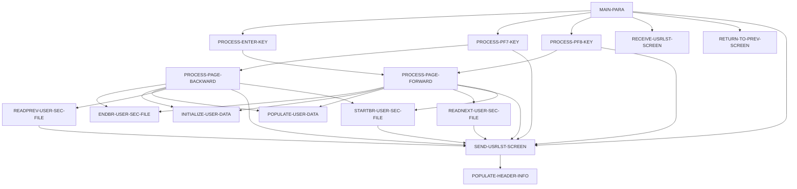

# Program COUSR00C

| Item | Value |
|---|---|
| Source | `app/cbl/COUSR00C.cbl` |
| Lines | 695 total, 531 code, 80 comment, 84 blank |
| PROGRAM-ID | COUSR00C |
| Author | AWS |
| Runtime | cics-online |
| Module | base |
| CICS transactions | CU00 (`app/csd/CARDDEMO.CSD:449-458`) |
| JCL steps | None |
| Paragraphs | 16 |
| Semantic analysis | validated (batch B07) |
| Version banner | * Ver: CardDemo_v1.0-15-g27d6c6f-68 Date: 2022-07-19 23:12:34 CDT |

## Summary

COUSR00C is a pseudo-conversational CICS COBOL program (transaction CU00, map COUSR0A in mapset COUSR00) that lists records of the USRSEC VSAM user security file ten at a time, showing user ID, first name, last name and user type. Without a COMMAREA it transfers to sign-on (COSGN00C); on first entry it lists from the start of the file; on re-entry Enter applies an optional start user ID and/or a row selection, PF3 returns to the admin menu COADM01C, PF7/PF8 page backward/forward. Paging uses STARTBR/READNEXT/READPREV/ENDBR keyed on SEC-USR-ID with the first/last user ID, page number and next-page flag kept in the COMMAREA extension CDEMO-CU00-INFO. Selecting a row with 'U' transfers (XCTL) to the user update program COUSR02C and 'D' to the user delete program COUSR03C, passing the user ID in CDEMO-CU00-USR-SELECTED. The program only reads USRSEC. (Confirmed)

Evidence: `app/cbl/COUSR00C.cbl:1-5`, `app/cbl/COUSR00C.cbl:35-39`, `app/cbl/COUSR00C.cbl:66-75`, `app/cbl/COUSR00C.cbl:110-144`, `app/cbl/COUSR00C.cbl:186-216`, `app/cbl/COUSR00C.cbl:282-379`, `app/cbl/COUSR00C.cbl:586-691`

Header comment (Unverified, `app/cbl/COUSR00C.cbl:1-8`): Program     : COUSR00C.CBL Application : CardDemo Type        : CICS COBOL Program Function    : List all users from USRSEC file All Rights Reserved. http://www.apache.org/licenses/LICENSE-2.0

## Divisions and sections

| Division / section | Lines | Notes |
|---|---|---|
| IDENTIFICATION DIVISION | `app/cbl/COUSR00C.cbl:22-25` |  |
| ENVIRONMENT DIVISION | `app/cbl/COUSR00C.cbl:26-28` |  |
| DATA DIVISION | `app/cbl/COUSR00C.cbl:29-96` |  |
| PROCEDURE DIVISION | `app/cbl/COUSR00C.cbl:97-695` |  |
| ENVIRONMENT / CONFIGURATION SECTION | `app/cbl/COUSR00C.cbl:27-28` |  |
| DATA / WORKING-STORAGE SECTION | `app/cbl/COUSR00C.cbl:33-88` |  |
| DATA / LINKAGE SECTION | `app/cbl/COUSR00C.cbl:89-96` |  |

## Files and data stores

No SELECT entries (no COBOL file I/O).

CICS file commands (file name resolved from VALUE clauses and the CSD):

| Command | FILE option | Resolved name | CSD DSNAME | CSD evidence | Line |
|---|---|---|---|---|---|
| STARTBR | WS-USRSEC-FILE | USRSEC | AWS.M2.CARDDEMO.USRSEC.VSAM.KSDS | `app/csd/CARDDEMO.CSD:88-99` | `app/cbl/COUSR00C.cbl:588-595` |
| READNEXT | WS-USRSEC-FILE | USRSEC | AWS.M2.CARDDEMO.USRSEC.VSAM.KSDS | `app/csd/CARDDEMO.CSD:88-99` | `app/cbl/COUSR00C.cbl:621-629` |
| READPREV | WS-USRSEC-FILE | USRSEC | AWS.M2.CARDDEMO.USRSEC.VSAM.KSDS | `app/csd/CARDDEMO.CSD:88-99` | `app/cbl/COUSR00C.cbl:655-663` |
| ENDBR | WS-USRSEC-FILE | USRSEC | AWS.M2.CARDDEMO.USRSEC.VSAM.KSDS | `app/csd/CARDDEMO.CSD:88-99` | `app/cbl/COUSR00C.cbl:689-691` |

CRUD summary from the program facts:

| Store | Kind | Ops | Evidence |
|---|---|---|---|
| USRSEC | cics-file | B | `app/cbl/COUSR00C.cbl:588-689` |

## Embedded CICS, SQL and DL/I commands

| Paragraph | Kind | Verb | Resources | Response | Lines |
|---|---|---|---|---|---|
| MAIN-PARA | CICS | RETURN | TRANSID(WS-TRANID) |  | `app/cbl/COUSR00C.cbl:141-144` |
| PROCESS-ENTER-KEY | CICS | XCTL | PROGRAM(CDEMO-TO-PROGRAM) |  | `app/cbl/COUSR00C.cbl:196-199` |
| PROCESS-ENTER-KEY | CICS | XCTL | PROGRAM(CDEMO-TO-PROGRAM) |  | `app/cbl/COUSR00C.cbl:206-209` |
| RETURN-TO-PREV-SCREEN | CICS | XCTL | PROGRAM(CDEMO-TO-PROGRAM) |  | `app/cbl/COUSR00C.cbl:514-517` |
| SEND-USRLST-SCREEN | CICS | SEND MAP | MAP('COUSR0A'), MAPSET('COUSR00') |  | `app/cbl/COUSR00C.cbl:529-535` |
| SEND-USRLST-SCREEN | CICS | SEND MAP | MAP('COUSR0A'), MAPSET('COUSR00') |  | `app/cbl/COUSR00C.cbl:537-543` |
| RECEIVE-USRLST-SCREEN | CICS | RECEIVE MAP | MAP('COUSR0A'), MAPSET('COUSR00') | RESP | `app/cbl/COUSR00C.cbl:551-557` |
| STARTBR-USER-SEC-FILE | CICS | STARTBR | DATASET(WS-USRSEC-FILE) | RESP | `app/cbl/COUSR00C.cbl:588-595` |
| READNEXT-USER-SEC-FILE | CICS | READNEXT | DATASET(WS-USRSEC-FILE) | RESP | `app/cbl/COUSR00C.cbl:621-629` |
| READPREV-USER-SEC-FILE | CICS | READPREV | DATASET(WS-USRSEC-FILE) | RESP | `app/cbl/COUSR00C.cbl:655-663` |
| ENDBR-USER-SEC-FILE | CICS | ENDBR | DATASET(WS-USRSEC-FILE) |  | `app/cbl/COUSR00C.cbl:689-691` |

## Calls, transfers and callers

| Mechanism | Target | Parameters | Paragraph | Lines |
|---|---|---|---|---|
| EXEC CICS RETURN | WS-TRANID = CU00 | CARDDEMO-COMMAREA | MAIN-PARA | `app/cbl/COUSR00C.cbl:141-144` |
| EXEC CICS XCTL | CDEMO-TO-PROGRAM = COUSR02C | CARDDEMO-COMMAREA | PROCESS-ENTER-KEY | `app/cbl/COUSR00C.cbl:196-199` |
| EXEC CICS XCTL | CDEMO-TO-PROGRAM = COUSR03C | CARDDEMO-COMMAREA | PROCESS-ENTER-KEY | `app/cbl/COUSR00C.cbl:206-209` |
| EXEC CICS XCTL | CDEMO-TO-PROGRAM = COADM01C, COSGN00C | CARDDEMO-COMMAREA | RETURN-TO-PREV-SCREEN | `app/cbl/COUSR00C.cbl:514-517` |

Programs that transfer to or call this program (from `docs/_work/xref/call-graph.json`):

| Caller | Mechanism | Confidence | Evidence |
|---|---|---|---|
| COADM01C | XCTL | Confirmed | `app/cbl/COADM01C.cbl:146` |

## Copybooks

| Copybook | Statement | Resolution | Resolved path | REPLACING | Line |
|---|---|---|---|---|---|
| [COCOM01Y](../08-data/layouts/COCOM01Y.md) | COPY | inventory | app/cpy/COCOM01Y.cpy |  | `app/cbl/COUSR00C.cbl:66` |
| COUSR00 | COPY | inventory | app/cpy-bms/COUSR00.CPY |  | `app/cbl/COUSR00C.cbl:76` |
| [COTTL01Y](../08-data/layouts/COTTL01Y.md) | COPY | inventory | app/cpy/COTTL01Y.cpy |  | `app/cbl/COUSR00C.cbl:78` |
| [CSDAT01Y](../08-data/layouts/CSDAT01Y.md) | COPY | inventory | app/cpy/CSDAT01Y.cpy |  | `app/cbl/COUSR00C.cbl:79` |
| [CSMSG01Y](../08-data/layouts/CSMSG01Y.md) | COPY | inventory | app/cpy/CSMSG01Y.cpy |  | `app/cbl/COUSR00C.cbl:80` |
| [CSUSR01Y](../08-data/layouts/CSUSR01Y.md) | COPY | inventory | app/cpy/CSUSR01Y.cpy |  | `app/cbl/COUSR00C.cbl:81` |
| DFHAID | COPY | system |  |  | `app/cbl/COUSR00C.cbl:83` |
| DFHBMSCA | COPY | system |  |  | `app/cbl/COUSR00C.cbl:84` |

## Data division items

Every data entry coded in this source (copybook contents are on the copybook pages). Lengths are computed from PIC and USAGE.

| Section | Lvl | Name | PIC | Usage | Len | OCCURS | REDEFINES | VALUE | 88-levels | Line |
|---|---|---|---|---|---|---|---|---|---|---|
| WORKING-STORAGE | 01 | WS-VARIABLES |  |  |  |  |  |  |  | 35 |
| WORKING-STORAGE | 05 | WS-PGMNAME | X(08) |  | 8 |  |  | 'COUSR00C' |  | 36 |
| WORKING-STORAGE | 05 | WS-TRANID | X(04) |  | 4 |  |  | 'CU00' |  | 37 |
| WORKING-STORAGE | 05 | WS-MESSAGE | X(80) |  | 80 |  |  | SPACES |  | 38 |
| WORKING-STORAGE | 05 | WS-USRSEC-FILE | X(08) |  | 8 |  |  | 'USRSEC ' |  | 39 |
| WORKING-STORAGE | 05 | WS-ERR-FLG | X(01) |  | 1 |  |  | 'N' | ERR-FLG-ON = 'Y'; ERR-FLG-OFF = 'N' | 40 |
| WORKING-STORAGE | 05 | WS-USER-SEC-EOF | X(01) |  | 1 |  |  | 'N' | USER-SEC-EOF = 'Y'; USER-SEC-NOT-EOF = 'N' | 43 |
| WORKING-STORAGE | 05 | WS-SEND-ERASE-FLG | X(01) |  | 1 |  |  | 'Y' | SEND-ERASE-YES = 'Y'; SEND-ERASE-NO = 'N' | 46 |
| WORKING-STORAGE | 05 | WS-RESP-CD | S9(09) | COMP | 4 |  |  | ZEROS |  | 50 |
| WORKING-STORAGE | 05 | WS-REAS-CD | S9(09) | COMP | 4 |  |  | ZEROS |  | 51 |
| WORKING-STORAGE | 05 | WS-REC-COUNT | S9(04) | COMP | 2 |  |  | ZEROS |  | 52 |
| WORKING-STORAGE | 05 | WS-IDX | S9(04) | COMP | 2 |  |  | ZEROS |  | 53 |
| WORKING-STORAGE | 05 | WS-PAGE-NUM | S9(04) | COMP | 2 |  |  | ZEROS |  | 54 |
| WORKING-STORAGE | 01 | WS-USER-DATA |  |  |  |  |  |  |  | 56 |
| WORKING-STORAGE | 02 | USER-REC |  |  |  | 10 |  |  |  | 57 |
| WORKING-STORAGE | 05 | USER-SEL | X(01) |  | 1 |  |  |  |  | 58 |
| WORKING-STORAGE | 05 | FILLER | X(02) |  | 2 |  |  |  |  | 59 |
| WORKING-STORAGE | 05 | USER-ID | X(08) |  | 8 |  |  |  |  | 60 |
| WORKING-STORAGE | 05 | FILLER | X(02) |  | 2 |  |  |  |  | 61 |
| WORKING-STORAGE | 05 | USER-NAME | X(25) |  | 25 |  |  |  |  | 62 |
| WORKING-STORAGE | 05 | FILLER | X(02) |  | 2 |  |  |  |  | 63 |
| WORKING-STORAGE | 05 | USER-TYPE | X(08) |  | 8 |  |  |  |  | 64 |
| WORKING-STORAGE | 05 | CDEMO-CU00-INFO |  |  |  |  |  |  |  | 67 |
| WORKING-STORAGE | 10 | CDEMO-CU00-USRID-FIRST | X(08) |  | 8 |  |  |  |  | 68 |
| WORKING-STORAGE | 10 | CDEMO-CU00-USRID-LAST | X(08) |  | 8 |  |  |  |  | 69 |
| WORKING-STORAGE | 10 | CDEMO-CU00-PAGE-NUM | 9(08) |  | 8 |  |  |  |  | 70 |
| WORKING-STORAGE | 10 | CDEMO-CU00-NEXT-PAGE-FLG | X(01) |  | 1 |  |  | 'N' | NEXT-PAGE-YES = 'Y'; NEXT-PAGE-NO = 'N' | 71 |
| WORKING-STORAGE | 10 | CDEMO-CU00-USR-SEL-FLG | X(01) |  | 1 |  |  |  |  | 74 |
| WORKING-STORAGE | 10 | CDEMO-CU00-USR-SELECTED | X(08) |  | 8 |  |  |  |  | 75 |
| LINKAGE | 01 | DFHCOMMAREA |  |  |  |  |  |  |  | 90 |
| LINKAGE | 05 | LK-COMMAREA | X(01) |  | 1 | 1 TO 32767 DEPENDING ON EIBCALEN |  |  |  | 91 |

## Statement inventory

Every procedure statement the parser recorded, by kind. Each one is listed with its line under Paragraph details.

| Kind | Count |
|---|---|
| Decisions (IF, EVALUATE, WHEN, loops, handlers) | 89 |
| Calculations | 5 |
| File I/O | 0 |
| EXEC CICS / SQL / DLI | 11 |
| CALL | 0 |
| PERFORM | 41 |
| GO TO | 0 |
| MOVE literal | 36 |
| MOVE field | 137 |
| SET | 14 |
| STRING, UNSTRING, INSPECT, INITIALIZE, COPY, ENTRY and others | 0 |
| DISPLAY | 3 |
| GOBACK, STOP RUN, RETURN, XCTL | 4 |
| Not classified by the parser | 0 |

## Control flow

| Paragraph | Lines | Logic | Performs | Performed by | Reachable |
|---|---|---|---|---|---|
| [MAIN-PARA](#para-main-para) | 98-144 | Resets the error, EOF, next-page and erase flags and the message. EIBCALEN = 0 XCTLs to COSGN00C. Otherwise loads CARDDEMO-COMMAREA; on first entry sets re-enter, clears the map, performs PROCESS-ENTER-KEY and sends the list. On re-entry receives the map and dispatches on EIBAID: Enter, PF3 (XCTL to COADM01C), PF7, PF8, other keys show CCDA-MSG-INVALID-KEY. Ends with CICS RETURN TRANSID CU00. (Confirmed) | PROCESS-ENTER-KEY, PROCESS-PF7-KEY, PROCESS-PF8-KEY, RECEIVE-USRLST-SCREEN, RETURN-TO-PREV-SCREEN, SEND-USRLST-SCREEN |  | yes |
| [PROCESS-ENTER-KEY](#para-process-enter-key) | 149-232 | Captures the first non-blank selection SEL0001I..SEL0010I with its USRIDnnI into CDEMO-CU00-USR-SEL-FLG / CDEMO-CU00-USR-SELECTED. 'U'/'u' XCTLs to COUSR02C, 'D'/'d' to COUSR03C, other values set 'Invalid selection. Valid values are U and D'. Then sets the browse key SEC-USR-ID from USRIDINI (LOW-VALUES when blank), resets CDEMO-CU00-PAGE-NUM to 0 and performs PROCESS-PAGE-FORWARD. (Confirmed) | PROCESS-PAGE-FORWARD | MAIN-PARA | yes |
| [PROCESS-PF7-KEY](#para-process-pf7-key) | 237-255 | Sets SEC-USR-ID to CDEMO-CU00-USRID-FIRST (LOW-VALUES when blank) and NEXT-PAGE-YES. If CDEMO-CU00-PAGE-NUM > 1 performs PROCESS-PAGE-BACKWARD, else sends 'You are already at the top of the page...' without erase. (Confirmed) | PROCESS-PAGE-BACKWARD, SEND-USRLST-SCREEN | MAIN-PARA | yes |
| [PROCESS-PF8-KEY](#para-process-pf8-key) | 260-277 | Sets SEC-USR-ID to CDEMO-CU00-USRID-LAST (HIGH-VALUES when blank). If NEXT-PAGE-YES performs PROCESS-PAGE-FORWARD, else sends 'You are already at the bottom of the page...' without erase. (Confirmed) | PROCESS-PAGE-FORWARD, SEND-USRLST-SCREEN | MAIN-PARA | yes |
| [PROCESS-PAGE-FORWARD](#para-process-page-forward) | 282-331 | Starts a browse at SEC-USR-ID; if no error, skips one record unless the key was Enter/PF7/PF3, clears the 10 rows and reads up to 10 users into rows 1-10. If records remain adds 1 to the page and reads one more to set NEXT-PAGE-YES/NO; otherwise NEXT-PAGE-NO and the page is incremented only if a row was filled. Ends the browse and sends the screen. (Confirmed) | ENDBR-USER-SEC-FILE, INITIALIZE-USER-DATA, POPULATE-USER-DATA, READNEXT-USER-SEC-FILE, SEND-USRLST-SCREEN, STARTBR-USER-SEC-FILE | PROCESS-ENTER-KEY, PROCESS-PF8-KEY | yes |
| [PROCESS-PAGE-BACKWARD](#para-process-page-backward) | 336-379 | Starts a browse at SEC-USR-ID; if no error, skips one record unless the key was Enter/PF8, clears the rows and reads up to 10 previous users into rows 10 down to 1. If records remain reads one more previous record and, when NEXT-PAGE-YES, subtracts 1 from the page if it succeeded and the page is > 1, else sets the page to 1. Ends the browse and sends the screen. (Confirmed) | ENDBR-USER-SEC-FILE, INITIALIZE-USER-DATA, POPULATE-USER-DATA, READPREV-USER-SEC-FILE, SEND-USRLST-SCREEN, STARTBR-USER-SEC-FILE | PROCESS-PF7-KEY | yes |
| [POPULATE-USER-DATA](#para-populate-user-data) | 384-441 | Moves SEC-USR-ID, SEC-USR-FNAME, SEC-USR-LNAME and SEC-USR-TYPE to row WS-IDX of COUSR0AI; row 1 also stores the ID in CDEMO-CU00-USRID-FIRST and row 10 in CDEMO-CU00-USRID-LAST. The password is not displayed. (Confirmed) |  | PROCESS-PAGE-BACKWARD, PROCESS-PAGE-FORWARD | yes |
| [INITIALIZE-USER-DATA](#para-initialize-user-data) | 446-501 | Moves SPACES to the user ID, first name, last name and type of row WS-IDX (1-10). (Confirmed) |  | PROCESS-PAGE-BACKWARD, PROCESS-PAGE-FORWARD | yes |
| [RETURN-TO-PREV-SCREEN](#para-return-to-prev-screen) | 506-517 | Defaults CDEMO-TO-PROGRAM to COSGN00C when blank, sets FROM tranid/program to CU00/COUSR00C, resets CDEMO-PGM-CONTEXT and XCTLs to CDEMO-TO-PROGRAM. (Confirmed) |  | MAIN-PARA | yes |
| [SEND-USRLST-SCREEN](#para-send-usrlst-screen) | 522-544 | Fills the header, moves WS-MESSAGE to ERRMSGO and sends map COUSR0A with ERASE when SEND-ERASE-YES, otherwise without ERASE. (Confirmed) | POPULATE-HEADER-INFO | MAIN-PARA, PROCESS-PAGE-BACKWARD, PROCESS-PAGE-FORWARD, PROCESS-PF7-KEY, PROCESS-PF8-KEY, READNEXT-USER-SEC-FILE, READPREV-USER-SEC-FILE, STARTBR-USER-SEC-FILE | yes |
| [RECEIVE-USRLST-SCREEN](#para-receive-usrlst-screen) | 549-557 | Receives map COUSR0A into COUSR0AI with RESP/RESP2; the response is not tested. (Confirmed) |  | MAIN-PARA | yes |
| [POPULATE-HEADER-INFO](#para-populate-header-info) | 562-581 | Moves FUNCTION CURRENT-DATE to WS-CURDATE-DATA, CCDA-TITLE01/CCDA-TITLE02 to TITLE01O/TITLE02O, WS-TRANID to TRNNAMEO and WS-PGMNAME to PGMNAMEO of COUSR0AO; rebuilds the date as WS-CURDATE-MM-DD-YY (MM/DD/YY from WS-CURDATE-MONTH, WS-CURDATE-DAY, WS-CURDATE-YEAR(3:2)) into CURDATEO and the time as WS-CURTIME-HH-MM-SS into CURTIMEO. (Confirmed) |  | SEND-USRLST-SCREEN | yes |
| [STARTBR-USER-SEC-FILE](#para-startbr-user-sec-file) | 586-614 | Issues CICS STARTBR on USRSEC with RIDFLD SEC-USR-ID (GTEQ commented out). NOTFND sets USER-SEC-EOF and sends 'You are at the top of the page...'; other errors set the error flag and send 'Unable to lookup User...'. (Confirmed) | SEND-USRLST-SCREEN | PROCESS-PAGE-BACKWARD, PROCESS-PAGE-FORWARD | yes |
| [READNEXT-USER-SEC-FILE](#para-readnext-user-sec-file) | 619-648 | Issues CICS READNEXT into SEC-USER-DATA. ENDFILE sets USER-SEC-EOF and sends 'You have reached the bottom of the page...'; other errors set the error flag and send 'Unable to lookup User...'. (Confirmed) | SEND-USRLST-SCREEN | PROCESS-PAGE-FORWARD | yes |
| [READPREV-USER-SEC-FILE](#para-readprev-user-sec-file) | 653-682 | Issues CICS READPREV into SEC-USER-DATA. ENDFILE sets USER-SEC-EOF and sends 'You have reached the top of the page...'; other errors set the error flag and send 'Unable to lookup User...'. (Confirmed) | SEND-USRLST-SCREEN | PROCESS-PAGE-BACKWARD | yes |
| [ENDBR-USER-SEC-FILE](#para-endbr-user-sec-file) | 687-691 | Issues CICS ENDBR on USRSEC without RESP. (Confirmed) |  | PROCESS-PAGE-BACKWARD, PROCESS-PAGE-FORWARD | yes |

## Paragraph details

### Para MAIN-PARA

Lines `app/cbl/COUSR00C.cbl:98-144`. 

Logic: Resets the error, EOF, next-page and erase flags and the message. EIBCALEN = 0 XCTLs to COSGN00C. Otherwise loads CARDDEMO-COMMAREA; on first entry sets re-enter, clears the map, performs PROCESS-ENTER-KEY and sends the list. On re-entry receives the map and dispatches on EIBAID: Enter, PF3 (XCTL to COADM01C), PF7, PF8, other keys show CCDA-MSG-INVALID-KEY. Ends with CICS RETURN TRANSID CU00. (Confirmed)

Rules: [BR-COUSR00C-001](../09-business-rules-catalog.md#br-cousr00c-001), [BR-COUSR00C-002](../09-business-rules-catalog.md#br-cousr00c-002)

Statements in source order:

- `SET ERR-FLG-OFF TO TRUE` at `app/cbl/COUSR00C.cbl:100`
- `SET USER-SEC-NOT-EOF TO TRUE` at `app/cbl/COUSR00C.cbl:101`
- `SET NEXT-PAGE-NO TO TRUE` at `app/cbl/COUSR00C.cbl:102`
- `SET SEND-ERASE-YES TO TRUE` at `app/cbl/COUSR00C.cbl:103`
- `MOVE SPACES TO WS-MESSAGE ERRMSGO OF COUSR0AO` at `app/cbl/COUSR00C.cbl:105-106`
- MOVE `-1` TO USRIDINL OF COUSR0AI at `app/cbl/COUSR00C.cbl:108`
- IF `EIBCALEN = 0` at `app/cbl/COUSR00C.cbl:110` (pseudo-conversation)
- MOVE `'COSGN00C'` TO CDEMO-TO-PROGRAM at `app/cbl/COUSR00C.cbl:111`
- PERFORM RETURN-TO-PREV-SCREEN at `app/cbl/COUSR00C.cbl:112`
- `MOVE DFHCOMMAREA(1:EIBCALEN) TO CARDDEMO-COMMAREA` at `app/cbl/COUSR00C.cbl:114`
- IF `NOT CDEMO-PGM-REENTER` at `app/cbl/COUSR00C.cbl:115` (pseudo-conversation)
- `SET CDEMO-PGM-REENTER TO TRUE` at `app/cbl/COUSR00C.cbl:116`
- `MOVE LOW-VALUES TO COUSR0AO` at `app/cbl/COUSR00C.cbl:117`
- PERFORM PROCESS-ENTER-KEY at `app/cbl/COUSR00C.cbl:118`
- PERFORM SEND-USRLST-SCREEN at `app/cbl/COUSR00C.cbl:119`
- PERFORM RECEIVE-USRLST-SCREEN at `app/cbl/COUSR00C.cbl:121`
- EVALUATE `EIBAID` at `app/cbl/COUSR00C.cbl:122` (screen-key)
- WHEN `DFHENTER` at `app/cbl/COUSR00C.cbl:123` (screen-key)
- PERFORM PROCESS-ENTER-KEY at `app/cbl/COUSR00C.cbl:124`
- WHEN `DFHPF3` at `app/cbl/COUSR00C.cbl:125` (screen-key)
- MOVE `'COADM01C'` TO CDEMO-TO-PROGRAM at `app/cbl/COUSR00C.cbl:126`
- PERFORM RETURN-TO-PREV-SCREEN at `app/cbl/COUSR00C.cbl:127`
- WHEN `DFHPF7` at `app/cbl/COUSR00C.cbl:128` (screen-key)
- PERFORM PROCESS-PF7-KEY at `app/cbl/COUSR00C.cbl:129`
- WHEN `DFHPF8` at `app/cbl/COUSR00C.cbl:130` (screen-key)
- PERFORM PROCESS-PF8-KEY at `app/cbl/COUSR00C.cbl:131`
- WHEN `OTHER` at `app/cbl/COUSR00C.cbl:132` (screen-key)
- MOVE `'Y'` TO WS-ERR-FLG at `app/cbl/COUSR00C.cbl:133`
- MOVE `-1` TO USRIDINL OF COUSR0AI at `app/cbl/COUSR00C.cbl:134`
- `MOVE CCDA-MSG-INVALID-KEY TO WS-MESSAGE` at `app/cbl/COUSR00C.cbl:135`
- PERFORM SEND-USRLST-SCREEN at `app/cbl/COUSR00C.cbl:136`
- EXEC CICS RETURN at `app/cbl/COUSR00C.cbl:141-144`
- Ends with EXEC CICS RETURN at `app/cbl/COUSR00C.cbl:141-144`

### Para PROCESS-ENTER-KEY

Lines `app/cbl/COUSR00C.cbl:149-232`. 

Logic: Captures the first non-blank selection SEL0001I..SEL0010I with its USRIDnnI into CDEMO-CU00-USR-SEL-FLG / CDEMO-CU00-USR-SELECTED. 'U'/'u' XCTLs to COUSR02C, 'D'/'d' to COUSR03C, other values set 'Invalid selection. Valid values are U and D'. Then sets the browse key SEC-USR-ID from USRIDINI (LOW-VALUES when blank), resets CDEMO-CU00-PAGE-NUM to 0 and performs PROCESS-PAGE-FORWARD. (Confirmed)

Rules: [BR-COUSR00C-003](../09-business-rules-catalog.md#br-cousr00c-003), [BR-COUSR00C-004](../09-business-rules-catalog.md#br-cousr00c-004), [BR-COUSR00C-005](../09-business-rules-catalog.md#br-cousr00c-005)

Statements in source order:

- EVALUATE `TRUE` at `app/cbl/COUSR00C.cbl:151` (business-candidate)
- WHEN `SEL0001I OF COUSR0AI NOT = SPACES AND LOW-VALUES` at `app/cbl/COUSR00C.cbl:152` (business-candidate)
- `MOVE SEL0001I OF COUSR0AI TO CDEMO-CU00-USR-SEL-FLG` at `app/cbl/COUSR00C.cbl:153`
- `MOVE USRID01I OF COUSR0AI TO CDEMO-CU00-USR-SELECTED` at `app/cbl/COUSR00C.cbl:154`
- WHEN `SEL0002I OF COUSR0AI NOT = SPACES AND LOW-VALUES` at `app/cbl/COUSR00C.cbl:155` (business-candidate)
- `MOVE SEL0002I OF COUSR0AI TO CDEMO-CU00-USR-SEL-FLG` at `app/cbl/COUSR00C.cbl:156`
- `MOVE USRID02I OF COUSR0AI TO CDEMO-CU00-USR-SELECTED` at `app/cbl/COUSR00C.cbl:157`
- WHEN `SEL0003I OF COUSR0AI NOT = SPACES AND LOW-VALUES` at `app/cbl/COUSR00C.cbl:158` (business-candidate)
- `MOVE SEL0003I OF COUSR0AI TO CDEMO-CU00-USR-SEL-FLG` at `app/cbl/COUSR00C.cbl:159`
- `MOVE USRID03I OF COUSR0AI TO CDEMO-CU00-USR-SELECTED` at `app/cbl/COUSR00C.cbl:160`
- WHEN `SEL0004I OF COUSR0AI NOT = SPACES AND LOW-VALUES` at `app/cbl/COUSR00C.cbl:161` (business-candidate)
- `MOVE SEL0004I OF COUSR0AI TO CDEMO-CU00-USR-SEL-FLG` at `app/cbl/COUSR00C.cbl:162`
- `MOVE USRID04I OF COUSR0AI TO CDEMO-CU00-USR-SELECTED` at `app/cbl/COUSR00C.cbl:163`
- WHEN `SEL0005I OF COUSR0AI NOT = SPACES AND LOW-VALUES` at `app/cbl/COUSR00C.cbl:164` (business-candidate)
- `MOVE SEL0005I OF COUSR0AI TO CDEMO-CU00-USR-SEL-FLG` at `app/cbl/COUSR00C.cbl:165`
- `MOVE USRID05I OF COUSR0AI TO CDEMO-CU00-USR-SELECTED` at `app/cbl/COUSR00C.cbl:166`
- WHEN `SEL0006I OF COUSR0AI NOT = SPACES AND LOW-VALUES` at `app/cbl/COUSR00C.cbl:167` (business-candidate)
- `MOVE SEL0006I OF COUSR0AI TO CDEMO-CU00-USR-SEL-FLG` at `app/cbl/COUSR00C.cbl:168`
- `MOVE USRID06I OF COUSR0AI TO CDEMO-CU00-USR-SELECTED` at `app/cbl/COUSR00C.cbl:169`
- WHEN `SEL0007I OF COUSR0AI NOT = SPACES AND LOW-VALUES` at `app/cbl/COUSR00C.cbl:170` (business-candidate)
- `MOVE SEL0007I OF COUSR0AI TO CDEMO-CU00-USR-SEL-FLG` at `app/cbl/COUSR00C.cbl:171`
- `MOVE USRID07I OF COUSR0AI TO CDEMO-CU00-USR-SELECTED` at `app/cbl/COUSR00C.cbl:172`
- WHEN `SEL0008I OF COUSR0AI NOT = SPACES AND LOW-VALUES` at `app/cbl/COUSR00C.cbl:173` (business-candidate)
- `MOVE SEL0008I OF COUSR0AI TO CDEMO-CU00-USR-SEL-FLG` at `app/cbl/COUSR00C.cbl:174`
- `MOVE USRID08I OF COUSR0AI TO CDEMO-CU00-USR-SELECTED` at `app/cbl/COUSR00C.cbl:175`
- WHEN `SEL0009I OF COUSR0AI NOT = SPACES AND LOW-VALUES` at `app/cbl/COUSR00C.cbl:176` (business-candidate)
- `MOVE SEL0009I OF COUSR0AI TO CDEMO-CU00-USR-SEL-FLG` at `app/cbl/COUSR00C.cbl:177`
- `MOVE USRID09I OF COUSR0AI TO CDEMO-CU00-USR-SELECTED` at `app/cbl/COUSR00C.cbl:178`
- WHEN `SEL0010I OF COUSR0AI NOT = SPACES AND LOW-VALUES` at `app/cbl/COUSR00C.cbl:179` (business-candidate)
- `MOVE SEL0010I OF COUSR0AI TO CDEMO-CU00-USR-SEL-FLG` at `app/cbl/COUSR00C.cbl:180`
- `MOVE USRID10I OF COUSR0AI TO CDEMO-CU00-USR-SELECTED` at `app/cbl/COUSR00C.cbl:181`
- WHEN `OTHER` at `app/cbl/COUSR00C.cbl:182` (business-candidate)
- `MOVE SPACES TO CDEMO-CU00-USR-SEL-FLG` at `app/cbl/COUSR00C.cbl:183`
- `MOVE SPACES TO CDEMO-CU00-USR-SELECTED` at `app/cbl/COUSR00C.cbl:184`
- IF `(CDEMO-CU00-USR-SEL-FLG NOT = SPACES AND LOW-VALUES) AND (CDEMO-CU00-USR-SELECTED NOT = SPACES AND LOW-VALUES)` at `app/cbl/COUSR00C.cbl:187-188` (business-candidate)
- EVALUATE `CDEMO-CU00-USR-SEL-FLG` at `app/cbl/COUSR00C.cbl:189` (business-candidate)
- WHEN `'U'` at `app/cbl/COUSR00C.cbl:190` (business-candidate)
- WHEN `'u'` at `app/cbl/COUSR00C.cbl:191` (business-candidate)
- MOVE `'COUSR02C'` TO CDEMO-TO-PROGRAM at `app/cbl/COUSR00C.cbl:192`
- `MOVE WS-TRANID TO CDEMO-FROM-TRANID` at `app/cbl/COUSR00C.cbl:193`
- `MOVE WS-PGMNAME TO CDEMO-FROM-PROGRAM` at `app/cbl/COUSR00C.cbl:194`
- MOVE `0` TO CDEMO-PGM-CONTEXT at `app/cbl/COUSR00C.cbl:195`
- EXEC CICS XCTL at `app/cbl/COUSR00C.cbl:196-199`
- Ends with EXEC CICS XCTL at `app/cbl/COUSR00C.cbl:196-199`
- WHEN `'D'` at `app/cbl/COUSR00C.cbl:200` (business-candidate)
- WHEN `'d'` at `app/cbl/COUSR00C.cbl:201` (business-candidate)
- MOVE `'COUSR03C'` TO CDEMO-TO-PROGRAM at `app/cbl/COUSR00C.cbl:202`
- `MOVE WS-TRANID TO CDEMO-FROM-TRANID` at `app/cbl/COUSR00C.cbl:203`
- `MOVE WS-PGMNAME TO CDEMO-FROM-PROGRAM` at `app/cbl/COUSR00C.cbl:204`
- MOVE `0` TO CDEMO-PGM-CONTEXT at `app/cbl/COUSR00C.cbl:205`
- EXEC CICS XCTL at `app/cbl/COUSR00C.cbl:206-209`
- Ends with EXEC CICS XCTL at `app/cbl/COUSR00C.cbl:206-209`
- WHEN `OTHER` at `app/cbl/COUSR00C.cbl:210` (business-candidate)
- MOVE `'Invalid selection. Valid values are U and D'` TO WS-MESSAGE at `app/cbl/COUSR00C.cbl:211-213`
- MOVE `-1` TO USRIDINL OF COUSR0AI at `app/cbl/COUSR00C.cbl:214`
- IF `USRIDINI OF COUSR0AI = SPACES OR LOW-VALUES` at `app/cbl/COUSR00C.cbl:218` (business-candidate)
- `MOVE LOW-VALUES TO SEC-USR-ID` at `app/cbl/COUSR00C.cbl:219`
- `MOVE USRIDINI OF COUSR0AI TO SEC-USR-ID` at `app/cbl/COUSR00C.cbl:221`
- MOVE `-1` TO USRIDINL OF COUSR0AI at `app/cbl/COUSR00C.cbl:224`
- MOVE `0` TO CDEMO-CU00-PAGE-NUM at `app/cbl/COUSR00C.cbl:227`
- PERFORM PROCESS-PAGE-FORWARD at `app/cbl/COUSR00C.cbl:228`
- IF `NOT ERR-FLG-ON` at `app/cbl/COUSR00C.cbl:230` (error-flag)
- `MOVE SPACE TO USRIDINO OF COUSR0AO` at `app/cbl/COUSR00C.cbl:231`

### Para PROCESS-PF7-KEY

Lines `app/cbl/COUSR00C.cbl:237-255`. 

Logic: Sets SEC-USR-ID to CDEMO-CU00-USRID-FIRST (LOW-VALUES when blank) and NEXT-PAGE-YES. If CDEMO-CU00-PAGE-NUM > 1 performs PROCESS-PAGE-BACKWARD, else sends 'You are already at the top of the page...' without erase. (Confirmed)

Rules: [BR-COUSR00C-006](../09-business-rules-catalog.md#br-cousr00c-006)

Statements in source order:

- IF `CDEMO-CU00-USRID-FIRST = SPACES OR LOW-VALUES` at `app/cbl/COUSR00C.cbl:239` (business-candidate)
- `MOVE LOW-VALUES TO SEC-USR-ID` at `app/cbl/COUSR00C.cbl:240`
- `MOVE CDEMO-CU00-USRID-FIRST TO SEC-USR-ID` at `app/cbl/COUSR00C.cbl:242`
- `SET NEXT-PAGE-YES TO TRUE` at `app/cbl/COUSR00C.cbl:245`
- MOVE `-1` TO USRIDINL OF COUSR0AI at `app/cbl/COUSR00C.cbl:246`
- IF `CDEMO-CU00-PAGE-NUM > 1` at `app/cbl/COUSR00C.cbl:248` (business-candidate)
- PERFORM PROCESS-PAGE-BACKWARD at `app/cbl/COUSR00C.cbl:249`
- MOVE `'You are already at the top of the page...'` TO WS-MESSAGE at `app/cbl/COUSR00C.cbl:251-252`
- `SET SEND-ERASE-NO TO TRUE` at `app/cbl/COUSR00C.cbl:253`
- PERFORM SEND-USRLST-SCREEN at `app/cbl/COUSR00C.cbl:254`

### Para PROCESS-PF8-KEY

Lines `app/cbl/COUSR00C.cbl:260-277`. 

Logic: Sets SEC-USR-ID to CDEMO-CU00-USRID-LAST (HIGH-VALUES when blank). If NEXT-PAGE-YES performs PROCESS-PAGE-FORWARD, else sends 'You are already at the bottom of the page...' without erase. (Confirmed)

Rules: [BR-COUSR00C-007](../09-business-rules-catalog.md#br-cousr00c-007)

Statements in source order:

- IF `CDEMO-CU00-USRID-LAST = SPACES OR LOW-VALUES` at `app/cbl/COUSR00C.cbl:262` (business-candidate)
- `MOVE HIGH-VALUES TO SEC-USR-ID` at `app/cbl/COUSR00C.cbl:263`
- `MOVE CDEMO-CU00-USRID-LAST TO SEC-USR-ID` at `app/cbl/COUSR00C.cbl:265`
- MOVE `-1` TO USRIDINL OF COUSR0AI at `app/cbl/COUSR00C.cbl:268`
- IF `NEXT-PAGE-YES` at `app/cbl/COUSR00C.cbl:270` (business-candidate)
- PERFORM PROCESS-PAGE-FORWARD at `app/cbl/COUSR00C.cbl:271`
- MOVE `'You are already at the bottom of the page...'` TO WS-MESSAGE at `app/cbl/COUSR00C.cbl:273-274`
- `SET SEND-ERASE-NO TO TRUE` at `app/cbl/COUSR00C.cbl:275`
- PERFORM SEND-USRLST-SCREEN at `app/cbl/COUSR00C.cbl:276`

### Para PROCESS-PAGE-FORWARD

Lines `app/cbl/COUSR00C.cbl:282-331`. 

Logic: Starts a browse at SEC-USR-ID; if no error, skips one record unless the key was Enter/PF7/PF3, clears the 10 rows and reads up to 10 users into rows 1-10. If records remain adds 1 to the page and reads one more to set NEXT-PAGE-YES/NO; otherwise NEXT-PAGE-NO and the page is incremented only if a row was filled. Ends the browse and sends the screen. (Confirmed)

Rules: [BR-COUSR00C-008](../09-business-rules-catalog.md#br-cousr00c-008), [BR-COUSR00C-009](../09-business-rules-catalog.md#br-cousr00c-009)

Statements in source order:

- PERFORM STARTBR-USER-SEC-FILE at `app/cbl/COUSR00C.cbl:284`
- IF `NOT ERR-FLG-ON` at `app/cbl/COUSR00C.cbl:286` (error-flag)
- IF `EIBAID NOT = DFHENTER AND DFHPF7 AND DFHPF3` at `app/cbl/COUSR00C.cbl:288` (screen-key)
- PERFORM READNEXT-USER-SEC-FILE at `app/cbl/COUSR00C.cbl:289`
- IF `USER-SEC-NOT-EOF AND ERR-FLG-OFF` at `app/cbl/COUSR00C.cbl:292` (io-status)
- LOOP `VARYING WS-IDX FROM 1 BY 1 UNTIL WS-IDX > 10` at `app/cbl/COUSR00C.cbl:293` (business-candidate)
- Inline PERFORM `VARYING WS-IDX FROM 1 BY 1 UNTIL WS-IDX > 10` at `app/cbl/COUSR00C.cbl:293`
- PERFORM INITIALIZE-USER-DATA at `app/cbl/COUSR00C.cbl:294`
- MOVE `1` TO WS-IDX at `app/cbl/COUSR00C.cbl:298`
- LOOP `UNTIL WS-IDX >= 11 OR USER-SEC-EOF OR ERR-FLG-ON` at `app/cbl/COUSR00C.cbl:300` (io-status)
- Inline PERFORM `UNTIL WS-IDX >= 11 OR USER-SEC-EOF OR ERR-FLG-ON` at `app/cbl/COUSR00C.cbl:300`
- PERFORM READNEXT-USER-SEC-FILE at `app/cbl/COUSR00C.cbl:301`
- IF `USER-SEC-NOT-EOF AND ERR-FLG-OFF` at `app/cbl/COUSR00C.cbl:302` (io-status)
- PERFORM POPULATE-USER-DATA at `app/cbl/COUSR00C.cbl:303`
- Calculation `COMPUTE WS-IDX = WS-IDX + 1` at `app/cbl/COUSR00C.cbl:304` (no ROUNDED)
- IF `USER-SEC-NOT-EOF AND ERR-FLG-OFF` at `app/cbl/COUSR00C.cbl:308` (io-status)
- Calculation `COMPUTE CDEMO-CU00-PAGE-NUM = CDEMO-CU00-PAGE-NUM + 1` at `app/cbl/COUSR00C.cbl:309-310` (no ROUNDED)
- PERFORM READNEXT-USER-SEC-FILE at `app/cbl/COUSR00C.cbl:311`
- IF `USER-SEC-NOT-EOF AND ERR-FLG-OFF` at `app/cbl/COUSR00C.cbl:312` (io-status)
- `SET NEXT-PAGE-YES TO TRUE` at `app/cbl/COUSR00C.cbl:313`
- `SET NEXT-PAGE-NO TO TRUE` at `app/cbl/COUSR00C.cbl:315`
- `SET NEXT-PAGE-NO TO TRUE` at `app/cbl/COUSR00C.cbl:318`
- IF `WS-IDX > 1` at `app/cbl/COUSR00C.cbl:319` (business-candidate)
- Calculation `COMPUTE CDEMO-CU00-PAGE-NUM = CDEMO-CU00-PAGE-NUM + 1` at `app/cbl/COUSR00C.cbl:320-321` (no ROUNDED)
- PERFORM ENDBR-USER-SEC-FILE at `app/cbl/COUSR00C.cbl:325`
- `MOVE CDEMO-CU00-PAGE-NUM TO PAGENUMI OF COUSR0AI` at `app/cbl/COUSR00C.cbl:327`
- `MOVE SPACE TO USRIDINO OF COUSR0AO` at `app/cbl/COUSR00C.cbl:328`
- PERFORM SEND-USRLST-SCREEN at `app/cbl/COUSR00C.cbl:329`

### Para PROCESS-PAGE-BACKWARD

Lines `app/cbl/COUSR00C.cbl:336-379`. 

Logic: Starts a browse at SEC-USR-ID; if no error, skips one record unless the key was Enter/PF8, clears the rows and reads up to 10 previous users into rows 10 down to 1. If records remain reads one more previous record and, when NEXT-PAGE-YES, subtracts 1 from the page if it succeeded and the page is > 1, else sets the page to 1. Ends the browse and sends the screen. (Confirmed)

Rules: [BR-COUSR00C-010](../09-business-rules-catalog.md#br-cousr00c-010), [BR-COUSR00C-011](../09-business-rules-catalog.md#br-cousr00c-011)

Statements in source order:

- PERFORM STARTBR-USER-SEC-FILE at `app/cbl/COUSR00C.cbl:338`
- IF `NOT ERR-FLG-ON` at `app/cbl/COUSR00C.cbl:340` (error-flag)
- IF `EIBAID NOT = DFHENTER AND DFHPF8` at `app/cbl/COUSR00C.cbl:342` (screen-key)
- PERFORM READPREV-USER-SEC-FILE at `app/cbl/COUSR00C.cbl:343`
- IF `USER-SEC-NOT-EOF AND ERR-FLG-OFF` at `app/cbl/COUSR00C.cbl:346` (io-status)
- LOOP `VARYING WS-IDX FROM 1 BY 1 UNTIL WS-IDX > 10` at `app/cbl/COUSR00C.cbl:347` (business-candidate)
- Inline PERFORM `VARYING WS-IDX FROM 1 BY 1 UNTIL WS-IDX > 10` at `app/cbl/COUSR00C.cbl:347`
- PERFORM INITIALIZE-USER-DATA at `app/cbl/COUSR00C.cbl:348`
- MOVE `10` TO WS-IDX at `app/cbl/COUSR00C.cbl:352`
- LOOP `UNTIL WS-IDX <= 0 OR USER-SEC-EOF OR ERR-FLG-ON` at `app/cbl/COUSR00C.cbl:354` (io-status)
- Inline PERFORM `UNTIL WS-IDX <= 0 OR USER-SEC-EOF OR ERR-FLG-ON` at `app/cbl/COUSR00C.cbl:354`
- PERFORM READPREV-USER-SEC-FILE at `app/cbl/COUSR00C.cbl:355`
- IF `USER-SEC-NOT-EOF AND ERR-FLG-OFF` at `app/cbl/COUSR00C.cbl:356` (io-status)
- PERFORM POPULATE-USER-DATA at `app/cbl/COUSR00C.cbl:357`
- Calculation `COMPUTE WS-IDX = WS-IDX - 1` at `app/cbl/COUSR00C.cbl:358` (no ROUNDED)
- IF `USER-SEC-NOT-EOF AND ERR-FLG-OFF` at `app/cbl/COUSR00C.cbl:362` (io-status)
- PERFORM READPREV-USER-SEC-FILE at `app/cbl/COUSR00C.cbl:363`
- IF `NEXT-PAGE-YES` at `app/cbl/COUSR00C.cbl:364` (business-candidate)
- IF `USER-SEC-NOT-EOF AND ERR-FLG-OFF AND CDEMO-CU00-PAGE-NUM > 1` at `app/cbl/COUSR00C.cbl:365-366` (io-status)
- Calculation `SUBTRACT 1 FROM CDEMO-CU00-PAGE-NUM` at `app/cbl/COUSR00C.cbl:367`
- MOVE `1` TO CDEMO-CU00-PAGE-NUM at `app/cbl/COUSR00C.cbl:369`
- PERFORM ENDBR-USER-SEC-FILE at `app/cbl/COUSR00C.cbl:374`
- `MOVE CDEMO-CU00-PAGE-NUM TO PAGENUMI OF COUSR0AI` at `app/cbl/COUSR00C.cbl:376`
- PERFORM SEND-USRLST-SCREEN at `app/cbl/COUSR00C.cbl:377`

### Para POPULATE-USER-DATA

Lines `app/cbl/COUSR00C.cbl:384-441`. 

Logic: Moves SEC-USR-ID, SEC-USR-FNAME, SEC-USR-LNAME and SEC-USR-TYPE to row WS-IDX of COUSR0AI; row 1 also stores the ID in CDEMO-CU00-USRID-FIRST and row 10 in CDEMO-CU00-USRID-LAST. The password is not displayed. (Confirmed)

Rules: [BR-COUSR00C-012](../09-business-rules-catalog.md#br-cousr00c-012)

Statements in source order:

- EVALUATE `WS-IDX` at `app/cbl/COUSR00C.cbl:386` (business-candidate)
- WHEN `1` at `app/cbl/COUSR00C.cbl:387` (business-candidate)
- `MOVE SEC-USR-ID TO USRID01I OF COUSR0AI CDEMO-CU00-USRID-FIRST` at `app/cbl/COUSR00C.cbl:388-389`
- `MOVE SEC-USR-FNAME TO FNAME01I OF COUSR0AI` at `app/cbl/COUSR00C.cbl:390`
- `MOVE SEC-USR-LNAME TO LNAME01I OF COUSR0AI` at `app/cbl/COUSR00C.cbl:391`
- `MOVE SEC-USR-TYPE TO UTYPE01I OF COUSR0AI` at `app/cbl/COUSR00C.cbl:392`
- WHEN `2` at `app/cbl/COUSR00C.cbl:393` (business-candidate)
- `MOVE SEC-USR-ID TO USRID02I OF COUSR0AI` at `app/cbl/COUSR00C.cbl:394`
- `MOVE SEC-USR-FNAME TO FNAME02I OF COUSR0AI` at `app/cbl/COUSR00C.cbl:395`
- `MOVE SEC-USR-LNAME TO LNAME02I OF COUSR0AI` at `app/cbl/COUSR00C.cbl:396`
- `MOVE SEC-USR-TYPE TO UTYPE02I OF COUSR0AI` at `app/cbl/COUSR00C.cbl:397`
- WHEN `3` at `app/cbl/COUSR00C.cbl:398` (business-candidate)
- `MOVE SEC-USR-ID TO USRID03I OF COUSR0AI` at `app/cbl/COUSR00C.cbl:399`
- `MOVE SEC-USR-FNAME TO FNAME03I OF COUSR0AI` at `app/cbl/COUSR00C.cbl:400`
- `MOVE SEC-USR-LNAME TO LNAME03I OF COUSR0AI` at `app/cbl/COUSR00C.cbl:401`
- `MOVE SEC-USR-TYPE TO UTYPE03I OF COUSR0AI` at `app/cbl/COUSR00C.cbl:402`
- WHEN `4` at `app/cbl/COUSR00C.cbl:403` (business-candidate)
- `MOVE SEC-USR-ID TO USRID04I OF COUSR0AI` at `app/cbl/COUSR00C.cbl:404`
- `MOVE SEC-USR-FNAME TO FNAME04I OF COUSR0AI` at `app/cbl/COUSR00C.cbl:405`
- `MOVE SEC-USR-LNAME TO LNAME04I OF COUSR0AI` at `app/cbl/COUSR00C.cbl:406`
- `MOVE SEC-USR-TYPE TO UTYPE04I OF COUSR0AI` at `app/cbl/COUSR00C.cbl:407`
- WHEN `5` at `app/cbl/COUSR00C.cbl:408` (business-candidate)
- `MOVE SEC-USR-ID TO USRID05I OF COUSR0AI` at `app/cbl/COUSR00C.cbl:409`
- `MOVE SEC-USR-FNAME TO FNAME05I OF COUSR0AI` at `app/cbl/COUSR00C.cbl:410`
- `MOVE SEC-USR-LNAME TO LNAME05I OF COUSR0AI` at `app/cbl/COUSR00C.cbl:411`
- `MOVE SEC-USR-TYPE TO UTYPE05I OF COUSR0AI` at `app/cbl/COUSR00C.cbl:412`
- WHEN `6` at `app/cbl/COUSR00C.cbl:413` (business-candidate)
- `MOVE SEC-USR-ID TO USRID06I OF COUSR0AI` at `app/cbl/COUSR00C.cbl:414`
- `MOVE SEC-USR-FNAME TO FNAME06I OF COUSR0AI` at `app/cbl/COUSR00C.cbl:415`
- `MOVE SEC-USR-LNAME TO LNAME06I OF COUSR0AI` at `app/cbl/COUSR00C.cbl:416`
- `MOVE SEC-USR-TYPE TO UTYPE06I OF COUSR0AI` at `app/cbl/COUSR00C.cbl:417`
- WHEN `7` at `app/cbl/COUSR00C.cbl:418` (business-candidate)
- `MOVE SEC-USR-ID TO USRID07I OF COUSR0AI` at `app/cbl/COUSR00C.cbl:419`
- `MOVE SEC-USR-FNAME TO FNAME07I OF COUSR0AI` at `app/cbl/COUSR00C.cbl:420`
- `MOVE SEC-USR-LNAME TO LNAME07I OF COUSR0AI` at `app/cbl/COUSR00C.cbl:421`
- `MOVE SEC-USR-TYPE TO UTYPE07I OF COUSR0AI` at `app/cbl/COUSR00C.cbl:422`
- WHEN `8` at `app/cbl/COUSR00C.cbl:423` (business-candidate)
- `MOVE SEC-USR-ID TO USRID08I OF COUSR0AI` at `app/cbl/COUSR00C.cbl:424`
- `MOVE SEC-USR-FNAME TO FNAME08I OF COUSR0AI` at `app/cbl/COUSR00C.cbl:425`
- `MOVE SEC-USR-LNAME TO LNAME08I OF COUSR0AI` at `app/cbl/COUSR00C.cbl:426`
- `MOVE SEC-USR-TYPE TO UTYPE08I OF COUSR0AI` at `app/cbl/COUSR00C.cbl:427`
- WHEN `9` at `app/cbl/COUSR00C.cbl:428` (business-candidate)
- `MOVE SEC-USR-ID TO USRID09I OF COUSR0AI` at `app/cbl/COUSR00C.cbl:429`
- `MOVE SEC-USR-FNAME TO FNAME09I OF COUSR0AI` at `app/cbl/COUSR00C.cbl:430`
- `MOVE SEC-USR-LNAME TO LNAME09I OF COUSR0AI` at `app/cbl/COUSR00C.cbl:431`
- `MOVE SEC-USR-TYPE TO UTYPE09I OF COUSR0AI` at `app/cbl/COUSR00C.cbl:432`
- WHEN `10` at `app/cbl/COUSR00C.cbl:433` (business-candidate)
- `MOVE SEC-USR-ID TO USRID10I OF COUSR0AI CDEMO-CU00-USRID-LAST` at `app/cbl/COUSR00C.cbl:434-435`
- `MOVE SEC-USR-FNAME TO FNAME10I OF COUSR0AI` at `app/cbl/COUSR00C.cbl:436`
- `MOVE SEC-USR-LNAME TO LNAME10I OF COUSR0AI` at `app/cbl/COUSR00C.cbl:437`
- `MOVE SEC-USR-TYPE TO UTYPE10I OF COUSR0AI` at `app/cbl/COUSR00C.cbl:438`
- WHEN `OTHER` at `app/cbl/COUSR00C.cbl:439` (business-candidate)

### Para INITIALIZE-USER-DATA

Lines `app/cbl/COUSR00C.cbl:446-501`. 

Logic: Moves SPACES to the user ID, first name, last name and type of row WS-IDX (1-10). (Confirmed)

Statements in source order:

- EVALUATE `WS-IDX` at `app/cbl/COUSR00C.cbl:448` (business-candidate)
- WHEN `1` at `app/cbl/COUSR00C.cbl:449` (business-candidate)
- `MOVE SPACES TO USRID01I OF COUSR0AI` at `app/cbl/COUSR00C.cbl:450`
- `MOVE SPACES TO FNAME01I OF COUSR0AI` at `app/cbl/COUSR00C.cbl:451`
- `MOVE SPACES TO LNAME01I OF COUSR0AI` at `app/cbl/COUSR00C.cbl:452`
- `MOVE SPACES TO UTYPE01I OF COUSR0AI` at `app/cbl/COUSR00C.cbl:453`
- WHEN `2` at `app/cbl/COUSR00C.cbl:454` (business-candidate)
- `MOVE SPACES TO USRID02I OF COUSR0AI` at `app/cbl/COUSR00C.cbl:455`
- `MOVE SPACES TO FNAME02I OF COUSR0AI` at `app/cbl/COUSR00C.cbl:456`
- `MOVE SPACES TO LNAME02I OF COUSR0AI` at `app/cbl/COUSR00C.cbl:457`
- `MOVE SPACES TO UTYPE02I OF COUSR0AI` at `app/cbl/COUSR00C.cbl:458`
- WHEN `3` at `app/cbl/COUSR00C.cbl:459` (business-candidate)
- `MOVE SPACES TO USRID03I OF COUSR0AI` at `app/cbl/COUSR00C.cbl:460`
- `MOVE SPACES TO FNAME03I OF COUSR0AI` at `app/cbl/COUSR00C.cbl:461`
- `MOVE SPACES TO LNAME03I OF COUSR0AI` at `app/cbl/COUSR00C.cbl:462`
- `MOVE SPACES TO UTYPE03I OF COUSR0AI` at `app/cbl/COUSR00C.cbl:463`
- WHEN `4` at `app/cbl/COUSR00C.cbl:464` (business-candidate)
- `MOVE SPACES TO USRID04I OF COUSR0AI` at `app/cbl/COUSR00C.cbl:465`
- `MOVE SPACES TO FNAME04I OF COUSR0AI` at `app/cbl/COUSR00C.cbl:466`
- `MOVE SPACES TO LNAME04I OF COUSR0AI` at `app/cbl/COUSR00C.cbl:467`
- `MOVE SPACES TO UTYPE04I OF COUSR0AI` at `app/cbl/COUSR00C.cbl:468`
- WHEN `5` at `app/cbl/COUSR00C.cbl:469` (business-candidate)
- `MOVE SPACES TO USRID05I OF COUSR0AI` at `app/cbl/COUSR00C.cbl:470`
- `MOVE SPACES TO FNAME05I OF COUSR0AI` at `app/cbl/COUSR00C.cbl:471`
- `MOVE SPACES TO LNAME05I OF COUSR0AI` at `app/cbl/COUSR00C.cbl:472`
- `MOVE SPACES TO UTYPE05I OF COUSR0AI` at `app/cbl/COUSR00C.cbl:473`
- WHEN `6` at `app/cbl/COUSR00C.cbl:474` (business-candidate)
- `MOVE SPACES TO USRID06I OF COUSR0AI` at `app/cbl/COUSR00C.cbl:475`
- `MOVE SPACES TO FNAME06I OF COUSR0AI` at `app/cbl/COUSR00C.cbl:476`
- `MOVE SPACES TO LNAME06I OF COUSR0AI` at `app/cbl/COUSR00C.cbl:477`
- `MOVE SPACES TO UTYPE06I OF COUSR0AI` at `app/cbl/COUSR00C.cbl:478`
- WHEN `7` at `app/cbl/COUSR00C.cbl:479` (business-candidate)
- `MOVE SPACES TO USRID07I OF COUSR0AI` at `app/cbl/COUSR00C.cbl:480`
- `MOVE SPACES TO FNAME07I OF COUSR0AI` at `app/cbl/COUSR00C.cbl:481`
- `MOVE SPACES TO LNAME07I OF COUSR0AI` at `app/cbl/COUSR00C.cbl:482`
- `MOVE SPACES TO UTYPE07I OF COUSR0AI` at `app/cbl/COUSR00C.cbl:483`
- WHEN `8` at `app/cbl/COUSR00C.cbl:484` (business-candidate)
- `MOVE SPACES TO USRID08I OF COUSR0AI` at `app/cbl/COUSR00C.cbl:485`
- `MOVE SPACES TO FNAME08I OF COUSR0AI` at `app/cbl/COUSR00C.cbl:486`
- `MOVE SPACES TO LNAME08I OF COUSR0AI` at `app/cbl/COUSR00C.cbl:487`
- `MOVE SPACES TO UTYPE08I OF COUSR0AI` at `app/cbl/COUSR00C.cbl:488`
- WHEN `9` at `app/cbl/COUSR00C.cbl:489` (business-candidate)
- `MOVE SPACES TO USRID09I OF COUSR0AI` at `app/cbl/COUSR00C.cbl:490`
- `MOVE SPACES TO FNAME09I OF COUSR0AI` at `app/cbl/COUSR00C.cbl:491`
- `MOVE SPACES TO LNAME09I OF COUSR0AI` at `app/cbl/COUSR00C.cbl:492`
- `MOVE SPACES TO UTYPE09I OF COUSR0AI` at `app/cbl/COUSR00C.cbl:493`
- WHEN `10` at `app/cbl/COUSR00C.cbl:494` (business-candidate)
- `MOVE SPACES TO USRID10I OF COUSR0AI` at `app/cbl/COUSR00C.cbl:495`
- `MOVE SPACES TO FNAME10I OF COUSR0AI` at `app/cbl/COUSR00C.cbl:496`
- `MOVE SPACES TO LNAME10I OF COUSR0AI` at `app/cbl/COUSR00C.cbl:497`
- `MOVE SPACES TO UTYPE10I OF COUSR0AI` at `app/cbl/COUSR00C.cbl:498`
- WHEN `OTHER` at `app/cbl/COUSR00C.cbl:499` (business-candidate)

### Para RETURN-TO-PREV-SCREEN

Lines `app/cbl/COUSR00C.cbl:506-517`. 

Logic: Defaults CDEMO-TO-PROGRAM to COSGN00C when blank, sets FROM tranid/program to CU00/COUSR00C, resets CDEMO-PGM-CONTEXT and XCTLs to CDEMO-TO-PROGRAM. (Confirmed)

Statements in source order:

- IF `CDEMO-TO-PROGRAM = LOW-VALUES OR SPACES` at `app/cbl/COUSR00C.cbl:508` (business-candidate)
- MOVE `'COSGN00C'` TO CDEMO-TO-PROGRAM at `app/cbl/COUSR00C.cbl:509`
- `MOVE WS-TRANID TO CDEMO-FROM-TRANID` at `app/cbl/COUSR00C.cbl:511`
- `MOVE WS-PGMNAME TO CDEMO-FROM-PROGRAM` at `app/cbl/COUSR00C.cbl:512`
- `MOVE ZEROS TO CDEMO-PGM-CONTEXT` at `app/cbl/COUSR00C.cbl:513`
- EXEC CICS XCTL at `app/cbl/COUSR00C.cbl:514-517`
- Ends with EXEC CICS XCTL at `app/cbl/COUSR00C.cbl:514-517`

### Para SEND-USRLST-SCREEN

Lines `app/cbl/COUSR00C.cbl:522-544`. 

Logic: Fills the header, moves WS-MESSAGE to ERRMSGO and sends map COUSR0A with ERASE when SEND-ERASE-YES, otherwise without ERASE. (Confirmed)

Statements in source order:

- PERFORM POPULATE-HEADER-INFO at `app/cbl/COUSR00C.cbl:524`
- `MOVE WS-MESSAGE TO ERRMSGO OF COUSR0AO` at `app/cbl/COUSR00C.cbl:526`
- IF `SEND-ERASE-YES` at `app/cbl/COUSR00C.cbl:528` (business-candidate)
- EXEC CICS SEND MAP at `app/cbl/COUSR00C.cbl:529-535`
- EXEC CICS SEND MAP at `app/cbl/COUSR00C.cbl:537-543`

### Para RECEIVE-USRLST-SCREEN

Lines `app/cbl/COUSR00C.cbl:549-557`. 

Logic: Receives map COUSR0A into COUSR0AI with RESP/RESP2; the response is not tested. (Confirmed)

Statements in source order:

- EXEC CICS RECEIVE MAP at `app/cbl/COUSR00C.cbl:551-557`

### Para POPULATE-HEADER-INFO

Lines `app/cbl/COUSR00C.cbl:562-581`. 

Logic: Moves FUNCTION CURRENT-DATE to WS-CURDATE-DATA, CCDA-TITLE01/CCDA-TITLE02 to TITLE01O/TITLE02O, WS-TRANID to TRNNAMEO and WS-PGMNAME to PGMNAMEO of COUSR0AO; rebuilds the date as WS-CURDATE-MM-DD-YY (MM/DD/YY from WS-CURDATE-MONTH, WS-CURDATE-DAY, WS-CURDATE-YEAR(3:2)) into CURDATEO and the time as WS-CURTIME-HH-MM-SS into CURTIMEO. (Confirmed)

Statements in source order:

- `MOVE FUNCTION CURRENT-DATE TO WS-CURDATE-DATA` at `app/cbl/COUSR00C.cbl:564`
- `MOVE CCDA-TITLE01 TO TITLE01O OF COUSR0AO` at `app/cbl/COUSR00C.cbl:566`
- `MOVE CCDA-TITLE02 TO TITLE02O OF COUSR0AO` at `app/cbl/COUSR00C.cbl:567`
- `MOVE WS-TRANID TO TRNNAMEO OF COUSR0AO` at `app/cbl/COUSR00C.cbl:568`
- `MOVE WS-PGMNAME TO PGMNAMEO OF COUSR0AO` at `app/cbl/COUSR00C.cbl:569`
- `MOVE WS-CURDATE-MONTH TO WS-CURDATE-MM` at `app/cbl/COUSR00C.cbl:571`
- `MOVE WS-CURDATE-DAY TO WS-CURDATE-DD` at `app/cbl/COUSR00C.cbl:572`
- `MOVE WS-CURDATE-YEAR(3:2) TO WS-CURDATE-YY` at `app/cbl/COUSR00C.cbl:573`
- `MOVE WS-CURDATE-MM-DD-YY TO CURDATEO OF COUSR0AO` at `app/cbl/COUSR00C.cbl:575`
- `MOVE WS-CURTIME-HOURS TO WS-CURTIME-HH` at `app/cbl/COUSR00C.cbl:577`
- `MOVE WS-CURTIME-MINUTE TO WS-CURTIME-MM` at `app/cbl/COUSR00C.cbl:578`
- `MOVE WS-CURTIME-SECOND TO WS-CURTIME-SS` at `app/cbl/COUSR00C.cbl:579`
- `MOVE WS-CURTIME-HH-MM-SS TO CURTIMEO OF COUSR0AO` at `app/cbl/COUSR00C.cbl:581`

### Para STARTBR-USER-SEC-FILE

Lines `app/cbl/COUSR00C.cbl:586-614`. 

Logic: Issues CICS STARTBR on USRSEC with RIDFLD SEC-USR-ID (GTEQ commented out). NOTFND sets USER-SEC-EOF and sends 'You are at the top of the page...'; other errors set the error flag and send 'Unable to lookup User...'. (Confirmed)

Rules: [BR-COUSR00C-013](../09-business-rules-catalog.md#br-cousr00c-013)

Statements in source order:

- EXEC CICS STARTBR at `app/cbl/COUSR00C.cbl:588-595`
- EVALUATE `WS-RESP-CD` at `app/cbl/COUSR00C.cbl:597` (io-status)
- WHEN `DFHRESP(NORMAL)` at `app/cbl/COUSR00C.cbl:598` (io-status)
- WHEN `DFHRESP(NOTFND)` at `app/cbl/COUSR00C.cbl:600` (io-status)
- `SET USER-SEC-EOF TO TRUE` at `app/cbl/COUSR00C.cbl:602`
- MOVE `'You are at the top of the page...'` TO WS-MESSAGE at `app/cbl/COUSR00C.cbl:603-604`
- MOVE `-1` TO USRIDINL OF COUSR0AI at `app/cbl/COUSR00C.cbl:605`
- PERFORM SEND-USRLST-SCREEN at `app/cbl/COUSR00C.cbl:606`
- WHEN `OTHER` at `app/cbl/COUSR00C.cbl:607` (io-status)
- `DISPLAY 'RESP:' WS-RESP-CD 'REAS:' WS-REAS-CD` at `app/cbl/COUSR00C.cbl:608`
- MOVE `'Y'` TO WS-ERR-FLG at `app/cbl/COUSR00C.cbl:609`
- MOVE `'Unable to lookup User...'` TO WS-MESSAGE at `app/cbl/COUSR00C.cbl:610-611`
- MOVE `-1` TO USRIDINL OF COUSR0AI at `app/cbl/COUSR00C.cbl:612`
- PERFORM SEND-USRLST-SCREEN at `app/cbl/COUSR00C.cbl:613`

### Para READNEXT-USER-SEC-FILE

Lines `app/cbl/COUSR00C.cbl:619-648`. 

Logic: Issues CICS READNEXT into SEC-USER-DATA. ENDFILE sets USER-SEC-EOF and sends 'You have reached the bottom of the page...'; other errors set the error flag and send 'Unable to lookup User...'. (Confirmed)

Rules: [BR-COUSR00C-014](../09-business-rules-catalog.md#br-cousr00c-014)

Statements in source order:

- EXEC CICS READNEXT at `app/cbl/COUSR00C.cbl:621-629`
- EVALUATE `WS-RESP-CD` at `app/cbl/COUSR00C.cbl:631` (io-status)
- WHEN `DFHRESP(NORMAL)` at `app/cbl/COUSR00C.cbl:632` (io-status)
- WHEN `DFHRESP(ENDFILE)` at `app/cbl/COUSR00C.cbl:634` (io-status)
- `SET USER-SEC-EOF TO TRUE` at `app/cbl/COUSR00C.cbl:636`
- MOVE `'You have reached the bottom of the page...'` TO WS-MESSAGE at `app/cbl/COUSR00C.cbl:637-638`
- MOVE `-1` TO USRIDINL OF COUSR0AI at `app/cbl/COUSR00C.cbl:639`
- PERFORM SEND-USRLST-SCREEN at `app/cbl/COUSR00C.cbl:640`
- WHEN `OTHER` at `app/cbl/COUSR00C.cbl:641` (io-status)
- `DISPLAY 'RESP:' WS-RESP-CD 'REAS:' WS-REAS-CD` at `app/cbl/COUSR00C.cbl:642`
- MOVE `'Y'` TO WS-ERR-FLG at `app/cbl/COUSR00C.cbl:643`
- MOVE `'Unable to lookup User...'` TO WS-MESSAGE at `app/cbl/COUSR00C.cbl:644-645`
- MOVE `-1` TO USRIDINL OF COUSR0AI at `app/cbl/COUSR00C.cbl:646`
- PERFORM SEND-USRLST-SCREEN at `app/cbl/COUSR00C.cbl:647`

### Para READPREV-USER-SEC-FILE

Lines `app/cbl/COUSR00C.cbl:653-682`. 

Logic: Issues CICS READPREV into SEC-USER-DATA. ENDFILE sets USER-SEC-EOF and sends 'You have reached the top of the page...'; other errors set the error flag and send 'Unable to lookup User...'. (Confirmed)

Rules: [BR-COUSR00C-015](../09-business-rules-catalog.md#br-cousr00c-015)

Statements in source order:

- EXEC CICS READPREV at `app/cbl/COUSR00C.cbl:655-663`
- EVALUATE `WS-RESP-CD` at `app/cbl/COUSR00C.cbl:665` (io-status)
- WHEN `DFHRESP(NORMAL)` at `app/cbl/COUSR00C.cbl:666` (io-status)
- WHEN `DFHRESP(ENDFILE)` at `app/cbl/COUSR00C.cbl:668` (io-status)
- `SET USER-SEC-EOF TO TRUE` at `app/cbl/COUSR00C.cbl:670`
- MOVE `'You have reached the top of the page...'` TO WS-MESSAGE at `app/cbl/COUSR00C.cbl:671-672`
- MOVE `-1` TO USRIDINL OF COUSR0AI at `app/cbl/COUSR00C.cbl:673`
- PERFORM SEND-USRLST-SCREEN at `app/cbl/COUSR00C.cbl:674`
- WHEN `OTHER` at `app/cbl/COUSR00C.cbl:675` (io-status)
- `DISPLAY 'RESP:' WS-RESP-CD 'REAS:' WS-REAS-CD` at `app/cbl/COUSR00C.cbl:676`
- MOVE `'Y'` TO WS-ERR-FLG at `app/cbl/COUSR00C.cbl:677`
- MOVE `'Unable to lookup User...'` TO WS-MESSAGE at `app/cbl/COUSR00C.cbl:678-679`
- MOVE `-1` TO USRIDINL OF COUSR0AI at `app/cbl/COUSR00C.cbl:680`
- PERFORM SEND-USRLST-SCREEN at `app/cbl/COUSR00C.cbl:681`

### Para ENDBR-USER-SEC-FILE

Lines `app/cbl/COUSR00C.cbl:687-691`. 

Logic: Issues CICS ENDBR on USRSEC without RESP. (Confirmed)

Statements in source order:

- EXEC CICS ENDBR at `app/cbl/COUSR00C.cbl:689-691`

## Business rules

| Rule | Category | Statement | Paragraph | Source | Confidence |
|---|---|---|---|---|---|
| [BR-COUSR00C-001](../09-business-rules-catalog.md#br-cousr00c-001) | routing | When started without a COMMAREA (EIBCALEN = 0) the user is sent to the sign-on program COSGN00C. | MAIN-PARA | `app/cbl/COUSR00C.cbl:110-112`, `app/cbl/COUSR00C.cbl:508-516` | Confirmed |
| [BR-COUSR00C-002](../09-business-rules-catalog.md#br-cousr00c-002) | routing | On re-entry the attention key decides the action: Enter processes selection/filter, PF3 returns to the admin menu COADM01C, PF7 pages backward, PF8 pages forward; other keys are rejected with the invalid-key message. | MAIN-PARA | `app/cbl/COUSR00C.cbl:122-137` | Confirmed |
| [BR-COUSR00C-003](../09-business-rules-catalog.md#br-cousr00c-003) | decision | Only one row selection is honoured per Enter: selection fields are tested from row 1 to row 10 and the first non-blank one is taken with the user ID of the same row; if none is filled the stored selection is cleared. | PROCESS-ENTER-KEY | `app/cbl/COUSR00C.cbl:151-184` | Confirmed |
| [BR-COUSR00C-004](../09-business-rules-catalog.md#br-cousr00c-004) | routing | Valid row actions are 'U' (update) and 'D' (delete), upper or lower case. 'U' transfers to COUSR02C and 'D' to COUSR03C with the selected user ID in the COMMAREA; any other code is rejected with a message and the list is refreshed. | PROCESS-ENTER-KEY | `app/cbl/COUSR00C.cbl:186-216` | Confirmed |
| [BR-COUSR00C-005](../09-business-rules-catalog.md#br-cousr00c-005) | decision | The optional start user ID positions the list: blank lists from the beginning of USRSEC, otherwise the browse starts at the entered user ID (no format validation). Each Enter resets the page number to 0 before reading the first page. | PROCESS-ENTER-KEY | `app/cbl/COUSR00C.cbl:218-228` | Confirmed |
| [BR-COUSR00C-006](../09-business-rules-catalog.md#br-cousr00c-006) | decision | PF7 (previous page) is allowed only when the page number is greater than 1; the backward browse starts at the first user ID of the current page (LOW-VALUES if none). On page 1 the user is told they are already at the top. | PROCESS-PF7-KEY | `app/cbl/COUSR00C.cbl:239-255` | Confirmed |
| [BR-COUSR00C-007](../09-business-rules-catalog.md#br-cousr00c-007) | decision | PF8 (next page) is allowed only when the last forward read found an 11th user (next-page flag 'Y'); the browse starts at the last user ID of the current page (HIGH-VALUES if none). Otherwise the user is told they are already at the bottom. | PROCESS-PF8-KEY | `app/cbl/COUSR00C.cbl:262-277` | Confirmed |
| [BR-COUSR00C-008](../09-business-rules-catalog.md#br-cousr00c-008) | decision | A page holds at most 10 users. On PF8 the record at the start key (last user of the previous page) is skipped; the rows are cleared and up to 10 users are read in ascending user ID order. | PROCESS-PAGE-FORWARD | `app/cbl/COUSR00C.cbl:288-306` | Confirmed |
| [BR-COUSR00C-009](../09-business-rules-catalog.md#br-cousr00c-009) | calculation | After a forward fill, the page number is increased by 1 when the page is full and a look-ahead read decides whether a next page exists; when end of file was hit during the fill there is no next page and the page number is increased only if at least one row was shown. | PROCESS-PAGE-FORWARD | `app/cbl/COUSR00C.cbl:308-323` | Confirmed |
| [BR-COUSR00C-010](../09-business-rules-catalog.md#br-cousr00c-010) | decision | On PF7 the record at the start key (first user of the current page) is skipped and up to 10 previous users are read in descending order into rows 10 down to 1, so the screen stays in ascending order. | PROCESS-PAGE-BACKWARD | `app/cbl/COUSR00C.cbl:342-360` | Confirmed |
| [BR-COUSR00C-011](../09-business-rules-catalog.md#br-cousr00c-011) | calculation | After a full backward page, one more previous record is read: if it exists and the page number is above 1 the page number is decreased by 1, otherwise it is set to 1. If the fill hit the start of the file, the page number is left unchanged. | PROCESS-PAGE-BACKWARD | `app/cbl/COUSR00C.cbl:362-372` | Confirmed |
| [BR-COUSR00C-012](../09-business-rules-catalog.md#br-cousr00c-012) | data-integrity | The user ID on row 1 is remembered as the page's first key and the user ID on row 10 as its last key; these are the start positions for PF7 and PF8. | POPULATE-USER-DATA | `app/cbl/COUSR00C.cbl:387-389`, `app/cbl/COUSR00C.cbl:433-435` | Confirmed |
| [BR-COUSR00C-013](../09-business-rules-catalog.md#br-cousr00c-013) | error-policy | Starting the browse: no user at or after the start key is treated as end of list with a top-of-page message; any other failure sets the error flag with a lookup-failure message, stopping the page fill. | STARTBR-USER-SEC-FILE | `app/cbl/COUSR00C.cbl:596-614` | Confirmed |
| [BR-COUSR00C-014](../09-business-rules-catalog.md#br-cousr00c-014) | error-policy | Reading forward: end of file stops the list with a bottom-of-page message; other failures set the error flag with a lookup-failure message. | READNEXT-USER-SEC-FILE | `app/cbl/COUSR00C.cbl:631-648` | Confirmed |
| [BR-COUSR00C-015](../09-business-rules-catalog.md#br-cousr00c-015) | error-policy | Reading backward: start of file stops the list with a top-of-page message; other failures set the error flag with a lookup-failure message. | READPREV-USER-SEC-FILE | `app/cbl/COUSR00C.cbl:665-682` | Confirmed |

Decision points reviewed and classified as not business rules:

| Lines | Reason |
|---|---|
| `app/cbl/COUSR00C.cbl:386-441` | Row-index EVALUATE that maps user record fields to screen row WS-IDX (presentation); first/last key capture is covered by BR-COUSR00C-012. |
| `app/cbl/COUSR00C.cbl:448-501` | Row-index EVALUATE that blanks screen row fields (screen housekeeping). |
| `app/cbl/COUSR00C.cbl:508-510` | Defensive default of the XCTL target to COSGN00C when CDEMO-TO-PROGRAM is blank. |
| `app/cbl/COUSR00C.cbl:528-544` | Chooses SEND with or without ERASE (presentation only). |

Decision coverage: 54 of 54 business-candidate decision points are linked to a rule or a no-rule reason (31 inside rule ranges).

## Error handling

| Paragraph | Kind | Detail | Lines |
|---|---|---|---|
| PROCESS-PAGE-FORWARD | check | `USER-SEC-NOT-EOF AND ERR-FLG-OFF` | `app/cbl/COUSR00C.cbl:292` |
| PROCESS-PAGE-FORWARD | check | `UNTIL WS-IDX >= 11 OR USER-SEC-EOF OR ERR-FLG-ON` | `app/cbl/COUSR00C.cbl:300` |
| PROCESS-PAGE-FORWARD | check | `USER-SEC-NOT-EOF AND ERR-FLG-OFF` | `app/cbl/COUSR00C.cbl:302` |
| PROCESS-PAGE-FORWARD | check | `USER-SEC-NOT-EOF AND ERR-FLG-OFF` | `app/cbl/COUSR00C.cbl:308` |
| PROCESS-PAGE-FORWARD | check | `USER-SEC-NOT-EOF AND ERR-FLG-OFF` | `app/cbl/COUSR00C.cbl:312` |
| PROCESS-PAGE-BACKWARD | check | `USER-SEC-NOT-EOF AND ERR-FLG-OFF` | `app/cbl/COUSR00C.cbl:346` |
| PROCESS-PAGE-BACKWARD | check | `UNTIL WS-IDX <= 0 OR USER-SEC-EOF OR ERR-FLG-ON` | `app/cbl/COUSR00C.cbl:354` |
| PROCESS-PAGE-BACKWARD | check | `USER-SEC-NOT-EOF AND ERR-FLG-OFF` | `app/cbl/COUSR00C.cbl:356` |
| PROCESS-PAGE-BACKWARD | check | `USER-SEC-NOT-EOF AND ERR-FLG-OFF` | `app/cbl/COUSR00C.cbl:362` |
| PROCESS-PAGE-BACKWARD | check | `USER-SEC-NOT-EOF AND ERR-FLG-OFF AND CDEMO-CU00-PAGE-NUM > 1` | `app/cbl/COUSR00C.cbl:365-366` |
| STARTBR-USER-SEC-FILE | check | `WS-RESP-CD` | `app/cbl/COUSR00C.cbl:597` |
| STARTBR-USER-SEC-FILE | check | `DFHRESP(NORMAL)` | `app/cbl/COUSR00C.cbl:598` |
| STARTBR-USER-SEC-FILE | check | `DFHRESP(NOTFND)` | `app/cbl/COUSR00C.cbl:600` |
| STARTBR-USER-SEC-FILE | check | `OTHER` | `app/cbl/COUSR00C.cbl:607` |
| READNEXT-USER-SEC-FILE | check | `WS-RESP-CD` | `app/cbl/COUSR00C.cbl:631` |
| READNEXT-USER-SEC-FILE | check | `DFHRESP(NORMAL)` | `app/cbl/COUSR00C.cbl:632` |
| READNEXT-USER-SEC-FILE | check | `DFHRESP(ENDFILE)` | `app/cbl/COUSR00C.cbl:634` |
| READNEXT-USER-SEC-FILE | check | `OTHER` | `app/cbl/COUSR00C.cbl:641` |
| READPREV-USER-SEC-FILE | check | `WS-RESP-CD` | `app/cbl/COUSR00C.cbl:665` |
| READPREV-USER-SEC-FILE | check | `DFHRESP(NORMAL)` | `app/cbl/COUSR00C.cbl:666` |
| READPREV-USER-SEC-FILE | check | `DFHRESP(ENDFILE)` | `app/cbl/COUSR00C.cbl:668` |
| READPREV-USER-SEC-FILE | check | `OTHER` | `app/cbl/COUSR00C.cbl:675` |

## Observations and SME questions

- security: The program does not test CDEMO-USER-TYPE (CDEMO-USRTYP-ADMIN); restriction of user maintenance to administrators depends entirely on reaching CU00 through the admin menu (Inferred: PF3 returns to COADM01C). Anyone who can start CU00 with a COMMAREA can list, and route to update/delete of, any user. (`app/cbl/COUSR00C.cbl:110-138`)
- anomaly: On first entry PROCESS-ENTER-KEY ends with PROCESS-PAGE-FORWARD, which already sends the map (line 329), and MAIN-PARA sends it again, so two SEND MAP commands are issued in one task. (`app/cbl/COUSR00C.cbl:117-119`)
- anomaly: STARTBR NOTFND sets USER-SEC-EOF without the error flag, so the PF8 skip read and the ENDBR (no RESP) are still issued against a browse that was never started; an INVREQ on ENDBR would abend the task (Inferred from CICS semantics). (`app/cbl/COUSR00C.cbl:600-606`)
- anomaly: STARTBR is coded without GTEQ/EQUAL (GTEQ commented out); positioning relies on the CICS STARTBR default (Inferred: GTEQ). (`app/cbl/COUSR00C.cbl:588-594`)
- anomaly: If a backward page reaches the start of file before row 1 is filled, the top rows stay blank, CDEMO-CU00-USRID-FIRST is not refreshed and the page number is not adjusted (Inferred from control flow). (`app/cbl/COUSR00C.cbl:354-372`)
- dead-code: WS-USER-DATA (USER-REC OCCURS 10 with USER-SEL, USER-ID, USER-NAME, USER-TYPE) and WS-REC-COUNT / WS-PAGE-NUM are declared but never referenced in the procedure division. (`app/cbl/COUSR00C.cbl:52-64`)
- unchecked-io: RECEIVE MAP response codes are captured but never tested; ENDBR has no RESP. (`app/cbl/COUSR00C.cbl:551-557`)
- hardcoded-value: File 'USRSEC', transaction 'CU00' and programs COSGN00C, COADM01C, COUSR02C, COUSR03C are literals. (`app/cbl/COUSR00C.cbl:36-39`)
- SME question: Should COUSR00C itself verify that the signed-on user is an administrator (CDEMO-USRTYP-ADMIN) before listing users and routing to update/delete? (`app/cbl/COUSR00C.cbl:110-138`)
- SME question: Is the start user ID intended as a 'start at or after' position (STARTBR default) or an exact match? GTEQ is commented out. (`app/cbl/COUSR00C.cbl:588-594`)

## Sources

- `app/cbl/COUSR00C.cbl`
- `docs/_work/structure/programs/COUSR00C.json`
- `docs/_work/semantic/programs/COUSR00C.json`
- `docs/_work/programs/COUSR00C.json`

## Confidence

Structure tables (divisions, items, paragraphs, statements, line numbers) are Confirmed: they are parsed from the source. Paragraph logic and rule statements carry their own Confirmed/Inferred tag from the batch analysis, and every rule anchor was checked against the cited lines. Decision-point classes are a keyword heuristic used only for coverage measurement. Header comments are Unverified.
