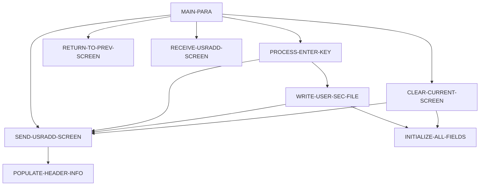

# Program COUSR01C

| Item | Value |
|---|---|
| Source | `app/cbl/COUSR01C.cbl` |
| Lines | 299 total, 198 code, 61 comment, 40 blank |
| PROGRAM-ID | COUSR01C |
| Author | AWS |
| Runtime | cics-online |
| Module | base |
| CICS transactions | CU01 (`app/csd/CARDDEMO.CSD:459-468`) |
| JCL steps | None |
| Paragraphs | 9 |
| Semantic analysis | validated (batch B07) |
| Version banner | * Ver: CardDemo_v1.0-15-g27d6c6f-68 Date: 2022-07-19 23:12:34 CDT |

## Summary

COUSR01C is a pseudo-conversational CICS COBOL program (transaction CU01, map COUSR1A in mapset COUSR01) that adds a new user record to the USRSEC VSAM user security file. Without a COMMAREA it transfers to sign-on (COSGN00C); on first entry it shows an empty add screen. On Enter it requires first name, last name, user ID, password and user type (checked in that order, first missing field reported), builds SEC-USER-DATA from the screen and issues CICS WRITE keyed on SEC-USR-ID. Success clears the screen and shows 'User <id> has been added ...' in green; a duplicate key shows 'User ID already exist...'. PF3 returns to the admin menu COADM01C and PF4 clears the screen. (Confirmed)

Evidence: `app/cbl/COUSR01C.cbl:1-5`, `app/cbl/COUSR01C.cbl:35-39`, `app/cbl/COUSR01C.cbl:78-110`, `app/cbl/COUSR01C.cbl:115-160`, `app/cbl/COUSR01C.cbl:238-274`

Header comment (Unverified, `app/cbl/COUSR01C.cbl:1-8`): Program     : COUSR01C.CBL Application : CardDemo Type        : CICS COBOL Program Function    : Add a new Regular/Admin user to USRSEC file All Rights Reserved. http://www.apache.org/licenses/LICENSE-2.0

## Divisions and sections

| Division / section | Lines | Notes |
|---|---|---|
| IDENTIFICATION DIVISION | `app/cbl/COUSR01C.cbl:22-25` |  |
| ENVIRONMENT DIVISION | `app/cbl/COUSR01C.cbl:26-28` |  |
| DATA DIVISION | `app/cbl/COUSR01C.cbl:29-69` |  |
| PROCEDURE DIVISION | `app/cbl/COUSR01C.cbl:70-299` |  |
| ENVIRONMENT / CONFIGURATION SECTION | `app/cbl/COUSR01C.cbl:27-28` |  |
| DATA / WORKING-STORAGE SECTION | `app/cbl/COUSR01C.cbl:33-61` |  |
| DATA / LINKAGE SECTION | `app/cbl/COUSR01C.cbl:62-69` |  |

## Files and data stores

No SELECT entries (no COBOL file I/O).

CICS file commands (file name resolved from VALUE clauses and the CSD):

| Command | FILE option | Resolved name | CSD DSNAME | CSD evidence | Line |
|---|---|---|---|---|---|
| WRITE | WS-USRSEC-FILE | USRSEC | AWS.M2.CARDDEMO.USRSEC.VSAM.KSDS | `app/csd/CARDDEMO.CSD:88-99` | `app/cbl/COUSR01C.cbl:240-248` |

CRUD summary from the program facts:

| Store | Kind | Ops | Evidence |
|---|---|---|---|
| USRSEC | cics-file | C | `app/cbl/COUSR01C.cbl:240` |

## Embedded CICS, SQL and DL/I commands

| Paragraph | Kind | Verb | Resources | Response | Lines |
|---|---|---|---|---|---|
| MAIN-PARA | CICS | RETURN | TRANSID(WS-TRANID) |  | `app/cbl/COUSR01C.cbl:107-110` |
| RETURN-TO-PREV-SCREEN | CICS | XCTL | PROGRAM(CDEMO-TO-PROGRAM) |  | `app/cbl/COUSR01C.cbl:175-178` |
| SEND-USRADD-SCREEN | CICS | SEND MAP | MAP('COUSR1A'), MAPSET('COUSR01') |  | `app/cbl/COUSR01C.cbl:190-196` |
| RECEIVE-USRADD-SCREEN | CICS | RECEIVE MAP | MAP('COUSR1A'), MAPSET('COUSR01') | RESP | `app/cbl/COUSR01C.cbl:203-209` |
| WRITE-USER-SEC-FILE | CICS | WRITE | DATASET(WS-USRSEC-FILE) | RESP | `app/cbl/COUSR01C.cbl:240-248` |

## Calls, transfers and callers

| Mechanism | Target | Parameters | Paragraph | Lines |
|---|---|---|---|---|
| EXEC CICS RETURN | WS-TRANID = CU01 | CARDDEMO-COMMAREA | MAIN-PARA | `app/cbl/COUSR01C.cbl:107-110` |
| EXEC CICS XCTL | CDEMO-TO-PROGRAM = COADM01C, COSGN00C | CARDDEMO-COMMAREA | RETURN-TO-PREV-SCREEN | `app/cbl/COUSR01C.cbl:175-178` |

Programs that transfer to or call this program (from `docs/_work/xref/call-graph.json`):

| Caller | Mechanism | Confidence | Evidence |
|---|---|---|---|
| COADM01C | XCTL | Confirmed | `app/cbl/COADM01C.cbl:146` |

## Copybooks

| Copybook | Statement | Resolution | Resolved path | REPLACING | Line |
|---|---|---|---|---|---|
| [COCOM01Y](../08-data/layouts/COCOM01Y.md) | COPY | inventory | app/cpy/COCOM01Y.cpy |  | `app/cbl/COUSR01C.cbl:46` |
| COUSR01 | COPY | inventory | app/cpy-bms/COUSR01.CPY |  | `app/cbl/COUSR01C.cbl:48` |
| [COTTL01Y](../08-data/layouts/COTTL01Y.md) | COPY | inventory | app/cpy/COTTL01Y.cpy |  | `app/cbl/COUSR01C.cbl:50` |
| [CSDAT01Y](../08-data/layouts/CSDAT01Y.md) | COPY | inventory | app/cpy/CSDAT01Y.cpy |  | `app/cbl/COUSR01C.cbl:51` |
| [CSMSG01Y](../08-data/layouts/CSMSG01Y.md) | COPY | inventory | app/cpy/CSMSG01Y.cpy |  | `app/cbl/COUSR01C.cbl:52` |
| [CSUSR01Y](../08-data/layouts/CSUSR01Y.md) | COPY | inventory | app/cpy/CSUSR01Y.cpy |  | `app/cbl/COUSR01C.cbl:53` |
| DFHAID | COPY | system |  |  | `app/cbl/COUSR01C.cbl:55` |
| DFHBMSCA | COPY | system |  |  | `app/cbl/COUSR01C.cbl:56` |
| DFHATTR | COPY | system (commented out) |  |  | `app/cbl/COUSR01C.cbl:57` |

## Data division items

Every data entry coded in this source (copybook contents are on the copybook pages). Lengths are computed from PIC and USAGE.

| Section | Lvl | Name | PIC | Usage | Len | OCCURS | REDEFINES | VALUE | 88-levels | Line |
|---|---|---|---|---|---|---|---|---|---|---|
| WORKING-STORAGE | 01 | WS-VARIABLES |  |  |  |  |  |  |  | 35 |
| WORKING-STORAGE | 05 | WS-PGMNAME | X(08) |  | 8 |  |  | 'COUSR01C' |  | 36 |
| WORKING-STORAGE | 05 | WS-TRANID | X(04) |  | 4 |  |  | 'CU01' |  | 37 |
| WORKING-STORAGE | 05 | WS-MESSAGE | X(80) |  | 80 |  |  | SPACES |  | 38 |
| WORKING-STORAGE | 05 | WS-USRSEC-FILE | X(08) |  | 8 |  |  | 'USRSEC ' |  | 39 |
| WORKING-STORAGE | 05 | WS-ERR-FLG | X(01) |  | 1 |  |  | 'N' | ERR-FLG-ON = 'Y'; ERR-FLG-OFF = 'N' | 40 |
| WORKING-STORAGE | 05 | WS-RESP-CD | S9(09) | COMP | 4 |  |  | ZEROS |  | 43 |
| WORKING-STORAGE | 05 | WS-REAS-CD | S9(09) | COMP | 4 |  |  | ZEROS |  | 44 |
| LINKAGE | 01 | DFHCOMMAREA |  |  |  |  |  |  |  | 63 |
| LINKAGE | 05 | LK-COMMAREA | X(01) |  | 1 | 1 TO 32767 DEPENDING ON EIBCALEN |  |  |  | 64 |

## Statement inventory

Every procedure statement the parser recorded, by kind. Each one is listed with its line under Paragraph details.

| Kind | Count |
|---|---|
| Decisions (IF, EVALUATE, WHEN, loops, handlers) | 21 |
| Calculations | 0 |
| File I/O | 0 |
| EXEC CICS / SQL / DLI | 5 |
| CALL | 0 |
| PERFORM | 20 |
| GO TO | 0 |
| MOVE literal | 29 |
| MOVE field | 29 |
| SET | 2 |
| STRING, UNSTRING, INSPECT, INITIALIZE, COPY, ENTRY and others | 1 |
| DISPLAY | 0 |
| GOBACK, STOP RUN, RETURN, XCTL | 2 |
| Not classified by the parser | 0 |

## Control flow

| Paragraph | Lines | Logic | Performs | Performed by | Reachable |
|---|---|---|---|---|---|
| [MAIN-PARA](#para-main-para) | 71-110 | Resets the error flag and message. EIBCALEN = 0 XCTLs to COSGN00C. Otherwise loads CARDDEMO-COMMAREA; on first entry sets re-enter, clears the map and sends it with the cursor on first name. On re-entry receives the map and dispatches on EIBAID: Enter (PROCESS-ENTER-KEY), PF3 (XCTL to COADM01C), PF4 (clear), other keys show CCDA-MSG-INVALID-KEY. Ends with CICS RETURN TRANSID CU01. (Confirmed) | CLEAR-CURRENT-SCREEN, PROCESS-ENTER-KEY, RECEIVE-USRADD-SCREEN, RETURN-TO-PREV-SCREEN, SEND-USRADD-SCREEN |  | yes |
| [PROCESS-ENTER-KEY](#para-process-enter-key) | 115-160 | Checks in order that FNAMEI, LNAMEI, USERIDI, PASSWDI and USRTYPEI are not blank; the first blank field sets the error flag, its 'can NOT be empty' message and cursor, and sends the screen. If all are present, moves them to SEC-USR-ID, SEC-USR-FNAME, SEC-USR-LNAME, SEC-USR-PWD, SEC-USR-TYPE and performs WRITE-USER-SEC-FILE. (Confirmed) | SEND-USRADD-SCREEN, WRITE-USER-SEC-FILE | MAIN-PARA | yes |
| [RETURN-TO-PREV-SCREEN](#para-return-to-prev-screen) | 165-178 | Defaults CDEMO-TO-PROGRAM to COSGN00C when blank, sets FROM tranid/program to CU01/COUSR01C, resets CDEMO-PGM-CONTEXT and XCTLs to CDEMO-TO-PROGRAM (moves of user ID/type into the COMMAREA are commented out). (Confirmed) |  | MAIN-PARA | yes |
| [SEND-USRADD-SCREEN](#para-send-usradd-screen) | 184-196 | Fills the header, moves WS-MESSAGE to ERRMSGO and sends map COUSR1A with ERASE and CURSOR. (Confirmed) | POPULATE-HEADER-INFO | CLEAR-CURRENT-SCREEN, MAIN-PARA, PROCESS-ENTER-KEY, WRITE-USER-SEC-FILE | yes |
| [RECEIVE-USRADD-SCREEN](#para-receive-usradd-screen) | 201-209 | Receives map COUSR1A into COUSR1AI with RESP/RESP2; the response is not tested. (Confirmed) |  | MAIN-PARA | yes |
| [POPULATE-HEADER-INFO](#para-populate-header-info) | 214-233 | Moves FUNCTION CURRENT-DATE to WS-CURDATE-DATA, CCDA-TITLE01/CCDA-TITLE02 to TITLE01O/TITLE02O, WS-TRANID to TRNNAMEO and WS-PGMNAME to PGMNAMEO of COUSR1AO; rebuilds the date as WS-CURDATE-MM-DD-YY (MM/DD/YY from WS-CURDATE-MONTH, WS-CURDATE-DAY, WS-CURDATE-YEAR(3:2)) into CURDATEO and the time as WS-CURTIME-HH-MM-SS into CURTIMEO. (Confirmed) |  | SEND-USRADD-SCREEN | yes |
| [WRITE-USER-SEC-FILE](#para-write-user-sec-file) | 238-274 | Issues CICS WRITE of SEC-USER-DATA to USRSEC keyed by SEC-USR-ID. NORMAL clears the input fields and shows 'User <id> has been added ...' in green; DUPKEY/DUPREC sets the error flag with 'User ID already exist...'; other responses set the error flag with 'Unable to Add User...'. (Confirmed) | INITIALIZE-ALL-FIELDS, SEND-USRADD-SCREEN | PROCESS-ENTER-KEY | yes |
| [CLEAR-CURRENT-SCREEN](#para-clear-current-screen) | 279-282 | Performs INITIALIZE-ALL-FIELDS and sends the screen. (Confirmed) | INITIALIZE-ALL-FIELDS, SEND-USRADD-SCREEN | MAIN-PARA | yes |
| [INITIALIZE-ALL-FIELDS](#para-initialize-all-fields) | 287-295 | Positions the cursor on first name and moves SPACES to user ID, first name, last name, password, user type and WS-MESSAGE. (Confirmed) |  | CLEAR-CURRENT-SCREEN, WRITE-USER-SEC-FILE | yes |

## Paragraph details

### Para MAIN-PARA

Lines `app/cbl/COUSR01C.cbl:71-110`. 

Logic: Resets the error flag and message. EIBCALEN = 0 XCTLs to COSGN00C. Otherwise loads CARDDEMO-COMMAREA; on first entry sets re-enter, clears the map and sends it with the cursor on first name. On re-entry receives the map and dispatches on EIBAID: Enter (PROCESS-ENTER-KEY), PF3 (XCTL to COADM01C), PF4 (clear), other keys show CCDA-MSG-INVALID-KEY. Ends with CICS RETURN TRANSID CU01. (Confirmed)

Rules: [BR-COUSR01C-001](../09-business-rules-catalog.md#br-cousr01c-001), [BR-COUSR01C-002](../09-business-rules-catalog.md#br-cousr01c-002)

Statements in source order:

- `SET ERR-FLG-OFF TO TRUE` at `app/cbl/COUSR01C.cbl:73`
- `MOVE SPACES TO WS-MESSAGE ERRMSGO OF COUSR1AO` at `app/cbl/COUSR01C.cbl:75-76`
- IF `EIBCALEN = 0` at `app/cbl/COUSR01C.cbl:78` (pseudo-conversation)
- MOVE `'COSGN00C'` TO CDEMO-TO-PROGRAM at `app/cbl/COUSR01C.cbl:79`
- PERFORM RETURN-TO-PREV-SCREEN at `app/cbl/COUSR01C.cbl:80`
- `MOVE DFHCOMMAREA(1:EIBCALEN) TO CARDDEMO-COMMAREA` at `app/cbl/COUSR01C.cbl:82`
- IF `NOT CDEMO-PGM-REENTER` at `app/cbl/COUSR01C.cbl:83` (pseudo-conversation)
- `SET CDEMO-PGM-REENTER TO TRUE` at `app/cbl/COUSR01C.cbl:84`
- `MOVE LOW-VALUES TO COUSR1AO` at `app/cbl/COUSR01C.cbl:85`
- MOVE `-1` TO FNAMEL OF COUSR1AI at `app/cbl/COUSR01C.cbl:86`
- PERFORM SEND-USRADD-SCREEN at `app/cbl/COUSR01C.cbl:87`
- PERFORM RECEIVE-USRADD-SCREEN at `app/cbl/COUSR01C.cbl:89`
- EVALUATE `EIBAID` at `app/cbl/COUSR01C.cbl:90` (screen-key)
- WHEN `DFHENTER` at `app/cbl/COUSR01C.cbl:91` (screen-key)
- PERFORM PROCESS-ENTER-KEY at `app/cbl/COUSR01C.cbl:92`
- WHEN `DFHPF3` at `app/cbl/COUSR01C.cbl:93` (screen-key)
- MOVE `'COADM01C'` TO CDEMO-TO-PROGRAM at `app/cbl/COUSR01C.cbl:94`
- PERFORM RETURN-TO-PREV-SCREEN at `app/cbl/COUSR01C.cbl:95`
- WHEN `DFHPF4` at `app/cbl/COUSR01C.cbl:96` (screen-key)
- PERFORM CLEAR-CURRENT-SCREEN at `app/cbl/COUSR01C.cbl:97`
- WHEN `OTHER` at `app/cbl/COUSR01C.cbl:98` (screen-key)
- MOVE `'Y'` TO WS-ERR-FLG at `app/cbl/COUSR01C.cbl:99`
- MOVE `-1` TO FNAMEL OF COUSR1AI at `app/cbl/COUSR01C.cbl:100`
- `MOVE CCDA-MSG-INVALID-KEY TO WS-MESSAGE` at `app/cbl/COUSR01C.cbl:101`
- PERFORM SEND-USRADD-SCREEN at `app/cbl/COUSR01C.cbl:102`
- EXEC CICS RETURN at `app/cbl/COUSR01C.cbl:107-110`
- Ends with EXEC CICS RETURN at `app/cbl/COUSR01C.cbl:107-110`

### Para PROCESS-ENTER-KEY

Lines `app/cbl/COUSR01C.cbl:115-160`. 

Logic: Checks in order that FNAMEI, LNAMEI, USERIDI, PASSWDI and USRTYPEI are not blank; the first blank field sets the error flag, its 'can NOT be empty' message and cursor, and sends the screen. If all are present, moves them to SEC-USR-ID, SEC-USR-FNAME, SEC-USR-LNAME, SEC-USR-PWD, SEC-USR-TYPE and performs WRITE-USER-SEC-FILE. (Confirmed)

Rules: [BR-COUSR01C-003](../09-business-rules-catalog.md#br-cousr01c-003), [BR-COUSR01C-004](../09-business-rules-catalog.md#br-cousr01c-004)

Statements in source order:

- EVALUATE `TRUE` at `app/cbl/COUSR01C.cbl:117` (business-candidate)
- WHEN `FNAMEI OF COUSR1AI = SPACES OR LOW-VALUES` at `app/cbl/COUSR01C.cbl:118` (business-candidate)
- MOVE `'Y'` TO WS-ERR-FLG at `app/cbl/COUSR01C.cbl:119`
- MOVE `'First Name can NOT be empty...'` TO WS-MESSAGE at `app/cbl/COUSR01C.cbl:120-121`
- MOVE `-1` TO FNAMEL OF COUSR1AI at `app/cbl/COUSR01C.cbl:122`
- PERFORM SEND-USRADD-SCREEN at `app/cbl/COUSR01C.cbl:123`
- WHEN `LNAMEI OF COUSR1AI = SPACES OR LOW-VALUES` at `app/cbl/COUSR01C.cbl:124` (business-candidate)
- MOVE `'Y'` TO WS-ERR-FLG at `app/cbl/COUSR01C.cbl:125`
- MOVE `'Last Name can NOT be empty...'` TO WS-MESSAGE at `app/cbl/COUSR01C.cbl:126-127`
- MOVE `-1` TO LNAMEL OF COUSR1AI at `app/cbl/COUSR01C.cbl:128`
- PERFORM SEND-USRADD-SCREEN at `app/cbl/COUSR01C.cbl:129`
- WHEN `USERIDI OF COUSR1AI = SPACES OR LOW-VALUES` at `app/cbl/COUSR01C.cbl:130` (business-candidate)
- MOVE `'Y'` TO WS-ERR-FLG at `app/cbl/COUSR01C.cbl:131`
- MOVE `'User ID can NOT be empty...'` TO WS-MESSAGE at `app/cbl/COUSR01C.cbl:132-133`
- MOVE `-1` TO USERIDL OF COUSR1AI at `app/cbl/COUSR01C.cbl:134`
- PERFORM SEND-USRADD-SCREEN at `app/cbl/COUSR01C.cbl:135`
- WHEN `PASSWDI OF COUSR1AI = SPACES OR LOW-VALUES` at `app/cbl/COUSR01C.cbl:136` (business-candidate)
- MOVE `'Y'` TO WS-ERR-FLG at `app/cbl/COUSR01C.cbl:137`
- MOVE `'Password can NOT be empty...'` TO WS-MESSAGE at `app/cbl/COUSR01C.cbl:138-139`
- MOVE `-1` TO PASSWDL OF COUSR1AI at `app/cbl/COUSR01C.cbl:140`
- PERFORM SEND-USRADD-SCREEN at `app/cbl/COUSR01C.cbl:141`
- WHEN `USRTYPEI OF COUSR1AI = SPACES OR LOW-VALUES` at `app/cbl/COUSR01C.cbl:142` (business-candidate)
- MOVE `'Y'` TO WS-ERR-FLG at `app/cbl/COUSR01C.cbl:143`
- MOVE `'User Type can NOT be empty...'` TO WS-MESSAGE at `app/cbl/COUSR01C.cbl:144-145`
- MOVE `-1` TO USRTYPEL OF COUSR1AI at `app/cbl/COUSR01C.cbl:146`
- PERFORM SEND-USRADD-SCREEN at `app/cbl/COUSR01C.cbl:147`
- WHEN `OTHER` at `app/cbl/COUSR01C.cbl:148` (business-candidate)
- MOVE `-1` TO FNAMEL OF COUSR1AI at `app/cbl/COUSR01C.cbl:149`
- IF `NOT ERR-FLG-ON` at `app/cbl/COUSR01C.cbl:153` (error-flag)
- `MOVE USERIDI OF COUSR1AI TO SEC-USR-ID` at `app/cbl/COUSR01C.cbl:154`
- `MOVE FNAMEI OF COUSR1AI TO SEC-USR-FNAME` at `app/cbl/COUSR01C.cbl:155`
- `MOVE LNAMEI OF COUSR1AI TO SEC-USR-LNAME` at `app/cbl/COUSR01C.cbl:156`
- `MOVE PASSWDI OF COUSR1AI TO SEC-USR-PWD` at `app/cbl/COUSR01C.cbl:157`
- `MOVE USRTYPEI OF COUSR1AI TO SEC-USR-TYPE` at `app/cbl/COUSR01C.cbl:158`
- PERFORM WRITE-USER-SEC-FILE at `app/cbl/COUSR01C.cbl:159`

### Para RETURN-TO-PREV-SCREEN

Lines `app/cbl/COUSR01C.cbl:165-178`. 

Logic: Defaults CDEMO-TO-PROGRAM to COSGN00C when blank, sets FROM tranid/program to CU01/COUSR01C, resets CDEMO-PGM-CONTEXT and XCTLs to CDEMO-TO-PROGRAM (moves of user ID/type into the COMMAREA are commented out). (Confirmed)

Statements in source order:

- IF `CDEMO-TO-PROGRAM = LOW-VALUES OR SPACES` at `app/cbl/COUSR01C.cbl:167` (business-candidate)
- MOVE `'COSGN00C'` TO CDEMO-TO-PROGRAM at `app/cbl/COUSR01C.cbl:168`
- `MOVE WS-TRANID TO CDEMO-FROM-TRANID` at `app/cbl/COUSR01C.cbl:170`
- `MOVE WS-PGMNAME TO CDEMO-FROM-PROGRAM` at `app/cbl/COUSR01C.cbl:171`
- `MOVE ZEROS TO CDEMO-PGM-CONTEXT` at `app/cbl/COUSR01C.cbl:174`
- EXEC CICS XCTL at `app/cbl/COUSR01C.cbl:175-178`
- Ends with EXEC CICS XCTL at `app/cbl/COUSR01C.cbl:175-178`

### Para SEND-USRADD-SCREEN

Lines `app/cbl/COUSR01C.cbl:184-196`. 

Logic: Fills the header, moves WS-MESSAGE to ERRMSGO and sends map COUSR1A with ERASE and CURSOR. (Confirmed)

Statements in source order:

- PERFORM POPULATE-HEADER-INFO at `app/cbl/COUSR01C.cbl:186`
- `MOVE WS-MESSAGE TO ERRMSGO OF COUSR1AO` at `app/cbl/COUSR01C.cbl:188`
- EXEC CICS SEND MAP at `app/cbl/COUSR01C.cbl:190-196`

### Para RECEIVE-USRADD-SCREEN

Lines `app/cbl/COUSR01C.cbl:201-209`. 

Logic: Receives map COUSR1A into COUSR1AI with RESP/RESP2; the response is not tested. (Confirmed)

Statements in source order:

- EXEC CICS RECEIVE MAP at `app/cbl/COUSR01C.cbl:203-209`

### Para POPULATE-HEADER-INFO

Lines `app/cbl/COUSR01C.cbl:214-233`. 

Logic: Moves FUNCTION CURRENT-DATE to WS-CURDATE-DATA, CCDA-TITLE01/CCDA-TITLE02 to TITLE01O/TITLE02O, WS-TRANID to TRNNAMEO and WS-PGMNAME to PGMNAMEO of COUSR1AO; rebuilds the date as WS-CURDATE-MM-DD-YY (MM/DD/YY from WS-CURDATE-MONTH, WS-CURDATE-DAY, WS-CURDATE-YEAR(3:2)) into CURDATEO and the time as WS-CURTIME-HH-MM-SS into CURTIMEO. (Confirmed)

Statements in source order:

- `MOVE FUNCTION CURRENT-DATE TO WS-CURDATE-DATA` at `app/cbl/COUSR01C.cbl:216`
- `MOVE CCDA-TITLE01 TO TITLE01O OF COUSR1AO` at `app/cbl/COUSR01C.cbl:218`
- `MOVE CCDA-TITLE02 TO TITLE02O OF COUSR1AO` at `app/cbl/COUSR01C.cbl:219`
- `MOVE WS-TRANID TO TRNNAMEO OF COUSR1AO` at `app/cbl/COUSR01C.cbl:220`
- `MOVE WS-PGMNAME TO PGMNAMEO OF COUSR1AO` at `app/cbl/COUSR01C.cbl:221`
- `MOVE WS-CURDATE-MONTH TO WS-CURDATE-MM` at `app/cbl/COUSR01C.cbl:223`
- `MOVE WS-CURDATE-DAY TO WS-CURDATE-DD` at `app/cbl/COUSR01C.cbl:224`
- `MOVE WS-CURDATE-YEAR(3:2) TO WS-CURDATE-YY` at `app/cbl/COUSR01C.cbl:225`
- `MOVE WS-CURDATE-MM-DD-YY TO CURDATEO OF COUSR1AO` at `app/cbl/COUSR01C.cbl:227`
- `MOVE WS-CURTIME-HOURS TO WS-CURTIME-HH` at `app/cbl/COUSR01C.cbl:229`
- `MOVE WS-CURTIME-MINUTE TO WS-CURTIME-MM` at `app/cbl/COUSR01C.cbl:230`
- `MOVE WS-CURTIME-SECOND TO WS-CURTIME-SS` at `app/cbl/COUSR01C.cbl:231`
- `MOVE WS-CURTIME-HH-MM-SS TO CURTIMEO OF COUSR1AO` at `app/cbl/COUSR01C.cbl:233`

### Para WRITE-USER-SEC-FILE

Lines `app/cbl/COUSR01C.cbl:238-274`. 

Logic: Issues CICS WRITE of SEC-USER-DATA to USRSEC keyed by SEC-USR-ID. NORMAL clears the input fields and shows 'User <id> has been added ...' in green; DUPKEY/DUPREC sets the error flag with 'User ID already exist...'; other responses set the error flag with 'Unable to Add User...'. (Confirmed)

Rules: [BR-COUSR01C-005](../09-business-rules-catalog.md#br-cousr01c-005)

Statements in source order:

- EXEC CICS WRITE at `app/cbl/COUSR01C.cbl:240-248`
- EVALUATE `WS-RESP-CD` at `app/cbl/COUSR01C.cbl:250` (io-status)
- WHEN `DFHRESP(NORMAL)` at `app/cbl/COUSR01C.cbl:251` (io-status)
- PERFORM INITIALIZE-ALL-FIELDS at `app/cbl/COUSR01C.cbl:252`
- `MOVE SPACES TO WS-MESSAGE` at `app/cbl/COUSR01C.cbl:253`
- `MOVE DFHGREEN TO ERRMSGC OF COUSR1AO` at `app/cbl/COUSR01C.cbl:254`
- `STRING 'User ' DELIMITED BY SIZE SEC-USR-ID DELIMITED BY SPACE ' has been added ...' DELIMITED BY SIZE INTO WS-MESSAGE` at `app/cbl/COUSR01C.cbl:255-258`
- PERFORM SEND-USRADD-SCREEN at `app/cbl/COUSR01C.cbl:259`
- WHEN `DFHRESP(DUPKEY)` at `app/cbl/COUSR01C.cbl:260` (io-status)
- WHEN `DFHRESP(DUPREC)` at `app/cbl/COUSR01C.cbl:261` (io-status)
- MOVE `'Y'` TO WS-ERR-FLG at `app/cbl/COUSR01C.cbl:262`
- MOVE `'User ID already exist...'` TO WS-MESSAGE at `app/cbl/COUSR01C.cbl:263-264`
- MOVE `-1` TO USERIDL OF COUSR1AI at `app/cbl/COUSR01C.cbl:265`
- PERFORM SEND-USRADD-SCREEN at `app/cbl/COUSR01C.cbl:266`
- WHEN `OTHER` at `app/cbl/COUSR01C.cbl:267` (io-status)
- MOVE `'Y'` TO WS-ERR-FLG at `app/cbl/COUSR01C.cbl:269`
- MOVE `'Unable to Add User...'` TO WS-MESSAGE at `app/cbl/COUSR01C.cbl:270-271`
- MOVE `-1` TO FNAMEL OF COUSR1AI at `app/cbl/COUSR01C.cbl:272`
- PERFORM SEND-USRADD-SCREEN at `app/cbl/COUSR01C.cbl:273`

### Para CLEAR-CURRENT-SCREEN

Lines `app/cbl/COUSR01C.cbl:279-282`. 

Logic: Performs INITIALIZE-ALL-FIELDS and sends the screen. (Confirmed)

Statements in source order:

- PERFORM INITIALIZE-ALL-FIELDS at `app/cbl/COUSR01C.cbl:281`
- PERFORM SEND-USRADD-SCREEN at `app/cbl/COUSR01C.cbl:282`

### Para INITIALIZE-ALL-FIELDS

Lines `app/cbl/COUSR01C.cbl:287-295`. 

Logic: Positions the cursor on first name and moves SPACES to user ID, first name, last name, password, user type and WS-MESSAGE. (Confirmed)

Statements in source order:

- MOVE `-1` TO FNAMEL OF COUSR1AI at `app/cbl/COUSR01C.cbl:289`
- `MOVE SPACES TO USERIDI OF COUSR1AI FNAMEI OF COUSR1AI LNAMEI OF COUSR1AI PASSWDI OF COUSR1AI USRTYPEI OF COUSR1AI WS-MESSAGE` at `app/cbl/COUSR01C.cbl:290-295`

## Business rules

| Rule | Category | Statement | Paragraph | Source | Confidence |
|---|---|---|---|---|---|
| [BR-COUSR01C-001](../09-business-rules-catalog.md#br-cousr01c-001) | routing | When started without a COMMAREA (EIBCALEN = 0) the user is sent to the sign-on program COSGN00C. | MAIN-PARA | `app/cbl/COUSR01C.cbl:78-80`, `app/cbl/COUSR01C.cbl:167-177` | Confirmed |
| [BR-COUSR01C-002](../09-business-rules-catalog.md#br-cousr01c-002) | routing | On re-entry the attention key decides the action: Enter validates and adds the user, PF3 returns to the admin menu COADM01C, PF4 clears the screen, any other key shows the invalid-key message. | MAIN-PARA | `app/cbl/COUSR01C.cbl:90-103` | Confirmed |
| [BR-COUSR01C-003](../09-business-rules-catalog.md#br-cousr01c-003) | validation | To add a user, first name, last name, user ID, password and user type are all mandatory. They are checked in that order and only the first missing field is reported; no format or value checks are applied (e.g. user type is not restricted to 'A' or 'U'). | PROCESS-ENTER-KEY | `app/cbl/COUSR01C.cbl:117-151` | Confirmed |
| [BR-COUSR01C-004](../09-business-rules-catalog.md#br-cousr01c-004) | transformation | A new user security record is built directly from the screen: user ID, first name, last name, password (stored as entered, in clear text) and user type. | PROCESS-ENTER-KEY | `app/cbl/COUSR01C.cbl:153-160` | Confirmed |
| [BR-COUSR01C-005](../09-business-rules-catalog.md#br-cousr01c-005) | data-integrity | User IDs must be unique: the add is rejected when a record with the same user ID already exists in USRSEC. On success the screen is cleared and a confirmation naming the user is shown; any other write failure is reported as unable to add. | WRITE-USER-SEC-FILE | `app/cbl/COUSR01C.cbl:250-274` | Confirmed |

Decision points reviewed and classified as not business rules:

| Lines | Reason |
|---|---|
| `app/cbl/COUSR01C.cbl:167-169` | Defensive default of the XCTL target to COSGN00C when CDEMO-TO-PROGRAM is blank. |

Decision coverage: 8 of 8 business-candidate decision points are linked to a rule or a no-rule reason (8 inside rule ranges).

## Error handling

| Paragraph | Kind | Detail | Lines |
|---|---|---|---|
| WRITE-USER-SEC-FILE | check | `WS-RESP-CD` | `app/cbl/COUSR01C.cbl:250` |
| WRITE-USER-SEC-FILE | check | `DFHRESP(NORMAL)` | `app/cbl/COUSR01C.cbl:251` |
| WRITE-USER-SEC-FILE | check | `DFHRESP(DUPKEY)` | `app/cbl/COUSR01C.cbl:260` |
| WRITE-USER-SEC-FILE | check | `DFHRESP(DUPREC)` | `app/cbl/COUSR01C.cbl:261` |
| WRITE-USER-SEC-FILE | check | `OTHER` | `app/cbl/COUSR01C.cbl:267` |

## Observations and SME questions

- security: Passwords are moved from the screen to SEC-USR-PWD and written in clear text; no hashing or strength rule is applied. (`app/cbl/COUSR01C.cbl:157`)
- security: The program does not check that the signed-on user is an administrator (CDEMO-USER-TYPE is not referenced); access control relies on navigation from COADM01C (Inferred from PF3 target). (`app/cbl/COUSR01C.cbl:78-104`)
- conflict: The header says the program adds a 'Regular/Admin user', but USRTYPEI is only checked for non-blank; any character is stored as SEC-USR-TYPE (the COMMAREA 88-levels recognise only 'A' and 'U', app/cpy/COCOM01Y.cpy). (`app/cbl/COUSR01C.cbl:142-147`)
- dead-code: Commented-out moves of WS-USER-ID / SEC-USR-TYPE to the COMMAREA and a commented-out DISPLAY of RESP/REAS. (`app/cbl/COUSR01C.cbl:172-173`)
- unchecked-io: RECEIVE MAP response codes are captured but never tested. (`app/cbl/COUSR01C.cbl:203-209`)
- hardcoded-value: File 'USRSEC', transaction 'CU01', programs COSGN00C and COADM01C are literals. (`app/cbl/COUSR01C.cbl:36-39`)
- earlier pass: Commented COPY is not expanded: COPY DFHATTR. (Confirmed, `app/cbl/COUSR01C.cbl:57`)
- SME question: Which user type values are valid (only 'A' admin and 'U' regular?) and should COUSR01C reject other values? (`app/cbl/COUSR01C.cbl:142-147`)
- SME question: Are there password rules (length, complexity, encryption) that the add function should enforce? (`app/cbl/COUSR01C.cbl:136-141`)

## Sources

- `app/cbl/COUSR01C.cbl`
- `docs/_work/structure/programs/COUSR01C.json`
- `docs/_work/semantic/programs/COUSR01C.json`
- `docs/_work/programs/COUSR01C.json`

## Confidence

Structure tables (divisions, items, paragraphs, statements, line numbers) are Confirmed: they are parsed from the source. Paragraph logic and rule statements carry their own Confirmed/Inferred tag from the batch analysis, and every rule anchor was checked against the cited lines. Decision-point classes are a keyword heuristic used only for coverage measurement. Header comments are Unverified.
