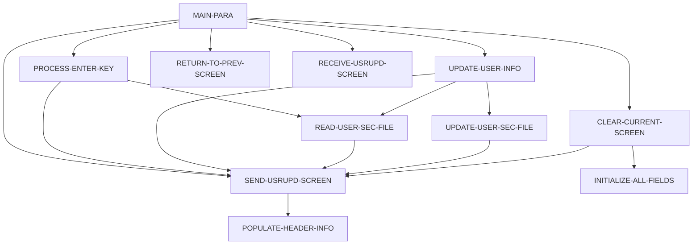

# Program COUSR02C

| Item | Value |
|---|---|
| Source | `app/cbl/COUSR02C.cbl` |
| Lines | 414 total, 303 code, 63 comment, 48 blank |
| PROGRAM-ID | COUSR02C |
| Author | AWS |
| Runtime | cics-online |
| Module | base |
| CICS transactions | CU02 (`app/csd/CARDDEMO.CSD:469-478`) |
| JCL steps | None |
| Paragraphs | 11 |
| Semantic analysis | validated (batch B07) |
| Version banner | * Ver: CardDemo_v1.0-15-g27d6c6f-68 Date: 2022-07-19 23:12:34 CDT |

## Summary

COUSR02C is a pseudo-conversational CICS COBOL program (transaction CU02, map COUSR2A in mapset COUSR02) that updates an existing user in the USRSEC VSAM user security file. Without a COMMAREA it transfers to sign-on (COSGN00C). On first entry it automatically fetches the user selected on the user list (CDEMO-CU02-USR-SELECTED); on Enter it reads the user ID typed on the screen (READ UPDATE) and shows first name, last name, password and user type. PF5 (and also PF3 before leaving) validates that all fields are filled, re-reads the record, compares each field with the stored value and issues CICS REWRITE only when at least one field changed, otherwise shows 'Please modify to update ...'. PF3 then returns to the calling program (or COADM01C), PF4 clears the screen and PF12 returns to the admin menu COADM01C. (Confirmed)

Evidence: `app/cbl/COUSR02C.cbl:1-5`, `app/cbl/COUSR02C.cbl:35-39`, `app/cbl/COUSR02C.cbl:90-137`, `app/cbl/COUSR02C.cbl:143-172`, `app/cbl/COUSR02C.cbl:177-245`, `app/cbl/COUSR02C.cbl:320-390`

Header comment (Unverified, `app/cbl/COUSR02C.cbl:1-8`): Program     : COUSR02C.CBL Application : CardDemo Type        : CICS COBOL Program Function    : Update a user in USRSEC file All Rights Reserved. http://www.apache.org/licenses/LICENSE-2.0

## Divisions and sections

| Division / section | Lines | Notes |
|---|---|---|
| IDENTIFICATION DIVISION | `app/cbl/COUSR02C.cbl:22-25` |  |
| ENVIRONMENT DIVISION | `app/cbl/COUSR02C.cbl:26-28` |  |
| DATA DIVISION | `app/cbl/COUSR02C.cbl:29-80` |  |
| PROCEDURE DIVISION | `app/cbl/COUSR02C.cbl:81-414` |  |
| ENVIRONMENT / CONFIGURATION SECTION | `app/cbl/COUSR02C.cbl:27-28` |  |
| DATA / WORKING-STORAGE SECTION | `app/cbl/COUSR02C.cbl:33-72` |  |
| DATA / LINKAGE SECTION | `app/cbl/COUSR02C.cbl:73-80` |  |

## Files and data stores

No SELECT entries (no COBOL file I/O).

CICS file commands (file name resolved from VALUE clauses and the CSD):

| Command | FILE option | Resolved name | CSD DSNAME | CSD evidence | Line |
|---|---|---|---|---|---|
| READ | WS-USRSEC-FILE | USRSEC | AWS.M2.CARDDEMO.USRSEC.VSAM.KSDS | `app/csd/CARDDEMO.CSD:88-99` | `app/cbl/COUSR02C.cbl:322-331` |
| REWRITE | WS-USRSEC-FILE | USRSEC | AWS.M2.CARDDEMO.USRSEC.VSAM.KSDS | `app/csd/CARDDEMO.CSD:88-99` | `app/cbl/COUSR02C.cbl:360-366` |

CRUD summary from the program facts:

| Store | Kind | Ops | Evidence |
|---|---|---|---|
| USRSEC | cics-file | R, U | `app/cbl/COUSR02C.cbl:322-360` |

## Embedded CICS, SQL and DL/I commands

| Paragraph | Kind | Verb | Resources | Response | Lines |
|---|---|---|---|---|---|
| MAIN-PARA | CICS | RETURN | TRANSID(WS-TRANID) |  | `app/cbl/COUSR02C.cbl:135-138` |
| RETURN-TO-PREV-SCREEN | CICS | XCTL | PROGRAM(CDEMO-TO-PROGRAM) |  | `app/cbl/COUSR02C.cbl:258-261` |
| SEND-USRUPD-SCREEN | CICS | SEND MAP | MAP('COUSR2A'), MAPSET('COUSR02') |  | `app/cbl/COUSR02C.cbl:272-278` |
| RECEIVE-USRUPD-SCREEN | CICS | RECEIVE MAP | MAP('COUSR2A'), MAPSET('COUSR02') | RESP | `app/cbl/COUSR02C.cbl:285-291` |
| READ-USER-SEC-FILE | CICS | READ | DATASET(WS-USRSEC-FILE) | RESP | `app/cbl/COUSR02C.cbl:322-331` |
| UPDATE-USER-SEC-FILE | CICS | REWRITE | DATASET(WS-USRSEC-FILE) | RESP | `app/cbl/COUSR02C.cbl:360-366` |

## Calls, transfers and callers

| Mechanism | Target | Parameters | Paragraph | Lines |
|---|---|---|---|---|
| EXEC CICS RETURN | WS-TRANID = CU02 | CARDDEMO-COMMAREA | MAIN-PARA | `app/cbl/COUSR02C.cbl:135-138` |
| EXEC CICS XCTL | CDEMO-TO-PROGRAM = COADM01C, COSGN00C | CARDDEMO-COMMAREA | RETURN-TO-PREV-SCREEN | `app/cbl/COUSR02C.cbl:258-261` |

Programs that transfer to or call this program (from `docs/_work/xref/call-graph.json`):

| Caller | Mechanism | Confidence | Evidence |
|---|---|---|---|
| COADM01C | XCTL | Confirmed | `app/cbl/COADM01C.cbl:146` |
| COUSR00C | XCTL | Confirmed | `app/cbl/COUSR00C.cbl:196` |

## Copybooks

| Copybook | Statement | Resolution | Resolved path | REPLACING | Line |
|---|---|---|---|---|---|
| [COCOM01Y](../08-data/layouts/COCOM01Y.md) | COPY | inventory | app/cpy/COCOM01Y.cpy |  | `app/cbl/COUSR02C.cbl:49` |
| COUSR02 | COPY | inventory | app/cpy-bms/COUSR02.CPY |  | `app/cbl/COUSR02C.cbl:60` |
| [COTTL01Y](../08-data/layouts/COTTL01Y.md) | COPY | inventory | app/cpy/COTTL01Y.cpy |  | `app/cbl/COUSR02C.cbl:62` |
| [CSDAT01Y](../08-data/layouts/CSDAT01Y.md) | COPY | inventory | app/cpy/CSDAT01Y.cpy |  | `app/cbl/COUSR02C.cbl:63` |
| [CSMSG01Y](../08-data/layouts/CSMSG01Y.md) | COPY | inventory | app/cpy/CSMSG01Y.cpy |  | `app/cbl/COUSR02C.cbl:64` |
| [CSUSR01Y](../08-data/layouts/CSUSR01Y.md) | COPY | inventory | app/cpy/CSUSR01Y.cpy |  | `app/cbl/COUSR02C.cbl:65` |
| DFHAID | COPY | system |  |  | `app/cbl/COUSR02C.cbl:67` |
| DFHBMSCA | COPY | system |  |  | `app/cbl/COUSR02C.cbl:68` |

## Data division items

Every data entry coded in this source (copybook contents are on the copybook pages). Lengths are computed from PIC and USAGE.

| Section | Lvl | Name | PIC | Usage | Len | OCCURS | REDEFINES | VALUE | 88-levels | Line |
|---|---|---|---|---|---|---|---|---|---|---|
| WORKING-STORAGE | 01 | WS-VARIABLES |  |  |  |  |  |  |  | 35 |
| WORKING-STORAGE | 05 | WS-PGMNAME | X(08) |  | 8 |  |  | 'COUSR02C' |  | 36 |
| WORKING-STORAGE | 05 | WS-TRANID | X(04) |  | 4 |  |  | 'CU02' |  | 37 |
| WORKING-STORAGE | 05 | WS-MESSAGE | X(80) |  | 80 |  |  | SPACES |  | 38 |
| WORKING-STORAGE | 05 | WS-USRSEC-FILE | X(08) |  | 8 |  |  | 'USRSEC ' |  | 39 |
| WORKING-STORAGE | 05 | WS-ERR-FLG | X(01) |  | 1 |  |  | 'N' | ERR-FLG-ON = 'Y'; ERR-FLG-OFF = 'N' | 40 |
| WORKING-STORAGE | 05 | WS-RESP-CD | S9(09) | COMP | 4 |  |  | ZEROS |  | 43 |
| WORKING-STORAGE | 05 | WS-REAS-CD | S9(09) | COMP | 4 |  |  | ZEROS |  | 44 |
| WORKING-STORAGE | 05 | WS-USR-MODIFIED | X(01) |  | 1 |  |  | 'N' | USR-MODIFIED-YES = 'Y'; USR-MODIFIED-NO = 'N' | 45 |
| WORKING-STORAGE | 05 | CDEMO-CU02-INFO |  |  |  |  |  |  |  | 50 |
| WORKING-STORAGE | 10 | CDEMO-CU02-USRID-FIRST | X(08) |  | 8 |  |  |  |  | 51 |
| WORKING-STORAGE | 10 | CDEMO-CU02-USRID-LAST | X(08) |  | 8 |  |  |  |  | 52 |
| WORKING-STORAGE | 10 | CDEMO-CU02-PAGE-NUM | 9(08) |  | 8 |  |  |  |  | 53 |
| WORKING-STORAGE | 10 | CDEMO-CU02-NEXT-PAGE-FLG | X(01) |  | 1 |  |  | 'N' | NEXT-PAGE-YES = 'Y'; NEXT-PAGE-NO = 'N' | 54 |
| WORKING-STORAGE | 10 | CDEMO-CU02-USR-SEL-FLG | X(01) |  | 1 |  |  |  |  | 57 |
| WORKING-STORAGE | 10 | CDEMO-CU02-USR-SELECTED | X(08) |  | 8 |  |  |  |  | 58 |
| LINKAGE | 01 | DFHCOMMAREA |  |  |  |  |  |  |  | 74 |
| LINKAGE | 05 | LK-COMMAREA | X(01) |  | 1 | 1 TO 32767 DEPENDING ON EIBCALEN |  |  |  | 75 |

## Statement inventory

Every procedure statement the parser recorded, by kind. Each one is listed with its line under Paragraph details.

| Kind | Count |
|---|---|
| Decisions (IF, EVALUATE, WHEN, loops, handlers) | 38 |
| Calculations | 0 |
| File I/O | 0 |
| EXEC CICS / SQL / DLI | 6 |
| CALL | 0 |
| PERFORM | 31 |
| GO TO | 0 |
| MOVE literal | 41 |
| MOVE field | 39 |
| SET | 7 |
| STRING, UNSTRING, INSPECT, INITIALIZE, COPY, ENTRY and others | 1 |
| DISPLAY | 2 |
| GOBACK, STOP RUN, RETURN, XCTL | 2 |
| Not classified by the parser | 0 |

## Control flow

| Paragraph | Lines | Logic | Performs | Performed by | Reachable |
|---|---|---|---|---|---|
| [MAIN-PARA](#para-main-para) | 82-138 | Resets the error and modified flags and the message. EIBCALEN = 0 XCTLs to COSGN00C. Otherwise loads CARDDEMO-COMMAREA; on first entry sets re-enter, clears the map and, if CDEMO-CU02-USR-SELECTED is not blank, moves it to USRIDINI and performs PROCESS-ENTER-KEY, then sends the screen. On re-entry receives the map and dispatches: Enter (PROCESS-ENTER-KEY), PF3 (UPDATE-USER-INFO then XCTL to CDEMO-FROM-PROGRAM or COADM01C), PF4 (clear), PF5 (UPDATE-USER-INFO), PF12 (XCTL to COADM01C), other keys show CCDA-MSG-INVALID-KEY. Ends with CICS RETURN TRANSID CU02. (Confirmed) | CLEAR-CURRENT-SCREEN, PROCESS-ENTER-KEY, RECEIVE-USRUPD-SCREEN, RETURN-TO-PREV-SCREEN, SEND-USRUPD-SCREEN, UPDATE-USER-INFO |  | yes |
| [PROCESS-ENTER-KEY](#para-process-enter-key) | 143-172 | Rejects a blank USRIDINI with 'User ID can NOT be empty...'. Otherwise blanks the name, password and type fields, moves USRIDINI to SEC-USR-ID and performs READ-USER-SEC-FILE; if found, moves SEC-USR-FNAME, SEC-USR-LNAME, SEC-USR-PWD and SEC-USR-TYPE to the screen and sends it. (Confirmed) | READ-USER-SEC-FILE, SEND-USRUPD-SCREEN | MAIN-PARA | yes |
| [UPDATE-USER-INFO](#para-update-user-info) | 177-245 | Checks in order that user ID, first name, last name, password and user type are not blank (first blank one reported). Then reads the user by USRIDINI, copies each screen field that differs from the stored value into SEC-USER-DATA and sets USR-MODIFIED-YES. If anything changed performs UPDATE-USER-SEC-FILE, otherwise shows 'Please modify to update ...' in red. (Confirmed) | READ-USER-SEC-FILE, SEND-USRUPD-SCREEN, UPDATE-USER-SEC-FILE | MAIN-PARA | yes |
| [RETURN-TO-PREV-SCREEN](#para-return-to-prev-screen) | 250-261 | Defaults CDEMO-TO-PROGRAM to COSGN00C when blank, sets FROM tranid/program to CU02/COUSR02C, resets CDEMO-PGM-CONTEXT and XCTLs to CDEMO-TO-PROGRAM. (Confirmed) |  | MAIN-PARA | yes |
| [SEND-USRUPD-SCREEN](#para-send-usrupd-screen) | 266-278 | Fills the header, moves WS-MESSAGE to ERRMSGO and sends map COUSR2A with ERASE and CURSOR. (Confirmed) | POPULATE-HEADER-INFO | CLEAR-CURRENT-SCREEN, MAIN-PARA, PROCESS-ENTER-KEY, READ-USER-SEC-FILE, UPDATE-USER-INFO, UPDATE-USER-SEC-FILE | yes |
| [RECEIVE-USRUPD-SCREEN](#para-receive-usrupd-screen) | 283-291 | Receives map COUSR2A into COUSR2AI with RESP/RESP2; the response is not tested. (Confirmed) |  | MAIN-PARA | yes |
| [POPULATE-HEADER-INFO](#para-populate-header-info) | 296-315 | Moves FUNCTION CURRENT-DATE to WS-CURDATE-DATA, CCDA-TITLE01/CCDA-TITLE02 to TITLE01O/TITLE02O, WS-TRANID to TRNNAMEO and WS-PGMNAME to PGMNAMEO of COUSR2AO; rebuilds the date as WS-CURDATE-MM-DD-YY (MM/DD/YY from WS-CURDATE-MONTH, WS-CURDATE-DAY, WS-CURDATE-YEAR(3:2)) into CURDATEO and the time as WS-CURTIME-HH-MM-SS into CURTIMEO. (Confirmed) |  | SEND-USRUPD-SCREEN | yes |
| [READ-USER-SEC-FILE](#para-read-user-sec-file) | 320-353 | Issues CICS READ UPDATE on USRSEC by SEC-USR-ID into SEC-USER-DATA. NORMAL sends the screen with 'Press PF5 key to save your updates ...' (neutral colour); NOTFND sets the error flag with 'User ID NOT found...'; other responses display RESP/REAS and set the error flag with 'Unable to lookup User...'. (Confirmed) | SEND-USRUPD-SCREEN | PROCESS-ENTER-KEY, UPDATE-USER-INFO | yes |
| [UPDATE-USER-SEC-FILE](#para-update-user-sec-file) | 358-390 | Issues CICS REWRITE of SEC-USER-DATA. NORMAL shows 'User <id> has been updated ...' in green; NOTFND sets the error flag with 'User ID NOT found...'; other responses set the error flag with 'Unable to Update User...'. (Confirmed) | SEND-USRUPD-SCREEN | UPDATE-USER-INFO | yes |
| [CLEAR-CURRENT-SCREEN](#para-clear-current-screen) | 395-398 | Performs INITIALIZE-ALL-FIELDS and sends the screen. (Confirmed) | INITIALIZE-ALL-FIELDS, SEND-USRUPD-SCREEN | MAIN-PARA | yes |
| [INITIALIZE-ALL-FIELDS](#para-initialize-all-fields) | 403-411 | Positions the cursor on the user ID and moves SPACES to user ID, first name, last name, password, user type and WS-MESSAGE. (Confirmed) |  | CLEAR-CURRENT-SCREEN | yes |

## Paragraph details

### Para MAIN-PARA

Lines `app/cbl/COUSR02C.cbl:82-138`. 

Logic: Resets the error and modified flags and the message. EIBCALEN = 0 XCTLs to COSGN00C. Otherwise loads CARDDEMO-COMMAREA; on first entry sets re-enter, clears the map and, if CDEMO-CU02-USR-SELECTED is not blank, moves it to USRIDINI and performs PROCESS-ENTER-KEY, then sends the screen. On re-entry receives the map and dispatches: Enter (PROCESS-ENTER-KEY), PF3 (UPDATE-USER-INFO then XCTL to CDEMO-FROM-PROGRAM or COADM01C), PF4 (clear), PF5 (UPDATE-USER-INFO), PF12 (XCTL to COADM01C), other keys show CCDA-MSG-INVALID-KEY. Ends with CICS RETURN TRANSID CU02. (Confirmed)

Rules: [BR-COUSR02C-001](../09-business-rules-catalog.md#br-cousr02c-001), [BR-COUSR02C-002](../09-business-rules-catalog.md#br-cousr02c-002), [BR-COUSR02C-003](../09-business-rules-catalog.md#br-cousr02c-003)

Statements in source order:

- `SET ERR-FLG-OFF TO TRUE` at `app/cbl/COUSR02C.cbl:84`
- `SET USR-MODIFIED-NO TO TRUE` at `app/cbl/COUSR02C.cbl:85`
- `MOVE SPACES TO WS-MESSAGE ERRMSGO OF COUSR2AO` at `app/cbl/COUSR02C.cbl:87-88`
- IF `EIBCALEN = 0` at `app/cbl/COUSR02C.cbl:90` (pseudo-conversation)
- MOVE `'COSGN00C'` TO CDEMO-TO-PROGRAM at `app/cbl/COUSR02C.cbl:91`
- PERFORM RETURN-TO-PREV-SCREEN at `app/cbl/COUSR02C.cbl:92`
- `MOVE DFHCOMMAREA(1:EIBCALEN) TO CARDDEMO-COMMAREA` at `app/cbl/COUSR02C.cbl:94`
- IF `NOT CDEMO-PGM-REENTER` at `app/cbl/COUSR02C.cbl:95` (pseudo-conversation)
- `SET CDEMO-PGM-REENTER TO TRUE` at `app/cbl/COUSR02C.cbl:96`
- `MOVE LOW-VALUES TO COUSR2AO` at `app/cbl/COUSR02C.cbl:97`
- MOVE `-1` TO USRIDINL OF COUSR2AI at `app/cbl/COUSR02C.cbl:98`
- IF `CDEMO-CU02-USR-SELECTED NOT = SPACES AND LOW-VALUES` at `app/cbl/COUSR02C.cbl:99-100` (business-candidate)
- `MOVE CDEMO-CU02-USR-SELECTED TO USRIDINI OF COUSR2AI` at `app/cbl/COUSR02C.cbl:101-102`
- PERFORM PROCESS-ENTER-KEY at `app/cbl/COUSR02C.cbl:103`
- PERFORM SEND-USRUPD-SCREEN at `app/cbl/COUSR02C.cbl:105`
- PERFORM RECEIVE-USRUPD-SCREEN at `app/cbl/COUSR02C.cbl:107`
- EVALUATE `EIBAID` at `app/cbl/COUSR02C.cbl:108` (screen-key)
- WHEN `DFHENTER` at `app/cbl/COUSR02C.cbl:109` (screen-key)
- PERFORM PROCESS-ENTER-KEY at `app/cbl/COUSR02C.cbl:110`
- WHEN `DFHPF3` at `app/cbl/COUSR02C.cbl:111` (screen-key)
- PERFORM UPDATE-USER-INFO at `app/cbl/COUSR02C.cbl:112`
- IF `CDEMO-FROM-PROGRAM = SPACES OR LOW-VALUES` at `app/cbl/COUSR02C.cbl:113` (pseudo-conversation)
- MOVE `'COADM01C'` TO CDEMO-TO-PROGRAM at `app/cbl/COUSR02C.cbl:114`
- `MOVE CDEMO-FROM-PROGRAM TO CDEMO-TO-PROGRAM` at `app/cbl/COUSR02C.cbl:116-117`
- PERFORM RETURN-TO-PREV-SCREEN at `app/cbl/COUSR02C.cbl:119`
- WHEN `DFHPF4` at `app/cbl/COUSR02C.cbl:120` (screen-key)
- PERFORM CLEAR-CURRENT-SCREEN at `app/cbl/COUSR02C.cbl:121`
- WHEN `DFHPF5` at `app/cbl/COUSR02C.cbl:122` (screen-key)
- PERFORM UPDATE-USER-INFO at `app/cbl/COUSR02C.cbl:123`
- WHEN `DFHPF12` at `app/cbl/COUSR02C.cbl:124` (screen-key)
- MOVE `'COADM01C'` TO CDEMO-TO-PROGRAM at `app/cbl/COUSR02C.cbl:125`
- PERFORM RETURN-TO-PREV-SCREEN at `app/cbl/COUSR02C.cbl:126`
- WHEN `OTHER` at `app/cbl/COUSR02C.cbl:127` (screen-key)
- MOVE `'Y'` TO WS-ERR-FLG at `app/cbl/COUSR02C.cbl:128`
- `MOVE CCDA-MSG-INVALID-KEY TO WS-MESSAGE` at `app/cbl/COUSR02C.cbl:129`
- PERFORM SEND-USRUPD-SCREEN at `app/cbl/COUSR02C.cbl:130`
- EXEC CICS RETURN at `app/cbl/COUSR02C.cbl:135-138`
- Ends with EXEC CICS RETURN at `app/cbl/COUSR02C.cbl:135-138`

### Para PROCESS-ENTER-KEY

Lines `app/cbl/COUSR02C.cbl:143-172`. 

Logic: Rejects a blank USRIDINI with 'User ID can NOT be empty...'. Otherwise blanks the name, password and type fields, moves USRIDINI to SEC-USR-ID and performs READ-USER-SEC-FILE; if found, moves SEC-USR-FNAME, SEC-USR-LNAME, SEC-USR-PWD and SEC-USR-TYPE to the screen and sends it. (Confirmed)

Rules: [BR-COUSR02C-004](../09-business-rules-catalog.md#br-cousr02c-004)

Statements in source order:

- EVALUATE `TRUE` at `app/cbl/COUSR02C.cbl:145` (business-candidate)
- WHEN `USRIDINI OF COUSR2AI = SPACES OR LOW-VALUES` at `app/cbl/COUSR02C.cbl:146` (business-candidate)
- MOVE `'Y'` TO WS-ERR-FLG at `app/cbl/COUSR02C.cbl:147`
- MOVE `'User ID can NOT be empty...'` TO WS-MESSAGE at `app/cbl/COUSR02C.cbl:148-149`
- MOVE `-1` TO USRIDINL OF COUSR2AI at `app/cbl/COUSR02C.cbl:150`
- PERFORM SEND-USRUPD-SCREEN at `app/cbl/COUSR02C.cbl:151`
- WHEN `OTHER` at `app/cbl/COUSR02C.cbl:152` (business-candidate)
- MOVE `-1` TO USRIDINL OF COUSR2AI at `app/cbl/COUSR02C.cbl:153`
- IF `NOT ERR-FLG-ON` at `app/cbl/COUSR02C.cbl:157` (error-flag)
- `MOVE SPACES TO FNAMEI OF COUSR2AI LNAMEI OF COUSR2AI PASSWDI OF COUSR2AI USRTYPEI OF COUSR2AI` at `app/cbl/COUSR02C.cbl:158-161`
- `MOVE USRIDINI OF COUSR2AI TO SEC-USR-ID` at `app/cbl/COUSR02C.cbl:162`
- PERFORM READ-USER-SEC-FILE at `app/cbl/COUSR02C.cbl:163`
- IF `NOT ERR-FLG-ON` at `app/cbl/COUSR02C.cbl:166` (error-flag)
- `MOVE SEC-USR-FNAME TO FNAMEI OF COUSR2AI` at `app/cbl/COUSR02C.cbl:167`
- `MOVE SEC-USR-LNAME TO LNAMEI OF COUSR2AI` at `app/cbl/COUSR02C.cbl:168`
- `MOVE SEC-USR-PWD TO PASSWDI OF COUSR2AI` at `app/cbl/COUSR02C.cbl:169`
- `MOVE SEC-USR-TYPE TO USRTYPEI OF COUSR2AI` at `app/cbl/COUSR02C.cbl:170`
- PERFORM SEND-USRUPD-SCREEN at `app/cbl/COUSR02C.cbl:171`

### Para UPDATE-USER-INFO

Lines `app/cbl/COUSR02C.cbl:177-245`. 

Logic: Checks in order that user ID, first name, last name, password and user type are not blank (first blank one reported). Then reads the user by USRIDINI, copies each screen field that differs from the stored value into SEC-USER-DATA and sets USR-MODIFIED-YES. If anything changed performs UPDATE-USER-SEC-FILE, otherwise shows 'Please modify to update ...' in red. (Confirmed)

Rules: [BR-COUSR02C-005](../09-business-rules-catalog.md#br-cousr02c-005), [BR-COUSR02C-006](../09-business-rules-catalog.md#br-cousr02c-006), [BR-COUSR02C-007](../09-business-rules-catalog.md#br-cousr02c-007)

Statements in source order:

- EVALUATE `TRUE` at `app/cbl/COUSR02C.cbl:179` (business-candidate)
- WHEN `USRIDINI OF COUSR2AI = SPACES OR LOW-VALUES` at `app/cbl/COUSR02C.cbl:180` (business-candidate)
- MOVE `'Y'` TO WS-ERR-FLG at `app/cbl/COUSR02C.cbl:181`
- MOVE `'User ID can NOT be empty...'` TO WS-MESSAGE at `app/cbl/COUSR02C.cbl:182-183`
- MOVE `-1` TO USRIDINL OF COUSR2AI at `app/cbl/COUSR02C.cbl:184`
- PERFORM SEND-USRUPD-SCREEN at `app/cbl/COUSR02C.cbl:185`
- WHEN `FNAMEI OF COUSR2AI = SPACES OR LOW-VALUES` at `app/cbl/COUSR02C.cbl:186` (business-candidate)
- MOVE `'Y'` TO WS-ERR-FLG at `app/cbl/COUSR02C.cbl:187`
- MOVE `'First Name can NOT be empty...'` TO WS-MESSAGE at `app/cbl/COUSR02C.cbl:188-189`
- MOVE `-1` TO FNAMEL OF COUSR2AI at `app/cbl/COUSR02C.cbl:190`
- PERFORM SEND-USRUPD-SCREEN at `app/cbl/COUSR02C.cbl:191`
- WHEN `LNAMEI OF COUSR2AI = SPACES OR LOW-VALUES` at `app/cbl/COUSR02C.cbl:192` (business-candidate)
- MOVE `'Y'` TO WS-ERR-FLG at `app/cbl/COUSR02C.cbl:193`
- MOVE `'Last Name can NOT be empty...'` TO WS-MESSAGE at `app/cbl/COUSR02C.cbl:194-195`
- MOVE `-1` TO LNAMEL OF COUSR2AI at `app/cbl/COUSR02C.cbl:196`
- PERFORM SEND-USRUPD-SCREEN at `app/cbl/COUSR02C.cbl:197`
- WHEN `PASSWDI OF COUSR2AI = SPACES OR LOW-VALUES` at `app/cbl/COUSR02C.cbl:198` (business-candidate)
- MOVE `'Y'` TO WS-ERR-FLG at `app/cbl/COUSR02C.cbl:199`
- MOVE `'Password can NOT be empty...'` TO WS-MESSAGE at `app/cbl/COUSR02C.cbl:200-201`
- MOVE `-1` TO PASSWDL OF COUSR2AI at `app/cbl/COUSR02C.cbl:202`
- PERFORM SEND-USRUPD-SCREEN at `app/cbl/COUSR02C.cbl:203`
- WHEN `USRTYPEI OF COUSR2AI = SPACES OR LOW-VALUES` at `app/cbl/COUSR02C.cbl:204` (business-candidate)
- MOVE `'Y'` TO WS-ERR-FLG at `app/cbl/COUSR02C.cbl:205`
- MOVE `'User Type can NOT be empty...'` TO WS-MESSAGE at `app/cbl/COUSR02C.cbl:206-207`
- MOVE `-1` TO USRTYPEL OF COUSR2AI at `app/cbl/COUSR02C.cbl:208`
- PERFORM SEND-USRUPD-SCREEN at `app/cbl/COUSR02C.cbl:209`
- WHEN `OTHER` at `app/cbl/COUSR02C.cbl:210` (business-candidate)
- MOVE `-1` TO FNAMEL OF COUSR2AI at `app/cbl/COUSR02C.cbl:211`
- IF `NOT ERR-FLG-ON` at `app/cbl/COUSR02C.cbl:215` (error-flag)
- `MOVE USRIDINI OF COUSR2AI TO SEC-USR-ID` at `app/cbl/COUSR02C.cbl:216`
- PERFORM READ-USER-SEC-FILE at `app/cbl/COUSR02C.cbl:217`
- IF `FNAMEI OF COUSR2AI NOT = SEC-USR-FNAME` at `app/cbl/COUSR02C.cbl:219` (business-candidate)
- `MOVE FNAMEI OF COUSR2AI TO SEC-USR-FNAME` at `app/cbl/COUSR02C.cbl:220`
- `SET USR-MODIFIED-YES TO TRUE` at `app/cbl/COUSR02C.cbl:221`
- IF `LNAMEI OF COUSR2AI NOT = SEC-USR-LNAME` at `app/cbl/COUSR02C.cbl:223` (business-candidate)
- `MOVE LNAMEI OF COUSR2AI TO SEC-USR-LNAME` at `app/cbl/COUSR02C.cbl:224`
- `SET USR-MODIFIED-YES TO TRUE` at `app/cbl/COUSR02C.cbl:225`
- IF `PASSWDI OF COUSR2AI NOT = SEC-USR-PWD` at `app/cbl/COUSR02C.cbl:227` (business-candidate)
- `MOVE PASSWDI OF COUSR2AI TO SEC-USR-PWD` at `app/cbl/COUSR02C.cbl:228`
- `SET USR-MODIFIED-YES TO TRUE` at `app/cbl/COUSR02C.cbl:229`
- IF `USRTYPEI OF COUSR2AI NOT = SEC-USR-TYPE` at `app/cbl/COUSR02C.cbl:231` (business-candidate)
- `MOVE USRTYPEI OF COUSR2AI TO SEC-USR-TYPE` at `app/cbl/COUSR02C.cbl:232`
- `SET USR-MODIFIED-YES TO TRUE` at `app/cbl/COUSR02C.cbl:233`
- IF `USR-MODIFIED-YES` at `app/cbl/COUSR02C.cbl:236` (business-candidate)
- PERFORM UPDATE-USER-SEC-FILE at `app/cbl/COUSR02C.cbl:237`
- MOVE `'Please modify to update ...'` TO WS-MESSAGE at `app/cbl/COUSR02C.cbl:239-240`
- `MOVE DFHRED TO ERRMSGC OF COUSR2AO` at `app/cbl/COUSR02C.cbl:241`
- PERFORM SEND-USRUPD-SCREEN at `app/cbl/COUSR02C.cbl:242`

### Para RETURN-TO-PREV-SCREEN

Lines `app/cbl/COUSR02C.cbl:250-261`. 

Logic: Defaults CDEMO-TO-PROGRAM to COSGN00C when blank, sets FROM tranid/program to CU02/COUSR02C, resets CDEMO-PGM-CONTEXT and XCTLs to CDEMO-TO-PROGRAM. (Confirmed)

Statements in source order:

- IF `CDEMO-TO-PROGRAM = LOW-VALUES OR SPACES` at `app/cbl/COUSR02C.cbl:252` (business-candidate)
- MOVE `'COSGN00C'` TO CDEMO-TO-PROGRAM at `app/cbl/COUSR02C.cbl:253`
- `MOVE WS-TRANID TO CDEMO-FROM-TRANID` at `app/cbl/COUSR02C.cbl:255`
- `MOVE WS-PGMNAME TO CDEMO-FROM-PROGRAM` at `app/cbl/COUSR02C.cbl:256`
- `MOVE ZEROS TO CDEMO-PGM-CONTEXT` at `app/cbl/COUSR02C.cbl:257`
- EXEC CICS XCTL at `app/cbl/COUSR02C.cbl:258-261`
- Ends with EXEC CICS XCTL at `app/cbl/COUSR02C.cbl:258-261`

### Para SEND-USRUPD-SCREEN

Lines `app/cbl/COUSR02C.cbl:266-278`. 

Logic: Fills the header, moves WS-MESSAGE to ERRMSGO and sends map COUSR2A with ERASE and CURSOR. (Confirmed)

Statements in source order:

- PERFORM POPULATE-HEADER-INFO at `app/cbl/COUSR02C.cbl:268`
- `MOVE WS-MESSAGE TO ERRMSGO OF COUSR2AO` at `app/cbl/COUSR02C.cbl:270`
- EXEC CICS SEND MAP at `app/cbl/COUSR02C.cbl:272-278`

### Para RECEIVE-USRUPD-SCREEN

Lines `app/cbl/COUSR02C.cbl:283-291`. 

Logic: Receives map COUSR2A into COUSR2AI with RESP/RESP2; the response is not tested. (Confirmed)

Statements in source order:

- EXEC CICS RECEIVE MAP at `app/cbl/COUSR02C.cbl:285-291`

### Para POPULATE-HEADER-INFO

Lines `app/cbl/COUSR02C.cbl:296-315`. 

Logic: Moves FUNCTION CURRENT-DATE to WS-CURDATE-DATA, CCDA-TITLE01/CCDA-TITLE02 to TITLE01O/TITLE02O, WS-TRANID to TRNNAMEO and WS-PGMNAME to PGMNAMEO of COUSR2AO; rebuilds the date as WS-CURDATE-MM-DD-YY (MM/DD/YY from WS-CURDATE-MONTH, WS-CURDATE-DAY, WS-CURDATE-YEAR(3:2)) into CURDATEO and the time as WS-CURTIME-HH-MM-SS into CURTIMEO. (Confirmed)

Statements in source order:

- `MOVE FUNCTION CURRENT-DATE TO WS-CURDATE-DATA` at `app/cbl/COUSR02C.cbl:298`
- `MOVE CCDA-TITLE01 TO TITLE01O OF COUSR2AO` at `app/cbl/COUSR02C.cbl:300`
- `MOVE CCDA-TITLE02 TO TITLE02O OF COUSR2AO` at `app/cbl/COUSR02C.cbl:301`
- `MOVE WS-TRANID TO TRNNAMEO OF COUSR2AO` at `app/cbl/COUSR02C.cbl:302`
- `MOVE WS-PGMNAME TO PGMNAMEO OF COUSR2AO` at `app/cbl/COUSR02C.cbl:303`
- `MOVE WS-CURDATE-MONTH TO WS-CURDATE-MM` at `app/cbl/COUSR02C.cbl:305`
- `MOVE WS-CURDATE-DAY TO WS-CURDATE-DD` at `app/cbl/COUSR02C.cbl:306`
- `MOVE WS-CURDATE-YEAR(3:2) TO WS-CURDATE-YY` at `app/cbl/COUSR02C.cbl:307`
- `MOVE WS-CURDATE-MM-DD-YY TO CURDATEO OF COUSR2AO` at `app/cbl/COUSR02C.cbl:309`
- `MOVE WS-CURTIME-HOURS TO WS-CURTIME-HH` at `app/cbl/COUSR02C.cbl:311`
- `MOVE WS-CURTIME-MINUTE TO WS-CURTIME-MM` at `app/cbl/COUSR02C.cbl:312`
- `MOVE WS-CURTIME-SECOND TO WS-CURTIME-SS` at `app/cbl/COUSR02C.cbl:313`
- `MOVE WS-CURTIME-HH-MM-SS TO CURTIMEO OF COUSR2AO` at `app/cbl/COUSR02C.cbl:315`

### Para READ-USER-SEC-FILE

Lines `app/cbl/COUSR02C.cbl:320-353`. 

Logic: Issues CICS READ UPDATE on USRSEC by SEC-USR-ID into SEC-USER-DATA. NORMAL sends the screen with 'Press PF5 key to save your updates ...' (neutral colour); NOTFND sets the error flag with 'User ID NOT found...'; other responses display RESP/REAS and set the error flag with 'Unable to lookup User...'. (Confirmed)

Rules: [BR-COUSR02C-008](../09-business-rules-catalog.md#br-cousr02c-008)

Statements in source order:

- EXEC CICS READ at `app/cbl/COUSR02C.cbl:322-331`
- EVALUATE `WS-RESP-CD` at `app/cbl/COUSR02C.cbl:333` (io-status)
- WHEN `DFHRESP(NORMAL)` at `app/cbl/COUSR02C.cbl:334` (io-status)
- MOVE `'Press PF5 key to save your updates ...'` TO WS-MESSAGE at `app/cbl/COUSR02C.cbl:336-337`
- `MOVE DFHNEUTR TO ERRMSGC OF COUSR2AO` at `app/cbl/COUSR02C.cbl:338`
- PERFORM SEND-USRUPD-SCREEN at `app/cbl/COUSR02C.cbl:339`
- WHEN `DFHRESP(NOTFND)` at `app/cbl/COUSR02C.cbl:340` (io-status)
- MOVE `'Y'` TO WS-ERR-FLG at `app/cbl/COUSR02C.cbl:341`
- MOVE `'User ID NOT found...'` TO WS-MESSAGE at `app/cbl/COUSR02C.cbl:342-343`
- MOVE `-1` TO USRIDINL OF COUSR2AI at `app/cbl/COUSR02C.cbl:344`
- PERFORM SEND-USRUPD-SCREEN at `app/cbl/COUSR02C.cbl:345`
- WHEN `OTHER` at `app/cbl/COUSR02C.cbl:346` (io-status)
- `DISPLAY 'RESP:' WS-RESP-CD 'REAS:' WS-REAS-CD` at `app/cbl/COUSR02C.cbl:347`
- MOVE `'Y'` TO WS-ERR-FLG at `app/cbl/COUSR02C.cbl:348`
- MOVE `'Unable to lookup User...'` TO WS-MESSAGE at `app/cbl/COUSR02C.cbl:349-350`
- MOVE `-1` TO FNAMEL OF COUSR2AI at `app/cbl/COUSR02C.cbl:351`
- PERFORM SEND-USRUPD-SCREEN at `app/cbl/COUSR02C.cbl:352`

### Para UPDATE-USER-SEC-FILE

Lines `app/cbl/COUSR02C.cbl:358-390`. 

Logic: Issues CICS REWRITE of SEC-USER-DATA. NORMAL shows 'User <id> has been updated ...' in green; NOTFND sets the error flag with 'User ID NOT found...'; other responses set the error flag with 'Unable to Update User...'. (Confirmed)

Rules: [BR-COUSR02C-009](../09-business-rules-catalog.md#br-cousr02c-009)

Statements in source order:

- EXEC CICS REWRITE at `app/cbl/COUSR02C.cbl:360-366`
- EVALUATE `WS-RESP-CD` at `app/cbl/COUSR02C.cbl:368` (io-status)
- WHEN `DFHRESP(NORMAL)` at `app/cbl/COUSR02C.cbl:369` (io-status)
- `MOVE SPACES TO WS-MESSAGE` at `app/cbl/COUSR02C.cbl:370`
- `MOVE DFHGREEN TO ERRMSGC OF COUSR2AO` at `app/cbl/COUSR02C.cbl:371`
- `STRING 'User ' DELIMITED BY SIZE SEC-USR-ID DELIMITED BY SPACE ' has been updated ...' DELIMITED BY SIZE INTO WS-MESSAGE` at `app/cbl/COUSR02C.cbl:372-375`
- PERFORM SEND-USRUPD-SCREEN at `app/cbl/COUSR02C.cbl:376`
- WHEN `DFHRESP(NOTFND)` at `app/cbl/COUSR02C.cbl:377` (io-status)
- MOVE `'Y'` TO WS-ERR-FLG at `app/cbl/COUSR02C.cbl:378`
- MOVE `'User ID NOT found...'` TO WS-MESSAGE at `app/cbl/COUSR02C.cbl:379-380`
- MOVE `-1` TO USRIDINL OF COUSR2AI at `app/cbl/COUSR02C.cbl:381`
- PERFORM SEND-USRUPD-SCREEN at `app/cbl/COUSR02C.cbl:382`
- WHEN `OTHER` at `app/cbl/COUSR02C.cbl:383` (io-status)
- `DISPLAY 'RESP:' WS-RESP-CD 'REAS:' WS-REAS-CD` at `app/cbl/COUSR02C.cbl:384`
- MOVE `'Y'` TO WS-ERR-FLG at `app/cbl/COUSR02C.cbl:385`
- MOVE `'Unable to Update User...'` TO WS-MESSAGE at `app/cbl/COUSR02C.cbl:386-387`
- MOVE `-1` TO FNAMEL OF COUSR2AI at `app/cbl/COUSR02C.cbl:388`
- PERFORM SEND-USRUPD-SCREEN at `app/cbl/COUSR02C.cbl:389`

### Para CLEAR-CURRENT-SCREEN

Lines `app/cbl/COUSR02C.cbl:395-398`. 

Logic: Performs INITIALIZE-ALL-FIELDS and sends the screen. (Confirmed)

Statements in source order:

- PERFORM INITIALIZE-ALL-FIELDS at `app/cbl/COUSR02C.cbl:397`
- PERFORM SEND-USRUPD-SCREEN at `app/cbl/COUSR02C.cbl:398`

### Para INITIALIZE-ALL-FIELDS

Lines `app/cbl/COUSR02C.cbl:403-411`. 

Logic: Positions the cursor on the user ID and moves SPACES to user ID, first name, last name, password, user type and WS-MESSAGE. (Confirmed)

Statements in source order:

- MOVE `-1` TO USRIDINL OF COUSR2AI at `app/cbl/COUSR02C.cbl:405`
- `MOVE SPACES TO USRIDINI OF COUSR2AI FNAMEI OF COUSR2AI LNAMEI OF COUSR2AI PASSWDI OF COUSR2AI USRTYPEI OF COUSR2AI WS-MESSAGE` at `app/cbl/COUSR02C.cbl:406-411`

## Business rules

| Rule | Category | Statement | Paragraph | Source | Confidence |
|---|---|---|---|---|---|
| [BR-COUSR02C-001](../09-business-rules-catalog.md#br-cousr02c-001) | routing | When started without a COMMAREA (EIBCALEN = 0) the user is sent to the sign-on program COSGN00C. | MAIN-PARA | `app/cbl/COUSR02C.cbl:90-92`, `app/cbl/COUSR02C.cbl:252-260` | Confirmed |
| [BR-COUSR02C-002](../09-business-rules-catalog.md#br-cousr02c-002) | decision | On first entry, when a user was selected on the user list (CDEMO-CU02-USR-SELECTED not blank), that user is fetched and displayed for editing immediately. | MAIN-PARA | `app/cbl/COUSR02C.cbl:95-105` | Confirmed |
| [BR-COUSR02C-003](../09-business-rules-catalog.md#br-cousr02c-003) | routing | Key actions on re-entry: Enter fetches the user; PF5 saves changes; PF3 also attempts to save changes and then returns to the calling program (CDEMO-FROM-PROGRAM, or COADM01C when unknown) regardless of the save outcome; PF4 clears the screen; PF12 returns to the admin menu COADM01C without saving; other keys show the invalid-key message. | MAIN-PARA | `app/cbl/COUSR02C.cbl:108-131` | Confirmed |
| [BR-COUSR02C-004](../09-business-rules-catalog.md#br-cousr02c-004) | validation | A user ID is required to fetch a user for update. | PROCESS-ENTER-KEY | `app/cbl/COUSR02C.cbl:145-155` | Confirmed |
| [BR-COUSR02C-005](../09-business-rules-catalog.md#br-cousr02c-005) | validation | To save an update, user ID, first name, last name, password and user type must all be non-blank; they are checked in that order and only the first missing field is reported. No value or format checks are applied (user type is not restricted to 'A'/'U'). | UPDATE-USER-INFO | `app/cbl/COUSR02C.cbl:179-213` | Confirmed |
| [BR-COUSR02C-006](../09-business-rules-catalog.md#br-cousr02c-006) | decision | Only fields that differ from the stored record are changed: first name, last name, password and user type on the screen are each compared with the record just read, the new value is copied when different, and the record is marked as modified. The user ID itself is the key and cannot be changed. | UPDATE-USER-INFO | `app/cbl/COUSR02C.cbl:215-234` | Confirmed |
| [BR-COUSR02C-007](../09-business-rules-catalog.md#br-cousr02c-007) | decision | The user record is rewritten only when at least one field was changed; otherwise the user is asked to modify something and nothing is written. | UPDATE-USER-INFO | `app/cbl/COUSR02C.cbl:236-243` | Confirmed |
| [BR-COUSR02C-008](../09-business-rules-catalog.md#br-cousr02c-008) | error-policy | Fetching the user by exact user ID: if found the user is prompted to press PF5 to save; if not found the user is told so; other failures report a lookup error. Not-found and lookup errors set the error flag. | READ-USER-SEC-FILE | `app/cbl/COUSR02C.cbl:333-353` | Confirmed |
| [BR-COUSR02C-009](../09-business-rules-catalog.md#br-cousr02c-009) | error-policy | Saving the user: a successful rewrite shows a green confirmation naming the user; not-found and other failures set the error flag with their messages. | UPDATE-USER-SEC-FILE | `app/cbl/COUSR02C.cbl:368-390` | Confirmed |

Decision points reviewed and classified as not business rules:

| Lines | Reason |
|---|---|
| `app/cbl/COUSR02C.cbl:252-254` | Defensive default of the XCTL target to COSGN00C when CDEMO-TO-PROGRAM is blank. |

Decision coverage: 17 of 17 business-candidate decision points are linked to a rule or a no-rule reason (17 inside rule ranges).

## Error handling

| Paragraph | Kind | Detail | Lines |
|---|---|---|---|
| READ-USER-SEC-FILE | check | `WS-RESP-CD` | `app/cbl/COUSR02C.cbl:333` |
| READ-USER-SEC-FILE | check | `DFHRESP(NORMAL)` | `app/cbl/COUSR02C.cbl:334` |
| READ-USER-SEC-FILE | check | `DFHRESP(NOTFND)` | `app/cbl/COUSR02C.cbl:340` |
| READ-USER-SEC-FILE | check | `OTHER` | `app/cbl/COUSR02C.cbl:346` |
| UPDATE-USER-SEC-FILE | check | `WS-RESP-CD` | `app/cbl/COUSR02C.cbl:368` |
| UPDATE-USER-SEC-FILE | check | `DFHRESP(NORMAL)` | `app/cbl/COUSR02C.cbl:369` |
| UPDATE-USER-SEC-FILE | check | `DFHRESP(NOTFND)` | `app/cbl/COUSR02C.cbl:377` |
| UPDATE-USER-SEC-FILE | check | `OTHER` | `app/cbl/COUSR02C.cbl:383` |

## Observations and SME questions

- anomaly: UPDATE-USER-INFO does not test the error flag after READ-USER-SEC-FILE: when the user is not found (or the read fails) the field comparison still runs against SEC-USER-DATA and a REWRITE can be issued without a successful READ UPDATE, which CICS would reject (Inferred: INVREQ, giving 'Unable to Update User...'). (`app/cbl/COUSR02C.cbl:215-237`)
- anomaly: PF3 performs UPDATE-USER-INFO (save) and then always XCTLs away, so validation or save errors are sent to the terminal and immediately replaced by the next program; leaving with PF3 also silently saves edits. (`app/cbl/COUSR02C.cbl:111-119`)
- anomaly: READ-USER-SEC-FILE sends the screen on success, so a PF5 save sends the map twice in one task (read prompt, then update result), and the first-entry path sends it up to three times (read, PROCESS-ENTER-KEY line 171, MAIN-PARA line 105). (`app/cbl/COUSR02C.cbl:333-338`)
- anomaly: There is no optimistic-concurrency check: the update compares the screen with a fresh read at save time, not with the values originally displayed, so a concurrent change by another administrator is silently overwritten (Inferred from control flow). The Enter-path READ UPDATE lock is released when the task returns. (`app/cbl/COUSR02C.cbl:215-234`)
- security: The stored password SEC-USR-PWD is moved to the screen field PASSWDI for display/editing; whether it is visible depends on the BMS attributes of map COUSR2A (not verified here). Passwords are stored in clear text. (`app/cbl/COUSR02C.cbl:169`)
- security: No check that the signed-on user is an administrator (CDEMO-USER-TYPE not referenced), and an administrator can change any user's type, including their own. (`app/cbl/COUSR02C.cbl:231-234`)
- unchecked-io: RECEIVE MAP response codes are captured but never tested. (`app/cbl/COUSR02C.cbl:285-291`)
- hardcoded-value: File 'USRSEC', transaction 'CU02', programs COSGN00C and COADM01C are literals. (`app/cbl/COUSR02C.cbl:36-39`)
- SME question: Is PF3 intended to save pending changes before exiting (it performs UPDATE-USER-INFO), and should an error stop the exit? (`app/cbl/COUSR02C.cbl:111-119`)
- SME question: Which user type values are valid, and may an administrator change their own type or password through this screen? (`app/cbl/COUSR02C.cbl:204-209`)
- SME question: Should the update be refused if the record changed since it was displayed (optimistic locking)? (`app/cbl/COUSR02C.cbl:215-237`)

## Sources

- `app/cbl/COUSR02C.cbl`
- `docs/_work/structure/programs/COUSR02C.json`
- `docs/_work/semantic/programs/COUSR02C.json`
- `docs/_work/programs/COUSR02C.json`

## Confidence

Structure tables (divisions, items, paragraphs, statements, line numbers) are Confirmed: they are parsed from the source. Paragraph logic and rule statements carry their own Confirmed/Inferred tag from the batch analysis, and every rule anchor was checked against the cited lines. Decision-point classes are a keyword heuristic used only for coverage measurement. Header comments are Unverified.
