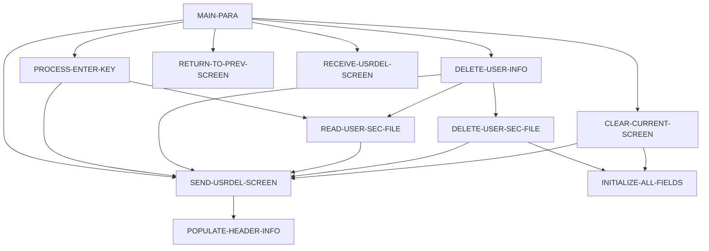

# Program COUSR03C

| Item | Value |
|---|---|
| Source | `app/cbl/COUSR03C.cbl` |
| Lines | 359 total, 251 code, 63 comment, 45 blank |
| PROGRAM-ID | COUSR03C |
| Author | AWS |
| Runtime | cics-online |
| Module | base |
| CICS transactions | CU03 (`app/csd/CARDDEMO.CSD:479-488`) |
| JCL steps | None |
| Paragraphs | 11 |
| Semantic analysis | validated (batch B07) |
| Version banner | * Ver: CardDemo_v1.0-15-g27d6c6f-68 Date: 2022-07-19 23:12:35 CDT |

## Summary

COUSR03C is a pseudo-conversational CICS COBOL program (transaction CU03, map COUSR3A in mapset COUSR03) that deletes a user from the USRSEC VSAM user security file. Without a COMMAREA it transfers to sign-on (COSGN00C). On first entry it fetches the user selected on the user list (CDEMO-CU03-USR-SELECTED); on Enter it reads the typed user ID (READ UPDATE) and shows first name, last name and user type with the prompt 'Press PF5 key to delete this user ...'. PF5 requires a user ID, re-reads the record with UPDATE and issues CICS DELETE; success clears the screen and shows 'User <id> has been deleted ...'. PF3 returns to the calling program (or COADM01C), PF4 clears the screen and PF12 returns to the admin menu COADM01C. (Confirmed)

Evidence: `app/cbl/COUSR03C.cbl:1-5`, `app/cbl/COUSR03C.cbl:35-39`, `app/cbl/COUSR03C.cbl:90-136`, `app/cbl/COUSR03C.cbl:142-192`, `app/cbl/COUSR03C.cbl:267-336`

Header comment (Unverified, `app/cbl/COUSR03C.cbl:1-8`): Program     : COUSR03C.CBL Application : CardDemo Type        : CICS COBOL Program Function    : Delete a user from USRSEC file All Rights Reserved. http://www.apache.org/licenses/LICENSE-2.0

## Divisions and sections

| Division / section | Lines | Notes |
|---|---|---|
| IDENTIFICATION DIVISION | `app/cbl/COUSR03C.cbl:22-25` |  |
| ENVIRONMENT DIVISION | `app/cbl/COUSR03C.cbl:26-28` |  |
| DATA DIVISION | `app/cbl/COUSR03C.cbl:29-80` |  |
| PROCEDURE DIVISION | `app/cbl/COUSR03C.cbl:81-359` |  |
| ENVIRONMENT / CONFIGURATION SECTION | `app/cbl/COUSR03C.cbl:27-28` |  |
| DATA / WORKING-STORAGE SECTION | `app/cbl/COUSR03C.cbl:33-72` |  |
| DATA / LINKAGE SECTION | `app/cbl/COUSR03C.cbl:73-80` |  |

## Files and data stores

No SELECT entries (no COBOL file I/O).

CICS file commands (file name resolved from VALUE clauses and the CSD):

| Command | FILE option | Resolved name | CSD DSNAME | CSD evidence | Line |
|---|---|---|---|---|---|
| READ | WS-USRSEC-FILE | USRSEC | AWS.M2.CARDDEMO.USRSEC.VSAM.KSDS | `app/csd/CARDDEMO.CSD:88-99` | `app/cbl/COUSR03C.cbl:269-278` |
| DELETE | WS-USRSEC-FILE | USRSEC | AWS.M2.CARDDEMO.USRSEC.VSAM.KSDS | `app/csd/CARDDEMO.CSD:88-99` | `app/cbl/COUSR03C.cbl:307-311` |

CRUD summary from the program facts:

| Store | Kind | Ops | Evidence |
|---|---|---|---|
| USRSEC | cics-file | D, R, U | `app/cbl/COUSR03C.cbl:269-307` |

## Embedded CICS, SQL and DL/I commands

| Paragraph | Kind | Verb | Resources | Response | Lines |
|---|---|---|---|---|---|
| MAIN-PARA | CICS | RETURN | TRANSID(WS-TRANID) |  | `app/cbl/COUSR03C.cbl:134-137` |
| RETURN-TO-PREV-SCREEN | CICS | XCTL | PROGRAM(CDEMO-TO-PROGRAM) |  | `app/cbl/COUSR03C.cbl:205-208` |
| SEND-USRDEL-SCREEN | CICS | SEND MAP | MAP('COUSR3A'), MAPSET('COUSR03') |  | `app/cbl/COUSR03C.cbl:219-225` |
| RECEIVE-USRDEL-SCREEN | CICS | RECEIVE MAP | MAP('COUSR3A'), MAPSET('COUSR03') | RESP | `app/cbl/COUSR03C.cbl:232-238` |
| READ-USER-SEC-FILE | CICS | READ | DATASET(WS-USRSEC-FILE) | RESP | `app/cbl/COUSR03C.cbl:269-278` |
| DELETE-USER-SEC-FILE | CICS | DELETE | DATASET(WS-USRSEC-FILE) | RESP | `app/cbl/COUSR03C.cbl:307-311` |

## Calls, transfers and callers

| Mechanism | Target | Parameters | Paragraph | Lines |
|---|---|---|---|---|
| EXEC CICS RETURN | WS-TRANID = CU03 | CARDDEMO-COMMAREA | MAIN-PARA | `app/cbl/COUSR03C.cbl:134-137` |
| EXEC CICS XCTL | CDEMO-TO-PROGRAM = COADM01C, COSGN00C | CARDDEMO-COMMAREA | RETURN-TO-PREV-SCREEN | `app/cbl/COUSR03C.cbl:205-208` |

Programs that transfer to or call this program (from `docs/_work/xref/call-graph.json`):

| Caller | Mechanism | Confidence | Evidence |
|---|---|---|---|
| COADM01C | XCTL | Confirmed | `app/cbl/COADM01C.cbl:146` |
| COUSR00C | XCTL | Confirmed | `app/cbl/COUSR00C.cbl:206` |

## Copybooks

| Copybook | Statement | Resolution | Resolved path | REPLACING | Line |
|---|---|---|---|---|---|
| [COCOM01Y](../08-data/layouts/COCOM01Y.md) | COPY | inventory | app/cpy/COCOM01Y.cpy |  | `app/cbl/COUSR03C.cbl:49` |
| COUSR03 | COPY | inventory | app/cpy-bms/COUSR03.CPY |  | `app/cbl/COUSR03C.cbl:60` |
| [COTTL01Y](../08-data/layouts/COTTL01Y.md) | COPY | inventory | app/cpy/COTTL01Y.cpy |  | `app/cbl/COUSR03C.cbl:62` |
| [CSDAT01Y](../08-data/layouts/CSDAT01Y.md) | COPY | inventory | app/cpy/CSDAT01Y.cpy |  | `app/cbl/COUSR03C.cbl:63` |
| [CSMSG01Y](../08-data/layouts/CSMSG01Y.md) | COPY | inventory | app/cpy/CSMSG01Y.cpy |  | `app/cbl/COUSR03C.cbl:64` |
| [CSUSR01Y](../08-data/layouts/CSUSR01Y.md) | COPY | inventory | app/cpy/CSUSR01Y.cpy |  | `app/cbl/COUSR03C.cbl:65` |
| DFHAID | COPY | system |  |  | `app/cbl/COUSR03C.cbl:67` |
| DFHBMSCA | COPY | system |  |  | `app/cbl/COUSR03C.cbl:68` |

## Data division items

Every data entry coded in this source (copybook contents are on the copybook pages). Lengths are computed from PIC and USAGE.

| Section | Lvl | Name | PIC | Usage | Len | OCCURS | REDEFINES | VALUE | 88-levels | Line |
|---|---|---|---|---|---|---|---|---|---|---|
| WORKING-STORAGE | 01 | WS-VARIABLES |  |  |  |  |  |  |  | 35 |
| WORKING-STORAGE | 05 | WS-PGMNAME | X(08) |  | 8 |  |  | 'COUSR03C' |  | 36 |
| WORKING-STORAGE | 05 | WS-TRANID | X(04) |  | 4 |  |  | 'CU03' |  | 37 |
| WORKING-STORAGE | 05 | WS-MESSAGE | X(80) |  | 80 |  |  | SPACES |  | 38 |
| WORKING-STORAGE | 05 | WS-USRSEC-FILE | X(08) |  | 8 |  |  | 'USRSEC ' |  | 39 |
| WORKING-STORAGE | 05 | WS-ERR-FLG | X(01) |  | 1 |  |  | 'N' | ERR-FLG-ON = 'Y'; ERR-FLG-OFF = 'N' | 40 |
| WORKING-STORAGE | 05 | WS-RESP-CD | S9(09) | COMP | 4 |  |  | ZEROS |  | 43 |
| WORKING-STORAGE | 05 | WS-REAS-CD | S9(09) | COMP | 4 |  |  | ZEROS |  | 44 |
| WORKING-STORAGE | 05 | WS-USR-MODIFIED | X(01) |  | 1 |  |  | 'N' | USR-MODIFIED-YES = 'Y'; USR-MODIFIED-NO = 'N' | 45 |
| WORKING-STORAGE | 05 | CDEMO-CU03-INFO |  |  |  |  |  |  |  | 50 |
| WORKING-STORAGE | 10 | CDEMO-CU03-USRID-FIRST | X(08) |  | 8 |  |  |  |  | 51 |
| WORKING-STORAGE | 10 | CDEMO-CU03-USRID-LAST | X(08) |  | 8 |  |  |  |  | 52 |
| WORKING-STORAGE | 10 | CDEMO-CU03-PAGE-NUM | 9(08) |  | 8 |  |  |  |  | 53 |
| WORKING-STORAGE | 10 | CDEMO-CU03-NEXT-PAGE-FLG | X(01) |  | 1 |  |  | 'N' | NEXT-PAGE-YES = 'Y'; NEXT-PAGE-NO = 'N' | 54 |
| WORKING-STORAGE | 10 | CDEMO-CU03-USR-SEL-FLG | X(01) |  | 1 |  |  |  |  | 57 |
| WORKING-STORAGE | 10 | CDEMO-CU03-USR-SELECTED | X(08) |  | 8 |  |  |  |  | 58 |
| LINKAGE | 01 | DFHCOMMAREA |  |  |  |  |  |  |  | 74 |
| LINKAGE | 05 | LK-COMMAREA | X(01) |  | 1 | 1 TO 32767 DEPENDING ON EIBCALEN |  |  |  | 75 |

## Statement inventory

Every procedure statement the parser recorded, by kind. Each one is listed with its line under Paragraph details.

| Kind | Count |
|---|---|
| Decisions (IF, EVALUATE, WHEN, loops, handlers) | 29 |
| Calculations | 0 |
| File I/O | 0 |
| EXEC CICS / SQL / DLI | 6 |
| CALL | 0 |
| PERFORM | 26 |
| GO TO | 0 |
| MOVE literal | 28 |
| MOVE field | 33 |
| SET | 3 |
| STRING, UNSTRING, INSPECT, INITIALIZE, COPY, ENTRY and others | 1 |
| DISPLAY | 2 |
| GOBACK, STOP RUN, RETURN, XCTL | 2 |
| Not classified by the parser | 0 |

## Control flow

| Paragraph | Lines | Logic | Performs | Performed by | Reachable |
|---|---|---|---|---|---|
| [MAIN-PARA](#para-main-para) | 82-137 | Resets the error and modified flags and the message. EIBCALEN = 0 XCTLs to COSGN00C. Otherwise loads CARDDEMO-COMMAREA; on first entry sets re-enter, clears the map and, if CDEMO-CU03-USR-SELECTED is not blank, moves it to USRIDINI and performs PROCESS-ENTER-KEY, then sends the screen. On re-entry receives the map and dispatches: Enter, PF3 (XCTL to CDEMO-FROM-PROGRAM or COADM01C), PF4 (clear), PF5 (DELETE-USER-INFO), PF12 (XCTL to COADM01C), other keys show CCDA-MSG-INVALID-KEY. Ends with CICS RETURN TRANSID CU03. (Confirmed) | CLEAR-CURRENT-SCREEN, DELETE-USER-INFO, PROCESS-ENTER-KEY, RECEIVE-USRDEL-SCREEN, RETURN-TO-PREV-SCREEN, SEND-USRDEL-SCREEN |  | yes |
| [PROCESS-ENTER-KEY](#para-process-enter-key) | 142-169 | Rejects a blank USRIDINI with 'User ID can NOT be empty...'. Otherwise blanks name and type fields, moves USRIDINI to SEC-USR-ID and performs READ-USER-SEC-FILE; if found moves SEC-USR-FNAME, SEC-USR-LNAME and SEC-USR-TYPE to the screen and sends it (the password is not shown). (Confirmed) | READ-USER-SEC-FILE, SEND-USRDEL-SCREEN | MAIN-PARA | yes |
| [DELETE-USER-INFO](#para-delete-user-info) | 174-192 | Rejects a blank USRIDINI with 'User ID can NOT be empty...'. Otherwise moves USRIDINI to SEC-USR-ID, performs READ-USER-SEC-FILE and then DELETE-USER-SEC-FILE without testing the read result. (Confirmed) | DELETE-USER-SEC-FILE, READ-USER-SEC-FILE, SEND-USRDEL-SCREEN | MAIN-PARA | yes |
| [RETURN-TO-PREV-SCREEN](#para-return-to-prev-screen) | 197-208 | Defaults CDEMO-TO-PROGRAM to COSGN00C when blank, sets FROM tranid/program to CU03/COUSR03C, resets CDEMO-PGM-CONTEXT and XCTLs to CDEMO-TO-PROGRAM. (Confirmed) |  | MAIN-PARA | yes |
| [SEND-USRDEL-SCREEN](#para-send-usrdel-screen) | 213-225 | Fills the header, moves WS-MESSAGE to ERRMSGO and sends map COUSR3A with ERASE and CURSOR. (Confirmed) | POPULATE-HEADER-INFO | CLEAR-CURRENT-SCREEN, DELETE-USER-INFO, DELETE-USER-SEC-FILE, MAIN-PARA, PROCESS-ENTER-KEY, READ-USER-SEC-FILE | yes |
| [RECEIVE-USRDEL-SCREEN](#para-receive-usrdel-screen) | 230-238 | Receives map COUSR3A into COUSR3AI with RESP/RESP2; the response is not tested. (Confirmed) |  | MAIN-PARA | yes |
| [POPULATE-HEADER-INFO](#para-populate-header-info) | 243-262 | Moves FUNCTION CURRENT-DATE to WS-CURDATE-DATA, CCDA-TITLE01/CCDA-TITLE02 to TITLE01O/TITLE02O, WS-TRANID to TRNNAMEO and WS-PGMNAME to PGMNAMEO of COUSR3AO; rebuilds the date as WS-CURDATE-MM-DD-YY (MM/DD/YY from WS-CURDATE-MONTH, WS-CURDATE-DAY, WS-CURDATE-YEAR(3:2)) into CURDATEO and the time as WS-CURTIME-HH-MM-SS into CURTIMEO. (Confirmed) |  | SEND-USRDEL-SCREEN | yes |
| [READ-USER-SEC-FILE](#para-read-user-sec-file) | 267-300 | Issues CICS READ UPDATE on USRSEC by SEC-USR-ID. NORMAL sends the screen with 'Press PF5 key to delete this user ...' (neutral colour); NOTFND sets the error flag with 'User ID NOT found...'; other responses display RESP/REAS and set the error flag with 'Unable to lookup User...'. (Confirmed) | SEND-USRDEL-SCREEN | DELETE-USER-INFO, PROCESS-ENTER-KEY | yes |
| [DELETE-USER-SEC-FILE](#para-delete-user-sec-file) | 305-336 | Issues CICS DELETE on USRSEC (record held by the preceding READ UPDATE). NORMAL clears the fields and shows 'User <id> has been deleted ...' in green; NOTFND sets the error flag with 'User ID NOT found...'; other responses set the error flag with 'Unable to Update User...'. (Confirmed) | INITIALIZE-ALL-FIELDS, SEND-USRDEL-SCREEN | DELETE-USER-INFO | yes |
| [CLEAR-CURRENT-SCREEN](#para-clear-current-screen) | 341-344 | Performs INITIALIZE-ALL-FIELDS and sends the screen. (Confirmed) | INITIALIZE-ALL-FIELDS, SEND-USRDEL-SCREEN | MAIN-PARA | yes |
| [INITIALIZE-ALL-FIELDS](#para-initialize-all-fields) | 349-356 | Positions the cursor on the user ID and moves SPACES to user ID, first name, last name, user type and WS-MESSAGE. (Confirmed) |  | CLEAR-CURRENT-SCREEN, DELETE-USER-SEC-FILE | yes |

## Paragraph details

### Para MAIN-PARA

Lines `app/cbl/COUSR03C.cbl:82-137`. 

Logic: Resets the error and modified flags and the message. EIBCALEN = 0 XCTLs to COSGN00C. Otherwise loads CARDDEMO-COMMAREA; on first entry sets re-enter, clears the map and, if CDEMO-CU03-USR-SELECTED is not blank, moves it to USRIDINI and performs PROCESS-ENTER-KEY, then sends the screen. On re-entry receives the map and dispatches: Enter, PF3 (XCTL to CDEMO-FROM-PROGRAM or COADM01C), PF4 (clear), PF5 (DELETE-USER-INFO), PF12 (XCTL to COADM01C), other keys show CCDA-MSG-INVALID-KEY. Ends with CICS RETURN TRANSID CU03. (Confirmed)

Rules: [BR-COUSR03C-001](../09-business-rules-catalog.md#br-cousr03c-001), [BR-COUSR03C-002](../09-business-rules-catalog.md#br-cousr03c-002), [BR-COUSR03C-003](../09-business-rules-catalog.md#br-cousr03c-003)

Statements in source order:

- `SET ERR-FLG-OFF TO TRUE` at `app/cbl/COUSR03C.cbl:84`
- `SET USR-MODIFIED-NO TO TRUE` at `app/cbl/COUSR03C.cbl:85`
- `MOVE SPACES TO WS-MESSAGE ERRMSGO OF COUSR3AO` at `app/cbl/COUSR03C.cbl:87-88`
- IF `EIBCALEN = 0` at `app/cbl/COUSR03C.cbl:90` (pseudo-conversation)
- MOVE `'COSGN00C'` TO CDEMO-TO-PROGRAM at `app/cbl/COUSR03C.cbl:91`
- PERFORM RETURN-TO-PREV-SCREEN at `app/cbl/COUSR03C.cbl:92`
- `MOVE DFHCOMMAREA(1:EIBCALEN) TO CARDDEMO-COMMAREA` at `app/cbl/COUSR03C.cbl:94`
- IF `NOT CDEMO-PGM-REENTER` at `app/cbl/COUSR03C.cbl:95` (pseudo-conversation)
- `SET CDEMO-PGM-REENTER TO TRUE` at `app/cbl/COUSR03C.cbl:96`
- `MOVE LOW-VALUES TO COUSR3AO` at `app/cbl/COUSR03C.cbl:97`
- MOVE `-1` TO USRIDINL OF COUSR3AI at `app/cbl/COUSR03C.cbl:98`
- IF `CDEMO-CU03-USR-SELECTED NOT = SPACES AND LOW-VALUES` at `app/cbl/COUSR03C.cbl:99-100` (business-candidate)
- `MOVE CDEMO-CU03-USR-SELECTED TO USRIDINI OF COUSR3AI` at `app/cbl/COUSR03C.cbl:101-102`
- PERFORM PROCESS-ENTER-KEY at `app/cbl/COUSR03C.cbl:103`
- PERFORM SEND-USRDEL-SCREEN at `app/cbl/COUSR03C.cbl:105`
- PERFORM RECEIVE-USRDEL-SCREEN at `app/cbl/COUSR03C.cbl:107`
- EVALUATE `EIBAID` at `app/cbl/COUSR03C.cbl:108` (screen-key)
- WHEN `DFHENTER` at `app/cbl/COUSR03C.cbl:109` (screen-key)
- PERFORM PROCESS-ENTER-KEY at `app/cbl/COUSR03C.cbl:110`
- WHEN `DFHPF3` at `app/cbl/COUSR03C.cbl:111` (screen-key)
- IF `CDEMO-FROM-PROGRAM = SPACES OR LOW-VALUES` at `app/cbl/COUSR03C.cbl:112` (pseudo-conversation)
- MOVE `'COADM01C'` TO CDEMO-TO-PROGRAM at `app/cbl/COUSR03C.cbl:113`
- `MOVE CDEMO-FROM-PROGRAM TO CDEMO-TO-PROGRAM` at `app/cbl/COUSR03C.cbl:115-116`
- PERFORM RETURN-TO-PREV-SCREEN at `app/cbl/COUSR03C.cbl:118`
- WHEN `DFHPF4` at `app/cbl/COUSR03C.cbl:119` (screen-key)
- PERFORM CLEAR-CURRENT-SCREEN at `app/cbl/COUSR03C.cbl:120`
- WHEN `DFHPF5` at `app/cbl/COUSR03C.cbl:121` (screen-key)
- PERFORM DELETE-USER-INFO at `app/cbl/COUSR03C.cbl:122`
- WHEN `DFHPF12` at `app/cbl/COUSR03C.cbl:123` (screen-key)
- MOVE `'COADM01C'` TO CDEMO-TO-PROGRAM at `app/cbl/COUSR03C.cbl:124`
- PERFORM RETURN-TO-PREV-SCREEN at `app/cbl/COUSR03C.cbl:125`
- WHEN `OTHER` at `app/cbl/COUSR03C.cbl:126` (screen-key)
- MOVE `'Y'` TO WS-ERR-FLG at `app/cbl/COUSR03C.cbl:127`
- `MOVE CCDA-MSG-INVALID-KEY TO WS-MESSAGE` at `app/cbl/COUSR03C.cbl:128`
- PERFORM SEND-USRDEL-SCREEN at `app/cbl/COUSR03C.cbl:129`
- EXEC CICS RETURN at `app/cbl/COUSR03C.cbl:134-137`
- Ends with EXEC CICS RETURN at `app/cbl/COUSR03C.cbl:134-137`

### Para PROCESS-ENTER-KEY

Lines `app/cbl/COUSR03C.cbl:142-169`. 

Logic: Rejects a blank USRIDINI with 'User ID can NOT be empty...'. Otherwise blanks name and type fields, moves USRIDINI to SEC-USR-ID and performs READ-USER-SEC-FILE; if found moves SEC-USR-FNAME, SEC-USR-LNAME and SEC-USR-TYPE to the screen and sends it (the password is not shown). (Confirmed)

Rules: [BR-COUSR03C-004](../09-business-rules-catalog.md#br-cousr03c-004)

Statements in source order:

- EVALUATE `TRUE` at `app/cbl/COUSR03C.cbl:144` (business-candidate)
- WHEN `USRIDINI OF COUSR3AI = SPACES OR LOW-VALUES` at `app/cbl/COUSR03C.cbl:145` (business-candidate)
- MOVE `'Y'` TO WS-ERR-FLG at `app/cbl/COUSR03C.cbl:146`
- MOVE `'User ID can NOT be empty...'` TO WS-MESSAGE at `app/cbl/COUSR03C.cbl:147-148`
- MOVE `-1` TO USRIDINL OF COUSR3AI at `app/cbl/COUSR03C.cbl:149`
- PERFORM SEND-USRDEL-SCREEN at `app/cbl/COUSR03C.cbl:150`
- WHEN `OTHER` at `app/cbl/COUSR03C.cbl:151` (business-candidate)
- MOVE `-1` TO USRIDINL OF COUSR3AI at `app/cbl/COUSR03C.cbl:152`
- IF `NOT ERR-FLG-ON` at `app/cbl/COUSR03C.cbl:156` (error-flag)
- `MOVE SPACES TO FNAMEI OF COUSR3AI LNAMEI OF COUSR3AI USRTYPEI OF COUSR3AI` at `app/cbl/COUSR03C.cbl:157-159`
- `MOVE USRIDINI OF COUSR3AI TO SEC-USR-ID` at `app/cbl/COUSR03C.cbl:160`
- PERFORM READ-USER-SEC-FILE at `app/cbl/COUSR03C.cbl:161`
- IF `NOT ERR-FLG-ON` at `app/cbl/COUSR03C.cbl:164` (error-flag)
- `MOVE SEC-USR-FNAME TO FNAMEI OF COUSR3AI` at `app/cbl/COUSR03C.cbl:165`
- `MOVE SEC-USR-LNAME TO LNAMEI OF COUSR3AI` at `app/cbl/COUSR03C.cbl:166`
- `MOVE SEC-USR-TYPE TO USRTYPEI OF COUSR3AI` at `app/cbl/COUSR03C.cbl:167`
- PERFORM SEND-USRDEL-SCREEN at `app/cbl/COUSR03C.cbl:168`

### Para DELETE-USER-INFO

Lines `app/cbl/COUSR03C.cbl:174-192`. 

Logic: Rejects a blank USRIDINI with 'User ID can NOT be empty...'. Otherwise moves USRIDINI to SEC-USR-ID, performs READ-USER-SEC-FILE and then DELETE-USER-SEC-FILE without testing the read result. (Confirmed)

Rules: [BR-COUSR03C-005](../09-business-rules-catalog.md#br-cousr03c-005)

Statements in source order:

- EVALUATE `TRUE` at `app/cbl/COUSR03C.cbl:176` (business-candidate)
- WHEN `USRIDINI OF COUSR3AI = SPACES OR LOW-VALUES` at `app/cbl/COUSR03C.cbl:177` (business-candidate)
- MOVE `'Y'` TO WS-ERR-FLG at `app/cbl/COUSR03C.cbl:178`
- MOVE `'User ID can NOT be empty...'` TO WS-MESSAGE at `app/cbl/COUSR03C.cbl:179-180`
- MOVE `-1` TO USRIDINL OF COUSR3AI at `app/cbl/COUSR03C.cbl:181`
- PERFORM SEND-USRDEL-SCREEN at `app/cbl/COUSR03C.cbl:182`
- WHEN `OTHER` at `app/cbl/COUSR03C.cbl:183` (business-candidate)
- MOVE `-1` TO USRIDINL OF COUSR3AI at `app/cbl/COUSR03C.cbl:184`
- IF `NOT ERR-FLG-ON` at `app/cbl/COUSR03C.cbl:188` (error-flag)
- `MOVE USRIDINI OF COUSR3AI TO SEC-USR-ID` at `app/cbl/COUSR03C.cbl:189`
- PERFORM READ-USER-SEC-FILE at `app/cbl/COUSR03C.cbl:190`
- PERFORM DELETE-USER-SEC-FILE at `app/cbl/COUSR03C.cbl:191`

### Para RETURN-TO-PREV-SCREEN

Lines `app/cbl/COUSR03C.cbl:197-208`. 

Logic: Defaults CDEMO-TO-PROGRAM to COSGN00C when blank, sets FROM tranid/program to CU03/COUSR03C, resets CDEMO-PGM-CONTEXT and XCTLs to CDEMO-TO-PROGRAM. (Confirmed)

Statements in source order:

- IF `CDEMO-TO-PROGRAM = LOW-VALUES OR SPACES` at `app/cbl/COUSR03C.cbl:199` (business-candidate)
- MOVE `'COSGN00C'` TO CDEMO-TO-PROGRAM at `app/cbl/COUSR03C.cbl:200`
- `MOVE WS-TRANID TO CDEMO-FROM-TRANID` at `app/cbl/COUSR03C.cbl:202`
- `MOVE WS-PGMNAME TO CDEMO-FROM-PROGRAM` at `app/cbl/COUSR03C.cbl:203`
- `MOVE ZEROS TO CDEMO-PGM-CONTEXT` at `app/cbl/COUSR03C.cbl:204`
- EXEC CICS XCTL at `app/cbl/COUSR03C.cbl:205-208`
- Ends with EXEC CICS XCTL at `app/cbl/COUSR03C.cbl:205-208`

### Para SEND-USRDEL-SCREEN

Lines `app/cbl/COUSR03C.cbl:213-225`. 

Logic: Fills the header, moves WS-MESSAGE to ERRMSGO and sends map COUSR3A with ERASE and CURSOR. (Confirmed)

Statements in source order:

- PERFORM POPULATE-HEADER-INFO at `app/cbl/COUSR03C.cbl:215`
- `MOVE WS-MESSAGE TO ERRMSGO OF COUSR3AO` at `app/cbl/COUSR03C.cbl:217`
- EXEC CICS SEND MAP at `app/cbl/COUSR03C.cbl:219-225`

### Para RECEIVE-USRDEL-SCREEN

Lines `app/cbl/COUSR03C.cbl:230-238`. 

Logic: Receives map COUSR3A into COUSR3AI with RESP/RESP2; the response is not tested. (Confirmed)

Statements in source order:

- EXEC CICS RECEIVE MAP at `app/cbl/COUSR03C.cbl:232-238`

### Para POPULATE-HEADER-INFO

Lines `app/cbl/COUSR03C.cbl:243-262`. 

Logic: Moves FUNCTION CURRENT-DATE to WS-CURDATE-DATA, CCDA-TITLE01/CCDA-TITLE02 to TITLE01O/TITLE02O, WS-TRANID to TRNNAMEO and WS-PGMNAME to PGMNAMEO of COUSR3AO; rebuilds the date as WS-CURDATE-MM-DD-YY (MM/DD/YY from WS-CURDATE-MONTH, WS-CURDATE-DAY, WS-CURDATE-YEAR(3:2)) into CURDATEO and the time as WS-CURTIME-HH-MM-SS into CURTIMEO. (Confirmed)

Statements in source order:

- `MOVE FUNCTION CURRENT-DATE TO WS-CURDATE-DATA` at `app/cbl/COUSR03C.cbl:245`
- `MOVE CCDA-TITLE01 TO TITLE01O OF COUSR3AO` at `app/cbl/COUSR03C.cbl:247`
- `MOVE CCDA-TITLE02 TO TITLE02O OF COUSR3AO` at `app/cbl/COUSR03C.cbl:248`
- `MOVE WS-TRANID TO TRNNAMEO OF COUSR3AO` at `app/cbl/COUSR03C.cbl:249`
- `MOVE WS-PGMNAME TO PGMNAMEO OF COUSR3AO` at `app/cbl/COUSR03C.cbl:250`
- `MOVE WS-CURDATE-MONTH TO WS-CURDATE-MM` at `app/cbl/COUSR03C.cbl:252`
- `MOVE WS-CURDATE-DAY TO WS-CURDATE-DD` at `app/cbl/COUSR03C.cbl:253`
- `MOVE WS-CURDATE-YEAR(3:2) TO WS-CURDATE-YY` at `app/cbl/COUSR03C.cbl:254`
- `MOVE WS-CURDATE-MM-DD-YY TO CURDATEO OF COUSR3AO` at `app/cbl/COUSR03C.cbl:256`
- `MOVE WS-CURTIME-HOURS TO WS-CURTIME-HH` at `app/cbl/COUSR03C.cbl:258`
- `MOVE WS-CURTIME-MINUTE TO WS-CURTIME-MM` at `app/cbl/COUSR03C.cbl:259`
- `MOVE WS-CURTIME-SECOND TO WS-CURTIME-SS` at `app/cbl/COUSR03C.cbl:260`
- `MOVE WS-CURTIME-HH-MM-SS TO CURTIMEO OF COUSR3AO` at `app/cbl/COUSR03C.cbl:262`

### Para READ-USER-SEC-FILE

Lines `app/cbl/COUSR03C.cbl:267-300`. 

Logic: Issues CICS READ UPDATE on USRSEC by SEC-USR-ID. NORMAL sends the screen with 'Press PF5 key to delete this user ...' (neutral colour); NOTFND sets the error flag with 'User ID NOT found...'; other responses display RESP/REAS and set the error flag with 'Unable to lookup User...'. (Confirmed)

Rules: [BR-COUSR03C-006](../09-business-rules-catalog.md#br-cousr03c-006)

Statements in source order:

- EXEC CICS READ at `app/cbl/COUSR03C.cbl:269-278`
- EVALUATE `WS-RESP-CD` at `app/cbl/COUSR03C.cbl:280` (io-status)
- WHEN `DFHRESP(NORMAL)` at `app/cbl/COUSR03C.cbl:281` (io-status)
- MOVE `'Press PF5 key to delete this user ...'` TO WS-MESSAGE at `app/cbl/COUSR03C.cbl:283-284`
- `MOVE DFHNEUTR TO ERRMSGC OF COUSR3AO` at `app/cbl/COUSR03C.cbl:285`
- PERFORM SEND-USRDEL-SCREEN at `app/cbl/COUSR03C.cbl:286`
- WHEN `DFHRESP(NOTFND)` at `app/cbl/COUSR03C.cbl:287` (io-status)
- MOVE `'Y'` TO WS-ERR-FLG at `app/cbl/COUSR03C.cbl:288`
- MOVE `'User ID NOT found...'` TO WS-MESSAGE at `app/cbl/COUSR03C.cbl:289-290`
- MOVE `-1` TO USRIDINL OF COUSR3AI at `app/cbl/COUSR03C.cbl:291`
- PERFORM SEND-USRDEL-SCREEN at `app/cbl/COUSR03C.cbl:292`
- WHEN `OTHER` at `app/cbl/COUSR03C.cbl:293` (io-status)
- `DISPLAY 'RESP:' WS-RESP-CD 'REAS:' WS-REAS-CD` at `app/cbl/COUSR03C.cbl:294`
- MOVE `'Y'` TO WS-ERR-FLG at `app/cbl/COUSR03C.cbl:295`
- MOVE `'Unable to lookup User...'` TO WS-MESSAGE at `app/cbl/COUSR03C.cbl:296-297`
- MOVE `-1` TO FNAMEL OF COUSR3AI at `app/cbl/COUSR03C.cbl:298`
- PERFORM SEND-USRDEL-SCREEN at `app/cbl/COUSR03C.cbl:299`

### Para DELETE-USER-SEC-FILE

Lines `app/cbl/COUSR03C.cbl:305-336`. 

Logic: Issues CICS DELETE on USRSEC (record held by the preceding READ UPDATE). NORMAL clears the fields and shows 'User <id> has been deleted ...' in green; NOTFND sets the error flag with 'User ID NOT found...'; other responses set the error flag with 'Unable to Update User...'. (Confirmed)

Rules: [BR-COUSR03C-007](../09-business-rules-catalog.md#br-cousr03c-007)

Statements in source order:

- EXEC CICS DELETE at `app/cbl/COUSR03C.cbl:307-311`
- EVALUATE `WS-RESP-CD` at `app/cbl/COUSR03C.cbl:313` (io-status)
- WHEN `DFHRESP(NORMAL)` at `app/cbl/COUSR03C.cbl:314` (io-status)
- PERFORM INITIALIZE-ALL-FIELDS at `app/cbl/COUSR03C.cbl:315`
- `MOVE SPACES TO WS-MESSAGE` at `app/cbl/COUSR03C.cbl:316`
- `MOVE DFHGREEN TO ERRMSGC OF COUSR3AO` at `app/cbl/COUSR03C.cbl:317`
- `STRING 'User ' DELIMITED BY SIZE SEC-USR-ID DELIMITED BY SPACE ' has been deleted ...' DELIMITED BY SIZE INTO WS-MESSAGE` at `app/cbl/COUSR03C.cbl:318-321`
- PERFORM SEND-USRDEL-SCREEN at `app/cbl/COUSR03C.cbl:322`
- WHEN `DFHRESP(NOTFND)` at `app/cbl/COUSR03C.cbl:323` (io-status)
- MOVE `'Y'` TO WS-ERR-FLG at `app/cbl/COUSR03C.cbl:324`
- MOVE `'User ID NOT found...'` TO WS-MESSAGE at `app/cbl/COUSR03C.cbl:325-326`
- MOVE `-1` TO USRIDINL OF COUSR3AI at `app/cbl/COUSR03C.cbl:327`
- PERFORM SEND-USRDEL-SCREEN at `app/cbl/COUSR03C.cbl:328`
- WHEN `OTHER` at `app/cbl/COUSR03C.cbl:329` (io-status)
- `DISPLAY 'RESP:' WS-RESP-CD 'REAS:' WS-REAS-CD` at `app/cbl/COUSR03C.cbl:330`
- MOVE `'Y'` TO WS-ERR-FLG at `app/cbl/COUSR03C.cbl:331`
- MOVE `'Unable to Update User...'` TO WS-MESSAGE at `app/cbl/COUSR03C.cbl:332-333`
- MOVE `-1` TO FNAMEL OF COUSR3AI at `app/cbl/COUSR03C.cbl:334`
- PERFORM SEND-USRDEL-SCREEN at `app/cbl/COUSR03C.cbl:335`

### Para CLEAR-CURRENT-SCREEN

Lines `app/cbl/COUSR03C.cbl:341-344`. 

Logic: Performs INITIALIZE-ALL-FIELDS and sends the screen. (Confirmed)

Statements in source order:

- PERFORM INITIALIZE-ALL-FIELDS at `app/cbl/COUSR03C.cbl:343`
- PERFORM SEND-USRDEL-SCREEN at `app/cbl/COUSR03C.cbl:344`

### Para INITIALIZE-ALL-FIELDS

Lines `app/cbl/COUSR03C.cbl:349-356`. 

Logic: Positions the cursor on the user ID and moves SPACES to user ID, first name, last name, user type and WS-MESSAGE. (Confirmed)

Statements in source order:

- MOVE `-1` TO USRIDINL OF COUSR3AI at `app/cbl/COUSR03C.cbl:351`
- `MOVE SPACES TO USRIDINI OF COUSR3AI FNAMEI OF COUSR3AI LNAMEI OF COUSR3AI USRTYPEI OF COUSR3AI WS-MESSAGE` at `app/cbl/COUSR03C.cbl:352-356`

## Business rules

| Rule | Category | Statement | Paragraph | Source | Confidence |
|---|---|---|---|---|---|
| [BR-COUSR03C-001](../09-business-rules-catalog.md#br-cousr03c-001) | routing | When started without a COMMAREA (EIBCALEN = 0) the user is sent to the sign-on program COSGN00C. | MAIN-PARA | `app/cbl/COUSR03C.cbl:90-92`, `app/cbl/COUSR03C.cbl:199-207` | Confirmed |
| [BR-COUSR03C-002](../09-business-rules-catalog.md#br-cousr03c-002) | decision | On first entry, when a user was selected for deletion on the user list (CDEMO-CU03-USR-SELECTED not blank), that user is fetched and displayed immediately with the delete prompt. | MAIN-PARA | `app/cbl/COUSR03C.cbl:95-105` | Confirmed |
| [BR-COUSR03C-003](../09-business-rules-catalog.md#br-cousr03c-003) | routing | Key actions on re-entry: Enter fetches the user; PF5 deletes the user whose ID is on the screen; PF3 returns to the calling program (CDEMO-FROM-PROGRAM, or COADM01C when unknown); PF4 clears the screen; PF12 returns to the admin menu COADM01C; other keys show the invalid-key message. | MAIN-PARA | `app/cbl/COUSR03C.cbl:108-130` | Confirmed |
| [BR-COUSR03C-004](../09-business-rules-catalog.md#br-cousr03c-004) | validation | A user ID is required to look up a user for deletion. | PROCESS-ENTER-KEY | `app/cbl/COUSR03C.cbl:144-154` | Confirmed |
| [BR-COUSR03C-005](../09-business-rules-catalog.md#br-cousr03c-005) | validation | PF5 deletes the user whose ID is currently in the input field; the only condition is that the ID is not blank. The user does not have to have been displayed first (no confirmation state is kept). | DELETE-USER-INFO | `app/cbl/COUSR03C.cbl:176-192` | Confirmed |
| [BR-COUSR03C-006](../09-business-rules-catalog.md#br-cousr03c-006) | error-policy | Fetching the user by exact user ID: if found the user is prompted to press PF5 to delete; if not found the user is told so; other failures report a lookup error. Not-found and lookup errors set the error flag. | READ-USER-SEC-FILE | `app/cbl/COUSR03C.cbl:280-300` | Confirmed |
| [BR-COUSR03C-007](../09-business-rules-catalog.md#br-cousr03c-007) | error-policy | Deleting the user: success clears the screen and shows a green confirmation naming the user; not-found and other failures set the error flag with their messages (the generic failure text says 'Update'). | DELETE-USER-SEC-FILE | `app/cbl/COUSR03C.cbl:313-336` | Confirmed |

Decision points reviewed and classified as not business rules:

| Lines | Reason |
|---|---|
| `app/cbl/COUSR03C.cbl:199-201` | Defensive default of the XCTL target to COSGN00C when CDEMO-TO-PROGRAM is blank. |

Decision coverage: 8 of 8 business-candidate decision points are linked to a rule or a no-rule reason (8 inside rule ranges).

## Error handling

| Paragraph | Kind | Detail | Lines |
|---|---|---|---|
| READ-USER-SEC-FILE | check | `WS-RESP-CD` | `app/cbl/COUSR03C.cbl:280` |
| READ-USER-SEC-FILE | check | `DFHRESP(NORMAL)` | `app/cbl/COUSR03C.cbl:281` |
| READ-USER-SEC-FILE | check | `DFHRESP(NOTFND)` | `app/cbl/COUSR03C.cbl:287` |
| READ-USER-SEC-FILE | check | `OTHER` | `app/cbl/COUSR03C.cbl:293` |
| DELETE-USER-SEC-FILE | check | `WS-RESP-CD` | `app/cbl/COUSR03C.cbl:313` |
| DELETE-USER-SEC-FILE | check | `DFHRESP(NORMAL)` | `app/cbl/COUSR03C.cbl:314` |
| DELETE-USER-SEC-FILE | check | `DFHRESP(NOTFND)` | `app/cbl/COUSR03C.cbl:323` |
| DELETE-USER-SEC-FILE | check | `OTHER` | `app/cbl/COUSR03C.cbl:329` |

## Observations and SME questions

- anomaly: DELETE-USER-INFO performs DELETE-USER-SEC-FILE without testing the error flag after READ-USER-SEC-FILE; when the user is not found the not-found screen is sent and then a DELETE without a prior READ UPDATE is issued (Inferred: CICS INVREQ, giving a second screen 'Unable to Update User...'). (`app/cbl/COUSR03C.cbl:189-191`)
- anomaly: The generic delete failure message reads 'Unable to Update User...' instead of a delete wording (copied from COUSR02C). (`app/cbl/COUSR03C.cbl:329-335`)
- anomaly: A successful READ sends the screen ('Press PF5 key to delete this user ...'), so PF5 sends the map twice in one task and first entry can send it three times (read, line 168, line 105). (`app/cbl/COUSR03C.cbl:281-285`)
- security: No check that the signed-on user is an administrator, that the user is not deleting their own ID (CDEMO-USER-ID not referenced), or that at least one administrator remains. (`app/cbl/COUSR03C.cbl:174-192`)
- dead-code: WS-USR-MODIFIED and its 88-levels are set but never tested in this program. (`app/cbl/COUSR03C.cbl:45-47`)
- unchecked-io: RECEIVE MAP response codes are captured but never tested. (`app/cbl/COUSR03C.cbl:232-238`)
- hardcoded-value: File 'USRSEC', transaction 'CU03', programs COSGN00C and COADM01C are literals. (`app/cbl/COUSR03C.cbl:36-39`)
- SME question: Should PF5 delete only a user that was displayed and confirmed in the previous interaction, rather than any ID typed in the input field? (`app/cbl/COUSR03C.cbl:176-192`)
- SME question: Should deletion of the signed-on user's own ID or of the last administrator be prevented? (`app/cbl/COUSR03C.cbl:305-311`)

## Sources

- `app/cbl/COUSR03C.cbl`
- `docs/_work/structure/programs/COUSR03C.json`
- `docs/_work/semantic/programs/COUSR03C.json`
- `docs/_work/programs/COUSR03C.json`

## Confidence

Structure tables (divisions, items, paragraphs, statements, line numbers) are Confirmed: they are parsed from the source. Paragraph logic and rule statements carry their own Confirmed/Inferred tag from the batch analysis, and every rule anchor was checked against the cited lines. Decision-point classes are a keyword heuristic used only for coverage measurement. Header comments are Unverified.
