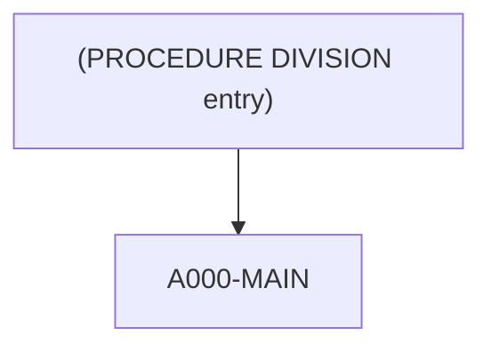

# Program CSUTLDTC

| Item | Value |
|---|---|
| Source | `app/cbl/CSUTLDTC.cbl` |
| Lines | 157 total, 114 code, 29 comment, 14 blank |
| PROGRAM-ID | CSUTLDTC |
| Author |  |
| Runtime | subprogram |
| Module | base |
| CICS transactions | None in CSD |
| JCL steps | None |
| Paragraphs | 3 |
| Semantic analysis | validated (batch B06) |
| Version banner | * Ver: CardDemo_v1.0-15-g27d6c6f-68 Date: 2022-07-19 23:12:35 CDT |

## Summary

CSUTLDTC is a called date-validation subprogram (no CICS or file I/O) that wraps the Language Environment callable service CEEDAYS. It receives a 10-byte date string, a 10-byte format mask (callers pass 'YYYY-MM-DD') and an 80-byte result area, converts the date and mask into the variable-length strings CEEDAYS expects and calls CEEDAYS to obtain a Lilian day number. It then returns in the result area the CEEDAYS severity (4 digits), the message number (4 digits) and a 15-character text such as 'Date is valid', 'Datevalue error' or 'Invalid month', plus the tested date and mask, and sets RETURN-CODE to the severity. The Lilian date itself is not returned. It is called by CORPT00C and COTRN02C, and the copybook CSUTLDPY also contains a CALL 'CSUTLDTC'. (Confirmed)

Evidence: `app/cbl/CSUTLDTC.cbl:24-80`, `app/cbl/CSUTLDTC.cbl:83-102`, `app/cbl/CSUTLDTC.cbl:103-151`, `app/cbl/CORPT00C.cbl:392-394`, `app/cbl/COTRN02C.cbl:393-393`

Header comment (Unverified, `app/cbl/CSUTLDTC.cbl:1-8`): All Rights Reserved. http://www.apache.org/licenses/LICENSE-2.0 Unless required by applicable law or agreed to in writing, "AS IS" BASIS, WITHOUT WARRANTIES OR CONDITIONS OF ANY KIND,

## Divisions and sections

| Division / section | Lines | Notes |
|---|---|---|
| IDENTIFICATION DIVISION | `app/cbl/CSUTLDTC.cbl:19-20` |  |
| DATA DIVISION | `app/cbl/CSUTLDTC.cbl:21-87` |  |
| PROCEDURE DIVISION | `app/cbl/CSUTLDTC.cbl:88-157` | USING LS-DATE, LS-DATE-FORMAT, LS-RESULT |
| DATA / WORKING-STORAGE SECTION | `app/cbl/CSUTLDTC.cbl:22-82` |  |
| DATA / LINKAGE SECTION | `app/cbl/CSUTLDTC.cbl:83-87` |  |

## Files and data stores

No SELECT entries (no COBOL file I/O).

## Embedded CICS, SQL and DL/I commands

No EXEC blocks.

## Calls, transfers and callers

| Mechanism | Target | Parameters | Paragraph | Lines |
|---|---|---|---|---|
| CALL system/LE | CEEDAYS | WS-DATE-TO-TEST, WS-DATE-FORMAT, OUTPUT-LILLIAN, FEEDBACK-CODE | A000-MAIN | `app/cbl/CSUTLDTC.cbl:116-120` |

Programs that transfer to or call this program (from `docs/_work/xref/call-graph.json`):

| Caller | Mechanism | Confidence | Evidence |
|---|---|---|---|
| CORPT00C | CALL-static | Confirmed | `app/cbl/CORPT00C.cbl:392` |
| CORPT00C | CALL-static | Confirmed | `app/cbl/CORPT00C.cbl:412` |
| COTRN02C | CALL-static | Confirmed | `app/cbl/COTRN02C.cbl:393` |
| COTRN02C | CALL-static | Confirmed | `app/cbl/COTRN02C.cbl:413` |

## Copybooks

No COPY statements.

## Data division items

Every data entry coded in this source (copybook contents are on the copybook pages). Lengths are computed from PIC and USAGE.

| Section | Lvl | Name | PIC | Usage | Len | OCCURS | REDEFINES | VALUE | 88-levels | Line |
|---|---|---|---|---|---|---|---|---|---|---|
| WORKING-STORAGE | 01 | WS-DATE-TO-TEST |  |  |  |  |  |  |  | 25 |
| WORKING-STORAGE | 02 | VSTRING-LENGTH | S9(4) | BINARY | 2 |  |  |  |  | 26 |
| WORKING-STORAGE | 02 | VSTRING-TEXT |  |  |  |  |  |  |  | 27 |
| WORKING-STORAGE | 03 | VSTRING-CHAR | X |  | 1 | 0256 DEPENDING ON VSTRING-LENGTH |  |  |  | 28 |
| WORKING-STORAGE | 01 | WS-DATE-FORMAT |  |  |  |  |  |  |  | 33 |
| WORKING-STORAGE | 02 | VSTRING-LENGTH | S9(4) | BINARY | 2 |  |  |  |  | 34 |
| WORKING-STORAGE | 02 | VSTRING-TEXT |  |  |  |  |  |  |  | 35 |
| WORKING-STORAGE | 03 | VSTRING-CHAR | X |  | 1 | 0256 DEPENDING ON VSTRING-LENGTH |  |  |  | 36 |
| WORKING-STORAGE | 01 | OUTPUT-LILLIAN | S9(9) | BINARY | 4 |  |  |  |  | 41 |
| WORKING-STORAGE | 01 | WS-MESSAGE |  |  |  |  |  |  |  | 42 |
| WORKING-STORAGE | 02 | WS-SEVERITY | X(04) |  | 4 |  |  |  |  | 43 |
| WORKING-STORAGE | 02 | WS-SEVERITY-N | 9(4) |  | 4 |  | WS-SEVERITY |  |  | 44 |
| WORKING-STORAGE | 02 | FILLER | X(11) |  | 11 |  |  | 'Mesg Code:' |  | 45 |
| WORKING-STORAGE | 02 | WS-MSG-NO | X(04) |  | 4 |  |  |  |  | 46 |
| WORKING-STORAGE | 02 | WS-MSG-NO-N | 9(4) |  | 4 |  | WS-MSG-NO |  |  | 47 |
| WORKING-STORAGE | 02 | FILLER | X(01) |  | 1 |  |  | SPACE |  | 48 |
| WORKING-STORAGE | 02 | WS-RESULT | X(15) |  | 15 |  |  |  |  | 49 |
| WORKING-STORAGE | 02 | FILLER | X(01) |  | 1 |  |  | SPACE |  | 50 |
| WORKING-STORAGE | 02 | FILLER | X(09) |  | 9 |  |  | 'TstDate:' |  | 51 |
| WORKING-STORAGE | 02 | WS-DATE | X(10) |  | 10 |  |  | SPACES |  | 52 |
| WORKING-STORAGE | 02 | FILLER | X(01) |  | 1 |  |  | SPACE |  | 53 |
| WORKING-STORAGE | 02 | FILLER | X(10) |  | 10 |  |  | 'Mask used:' |  | 54 |
| WORKING-STORAGE | 02 | WS-DATE-FMT | X(10) |  | 10 |  |  |  |  | 55 |
| WORKING-STORAGE | 02 | FILLER | X(01) |  | 1 |  |  | SPACE |  | 56 |
| WORKING-STORAGE | 02 | FILLER | X(03) |  | 3 |  |  | SPACES |  | 57 |
| WORKING-STORAGE | 01 | FEEDBACK-CODE |  |  |  |  |  |  |  | 60 |
| WORKING-STORAGE | 02 | FEEDBACK-TOKEN-VALUE |  |  |  |  |  |  | FC-INVALID-DATE = X'0000000000000000'; FC-INSUFFICIENT-DATA = X'000309CB59C3C5C5'; FC-BAD-DATE-VALUE = X'000309CC59C3C5C5'; FC-INVALID-ERA = X'000309CD59C3C5C5'; FC-UNSUPP-RANGE = X'000309D159C3C5C5'; | 61 |
| WORKING-STORAGE | 03 | CASE-1-CONDITION-ID |  |  |  |  |  |  |  | 71 |
| WORKING-STORAGE | 04 | SEVERITY | S9(4) | BINARY | 2 |  |  |  |  | 72 |
| WORKING-STORAGE | 04 | MSG-NO | S9(4) | BINARY | 2 |  |  |  |  | 73 |
| WORKING-STORAGE | 03 | CASE-2-CONDITION-ID |  |  |  |  | CASE-1-CONDITION-ID |  |  | 74 |
| WORKING-STORAGE | 04 | CLASS-CODE | S9(4) | BINARY | 2 |  |  |  |  | 76 |
| WORKING-STORAGE | 04 | CAUSE-CODE | S9(4) | BINARY | 2 |  |  |  |  | 77 |
| WORKING-STORAGE | 03 | CASE-SEV-CTL | X |  | 1 |  |  |  |  | 78 |
| WORKING-STORAGE | 03 | FACILITY-ID | XXX |  | 3 |  |  |  |  | 79 |
| WORKING-STORAGE | 02 | I-S-INFO | S9(9) | BINARY | 4 |  |  |  |  | 80 |
| LINKAGE | 01 | LS-DATE | X(10) |  | 10 |  |  |  |  | 84 |
| LINKAGE | 01 | LS-DATE-FORMAT | X(10) |  | 10 |  |  |  |  | 85 |
| LINKAGE | 01 | LS-RESULT | X(80) |  | 80 |  |  |  |  | 86 |

## Statement inventory

Every procedure statement the parser recorded, by kind. Each one is listed with its line under Paragraph details.

| Kind | Count |
|---|---|
| Decisions (IF, EVALUATE, WHEN, loops, handlers) | 11 |
| Calculations | 0 |
| File I/O | 0 |
| EXEC CICS / SQL / DLI | 0 |
| CALL | 1 |
| PERFORM | 1 |
| GO TO | 0 |
| MOVE literal | 11 |
| MOVE field | 10 |
| SET | 0 |
| STRING, UNSTRING, INSPECT, INITIALIZE, COPY, ENTRY and others | 1 |
| DISPLAY | 0 |
| GOBACK, STOP RUN, RETURN, XCTL | 1 |
| Not classified by the parser | 0 |

## Control flow

| Paragraph | Lines | Logic | Performs | Performed by | Reachable |
|---|---|---|---|---|---|
| [(PROCEDURE DIVISION entry)](#para-procedure-division-entry) | 90-102 | Entry point with USING LS-DATE, LS-DATE-FORMAT, LS-RESULT. Initializes WS-MESSAGE, clears WS-DATE, performs A000-MAIN, then moves the 80-byte WS-MESSAGE to LS-RESULT, moves WS-SEVERITY-N to RETURN-CODE and returns with EXIT PROGRAM. (Confirmed) | A000-MAIN |  | yes |
| [A000-MAIN](#para-a000-main) | 103-151 | Builds the CEEDAYS variable-length inputs (length 10 plus text) from LS-DATE and LS-DATE-FORMAT, calls CEEDAYS with OUTPUT-LILLIAN and FEEDBACK-CODE, stores the feedback severity and message number in WS-SEVERITY-N/WS-MSG-NO-N, and maps the feedback token to a 15-character WS-RESULT text ('Date is valid', 'Insufficient', 'Datevalue error', 'Invalid Era', 'Unsupp. Range', 'Invalid month', 'Bad Pic String', 'Nonnumeric data', 'YearInEra is 0', else 'Date is invalid'). (Confirmed) |  | (PROCEDURE DIVISION entry) | yes |
| [A000-MAIN-EXIT](#para-a000-main-exit) | 152-154 | Exit paragraph for A000-MAIN; contains only EXIT. (Confirmed) |  | (PROCEDURE DIVISION entry) | yes |

## Paragraph details

### Para (PROCEDURE DIVISION entry)

Lines `app/cbl/CSUTLDTC.cbl:90-102`. 

Logic: Entry point with USING LS-DATE, LS-DATE-FORMAT, LS-RESULT. Initializes WS-MESSAGE, clears WS-DATE, performs A000-MAIN, then moves the 80-byte WS-MESSAGE to LS-RESULT, moves WS-SEVERITY-N to RETURN-CODE and returns with EXIT PROGRAM. (Confirmed)

Rules: [BR-CSUTLDTC-003](../09-business-rules-catalog.md#br-csutldtc-003)

Statements in source order:

- `INITIALIZE WS-MESSAGE` at `app/cbl/CSUTLDTC.cbl:90`
- `MOVE SPACES TO WS-DATE` at `app/cbl/CSUTLDTC.cbl:91`
- PERFORM A000-MAIN THRU A000-MAIN-EXIT at `app/cbl/CSUTLDTC.cbl:93-94`
- `MOVE WS-MESSAGE TO LS-RESULT` at `app/cbl/CSUTLDTC.cbl:97`
- `MOVE WS-SEVERITY-N TO RETURN-CODE` at `app/cbl/CSUTLDTC.cbl:98`
- Ends with EXIT PROGRAM at `app/cbl/CSUTLDTC.cbl:100`

### Para A000-MAIN

Lines `app/cbl/CSUTLDTC.cbl:103-151`. 

Logic: Builds the CEEDAYS variable-length inputs (length 10 plus text) from LS-DATE and LS-DATE-FORMAT, calls CEEDAYS with OUTPUT-LILLIAN and FEEDBACK-CODE, stores the feedback severity and message number in WS-SEVERITY-N/WS-MSG-NO-N, and maps the feedback token to a 15-character WS-RESULT text ('Date is valid', 'Insufficient', 'Datevalue error', 'Invalid Era', 'Unsupp. Range', 'Invalid month', 'Bad Pic String', 'Nonnumeric data', 'YearInEra is 0', else 'Date is invalid'). (Confirmed)

Rules: [BR-CSUTLDTC-001](../09-business-rules-catalog.md#br-csutldtc-001), [BR-CSUTLDTC-002](../09-business-rules-catalog.md#br-csutldtc-002)

Statements in source order:

- `MOVE LENGTH OF LS-DATE TO VSTRING-LENGTH OF WS-DATE-TO-TEST` at `app/cbl/CSUTLDTC.cbl:105-106`
- `MOVE LS-DATE TO VSTRING-TEXT OF WS-DATE-TO-TEST WS-DATE` at `app/cbl/CSUTLDTC.cbl:107-108`
- `MOVE LENGTH OF LS-DATE-FORMAT TO VSTRING-LENGTH OF WS-DATE-FORMAT` at `app/cbl/CSUTLDTC.cbl:109-110`
- `MOVE LS-DATE-FORMAT TO VSTRING-TEXT OF WS-DATE-FORMAT WS-DATE-FMT` at `app/cbl/CSUTLDTC.cbl:111-113`
- MOVE `0` TO OUTPUT-LILLIAN at `app/cbl/CSUTLDTC.cbl:114`
- CALL CEEDAYS at `app/cbl/CSUTLDTC.cbl:116-120`
- `MOVE WS-DATE-TO-TEST TO WS-DATE` at `app/cbl/CSUTLDTC.cbl:122`
- `MOVE SEVERITY OF FEEDBACK-CODE TO WS-SEVERITY-N` at `app/cbl/CSUTLDTC.cbl:123`
- `MOVE MSG-NO OF FEEDBACK-CODE TO WS-MSG-NO-N` at `app/cbl/CSUTLDTC.cbl:124`
- EVALUATE `TRUE` at `app/cbl/CSUTLDTC.cbl:128` (business-candidate)
- WHEN `FC-INVALID-DATE` at `app/cbl/CSUTLDTC.cbl:129` (business-candidate)
- MOVE `'Date is valid'` TO WS-RESULT at `app/cbl/CSUTLDTC.cbl:130`
- WHEN `FC-INSUFFICIENT-DATA` at `app/cbl/CSUTLDTC.cbl:131` (business-candidate)
- MOVE `'Insufficient'` TO WS-RESULT at `app/cbl/CSUTLDTC.cbl:132`
- WHEN `FC-BAD-DATE-VALUE` at `app/cbl/CSUTLDTC.cbl:133` (business-candidate)
- MOVE `'Datevalue error'` TO WS-RESULT at `app/cbl/CSUTLDTC.cbl:134`
- WHEN `FC-INVALID-ERA` at `app/cbl/CSUTLDTC.cbl:135` (business-candidate)
- MOVE `'Invalid Era    '` TO WS-RESULT at `app/cbl/CSUTLDTC.cbl:136`
- WHEN `FC-UNSUPP-RANGE` at `app/cbl/CSUTLDTC.cbl:137` (business-candidate)
- MOVE `'Unsupp. Range  '` TO WS-RESULT at `app/cbl/CSUTLDTC.cbl:138`
- WHEN `FC-INVALID-MONTH` at `app/cbl/CSUTLDTC.cbl:139` (business-candidate)
- MOVE `'Invalid month  '` TO WS-RESULT at `app/cbl/CSUTLDTC.cbl:140`
- WHEN `FC-BAD-PIC-STRING` at `app/cbl/CSUTLDTC.cbl:141` (business-candidate)
- MOVE `'Bad Pic String '` TO WS-RESULT at `app/cbl/CSUTLDTC.cbl:142`
- WHEN `FC-NON-NUMERIC-DATA` at `app/cbl/CSUTLDTC.cbl:143` (business-candidate)
- MOVE `'Nonnumeric data'` TO WS-RESULT at `app/cbl/CSUTLDTC.cbl:144`
- WHEN `FC-YEAR-IN-ERA-ZERO` at `app/cbl/CSUTLDTC.cbl:145` (business-candidate)
- MOVE `'YearInEra is 0 '` TO WS-RESULT at `app/cbl/CSUTLDTC.cbl:146`
- WHEN `OTHER` at `app/cbl/CSUTLDTC.cbl:147` (business-candidate)
- MOVE `'Date is invalid'` TO WS-RESULT at `app/cbl/CSUTLDTC.cbl:148`

### Para A000-MAIN-EXIT

Lines `app/cbl/CSUTLDTC.cbl:152-154`. 

Logic: Exit paragraph for A000-MAIN; contains only EXIT. (Confirmed)

## Business rules

| Rule | Category | Statement | Paragraph | Source | Confidence |
|---|---|---|---|---|---|
| [BR-CSUTLDTC-001](../09-business-rules-catalog.md#br-csutldtc-001) | validation | A date is valid when the Language Environment service CEEDAYS can convert the supplied date string using the supplied format mask into a Lilian day number; the validity is expressed by the CEEDAYS feedback severity and message number. | A000-MAIN | `app/cbl/CSUTLDTC.cbl:105-124` | Confirmed |
| [BR-CSUTLDTC-002](../09-business-rules-catalog.md#br-csutldtc-002) | transformation | The CEEDAYS feedback token is translated into a short result text: all-zero token -> 'Date is valid'; message 2507 -> 'Insufficient'; 2508 -> 'Datevalue error'; 2509 -> 'Invalid Era'; 2513 -> 'Unsupp. Range'; 2517 -> 'Invalid month'; 2518 -> 'Bad Pic String'; 2520 -> 'Nonnumeric data'; 2521 -> 'YearInEra is 0'; any other token -> 'Date is invalid'. | A000-MAIN | `app/cbl/CSUTLDTC.cbl:128-149`, `app/cbl/CSUTLDTC.cbl:61-70` | Confirmed |
| [BR-CSUTLDTC-003](../09-business-rules-catalog.md#br-csutldtc-003) | error-policy | The validation outcome is returned to the caller as an 80-byte result (severity in bytes 1-4, 'Mesg Code:', message number in bytes 16-19, result text, tested date and mask) and the CEEDAYS severity is also placed in RETURN-CODE; the subprogram never abends on an invalid date, leaving the decision to the caller. | (PROCEDURE DIVISION entry) | `app/cbl/CSUTLDTC.cbl:90-100`, `app/cbl/CSUTLDTC.cbl:42-57` | Confirmed |

Decision coverage: 11 of 11 business-candidate decision points are linked to a rule or a no-rule reason (11 inside rule ranges).

## Error handling

No status checks, abends or return-code settings were found.

## Observations and SME questions

- anomaly: The 88-level named FC-INVALID-DATE has the all-zero feedback value, which means success, and its branch sets 'Date is valid'; the name is misleading. (`app/cbl/CSUTLDTC.cbl:62`)
- anomaly: After the call, the whole WS-DATE-TO-TEST group (2-byte binary length followed by the text) is moved to WS-DATE PIC X(10), overwriting the date moved at 107; the 'TstDate:' part of the result therefore starts with the binary length bytes and loses the last two date characters (Inferred from 25-31, 52 and 122). (`app/cbl/CSUTLDTC.cbl:122`)
- anomaly: The Lilian day number OUTPUT-LILLIAN produced by CEEDAYS is discarded; callers only receive validity information. (`app/cbl/CSUTLDTC.cbl:41`)
- anomaly: Message numbers in the 88-level feedback tokens are encoded in hex (X'09CB'=2507 ... X'09D9'=2521, severity 3, facility 'CEE'); only these nine conditions get specific texts. (`app/cbl/CSUTLDTC.cbl:60-80`)
- dead-code: DISPLAY WS-MESSAGE and GOBACK are commented out; the program ends with EXIT PROGRAM. (`app/cbl/CSUTLDTC.cbl:96-101`)
- SME question: Callers CORPT00C and COTRN02C accept message 2513 ('Unsupp. Range') as valid. Is this tolerance intentional, and what date range should actually be accepted? (`app/cbl/CSUTLDTC.cbl:137-138`)

## Sources

- `app/cbl/CSUTLDTC.cbl`
- `docs/_work/structure/programs/CSUTLDTC.json`
- `docs/_work/semantic/programs/CSUTLDTC.json`
- `docs/_work/programs/CSUTLDTC.json`

## Confidence

Structure tables (divisions, items, paragraphs, statements, line numbers) are Confirmed: they are parsed from the source. Paragraph logic and rule statements carry their own Confirmed/Inferred tag from the batch analysis, and every rule anchor was checked against the cited lines. Decision-point classes are a keyword heuristic used only for coverage measurement. Header comments are Unverified.
