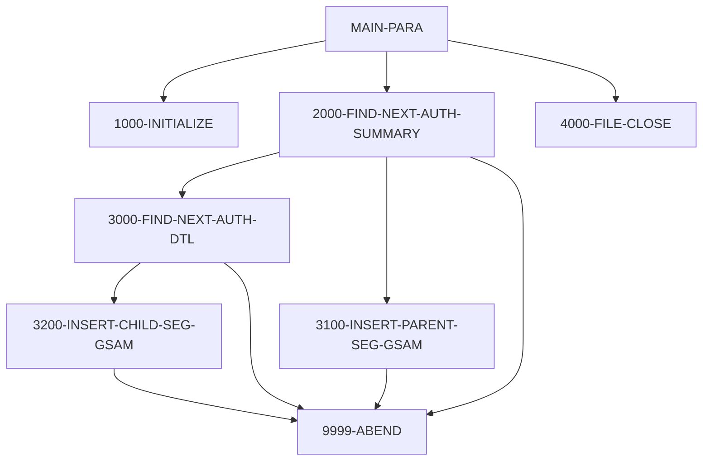

# Program DBUNLDGS

| Item | Value |
|---|---|
| Source | `app/app-authorization-ims-db2-mq/cbl/DBUNLDGS.CBL` |
| Lines | 366 total, 198 code, 155 comment, 13 blank |
| PROGRAM-ID | DBUNLDGS |
| Author | AWS |
| Runtime | dli-batch |
| Module | auth |
| CICS transactions | None in CSD |
| JCL steps | [UNLDGSAM](../06-batch/jobs/UNLDGSAM.md).STEP01 (`app/app-authorization-ims-db2-mq/jcl/UNLDGSAM.JCL:26-27`) |
| Paragraphs | 15 |
| Semantic analysis | validated (batch B01) |
| Version banner |  |

## Summary

DBUNLDGS is a batch IMS DL/I utility (entry DLITCBL with PCB masks PAUTBPCB, PASFLPCB and PADFLPCB; run by UNLDGSAM.JCL as DLI with PSB DLIGSAMP) that unloads the pending authorization database to two GSAM datasets. It reads every PAUTSUM0 summary root with unqualified GN calls and, for each summary with a numeric account id, inserts the summary into the summary GSAM PCB (PASFLPCB) and then reads every PAUTDTL1 child with GNP and inserts each into the detail GSAM PCB (PADFLPCB). It stops at end of database ('GB'); any other unexpected status displays diagnostics and ends with RETURN-CODE 16. The sequential-file output variant (OPFILE1/OPFILE2) is commented out. (Confirmed)

Evidence: `app/app-authorization-ims-db2-mq/cbl/DBUNLDGS.CBL:153-179`, `app/app-authorization-ims-db2-mq/cbl/DBUNLDGS.CBL:216-257`, `app/app-authorization-ims-db2-mq/cbl/DBUNLDGS.CBL:263-336`

Header comment (Unverified, `app/app-authorization-ims-db2-mq/cbl/DBUNLDGS.CBL:1`): See the comment block at the top of the source. Unverified until matched to code.

## Divisions and sections

| Division / section | Lines | Notes |
|---|---|---|
| IDENTIFICATION DIVISION | `app/app-authorization-ims-db2-mq/cbl/DBUNLDGS.CBL:17-20` |  |
| ENVIRONMENT DIVISION | `app/app-authorization-ims-db2-mq/cbl/DBUNLDGS.CBL:21-38` |  |
| DATA DIVISION | `app/app-authorization-ims-db2-mq/cbl/DBUNLDGS.CBL:39-158` |  |
| PROCEDURE DIVISION | `app/app-authorization-ims-db2-mq/cbl/DBUNLDGS.CBL:159-366` | USING PAUTBPCB PASFLPCB PADFLPCB |
| ENVIRONMENT / CONFIGURATION SECTION | `app/app-authorization-ims-db2-mq/cbl/DBUNLDGS.CBL:22-23` |  |
| ENVIRONMENT / INPUT-OUTPUT SECTION | `app/app-authorization-ims-db2-mq/cbl/DBUNLDGS.CBL:24-38` |  |
| DATA / WORKING-STORAGE SECTION | `app/app-authorization-ims-db2-mq/cbl/DBUNLDGS.CBL:51-150` |  |
| DATA / LINKAGE SECTION | `app/app-authorization-ims-db2-mq/cbl/DBUNLDGS.CBL:151-158` |  |

## Files and data stores

No SELECT entries (no COBOL file I/O).

## Embedded CICS, SQL and DL/I commands

No EXEC blocks.

## Calls, transfers and callers

| Mechanism | Target | Parameters | Paragraph | Lines |
|---|---|---|---|---|
| CALL system/LE | CBLTDLI | FUNC-GN, PAUTBPCB, PENDING-AUTH-SUMMARY, ROOT-UNQUAL-SSA | 2000-FIND-NEXT-AUTH-SUMMARY | `app/app-authorization-ims-db2-mq/cbl/DBUNLDGS.CBL:222-225` |
| CALL system/LE | CBLTDLI | FUNC-GNP, PAUTBPCB, PENDING-AUTH-DETAILS, CHILD-UNQUAL-SSA | 3000-FIND-NEXT-AUTH-DTL | `app/app-authorization-ims-db2-mq/cbl/DBUNLDGS.CBL:267-270` |
| CALL system/LE | CBLTDLI | FUNC-ISRT, PASFLPCB, PENDING-AUTH-SUMMARY | 3100-INSERT-PARENT-SEG-GSAM | `app/app-authorization-ims-db2-mq/cbl/DBUNLDGS.CBL:302-304` |
| CALL system/LE | CBLTDLI | FUNC-ISRT, PADFLPCB, PENDING-AUTH-DETAILS | 3200-INSERT-CHILD-SEG-GSAM | `app/app-authorization-ims-db2-mq/cbl/DBUNLDGS.CBL:321-323` |

## Copybooks

| Copybook | Statement | Resolution | Resolved path | REPLACING | Line |
|---|---|---|---|---|---|
| [IMSFUNCS](../08-data/layouts/IMSFUNCS.md) | COPY | inventory | app/app-authorization-ims-db2-mq/cpy/IMSFUNCS.cpy |  | `app/app-authorization-ims-db2-mq/cbl/DBUNLDGS.CBL:136` |
| [CIPAUSMY](../08-data/layouts/CIPAUSMY.md) | COPY | inventory | app/app-authorization-ims-db2-mq/cpy/CIPAUSMY.cpy |  | `app/app-authorization-ims-db2-mq/cbl/DBUNLDGS.CBL:143` |
| [CIPAUDTY](../08-data/layouts/CIPAUDTY.md) | COPY | inventory | app/app-authorization-ims-db2-mq/cpy/CIPAUDTY.cpy |  | `app/app-authorization-ims-db2-mq/cbl/DBUNLDGS.CBL:147` |
| [PAUTBPCB](../08-data/layouts/PAUTBPCB.md) | COPY | inventory | app/app-authorization-ims-db2-mq/cpy/PAUTBPCB.CPY |  | `app/app-authorization-ims-db2-mq/cbl/DBUNLDGS.CBL:154` |
| [PASFLPCB](../08-data/layouts/PASFLPCB.md) | COPY | inventory | app/app-authorization-ims-db2-mq/cpy/PASFLPCB.CPY |  | `app/app-authorization-ims-db2-mq/cbl/DBUNLDGS.CBL:155` |
| [PADFLPCB](../08-data/layouts/PADFLPCB.md) | COPY | inventory | app/app-authorization-ims-db2-mq/cpy/PADFLPCB.CPY |  | `app/app-authorization-ims-db2-mq/cbl/DBUNLDGS.CBL:156` |

## Data division items

Every data entry coded in this source (copybook contents are on the copybook pages). Lengths are computed from PIC and USAGE.

| Section | Lvl | Name | PIC | Usage | Len | OCCURS | REDEFINES | VALUE | 88-levels | Line |
|---|---|---|---|---|---|---|---|---|---|---|
| WORKING-STORAGE | 01 | OPFIL1-REC | X(100) |  | 100 |  |  |  |  | 53 |
| WORKING-STORAGE | 01 | OPFIL2-REC |  |  |  |  |  |  |  | 54 |
| WORKING-STORAGE | 05 | ROOT-SEG-KEY | S9(11) | COMP-3 | 6 |  |  |  |  | 55 |
| WORKING-STORAGE | 05 | CHILD-SEG-REC | X(200) |  | 200 |  |  |  |  | 56 |
| WORKING-STORAGE | 01 | WS-VARIABLES |  |  |  |  |  |  |  | 57 |
| WORKING-STORAGE | 05 | WS-PGMNAME | X(08) |  | 8 |  |  | 'IMSUNLOD' |  | 58 |
| WORKING-STORAGE | 05 | CURRENT-DATE | 9(06) |  | 6 |  |  |  |  | 59 |
| WORKING-STORAGE | 05 | CURRENT-YYDDD | 9(05) |  | 5 |  |  |  |  | 60 |
| WORKING-STORAGE | 05 | WS-AUTH-DATE | 9(05) |  | 5 |  |  |  |  | 61 |
| WORKING-STORAGE | 05 | WS-EXPIRY-DAYS | S9(4) | COMP | 2 |  |  |  |  | 62 |
| WORKING-STORAGE | 05 | WS-DAY-DIFF | S9(4) | COMP | 2 |  |  |  |  | 63 |
| WORKING-STORAGE | 05 | IDX | S9(4) | COMP | 2 |  |  |  |  | 64 |
| WORKING-STORAGE | 05 | WS-CURR-APP-ID | 9(11) |  | 11 |  |  |  |  | 65 |
| WORKING-STORAGE | 05 | WS-NO-CHKP | 9(8) |  | 8 |  |  | 0 |  | 67 |
| WORKING-STORAGE | 05 | WS-AUTH-SMRY-PROC-CNT | 9(8) |  | 8 |  |  | 0 |  | 68 |
| WORKING-STORAGE | 05 | WS-TOT-REC-WRITTEN | S9(8) | COMP | 4 |  |  | 0 |  | 69 |
| WORKING-STORAGE | 05 | WS-NO-SUMRY-READ | S9(8) | COMP | 4 |  |  | 0 |  | 70 |
| WORKING-STORAGE | 05 | WS-NO-SUMRY-DELETED | S9(8) | COMP | 4 |  |  | 0 |  | 71 |
| WORKING-STORAGE | 05 | WS-NO-DTL-READ | S9(8) | COMP | 4 |  |  | 0 |  | 72 |
| WORKING-STORAGE | 05 | WS-NO-DTL-DELETED | S9(8) | COMP | 4 |  |  | 0 |  | 73 |
| WORKING-STORAGE | 05 | WS-ERR-FLG | X(01) |  | 1 |  |  | 'N' | ERR-FLG-ON = 'Y'; ERR-FLG-OFF = 'N' | 75 |
| WORKING-STORAGE | 05 | WS-END-OF-AUTHDB-FLAG | X(01) |  | 1 |  |  | 'N' | END-OF-AUTHDB = 'Y'; NOT-END-OF-AUTHDB = 'N' | 78 |
| WORKING-STORAGE | 05 | WS-MORE-AUTHS-FLAG | X(01) |  | 1 |  |  | 'N' | MORE-AUTHS = 'Y'; NO-MORE-AUTHS = 'N' | 81 |
| WORKING-STORAGE | 05 | WS-END-OF-ROOT-SEG | X(01) |  | 1 |  |  | SPACES |  | 84 |
| WORKING-STORAGE | 05 | WS-END-OF-CHILD-SEG | X(01) |  | 1 |  |  | SPACES |  | 85 |
| WORKING-STORAGE | 05 | WS-INFILE-STATUS | X(02) |  | 2 |  |  | SPACES |  | 86 |
| WORKING-STORAGE | 05 | WS-OUTFL1-STATUS | X(02) |  | 2 |  |  | SPACES |  | 87 |
| WORKING-STORAGE | 05 | WS-OUTFL2-STATUS | X(02) |  | 2 |  |  | SPACES |  | 88 |
| WORKING-STORAGE | 05 | WS-CUSTID-STATUS | X(02) |  | 2 |  |  | SPACES | END-OF-FILE = '10' | 89 |
| WORKING-STORAGE | 05 | WK-CHKPT-ID |  |  |  |  |  |  |  | 92 |
| WORKING-STORAGE | 10 | FILLER | X(04) |  | 4 |  |  | 'RMAD' |  | 93 |
| WORKING-STORAGE | 10 | WK-CHKPT-ID-CTR | 9(04) |  | 4 |  |  | ZEROES |  | 94 |
| WORKING-STORAGE | 01 | WS-IMS-VARIABLES |  |  |  |  |  |  |  | 96 |
| WORKING-STORAGE | 05 | IMS-RETURN-CODE | X(02) |  | 2 |  |  |  | STATUS-OK = ' ', 'FW'; SEGMENT-NOT-FOUND = 'GE'; DUPLICATE-SEGMENT-FOUND = 'II'; WRONG-PARENTAGE = 'GP'; END-OF-DB = 'GB'; DATABASE-UNAVAILABLE = 'BA'; PSB-SCHEDULED-MORE-THAN-ONCE = 'TC'; COULD-NOT-S | 100 |
| WORKING-STORAGE | 05 | WS-IMS-PSB-SCHD-FLG | X(1) |  | 1 |  |  |  | IMS-PSB-SCHD = 'Y'; IMS-PSB-NOT-SCHD = 'N' | 110 |
| WORKING-STORAGE | 01 | ROOT-UNQUAL-SSA |  |  |  |  |  |  |  | 115 |
| WORKING-STORAGE | 05 | FILLER | X(08) |  | 8 |  |  | 'PAUTSUM0' |  | 116 |
| WORKING-STORAGE | 05 | FILLER | X(01) |  | 1 |  |  | ' ' |  | 117 |
| WORKING-STORAGE | 01 | CHILD-UNQUAL-SSA |  |  |  |  |  |  |  | 119 |
| WORKING-STORAGE | 05 | FILLER | X(08) |  | 8 |  |  | 'PAUTDTL1' |  | 120 |
| WORKING-STORAGE | 05 | FILLER | X(01) |  | 1 |  |  | ' ' |  | 121 |
| WORKING-STORAGE | 01 | PRM-INFO |  |  |  |  |  |  |  | 123 |
| WORKING-STORAGE | 05 | P-EXPIRY-DAYS | 9(02) |  | 2 |  |  |  |  | 124 |
| WORKING-STORAGE | 05 | FILLER | X(01) |  | 1 |  |  |  |  | 125 |
| WORKING-STORAGE | 05 | P-CHKP-FREQ | X(05) |  | 5 |  |  |  |  | 126 |
| WORKING-STORAGE | 05 | FILLER | X(01) |  | 1 |  |  |  |  | 127 |
| WORKING-STORAGE | 05 | P-CHKP-DIS-FREQ | X(05) |  | 5 |  |  |  |  | 128 |
| WORKING-STORAGE | 05 | FILLER | X(01) |  | 1 |  |  |  |  | 129 |
| WORKING-STORAGE | 05 | P-DEBUG-FLAG | X(01) |  | 1 |  |  |  | DEBUG-ON = 'Y'; DEBUG-OFF = 'N' | 130 |
| WORKING-STORAGE | 05 | FILLER | X(01) |  | 1 |  |  |  |  | 133 |
| WORKING-STORAGE | 01 | PENDING-AUTH-SUMMARY |  |  |  |  |  |  |  | 142 |
| WORKING-STORAGE | 01 | PENDING-AUTH-DETAILS |  |  |  |  |  |  |  | 146 |

## Statement inventory

Every procedure statement the parser recorded, by kind. Each one is listed with its line under Paragraph details.

| Kind | Count |
|---|---|
| Decisions (IF, EVALUATE, WHEN, loops, handlers) | 9 |
| Calculations | 4 |
| File I/O | 0 |
| EXEC CICS / SQL / DLI | 0 |
| CALL | 4 |
| PERFORM | 10 |
| GO TO | 0 |
| MOVE literal | 3 |
| MOVE field | 3 |
| SET | 2 |
| STRING, UNSTRING, INSPECT, INITIALIZE, COPY, ENTRY and others | 8 |
| DISPLAY | 15 |
| GOBACK, STOP RUN, RETURN, XCTL | 2 |
| Not classified by the parser | 0 |

## Control flow

| Paragraph | Lines | Logic | Performs | Performed by | Reachable |
|---|---|---|---|---|---|
| [MAIN-PARA](#para-main-para) | 164-179 | Entered via ENTRY 'DLITCBL' with three PCBs; performs 1000-INITIALIZE, repeats 2000-FIND-NEXT-AUTH-SUMMARY until WS-END-OF-ROOT-SEG = 'Y', performs 4000-FILE-CLOSE and GOBACKs. (Confirmed) | 1000-INITIALIZE, 2000-FIND-NEXT-AUTH-SUMMARY, 4000-FILE-CLOSE |  | yes |
| [1000-INITIALIZE](#para-1000-initialize) | 182-194 | Accepts the current date and YYDDD day and displays a start banner with today's date. The SYSIN parameter accept and file opens are commented out. (Confirmed) |  | MAIN-PARA | yes |
| [1000-EXIT](#para-1000-exit) | 212-213 | Exit point of 1000-INITIALIZE (EXIT only). (Confirmed) |  | MAIN-PARA | yes |
| [2000-FIND-NEXT-AUTH-SUMMARY](#para-2000-find-next-auth-summary) | 216-257 | Calls CBLTDLI GN with ROOT-UNQUAL-SSA (PAUTSUM0) on PAUTBPCB. On blank status counts the read and, when PA-ACCT-ID is numeric, inserts the summary into the GSAM PCB and loops 3000-FIND-NEXT-AUTH-DTL until WS-END-OF-CHILD-SEG = 'Y'. Status 'GB' sets end of root segments; any other status displays 'AUTH SUM  GN FAILED' with the key feedback and performs 9999-ABEND. (Confirmed) | 3000-FIND-NEXT-AUTH-DTL, 3100-INSERT-PARENT-SEG-GSAM, 9999-ABEND | MAIN-PARA | yes |
| [2000-EXIT](#para-2000-exit) | 258-259 | Exit point of 2000-FIND-NEXT-AUTH-SUMMARY (EXIT only). (Confirmed) |  | MAIN-PARA | yes |
| [3000-FIND-NEXT-AUTH-DTL](#para-3000-find-next-auth-dtl) | 263-295 | Calls CBLTDLI GNP with CHILD-UNQUAL-SSA (PAUTDTL1). On blank status counts it and inserts the detail into the detail GSAM PCB; 'GE' sets WS-END-OF-CHILD-SEG = 'Y'; any other status displays 'GNP CALL FAILED' and performs 9999-ABEND. Clears PAUT-PCB-STATUS afterwards. (Confirmed) | 3200-INSERT-CHILD-SEG-GSAM, 9999-ABEND | 2000-FIND-NEXT-AUTH-SUMMARY | yes |
| [3000-EXIT](#para-3000-exit) | 296-297 | Exit point of 3000-FIND-NEXT-AUTH-DTL (EXIT only). (Confirmed) |  | 2000-FIND-NEXT-AUTH-SUMMARY | yes |
| [3100-INSERT-PARENT-SEG-GSAM](#para-3100-insert-parent-seg-gsam) | 300-315 | Calls CBLTDLI ISRT on PASFLPCB with PENDING-AUTH-SUMMARY; a non-blank status displays 'GSAM PARENT FAIL' and performs 9999-ABEND. (Confirmed) | 9999-ABEND | 2000-FIND-NEXT-AUTH-SUMMARY | yes |
| [3100-EXIT](#para-3100-exit) | 316-317 | Exit point of 3100-INSERT-PARENT-SEG-GSAM (EXIT only). (Confirmed) |  | 2000-FIND-NEXT-AUTH-SUMMARY | yes |
| [3200-INSERT-CHILD-SEG-GSAM](#para-3200-insert-child-seg-gsam) | 319-334 | Calls CBLTDLI ISRT on PADFLPCB with PENDING-AUTH-DETAILS; a non-blank status displays 'GSAM PARENT FAIL' (same text as the parent insert) and performs 9999-ABEND. (Confirmed) | 9999-ABEND | 3000-FIND-NEXT-AUTH-DTL | yes |
| [3200-EXIT](#para-3200-exit) | 335-336 | Exit point of 3200-INSERT-CHILD-SEG-GSAM (EXIT only). (Confirmed) |  | 3000-FIND-NEXT-AUTH-DTL | yes |
| [4000-FILE-CLOSE](#para-4000-file-close) | 338-339 | Displays 'CLOSING THE FILE'; the actual CLOSE statements are commented out (GSAM datasets are closed by IMS). (Confirmed) |  | MAIN-PARA | yes |
| [4000-EXIT](#para-4000-exit) | 354-355 | Exit point of 4000-FILE-CLOSE (EXIT only). (Confirmed) |  | MAIN-PARA | yes |
| [9999-ABEND](#para-9999-abend) | 357-363 | Displays 'DBUNLDGS ABENDING ...', sets RETURN-CODE 16 and GOBACKs. (Confirmed) |  | 2000-FIND-NEXT-AUTH-SUMMARY, 3000-FIND-NEXT-AUTH-DTL, 3100-INSERT-PARENT-SEG-GSAM, 3200-INSERT-CHILD-SEG-GSAM | yes |
| [9999-EXIT](#para-9999-exit) | 365-366 | Exit point of 9999-ABEND (EXIT only, not reached). (Confirmed) |  |  | no static path |

## Paragraph details

### Para MAIN-PARA

Lines `app/app-authorization-ims-db2-mq/cbl/DBUNLDGS.CBL:164-179`. 

Logic: Entered via ENTRY 'DLITCBL' with three PCBs; performs 1000-INITIALIZE, repeats 2000-FIND-NEXT-AUTH-SUMMARY until WS-END-OF-ROOT-SEG = 'Y', performs 4000-FILE-CLOSE and GOBACKs. (Confirmed)

Statements in source order:

- `ENTRY 'DLITCBL' USING PAUTBPCB PASFLPCB PADFLPCB` at `app/app-authorization-ims-db2-mq/cbl/DBUNLDGS.CBL:165-167`
- PERFORM 1000-INITIALIZE THRU 1000-EXIT at `app/app-authorization-ims-db2-mq/cbl/DBUNLDGS.CBL:170`
- PERFORM 2000-FIND-NEXT-AUTH-SUMMARY THRU 2000-EXIT `UNTIL WS-END-OF-ROOT-SEG = 'Y'` at `app/app-authorization-ims-db2-mq/cbl/DBUNLDGS.CBL:172-173`
- PERFORM 4000-FILE-CLOSE THRU 4000-EXIT at `app/app-authorization-ims-db2-mq/cbl/DBUNLDGS.CBL:175`
- Ends with GOBACK at `app/app-authorization-ims-db2-mq/cbl/DBUNLDGS.CBL:179`

### Para 1000-INITIALIZE

Lines `app/app-authorization-ims-db2-mq/cbl/DBUNLDGS.CBL:182-194`. 

Logic: Accepts the current date and YYDDD day and displays a start banner with today's date. The SYSIN parameter accept and file opens are commented out. (Confirmed)

Statements in source order:

- `ACCEPT CURRENT-DATE FROM DATE` at `app/app-authorization-ims-db2-mq/cbl/DBUNLDGS.CBL:185`
- `ACCEPT CURRENT-YYDDD FROM DAY` at `app/app-authorization-ims-db2-mq/cbl/DBUNLDGS.CBL:186`
- `DISPLAY 'STARTING PROGRAM DBUNLDGS::'` at `app/app-authorization-ims-db2-mq/cbl/DBUNLDGS.CBL:189`
- `DISPLAY '*-------------------------------------*'` at `app/app-authorization-ims-db2-mq/cbl/DBUNLDGS.CBL:190`
- `DISPLAY 'TODAYS DATE :' CURRENT-DATE` at `app/app-authorization-ims-db2-mq/cbl/DBUNLDGS.CBL:191`
- `DISPLAY ' '` at `app/app-authorization-ims-db2-mq/cbl/DBUNLDGS.CBL:192-194`

### Para 1000-EXIT

Lines `app/app-authorization-ims-db2-mq/cbl/DBUNLDGS.CBL:212-213`. 

Logic: Exit point of 1000-INITIALIZE (EXIT only). (Confirmed)

### Para 2000-FIND-NEXT-AUTH-SUMMARY

Lines `app/app-authorization-ims-db2-mq/cbl/DBUNLDGS.CBL:216-257`. 

Logic: Calls CBLTDLI GN with ROOT-UNQUAL-SSA (PAUTSUM0) on PAUTBPCB. On blank status counts the read and, when PA-ACCT-ID is numeric, inserts the summary into the GSAM PCB and loops 3000-FIND-NEXT-AUTH-DTL until WS-END-OF-CHILD-SEG = 'Y'. Status 'GB' sets end of root segments; any other status displays 'AUTH SUM  GN FAILED' with the key feedback and performs 9999-ABEND. (Confirmed)

Rules: [BR-DBUNLDGS-001](../09-business-rules-catalog.md#br-dbunldgs-001), [BR-DBUNLDGS-002](../09-business-rules-catalog.md#br-dbunldgs-002)

Statements in source order:

- `INITIALIZE PAUT-PCB-STATUS` at `app/app-authorization-ims-db2-mq/cbl/DBUNLDGS.CBL:221`
- CALL CBLTDLI at `app/app-authorization-ims-db2-mq/cbl/DBUNLDGS.CBL:222-225`
- IF `PAUT-PCB-STATUS = SPACES` at `app/app-authorization-ims-db2-mq/cbl/DBUNLDGS.CBL:232` (io-status)
- Calculation `ADD 1 TO WS-NO-SUMRY-READ` at `app/app-authorization-ims-db2-mq/cbl/DBUNLDGS.CBL:234`
- Calculation `ADD 1 TO WS-AUTH-SMRY-PROC-CNT` at `app/app-authorization-ims-db2-mq/cbl/DBUNLDGS.CBL:235`
- `MOVE PENDING-AUTH-SUMMARY TO OPFIL1-REC` at `app/app-authorization-ims-db2-mq/cbl/DBUNLDGS.CBL:236`
- `INITIALIZE ROOT-SEG-KEY` at `app/app-authorization-ims-db2-mq/cbl/DBUNLDGS.CBL:237`
- `INITIALIZE CHILD-SEG-REC` at `app/app-authorization-ims-db2-mq/cbl/DBUNLDGS.CBL:238`
- `MOVE PA-ACCT-ID TO ROOT-SEG-KEY` at `app/app-authorization-ims-db2-mq/cbl/DBUNLDGS.CBL:239`
- IF `PA-ACCT-ID IS NUMERIC` at `app/app-authorization-ims-db2-mq/cbl/DBUNLDGS.CBL:241` (business-candidate)
- PERFORM 3100-INSERT-PARENT-SEG-GSAM THRU 3100-EXIT at `app/app-authorization-ims-db2-mq/cbl/DBUNLDGS.CBL:243`
- `INITIALIZE WS-END-OF-CHILD-SEG` at `app/app-authorization-ims-db2-mq/cbl/DBUNLDGS.CBL:244`
- PERFORM 3000-FIND-NEXT-AUTH-DTL THRU 3000-EXIT `UNTIL WS-END-OF-CHILD-SEG='Y'` at `app/app-authorization-ims-db2-mq/cbl/DBUNLDGS.CBL:245-246`
- IF `PAUT-PCB-STATUS = 'GB'` at `app/app-authorization-ims-db2-mq/cbl/DBUNLDGS.CBL:249` (io-status)
- `SET END-OF-AUTHDB TO TRUE` at `app/app-authorization-ims-db2-mq/cbl/DBUNLDGS.CBL:250`
- MOVE `'Y'` TO WS-END-OF-ROOT-SEG at `app/app-authorization-ims-db2-mq/cbl/DBUNLDGS.CBL:251`
- IF `PAUT-PCB-STATUS NOT EQUAL TO SPACES AND 'GB'` at `app/app-authorization-ims-db2-mq/cbl/DBUNLDGS.CBL:253` (io-status)
- `DISPLAY 'AUTH SUM GN FAILED :' PAUT-PCB-STATUS` at `app/app-authorization-ims-db2-mq/cbl/DBUNLDGS.CBL:254`
- `DISPLAY 'KEY FEEDBACK AREA :' PAUT-KEYFB` at `app/app-authorization-ims-db2-mq/cbl/DBUNLDGS.CBL:255`
- PERFORM 9999-ABEND at `app/app-authorization-ims-db2-mq/cbl/DBUNLDGS.CBL:256-257`

### Para 2000-EXIT

Lines `app/app-authorization-ims-db2-mq/cbl/DBUNLDGS.CBL:258-259`. 

Logic: Exit point of 2000-FIND-NEXT-AUTH-SUMMARY (EXIT only). (Confirmed)

### Para 3000-FIND-NEXT-AUTH-DTL

Lines `app/app-authorization-ims-db2-mq/cbl/DBUNLDGS.CBL:263-295`. 

Logic: Calls CBLTDLI GNP with CHILD-UNQUAL-SSA (PAUTDTL1). On blank status counts it and inserts the detail into the detail GSAM PCB; 'GE' sets WS-END-OF-CHILD-SEG = 'Y'; any other status displays 'GNP CALL FAILED' and performs 9999-ABEND. Clears PAUT-PCB-STATUS afterwards. (Confirmed)

Statements in source order:

- CALL CBLTDLI at `app/app-authorization-ims-db2-mq/cbl/DBUNLDGS.CBL:267-270`
- IF `PAUT-PCB-STATUS = SPACES` at `app/app-authorization-ims-db2-mq/cbl/DBUNLDGS.CBL:276` (io-status)
- `SET MORE-AUTHS TO TRUE` at `app/app-authorization-ims-db2-mq/cbl/DBUNLDGS.CBL:277`
- Calculation `ADD 1 TO WS-NO-SUMRY-READ` at `app/app-authorization-ims-db2-mq/cbl/DBUNLDGS.CBL:278`
- Calculation `ADD 1 TO WS-AUTH-SMRY-PROC-CNT` at `app/app-authorization-ims-db2-mq/cbl/DBUNLDGS.CBL:279`
- `MOVE PENDING-AUTH-DETAILS TO CHILD-SEG-REC` at `app/app-authorization-ims-db2-mq/cbl/DBUNLDGS.CBL:280`
- PERFORM 3200-INSERT-CHILD-SEG-GSAM THRU 3200-EXIT at `app/app-authorization-ims-db2-mq/cbl/DBUNLDGS.CBL:282`
- IF `PAUT-PCB-STATUS = 'GE'` at `app/app-authorization-ims-db2-mq/cbl/DBUNLDGS.CBL:284` (io-status)
- MOVE `'Y'` TO WS-END-OF-CHILD-SEG at `app/app-authorization-ims-db2-mq/cbl/DBUNLDGS.CBL:286`
- `DISPLAY 'CHILD SEG FLAG GE : ' WS-END-OF-CHILD-SEG` at `app/app-authorization-ims-db2-mq/cbl/DBUNLDGS.CBL:287-288`
- IF `PAUT-PCB-STATUS NOT EQUAL TO SPACES AND 'GE'` at `app/app-authorization-ims-db2-mq/cbl/DBUNLDGS.CBL:290` (io-status)
- `DISPLAY 'GNP CALL FAILED :' PAUT-PCB-STATUS` at `app/app-authorization-ims-db2-mq/cbl/DBUNLDGS.CBL:291`
- `DISPLAY 'KFB AREA IN CHILD:' PAUT-KEYFB` at `app/app-authorization-ims-db2-mq/cbl/DBUNLDGS.CBL:292`
- PERFORM 9999-ABEND at `app/app-authorization-ims-db2-mq/cbl/DBUNLDGS.CBL:293`
- `INITIALIZE PAUT-PCB-STATUS` at `app/app-authorization-ims-db2-mq/cbl/DBUNLDGS.CBL:295`

### Para 3000-EXIT

Lines `app/app-authorization-ims-db2-mq/cbl/DBUNLDGS.CBL:296-297`. 

Logic: Exit point of 3000-FIND-NEXT-AUTH-DTL (EXIT only). (Confirmed)

### Para 3100-INSERT-PARENT-SEG-GSAM

Lines `app/app-authorization-ims-db2-mq/cbl/DBUNLDGS.CBL:300-315`. 

Logic: Calls CBLTDLI ISRT on PASFLPCB with PENDING-AUTH-SUMMARY; a non-blank status displays 'GSAM PARENT FAIL' and performs 9999-ABEND. (Confirmed)

Statements in source order:

- CALL CBLTDLI at `app/app-authorization-ims-db2-mq/cbl/DBUNLDGS.CBL:302-304`
- IF `PASFL-PCB-STATUS NOT EQUAL TO SPACES` at `app/app-authorization-ims-db2-mq/cbl/DBUNLDGS.CBL:311` (io-status)
- `DISPLAY 'GSAM PARENT FAIL :' PASFL-PCB-STATUS` at `app/app-authorization-ims-db2-mq/cbl/DBUNLDGS.CBL:312`
- `DISPLAY 'KFB AREA IN GSAM:' PASFL-KEYFB` at `app/app-authorization-ims-db2-mq/cbl/DBUNLDGS.CBL:313`
- PERFORM 9999-ABEND at `app/app-authorization-ims-db2-mq/cbl/DBUNLDGS.CBL:314`

### Para 3100-EXIT

Lines `app/app-authorization-ims-db2-mq/cbl/DBUNLDGS.CBL:316-317`. 

Logic: Exit point of 3100-INSERT-PARENT-SEG-GSAM (EXIT only). (Confirmed)

### Para 3200-INSERT-CHILD-SEG-GSAM

Lines `app/app-authorization-ims-db2-mq/cbl/DBUNLDGS.CBL:319-334`. 

Logic: Calls CBLTDLI ISRT on PADFLPCB with PENDING-AUTH-DETAILS; a non-blank status displays 'GSAM PARENT FAIL' (same text as the parent insert) and performs 9999-ABEND. (Confirmed)

Statements in source order:

- CALL CBLTDLI at `app/app-authorization-ims-db2-mq/cbl/DBUNLDGS.CBL:321-323`
- IF `PADFL-PCB-STATUS NOT EQUAL TO SPACES` at `app/app-authorization-ims-db2-mq/cbl/DBUNLDGS.CBL:330` (io-status)
- `DISPLAY 'GSAM PARENT FAIL :' PADFL-PCB-STATUS` at `app/app-authorization-ims-db2-mq/cbl/DBUNLDGS.CBL:331`
- `DISPLAY 'KFB AREA IN GSAM:' PADFL-KEYFB` at `app/app-authorization-ims-db2-mq/cbl/DBUNLDGS.CBL:332`
- PERFORM 9999-ABEND at `app/app-authorization-ims-db2-mq/cbl/DBUNLDGS.CBL:333`

### Para 3200-EXIT

Lines `app/app-authorization-ims-db2-mq/cbl/DBUNLDGS.CBL:335-336`. 

Logic: Exit point of 3200-INSERT-CHILD-SEG-GSAM (EXIT only). (Confirmed)

### Para 4000-FILE-CLOSE

Lines `app/app-authorization-ims-db2-mq/cbl/DBUNLDGS.CBL:338-339`. 

Logic: Displays 'CLOSING THE FILE'; the actual CLOSE statements are commented out (GSAM datasets are closed by IMS). (Confirmed)

Statements in source order:

- `DISPLAY 'CLOSING THE FILE'` at `app/app-authorization-ims-db2-mq/cbl/DBUNLDGS.CBL:339`

### Para 4000-EXIT

Lines `app/app-authorization-ims-db2-mq/cbl/DBUNLDGS.CBL:354-355`. 

Logic: Exit point of 4000-FILE-CLOSE (EXIT only). (Confirmed)

### Para 9999-ABEND

Lines `app/app-authorization-ims-db2-mq/cbl/DBUNLDGS.CBL:357-363`. 

Logic: Displays 'DBUNLDGS ABENDING ...', sets RETURN-CODE 16 and GOBACKs. (Confirmed)

Statements in source order:

- `DISPLAY 'DBUNLDGS ABENDING ...'` at `app/app-authorization-ims-db2-mq/cbl/DBUNLDGS.CBL:360`
- MOVE `16` TO RETURN-CODE at `app/app-authorization-ims-db2-mq/cbl/DBUNLDGS.CBL:362`
- Ends with GOBACK at `app/app-authorization-ims-db2-mq/cbl/DBUNLDGS.CBL:363`

### Para 9999-EXIT

Lines `app/app-authorization-ims-db2-mq/cbl/DBUNLDGS.CBL:365-366`. 

Logic: Exit point of 9999-ABEND (EXIT only, not reached). (Confirmed)

## Business rules

| Rule | Category | Statement | Paragraph | Source | Confidence |
|---|---|---|---|---|---|
| [BR-DBUNLDGS-001](../09-business-rules-catalog.md#br-dbunldgs-001) | decision | Only pending authorization summaries whose account id (PA-ACCT-ID) is numeric are unloaded; for those, the summary and all its child details are written to the GSAM datasets. Summaries with a non-numeric account id and their details are skipped silently. | 2000-FIND-NEXT-AUTH-SUMMARY | `app/app-authorization-ims-db2-mq/cbl/DBUNLDGS.CBL:241-247` | Confirmed |
| [BR-DBUNLDGS-002](../09-business-rules-catalog.md#br-dbunldgs-002) | error-policy | The unload stops with return code 16 on any IMS status other than blank or 'GB' on the summary read, other than blank or 'GE' on the detail read, or any non-blank status on a GSAM insert. | 2000-FIND-NEXT-AUTH-SUMMARY | `app/app-authorization-ims-db2-mq/cbl/DBUNLDGS.CBL:253-256`, `app/app-authorization-ims-db2-mq/cbl/DBUNLDGS.CBL:290-294`, `app/app-authorization-ims-db2-mq/cbl/DBUNLDGS.CBL:311-315`, `app/app-authorization-ims-db2-mq/cbl/DBUNLDGS.CBL:330-334`, `app/app-authorization-ims-db2-mq/cbl/DBUNLDGS.CBL:360-363` | Confirmed |

Decision coverage: 1 of 1 business-candidate decision points are linked to a rule or a no-rule reason (1 inside rule ranges).

## Error handling

| Paragraph | Kind | Detail | Lines |
|---|---|---|---|
| 2000-FIND-NEXT-AUTH-SUMMARY | check | `PAUT-PCB-STATUS = SPACES` | `app/app-authorization-ims-db2-mq/cbl/DBUNLDGS.CBL:232` |
| 2000-FIND-NEXT-AUTH-SUMMARY | check | `PAUT-PCB-STATUS = 'GB'` | `app/app-authorization-ims-db2-mq/cbl/DBUNLDGS.CBL:249` |
| 2000-FIND-NEXT-AUTH-SUMMARY | check | `PAUT-PCB-STATUS NOT EQUAL TO SPACES AND 'GB'` | `app/app-authorization-ims-db2-mq/cbl/DBUNLDGS.CBL:253` |
| 3000-FIND-NEXT-AUTH-DTL | check | `PAUT-PCB-STATUS = SPACES` | `app/app-authorization-ims-db2-mq/cbl/DBUNLDGS.CBL:276` |
| 3000-FIND-NEXT-AUTH-DTL | check | `PAUT-PCB-STATUS = 'GE'` | `app/app-authorization-ims-db2-mq/cbl/DBUNLDGS.CBL:284` |
| 3000-FIND-NEXT-AUTH-DTL | check | `PAUT-PCB-STATUS NOT EQUAL TO SPACES AND 'GE'` | `app/app-authorization-ims-db2-mq/cbl/DBUNLDGS.CBL:290` |
| 3100-INSERT-PARENT-SEG-GSAM | check | `PASFL-PCB-STATUS NOT EQUAL TO SPACES` | `app/app-authorization-ims-db2-mq/cbl/DBUNLDGS.CBL:311` |
| 3200-INSERT-CHILD-SEG-GSAM | check | `PADFL-PCB-STATUS NOT EQUAL TO SPACES` | `app/app-authorization-ims-db2-mq/cbl/DBUNLDGS.CBL:330` |
| 9999-ABEND | return code | MOVE 16 TO RETURN-CODE | `app/app-authorization-ims-db2-mq/cbl/DBUNLDGS.CBL:362` |

## Observations and SME questions

- anomaly: Detail reads increment WS-NO-SUMRY-READ and WS-AUTH-SMRY-PROC-CNT instead of WS-NO-DTL-READ; none of the counters are displayed. (`app/app-authorization-ims-db2-mq/cbl/DBUNLDGS.CBL:278-279`)
- anomaly: The child GSAM insert failure displays 'GSAM PARENT FAIL', the same text as the parent insert, making failures ambiguous. (`app/app-authorization-ims-db2-mq/cbl/DBUNLDGS.CBL:331`)
- dead-code: Sequential OPFILE1/OPFILE2 definitions, opens, writes and closes are commented out; OPFIL1-REC/OPFIL2-REC and ROOT-SEG-KEY are still populated in working storage but never written. PRM-INFO, checkpoint id and expiry fields are unused copies from CBPAUP0C. (`app/app-authorization-ims-db2-mq/cbl/DBUNLDGS.CBL:53-56`)
- anomaly: WS-PGMNAME is 'IMSUNLOD' rather than the program id DBUNLDGS. (`app/app-authorization-ims-db2-mq/cbl/DBUNLDGS.CBL:58`)
- anomaly: The IF on line 253 has no END-IF and is closed by the paragraph period; behaviour is correct but fragile. (`app/app-authorization-ims-db2-mq/cbl/DBUNLDGS.CBL:253-256`)
- SME question: Can PAUTSUM0 roots with a non-numeric PA-ACCT-ID exist, and should they be reported rather than silently skipped? (`app/app-authorization-ims-db2-mq/cbl/DBUNLDGS.CBL:241`)

## Sources

- `app/app-authorization-ims-db2-mq/cbl/DBUNLDGS.CBL`
- `docs/_work/structure/programs/DBUNLDGS.json`
- `docs/_work/semantic/programs/DBUNLDGS.json`
- `docs/_work/programs/DBUNLDGS.json`

## Confidence

Structure tables (divisions, items, paragraphs, statements, line numbers) are Confirmed: they are parsed from the source. Paragraph logic and rule statements carry their own Confirmed/Inferred tag from the batch analysis, and every rule anchor was checked against the cited lines. Decision-point classes are a keyword heuristic used only for coverage measurement. Header comments are Unverified.
