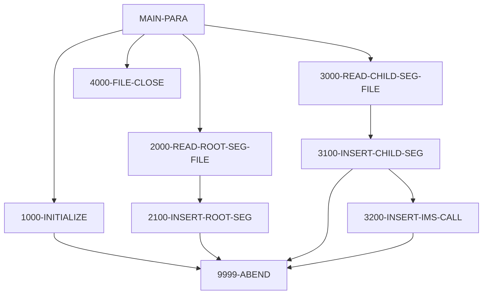

# Program PAUDBLOD

| Item | Value |
|---|---|
| Source | `app/app-authorization-ims-db2-mq/cbl/PAUDBLOD.CBL` |
| Lines | 369 total, 251 code, 95 comment, 23 blank |
| PROGRAM-ID | PAUDBLOD |
| Author | AWS |
| Runtime | ims-bmp |
| Module | auth |
| CICS transactions | None in CSD |
| JCL steps | [LOADPADB](../06-batch/jobs/LOADPADB.md).STEP01 (`app/app-authorization-ims-db2-mq/jcl/LOADPADB.JCL:26-27`) |
| Paragraphs | 17 |
| Semantic analysis | validated (batch B01) |
| Version banner |  |

## Summary

PAUDBLOD is a batch IMS DL/I load utility (run by LOADPADB.JCL as BMP with PSB PSBPAUTB) that reloads the pending authorization database from the two sequential files produced by PAUDBUNL. It first reads every summary record from INFILE1 and inserts it as a PAUTSUM0 root, tolerating duplicates ('II'). It then reads every record of INFILE2 (packed account id plus detail); for records with a numeric account key it positions on the parent root with a qualified GU (ACCNTID EQ key) and inserts the PAUTDTL1 child, again tolerating duplicates. Open failures and unexpected insert statuses end the run with RETURN-CODE 16. (Confirmed)

Evidence: `app/app-authorization-ims-db2-mq/cbl/PAUDBLOD.CBL:25-48`, `app/app-authorization-ims-db2-mq/cbl/PAUDBLOD.CBL:113-127`, `app/app-authorization-ims-db2-mq/cbl/PAUDBLOD.CBL:164-187`, `app/app-authorization-ims-db2-mq/cbl/PAUDBLOD.CBL:222-336`

Header comment (Unverified, `app/app-authorization-ims-db2-mq/cbl/PAUDBLOD.CBL:1`): See the comment block at the top of the source. Unverified until matched to code.

## Divisions and sections

| Division / section | Lines | Notes |
|---|---|---|
| IDENTIFICATION DIVISION | `app/app-authorization-ims-db2-mq/cbl/PAUDBLOD.CBL:17-20` |  |
| ENVIRONMENT DIVISION | `app/app-authorization-ims-db2-mq/cbl/PAUDBLOD.CBL:21-38` |  |
| DATA DIVISION | `app/app-authorization-ims-db2-mq/cbl/PAUDBLOD.CBL:39-163` |  |
| PROCEDURE DIVISION | `app/app-authorization-ims-db2-mq/cbl/PAUDBLOD.CBL:164-369` | USING IO-PCB-MASK PAUTBPCB |
| ENVIRONMENT / CONFIGURATION SECTION | `app/app-authorization-ims-db2-mq/cbl/PAUDBLOD.CBL:22-23` |  |
| ENVIRONMENT / INPUT-OUTPUT SECTION | `app/app-authorization-ims-db2-mq/cbl/PAUDBLOD.CBL:24-38` |  |
| DATA / FILE SECTION | `app/app-authorization-ims-db2-mq/cbl/PAUDBLOD.CBL:42-50` |  |
| DATA / WORKING-STORAGE SECTION | `app/app-authorization-ims-db2-mq/cbl/PAUDBLOD.CBL:51-156` |  |
| DATA / LINKAGE SECTION | `app/app-authorization-ims-db2-mq/cbl/PAUDBLOD.CBL:157-163` |  |

## Files and data stores

| File | ASSIGN | Org | Access | Record key | Alt key | Status field | OPEN modes | Physical dataset (JCL) | Evidence |
|---|---|---|---|---|---|---|---|---|---|
| INFILE1 | INFILE1 | SEQUENTIAL | SEQUENTIAL |  |  | WS-INFIL1-STATUS | INPUT (line 201) | AWS.M2.CARDDEMO.PAUTDB.ROOT.FILEO (LOADPADB.STEP01 `app/app-authorization-ims-db2-mq/jcl/LOADPADB.JCL:36`) | `app/app-authorization-ims-db2-mq/cbl/PAUDBLOD.CBL:26-29`, FD `app/app-authorization-ims-db2-mq/cbl/PAUDBLOD.CBL:43` |
| INFILE2 | INFILE2 | SEQUENTIAL | SEQUENTIAL |  |  | WS-INFIL2-STATUS | INPUT (line 209) | AWS.M2.CARDDEMO.PAUTDB.CHILD.FILEO (LOADPADB.STEP01 `app/app-authorization-ims-db2-mq/jcl/LOADPADB.JCL:38`) | `app/app-authorization-ims-db2-mq/cbl/PAUDBLOD.CBL:32-35`, FD `app/app-authorization-ims-db2-mq/cbl/PAUDBLOD.CBL:45` |

## Embedded CICS, SQL and DL/I commands

No EXEC blocks.

## Calls, transfers and callers

| Mechanism | Target | Parameters | Paragraph | Lines |
|---|---|---|---|---|
| CALL system/LE | CBLTDLI | FUNC-ISRT, PAUTBPCB, PENDING-AUTH-SUMMARY, ROOT-UNQUAL-SSA | 2100-INSERT-ROOT-SEG | `app/app-authorization-ims-db2-mq/cbl/PAUDBLOD.CBL:244-247` |
| CALL system/LE | CBLTDLI | FUNC-GU, PAUTBPCB, PENDING-AUTH-SUMMARY, ROOT-QUAL-SSA | 3100-INSERT-CHILD-SEG | `app/app-authorization-ims-db2-mq/cbl/PAUDBLOD.CBL:296-299` |
| CALL system/LE | CBLTDLI | FUNC-ISRT, PAUTBPCB, PENDING-AUTH-DETAILS, CHILD-UNQUAL-SSA | 3200-INSERT-IMS-CALL | `app/app-authorization-ims-db2-mq/cbl/PAUDBLOD.CBL:321-324` |

## Copybooks

| Copybook | Statement | Resolution | Resolved path | REPLACING | Line |
|---|---|---|---|---|---|
| [IMSFUNCS](../08-data/layouts/IMSFUNCS.md) | COPY | inventory | app/app-authorization-ims-db2-mq/cpy/IMSFUNCS.cpy |  | `app/app-authorization-ims-db2-mq/cbl/PAUDBLOD.CBL:142` |
| [CIPAUSMY](../08-data/layouts/CIPAUSMY.md) | COPY | inventory | app/app-authorization-ims-db2-mq/cpy/CIPAUSMY.cpy |  | `app/app-authorization-ims-db2-mq/cbl/PAUDBLOD.CBL:149` |
| [CIPAUDTY](../08-data/layouts/CIPAUDTY.md) | COPY | inventory | app/app-authorization-ims-db2-mq/cpy/CIPAUDTY.cpy |  | `app/app-authorization-ims-db2-mq/cbl/PAUDBLOD.CBL:153` |
| [PAUTBPCB](../08-data/layouts/PAUTBPCB.md) | COPY | inventory | app/app-authorization-ims-db2-mq/cpy/PAUTBPCB.CPY |  | `app/app-authorization-ims-db2-mq/cbl/PAUDBLOD.CBL:161` |

## Data division items

Every data entry coded in this source (copybook contents are on the copybook pages). Lengths are computed from PIC and USAGE.

| Section | Lvl | Name | PIC | Usage | Len | OCCURS | REDEFINES | VALUE | 88-levels | Line |
|---|---|---|---|---|---|---|---|---|---|---|
| FILE | 01 | INFIL1-REC | X(100) |  | 100 |  |  |  |  | 44 |
| FILE | 01 | INFIL2-REC |  |  |  |  |  |  |  | 46 |
| FILE | 05 | ROOT-SEG-KEY | S9(11) | COMP-3 | 6 |  |  |  |  | 47 |
| FILE | 05 | CHILD-SEG-REC | X(200) |  | 200 |  |  |  |  | 48 |
| WORKING-STORAGE | 01 | WS-VARIABLES |  |  |  |  |  |  |  | 53 |
| WORKING-STORAGE | 05 | WS-PGMNAME | X(08) |  | 8 |  |  | 'IMSUNLOD' |  | 54 |
| WORKING-STORAGE | 05 | CURRENT-DATE | 9(06) |  | 6 |  |  |  |  | 55 |
| WORKING-STORAGE | 05 | CURRENT-YYDDD | 9(05) |  | 5 |  |  |  |  | 56 |
| WORKING-STORAGE | 05 | WS-AUTH-DATE | 9(05) |  | 5 |  |  |  |  | 57 |
| WORKING-STORAGE | 05 | WS-EXPIRY-DAYS | S9(4) | COMP | 2 |  |  |  |  | 58 |
| WORKING-STORAGE | 05 | WS-DAY-DIFF | S9(4) | COMP | 2 |  |  |  |  | 59 |
| WORKING-STORAGE | 05 | IDX | S9(4) | COMP | 2 |  |  |  |  | 60 |
| WORKING-STORAGE | 05 | WS-CURR-APP-ID | 9(11) |  | 11 |  |  |  |  | 61 |
| WORKING-STORAGE | 05 | WS-NO-CHKP | 9(8) |  | 8 |  |  | 0 |  | 63 |
| WORKING-STORAGE | 05 | WS-AUTH-SMRY-PROC-CNT | 9(8) |  | 8 |  |  | 0 |  | 64 |
| WORKING-STORAGE | 05 | WS-TOT-REC-WRITTEN | S9(8) | COMP | 4 |  |  | 0 |  | 65 |
| WORKING-STORAGE | 05 | WS-NO-SUMRY-READ | S9(8) | COMP | 4 |  |  | 0 |  | 66 |
| WORKING-STORAGE | 05 | WS-NO-SUMRY-DELETED | S9(8) | COMP | 4 |  |  | 0 |  | 67 |
| WORKING-STORAGE | 05 | WS-NO-DTL-READ | S9(8) | COMP | 4 |  |  | 0 |  | 68 |
| WORKING-STORAGE | 05 | WS-NO-DTL-DELETED | S9(8) | COMP | 4 |  |  | 0 |  | 69 |
| WORKING-STORAGE | 05 | WS-ERR-FLG | X(01) |  | 1 |  |  | 'N' | ERR-FLG-ON = 'Y'; ERR-FLG-OFF = 'N' | 71 |
| WORKING-STORAGE | 05 | WS-END-OF-AUTHDB-FLAG | X(01) |  | 1 |  |  | 'N' | END-OF-AUTHDB = 'Y'; NOT-END-OF-AUTHDB = 'N' | 74 |
| WORKING-STORAGE | 05 | WS-MORE-AUTHS-FLAG | X(01) |  | 1 |  |  | 'N' | MORE-AUTHS = 'Y'; NO-MORE-AUTHS = 'N' | 77 |
| WORKING-STORAGE | 05 | WS-END-OF-INFILE1 | X(01) |  | 1 |  |  | SPACES |  | 80 |
| WORKING-STORAGE | 05 | WS-END-OF-INFILE2 | X(01) |  | 1 |  |  | SPACES |  | 81 |
| WORKING-STORAGE | 05 | WS-INFILE-STATUS | X(02) |  | 2 |  |  | SPACES |  | 82 |
| WORKING-STORAGE | 05 | WS-INFIL1-STATUS | X(02) |  | 2 |  |  | SPACES |  | 83 |
| WORKING-STORAGE | 05 | WS-INFIL2-STATUS | X(02) |  | 2 |  |  | SPACES |  | 84 |
| WORKING-STORAGE | 05 | END-ROOT-SEG-FILE | X(01) |  | 1 |  |  | SPACES |  | 85 |
| WORKING-STORAGE | 05 | END-CHILD-SEG-FILE | X(01) |  | 1 |  |  | SPACES |  | 86 |
| WORKING-STORAGE | 05 | WS-CUSTID-STATUS | X(02) |  | 2 |  |  | SPACES | END-OF-FILE = '10' | 87 |
| WORKING-STORAGE | 05 | WK-CHKPT-ID |  |  |  |  |  |  |  | 90 |
| WORKING-STORAGE | 10 | FILLER | X(04) |  | 4 |  |  | 'RMAD' |  | 91 |
| WORKING-STORAGE | 10 | WK-CHKPT-ID-CTR | 9(04) |  | 4 |  |  | ZEROES |  | 92 |
| WORKING-STORAGE | 01 | WS-IMS-VARIABLES |  |  |  |  |  |  |  | 94 |
| WORKING-STORAGE | 05 | IMS-RETURN-CODE | X(02) |  | 2 |  |  |  | STATUS-OK = ' ', 'FW'; SEGMENT-NOT-FOUND = 'GE'; DUPLICATE-SEGMENT-FOUND = 'II'; WRONG-PARENTAGE = 'GP'; END-OF-DB = 'GB'; DATABASE-UNAVAILABLE = 'BA'; PSB-SCHEDULED-MORE-THAN-ONCE = 'TC'; COULD-NOT-S | 98 |
| WORKING-STORAGE | 05 | WS-IMS-PSB-SCHD-FLG | X(1) |  | 1 |  |  |  | IMS-PSB-SCHD = 'Y'; IMS-PSB-NOT-SCHD = 'N' | 108 |
| WORKING-STORAGE | 01 | ROOT-QUAL-SSA |  |  |  |  |  |  |  | 113 |
| WORKING-STORAGE | 05 | QUAL-SSA-SEG-NAME | X(08) |  | 8 |  |  | 'PAUTSUM0' |  | 114 |
| WORKING-STORAGE | 05 | FILLER | X(01) |  | 1 |  |  | '(' |  | 115 |
| WORKING-STORAGE | 05 | QUAL-SSA-KEY-FIELD | X(08) |  | 8 |  |  | 'ACCNTID ' |  | 116 |
| WORKING-STORAGE | 05 | QUAL-SSA-REL-OPER | X(02) |  | 2 |  |  | 'EQ' |  | 117 |
| WORKING-STORAGE | 05 | QUAL-SSA-KEY-VALUE | S9(11) | COMP-3 | 6 |  |  |  |  | 118 |
| WORKING-STORAGE | 05 | FILLER | X(01) |  | 1 |  |  | ')' |  | 119 |
| WORKING-STORAGE | 01 | ROOT-UNQUAL-SSA |  |  |  |  |  |  |  | 121 |
| WORKING-STORAGE | 05 | FILLER | X(08) |  | 8 |  |  | 'PAUTSUM0' |  | 122 |
| WORKING-STORAGE | 05 | FILLER | X(01) |  | 1 |  |  | ' ' |  | 123 |
| WORKING-STORAGE | 01 | CHILD-UNQUAL-SSA |  |  |  |  |  |  |  | 125 |
| WORKING-STORAGE | 05 | FILLER | X(08) |  | 8 |  |  | 'PAUTDTL1' |  | 126 |
| WORKING-STORAGE | 05 | FILLER | X(01) |  | 1 |  |  | ' ' |  | 127 |
| WORKING-STORAGE | 01 | PRM-INFO |  |  |  |  |  |  |  | 129 |
| WORKING-STORAGE | 05 | P-EXPIRY-DAYS | 9(02) |  | 2 |  |  |  |  | 130 |
| WORKING-STORAGE | 05 | FILLER | X(01) |  | 1 |  |  |  |  | 131 |
| WORKING-STORAGE | 05 | P-CHKP-FREQ | X(05) |  | 5 |  |  |  |  | 132 |
| WORKING-STORAGE | 05 | FILLER | X(01) |  | 1 |  |  |  |  | 133 |
| WORKING-STORAGE | 05 | P-CHKP-DIS-FREQ | X(05) |  | 5 |  |  |  |  | 134 |
| WORKING-STORAGE | 05 | FILLER | X(01) |  | 1 |  |  |  |  | 135 |
| WORKING-STORAGE | 05 | P-DEBUG-FLAG | X(01) |  | 1 |  |  |  | DEBUG-ON = 'Y'; DEBUG-OFF = 'N' | 136 |
| WORKING-STORAGE | 05 | FILLER | X(01) |  | 1 |  |  |  |  | 139 |
| WORKING-STORAGE | 01 | PENDING-AUTH-SUMMARY |  |  |  |  |  |  |  | 148 |
| WORKING-STORAGE | 01 | PENDING-AUTH-DETAILS |  |  |  |  |  |  |  | 152 |
| LINKAGE | 01 | IO-PCB-MASK | X(1) |  | 1 |  |  |  |  | 160 |

## Statement inventory

Every procedure statement the parser recorded, by kind. Each one is listed with its line under Paragraph details.

| Kind | Count |
|---|---|
| Decisions (IF, EVALUATE, WHEN, loops, handlers) | 17 |
| Calculations | 0 |
| File I/O | 6 |
| EXEC CICS / SQL / DLI | 0 |
| CALL | 3 |
| PERFORM | 12 |
| GO TO | 0 |
| MOVE literal | 3 |
| MOVE field | 3 |
| SET | 0 |
| STRING, UNSTRING, INSPECT, INITIALIZE, COPY, ENTRY and others | 4 |
| DISPLAY | 26 |
| GOBACK, STOP RUN, RETURN, XCTL | 2 |
| Not classified by the parser | 0 |

## Control flow

| Paragraph | Lines | Logic | Performs | Performed by | Reachable |
|---|---|---|---|---|---|
| [MAIN-PARA](#para-main-para) | 169-187 | Entered via ENTRY 'DLITCBL' using PAUTBPCB; displays 'STARTING PAUDBLOD', initializes, loads all root records until END-ROOT-SEG-FILE = 'Y', then all child records until END-CHILD-SEG-FILE = 'Y', closes the files and GOBACKs. (Confirmed) | 1000-INITIALIZE, 2000-READ-ROOT-SEG-FILE, 3000-READ-CHILD-SEG-FILE, 4000-FILE-CLOSE |  | yes |
| [1000-INITIALIZE](#para-1000-initialize) | 190-215 | Accepts and displays the current date, then opens INFILE1 and INFILE2 for input; a status other than spaces/'00' displays the error and performs 9999-ABEND. (Confirmed) | 9999-ABEND | MAIN-PARA | yes |
| [1000-EXIT](#para-1000-exit) | 218-219 | Exit point of 1000-INITIALIZE (EXIT only). (Confirmed) |  | MAIN-PARA | yes |
| [2000-READ-ROOT-SEG-FILE](#para-2000-read-root-seg-file) | 222-237 | Reads INFILE1; on success moves the record to PENDING-AUTH-SUMMARY and inserts it. Status '10' sets END-ROOT-SEG-FILE = 'Y'; any other status only displays 'ERROR READING ROOT SEG INFILE' and continues. (Confirmed) | 2100-INSERT-ROOT-SEG | MAIN-PARA | yes |
| [2000-EXIT](#para-2000-exit) | 239-240 | Exit point of 2000-READ-ROOT-SEG-FILE (EXIT only). (Confirmed) |  | MAIN-PARA | yes |
| [2100-INSERT-ROOT-SEG](#para-2100-insert-root-seg) | 242-263 | Calls CBLTDLI ISRT with ROOT-UNQUAL-SSA (PAUTSUM0) on PAUTBPCB. Blank status displays 'ROOT INSERT SUCCESS', 'II' displays 'ROOT SEGMENT ALREADY IN DB', any other status displays 'ROOT INSERT FAILED' and performs 9999-ABEND. (Confirmed) | 9999-ABEND | 2000-READ-ROOT-SEG-FILE | yes |
| [2100-EXIT](#para-2100-exit) | 264-265 | Exit point of 2100-INSERT-ROOT-SEG (EXIT only). (Confirmed) |  | 2000-READ-ROOT-SEG-FILE | yes |
| [3000-READ-CHILD-SEG-FILE](#para-3000-read-child-seg-file) | 269-289 | Reads INFILE2; on success and when ROOT-SEG-KEY is numeric moves it to QUAL-SSA-KEY-VALUE, moves CHILD-SEG-REC to PENDING-AUTH-DETAILS and performs 3100-INSERT-CHILD-SEG. Status '10' sets END-CHILD-SEG-FILE = 'Y'; other statuses only display 'ERROR READING CHILD SEG INFILE'. (Confirmed) | 3100-INSERT-CHILD-SEG | MAIN-PARA | yes |
| [3000-EXIT](#para-3000-exit) | 290-291 | Exit point of 3000-READ-CHILD-SEG-FILE (EXIT only). (Confirmed) |  | MAIN-PARA | yes |
| [3100-INSERT-CHILD-SEG](#para-3100-insert-child-seg) | 292-314 | Clears the PCB status and calls CBLTDLI GU with ROOT-QUAL-SSA (PAUTSUM0 ACCNTID EQ key). Only when the status is blank does it display success and perform 3200-INSERT-IMS-CALL; the nested failure check (no END-IF on the outer IF) is evaluated only on that path, so a failed GU is ignored and the child is skipped. (Confirmed) | 3200-INSERT-IMS-CALL, 9999-ABEND | 3000-READ-CHILD-SEG-FILE | yes |
| [3100-EXIT](#para-3100-exit) | 315-316 | Exit point of 3100-INSERT-CHILD-SEG (EXIT only). (Confirmed) |  | 3000-READ-CHILD-SEG-FILE | yes |
| [3200-INSERT-IMS-CALL](#para-3200-insert-ims-call) | 318-336 | Calls CBLTDLI ISRT with CHILD-UNQUAL-SSA (PAUTDTL1) under the current parent. Blank status displays success, 'II' displays 'CHILD SEGMENT ALREADY IN DB', other statuses display the failure and key feedback and perform 9999-ABEND. (Confirmed) | 9999-ABEND | 3100-INSERT-CHILD-SEG | yes |
| [3200-EXIT](#para-3200-exit) | 338-339 | Exit point of 3200-INSERT-IMS-CALL (EXIT only). (Confirmed) |  | 3100-INSERT-CHILD-SEG | yes |
| [4000-FILE-CLOSE](#para-4000-file-close) | 341-356 | Closes INFILE1 and INFILE2, displaying an error for a non-'00' status (no abend). (Confirmed) |  | MAIN-PARA | yes |
| [4000-EXIT](#para-4000-exit) | 357-358 | Exit point of 4000-FILE-CLOSE (EXIT only). (Confirmed) |  | MAIN-PARA | yes |
| [9999-ABEND](#para-9999-abend) | 360-366 | Displays 'IMS LOAD ABENDING ...', sets RETURN-CODE 16 and GOBACKs. (Confirmed) |  | 1000-INITIALIZE, 2100-INSERT-ROOT-SEG, 3100-INSERT-CHILD-SEG, 3200-INSERT-IMS-CALL | yes |
| [9999-EXIT](#para-9999-exit) | 368-369 | Exit point of 9999-ABEND (EXIT only, not reached). (Confirmed) |  |  | no static path |

## Paragraph details

### Para MAIN-PARA

Lines `app/app-authorization-ims-db2-mq/cbl/PAUDBLOD.CBL:169-187`. 

Logic: Entered via ENTRY 'DLITCBL' using PAUTBPCB; displays 'STARTING PAUDBLOD', initializes, loads all root records until END-ROOT-SEG-FILE = 'Y', then all child records until END-CHILD-SEG-FILE = 'Y', closes the files and GOBACKs. (Confirmed)

Statements in source order:

- `ENTRY 'DLITCBL' USING PAUTBPCB` at `app/app-authorization-ims-db2-mq/cbl/PAUDBLOD.CBL:171`
- `DISPLAY 'STARTING PAUDBLOD'` at `app/app-authorization-ims-db2-mq/cbl/PAUDBLOD.CBL:173`
- PERFORM 1000-INITIALIZE THRU 1000-EXIT at `app/app-authorization-ims-db2-mq/cbl/PAUDBLOD.CBL:175`
- PERFORM 2000-READ-ROOT-SEG-FILE THRU 2000-EXIT `UNTIL END-ROOT-SEG-FILE = 'Y'` at `app/app-authorization-ims-db2-mq/cbl/PAUDBLOD.CBL:177-178`
- PERFORM 3000-READ-CHILD-SEG-FILE THRU 3000-EXIT `UNTIL END-CHILD-SEG-FILE = 'Y'` at `app/app-authorization-ims-db2-mq/cbl/PAUDBLOD.CBL:180-181`
- PERFORM 4000-FILE-CLOSE THRU 4000-EXIT at `app/app-authorization-ims-db2-mq/cbl/PAUDBLOD.CBL:183`
- Ends with GOBACK at `app/app-authorization-ims-db2-mq/cbl/PAUDBLOD.CBL:187`

### Para 1000-INITIALIZE

Lines `app/app-authorization-ims-db2-mq/cbl/PAUDBLOD.CBL:190-215`. 

Logic: Accepts and displays the current date, then opens INFILE1 and INFILE2 for input; a status other than spaces/'00' displays the error and performs 9999-ABEND. (Confirmed)

Rules: [BR-PAUDBLOD-003](../09-business-rules-catalog.md#br-paudblod-003)

Statements in source order:

- `ACCEPT CURRENT-DATE FROM DATE` at `app/app-authorization-ims-db2-mq/cbl/PAUDBLOD.CBL:193`
- `ACCEPT CURRENT-YYDDD FROM DAY` at `app/app-authorization-ims-db2-mq/cbl/PAUDBLOD.CBL:194`
- `DISPLAY '*-------------------------------------*'` at `app/app-authorization-ims-db2-mq/cbl/PAUDBLOD.CBL:196`
- `DISPLAY 'TODAYS DATE :' CURRENT-DATE` at `app/app-authorization-ims-db2-mq/cbl/PAUDBLOD.CBL:197`
- `DISPLAY ' '` at `app/app-authorization-ims-db2-mq/cbl/PAUDBLOD.CBL:198-200`
- File I/O `OPEN INPUT INFILE1` at `app/app-authorization-ims-db2-mq/cbl/PAUDBLOD.CBL:201`
- IF `WS-INFIL1-STATUS = SPACES OR '00'` at `app/app-authorization-ims-db2-mq/cbl/PAUDBLOD.CBL:202` (io-status)
- `DISPLAY 'ERROR IN OPENING INFILE1:' WS-INFIL1-STATUS` at `app/app-authorization-ims-db2-mq/cbl/PAUDBLOD.CBL:205`
- PERFORM 9999-ABEND at `app/app-authorization-ims-db2-mq/cbl/PAUDBLOD.CBL:206`
- File I/O `OPEN INPUT INFILE2` at `app/app-authorization-ims-db2-mq/cbl/PAUDBLOD.CBL:209`
- IF `WS-INFIL2-STATUS = SPACES OR '00'` at `app/app-authorization-ims-db2-mq/cbl/PAUDBLOD.CBL:210` (io-status)
- `DISPLAY 'ERROR IN OPENING INFILE2:' WS-INFIL2-STATUS` at `app/app-authorization-ims-db2-mq/cbl/PAUDBLOD.CBL:213`
- PERFORM 9999-ABEND at `app/app-authorization-ims-db2-mq/cbl/PAUDBLOD.CBL:214`

### Para 1000-EXIT

Lines `app/app-authorization-ims-db2-mq/cbl/PAUDBLOD.CBL:218-219`. 

Logic: Exit point of 1000-INITIALIZE (EXIT only). (Confirmed)

### Para 2000-READ-ROOT-SEG-FILE

Lines `app/app-authorization-ims-db2-mq/cbl/PAUDBLOD.CBL:222-237`. 

Logic: Reads INFILE1; on success moves the record to PENDING-AUTH-SUMMARY and inserts it. Status '10' sets END-ROOT-SEG-FILE = 'Y'; any other status only displays 'ERROR READING ROOT SEG INFILE' and continues. (Confirmed)

Statements in source order:

- File I/O `READ INFILE1` at `app/app-authorization-ims-db2-mq/cbl/PAUDBLOD.CBL:226`
- IF `WS-INFIL1-STATUS = SPACES OR '00'` at `app/app-authorization-ims-db2-mq/cbl/PAUDBLOD.CBL:228` (io-status)
- `MOVE INFIL1-REC TO PENDING-AUTH-SUMMARY` at `app/app-authorization-ims-db2-mq/cbl/PAUDBLOD.CBL:229`
- PERFORM 2100-INSERT-ROOT-SEG THRU 2100-EXIT at `app/app-authorization-ims-db2-mq/cbl/PAUDBLOD.CBL:230`
- IF `WS-INFIL1-STATUS = '10'` at `app/app-authorization-ims-db2-mq/cbl/PAUDBLOD.CBL:232` (io-status)
- MOVE `'Y'` TO END-ROOT-SEG-FILE at `app/app-authorization-ims-db2-mq/cbl/PAUDBLOD.CBL:233`
- `DISPLAY 'ERROR READING ROOT SEG INFILE'` at `app/app-authorization-ims-db2-mq/cbl/PAUDBLOD.CBL:235`

### Para 2000-EXIT

Lines `app/app-authorization-ims-db2-mq/cbl/PAUDBLOD.CBL:239-240`. 

Logic: Exit point of 2000-READ-ROOT-SEG-FILE (EXIT only). (Confirmed)

### Para 2100-INSERT-ROOT-SEG

Lines `app/app-authorization-ims-db2-mq/cbl/PAUDBLOD.CBL:242-263`. 

Logic: Calls CBLTDLI ISRT with ROOT-UNQUAL-SSA (PAUTSUM0) on PAUTBPCB. Blank status displays 'ROOT INSERT SUCCESS', 'II' displays 'ROOT SEGMENT ALREADY IN DB', any other status displays 'ROOT INSERT FAILED' and performs 9999-ABEND. (Confirmed)

Rules: [BR-PAUDBLOD-002](../09-business-rules-catalog.md#br-paudblod-002)

Statements in source order:

- CALL CBLTDLI at `app/app-authorization-ims-db2-mq/cbl/PAUDBLOD.CBL:244-247`
- `DISPLAY ' *******************************'` at `app/app-authorization-ims-db2-mq/cbl/PAUDBLOD.CBL:248`
- `DISPLAY ' *******************************'` at `app/app-authorization-ims-db2-mq/cbl/PAUDBLOD.CBL:252`
- IF `PAUT-PCB-STATUS = SPACES` at `app/app-authorization-ims-db2-mq/cbl/PAUDBLOD.CBL:253` (io-status)
- `DISPLAY 'ROOT INSERT SUCCESS '` at `app/app-authorization-ims-db2-mq/cbl/PAUDBLOD.CBL:254`
- IF `PAUT-PCB-STATUS = 'II'` at `app/app-authorization-ims-db2-mq/cbl/PAUDBLOD.CBL:256` (io-status)
- `DISPLAY 'ROOT SEGMENT ALREADY IN DB'` at `app/app-authorization-ims-db2-mq/cbl/PAUDBLOD.CBL:257`
- IF `PAUT-PCB-STATUS NOT EQUAL TO SPACES AND 'II'` at `app/app-authorization-ims-db2-mq/cbl/PAUDBLOD.CBL:259` (io-status)
- `DISPLAY 'ROOT INSERT FAILED :' PAUT-PCB-STATUS` at `app/app-authorization-ims-db2-mq/cbl/PAUDBLOD.CBL:260`
- PERFORM 9999-ABEND at `app/app-authorization-ims-db2-mq/cbl/PAUDBLOD.CBL:261`

### Para 2100-EXIT

Lines `app/app-authorization-ims-db2-mq/cbl/PAUDBLOD.CBL:264-265`. 

Logic: Exit point of 2100-INSERT-ROOT-SEG (EXIT only). (Confirmed)

### Para 3000-READ-CHILD-SEG-FILE

Lines `app/app-authorization-ims-db2-mq/cbl/PAUDBLOD.CBL:269-289`. 

Logic: Reads INFILE2; on success and when ROOT-SEG-KEY is numeric moves it to QUAL-SSA-KEY-VALUE, moves CHILD-SEG-REC to PENDING-AUTH-DETAILS and performs 3100-INSERT-CHILD-SEG. Status '10' sets END-CHILD-SEG-FILE = 'Y'; other statuses only display 'ERROR READING CHILD SEG INFILE'. (Confirmed)

Rules: [BR-PAUDBLOD-001](../09-business-rules-catalog.md#br-paudblod-001)

Statements in source order:

- File I/O `READ INFILE2` at `app/app-authorization-ims-db2-mq/cbl/PAUDBLOD.CBL:272`
- IF `WS-INFIL2-STATUS = SPACES OR '00'` at `app/app-authorization-ims-db2-mq/cbl/PAUDBLOD.CBL:274` (io-status)
- IF `ROOT-SEG-KEY IS NUMERIC` at `app/app-authorization-ims-db2-mq/cbl/PAUDBLOD.CBL:275` (business-candidate)
- `MOVE ROOT-SEG-KEY TO QUAL-SSA-KEY-VALUE` at `app/app-authorization-ims-db2-mq/cbl/PAUDBLOD.CBL:277`
- `MOVE CHILD-SEG-REC TO PENDING-AUTH-DETAILS` at `app/app-authorization-ims-db2-mq/cbl/PAUDBLOD.CBL:280`
- PERFORM 3100-INSERT-CHILD-SEG THRU 3100-EXIT at `app/app-authorization-ims-db2-mq/cbl/PAUDBLOD.CBL:281`
- IF `WS-INFIL2-STATUS = '10'` at `app/app-authorization-ims-db2-mq/cbl/PAUDBLOD.CBL:284` (io-status)
- MOVE `'Y'` TO END-CHILD-SEG-FILE at `app/app-authorization-ims-db2-mq/cbl/PAUDBLOD.CBL:285`
- `DISPLAY 'ERROR READING CHILD SEG INFILE'` at `app/app-authorization-ims-db2-mq/cbl/PAUDBLOD.CBL:287`

### Para 3000-EXIT

Lines `app/app-authorization-ims-db2-mq/cbl/PAUDBLOD.CBL:290-291`. 

Logic: Exit point of 3000-READ-CHILD-SEG-FILE (EXIT only). (Confirmed)

### Para 3100-INSERT-CHILD-SEG

Lines `app/app-authorization-ims-db2-mq/cbl/PAUDBLOD.CBL:292-314`. 

Logic: Clears the PCB status and calls CBLTDLI GU with ROOT-QUAL-SSA (PAUTSUM0 ACCNTID EQ key). Only when the status is blank does it display success and perform 3200-INSERT-IMS-CALL; the nested failure check (no END-IF on the outer IF) is evaluated only on that path, so a failed GU is ignored and the child is skipped. (Confirmed)

Statements in source order:

- `INITIALIZE PAUT-PCB-STATUS` at `app/app-authorization-ims-db2-mq/cbl/PAUDBLOD.CBL:295`
- CALL CBLTDLI at `app/app-authorization-ims-db2-mq/cbl/PAUDBLOD.CBL:296-299`
- `DISPLAY '***************************'` at `app/app-authorization-ims-db2-mq/cbl/PAUDBLOD.CBL:300`
- `DISPLAY '***************************'` at `app/app-authorization-ims-db2-mq/cbl/PAUDBLOD.CBL:304`
- IF `PAUT-PCB-STATUS = SPACES` at `app/app-authorization-ims-db2-mq/cbl/PAUDBLOD.CBL:305` (io-status)
- `DISPLAY 'GU CALL TO ROOT SEG SUCCESS'` at `app/app-authorization-ims-db2-mq/cbl/PAUDBLOD.CBL:306`
- PERFORM 3200-INSERT-IMS-CALL THRU 3200-EXIT at `app/app-authorization-ims-db2-mq/cbl/PAUDBLOD.CBL:309`
- IF `PAUT-PCB-STATUS NOT EQUAL TO SPACES AND 'II'` at `app/app-authorization-ims-db2-mq/cbl/PAUDBLOD.CBL:310` (io-status)
- `DISPLAY 'ROOT GU CALL FAIL:' PAUT-PCB-STATUS` at `app/app-authorization-ims-db2-mq/cbl/PAUDBLOD.CBL:311`
- `DISPLAY 'KFB AREA IN CHILD:' PAUT-KEYFB` at `app/app-authorization-ims-db2-mq/cbl/PAUDBLOD.CBL:312`
- PERFORM 9999-ABEND at `app/app-authorization-ims-db2-mq/cbl/PAUDBLOD.CBL:313`

### Para 3100-EXIT

Lines `app/app-authorization-ims-db2-mq/cbl/PAUDBLOD.CBL:315-316`. 

Logic: Exit point of 3100-INSERT-CHILD-SEG (EXIT only). (Confirmed)

### Para 3200-INSERT-IMS-CALL

Lines `app/app-authorization-ims-db2-mq/cbl/PAUDBLOD.CBL:318-336`. 

Logic: Calls CBLTDLI ISRT with CHILD-UNQUAL-SSA (PAUTDTL1) under the current parent. Blank status displays success, 'II' displays 'CHILD SEGMENT ALREADY IN DB', other statuses display the failure and key feedback and perform 9999-ABEND. (Confirmed)

Statements in source order:

- CALL CBLTDLI at `app/app-authorization-ims-db2-mq/cbl/PAUDBLOD.CBL:321-324`
- IF `PAUT-PCB-STATUS = SPACES` at `app/app-authorization-ims-db2-mq/cbl/PAUDBLOD.CBL:326` (io-status)
- `DISPLAY 'CHILD SEGMENT INSERTED SUCCESS'` at `app/app-authorization-ims-db2-mq/cbl/PAUDBLOD.CBL:327`
- IF `PAUT-PCB-STATUS = 'II'` at `app/app-authorization-ims-db2-mq/cbl/PAUDBLOD.CBL:329` (io-status)
- `DISPLAY 'CHILD SEGMENT ALREADY IN DB'` at `app/app-authorization-ims-db2-mq/cbl/PAUDBLOD.CBL:330`
- IF `PAUT-PCB-STATUS NOT EQUAL TO SPACES AND 'II'` at `app/app-authorization-ims-db2-mq/cbl/PAUDBLOD.CBL:332` (io-status)
- `DISPLAY 'INSERT CALL FAIL FOR CHILD:' PAUT-PCB-STATUS` at `app/app-authorization-ims-db2-mq/cbl/PAUDBLOD.CBL:333`
- `DISPLAY 'KFB AREA IN CHILD:' PAUT-KEYFB` at `app/app-authorization-ims-db2-mq/cbl/PAUDBLOD.CBL:334`
- PERFORM 9999-ABEND at `app/app-authorization-ims-db2-mq/cbl/PAUDBLOD.CBL:335`

### Para 3200-EXIT

Lines `app/app-authorization-ims-db2-mq/cbl/PAUDBLOD.CBL:338-339`. 

Logic: Exit point of 3200-INSERT-IMS-CALL (EXIT only). (Confirmed)

### Para 4000-FILE-CLOSE

Lines `app/app-authorization-ims-db2-mq/cbl/PAUDBLOD.CBL:341-356`. 

Logic: Closes INFILE1 and INFILE2, displaying an error for a non-'00' status (no abend). (Confirmed)

Statements in source order:

- `DISPLAY 'CLOSING THE FILE'` at `app/app-authorization-ims-db2-mq/cbl/PAUDBLOD.CBL:342`
- File I/O `CLOSE INFILE1` at `app/app-authorization-ims-db2-mq/cbl/PAUDBLOD.CBL:343`
- IF `WS-INFIL1-STATUS = SPACES OR '00'` at `app/app-authorization-ims-db2-mq/cbl/PAUDBLOD.CBL:345` (io-status)
- `DISPLAY 'ERROR IN CLOSING 1ST FILE:'WS-INFIL1-STATUS` at `app/app-authorization-ims-db2-mq/cbl/PAUDBLOD.CBL:348`
- File I/O `CLOSE INFILE2` at `app/app-authorization-ims-db2-mq/cbl/PAUDBLOD.CBL:350`
- IF `WS-INFIL2-STATUS = SPACES OR '00'` at `app/app-authorization-ims-db2-mq/cbl/PAUDBLOD.CBL:352` (io-status)
- `DISPLAY 'ERROR IN CLOSING 2ND FILE:'WS-INFIL2-STATUS` at `app/app-authorization-ims-db2-mq/cbl/PAUDBLOD.CBL:355`

### Para 4000-EXIT

Lines `app/app-authorization-ims-db2-mq/cbl/PAUDBLOD.CBL:357-358`. 

Logic: Exit point of 4000-FILE-CLOSE (EXIT only). (Confirmed)

### Para 9999-ABEND

Lines `app/app-authorization-ims-db2-mq/cbl/PAUDBLOD.CBL:360-366`. 

Logic: Displays 'IMS LOAD ABENDING ...', sets RETURN-CODE 16 and GOBACKs. (Confirmed)

Statements in source order:

- `DISPLAY 'IMS LOAD ABENDING ...'` at `app/app-authorization-ims-db2-mq/cbl/PAUDBLOD.CBL:363`
- MOVE `16` TO RETURN-CODE at `app/app-authorization-ims-db2-mq/cbl/PAUDBLOD.CBL:365`
- Ends with GOBACK at `app/app-authorization-ims-db2-mq/cbl/PAUDBLOD.CBL:366`

### Para 9999-EXIT

Lines `app/app-authorization-ims-db2-mq/cbl/PAUDBLOD.CBL:368-369`. 

Logic: Exit point of 9999-ABEND (EXIT only, not reached). (Confirmed)

## Business rules

| Rule | Category | Statement | Paragraph | Source | Confidence |
|---|---|---|---|---|---|
| [BR-PAUDBLOD-001](../09-business-rules-catalog.md#br-paudblod-001) | decision | A detail record from the child file is loaded only when its packed account key (ROOT-SEG-KEY) is numeric; it is inserted as a PAUTDTL1 child under the PAUTSUM0 root whose ACCNTID equals that key. Records with a non-numeric key are skipped silently. | 3000-READ-CHILD-SEG-FILE | `app/app-authorization-ims-db2-mq/cbl/PAUDBLOD.CBL:274-282`, `app/app-authorization-ims-db2-mq/cbl/PAUDBLOD.CBL:296-309` | Confirmed |
| [BR-PAUDBLOD-002](../09-business-rules-catalog.md#br-paudblod-002) | data-integrity | Reloading is re-runnable: a root or child segment that already exists (IMS status 'II') is reported and skipped rather than treated as an error; any other insert failure ends the run with return code 16. | 2100-INSERT-ROOT-SEG | `app/app-authorization-ims-db2-mq/cbl/PAUDBLOD.CBL:253-262`, `app/app-authorization-ims-db2-mq/cbl/PAUDBLOD.CBL:326-336`, `app/app-authorization-ims-db2-mq/cbl/PAUDBLOD.CBL:363-366` | Confirmed |
| [BR-PAUDBLOD-003](../09-business-rules-catalog.md#br-paudblod-003) | error-policy | An input file that cannot be opened ends the run with return code 16; read errors other than end of file are only displayed and processing continues. | 1000-INITIALIZE | `app/app-authorization-ims-db2-mq/cbl/PAUDBLOD.CBL:201-215` | Confirmed |

Decision coverage: 1 of 1 business-candidate decision points are linked to a rule or a no-rule reason (1 inside rule ranges).

## Error handling

| Paragraph | Kind | Detail | Lines |
|---|---|---|---|
| 1000-INITIALIZE | check | `WS-INFIL1-STATUS = SPACES OR '00'` | `app/app-authorization-ims-db2-mq/cbl/PAUDBLOD.CBL:202` |
| 1000-INITIALIZE | check | `WS-INFIL2-STATUS = SPACES OR '00'` | `app/app-authorization-ims-db2-mq/cbl/PAUDBLOD.CBL:210` |
| 2000-READ-ROOT-SEG-FILE | check | `WS-INFIL1-STATUS = SPACES OR '00'` | `app/app-authorization-ims-db2-mq/cbl/PAUDBLOD.CBL:228` |
| 2000-READ-ROOT-SEG-FILE | check | `WS-INFIL1-STATUS = '10'` | `app/app-authorization-ims-db2-mq/cbl/PAUDBLOD.CBL:232` |
| 2100-INSERT-ROOT-SEG | check | `PAUT-PCB-STATUS = SPACES` | `app/app-authorization-ims-db2-mq/cbl/PAUDBLOD.CBL:253` |
| 2100-INSERT-ROOT-SEG | check | `PAUT-PCB-STATUS = 'II'` | `app/app-authorization-ims-db2-mq/cbl/PAUDBLOD.CBL:256` |
| 2100-INSERT-ROOT-SEG | check | `PAUT-PCB-STATUS NOT EQUAL TO SPACES AND 'II'` | `app/app-authorization-ims-db2-mq/cbl/PAUDBLOD.CBL:259` |
| 3000-READ-CHILD-SEG-FILE | check | `WS-INFIL2-STATUS = SPACES OR '00'` | `app/app-authorization-ims-db2-mq/cbl/PAUDBLOD.CBL:274` |
| 3000-READ-CHILD-SEG-FILE | check | `WS-INFIL2-STATUS = '10'` | `app/app-authorization-ims-db2-mq/cbl/PAUDBLOD.CBL:284` |
| 3100-INSERT-CHILD-SEG | check | `PAUT-PCB-STATUS = SPACES` | `app/app-authorization-ims-db2-mq/cbl/PAUDBLOD.CBL:305` |
| 3100-INSERT-CHILD-SEG | check | `PAUT-PCB-STATUS NOT EQUAL TO SPACES AND 'II'` | `app/app-authorization-ims-db2-mq/cbl/PAUDBLOD.CBL:310` |
| 3200-INSERT-IMS-CALL | check | `PAUT-PCB-STATUS = SPACES` | `app/app-authorization-ims-db2-mq/cbl/PAUDBLOD.CBL:326` |
| 3200-INSERT-IMS-CALL | check | `PAUT-PCB-STATUS = 'II'` | `app/app-authorization-ims-db2-mq/cbl/PAUDBLOD.CBL:329` |
| 3200-INSERT-IMS-CALL | check | `PAUT-PCB-STATUS NOT EQUAL TO SPACES AND 'II'` | `app/app-authorization-ims-db2-mq/cbl/PAUDBLOD.CBL:332` |
| 4000-FILE-CLOSE | check | `WS-INFIL1-STATUS = SPACES OR '00'` | `app/app-authorization-ims-db2-mq/cbl/PAUDBLOD.CBL:345` |
| 4000-FILE-CLOSE | check | `WS-INFIL2-STATUS = SPACES OR '00'` | `app/app-authorization-ims-db2-mq/cbl/PAUDBLOD.CBL:352` |
| 9999-ABEND | return code | MOVE 16 TO RETURN-CODE | `app/app-authorization-ims-db2-mq/cbl/PAUDBLOD.CBL:365` |

## Observations and SME questions

- anomaly: In 3100-INSERT-CHILD-SEG the IF on line 305 has no END-IF, so the 'ROOT GU CALL FAIL' check on line 310 is nested inside the success branch and never sees a failed GU; a detail whose parent root is missing ('GE') is silently dropped. (`app/app-authorization-ims-db2-mq/cbl/PAUDBLOD.CBL:305-314`)
- anomaly: A READ error other than '10' only displays a message without setting the end flag; a persistent error status would loop indefinitely. (`app/app-authorization-ims-db2-mq/cbl/PAUDBLOD.CBL:231-236`)
- anomaly: ENTRY 'DLITCBL' passes only PAUTBPCB while PROCEDURE DIVISION USING expects IO-PCB-MASK then PAUTBPCB; PSBPAUTB is CMPAT=YES (I/O PCB first), so if the program is entered via DLITCBL the first PCB (I/O PCB) would map to PAUTBPCB (Inferred; depends on the link-edit entry point). (`app/app-authorization-ims-db2-mq/cbl/PAUDBLOD.CBL:164-171`)
- anomaly: The load runs in BMP mode without any CHKP calls, so a large reload is one unit of work. (`app/app-authorization-ims-db2-mq/cbl/PAUDBLOD.CBL:176-181`)
- dead-code: PRM-INFO, checkpoint id, expiry fields and IMS-RETURN-CODE 88-levels are unused; WS-PGMNAME says 'IMSUNLOD'. (`app/app-authorization-ims-db2-mq/cbl/PAUDBLOD.CBL:53-61`)
- SME question: Should details whose parent summary is missing be reported (the GU failure check is unreachable)? (`app/app-authorization-ims-db2-mq/cbl/PAUDBLOD.CBL:305-314`)
- SME question: Which entry point is used at runtime (main entry with IO-PCB-MASK, or DLITCBL with PAUTBPCB only)? (`app/app-authorization-ims-db2-mq/cbl/PAUDBLOD.CBL:164-171`)

## Sources

- `app/app-authorization-ims-db2-mq/cbl/PAUDBLOD.CBL`
- `docs/_work/structure/programs/PAUDBLOD.json`
- `docs/_work/semantic/programs/PAUDBLOD.json`
- `docs/_work/programs/PAUDBLOD.json`

## Confidence

Structure tables (divisions, items, paragraphs, statements, line numbers) are Confirmed: they are parsed from the source. Paragraph logic and rule statements carry their own Confirmed/Inferred tag from the batch analysis, and every rule anchor was checked against the cited lines. Decision-point classes are a keyword heuristic used only for coverage measurement. Header comments are Unverified.
