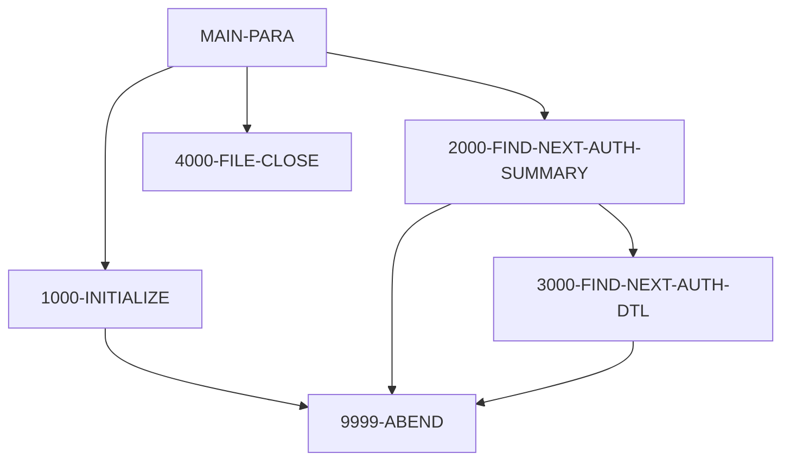

# Program PAUDBUNL

| Item | Value |
|---|---|
| Source | `app/app-authorization-ims-db2-mq/cbl/PAUDBUNL.CBL` |
| Lines | 317 total, 207 code, 95 comment, 15 blank |
| PROGRAM-ID | PAUDBUNL |
| Author | AWS |
| Runtime | dli-batch |
| Module | auth |
| CICS transactions | None in CSD |
| JCL steps | [UNLDPADB](../06-batch/jobs/UNLDPADB.md).STEP01 (`app/app-authorization-ims-db2-mq/jcl/UNLDPADB.JCL:38-39`) |
| Paragraphs | 11 |
| Semantic analysis | validated (batch B01) |
| Version banner |  |

## Summary

PAUDBUNL is a batch IMS DL/I unload utility (entry DLITCBL with PCB mask PAUTBPCB; run by UNLDPADB.JCL as DLI with PSB PAUTBUNL) that copies the pending authorization database to two sequential files. It reads every PAUTSUM0 summary root with unqualified GN calls; for each summary with a numeric account id it writes the 100-byte summary to OUTFIL1 and then reads each PAUTDTL1 child with GNP and writes a record of the packed account id (ROOT-SEG-KEY) plus the 200-byte detail to OUTFIL2. It ends at end of database ('GB'); unexpected IMS statuses or open failures end with RETURN-CODE 16. (Confirmed)

Evidence: `app/app-authorization-ims-db2-mq/cbl/PAUDBUNL.CBL:25-48`, `app/app-authorization-ims-db2-mq/cbl/PAUDBUNL.CBL:153-170`, `app/app-authorization-ims-db2-mq/cbl/PAUDBUNL.CBL:207-284`

Header comment (Unverified, `app/app-authorization-ims-db2-mq/cbl/PAUDBUNL.CBL:1`): See the comment block at the top of the source. Unverified until matched to code.

## Divisions and sections

| Division / section | Lines | Notes |
|---|---|---|
| IDENTIFICATION DIVISION | `app/app-authorization-ims-db2-mq/cbl/PAUDBUNL.CBL:17-20` |  |
| ENVIRONMENT DIVISION | `app/app-authorization-ims-db2-mq/cbl/PAUDBUNL.CBL:21-38` |  |
| DATA DIVISION | `app/app-authorization-ims-db2-mq/cbl/PAUDBUNL.CBL:39-152` |  |
| PROCEDURE DIVISION | `app/app-authorization-ims-db2-mq/cbl/PAUDBUNL.CBL:153-317` | USING PAUTBPCB |
| ENVIRONMENT / CONFIGURATION SECTION | `app/app-authorization-ims-db2-mq/cbl/PAUDBUNL.CBL:22-23` |  |
| ENVIRONMENT / INPUT-OUTPUT SECTION | `app/app-authorization-ims-db2-mq/cbl/PAUDBUNL.CBL:24-38` |  |
| DATA / FILE SECTION | `app/app-authorization-ims-db2-mq/cbl/PAUDBUNL.CBL:42-50` |  |
| DATA / WORKING-STORAGE SECTION | `app/app-authorization-ims-db2-mq/cbl/PAUDBUNL.CBL:51-146` |  |
| DATA / LINKAGE SECTION | `app/app-authorization-ims-db2-mq/cbl/PAUDBUNL.CBL:147-152` |  |

## Files and data stores

| File | ASSIGN | Org | Access | Record key | Alt key | Status field | OPEN modes | Physical dataset (JCL) | Evidence |
|---|---|---|---|---|---|---|---|---|---|
| OPFILE1 | OUTFIL1 | SEQUENTIAL | SEQUENTIAL |  |  | WS-OUTFL1-STATUS | OUTPUT (line 186) | AWS.M2.CARDDEMO.PAUTDB.ROOT.FILEO (UNLDPADB.STEP01 `app/app-authorization-ims-db2-mq/jcl/UNLDPADB.JCL:48-51`) | `app/app-authorization-ims-db2-mq/cbl/PAUDBUNL.CBL:26-29`, FD `app/app-authorization-ims-db2-mq/cbl/PAUDBUNL.CBL:43` |
| OPFILE2 | OUTFIL2 | SEQUENTIAL | SEQUENTIAL |  |  | WS-OUTFL2-STATUS | OUTPUT (line 194) | AWS.M2.CARDDEMO.PAUTDB.CHILD.FILEO (UNLDPADB.STEP01 `app/app-authorization-ims-db2-mq/jcl/UNLDPADB.JCL:53-56`) | `app/app-authorization-ims-db2-mq/cbl/PAUDBUNL.CBL:32-35`, FD `app/app-authorization-ims-db2-mq/cbl/PAUDBUNL.CBL:45` |

## Embedded CICS, SQL and DL/I commands

No EXEC blocks.

## Calls, transfers and callers

| Mechanism | Target | Parameters | Paragraph | Lines |
|---|---|---|---|---|
| CALL system/LE | CBLTDLI | FUNC-GN, PAUTBPCB, PENDING-AUTH-SUMMARY, ROOT-UNQUAL-SSA | 2000-FIND-NEXT-AUTH-SUMMARY | `app/app-authorization-ims-db2-mq/cbl/PAUDBUNL.CBL:213-216` |
| CALL system/LE | CBLTDLI | FUNC-GNP, PAUTBPCB, PENDING-AUTH-DETAILS, CHILD-UNQUAL-SSA | 3000-FIND-NEXT-AUTH-DTL | `app/app-authorization-ims-db2-mq/cbl/PAUDBUNL.CBL:257-260` |

## Copybooks

| Copybook | Statement | Resolution | Resolved path | REPLACING | Line |
|---|---|---|---|---|---|
| [IMSFUNCS](../08-data/layouts/IMSFUNCS.md) | COPY | inventory | app/app-authorization-ims-db2-mq/cpy/IMSFUNCS.cpy |  | `app/app-authorization-ims-db2-mq/cbl/PAUDBUNL.CBL:132` |
| [CIPAUSMY](../08-data/layouts/CIPAUSMY.md) | COPY | inventory | app/app-authorization-ims-db2-mq/cpy/CIPAUSMY.cpy |  | `app/app-authorization-ims-db2-mq/cbl/PAUDBUNL.CBL:139` |
| [CIPAUDTY](../08-data/layouts/CIPAUDTY.md) | COPY | inventory | app/app-authorization-ims-db2-mq/cpy/CIPAUDTY.cpy |  | `app/app-authorization-ims-db2-mq/cbl/PAUDBUNL.CBL:143` |
| [PAUTBPCB](../08-data/layouts/PAUTBPCB.md) | COPY | inventory | app/app-authorization-ims-db2-mq/cpy/PAUTBPCB.CPY |  | `app/app-authorization-ims-db2-mq/cbl/PAUDBUNL.CBL:150` |

## Data division items

Every data entry coded in this source (copybook contents are on the copybook pages). Lengths are computed from PIC and USAGE.

| Section | Lvl | Name | PIC | Usage | Len | OCCURS | REDEFINES | VALUE | 88-levels | Line |
|---|---|---|---|---|---|---|---|---|---|---|
| FILE | 01 | OPFIL1-REC | X(100) |  | 100 |  |  |  |  | 44 |
| FILE | 01 | OPFIL2-REC |  |  |  |  |  |  |  | 46 |
| FILE | 05 | ROOT-SEG-KEY | S9(11) | COMP-3 | 6 |  |  |  |  | 47 |
| FILE | 05 | CHILD-SEG-REC | X(200) |  | 200 |  |  |  |  | 48 |
| WORKING-STORAGE | 01 | WS-VARIABLES |  |  |  |  |  |  |  | 53 |
| WORKING-STORAGE | 05 | WS-PGMNAME | X(08) |  | 8 |  |  | 'IMSUNLOD' |  | 54 |
| WORKING-STORAGE | 05 | CURRENT-DATE | 9(06) |  | 6 |  |  |  |  | 55 |
| WORKING-STORAGE | 05 | CURRENT-YYDDD | 9(05) |  | 5 |  |  |  |  | 56 |
| WORKING-STORAGE | 05 | WS-AUTH-DATE | 9(05) |  | 5 |  |  |  |  | 57 |
| WORKING-STORAGE | 05 | WS-EXPIRY-DAYS | S9(4) | COMP | 2 |  |  |  |  | 58 |
| WORKING-STORAGE | 05 | WS-DAY-DIFF | S9(4) | COMP | 2 |  |  |  |  | 59 |
| WORKING-STORAGE | 05 | IDX | S9(4) | COMP | 2 |  |  |  |  | 60 |
| WORKING-STORAGE | 05 | WS-CURR-APP-ID | 9(11) |  | 11 |  |  |  |  | 61 |
| WORKING-STORAGE | 05 | WS-NO-CHKP | 9(8) |  | 8 |  |  | 0 |  | 63 |
| WORKING-STORAGE | 05 | WS-AUTH-SMRY-PROC-CNT | 9(8) |  | 8 |  |  | 0 |  | 64 |
| WORKING-STORAGE | 05 | WS-TOT-REC-WRITTEN | S9(8) | COMP | 4 |  |  | 0 |  | 65 |
| WORKING-STORAGE | 05 | WS-NO-SUMRY-READ | S9(8) | COMP | 4 |  |  | 0 |  | 66 |
| WORKING-STORAGE | 05 | WS-NO-SUMRY-DELETED | S9(8) | COMP | 4 |  |  | 0 |  | 67 |
| WORKING-STORAGE | 05 | WS-NO-DTL-READ | S9(8) | COMP | 4 |  |  | 0 |  | 68 |
| WORKING-STORAGE | 05 | WS-NO-DTL-DELETED | S9(8) | COMP | 4 |  |  | 0 |  | 69 |
| WORKING-STORAGE | 05 | WS-ERR-FLG | X(01) |  | 1 |  |  | 'N' | ERR-FLG-ON = 'Y'; ERR-FLG-OFF = 'N' | 71 |
| WORKING-STORAGE | 05 | WS-END-OF-AUTHDB-FLAG | X(01) |  | 1 |  |  | 'N' | END-OF-AUTHDB = 'Y'; NOT-END-OF-AUTHDB = 'N' | 74 |
| WORKING-STORAGE | 05 | WS-MORE-AUTHS-FLAG | X(01) |  | 1 |  |  | 'N' | MORE-AUTHS = 'Y'; NO-MORE-AUTHS = 'N' | 77 |
| WORKING-STORAGE | 05 | WS-END-OF-ROOT-SEG | X(01) |  | 1 |  |  | SPACES |  | 80 |
| WORKING-STORAGE | 05 | WS-END-OF-CHILD-SEG | X(01) |  | 1 |  |  | SPACES |  | 81 |
| WORKING-STORAGE | 05 | WS-INFILE-STATUS | X(02) |  | 2 |  |  | SPACES |  | 82 |
| WORKING-STORAGE | 05 | WS-OUTFL1-STATUS | X(02) |  | 2 |  |  | SPACES |  | 83 |
| WORKING-STORAGE | 05 | WS-OUTFL2-STATUS | X(02) |  | 2 |  |  | SPACES |  | 84 |
| WORKING-STORAGE | 05 | WS-CUSTID-STATUS | X(02) |  | 2 |  |  | SPACES | END-OF-FILE = '10' | 85 |
| WORKING-STORAGE | 05 | WK-CHKPT-ID |  |  |  |  |  |  |  | 88 |
| WORKING-STORAGE | 10 | FILLER | X(04) |  | 4 |  |  | 'RMAD' |  | 89 |
| WORKING-STORAGE | 10 | WK-CHKPT-ID-CTR | 9(04) |  | 4 |  |  | ZEROES |  | 90 |
| WORKING-STORAGE | 01 | WS-IMS-VARIABLES |  |  |  |  |  |  |  | 92 |
| WORKING-STORAGE | 05 | IMS-RETURN-CODE | X(02) |  | 2 |  |  |  | STATUS-OK = ' ', 'FW'; SEGMENT-NOT-FOUND = 'GE'; DUPLICATE-SEGMENT-FOUND = 'II'; WRONG-PARENTAGE = 'GP'; END-OF-DB = 'GB'; DATABASE-UNAVAILABLE = 'BA'; PSB-SCHEDULED-MORE-THAN-ONCE = 'TC'; COULD-NOT-S | 96 |
| WORKING-STORAGE | 05 | WS-IMS-PSB-SCHD-FLG | X(1) |  | 1 |  |  |  | IMS-PSB-SCHD = 'Y'; IMS-PSB-NOT-SCHD = 'N' | 106 |
| WORKING-STORAGE | 01 | ROOT-UNQUAL-SSA |  |  |  |  |  |  |  | 111 |
| WORKING-STORAGE | 05 | FILLER | X(08) |  | 8 |  |  | 'PAUTSUM0' |  | 112 |
| WORKING-STORAGE | 05 | FILLER | X(01) |  | 1 |  |  | ' ' |  | 113 |
| WORKING-STORAGE | 01 | CHILD-UNQUAL-SSA |  |  |  |  |  |  |  | 115 |
| WORKING-STORAGE | 05 | FILLER | X(08) |  | 8 |  |  | 'PAUTDTL1' |  | 116 |
| WORKING-STORAGE | 05 | FILLER | X(01) |  | 1 |  |  | ' ' |  | 117 |
| WORKING-STORAGE | 01 | PRM-INFO |  |  |  |  |  |  |  | 119 |
| WORKING-STORAGE | 05 | P-EXPIRY-DAYS | 9(02) |  | 2 |  |  |  |  | 120 |
| WORKING-STORAGE | 05 | FILLER | X(01) |  | 1 |  |  |  |  | 121 |
| WORKING-STORAGE | 05 | P-CHKP-FREQ | X(05) |  | 5 |  |  |  |  | 122 |
| WORKING-STORAGE | 05 | FILLER | X(01) |  | 1 |  |  |  |  | 123 |
| WORKING-STORAGE | 05 | P-CHKP-DIS-FREQ | X(05) |  | 5 |  |  |  |  | 124 |
| WORKING-STORAGE | 05 | FILLER | X(01) |  | 1 |  |  |  |  | 125 |
| WORKING-STORAGE | 05 | P-DEBUG-FLAG | X(01) |  | 1 |  |  |  | DEBUG-ON = 'Y'; DEBUG-OFF = 'N' | 126 |
| WORKING-STORAGE | 05 | FILLER | X(01) |  | 1 |  |  |  |  | 129 |
| WORKING-STORAGE | 01 | PENDING-AUTH-SUMMARY |  |  |  |  |  |  |  | 138 |
| WORKING-STORAGE | 01 | PENDING-AUTH-DETAILS |  |  |  |  |  |  |  | 142 |

## Statement inventory

Every procedure statement the parser recorded, by kind. Each one is listed with its line under Paragraph details.

| Kind | Count |
|---|---|
| Decisions (IF, EVALUATE, WHEN, loops, handlers) | 11 |
| Calculations | 4 |
| File I/O | 6 |
| EXEC CICS / SQL / DLI | 0 |
| CALL | 2 |
| PERFORM | 8 |
| GO TO | 0 |
| MOVE literal | 3 |
| MOVE field | 3 |
| SET | 2 |
| STRING, UNSTRING, INSPECT, INITIALIZE, COPY, ENTRY and others | 8 |
| DISPLAY | 15 |
| GOBACK, STOP RUN, RETURN, XCTL | 2 |
| Not classified by the parser | 0 |

## Control flow

| Paragraph | Lines | Logic | Performs | Performed by | Reachable |
|---|---|---|---|---|---|
| [MAIN-PARA](#para-main-para) | 157-170 | Entered via ENTRY 'DLITCBL' using PAUTBPCB; performs 1000-INITIALIZE, repeats 2000-FIND-NEXT-AUTH-SUMMARY until WS-END-OF-ROOT-SEG = 'Y', closes the files and GOBACKs. (Confirmed) | 1000-INITIALIZE, 2000-FIND-NEXT-AUTH-SUMMARY, 4000-FILE-CLOSE |  | yes |
| [1000-INITIALIZE](#para-1000-initialize) | 173-200 | Accepts and displays the current date, then opens OPFILE1 and OPFILE2 for output; a status other than spaces/'00' displays the error and performs 9999-ABEND. (Confirmed) | 9999-ABEND | MAIN-PARA | yes |
| [1000-EXIT](#para-1000-exit) | 203-204 | Exit point of 1000-INITIALIZE (EXIT only). (Confirmed) |  | MAIN-PARA | yes |
| [2000-FIND-NEXT-AUTH-SUMMARY](#para-2000-find-next-auth-summary) | 207-247 | Calls CBLTDLI GN with ROOT-UNQUAL-SSA on PAUTBPCB. On blank status counts the read, moves the summary to OPFIL1-REC and PA-ACCT-ID to ROOT-SEG-KEY and, if PA-ACCT-ID is numeric, writes OPFIL1-REC and loops 3000-FIND-NEXT-AUTH-DTL until end of children. 'GB' ends the root loop; any other status displays 'AUTH SUM  GN FAILED' and performs 9999-ABEND. (Confirmed) | 3000-FIND-NEXT-AUTH-DTL, 9999-ABEND | MAIN-PARA | yes |
| [2000-EXIT](#para-2000-exit) | 248-249 | Exit point of 2000-FIND-NEXT-AUTH-SUMMARY (EXIT only). (Confirmed) |  | MAIN-PARA | yes |
| [3000-FIND-NEXT-AUTH-DTL](#para-3000-find-next-auth-dtl) | 253-284 | Calls CBLTDLI GNP with CHILD-UNQUAL-SSA. On blank status moves the detail to CHILD-SEG-REC and writes OPFIL2-REC (account key + detail); 'GE' sets WS-END-OF-CHILD-SEG = 'Y'; other statuses display 'GNP CALL FAILED' and perform 9999-ABEND. Clears PAUT-PCB-STATUS. (Confirmed) | 9999-ABEND | 2000-FIND-NEXT-AUTH-SUMMARY | yes |
| [3000-EXIT](#para-3000-exit) | 285-286 | Exit point of 3000-FIND-NEXT-AUTH-DTL (EXIT only). (Confirmed) |  | 2000-FIND-NEXT-AUTH-SUMMARY | yes |
| [4000-FILE-CLOSE](#para-4000-file-close) | 289-304 | Closes OPFILE1 and OPFILE2, displaying an error message for a non-'00' status (no abend). (Confirmed) |  | MAIN-PARA | yes |
| [4000-EXIT](#para-4000-exit) | 305-306 | Exit point of 4000-FILE-CLOSE (EXIT only). (Confirmed) |  | MAIN-PARA | yes |
| [9999-ABEND](#para-9999-abend) | 308-314 | Displays 'IMSUNLOD ABENDING ...', sets RETURN-CODE 16 and GOBACKs. (Confirmed) |  | 1000-INITIALIZE, 2000-FIND-NEXT-AUTH-SUMMARY, 3000-FIND-NEXT-AUTH-DTL | yes |
| [9999-EXIT](#para-9999-exit) | 316-317 | Exit point of 9999-ABEND (EXIT only, not reached). (Confirmed) |  |  | no static path |

## Paragraph details

### Para MAIN-PARA

Lines `app/app-authorization-ims-db2-mq/cbl/PAUDBUNL.CBL:157-170`. 

Logic: Entered via ENTRY 'DLITCBL' using PAUTBPCB; performs 1000-INITIALIZE, repeats 2000-FIND-NEXT-AUTH-SUMMARY until WS-END-OF-ROOT-SEG = 'Y', closes the files and GOBACKs. (Confirmed)

Statements in source order:

- `ENTRY 'DLITCBL' USING PAUTBPCB` at `app/app-authorization-ims-db2-mq/cbl/PAUDBUNL.CBL:158`
- PERFORM 1000-INITIALIZE THRU 1000-EXIT at `app/app-authorization-ims-db2-mq/cbl/PAUDBUNL.CBL:161`
- PERFORM 2000-FIND-NEXT-AUTH-SUMMARY THRU 2000-EXIT `UNTIL WS-END-OF-ROOT-SEG = 'Y'` at `app/app-authorization-ims-db2-mq/cbl/PAUDBUNL.CBL:163-164`
- PERFORM 4000-FILE-CLOSE THRU 4000-EXIT at `app/app-authorization-ims-db2-mq/cbl/PAUDBUNL.CBL:166`
- Ends with GOBACK at `app/app-authorization-ims-db2-mq/cbl/PAUDBUNL.CBL:170`

### Para 1000-INITIALIZE

Lines `app/app-authorization-ims-db2-mq/cbl/PAUDBUNL.CBL:173-200`. 

Logic: Accepts and displays the current date, then opens OPFILE1 and OPFILE2 for output; a status other than spaces/'00' displays the error and performs 9999-ABEND. (Confirmed)

Statements in source order:

- `ACCEPT CURRENT-DATE FROM DATE` at `app/app-authorization-ims-db2-mq/cbl/PAUDBUNL.CBL:176`
- `ACCEPT CURRENT-YYDDD FROM DAY` at `app/app-authorization-ims-db2-mq/cbl/PAUDBUNL.CBL:177`
- `DISPLAY 'STARTING PROGRAM PAUDBUNL::'` at `app/app-authorization-ims-db2-mq/cbl/PAUDBUNL.CBL:180`
- `DISPLAY '*-------------------------------------*'` at `app/app-authorization-ims-db2-mq/cbl/PAUDBUNL.CBL:181`
- `DISPLAY 'TODAYS DATE :' CURRENT-DATE` at `app/app-authorization-ims-db2-mq/cbl/PAUDBUNL.CBL:182`
- `DISPLAY ' '` at `app/app-authorization-ims-db2-mq/cbl/PAUDBUNL.CBL:183-185`
- File I/O `OPEN OUTPUT OPFILE1` at `app/app-authorization-ims-db2-mq/cbl/PAUDBUNL.CBL:186`
- IF `WS-OUTFL1-STATUS = SPACES OR '00'` at `app/app-authorization-ims-db2-mq/cbl/PAUDBUNL.CBL:187` (io-status)
- `DISPLAY 'ERROR IN OPENING OPFILE1:' WS-OUTFL1-STATUS` at `app/app-authorization-ims-db2-mq/cbl/PAUDBUNL.CBL:190`
- PERFORM 9999-ABEND at `app/app-authorization-ims-db2-mq/cbl/PAUDBUNL.CBL:191`
- File I/O `OPEN OUTPUT OPFILE2` at `app/app-authorization-ims-db2-mq/cbl/PAUDBUNL.CBL:194`
- IF `WS-OUTFL2-STATUS = SPACES OR '00'` at `app/app-authorization-ims-db2-mq/cbl/PAUDBUNL.CBL:195` (io-status)
- `DISPLAY 'ERROR IN OPENING OPFILE2:' WS-OUTFL2-STATUS` at `app/app-authorization-ims-db2-mq/cbl/PAUDBUNL.CBL:198`
- PERFORM 9999-ABEND at `app/app-authorization-ims-db2-mq/cbl/PAUDBUNL.CBL:199`

### Para 1000-EXIT

Lines `app/app-authorization-ims-db2-mq/cbl/PAUDBUNL.CBL:203-204`. 

Logic: Exit point of 1000-INITIALIZE (EXIT only). (Confirmed)

### Para 2000-FIND-NEXT-AUTH-SUMMARY

Lines `app/app-authorization-ims-db2-mq/cbl/PAUDBUNL.CBL:207-247`. 

Logic: Calls CBLTDLI GN with ROOT-UNQUAL-SSA on PAUTBPCB. On blank status counts the read, moves the summary to OPFIL1-REC and PA-ACCT-ID to ROOT-SEG-KEY and, if PA-ACCT-ID is numeric, writes OPFIL1-REC and loops 3000-FIND-NEXT-AUTH-DTL until end of children. 'GB' ends the root loop; any other status displays 'AUTH SUM  GN FAILED' and performs 9999-ABEND. (Confirmed)

Rules: [BR-PAUDBUNL-001](../09-business-rules-catalog.md#br-paudbunl-001), [BR-PAUDBUNL-002](../09-business-rules-catalog.md#br-paudbunl-002)

Statements in source order:

- `INITIALIZE PAUT-PCB-STATUS` at `app/app-authorization-ims-db2-mq/cbl/PAUDBUNL.CBL:212`
- CALL CBLTDLI at `app/app-authorization-ims-db2-mq/cbl/PAUDBUNL.CBL:213-216`
- IF `PAUT-PCB-STATUS = SPACES` at `app/app-authorization-ims-db2-mq/cbl/PAUDBUNL.CBL:223` (io-status)
- Calculation `ADD 1 TO WS-NO-SUMRY-READ` at `app/app-authorization-ims-db2-mq/cbl/PAUDBUNL.CBL:225`
- Calculation `ADD 1 TO WS-AUTH-SMRY-PROC-CNT` at `app/app-authorization-ims-db2-mq/cbl/PAUDBUNL.CBL:226`
- `MOVE PENDING-AUTH-SUMMARY TO OPFIL1-REC` at `app/app-authorization-ims-db2-mq/cbl/PAUDBUNL.CBL:227`
- `INITIALIZE ROOT-SEG-KEY` at `app/app-authorization-ims-db2-mq/cbl/PAUDBUNL.CBL:228`
- `INITIALIZE CHILD-SEG-REC` at `app/app-authorization-ims-db2-mq/cbl/PAUDBUNL.CBL:229`
- `MOVE PA-ACCT-ID TO ROOT-SEG-KEY` at `app/app-authorization-ims-db2-mq/cbl/PAUDBUNL.CBL:230`
- IF `PA-ACCT-ID IS NUMERIC` at `app/app-authorization-ims-db2-mq/cbl/PAUDBUNL.CBL:232` (business-candidate)
- File I/O `WRITE OPFIL1-REC` at `app/app-authorization-ims-db2-mq/cbl/PAUDBUNL.CBL:233`
- `INITIALIZE WS-END-OF-CHILD-SEG` at `app/app-authorization-ims-db2-mq/cbl/PAUDBUNL.CBL:234`
- PERFORM 3000-FIND-NEXT-AUTH-DTL THRU 3000-EXIT `UNTIL WS-END-OF-CHILD-SEG='Y'` at `app/app-authorization-ims-db2-mq/cbl/PAUDBUNL.CBL:235-236`
- IF `PAUT-PCB-STATUS = 'GB'` at `app/app-authorization-ims-db2-mq/cbl/PAUDBUNL.CBL:239` (io-status)
- `SET END-OF-AUTHDB TO TRUE` at `app/app-authorization-ims-db2-mq/cbl/PAUDBUNL.CBL:240`
- MOVE `'Y'` TO WS-END-OF-ROOT-SEG at `app/app-authorization-ims-db2-mq/cbl/PAUDBUNL.CBL:241`
- IF `PAUT-PCB-STATUS NOT EQUAL TO SPACES AND 'GB'` at `app/app-authorization-ims-db2-mq/cbl/PAUDBUNL.CBL:243` (io-status)
- `DISPLAY 'AUTH SUM GN FAILED :' PAUT-PCB-STATUS` at `app/app-authorization-ims-db2-mq/cbl/PAUDBUNL.CBL:244`
- `DISPLAY 'KEY FEEDBACK AREA :' PAUT-KEYFB` at `app/app-authorization-ims-db2-mq/cbl/PAUDBUNL.CBL:245`
- PERFORM 9999-ABEND at `app/app-authorization-ims-db2-mq/cbl/PAUDBUNL.CBL:246-247`

### Para 2000-EXIT

Lines `app/app-authorization-ims-db2-mq/cbl/PAUDBUNL.CBL:248-249`. 

Logic: Exit point of 2000-FIND-NEXT-AUTH-SUMMARY (EXIT only). (Confirmed)

### Para 3000-FIND-NEXT-AUTH-DTL

Lines `app/app-authorization-ims-db2-mq/cbl/PAUDBUNL.CBL:253-284`. 

Logic: Calls CBLTDLI GNP with CHILD-UNQUAL-SSA. On blank status moves the detail to CHILD-SEG-REC and writes OPFIL2-REC (account key + detail); 'GE' sets WS-END-OF-CHILD-SEG = 'Y'; other statuses display 'GNP CALL FAILED' and perform 9999-ABEND. Clears PAUT-PCB-STATUS. (Confirmed)

Statements in source order:

- CALL CBLTDLI at `app/app-authorization-ims-db2-mq/cbl/PAUDBUNL.CBL:257-260`
- IF `PAUT-PCB-STATUS = SPACES` at `app/app-authorization-ims-db2-mq/cbl/PAUDBUNL.CBL:266` (io-status)
- `SET MORE-AUTHS TO TRUE` at `app/app-authorization-ims-db2-mq/cbl/PAUDBUNL.CBL:267`
- Calculation `ADD 1 TO WS-NO-SUMRY-READ` at `app/app-authorization-ims-db2-mq/cbl/PAUDBUNL.CBL:268`
- Calculation `ADD 1 TO WS-AUTH-SMRY-PROC-CNT` at `app/app-authorization-ims-db2-mq/cbl/PAUDBUNL.CBL:269`
- `MOVE PENDING-AUTH-DETAILS TO CHILD-SEG-REC` at `app/app-authorization-ims-db2-mq/cbl/PAUDBUNL.CBL:270`
- File I/O `WRITE OPFIL2-REC` at `app/app-authorization-ims-db2-mq/cbl/PAUDBUNL.CBL:271`
- IF `PAUT-PCB-STATUS = 'GE'` at `app/app-authorization-ims-db2-mq/cbl/PAUDBUNL.CBL:273` (io-status)
- MOVE `'Y'` TO WS-END-OF-CHILD-SEG at `app/app-authorization-ims-db2-mq/cbl/PAUDBUNL.CBL:275`
- `DISPLAY 'CHILD SEG FLAG GE : ' WS-END-OF-CHILD-SEG` at `app/app-authorization-ims-db2-mq/cbl/PAUDBUNL.CBL:276-277`
- IF `PAUT-PCB-STATUS NOT EQUAL TO SPACES AND 'GE'` at `app/app-authorization-ims-db2-mq/cbl/PAUDBUNL.CBL:279` (io-status)
- `DISPLAY 'GNP CALL FAILED :' PAUT-PCB-STATUS` at `app/app-authorization-ims-db2-mq/cbl/PAUDBUNL.CBL:280`
- `DISPLAY 'KFB AREA IN CHILD:' PAUT-KEYFB` at `app/app-authorization-ims-db2-mq/cbl/PAUDBUNL.CBL:281`
- PERFORM 9999-ABEND at `app/app-authorization-ims-db2-mq/cbl/PAUDBUNL.CBL:282`
- `INITIALIZE PAUT-PCB-STATUS` at `app/app-authorization-ims-db2-mq/cbl/PAUDBUNL.CBL:284`

### Para 3000-EXIT

Lines `app/app-authorization-ims-db2-mq/cbl/PAUDBUNL.CBL:285-286`. 

Logic: Exit point of 3000-FIND-NEXT-AUTH-DTL (EXIT only). (Confirmed)

### Para 4000-FILE-CLOSE

Lines `app/app-authorization-ims-db2-mq/cbl/PAUDBUNL.CBL:289-304`. 

Logic: Closes OPFILE1 and OPFILE2, displaying an error message for a non-'00' status (no abend). (Confirmed)

Statements in source order:

- `DISPLAY 'CLOSING THE FILE'` at `app/app-authorization-ims-db2-mq/cbl/PAUDBUNL.CBL:290`
- File I/O `CLOSE OPFILE1` at `app/app-authorization-ims-db2-mq/cbl/PAUDBUNL.CBL:291`
- IF `WS-OUTFL1-STATUS = SPACES OR '00'` at `app/app-authorization-ims-db2-mq/cbl/PAUDBUNL.CBL:293` (io-status)
- `DISPLAY 'ERROR IN CLOSING 1ST FILE:'WS-OUTFL1-STATUS` at `app/app-authorization-ims-db2-mq/cbl/PAUDBUNL.CBL:296`
- File I/O `CLOSE OPFILE2` at `app/app-authorization-ims-db2-mq/cbl/PAUDBUNL.CBL:298`
- IF `WS-OUTFL2-STATUS = SPACES OR '00'` at `app/app-authorization-ims-db2-mq/cbl/PAUDBUNL.CBL:300` (io-status)
- `DISPLAY 'ERROR IN CLOSING 2ND FILE:'WS-OUTFL2-STATUS` at `app/app-authorization-ims-db2-mq/cbl/PAUDBUNL.CBL:303`

### Para 4000-EXIT

Lines `app/app-authorization-ims-db2-mq/cbl/PAUDBUNL.CBL:305-306`. 

Logic: Exit point of 4000-FILE-CLOSE (EXIT only). (Confirmed)

### Para 9999-ABEND

Lines `app/app-authorization-ims-db2-mq/cbl/PAUDBUNL.CBL:308-314`. 

Logic: Displays 'IMSUNLOD ABENDING ...', sets RETURN-CODE 16 and GOBACKs. (Confirmed)

Statements in source order:

- `DISPLAY 'IMSUNLOD ABENDING ...'` at `app/app-authorization-ims-db2-mq/cbl/PAUDBUNL.CBL:311`
- MOVE `16` TO RETURN-CODE at `app/app-authorization-ims-db2-mq/cbl/PAUDBUNL.CBL:313`
- Ends with GOBACK at `app/app-authorization-ims-db2-mq/cbl/PAUDBUNL.CBL:314`

### Para 9999-EXIT

Lines `app/app-authorization-ims-db2-mq/cbl/PAUDBUNL.CBL:316-317`. 

Logic: Exit point of 9999-ABEND (EXIT only, not reached). (Confirmed)

## Business rules

| Rule | Category | Statement | Paragraph | Source | Confidence |
|---|---|---|---|---|---|
| [BR-PAUDBUNL-001](../09-business-rules-catalog.md#br-paudbunl-001) | decision | Only pending authorization summaries with a numeric account id are unloaded; for each such summary the summary record is written to OUTFIL1 and each child detail is written to OUTFIL2 prefixed with the packed account id so it can be re-parented on reload. | 2000-FIND-NEXT-AUTH-SUMMARY | `app/app-authorization-ims-db2-mq/cbl/PAUDBUNL.CBL:227-237`, `app/app-authorization-ims-db2-mq/cbl/PAUDBUNL.CBL:266-272` | Confirmed |
| [BR-PAUDBUNL-002](../09-business-rules-catalog.md#br-paudbunl-002) | error-policy | The unload stops with return code 16 when an output file cannot be opened or when IMS returns an unexpected status (not blank/'GB' on summary, not blank/'GE' on detail). | 2000-FIND-NEXT-AUTH-SUMMARY | `app/app-authorization-ims-db2-mq/cbl/PAUDBUNL.CBL:243-246`, `app/app-authorization-ims-db2-mq/cbl/PAUDBUNL.CBL:186-200`, `app/app-authorization-ims-db2-mq/cbl/PAUDBUNL.CBL:279-283`, `app/app-authorization-ims-db2-mq/cbl/PAUDBUNL.CBL:311-314` | Confirmed |

Decision coverage: 1 of 1 business-candidate decision points are linked to a rule or a no-rule reason (1 inside rule ranges).

## Error handling

| Paragraph | Kind | Detail | Lines |
|---|---|---|---|
| 1000-INITIALIZE | check | `WS-OUTFL1-STATUS = SPACES OR '00'` | `app/app-authorization-ims-db2-mq/cbl/PAUDBUNL.CBL:187` |
| 1000-INITIALIZE | check | `WS-OUTFL2-STATUS = SPACES OR '00'` | `app/app-authorization-ims-db2-mq/cbl/PAUDBUNL.CBL:195` |
| 2000-FIND-NEXT-AUTH-SUMMARY | check | `PAUT-PCB-STATUS = SPACES` | `app/app-authorization-ims-db2-mq/cbl/PAUDBUNL.CBL:223` |
| 2000-FIND-NEXT-AUTH-SUMMARY | check | `PAUT-PCB-STATUS = 'GB'` | `app/app-authorization-ims-db2-mq/cbl/PAUDBUNL.CBL:239` |
| 2000-FIND-NEXT-AUTH-SUMMARY | check | `PAUT-PCB-STATUS NOT EQUAL TO SPACES AND 'GB'` | `app/app-authorization-ims-db2-mq/cbl/PAUDBUNL.CBL:243` |
| 3000-FIND-NEXT-AUTH-DTL | check | `PAUT-PCB-STATUS = SPACES` | `app/app-authorization-ims-db2-mq/cbl/PAUDBUNL.CBL:266` |
| 3000-FIND-NEXT-AUTH-DTL | check | `PAUT-PCB-STATUS = 'GE'` | `app/app-authorization-ims-db2-mq/cbl/PAUDBUNL.CBL:273` |
| 3000-FIND-NEXT-AUTH-DTL | check | `PAUT-PCB-STATUS NOT EQUAL TO SPACES AND 'GE'` | `app/app-authorization-ims-db2-mq/cbl/PAUDBUNL.CBL:279` |
| 4000-FILE-CLOSE | check | `WS-OUTFL1-STATUS = SPACES OR '00'` | `app/app-authorization-ims-db2-mq/cbl/PAUDBUNL.CBL:293` |
| 4000-FILE-CLOSE | check | `WS-OUTFL2-STATUS = SPACES OR '00'` | `app/app-authorization-ims-db2-mq/cbl/PAUDBUNL.CBL:300` |
| 9999-ABEND | return code | MOVE 16 TO RETURN-CODE | `app/app-authorization-ims-db2-mq/cbl/PAUDBUNL.CBL:313` |

## Observations and SME questions

- unchecked-io: WRITE OPFIL1-REC and WRITE OPFIL2-REC are not followed by a file-status check. (`app/app-authorization-ims-db2-mq/cbl/PAUDBUNL.CBL:233`)
- anomaly: Detail reads increment WS-NO-SUMRY-READ and WS-AUTH-SMRY-PROC-CNT instead of a detail counter; no counts are displayed. (`app/app-authorization-ims-db2-mq/cbl/PAUDBUNL.CBL:268-269`)
- anomaly: Program displays 'IMSUNLOD' as its name (WS-PGMNAME and abend text) instead of PAUDBUNL. (`app/app-authorization-ims-db2-mq/cbl/PAUDBUNL.CBL:311`)
- dead-code: PRM-INFO, checkpoint id, expiry/day-diff fields and IMS-RETURN-CODE 88-levels are unused copies from CBPAUP0C. (`app/app-authorization-ims-db2-mq/cbl/PAUDBUNL.CBL:119-129`)

## Sources

- `app/app-authorization-ims-db2-mq/cbl/PAUDBUNL.CBL`
- `docs/_work/structure/programs/PAUDBUNL.json`
- `docs/_work/semantic/programs/PAUDBUNL.json`
- `docs/_work/programs/PAUDBUNL.json`

## Confidence

Structure tables (divisions, items, paragraphs, statements, line numbers) are Confirmed: they are parsed from the source. Paragraph logic and rule statements carry their own Confirmed/Inferred tag from the batch analysis, and every rule anchor was checked against the cited lines. Decision-point classes are a keyword heuristic used only for coverage measurement. Header comments are Unverified.
