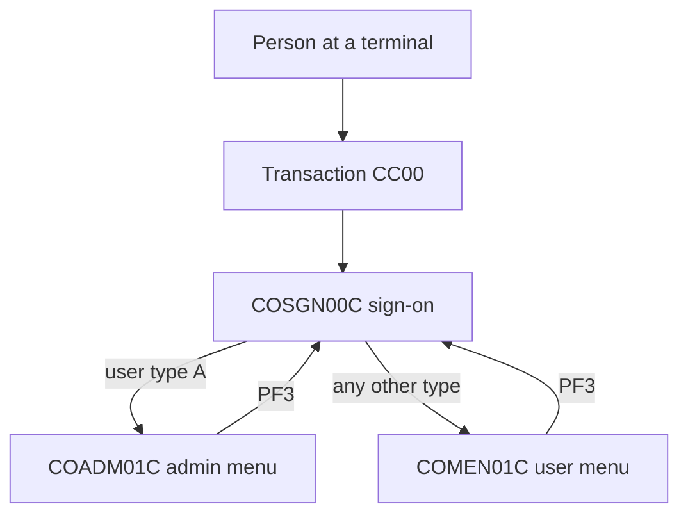
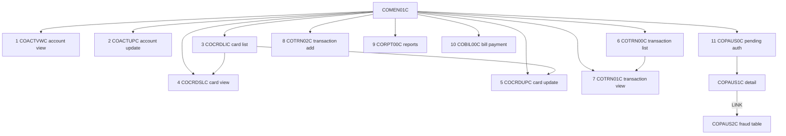
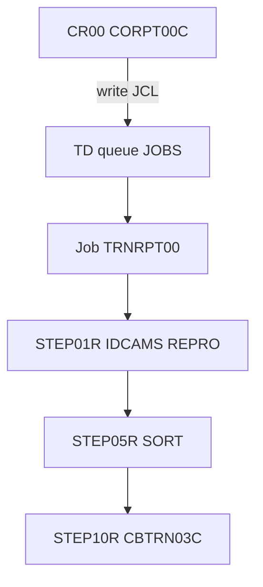
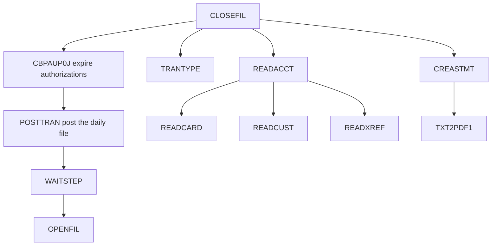

# Aws Mainframe Credit-Card-Demo

## What this repository is

CardDemo is a sample credit-card servicing application. A person signs on with a user id and a password. An administrator gets a different menu from other users. Online screens maintain accounts, cards, customers, users, and transactions. Batch jobs post transactions, calculate interest, and refresh files. The sign-on screen calls it a credit card demo application (`app/bms/COSGN00.bms`).

The inventory holds 331 files (`docs/_work/inventory.json`). They split into a base application, three optional add-ons, and build support (`docs-toolkit/project-profile.yaml`):

| Piece | What it adds | Files |
|---|---|---|
| Base | CICS screens, VSAM files, JCL, CA7, Control-M | 169 under `app/` outside the add-on folders |
| Authorization | IMS pending authorizations, a DB2 fraud table, MQ | 40 under `app/app-authorization-ims-db2-mq/` |
| Transaction types | DB2 transaction-type maintenance | 27 under `app/app-transaction-type-db2/` |
| VSAM and MQ | Account and date replies over MQ | 4 under `app/app-vsam-mq/` |
| Build | Compile procedures and shell scripts | 71 under `samples/` and `scripts/` |

Counts are from the architecture page, which assigns each file by the longest matching path in the profile.

## How a session works

Online work is CICS (Customer Information Control System). A four-character transaction name starts a program. The program paints a screen (a BMS map). When the person presses a key, the same program runs again, or it transfers to another program with `XCTL` and passes a shared block called `CARDDEMO-COMMAREA` (`app/cpy/COCOM01Y.cpy:20-31`). That block carries the user id, the user type, the program the person came from, and the program to return to.

`RETURN TRANSID` keeps the person on the same screen for the next key. PF3 on the user menu and the admin menu sets the return target to `COSGN00C` and goes back to sign-on (`app/cbl/COMEN01C.cbl:96-98`, `app/cbl/COADM01C.cbl:100-102`). When the return target is spaces or low-values, both menus set it to `COSGN00C` before the transfer (`app/cbl/COMEN01C.cbl:198-200`, `app/cbl/COADM01C.cbl:165-167`).

## Sign-on

Transaction `CC00` starts `COSGN00C` (`app/csd/CARDDEMO.CSD:378`).

A blank user id stops the screen with "Please enter User ID ..." before the password is checked (`app/cbl/COSGN00C.cbl:118-122`).

A blank password, when a user id is present, stops the screen with "Please enter Password ..." (`app/cbl/COSGN00C.cbl:123-127`).

The entered user id and password are converted to upper case (`app/cbl/COSGN00C.cbl:132-136`).

The program reads the user-security file (`app/cbl/COSGN00C.cbl:211-219`). Response 13 shows "User not found. Try again ...". Any other non-zero response shows "Unable to verify the User ..." (`app/cbl/COSGN00C.cbl:247-256`).

A password that does not match shows "Wrong Password. Try again ..." (`app/cbl/COSGN00C.cbl:241-246`).

A matching password stores the user id and the stored user type in the commarea. User type `A` transfers to `COADM01C`. Any other type transfers to `COMEN01C` (`app/cbl/COSGN00C.cbl:223-239`, `app/cpy/COCOM01Y.cpy:26-28`).

## User menu

Transaction `CM00` starts `COMEN01C` (`app/csd/CARDDEMO.CSD:399`). The person types an option number. A number that is not numeric, is zero, or is above the option count shows "Please enter a valid option number..." (`app/cbl/COMEN01C.cbl:127-133`). The menu has 11 options (`app/cpy/COMEN02Y.cpy:21`). A regular user (type `U`) who picks an option marked `A` is refused with "No access - Admin Only option..." (`app/cbl/COMEN01C.cbl:136-142`). Every option in the current table is marked `U`, so that refusal does not fire for these 11 rows (`app/cpy/COMEN02Y.cpy:25-90`).

A name that begins with `DUMMY` is not started. The menu says the option is coming soon (`app/cbl/COMEN01C.cbl:169-176`). None of the 11 names begins with `DUMMY`.

`COPAUS0C` is started only when `INQUIRE PROGRAM` returns a normal response. Otherwise the menu says the option is not installed (`app/cbl/COMEN01C.cbl:147-168`). That program lives in the optional authorization folder, so a base-only install takes this path.

Any other option is started with `XCTL` and the commarea (`app/cbl/COMEN01C.cbl:177-187`).

| Option | Screen title | Program | Transaction | What the person does |
|---|---|---|---|---|
| 1 | Account View | COACTVWC | CAVW | Enters an account id and sees the account |
| 2 | Account Update | COACTUPC | CAUP | Changes account and customer fields, then confirms |
| 3 | Credit Card List | COCRDLIC | CCLI | Lists cards, then opens view or update |
| 4 | Credit Card View | COCRDSLC | CCDL | Searches by account and card |
| 5 | Credit Card Update | COCRDUPC | CCUP | Changes card name, status, and expiry |
| 6 | Transaction List | COTRN00C | CT00 | Lists transactions and can open the view |
| 7 | Transaction View | COTRN01C | CT01 | Shows one transaction |
| 8 | Transaction Add | COTRN02C | CT02 | Adds a transaction |
| 9 | Transaction Reports | CORPT00C | CR00 | Submits a batch report for a date range |
| 10 | Bill Payment | COBIL00C | CB00 | Bill payment screen |
| 11 | Pending Authorization View | COPAUS0C | CPVS | Optional authorization module |

Titles and program names are the menu table (`app/cpy/COMEN02Y.cpy:25-90`). Transaction names are the CICS definitions (`app/csd/CARDDEMO.CSD:306-439`).

Solid arrows in the [navigation page](05-online/navigation-flow.md) are Confirmed. A return from account view, account update, card view, or card update back to whoever called it is Inferred, because the target is the caller's program name stored in the commarea.

### Account view (option 1)

The account field is read from the screen. An asterisk or spaces is treated as not supplied (`app/cbl/COACTVWC.cbl:627-633`). Low-values or spaces are reported as "Account number not provided", and a blank filter becomes "No input received" (`app/cbl/COACTVWC.cbl:640-642`, `app/cbl/COACTVWC.cbl:653-661`). A value that is not numeric, or is zeros, is rejected with "Account Filter must  be a non-zero 11 digit number" (`app/cbl/COACTVWC.cbl:666-673`). The message text contains two spaces after "must".

A valid id is used to read the card cross-reference by account, then the account master, then the customer master (`app/cbl/COACTVWC.cbl:687-715`).

### Account update (option 2)

Before details are fetched, a blank account is "not provided" and the message becomes "No input received". A supplied account that is not numeric or is zero is rejected with "Account Number if supplied must be a 11 digit Non-Zero Number" (`app/cbl/COACTUPC.cbl:1433-1446`, `app/cbl/COACTUPC.cbl:1783-1818`).

After a fetch, every account and customer field is compared with the fetched value. Text is compared after trim and upper case. Amounts, dates, phone parts, SSN, the EFT account, and the FICO score are compared exactly. If nothing differs, the field edits are skipped and the screen says "No change detected with respect to values fetched." (`app/cbl/COACTUPC.cbl:1681-1775`, `app/cbl/COACTUPC.cbl:491-492`).

When something changed, these edits run, in this order. Only the first failure is shown (`app/cbl/COACTUPC.cbl:480`, `app/cbl/COACTUPC.cbl:1805-1812`).

| Fields | Rule |
|---|---|
| Account status, primary card holder | Required, and must be Y or N |
| Credit limit, cash credit limit, current balance, cycle credit, cycle debit | Required, and must pass the numeric test |
| Open date, expiry date, reissue date, date of birth | Year required, numeric, century 19 or 20. Month 1-12. Day 1-31. Day 31 only in 31-day months. February 29 only in a leap year. A date that passes is checked again by CSUTLDTC |
| Date of birth | Must be earlier than today. Today is rejected |
| SSN | Three parts, 3, 2, and 4 digits, required, numeric, not zero. The first part cannot be 000, 666, or 900-999 |
| FICO | Required 3-digit number, 300 through 850 |
| First and last name | Required, letters and spaces, 25 characters. Middle name is optional, letters and spaces when supplied |
| Address line 1 | Required. City and country required, letters and spaces. State required and one of 56 US state and territory codes. Address line 2 is not edited |
| Zip | Required 5-digit non-zero number. With a valid state, the state plus the first two zip digits must be one of 240 listed pairs |
| Phone 1 and 2 | Optional. If entered, the area code must be one of 410 North American area codes, the prefix 3 non-zero digits, the line number 4 non-zero digits |
| EFT account id | Required 10-digit non-zero number |

Sources: `app/cbl/COACTUPC.cbl:1429-2558`, `app/cpy/CSUTLDPY.cpy:18-370`, `app/cpy/CSLKPCDY.cpy:521-1313`. When every edit passes, the screen can show "Changes validated.Press F5 to save" (`app/cbl/COACTUPC.cbl:473`).

Two defects are in this path and are recorded as written. The phone "not entered" test checks the area code where the line number is expected (`app/cbl/COACTUPC.cbl:2238-2239`). After `CSUTLDTC` rejects a date, control falls through to a line that marks the date valid again (`app/cpy/CSUTLDPY.cpy:315-327`). The update is still blocked because `INPUT-ERROR` stays set (`app/cbl/COACTUPC.cbl:1671-1675`).

### Cards (options 3, 4, and 5)

The card list (`COCRDLIC`) transfers to the card view or the card update through `CCARD-NEXT-PROG` (`app/cbl/COCRDLIC.cbl:526-566`, values at `app/cbl/COCRDLIC.cbl:195-204`). The view and the update can also be opened straight from the user menu.

Card view search (`COCRDSLC`): an asterisk or spaces on either filter is treated as not supplied (`app/cbl/COCRDSLC.cbl:614-627`). A blank or zero account is "Account number not provided". A non-numeric account is "ACCOUNT FILTER,IF SUPPLIED MUST BE A 11 DIGIT NUMBER" (`app/cbl/COCRDSLC.cbl:647-679`). The card filter uses the same pattern with a 16-digit message (`app/cbl/COCRDSLC.cbl:685-719`). Both blank becomes "No input received" (`app/cbl/COCRDSLC.cbl:636-643`).

Card update (`COCRDUPC`) edits only the account and card search keys until a card has been fetched (`app/cbl/COCRDUPC.cbl:644-662`). A zero account is reported as not provided here, which is a different message from account update (`app/cbl/COCRDUPC.cbl:725-731`). After a fetch, the new card data is compared with the old data after both are converted to upper case. A match skips the detail edits (`app/cbl/COCRDUPC.cbl:680-693`). Otherwise the embossed name must be letters and spaces, the active status must be Y or N, the expiry month must be 1 through 12, and the expiry year must be 1950 through 2099 (`app/cbl/COCRDUPC.cbl:806-944`, ranges at `app/cbl/COCRDUPC.cbl:91-99`). Comments above the year edit say "must be 1 to 12". The code accepts 1950 through 2099. Code wins. A clean edit shows "Changes validated.Press F5 to save" (`app/cbl/COCRDUPC.cbl:167`).

### Transactions (options 6, 7, and 8)

The list (`COTRN00C`, transaction `CT00`) can transfer to the view (`COTRN01C`, `CT01`) (`app/cbl/COTRN00C.cbl:192`). The add screen (`COTRN02C`, `CT02`) checks fields inline: account or card must be entered, type and category and merchant id must be numeric, amount and dates have format checks, and several merchant fields cannot be empty (`app/cbl/COTRN02C.cbl:199-432`). Those checks are not yet individual rules in the catalog. The list, view, and add each return to the user menu or to sign-on (`app/cbl/COTRN00C.cbl:518`, `app/cbl/COTRN01C.cbl:205`, `app/cbl/COTRN02C.cbl:508`).

### Transaction report (option 9)

`CORPT00C` (transaction `CR00`) does not print the report itself. It writes the JCL of job `TRNRPT00` to the extrapartition transient-data queue `JOBS`, one 80-byte line at a time (`app/cbl/CORPT00C.cbl:83-94`, `app/cbl/CORPT00C.cbl:497-520`). `JOBS` is defined as `TYPE(EXTRA)` with `DDNAME(INREADER)` (`app/csd/CARDDEMO.CSD:499-501`). The job executes procedure `TRANREPT` and passes the screen's start and end dates (`app/cbl/CORPT00C.cbl:94-121`).

The step order is `app/proc/TRANREPT.prc:21`, `:35`, and `:57`. The queue reaches a job reader only if the CICS region JCL defines DD `INREADER`. That JCL is not in this repository, so the last hop is Unverified.

### Bill payment (option 10)

Transaction `CB00` starts `COBIL00C` (`app/csd/CARDDEMO.CSD:337`). From this screen the person returns to the user menu or to sign-on (`app/cbl/COBIL00C.cbl:281`).

### Pending authorization (option 11)

This path exists only when the authorization module is installed. `COPAUS0C` (transaction `CPVS`) can transfer to `COPAUS1C` (transaction `CPVD`) (`app/app-authorization-ims-db2-mq/cbl/COPAUS0C.cbl:322`). `COPAUS1C` links to `COPAUS2C` (`app/app-authorization-ims-db2-mq/cbl/COPAUS1C.cbl:248-249`). Those programs read IMS database `DBPAUTP0` through PSB `PSBPAUTB`, and `COPAUS2C` reads DB2 table `CARDDEMO.AUTHFRDS` (`app/app-authorization-ims-db2-mq/cbl/COPAUS0C.cbl:75`, `app/app-authorization-ims-db2-mq/cbl/COPAUS2C.cbl:68`). Transaction `CP00` starts `COPAUA0C`, which exchanges MQ messages using the trigger queue name and `MQMD-REPLYTOQ` (`app/app-authorization-ims-db2-mq/csd/CRDDEMO2.csd:59`, `app/app-authorization-ims-db2-mq/cbl/COPAUA0C.cbl:238`).

A batch job, `CBPAUP0J`, runs `CBPAUP0C`. A pending authorization qualifies for delete when the day difference is at least the expiry days. Expiry days are the numeric parm, or 5 when that parm is not numeric (`app/app-authorization-ims-db2-mq/cbl/CBPAUP0C.cbl:196-199`, `app/app-authorization-ims-db2-mq/cbl/CBPAUP0C.cbl:280-286`). A qualifying row with response code `00` reduces the approved count and amount. Any other code reduces the declined count and amount (`app/app-authorization-ims-db2-mq/cbl/CBPAUP0C.cbl:287-293`).

## Admin menu

Transaction `CA00` starts `COADM01C` (`app/csd/CARDDEMO.CSD:327`). The menu has 6 options (`app/cpy/COADM02Y.cpy:22`). An option is started when its program name does not begin with `DUMMY` (`app/cbl/COADM01C.cbl:141-146`).

| Option | Screen title | Program | Transaction |
|---|---|---|---|
| 1 | User List (Security) | COUSR00C | CU00 |
| 2 | User Add (Security) | COUSR01C | CU01 |
| 3 | User Update (Security) | COUSR02C | CU02 |
| 4 | User Delete (Security) | COUSR03C | CU03 |
| 5 | Transaction Type List/Update (Db2) | COTRTLIC | CTLI |
| 6 | Transaction Type Maintenance (Db2) | COTRTUPC | CTTU |

Titles are `app/cpy/COADM02Y.cpy:26-54`. User transactions are `app/csd/CARDDEMO.CSD:449-479`. The DB2 transactions are `app/app-transaction-type-db2/csd/CRDDEMOD.csd:25` and `:35`. Options 5 and 6 need the transaction-type module.

From the user list, update goes to `COUSR02C` and delete goes to `COUSR03C` (`app/cbl/COUSR00C.cbl:196`, `app/cbl/COUSR00C.cbl:206`). Add refuses an empty first name, last name, user id, password, or user type (`app/cbl/COUSR01C.cbl:120-144`). Update adds the same empty checks (`app/cbl/COUSR02C.cbl:148-206`). Delete refuses an empty user id (`app/cbl/COUSR03C.cbl:147`). These checks are inline and are not yet rows in the rules catalog.

The transaction-type list can transfer to maintenance (`app/app-transaction-type-db2/cbl/COTRTLIC.cbl:648`). Maintenance requires a numeric non-zero type code of 2 characters and zero-pads it, and requires a description of letters, digits, and spaces within 50 characters (`app/app-transaction-type-db2/cbl/COTRTUPC.cbl:820-974`). A matching type and description skips the edits (`app/app-transaction-type-db2/cbl/COTRTUPC.cbl:783-811`). A clean edit is marked validated but not yet confirmed (`app/app-transaction-type-db2/cbl/COTRTUPC.cbl:772-775`).

Batch program `COBTUPDT` maintains the same DB2 table. A record inserts when the type is `A`, updates when the type is `U`, deletes when the type is `D`, and is ignored when the type is asterisk. Any other type abends with "ERROR: TYPE NOT VALID" (`app/app-transaction-type-db2/cbl/COBTUPDT.cbl:111-128`). Job `MNTTRDB2` runs it (`app/app-transaction-type-db2/jcl/MNTTRDB2.jcl:30`).

## The data the screens share

The card cross-reference ties the three masters together. `XREF-CARD-NUM` points at a card (`app/cpy/CVACT03Y.cpy:5`). `XREF-CUST-ID` points at a customer (`app/cpy/CVACT03Y.cpy:6`). `XREF-ACCT-ID` points at an account (`app/jcl/XREFFILE.jcl:74`).

| Store | Dataset name | Used by |
|---|---|---|
| Account master | AWS.M2.CARDDEMO.ACCTDATA.VSAM.KSDS | Account view and the daily post |
| Card cross-reference | AWS.M2.CARDDEMO.CARDXREF.VSAM.KSDS | Account view and the daily post |
| Daily transactions | AWS.M2.CARDDEMO.DALYTRAN.PS | Posted into the transaction master |
| Transaction master | AWS.M2.CARDDEMO.TRANSACT.VSAM.KSDS | Daily post |
| Category balances | AWS.M2.CARDDEMO.TCATBALF.VSAM.KSDS | Daily post |
| User security | CICS file USRSEC, dataset AWS.M2.CARDDEMO.USRSEC.VSAM.KSDS | Sign-on |
| Transaction types | DB2 CARDDEMO.TRANSACTION_TYPE | Admin options 5 and 6, and COBTUPDT |
| Authorization fraud | DB2 CARDDEMO.AUTHFRDS | COPAUS2C |

The daily-post dataset names are `app/jcl/POSTTRAN.jcl:23-42`. The user-security dataset is `app/csd/CARDDEMO.CSD:88-89`. The DB2 table names are `app/app-transaction-type-db2/cbl/COTRTUPC.cbl:1557` and `app/app-authorization-ims-db2-mq/ddl/AUTHFRDS.ddl:2`.

Several VSAM files share a record length, so a copybook of that length is not proof of which file it belongs to. Those pairs are listed in the [gaps register](16-gaps-assumptions-open-questions.md).

## The batch day

Two schedulers are in the repository. They are separate lists. A job name that appears in both is not one chain (`app/scheduler/CardDemo.ca7`, `app/scheduler/CardDemo.controlm`).

The usual shape is: close the online files, run the update, wait, open the files again. `CLOSEFIL` and `OPENFIL` are the jobs that do the file switch (`app/jcl/CLOSEFIL.jcl:26-30`, `app/jcl/OPENFIL.jcl:26-30`).

### CA7

Schedule id `030` is the main chain. What `030`, `031`, and `032` mean is not defined in this repository.

`POSTTRAN` runs `CBTRN02C`. It reads the daily transaction file and the card cross-reference, updates the transaction master and the account master, and writes a new generation of `AWS.M2.CARDDEMO.DALYREJS` (`app/jcl/POSTTRAN.jcl:20-38`).

Other CA7 chains, with their schedule ids, are in [batch schedule flow](06-batch/batch-schedule-flow.md). `CLOSEFIL1` and `CLOSEFIL2` name JCL member `CLOSEFIL` (`app/scheduler/CardDemo.ca7:225`, `app/scheduler/CardDemo.ca7:252`). There is no job card named `CLOSEFIL1` or `CLOSEFIL2`.

### Control-M

| Folder | Order |
|---|---|
| DAILY-TransactionBackup | CLOSEFIL, then TRANBKP, then WAITSTEP, then OPENFIL |
| MONTHLY-InterestCalculation | CLOSEFIL, then INTCALC, then COMBTRAN, then WAITSTEP, then OPENFIL |
| WEEKLY-TransactionTypesDBRefresh | MNTTRDB2, then CLOSEFIL, and MNTTRDB2, then TRANEXTR |
| WEEKLY-DisclosureGroupsRefresh | CLOSEFIL, then DISCGRP, then WAITSTEP, then OPENFIL |

`INTCALC` runs `CBACT04C` (`app/jcl/INTCALC.jcl:22`). Monthly interest for a category balance is the category balance times the disclosure interest rate, divided by 1200 (`app/cbl/CBACT04C.cbl:464-465`).

## Messages from outside

`COACCT01` (transaction `CDRA`) and `CODATE01` (transaction `CDRD`) are started from MQ (`app/app-vsam-mq/csd/CRDDEMOM.csd:17`, `:27`). The request queue name is copied from the trigger message. It is not a literal. Replies go to `CARD.DEMO.REPLY.ACCT` and `CARD.DEMO.REPLY.DATE`. Errors go to `CARD.DEMO.ERROR` (`app/app-vsam-mq/cbl/COACCT01.cbl:198`, `app/app-vsam-mq/cbl/CODATE01.cbl:147`, `app/app-vsam-mq/cbl/COACCT01.cbl:294`).

An FTP job, `FTPJCL`, is in the repository. Its command is `PUT` (`app/jcl/FTPJCL.JCL:40`). The user id and password in that job are not repeated here.

## What is not wired up

`CBTRN01C` is not the target of a CICS program definition, a job step, a `CALL`, or a `LINK`/`XCTL` (`app/cbl/CBTRN01C.cbl:23`). A comment calls it a batch post program. That comment is Unverified until a caller is found. The sibling programs are invoked: `CBTRN02C` by `POSTTRAN` (`app/jcl/POSTTRAN.jcl:23`) and `CBTRN03C` by procedure `TRANREPT` (`app/proc/TRANREPT.prc:57`).

CICS transaction definitions set resource security and command security off. The details are on the [security page](11-security-access.md).

## Where to read the rest

| Question | Page |
|---|---|
| Every transaction and screen | [Transaction catalog](05-online/transaction-catalog.md) |
| Every transfer, with the source line | [Navigation flow](05-online/navigation-flow.md) |
| Every batch chain | [Batch schedule flow](06-batch/batch-schedule-flow.md) |
| One program | [Programs](07-programs/index.md) |
| One dataset or copybook | [Data model](08-data/data-model.md) |
| The 50 confirmed business rules | [Business rules](09-business-rules-catalog.md) |
| MQ, IMS, DB2, and file transfer | [Integration](10-integration-interfaces.md) |
| Compile and run | [Build and operations](13-build-deploy-operations.md) |
| Facts this repository cannot settle | [Gaps](16-gaps-assumptions-open-questions.md) |

## Sources

- `app/bms/COSGN00.bms`
- `app/cbl/COSGN00C.cbl:118-256`
- `app/cbl/COMEN01C.cbl:96-200`
- `app/cbl/COADM01C.cbl:100-167`
- `app/cpy/COMEN02Y.cpy:21-90`
- `app/cpy/COADM02Y.cpy:22-54`
- `app/cpy/COCOM01Y.cpy:20-31`
- `app/csd/CARDDEMO.CSD:88-89`
- `app/csd/CARDDEMO.CSD:306-501`
- `app/cbl/COACTVWC.cbl:627-715`
- `app/cbl/COACTUPC.cbl:473`
- `app/cbl/COACTUPC.cbl:1429-2558`
- `app/cbl/COCRDLIC.cbl:195-204`
- `app/cbl/COCRDLIC.cbl:526-566`
- `app/cbl/COCRDSLC.cbl:608-719`
- `app/cbl/COCRDUPC.cbl:91-99`
- `app/cbl/COCRDUPC.cbl:167`
- `app/cbl/COCRDUPC.cbl:644-944`
- `app/cbl/COTRN00C.cbl:192`
- `app/cbl/COTRN00C.cbl:518`
- `app/cbl/COTRN02C.cbl:199-432`
- `app/cbl/CORPT00C.cbl:83-121`
- `app/cbl/CORPT00C.cbl:497-520`
- `app/proc/TRANREPT.prc:21-57`
- `app/jcl/POSTTRAN.jcl:20-42`
- `app/jcl/INTCALC.jcl:22`
- `app/jcl/CLOSEFIL.jcl:26-30`
- `app/jcl/OPENFIL.jcl:26-30`
- `app/cbl/CBACT04C.cbl:464-465`
- `app/scheduler/CardDemo.ca7:43-569`
- `app/scheduler/CardDemo.controlm`
- `app/cpy/CVACT03Y.cpy:5-6`
- `app/jcl/XREFFILE.jcl:74`
- `app/cpy/CSUTLDPY.cpy:18-370`
- `app/cpy/CSLKPCDY.cpy:521-1313`
- `app/app-transaction-type-db2/cbl/COTRTUPC.cbl:689-974`
- `app/app-transaction-type-db2/cbl/COBTUPDT.cbl:111-128`
- `app/app-transaction-type-db2/csd/CRDDEMOD.csd:25-36`
- `app/app-authorization-ims-db2-mq/cbl/COPAUS0C.cbl:75`
- `app/app-authorization-ims-db2-mq/cbl/COPAUS1C.cbl:248-249`
- `app/app-authorization-ims-db2-mq/cbl/CBPAUP0C.cbl:196-293`
- `app/app-vsam-mq/cbl/COACCT01.cbl:191-294`
- `docs/_work/inventory.json`
- `docs/_work/rules/rules.json`
- `docs-toolkit/project-profile.yaml`

## Confidence

Confirmed facts are copied from the files cited above. A return to the calling program through `CDEMO-FROM-PROGRAM` is Inferred from the callers found in source. The hop from TD queue `JOBS` to a running job is Unverified because the CICS region JCL is not in this repository. Header comments remain Unverified. This page was restored on 2026-10-13 from `CardDemo-end-to-end.docx` after the Markdown copy was absent; the diagrams were redrawn as Mermaid from the step lines in that Word file.
